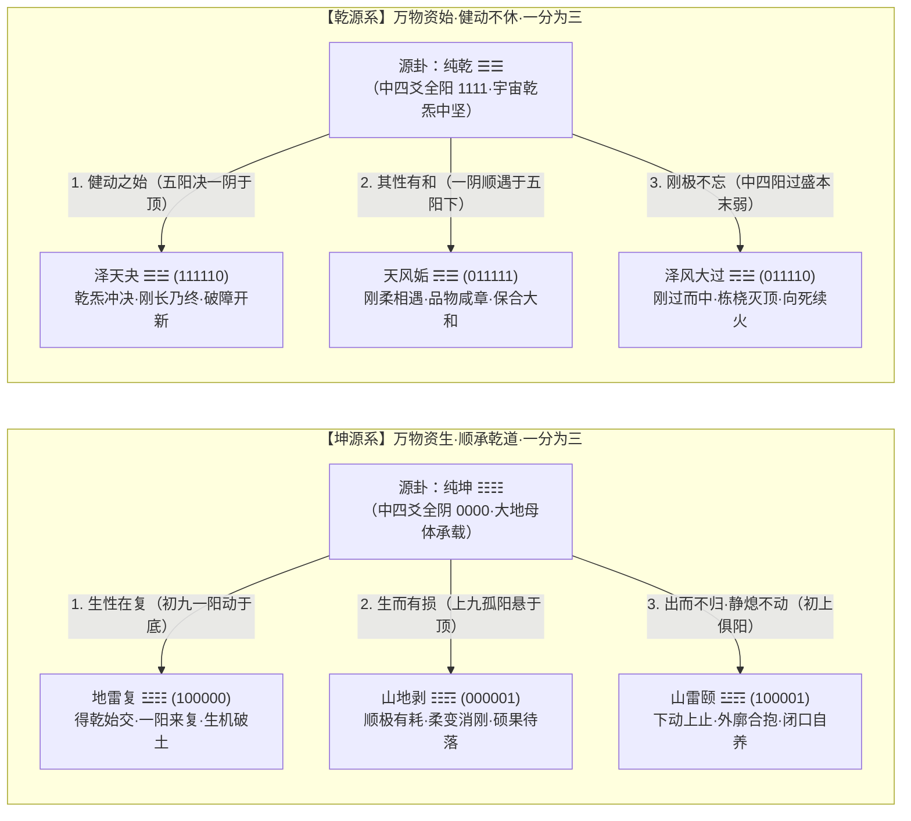

# 互卦化生论——乾坤一分为三不可逆法则与六十四卦错综互大卦全息拓扑

> **核心命题**：  
> 「易经各卦有错综互之变，剥复颐卦的互卦皆为坤，夬姤大过的互卦皆为乾，所谓互卦，在于其源卦卦化之分。互卦不可逆，坤以互卦的规则化生剥复颐三卦，在于坤之万物之生，顺承乾道的本性一分为三，生性在复，生而自然有损，所以其性化为剥，剥复之间，出而不归，静熄不动，其化为颐。乾以互卦的规则化生夬姤大过三卦，乾炁健动不休，万物之始，其性为夬；其性有和，化为姤，刚极而不忘，则去为大过。」

---

## 一、 范式革命：从「自外向内逆取互体」到「自源向外不可逆化生」

### 1.1 传统汉宋象数派「互体说」的理论盲区
自两汉京房、郑玄、虞翻创立「互体（中爻）」之说，历宋代朱震《汉上易传》至明代来知德《周易集注》，传统易学对待「互卦」的认知始终停留在**先有六十四别卦之果，再从中逆向抠取二至五爻（二三四互下卦、三四五互上卦）之因**的静态拆解层面。这一逆向析取视角存在三大根本缺陷：
1. **倒果为因**：将居于全卦腹心主干地位的二、三、四、五爻视为六画卦的附属切片，颠倒了本体基因核与边界表征之间的生成次序；
2. **抹杀方向性**：无法解释为何每四个六画卦共享同一个互卦，更无法阐明源母卦向子卦演化的能量流向与时间不可逆箭头；
3. **割裂义理与象数**：未能揭示为何《剥》《复》《颐》三卦同具坤核却性情迥异，《夬》《姤》《大过》三卦同具乾核却气象悬殊。

### 1.2 「互卦不可逆，在于其源卦卦化之分」的本体论确立
本论从唯物辩证法与系统生成论出发，彻底翻转传统互体观，确立**「互卦不可逆生成法则」**：
* **中四爻为源母之体，初上二爻为边界之用**：任意六画卦 $G = (c_1, c_2, c_3, c_4, c_5, c_6)$ 中，居中的二、三、四、五爻 $(c_2, c_3, c_4, c_5)$ 并非后天截取的片段，而是**先在的源卦母体基因核（体）**；初爻 $c_1$（事物发生之始基）与上爻 $c_6$（事物演进之终极）则是母体本性向时空上下两极延展、与外部环境交接而化生出的**功能分化形态（用）**。
* **不可逆的时间与耗散箭头**：由四画母核向外分化初、上两极（$(c_1, c_6) \in \{00, 10, 01, 11\}$），是从纯粹的潜能本体向具体历史时位的**不可逆展开**。除母核保持自身纯粹本态外，每一个源卦母核必然遵循**「一分为三」**的辩证分化规律，不可逆地化生出三个具有鲜明性情取向的子卦。

---

## 二、 坤源系之一分为三：剥、复、颐的不可逆化生机理

《坤·彖传》曰：「至哉坤元，万物资生，乃顺承天。坤厚载物，德合无疆。」如本库 [`乾坤生息论.md`](乾坤生息论.md) 所证，宇宙一点乾炁降落点燃生机，而大地与生命形体皆为坤（二至五爻纯阴 `0000`）。坤体顺承乾道以资生万物，其本性在初、上两极不可逆地一分为三：

### 2.1 生性在复（地雷复 $\text{☳☷}$ `100000`）
* **化生枢机**：坤体纯阴凝寂，不能自生；唯有顺承乾道之初炁潜入地底（初九阳爻居初，二至上五阴承载），万物资生之第一性方才发动。故**坤之生性全在于《复》**！
* **经传实证**：《复·彖传》云：「复亨，刚反，动而以顺行，是以出入无疾，朋来无咎。反复其道，七日来复，天行也。利有攸往，刚长也。复其见天地之心乎！」王夫之《周易外传》亦云：「乾始交坤而得复，人之位也。天地之生，以人为始……人者，天地之心也。」在万木霜天、群阴肃杀之底，初九一阳破土欲出，正是坤承乾炁、生生不息之本心。

### 2.2 生而自然有损，其性化为剥（山地剥 $\text{☷☶}$ `000001`）
* **化生枢机**：任何物质与生命的生长，绝非凭空永动，**有生则必有物质与能量的耗损**。当坤体顺承生机将阳气一路推升至极顶（上九孤阳悬于五阴之上），底层与中层的阴质地基便因持续供养输出而自然亏空、剥落。因此，**「生而自然有损，所以其性化为剥」**！
* **经传实证**：《剥·彖传》云：「剥，剥也，柔变刚也……顺而止之，观象也。君子尚消息盈虚，天行也。」《剥·大象传》云：「山附于地，剥；上以厚下，安宅。」正因为生长必然伴随下层基础的折损消耗，故统治者与系统中枢必须逆转单向抽血，主动以「厚下安宅」反哺基层，并在上九结出「硕果不食」之生命火种，等待新一轮来复。

### 2.3 剥复之间，出而不归，静熄不动，其化为颐（山雷颐 $\text{☳☶}$ `100001`）
* **化生枢机**：在《复》之初阳既出而未升、《剥》之上阳已极而未归的临界张力之间，初九与上九两画刚爻同时封锁了坤体（中四阴 `0000`）的上下出入边界——下震欲动而受制于上艮之止，阳气出而不归，内部纯坤静熄不动，外刚如齿唇匡廓、内虚如口腔腹笥，遂不可逆地化生为**《颐》（山雷颐）**！
* **经传实证**：《颐·彖传》云：「颐贞吉，养正则吉也。观颐，观其所养也；自求口实，观其自养也。」《颐·大象传》云：「山下有雷，颐；君子以慎言语，节饮食。」当系统处于「出而不归、静熄不动」的闭锁态时，一切盲目外求（如初九「舍尔灵龟，观我朵颐，凶」、六二「征凶」）皆招灾祸；唯有收敛外驰、慎言语节饮食，以内坤之静自求口实、涵养元气，方得「养正则吉」。

---

## 三、 乾源系之一分为三：夬、姤、大过的不可逆化生机理

《乾·彖传》曰：「大哉乾元，万物资始，乃统天……乾道变化，各正性命，保合大和，乃利贞。」《乾·大象传》曰：「天行健，君子以自强不息。」纯乾母体（二至五爻纯阳 `1111`）作为宇宙纯粹的刚健动能核，在向外化生万物时，其本性同样在初、上两极一分为三：

### 3.1 乾炁健动不休，万物之始，其性为夬（泽天夬 $\text{☰☱}$ `111110`）
* **化生枢机**：乾为万物资始之纯阳原动力，其第一本性便是刚健推进、势如破竹、永不停休。当五阳自下而上沛然充盈，直逼顶上最后一丝阴翳（上六）而将其一举冲决，如春雷破冰、江河决口，开辟新局之始，故**乾之健动本性化为《夬》（决也）**！
* **经传实证**：《夬·彖传》云：「夬，决也，刚决柔也。健而说，决而和……利有攸往，刚长乃终也。」《夬·大象传》云：「泽上于天，夬；君子以施禄及下，居德则忌。」乾炁健动不休，最忌屯积居德，唯有决破藩篱、施禄及下，方合万物资始之天道。

### 3.2 其性有和，化为姤（天风姤 $\text{☴☰}$ `011111`）
* **化生枢机**：孤阳不生，独阴不长。乾道若只有刚猛冲决而无柔和包涵，则天地亢烈、万物无从凝结成形。故《乾·彖传》特揭「保合大和，乃利贞」。当充沛五阳于极盛之时主动向下兼容，在始基之处与初生之一阴（初六）温柔交会，刚柔相济、阴阳和合，故**乾之和性化为《姤》（遇也）**！
* **经传实证**：《姤·彖传》高度赞叹曰：「姤，遇也，柔遇刚也……天地相遇，品物咸章也。刚遇中正，天下大行也。姤之时义大矣哉！」正是这一阳五刚与初六一柔的「天地相遇」，才使无形之乾炁化为有形之「品物咸章」。

### 3.3 刚极而不忘，则去为大过（泽风大过 $\text{☴☱}$ `011110`）
* **化生枢机**：当乾核（中四爻纯阳 `1111`）刚健凝聚至于极点，而其首尾两端（初六、上六）皆已化阴衰竭（「本末弱也」），客观形势已如洪泛灭木、大厦栋桡；然其腹心深处的乾阳精神依然刚烈执着、念念不忘（「刚极而不忘」），绝不肯随波逐流、苟且偷生，遂毅然行非常大过之举，故**乾之刚极不屈化为《大过》**！
* **经传实证**：《大过·彖传》云：「大过，大者过也。栋桡，本末弱也。刚过而中，巽而说行，利有攸往，乃亨。」《大过·大象传》云：「泽灭木，大过；君子以独立不惧，遁世无闷。」直至上六「过涉灭顶，凶，无咎」，正是「刚极而不忘」之君子在灭顶绝境中向死续火、杀身成仁的最高精神图腾！

---

## 四、 乾坤两系「一分为三」的拓扑对称律与变爻自洽闭环

将坤源系（`0000` 核）与乾源系（`1111` 核）的一分为三结构并列对勘，并通过 `zhouyi.json` 的物理工单检验其初爻、上爻之变，可以发现严丝合缝的数理群论闭环：

| 演化维度 | 【坤源系】互坤（`0000`）· 万物资生 | 【乾源系】互乾（`1111`）· 万物资始 | 错综对称与辩证法则 |
| :--- | :--- | :--- | :--- |
| **源卦母核** | **02 坤（$\text{☷☷}$ `000000`）** 至哉坤元，万物资生，顺承乾道 | **01 乾（$\text{☰☰}$ `111111`）** 大哉乾元，万物资始，健动不休 | **乾坤互错**： 乾炁为生机火种，坤土为形质载体 |
| **第一态：正向发动** （本性之彰显） | **24 复（$\text{☳☷}$ `100000`）** **「生性在复」**：一阳潜入坤底，生机始萌，七日来复 | **43 夬（$\text{☰☱}$ `111110`）** **「健动为夬」**：五阳决去顶阴，刚长乃终，施禄及下 | • **复（`100000`）与姤（`011111`）互错**； • **剥（`000001`）与夬（`111110`）互错**； • 复与夬皆主「利有攸往，刚长也」。 |
| **第二态：伴生转化** （对立面之相生） | **23 剥（$\text{☷☶}$ `000001`）** **「生而有损为剥」**：生机外耗于顶，下基亏空，厚下安宅 | **44 姤（$\text{☴☰}$ `011111`）** **「其性有和为姤」**：五阳下遇初阴，保合大和，品物咸章 | • 坤主生而必伴生耗损（剥）；乾主刚而必伴生柔和（姤）。 • **复与剥互综，夬与姤互综**。 |
| **第三态：极界锁合** （两极张力之凝定） | **27 颐（$\text{☳☶}$ `100001`）** **「出而不归、静熄不动为颐」**： 二阳外锁四阴，慎言语节饮食，自求口实 | **28 大过（$\text{☴☱}$ `011110`）** **「刚极而不忘为大过」**： 二阴外包四阳，本末弱而中刚不屈，独立不惧 | **颐（`100001`）与大过（`011110`）互错且各自自综**： • 颐代表「敬畏边界、休养自存」（法则一）； • 大过代表「绝境抗争、向死续火」（法则二）。 |
| **初、上变爻铁证闭环** | • 《复·初九》$\leftrightarrow$《坤·初六》；《剥·上九》$\leftrightarrow$《坤·上六》 • 《复·上六》$\leftrightarrow$《颐·上九》；《剥·初六》$\leftrightarrow$《颐·初九》 | • 《姤·初六》$\leftrightarrow$《乾·初九》；《夬·上六》$\leftrightarrow$《乾·上九》 • 《姤·上九》$\leftrightarrow$《大过·上六》；《夬·初九》$\leftrightarrow$《大过·初六》 | **边界爻变群封闭定理**： 同一源核化生出的四卦，其初爻变与上爻变必然在同一簇内构成 4-Cycle 闭合环路！ |

---

## 五、 六十四卦【错·综·互】与「大卦」连接的三阶有向超图全解

将「互卦不可逆生成论」推广至全书 64 卦，可以对整部《周易》的卦象拓扑连接作出严密的数学与哲学重构：

### 5.1 「4 终极源母 $\to$ 16 一阶互核 $\to$ 64 别卦」的三级不可逆架构
1. **Tier 0（4 大终极源母卦）**：由六画卦最核心的三、四两爻 $(c_3, c_4) \in \{00, 11, 10, 01\}$ 决定，全经一切互卦向源头追溯最多两步，必然收敛于 4 个终极源母：
   * **不动点自洽源母（2 卦）**：**【01 乾 `111111`】** 与 **【02 坤 `000000`】**（纯阳与纯阴之极，互卦恒为自身）；
   * **二周期振荡源母（2 卦）**：**【63 既济 `101010`】** 与 **【64 未济 `010101`】**（水火交错，既济之互为未济，未济之互为既济，构成动态循环核心）。
2. **Tier 1（16 个一阶互核大卦）**：由 4 大终极源母各自遵循「一分为四（含自守一态与分化三态）」规则，向外扩展二、五两爻，不可逆地生成 **16 个一阶互核卦**：
   * **坤母化生（4 核）**：`02 坤`、`24 复`、`23 剥`、`27 颐`；
   * **乾母化生（4 核）**：`01 乾`、`43 夬`、`44 姤`、`28 大过`；
   * **未济核（中四爻 `1010`）化生（4 核）**：`39 蹇`、`63 既济`、`53 渐`、`37 家人`；
   * **既济核（中四爻 `0101`）化生（4 核）**：`40 解`、`54 归妹`、`64 未济`、`38 睽`。
3. **Tier 2（64 别卦全集）**：16 个一阶互核大卦各自将自身的二至五爻作为母体基因核，进一步向初爻、上爻两极「一分为四」，精准无遗漏地化生出 $16 \times 4 = 64$ 卦！

### 5.2 「错·综」与「互卦化生」的严格群同态交换律
在 64 卦空间 $\mathbb{Z}_2^6$ 中，错变算子 $\text{Cuo}$（按位取反）、综变算子 $\text{Zong}$（逆序翻转）与互卦算子 $\text{Hu}$ 满足严格交换律：
$$\text{Hu}(\text{Cuo}(G)) = \text{Cuo}(\text{Hu}(G)), \qquad \text{Hu}(\text{Zong}(G)) = \text{Zong}(\text{Hu}(G))$$
* **源错则流必错**：因为源母乾与坤互错、既济与未济互错，所以乾系 16 卦与坤系 16 卦一一互错，既济系 16 卦与未济系 16 卦一一互错。
* **源综则流必综**：在同一母核内部，边界为 `[初1, 上0]` 与 `[初0, 上1]` 的子卦（若母核自综）必然互综；若两个一阶互核本身互综（如 **24 复** 与 **23 剥** 互综，**43 夬** 与 **44 姤** 互综），则它们各自化生出的四个子卦也必然成对互综（如复核化生的【师、临、蒙、损】与剥核化生的【比、观、屯、益】一一互综）！

### 5.3 两大类「大卦（大象八卦）」在不可逆化生网中的自然涌现
历代象数易学高度重视的「大卦（以六画卦呈现三画八卦之宏大法象）」，在不可逆互卦网络中并非人为拼凑，而是乾、坤两系一阶与二阶化生的**必然拓扑产物**：
1. **一阶单爻极变大卦（8 卦）**：即乾、坤母体第一级化生的 8 卦——**乾（大乾 $\text{☰}$）、坤（大坤 $\text{☷}$）、复（一阳动于五阴下·大震 $\text{☳}$）、剥（一阳止于五阴上·大艮 $\text{☶}$）、颐（外阳内阴中虚·大离 $\text{☲}$）、夬（一阴悦于五阳上·大兑 $\text{☱}$）、姤（一阴入于五阳下·大巽 $\text{☴}$）、大过（外阴内阳中实·大坎 $\text{☵}$）**。
2. **二阶双爻倍画大卦（8 卦）**：当上述一阶大卦继续向外化生，且初爻与二爻同性（$c_1=c_2$）、上爻与五爻同性（$c_6=c_5$）时，精准涌现出全经仅有的 **8 个双爻大八卦**（以及纯坎、纯离）：
   * `24 复 (100000)` $\xrightarrow{\text{初上}[1,0]}$ **`19 临 (110000)`（双爻大震 $\text{☳}$）**；
   * `23 剥 (000001)` $\xrightarrow{\text{初上}[0,1]}$ **`20 观 (000011)`（双爻大艮 $\text{☶}$）**；
   * `27 颐 (100001)` $\xrightarrow{\text{初上}[1,1]}$ **`61 中孚 (110011)`（双爻大离 $\text{☲}$）**，且 $\xrightarrow{\text{初上}[0,0]}$ **`29 坎 (010010)`（习坎纯水 $\text{☵☵}$）**；
   * `43 夬 (111110)` $\xrightarrow{\text{初上}[1,0]}$ **`34 大壮 (111100)`（双爻大兑 $\text{☱}$）**；
   * `44 姤 (011111)` $\xrightarrow{\text{初上}[0,1]}$ **`33 遁 (001111)`（双爻大巽 $\text{☴}$）**；
   * `28 大过 (011110)` $\xrightarrow{\text{初上}[0,0]}$ **`62 小过 (001100)`（双爻大坎 $\text{☵}$）**，且 $\xrightarrow{\text{初上}[1,1]}$ **`30 离 (101101)`（重明纯火 $\text{☲☲}$）**。

### 5.4 全经 64 卦不可逆化生与错综大卦总表

| 终极源母 (Tier 0) | 一阶互核大卦 (Tier 1，共16核) | 错 / 综 | 二阶不可逆化生四态（按边界 `[初爻, 上爻]` = `00 / 10 / 01 / 11` 排列） | 核心大卦与变爻闭环特征 |
| :--- | :--- | :--- | :--- | :--- |
| **【坤源系】** **02 坤** `000000` | **02 坤** `000000` *(二至五爻 `0000`)* | 错:01乾 综:02坤 | • `[0,0]` **02 坤** (`000000`) • `[1,0]` **24 复** (`100000`) • `[0,1]` **23 剥** (`000001`) • `[1,1]` **27 颐** (`100001`) | **坤母一分为三核心簇**： 生性在**复**，生而有损为**剥**，出而不归静熄为**颐**。初上变爻构成四卦闭环。 |
| ↳ 坤系一阶分化 | **24 复** `100000` *(承二至五爻 `1000`)* | 错:44姤 综:23剥 | • `[0,0]` **07 师** (`010000`) • `[1,0]` **19 临** (`110000`) ★*双爻大震* • `[0,1]` **04 蒙** (`010001`) • `[1,1]` **41 损** (`110001`) | **复核化生簇**： 由复之初阳进升至二爻（`1000`），化生出**师、临（大震）、蒙、损**四卦。 |
| ↳ 坤系一阶分化 | **23 剥** `000001` *(承二至五爻 `0001`)* | 错:43夬 综:24复 | • `[0,0]` **08 比** (`000010`) • `[1,0]` **03 屯** (`100010`) • `[0,1]` **20 观** (`000011`) ★*双爻大艮* • `[1,1]` **42 益** (`100011`) | **剥核化生簇**： 由剥之上阳内缩至五爻（`0001`），化生出**比、屯、观（大艮）、益**四卦（与复核四卦严格互综）。 |
| ↳ 坤系一阶分化 | **27 颐** `100001` *(承二至五爻 `1001`)* | 错:28大过 综:27颐 | • `[0,0]` **29 坎** (`010010`) ★*重险习坎* • `[1,0]` **60 节** (`110010`) • `[0,1]` **59 涣** (`010011`) • `[1,1]` **61 中孚** (`110011`) ★*双爻大离* | **颐核化生簇**： 由颐之上下二阳内敛至二、五爻（`1001`），化生出**坎（纯水）、节、涣、中孚（大离）**四卦。 |
| **【乾源系】** **01 乾** `111111` | **01 乾** `111111` *(二至五爻 `1111`)* | 错:02坤 综:01乾 | • `[0,0]` **28 大过** (`011110`) • `[1,0]` **43 夬** (`111110`) • `[0,1]` **44 姤** (`011111`) • `[1,1]` **01 乾** (`111111`) | **乾父一分为三核心簇**： 健动之始为**夬**，其性有和为**姤**，刚极不忘为**大过**。与坤核心簇严格互错。 |
| ↳ 乾系一阶分化 | **43 夬** `111110` *(承二至五爻 `1110`)* | 错:23剥 综:44姤 | • `[0,0]` **32 恒** (`011100`) • `[1,0]` **34 大壮** (`111100`) ★*双爻大兑* • `[0,1]` **50 鼎** (`011101`) • `[1,1]` **14 大有** (`111101`) | **夬核化生簇**： 化生出**恒、大壮（大兑）、鼎、大有**四卦（与剥核四卦一一互错）。 |
| ↳ 乾系一阶分化 | **44 姤** `011111` *(承二至五爻 `0111`)* | 错:24复 综:43夬 | • `[0,0]` **31 咸** (`001110`) • `[1,0]` **49 革** (`101110`) • `[0,1]` **33 遁** (`001111`) ★*双爻大巽* • `[1,1]` **13 同人** (`101111`) | **姤核化生簇**： 化生出**咸、革、遁（大巽）、同人**四卦（与复核四卦一一互错，与夬核四卦互综）。 |
| ↳ 乾系一阶分化 | **28 大过** `011110` *(承二至五爻 `0110`)* | 错:27颐 综:28大过 | • `[0,0]` **62 小过** (`001100`) ★*双爻大坎* • `[1,0]` **55 丰** (`101100`) • `[0,1]` **56 旅** (`001101`) • `[1,1]` **30 离** (`101101`) ★*重明纯离* | **大过核化生簇**： 化生出**小过（大坎）、丰、旅、离（纯火）**四卦（与颐核四卦一一互错）。 |
| **【既济源系】** **63 既济** `101010` | **64 未济** `010101` *(二至五爻 `1010`)* | 错:63既济 综:63既济 | • `[0,0]` **39 蹇** (`001010`) • `[1,0]` **63 既济** (`101010`) • `[0,1]` **53 渐** (`001011`) • `[1,1]` **37 家人** (`101011`) | **水火交泰一阶核心簇**： 未济核（`1010`）不可逆化生出**蹇、既济、渐、家人**四大交互母核。 |
| ↳ 既济系分化 | **38 睽** `110101` *(承二至五爻 `1101`)* | 错:39蹇 综:37家人 | • `[0,0]` **48 井** (`011010`) • `[1,0]` **05 需** (`111010`) • `[0,1]` **57 巽** (`011011`) • `[1,1]` **09 小畜** (`111011`) | **睽核化生簇**： 化生**井、需、巽、小畜**四卦。 |
| ↳ 既济系分化 | **40 解** `010100` *(承二至五爻 `0100`)* | 错:37家人 综:39蹇 | • `[0,0]` **15 谦** (`001000`) • `[1,0]` **36 明夷** (`101000`) • `[0,1]` **52 艮** (`001001`) • `[1,1]` **22 贲** (`101001`) | **解核化生簇**： 化生**谦、明夷、艮、贲**四卦。 |
| ↳ 既济系分化 | **54 归妹** `110100` *(承二至五爻 `1100`)* | 错:53渐 综:53渐 | • `[0,0]` **46 升** (`011000`) • `[1,0]` **11 泰** (`111000`) • `[0,1]` **18 蛊** (`011001`) • `[1,1]` **26 大畜** (`111001`) | **归妹核化生簇**： 化生**升、泰、蛊、大畜**四卦（地天泰居于此簇）。 |
| **【未济源系】** **64 未济** `010101` | **63 既济** `101010` *(二至五爻 `0101`)* | 错:64未济 综:64未济 | • `[0,0]` **40 解** (`010100`) • `[1,0]` **54 归妹** (`110100`) • `[0,1]` **64 未济** (`010101`) • `[1,1]` **38 睽** (`110101`) | **火水生生一阶核心簇**： 既济核（`0101`）不可逆化生出**解、归妹、未济、睽**四大交互母核。 |
| ↳ 未济系分化 | **37 家人** `101011` *(承二至五爻 `0111`→`0101`)* | 错:40解 综:38睽 | • `[0,0]` **47 困** (`010110`) • `[1,0]` **58 兑** (`110110`) • `[0,1]` **06 讼** (`010111`) • `[1,1]` **10 履** (`110111`) | **家人核化生簇**： 化生**困、兑、讼、履**四卦（与解核四卦一一互错，与睽核四卦一一互综）。 |
| ↳ 未济系分化 | **39 蹇** `001010` *(承二至五爻 `0010`)* | 错:38睽 综:40解 | • `[0,0]` **16 豫** (`000100`) • `[1,0]` **51 震** (`100100`) • `[0,1]` **35 晋** (`000101`) • `[1,1]` **21 噬嗑** (`100101`) | **蹇核化生簇**： 化生**豫、震、晋、噬嗑**四卦（与睽核四卦一一互错，与解核四卦一一互综）。 |
| ↳ 未济系分化 | **53 渐** `001011` *(承二至五爻 `0011`)* | 错:54归妹 综:54归妹 | • `[0,0]` **45 萃** (`000110`) • `[1,0]` **17 随** (`100110`) • `[0,1]` **12 否** (`000111`) • `[1,1]` **25 无妄** (`100111`) | **渐核化生簇**： 化生**萃、随、否、无妄**四卦（天地否居于此簇，与归妹核四卦既互错又互综）。 |

---

© 2026 徐时言 · 《互卦化生论——乾坤一分为三不可逆法则与六十四卦错综互大卦全息拓扑》 · 徐时言-易经研究 · 采用 CC BY-NC-ND 4.0 许可， 转载请署名并注明来源 https://wole278.github.io/xushiyan-YiJing/ · 禁止商业使用与改编传播 · 商业授权：wole278@hotmail.com / 微信 wole278
