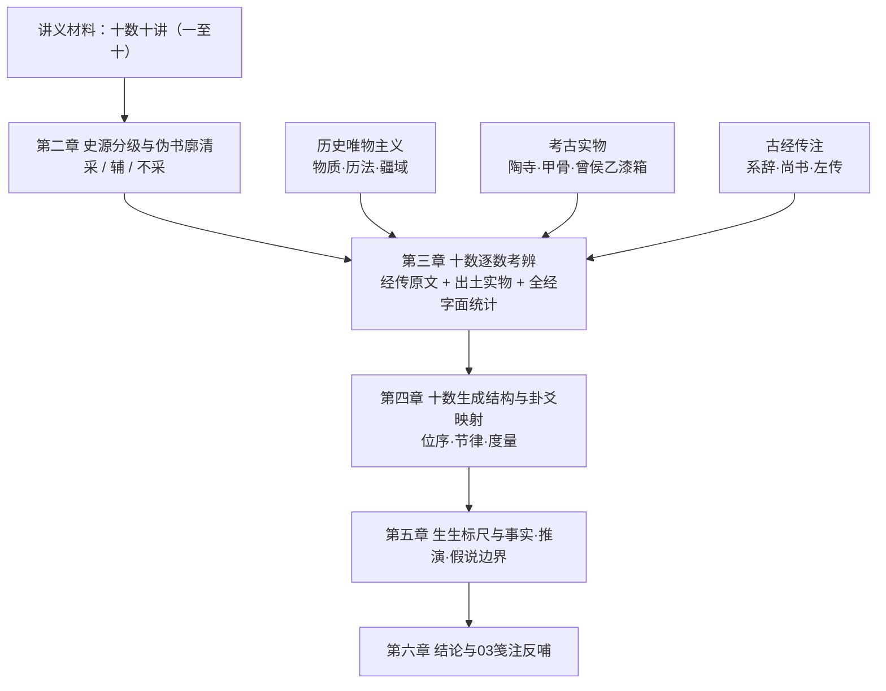

# 十数概论——《易》学“一至十”十数源流的本体论与四重证据通考

> **创建与修订日期**：2026-11-04  
> **模块归属与编号**：02 元研究 ｜ 编号：1-M09（待用户确权）  
> **价值基准评级**：🟡 **待用户终审（建议 1 级，核心依赖因子 0.4；在用户裁定前按 2 级 0.3 暂定适用）**。依据《学术研究论文撰写格式与期刊级模板规范》，新撰论文严禁擅自标为 1 级。  
> **前置理论与公理基石**：[`说一论`](说一论.md)（1-M01，一、阴阳、两仪四象八卦之“依准”论）、[`说恒`](说恒.md)（1-M02）、[`三易归源论`](三易归源论.md)（1-M03）、[`乾坤生息论`](乾坤生息论.md)（1-M07）、[`互卦化生论`](互卦化生论.md)（1-M08）、[`易经文物注`](易经文物注.md)（1-M06）、[`1-C06 元亨利贞通考`](../05%20词义研究记录/06_周易中元亨利贞的词义通考与系统演进哲学研究.md)；时位参数依 `384爻断辞回测报告`。  
> **四重证据配置与强度分层**：①传世文献——今文《尚书》《周易》经传、《诗》《礼记》《左传》《国语》《老子》《庄子》《孟子》《大戴礼记》及《史记》《汉书》（**强**，全部经 `verify.cmd` 核验）；②出土古文字与简帛——殷墟甲骨数字与干支、商周数字卦、豳公盨、阜阳汉简太乙九宫占盘等（**中**，据已刊论著转述，待用户提供原始著录复核）；③民族学与人类学旁证——岁时观象与十进位计数（**弱～中**）；④考古实物——陶寺观象台遗址、曾侯乙墓漆箱二十八宿盖（**中**）。  
> **与既有高级别成果关系声明**：本文**承续深化** 1-M01《说一论》“两仪者阴阳，四象者时空，八卦者万物性象变化”的生成序列，将其向下展开为“一至十”的完整数序；凡与《说一论》字面表述存在差异之处（如“阴阳之先未有记录”），已在 5.3 列表说明，**不擅改**原 1 级文档。

---

## 摘要

**问题意识**：《周易》自《系辞》“天一地二……天九地十”以降，数的问题长期被混置于河图洛书、命理术数与玄学图谶之中：既有的“十数”叙述多以图式（河图、先天后天八卦、九宫表）为起点，而以经传与实物为终点或根本不予回溯，出现“图在前、典在后”的倒置。**方法**：本文以“历史唯物主义 + 考古实物 + 古经传注”三维交叉融合为框架，以“四重证据法”为准绳，对徐欢《易学大观》讲义所列“一、二、三、四、五、六、七、八、九、十”十个数字的经传依据逐一回溯，并以 `zhouyi.json` 底本对经文字面作穷尽统计。**发现**：（1）通行本卦爻辞中“阴阳”不对举，“阴”仅见《中孚·九二》“鸣鹤在阴”，指荫蔽之处，“阳”“刚”“柔”不见于经文，阴阳成为范畴已在传文与西周以来的天地之气观念中；（2）五行在先秦文献中首先是“五材”（生产生活物质），《大象》只取木、火、水而不取金、土，经文之“金”皆为金属器物，相生相克的体系化晚出；（3）十数的**位序**（一至十）与**功能**（太极—两仪—三才—四时—五材—六位—七政—八卦—九州—十干）可以建立由“依准”到“节律”的单向生成结构，且其中“一—二—三—四—六—八”对应《说一论》既有序列，“五—七—九—十”提供了物质、星历、疆域与历日的支撑层；（4）讲义所引河图“生成数配五行”“上清河图内玄经”“奇门九宫表”“命理旺相休囚死”等属汉以后术数或道教文献，**不入典论位**。**结论**：十数是《周易》“推天道以明人事”的**度量框架**，不是玄学符码；其对 384 爻的意义在于“位”（初二三四五上）与“时”（四时七日八月），而非占验。

**关键词**：《周易》；十数；河图；四象四时；五材；七政；九州；干支；四重证据法

---

## 一、 引言：问题意识与学术史文献综述

### 1.1 问题的提出：十数叙述的三个死结
1. **图先于典**：河图、洛书、先天后天八卦诸图式在传世文献中最早只见“河出图，洛出书，圣人则之”（《系辞上》）与“凤鸟不至，河不出图，吾已矣夫”（《论语·子罕》），**均无图形与数字**；今见“一六居北、二七居南”等十数图式，属后世（宋代）图书学定型，不应倒推为《周易》本源。
2. **数与物脱节**：把“天一生水”等生成配属当作先在本体，而回避其所对应的**生产生活物质（五材）**与**星历观测（四时七政）**，使数字失去唯物基础。
3. **术数与易理混糅**：九宫、奇门、命理“旺相休囚死”等，混入易学基础叙述，造成“以术掩理”。本文严格依《标准 v3.5》白名单与黑名单划界。

### 1.2 学术史梳理：古今四代名家谱系与得失

| 代际 | 代表 | 对“数”的主要贡献（得） | 历史局限（失） |
| :--- | :--- | :--- | :--- |
| 两汉经学与象数派 | 京房、郑玄、荀爽、虞翻（见李鼎祚《周易集解》） | 建立天地之数、大衍、生成数配五行、卦气纳甲，使数字系统化 | 引入纬书与阴阳灾异，数与占验混同；生成数配五行的汉代注文与经文本义有距离 |
| 魏晋玄学与唐代官疏 | 王弼、孔颖达 | 以“明象”“得意”剥离象数繁碎，《周易正义》保存大量天地之数、八卦方位旧说 | 重义理而略历法与实物 |
| 宋明理学、图书学与清初气学 | 刘牧、邵雍、朱熹、来知德、王夫之 | 河洛图式、先天后天图、加一倍法使“数”可视化与形式化 | 图式被神化为伏羲原本；以图说经，倒置文献次序 |
| 近现代古文字学、新史学与考古学 | 王国维、张政烺、李学勤、冯时等 | 数字卦（筮数）释读，使“数”回到商周筮占实物；出土星历实物证古历 | 部分星象与图像的解读（如具体遗迹是否为北斗）仍有争议 |

### 1.3 研究思路、三维交叉融合框架与逻辑架构

---

## 二、 四重证据史源锚定、伪书廓清与物质基础还原

### 2.1 讲义材料三层分级（采 / 辅 / 不采）

| 层级 | 讲义所引材料 | 处置 | 理由 |
| :--- | :--- | :--- | :--- |
| **采（白名单与信史，已核验）** | 《周易》经传；今文《尚书》（尧典、甘誓、洪范、禹贡）；《老子》；《诗》；《礼记》；《左传》；《国语》；《庄子》；《孟子》；《史记》《汉书》 | 直入第一重证据 | 《标准 v3.5》白名单与信史 |
| **辅（非白名单、非黑名单，仅作线索，不入典论位）** | 《黄帝内经》九宫八风；《白虎通》五行；《山海经》洪水息壤；《尚书大传》 | 仅作“汉代知识形态”旁证，须标明 | 成书层累；《尚书大传》“天一生水”条经 `verify` 为【未见】（四库本该处文字夹于注文，疑为郑玄注，须以原本复核后方可定性） |
| **不采** | 《上清河图内玄经》北斗观星法要；奇门九宫神煞表；“命理学旺相休囚死”；道藏“精神魂魄”配三才；“天有五贼”类阴符术语的术数引申 | 不入证据链 | 道教符箓善书与术数，依标准属黑名单类或证据层级过弱 |

> [!NOTE]
> 讲义所配图像（太极图、星图、河图、先天后天八卦图、九宫图）仅作**示意图**使用；本文不以任何图式为立论依据。

### 2.2 四重证据交叉实证矩阵（按数）

| 数 | 第一重（传世文献） | 第二重（出土文字） | 第三重（民族学） | 第四重（实物） | 强度 |
| :---: | :--- | :--- | :--- | :--- | :---: |
| 一 | 《老子》四十二章；《系辞》太极 | 殷墟甲骨记数一至十 | — | — | 强 |
| 二 | 《系辞》两仪；《诗·公刘》“相其阴阳” | 殷墟甲骨无哲学义阴阳对举（待核） | — | — | 中 |
| 三 | 《说卦》三才；《汉书·律历志》三统 | — | — | — | 强 |
| 四 | 《尧典》四仲中星；《系辞》四象 | 殷墟四方风名甲骨（合集 14294，待核） | 四方、四季物候 | 陶寺观象台（约前 2100 年，待核） | 中～强 |
| 五 | 《洪范》五行；《左传》五材；《国语》以土与金木水火杂 | — | — | — | 强 |
| 六 | 《系辞》六爻；《庄子》六合 | 商周数字卦六位 | — | — | 强 |
| 七 | 《舜典》七政；《复》七日来复；《诗》七月流火 | 数字卦“七” | 岁时观象 | — | 中 |
| 八 | 《说卦》八卦；《左传》八风 | 马王堆帛书《周易》八经卦（待核） | — | 曾侯乙漆箱二十八宿盖（前 433 年，待核） | 中 |
| 九 | 《禹贡》九州；《大戴礼记·明堂》二九四七五三六一八 | 豳公盨（西周中期，待核）；阜阳汉简太乙九宫占盘（西汉初，待核） | — | — | 中 |
| 十 | 《左传》“日之数十，故有十时” | 殷墟干支表刻辞、十进位记数 | 十进位计数的人类学普遍性 | — | 强 |

---

## 三、 十数逐数考辨（核心正文）

### 3.0 总纲：十数的两种序列与两个“一”

1. **数序**：一至十，是**计数**序列。殷墟甲骨已使用十进位记数，“一、二、三……十”为基本系统（强）。
2. **生成序**：太极（一）→ 两仪（二）→ 三才（三）→ 四时（四）→ 五材（五）→ 六位（六）→ 七政（七）→ 八卦（八）→ 九州（九）→ 十干（十）。这是**本文依据经传依次可证的度量层级**，非“先天本体生成顺序”的断言（见 5.2）。
3. **“两个一”**：讲义所称“中国文化源头的两个一”，一为“道化太极”（《老子》“道生一，一生二，二生三，三生万物”，“天得一以清，地得一以宁，神得一以灵，谷得一以盈”），一为“斗建时空”（《尧典》“在璇玑玉衡，以齐七政”，《史记·天官书》“北斗七星，所谓旋、玑、玉衡以齐七政”）。对此，本文依《说一论》“凡能说者必有依准”进行区分：**太极之一是不可说的本体，北斗之一是可观测的依准**；前者无形无质，后者有象有时。二者不可混同。

### 3.1 一：太极之一与依准之一
- **经传**：《系辞上》“易有太极，是生两仪，两仪生四象，四象生八卦”；《老子》“道生一……”。
- **辨析**：《说一论》已论定“太极、道皆为名，一为实”。本文补充一点：**“一”在记数上是最小单位，在本体上是不可再分者**，二义同形而异层，传统易学常混用。
- **辩证定位**：矛盾的统一体（一）先于矛盾的分化（二）。

### 3.2 二：阴阳两仪
- **经传**：《系辞上》“一阴一阳之谓道”“生生之谓易”；《诗·大雅·公刘》“相其阴阳，观其流泉”（阴阳指山之向背，地理义）；西周末伯阳父论地震“阳伏而不能出，阴迫而不能蒸”（《国语·周语上》，核验为【仅见转引】，**弱**，待原典页复核）。
- **全经统计**：据 `zhouyi.json`，卦爻辞中“阴”仅 1 见（《中孚·九二》“鸣鹤在阴”，指荫蔽处），“阳”“刚”“柔”不见。**阴阳哲学范畴见于传文，不见于经文**（强）。
- **辨析**：这与《说一论》“阴阳之先，未有记录”并不矛盾，且可作补充：**阴阳最早是地理与气象的方位感知（向背、荫蔽、升降之气），再抽象为二元范畴**，其唯物起点清晰。
- **辩证定位**：对立统一规律的最小表达；“‘一’不可说，‘二’方可论”，是因为“二”才有依准可比较。

### 3.3 三：三才
- **经传**：《说卦》“立天之道曰阴与阳，立地之道曰柔与刚，立人之道曰仁与义”“兼三才而两之，故六”；《系辞下》“六爻之动，三极之道也”；《汉书·律历志》“三统者，天施，地化，人事之纪也”。
- **全经统计**：卦爻辞中“三”字出现 23 次（含三年、三日、三锡等），为经文中出现最频繁的数字，显示“三”是经文的基本结构数（强，字面统计）。
- **辨析**：讲义“三圣成易”（伏羲、文王、孔子）属传说叙事，作为“人更三世”的历史框架可参考，但**不作为经文生成的史实**，且三圣之说需单独考辨。
- **辩证定位**：天（时）、地（空）、人（实践主体）的三层结构，是矛盾论中“外因—条件—内因”的形式化。

### 3.4 四：四象四时
- **经传**：《尧典》“乃命羲和，钦若昊天，历象日月星辰，敬授民时”（讲义转录作“人时”，今据今文底本订为“民时”，核验：原句偏差仅此一字）；“期三百有六旬有六日，以闰月定四时成岁”；《系辞上》“易有四象，所以示也”“法象莫大乎天地，变通莫大乎四时，悬象著明莫大乎日月”；《礼记·曲礼上》“前朱鸟而后玄武，左青龙而右白虎”。
- **出土与实物**（据已刊论著，待复核）：殷墟甲骨有四方与四方风之名；山西襄汾陶寺遗址出土大型观象台基址；曾侯乙墓漆箱盖绘二十八宿与青龙白虎。濮阳西水坡蚌塑与北斗的关联，为**假说，强度弱**。
- **辨析**：《尧典》已把“四时”落实为“观象授时”的实践，与《说一论》“四象者时空”一致。“四象”有二义：一为节气时序（春夏秋冬），一为星象（四宫）。**《系辞》自身以“所以示也”点明四象为易所示之象**，未直接给出四象为何，不宜以后世“老阳少阴”之说定读。
- **辩证定位**：时间的度量是一切“时位”研判的底座，对应 384 爻“时位是主要矛盾（$\eta^2=0.131$）”的实证。

### 3.5 五：五材与“五行”
- **经传**：《洪范》“五行：一曰水，二曰火，三曰木，四曰金，五曰土。水曰润下，火曰炎上，木曰曲直，金曰从革，土爰稼穑”；《甘誓》“有扈氏威侮五行，怠弃三正”；《左传》“天生五材，民并用之，废一不可”；《国语·郑语》“先王以土与金、木、水、火杂，以成百物”。
- **关键事实**：（1）《洪范》五行的**排序水—火—木—金—土，恰与十数中的生数一至五对应**，这一对应出自文本本身，不依赖河图（强）；（2）五行在《左传》《国语》中的主语是**材料**（五材），指向冶金、农耕、烹饪等生产资料，而非相生相克的宇宙图式（强）；（3）据 `zhouyi.json`，《大象传》涉“木”者 5 卦（大过、升、井、鼎、渐），涉“火”者 10 卦，涉“水”者 11 卦，**“金”“土”二字不见于《大象》**；卦爻辞“金”字出现在蒙、噬嗑、姤、困、鼎，均为金属器物（金夫、金矢、金柅、金车、金铉），**不是五行之“金”**（强，字面统计）。
- **辨析**：讲义以《甘誓》“威侮五行”引出“禅让制向继承制度的转变”，这一推论的合理部分为：夏启伐有扈发生在“传子”与“传贤”之变之际（《孟子·万章上》“至于禹而德衰，不传于贤而传于子”，此为孟子所转述的时人之问，而非孟子自身断语）。但《甘誓》成篇时代仍有争议，因此**“五行”在夏代即具备国家意识形态意义，属推演，非定论**。
- **讲义中的生成数配五行**：讲义引“《尚书大传》：天一生水，地二生火……”。`verify` 结果为【未见】，四库本《尚书大传》该处文字夹于注文，疑为后人注语。因此，**“天一生水”类配属最早可靠载体需待复核**，本文暂只采《洪范》次序与《系辞》天地之数，二者**并置而不直接等同**。
- **“命理五行”**（旺相休囚死、五行与脏腑情志配属）：属汉以后医学与术数发展，**不入证据链**。

### 3.6 六：六爻与六合
- **经传**：《系辞下》“六爻之动，三极之道也”；《说卦》“兼三才而两之，故六”；《系辞下》“二与四同功而异位，其善不同，二多誉，四多惧，近也……三与五同功而异位，三多凶，五多功，贵贱之等也”；《庄子·齐物论》“六合之外，圣人存而不论”。
- **辨析**：“六”既是爻位数，又是空间数（上下四方）。**《周易》六位的功能是时位（初二三四五上）**，与 384 回测直接相关，是十数中**最直接作用于卦爻研判**的一个。
- **辩证定位**：从“三才”到“六位”是“一分为二”，即每一才各含阴阳两位。

### 3.7 七：七政与七日
- **经传**：《舜典》“在璇玑玉衡，以齐七政”；《史记·天官书》“北斗七星，所谓旋、玑、玉衡以齐七政”；《复》卦辞“反复其道，七日来复，利有攸往”；《诗·豳风·七月》“七月流火，九月授衣”；《洪范》稽疑“曰雨，曰霁，曰蒙，曰驿，曰克，曰贞，曰悔，凡七”。
- **全经统计**：卦爻辞“七”仅 3 见（《震·六二》《既济·六二》“七日得”，《复》卦辞“七日来复”）。
- **辨析**：“七”在经文中首先是**时间周期**（七日）而非星象；七政（日月五星或北斗七星）为星历术语，其具体所指，汉以后有“日月五星”与“北斗七星”两说，本文并存。《诗》“七月流火”是以大火星西流定寒暑的观象授时实例（强，天文可复核）。
- **辩证定位**：对“复”（一阳来复）而言，“七日”是**量变积累到质变的周期**，与 1-M08《互卦化生论》“复”之重要性互证。

### 3.8 八：八卦与八风
- **经传**：《系辞下》“古者包牺氏之王天下也，仰则观象于天，俯则观法于地，观鸟兽之文与地之宜，近取诸身，远取诸物，于是始作八卦”；《说卦》“天地定位，山泽通气，雷风相薄，水火不相射，八卦相错”“雷以动之，风以散之，雨以润之，日以烜之，艮以止之，兑以说之，乾以君之，坤以藏之”“帝出乎震，齐乎巽，相见乎离，致役乎坤，说言乎兑，战乎乾，劳乎坎，成言乎艮”；《左传·隐公五年》“夫舞，所以节八音而行八风”。
- **辨析**：（1）“天地定位……”与“帝出乎震……”为《说卦》两种卦位叙述，后世名为“先天”“后天”者，**图式的定型属宋代邵雍系统，不见于《说卦》原文**；（2）八风为方位—物候—音律的综合观念，殷墟已有四方风名，后扩为八；《黄帝内经·九宫八风》为汉代医学化，属辅证；（3）“八卦”之“八”在经文中仅见《临》卦辞“至于八月有凶”，指月份而非卦数。
- **辩证定位**：八卦是对“万物性象变化”的八类归纳（《说一论》），是对矛盾具体形态的分类学。

### 3.9 九：九州与九宫
- **经传**：《禹贡》“济河惟兖州”等九州叙述；《大戴礼记·明堂》“二九四，七五三，六一八”；乾“用九”（《乾》《坤》二卦的九与六）。
- **出土**：豳公盨铭文记载“天命禹敷土，随山濬川”，为禹治水传说的西周中期实证（待复核著录）；阜阳双古堆汉简太乙九宫占盘，为西汉初九宫实物（待复核）。
- **全经统计**：卦爻辞“九”仅见于《震·六二》“跻于九陵”，**九在爻题中作为阳爻代称（九二、九三等），而非数量**。
- **辨析**：（1）九州是**疆域治理框架**，与大禹治水的“任土作贡”（赋税与地理）直接相关，是历史唯物意义最强的一个数；（2）讲义“维天九星”包含洞明、隐元二星，为道教星官体系，**不采**；（3）九宫的数理（纵横图）最早传世可见《大戴礼记》明堂条，**与河图洛书无直接文字证据**。
- **辩证定位**：九为阳数之极，“用九”即《乾》之“见群龙无首”，在《乾》中是“盈不可久”的临界。

### 3.10 十：十干与十日
- **经传**：《左传·昭公五年》“日之数十，故有十时，亦当十位”；《系辞上》“天九地十”。
- **出土**：殷墟甲骨有完整的干支表刻辞；殷王以十干为庙号；甲骨记数为十进位（待复核著录）。
- **全经统计**：卦爻辞“十”5 见（十朋之龟、十年等，见屯、复、颐、损、益）。
- **辨析**：十是**历日记录**（十日为旬）与**十进位记数**的基底，其重要性不在占验，而在**纪年纪日制度**的稳定。“旬空”等六甲推演属术数，不采。
- **辩证定位**：十是循环的闭合，也是“再从一开始”的节点（十而复一），对应 1-M02《说恒》的动态守恒。

---

## 四、 十数生成结构与《周易》卦爻映射

### 4.1 单向生成结构

### 4.2 十数的三层功能分类（本文新释，属推演，见 5.2）

| 层 | 数 | 功能 | 与 1 级成果 |
| :---: | :---: | :--- | :--- |
| **本体层** | 一、二 | 依据与矛盾 | 《说一论》 |
| **结构层** | 三、六、八 | 三才—六位—八卦：空间与分类结构 | 《互卦化生论》（六位与互卦） |
| **度量层** | 四、七、十 | 四时—七日—十干：时间的度量 | 《说恒》（动态守恒） |
| **物质层** | 五、九 | 五材—九州：生产资料与疆域 | 1-C03《利与不利》（物质再生产）、1-R04《藏礼于器》 |

> 注：此三层分类是本文为便于检验而建立的**操作性模型**，不是传统易学固有分类。其可证伪条件见 5.2。

### 4.3 对 384 爻研判的实际作用
1. **六位**直接决定爻的时位档位（初难知、二多誉、三多凶、四多惧、五多功、上易知），已为 384 回测证实。
2. **七日、八月**等经文数字，是**时间窗口参数**，在《复》《临》《震》《既济》中需与“时位”并用解读。
3. **九、六**作为爻题，只表示阴阳属性与变化趋势，不表示数量。
4. **四时**为每一卦“卦时”的底层变量（如《泰》《否》之时序性）。

---

## 五、 历史唯物主义与“生生”价值标尺综合讨论

### 5.1 生生四判据与跨层唯物制约检验

| 判据 | 评估 |
| :--- | :--- |
| **存续** | 十数中的度量层（四、七、十）保证农耕社会的时间秩序，是文明存续基础 |
| **再生产** | 五材（物质）与九州（疆域）直接对应物质再生产与地缘治理 |
| **修复** | “闰月定四时”体现历法的自我校正（五岁再闰） |
| **传承** | 十干与记数体系使知识可记录、可传递 |

**跨层制约**：十数未发生“以数掩物”（用数字压倒物质）的危险时，才是正向；当“天一生水”等配属被神化为先天本体并反过来支配医疗、命理、政治时，则为跨层颠倒，本文**不予采纳**。

### 5.2 事实·推演·假说边界

| 类 | 命题 | 可证伪条件 |
| :---: | :--- | :--- |
| **事实（Fact）** | ① 经文无阴阳对举、无刚柔、无金土之五行义；② 经文“三”出现最多；③ 《洪范》五行次序与一至五对应；④ 《系辞》《说卦》《尧典》《禹贡》等引文已核验；⑤ 河图洛书在先秦仅有“出图出书”之说，无图形 | 若出土早期文献显示卦爻辞存在阴阳对举，则须修订① |
| **推演（Inference）** | ① 阴阳起源于方位向背与荫蔽的实感；② 五行首先是五材；③ 十数各有其功能层 | 若早期可靠文献显示五行一开始即是相生相克图式，则推翻② |
| **假说（Hypothesis）** | ① 十数生成序为“依准—矛盾—结构—度量—物质”的度量层级；② 西水坡蚌塑为北斗 | 若出土早期文本或实物显示数的排列与此序列不符，则修订① |

### 5.3 与既有 1 级成果的兼容性与差异对照

| 既有表述 | 本文 | 关系 |
| :--- | :--- | :--- |
| 《说一论》：“阴阳之先，未有记录” | 阴阳在经文之外、西周诗与国语中有地理与气象义的先行用例 | **补充**（不否定：阴阳作为哲学范畴之先，确无记录；但作为地理词汇已有） |
| 《说一论》：“四象者，时空” | 本文取“四时”为时间度量，四象之“空”以四方方位承载 | **一致并展开** |
| 《乾坤生息论》：乾坤合离 | 本文九（乾用九）、六（坤用六）作为爻题阴阳代称 | **一致** |
| 《互卦化生论》：六位互体 | 本文六位为时位参数 | **一致** |

> 在用户裁决前，原 1 级文档仍具向下约束力；上表“补充”项作为修正提案备案。

---

## 六、 研究结论与《周易笺注》母本反哺清单

### 6.1 核心研究结论
1. 十数是《周易》**度量框架**：一二为本体与矛盾，三六八为结构，四七十为时间，五九为物质与疆域。
2. 河图、洛书、先天后天八卦诸图式属**后世图书学**，不得倒推为《周易》本源；其中“一至十”数序的**文本依据**在《系辞》“天地之数”。
3. 五行先是**五材**，《大象》取木火水而不取金土，经文之“金”为金属器物。
4. 经文无阴阳对举；阴阳范畴见于传文与西周以来的地理气象词汇。
5. 讲义中道教星官、奇门神煞、命理旺相休囚死等，**不入证据链**。

### 6.2 对 03 周易笺注史鉴反哺定位表（建议，待用户裁决后落实）

| 卦 | 建议反哺点 | 依据 |
| :--- | :--- | :--- |
| 01 乾 / 02 坤 | 用九、用六的“九”“六”为爻题阴阳代称 | 3.9 |
| 24 复 | “七日来复”为周期窗口，与“反复其道”并解 | 3.7 |
| 19 临 | “八月有凶”的“八”为月份 | 3.8 |
| 51 震、63 既济 | “七日得”为时间窗口 | 3.7 |
| 04 蒙、21 噬嗑、44 姤、47 困、50 鼎 | 爻辞“金”（金夫、金矢、金柅、金车、金铉）解为金属器物，不作五行之金 | 3.5 |
| 28 大过、46 升、48 井、50 鼎、53 渐 | 《大象》之“木”为物与生产情境（不作五行配属） | 3.5 |
| 03 屯、24 复、27 颐、41 损、42 益 | “十年”“十朋”之“十”为时间与货币计量单位 | 3.10 |

---

## 七、 参考文献与四重证据引文核验表

### 7.1 传世原典引文逐字核验表（`tools/verify.cmd`，2026-11-04）

| 序号 | 引文 | 出处 | 核验状态 | 说明 |
| :---: | :--- | :--- | :---: | :--- |
| 1 | 天一，地二；天三，地四；天五，地六；天七，地八；天九，地十 | 《周易·系辞上》 | 一致 | |
| 2 | 天数五，地数五，五位相得而各有合 | 同上 | 一致 | |
| 3 | 易有太极，是生两仪，两仪生四象，四象生八卦 | 同上 | 一致 | |
| 4 | 一阴一阳之谓道 | 同上 | 一致 | |
| 5 | 生生之谓易 | 同上 | 一致 | |
| 6 | 分而为二以象两，挂一以象三，揲之以四以象四时，归奇于扐以象闰 | 同上 | 一致·待确认 | 仅见注本，须用 `--page` 复核原典 |
| 7 | 大衍之数五十，其用四十有九 | 同上 | 一致 | |
| 8 | 六爻之动，三极之道也 | 《系辞上》 | 一致 | |
| 9 | 兼三才而两之，故六 | 《说卦》 | 一致 | |
| 10 | 立天之道曰阴与阳，立地之道曰柔与刚，立人之道曰仁与义 | 《说卦》 | 一致 | |
| 11 | 天地定位，山泽通气，雷风相薄，水火不相射，八卦相错 | 《说卦》 | 一致 | |
| 12 | 帝出乎震，齐乎巽，相见乎离，致役乎坤，说言乎兑，战乎乾，劳乎坎，成言乎艮 | 《说卦》 | 一致 | |
| 13 | 雷以动之，风以散之，雨以润之，日以烜之，艮以止之，兑以说之，乾以君之，坤以藏之 | 《说卦》 | 一致 | |
| 14 | 观鸟兽之文与地之宜，近取诸身，远取诸物，于是始作八卦 | 《系辞下》 | 一致 | 原文作“包牺氏”，本文不引该句 |
| 15 | 数往者顺，知来者逆，是故易逆数也 | 《说卦》 | 一致 | |
| 16 | 三与五同功而异位，三多凶，五多功，贵贱之等也 | 《系辞下》 | 一致 | |
| 17 | 二多誉，四多惧，近也 | 《系辞下》 | 一致 | |
| 18 | 反复其道，七日来复，利有攸往 | 《周易·复》 | 一致 | |
| 19 | 河出图，洛出书，圣人则之 | 《系辞上》 | 一致 | |
| 20 | 易有四象，所以示也 | 《系辞上》 | 一致 | |
| 21 | 法象莫大乎天地，变通莫大乎四时，悬象著明莫大乎日月 | 《系辞上》 | 一致 | |
| 22 | 道生一，一生二，二生三，三生万物 | 《老子》四十二章 | 一致 | |
| 23 | 万物负阴而抱阳，冲气以为和 | 同上 | 一致 | 帛书本作“中气”，讲义已提示 |
| 24 | 天得一以清，地得一以宁，神得一以灵，谷得一以盈 | 《老子》三十九章 | 一致 | |
| 25 | 乃命羲和，钦若昊天，历象日月星辰，敬授民时 | 《尚书·尧典》 | 一致（订正） | 讲义作“人时”，核验结果近似度 83%，差异为“人→民”等，按今文底本订为“民时” |
| 26 | 期三百有六旬有六日，以闰月定四时成岁 | 同上 | 一致 | |
| 27 | 在璇玑玉衡，以齐七政 | 《舜典》（今文《尧典》） | 一致 | 核验命中《尚书大传疏证》转引 |
| 28 | 五行：一曰水，二曰火，三曰木，四曰金，五曰土 | 《尚书·洪范》 | 一致 | |
| 29 | 水曰润下，火曰炎上，木曰曲直，金曰从革，土爰稼穑 | 同上 | 一致 | |
| 30 | 五福：一曰寿，二曰富，三曰康宁，四曰攸好德，五曰考终命 | 同上 | 一致 | |
| 31 | 择建立卜筮人，乃命卜筮。曰雨，曰霁，曰蒙，曰驿，曰克，曰贞，曰悔，凡七 | 同上 | 一致 | |
| 32 | 有扈氏威侮五行，怠弃三正 | 《尚书·甘誓》 | 一致 | |
| 33 | 济河惟兖州 | 《尚书·禹贡》 | 一致 | |
| 34 | 前朱鸟而后玄武，左青龙而右白虎 | 《礼记·曲礼上》 | 一致 | |
| 35 | 七月流火，九月授衣 | 《诗·豳风·七月》 | 一致 | |
| 36 | 相其阴阳，观其流泉 | 《诗·大雅·公刘》 | 一致 | |
| 37 | 以土与金、木、水、火杂，以成百物 | 《国语·郑语》 | 一致 | |
| 38 | 阳伏而不能出，阴迫而不能蒸 | 《国语·周语上》 | **仅见转引** | 未在《国语》原典页找到，仅作弱证据 |
| 39 | 天生五材，民并用之，废一不可 | 《左传》襄公二十七年 | 一致 | |
| 40 | 日之数十，故有十时 | 《左传》昭公五年 | 一致 | |
| 41 | 夫舞，所以节八音而行八风 | 《左传》隐公五年 | 一致 | |
| 42 | 六合之外，圣人存而不论 | 《庄子·齐物论》 | 一致 | |
| 43 | 至于禹而德衰，不传于贤而传于子 | 《孟子·万章上》 | 一致 | 为时人之问，孟子答“否” |
| 44 | 二九四，七五三，六一八 | 《大戴礼记·明堂》 | 一致 | |
| 45 | 北斗七星，所谓旋、玑、玉衡以齐七政 | 《史记·天官书》 | 一致·已锁 | |
| 46 | 三统者，天施，地化，人事之纪也 | 《汉书·律历志》 | 一致 | |
| 47 | 凤鸟不至，河不出图，吾已矣夫 | 《论语·子罕》 | 一致 | |

### 7.1.1 辅证核验（不入典论位）

| 引文 | 出处 | 核验状态 | 处置 |
| :--- | :--- | :---: | :--- |
| 天一生水，地二生火，天三生木，地四生金，地五生土 | 《尚书大传》 | **未见** | 四库本该处夹于注文，疑为注语，待复核，不采 |
| 风从南方来，名曰大弱风，其伤人也，内舍于心 | 《黄帝内经·灵枢》 | 一致 | 仅作汉代医学旁证 |
| 五行所以更王何 | 《白虎通》 | 一致 | 仅作汉代五行体系化旁证 |
| 鲧窃帝之息壤以堙洪水，不待帝命 | 《山海经·海内经》 | 一致 | 仅作神话叙事，不入史证 |

### 7.2 规范参考文献目录（GB/T 7714-2015；**条目均由助手据记忆著录，页码与版次须用户复核**）

**一、古籍原典与历代易学注疏**
- [魏] 王弼, [晋] 韩康伯 注. 周易注（四部丛刊本）.
- [唐] 孔颖达. 周易正义[M] // 阮元, 校刻. 十三经注疏. 北京: 中华书局, 1980.
- [唐] 李鼎祚. 周易集解.

**二、出土文献与考古发掘报告（待用户提供著录以复核）**
- 张政烺. 试释周初青铜器铭文中的易卦[J]. 考古学报, 1980(4). （页码待核）
- 李学勤. 论豳公盨及其重要意义[J]. 中国历史文物, 2002(6). （待核）
- 中国社会科学院考古研究所, 山西省临汾市文物局. 襄汾陶寺——1978~1985年发掘报告[M]. 北京: 中国社会科学出版社, 2015. （待核）
- 胡厚宣 主编. 甲骨文合集[M]. 北京: 中华书局, 1978~1982. （四方风刻辞见第 14294 版，待核）
- 阜阳汉简整理组. 阜阳汉简《周易》；《太乙九宫占盘》简报. （待核）
- 随县擂鼓墩一号墓考古发掘队. 湖北随县曾侯乙墓发掘简报[J]. 文物, 1979(7). （待核）

**三、近现代学术专著与期刊论文**
- 徐欢. 易学大观（课件）[Z]. 用户提供，未刊.

---

## 八、 四级审议自检与价值分级建议报告

### 8.1 论文四级审议自检闭环表（撰审分离）

| 审级 | 检项 | 结果 |
| :---: | :--- | :---: |
| **初审（信源真伪）** | 47 条典论经 `verify` 核验；非白名单材料已入“辅/不采”；《尚书大传》条标【未见】；《国语》伯阳父条标【仅见转引】 | ✅ |
| **复审（时位与 1 级句法铁律）** | 未使用《序卦传》，未使用“受之以”类机械相因论调；未引用纬书；未触及“小人”“勿用”类句法 | ✅ |
| **三审（生生与四重证据强度）** | 第二至四重证据均标“待核”并分级；三界命题分别列出可证伪条件 | ✅（出土类须复核） |
| **终审（逻辑闭环与期刊体例）** | 八大模块齐备；与 1 级成果的差异在 5.3 表列 | ✅ |

> [!WARNING]
> 以下几处**未经原始著录核实**，用户裁定前请勿作为定论引用：第二重与第四重证据中的甲骨编号、陶寺年代、豳公盨与曾侯乙漆箱信息；《国语》伯阳父条；《系辞》大衍章（仅见注本）；《尚书大传》生成数条。

### 8.2 价值分级建议报告（供用户主理人裁决）

- **建议级别**：**1 级（0.4）**，理由：本文为十数的整体框架性专论，向下约束“数”相关的全部词义与卦爻研判；备选 **2 级（0.3）**，理由：第二、四重证据尚待复核。
- **核心依赖度指数（CDI）**：本文依赖 1-M01、M02、M03、M06、M07、M08、1-C06 共 7 篇 1 级成果，权重按 0.4 计，CDI 较高。
- **学术增量**：（1）经文字面统计（阴阳、刚柔、金土、数字）的穷尽结论；（2）五行“材”义先于“行”义的文本证明；（3）图式与经典的先后次序澄清；（4）十数的三层功能模型（假说）。
- **决策请求**：①是否确权为 1 级；②是否将讲义中的“不采”部分另立“术数辨伪”专文；③是否按 6.2 表对母本反哺。

---

© 2026 徐时言 · 《十数概论——《易》学“一至十”十数源流的本体论与四重证据通考》 · 徐时言-易经研究 · 采用 CC BY-NC-ND 4.0 许可， 转载请署名并注明来源 https://wole278.github.io/xushiyan-YiJing/ · 禁止商业使用与改编传播 · 商业授权：wole278@hotmail.com / 微信 wole278
