# 易经文物注

---

## 《易经文物小注》

前言：本文起因于从学叶舒宪先生的《中国神话和中华文明》一课。先生以唯物实证的眼界，以文物观万年，如同亲涉时光长河，却不拘泥于上古至今华夏民族社会生活中人神同感的神话信仰。观物立证，作文立传，为后学大开眼界。
我虽不专注于学术研究，然而因为《易》有传悟在身，今天一课，又得到解《易》新思。虽然自知才疏学浅，不以传学为己任，却也可以以古人眼中上古时代的文物考证，增注《易》文，增省自身，由是作文。
《易经》书成于3000年前。自孔子后，无数智者穷经皓首，希冀得窥大道奥妙。然而，文王以前，上古悠远；伏羲画卦，口书相传；想要文物相应，几难得见。《易经》说“飞龙在天”，何人见过真龙？“丧牛于易”，易在什么地方？“鼎玉铉”，用的什么玉？“帝乙归妹”，嫁送是什么样的礼仪？一个字的错解，可能一整句的经文就离题万里。虽说孔子言《易》之为书，变动不居，不可为典要，唯变所适。其本意是告诉后人，学《易》要脱物去形，直取大意。然而，圣人智慧，常人难以借鉴，六祖禅宗顿悟，佛学后传也有顿渐分别。其根本原因，还在于世人心性智慧各有所长，各有所成。
自孔子后，古人解经，依文难依物。大多是因为年岁悠远，古迹难寻。如今，技术的发展让自今日上溯万年的文物陆续出土。也让我们有机会借千万年前的文物遗迹，回溯时光，重回圣人作经的时代，以文物遗迹的实证回溯《易经》字意本源，虽然不一定能增加对《易经》文辞所包含的大道奥义的领悟，却必然可以有机会更准确地接近圣人文意根本，以物证意，遂作下文。
“潜龙勿用”
译：潜藏在深渊中的龙，还不能驾乘使用。
注：乾卦初爻，二爻，五爻六爻都说龙，这里的龙并非以龙喻人，而是直接说龙。古神话传说中有皇帝乘龙飞天，孔甲吃龙的记载，到战国庄子时，尚有朱泙漫学屠龙于支离益，可知商周时期，龙虽然被视为可以上天下海的百虫之长，依然是被人骑乘，带人升天，甚至被人屠杀食用。而不是如汉唐之后，被帝王百姓视为天降神物，不可亵渎。
【說文解字注】龙，鱗蟲之長。能幽能明。能细能巨。能短能長。

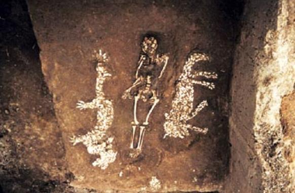

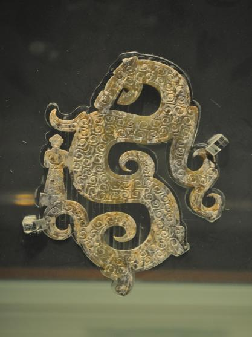

蚌塑龙虎墓（仰韶文化 濮阳西水坡遗址 ） 乘龙玉佩（战国 荆州博物馆）
“发蒙，利用刑人，用说桎梏，以往，吝”
译：启发教育，利用受过刑的人作民众的参照，以此说明刑罚的后果，如果要触犯法规，将接受同样的惩罚。
注：根据目前中国最早的史书《尚书》记载，舜帝命令皋陶设计五刑，并将刑罚内容刻画在各种器物上，用于警示百姓。
《尚书-舜典》记：“象以典刑，流宥五刑，鞭作官刑，扑作教刑，金作赎刑。”
《周礼·秋官》记：“墨者使守门，劓者使守阙，宫者使守内，刖者使守囿，髡者使守积。”

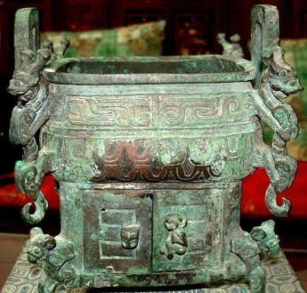

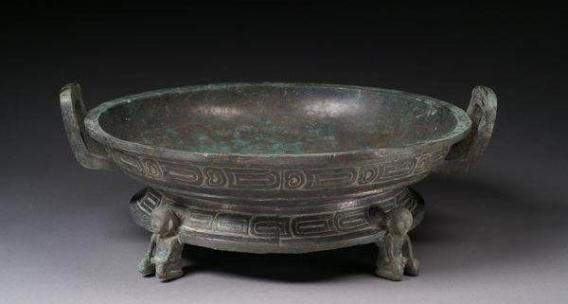

刖人守门鬲lì（古代炊器）（西周 陕西历史博物院）
它盘（西周 陕西历史博物院）
“或锡之鞶带，终朝三褫之”
译：君王赏赐鞶带。一天三次赏赐又三次剥夺赏赐了。
注：鞶带，皮革做的腰带。
【說文解字注】鞶，大带也。男子帶鞶。妇人帶丝。鞶，革带也

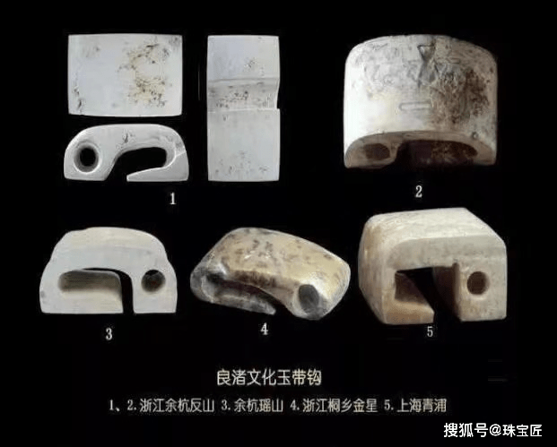

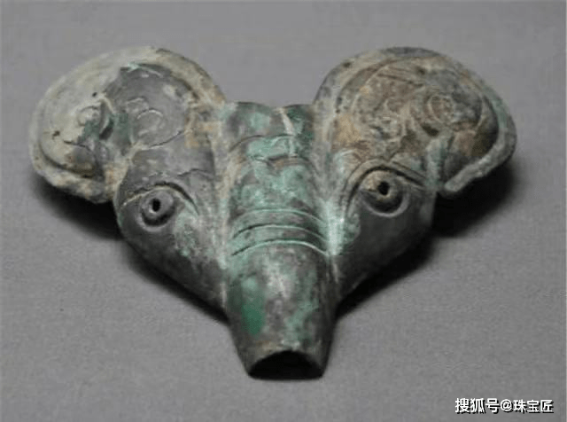

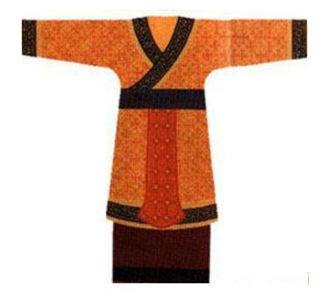

良渚文化 衣带玉钩 西周 羊首形青铜带饰 西周 服饰复原图
“有孚比之，无咎。有孚盈缶，终来有它吉”
译：真诚的交贸往来，没有过错。真诚的把酒在缶里倒满，外面的朋友终究会来的，而且会有其它一些吉利的事情发生。
注：“比”卦为君王建大国，各方部落往来依附交往，因此这里的缶应为青铜大缶，君主所用。《易经》离卦另有“日昃之离。不鼓缶而歌，则大耋之嗟，凶”，这句爻辞的描述景象为日常百姓之家，其中的缶应该为人人可以使用的小型陶缶。
【說文解字注】缶，瓦器，所以盛酒浆，秦人鼔之以节歌。

> 🖼️ *[图片无法获取: image]*

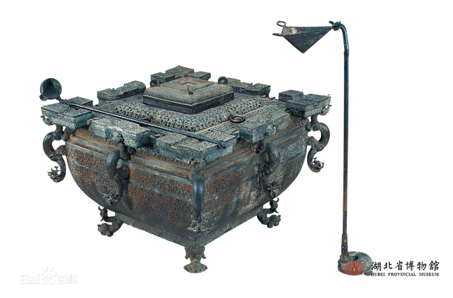

彩陶缶 河南三门峡市庙底沟出土 东周铜鉴缶 湖北省博物馆
“舆说辐，夫妻反目”
译：车子脱落了车轮的辐条，夫妻之间不和睦
注：根据《山海经》记载，皇帝和蚩尤大战于涿鹿之野，皇帝驾驶指南车，破除了蚩尤的迷雾阵，最终赢得了大战。目前中国出土最早的殷墟车马，也证明了上古时期的居民对于车辆的发明和使用。
【說文解字注】輿，車輿也。軾䡈軫軹轮辐都是车的一部分，车子脱落了辐条，就会像夫妻出现和不和睦一样，埋藏隐患，爆发问题。

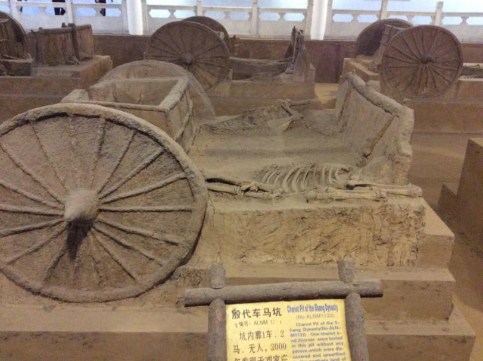

殷墟车马坑
“城复于隍。勿用师，自邑告命，贞，吝”
译：城墙已经倒塌在了城隍里，胜利了，既不要再用师进攻了，在郡邑昭告天命已达，如果还穷兵用师，反而会有悔恨。
注：商周时期，多是掘土堆高，夯实作墙，挖出来的沟壑就是城隍。城墙倒塌在了城隍利，意味着城破了。
“象曰：城复于隍，其命乱也。”

> 🖼️ *[图片无法获取: image]*

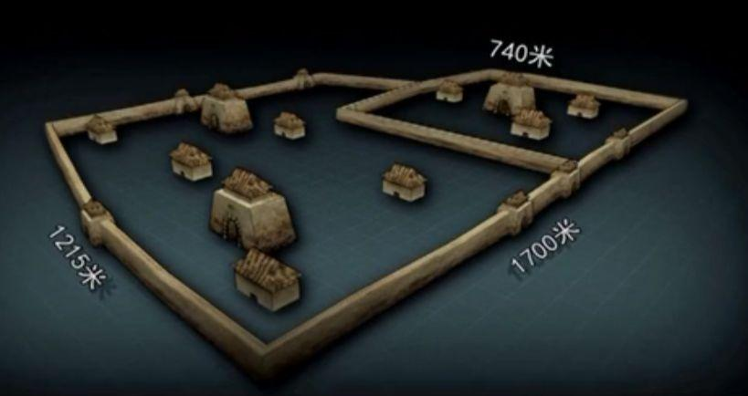

偃师商城遗址现场 偃师商城遗址模拟图
“观：盥而不荐，有孚颙若。”
译：清洗双手恭敬地祭祀，不上贡祭品，而是心怀诚实恭敬的扬首祈祷祝念。
注：古人祭祀的时候，清洗双手，洁净身体，上文中的洗手用具应用的是匜器装水冲洗祭祀者的双手。
【說文解字注】盥，澡手也。春秋傳曰。奉匜沃盥。左傳僖卄三年文。匜者，柄中有道可以注水。

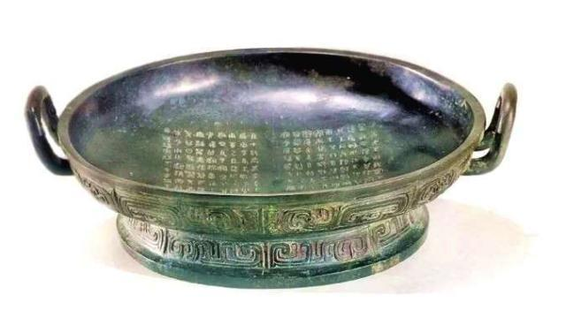

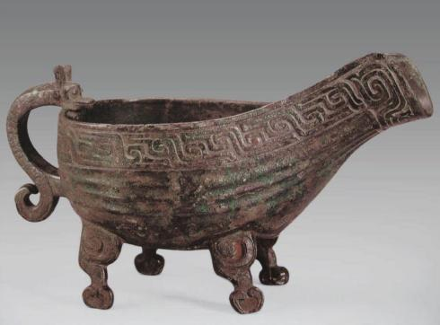

史墙盘（西周，陕西扶风周原文物管理所） 鲁伯愈父匜（yí）（春秋早期，上海博物馆）
“噬干胏（zǐ ），得金矢。利艰贞，吉”
译：吃着风干的带肉的骨头，吃出了一个金箭头，利于艰难但坚定的坚守正道，吉。
注：金矢，应是青铜箭头，自商至周的早期，青铜的冶炼铸造技术高度发达，而铁的冶炼铸造技术还处于刚刚发展的阶段。
【說文解字注】噬，啗，啖，咬着吃。

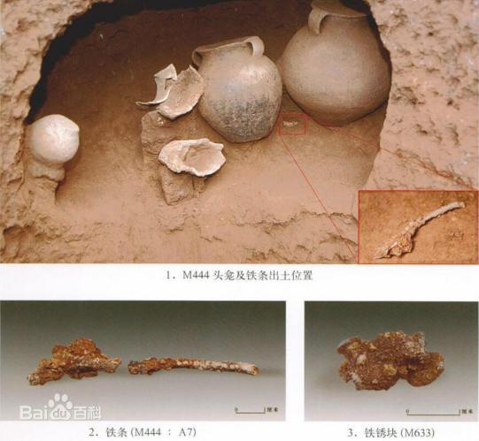

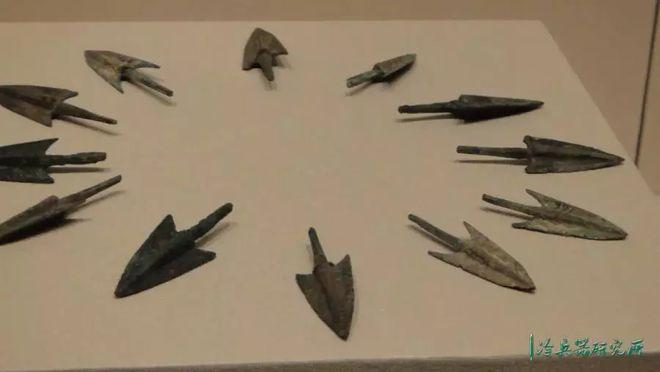

寺洼文化墓葬铁条（商朝前期） 商代铜箭镞(山东博物馆馆藏)
“屦校灭趾，无咎。”
译：麻草鞋磨破了脚趾，也不会有什么灾害，停下来就好了。
注：根据史料记载，商周时期，君王贵族多穿布帛皮革制作的鞋子，下层百姓多穿葛麻草绳编制的鞋子。
【說文解字注】屦，履也，左傳：踊贵履賤。指麻鞋或者葛草鞋。

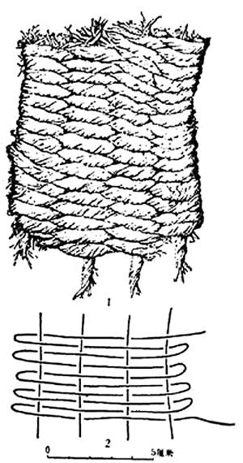

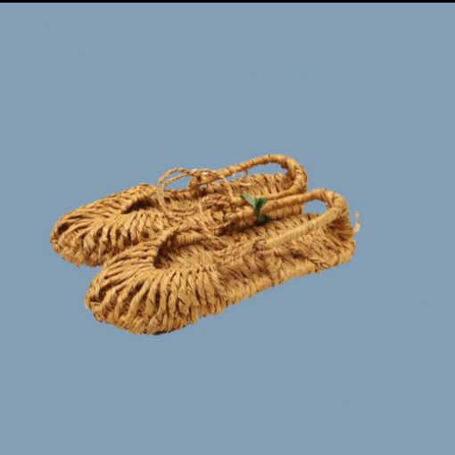

草鞋简照（商前期，河南孟庄遗址） 现代草鞋
“白贲，无咎”
译：白色的玉饰，没有一点瑕疵
注：从现今出土的文物古迹来看，中华民族对于玉石的喜爱和信仰，一直可以绵延上溯到没有文字的上古时代，并在这个过程中形成了对于白玉为最高玉石等级的质量追求。
【說文解字注】贲，飾也。从贝。

> 🖼️ *[图片无法获取: image]*

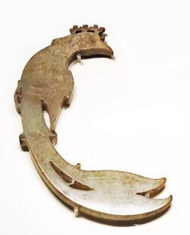

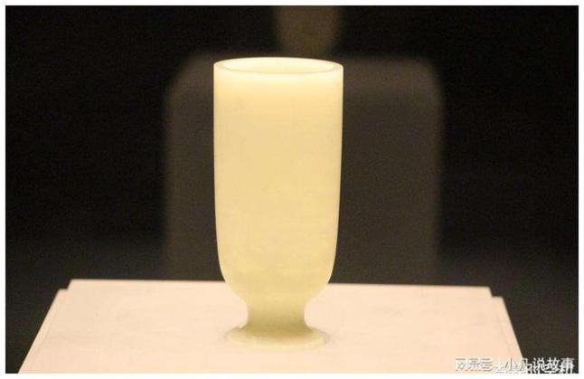

小南山遗址玉器（15000年） 玉凤佩（商中期 殷墟妇好墓） 白玉杯（三国魏 洛阳博物馆）
“舆说輹”
译：车子的车轴掉下来了
注：前文有“舆说辐，夫妻反目”中，车辆的损坏程度小于“舆说輹”，但是寓意着隐患存在但是没有及时解决，此处的“舆说輹”，虽然车辆已经损坏的不能使用了，但也因为及时停下来而不会造成更多地损害发生。
说同“脱”，輹为车轴，又称为伏兔，用于将车轴和车架固定在一起。

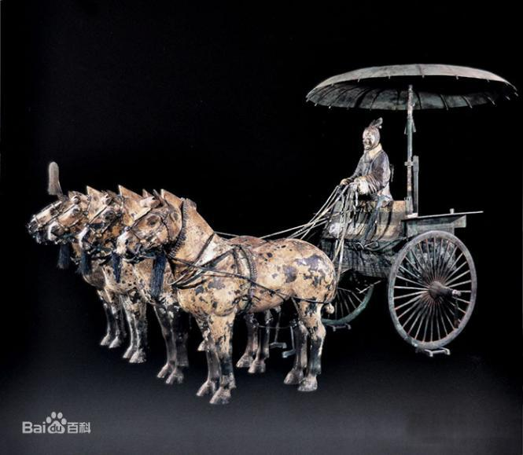

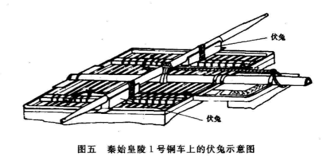

秦始皇一号铜马车（秦，西安兵马俑博物馆）
“舍尔灵龟，观我朵颐，凶”
译：舍弃了占卜的灵龟，看着我大口吃东西，有凶害会发生啊
注：古人做事，常常用灵龟占卜询问吉凶祸福，解决自己的疑惑，这是专注于成事的态度，如今放弃谨慎专注行事的态度，却去贪图口腹之欲，自然会导致凶害的事情发生。商纣王亡国于酒池肉林，周幽王断朝于沉溺女色，都是源于贪欲之祸。

> 🖼️ *[图片无法获取: image]*

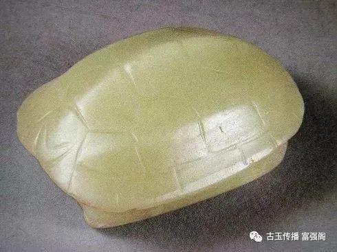

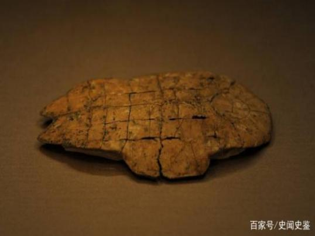

占卜龟甲（贾湖遗址 距今约9000―7500年） 玉龟（红山文化 辽宁省博物馆） 甲骨文（商中期 殷墟妇好墓）
“或益之十朋之龟，弗克违，永贞吉。王用享于帝，吉”
译：如果有人送来了价值十朋的灵龟，不要推辞，包永远坚守正道，君王在诚心的祭祀天帝，很吉利。
注：古人用龟占卜，朋是货币的单位，十朋之龟代表价值高稀有的灵龟。用最好的灵龟，以最诚敬的心向天帝祭祀问卜，古人相信会得到最好的结果。

> 🖼️ *[图片无法获取: image]*

“朋”的文字形态演变

> 🖼️ *[图片无法获取: image]*

> 🖼️ *[图片无法获取: image]*

绿松石海贝（三星堆） 保德铜贝 （商朝 山西省博物馆）
结束语：以古物注解《易经》，以万年的人世遗迹复观3000年的中华经首，实在是一件立足于当下时代的大幸事。圣如老庄孔孟，博观如司马二家，如果知道现代人能如此轻而易举的看见古往今来千万年的人文史迹，想必也都要感叹一句“斯世哉，实期慕也！”。

---

© 2026 徐时言 · 《易经文物注》 · 徐时言-易经研究 · 采用 CC BY-NC-ND 4.0 许可， 转载请署名并注明来源 https://wole278.github.io/xushiyan-YiJing/ · 禁止商业使用与改编传播 · 商业授权：wole278@hotmail.com / 微信 wole278
