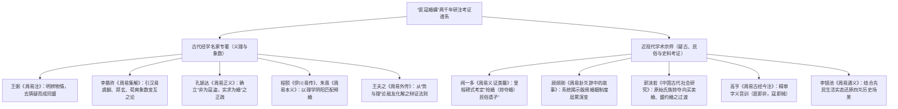

# 《周易》中“匪寇”与“婚媾”的词义训诂与部族博弈研究

> **创建日期**：2026-10-15  
> **深化修订**：2026-10-20  
> **价值基准评级**：🟢 **1 级文档（核心依赖因子：0.4）**。2026-10-21 经用户裁定正式确权晋升为 1 级价值文档，确立为部族博弈与联盟契约核心训诂模型。  
> **研究范畴**：甲金文字训诂、先秦抢婚与宗法联姻礼制考据、古今名家研注谱系（汉唐魏晋宋明经学 vs 近现代学术宗师疑古考证）、唯物辩证与地缘政治博弈  
> **核心结论**：破除汉宋注疏将“匪寇婚媾”窄化为单一字面男女私情之流弊；系统吸纳闻一多关于“上古掠夺婚（抢婚）民俗遗孑”与顾颉刚关于“殷周社会婚姻形态层累演进”之宗师级考证；确立“匪寇婚媾”是上古先民在资源争夺、部族突发遭遇与外交博弈中，**从戒备敌对（寇）向缔约结盟（婚媾）实现辩证转化的关键战略节点**。

---

## 一、 全景检索与学术问题提出

在通行本《周易》经文中，“匪寇”与“婚媾”作为一组极具戏剧张力与战略深度的语汇，在全经 384 爻中严格共见于 **4 处**：

```
【《周易》涉“匪寇”与“婚媾”经文分布】
┌────────────────────────────────────────────────────────────────────────┐
│ 1. [《屯》六二](../03%20周易笺注/03_屯卦.md)：屯如邅如，乘马班如。匪寇婚媾，女子贞不字，十年乃字。 │
│ 2. [《贲》六四](../03%20周易笺注/22_贲卦.md)：贲如皤如，白马翰如。匪寇婚媾。                    │
│ 3. [《睽》上九](../03%20周易笺注/38_睽卦.md)：睽孤，见豕负涂，载鬼一车，先张之弧，后说之弧，    │
│    匪寇婚媾，往遇雨则吉。                                              │
│ 4. [《震》上六](../03%20周易笺注/51_震卦.md)：震索索，视矍矍，征凶。震不于其躬，于其邻，无咎。  │
│    婚媾有言。                                                          │
└────────────────────────────────────────────────────────────────────────┘
```

长期以来，传统经学与现代流俗注疏在此核心语汇上陷入两大片面误区：
1. **经学义理派的抽象道德化**：如程朱理学将“婚媾”仅仅抽象为“求正应”、“阴阳得合”，将“寇”视为“强横乘凌之恶”，忽视了经文所植根的先秦部族战争与血缘部落结盟的真实历史土壤；
2. **字面流俗理解的狭隘孤立化**：将其简化为现代意义上的男女自由恋爱或家庭琐事，无法解释何以在屯卦草创建国、贲卦文饰天下、睽卦生死猜忌、震卦天惊地动的大动荡关头，经文频频将“婚媾”作为最高级别的战略破局或危机化解契机。

---

## 二、 文字训诂与字源发生学考

要还原“匪寇婚媾”的历史真实，必须首先从甲骨文、金文及先秦经典字源入手进行严密训诂：

```
【字形发生学与上古社会生活解构】
 ┌─────────────────────────────────────────────────────────────┐
 │ 【匪】：甲骨金文借“非”或从匚非声 ➔ 否定副词，“非也”、“若非”   │
 │ 【寇】：从宀从攴从人（手持杖械侵入室内抢掠） ➔ 暴掠之敌、劫夺之人│
 │ 【婚】：从女从昏（古代于黄昏迎亲，抢婚遗制） ➔ 妇家也、娶妇之礼  │
 │ 【媾】：从女从冓（象两木相交构、男女交接重婚之形） ➔ 厚结其好、同盟│
 └─────────────────────────────────────────────────────────────┘
```

### （一） “匪”：否定副词，训为“非”或“若非”
- 《说文解字·匚部》：“匪，器，似篚。从匚，非声。……或借为非。”
- 在殷墟卜辞与西周金文（如《毛公鼎》“匪鸡既鸣，匪天匪人”）中，“匪”普遍假借为否定副词“非”。
- 训诂歧解辨：古注与近代学者多训为“非也”，即“非是寇盗”；闻一多先生则别具卓见，指出古代“匪”亦通“微”（训为“若非、如果不是”），为“匪寇婚媾”提供了另一种深层民俗学解释。

### （二） “寇”：手持械刃侵入室内暴掠之人
- 甲骨文字形（）：外象房屋（宀），内象一人（人或元），上方有一手持杖械（攴）击打人头之形。
- 《说文解字·攴部》：“寇，暴也。从攴、完。贼侵入室也。”
- 《尔雅·释诂》：“寇，贼也。”《左传·文公七年》引《夏书》：“寇贼奸宄。”在先秦部族林立时代，“寇”特指以武装暴力掠夺人口、牲畜与财物的外部敌对势力。

### （三） “婚”与“媾”：从黄昏迎亲到两姓重婚结盟
- **“婚”**：《说文》：“婚，妇家也。《礼》：娶妇以昏时，妇人阴也，故曰婚。”古人迎亲必于黄昏暮时，这一习俗正是远古“抢婚（掠夺婚）”需要夜幕掩护的历史文化沉淀；
- **“媾”**：《说文》：“媾，重婚也。从女，冓声。”《尔雅·释亲》：“妇之父母、婿之父母，相谓为婚姻。婚姻为媾。”郝懿行《尔雅义疏》考订：“媾，谓两姓重结姻好，亲上加亲也。”
- **政治与外交引申**：在先秦宗法封建与部族争霸时代，“通婚”是仅次于血缘的最坚固政治契约与军事互不侵犯条约。《国语·晋语四》载重耳过秦，“秦伯纳女五人”，遂结“秦晋之好”，即是上古以婚媾换取政治同盟与战略纵深的典型体现。

---

## 三、 古今重点研究者研注汇纂与学术考证谱系

围绕“匪寇婚媾”与上古婚姻盟约，历代易学大师与近现代学术宗师展开了持续两千年的深入研讨与考辨：



### （一） 古代易经名家专著研注精义

#### 1. 魏晋王弼《周易注》：去疑释难，敌意消解
王弼开创扫象阐理之风，在《周易注》中敏锐把握了主体面对外部力量时“由疑惧转为合德”的心理机制：
- 注《屯·六二》：“居屯之时，处险之上，乘刚而无应……欲往求之，则遇寇难。明非寇也，乃求婚媾。”
- 注《贲·六四》：“始欲乘刚，寇难方发。乃以德自守，素白自处，无侵凌之患。寇退德显，终获婚媾。”
- 注《睽·上九》：“睽极生疑，猜防日至……后见其弧说，知非寇而为婚媾也。”
- **王弼核心观点**：将“寇”视为因缺乏互信而产生的外部威胁表象，将“婚媾”视为道德感通与客观契合带来的真实同盟。

#### 2. 唐李鼎祚《周易集解》所引汉魏诸儒：象数与互体考据
李鼎祚辑录汉易古义，保留了郑玄、虞翻、荀爽诸家对“寇”与“婚”的卦象结构解构：
- **虞翻注《屯·六二》**：“坎为盗，故称寇；互震为马，艮为居，初阳得位，二阴承之，阴阳相应，故曰婚媾。”（从卦象坎为寇、震为动、阴阳交际推导物理）；
- **荀爽注《贲·六四》**：“六四逼近九五，下承初九，白马翰如，动而得正。非为寇难，乃结良偶。”
- **干宝注《睽·上九》**：“极睽之世，视亲戚若仇雠。疑尽明生，怨释恩复，故虽疑为寇，卒为婚媾也。”

#### 3. 唐孔颖达《周易正义》：统一汉唐注疏定调
孔颖达在《周易正义》中对王弼之说作出了精确的语法疏解：
- “**匪寇婚媾者，言此乘马班如之人，非为寇盗，乃来求为婚媾也。**”孔疏明确将“匪寇”断为主谓判定句式的省略，确立了后世两千年训诂的主流基准。

#### 4. 宋程颐《伊川易传》与朱熹《周易本义》：理学视野下的正应与时义
- **程颐《伊川易传》**：
  - 释《屯·六二》：“二与五为正应，初九逼近，二守正不从，初亦知其守正不可夺，遂释其逼迫，故云匪寇婚媾。”程颐着重阐发“守正待时”（十年乃字）的贞固气节；
  - 释《睽·上九》：“猜极反通，幽极反明。往遇雨则阴阳和合，睽阻消融，吉莫大焉。”
- **朱熹《周易本义》**：
  - 强调占筮决疑功能：“此爻占法，示人以疑阻虽深，然实非寇害，宜审察机宜，求其和合。”

#### 5. 明末清初王夫之《周易外传》与《周易内传》：势理相因之博弈辩证法
王夫之打破程朱空疏道德论，从唯物辩证与地缘政治势力演进审视“寇与婚媾”：
- 船山指出：“**天下之事，情睽则为寇，理顺则为媾。寇与媾，一隙之积而势殊也。**”
- 在《睽卦外传》中，王夫之精辟论证：主体处于孤危绝境（睽孤）之时，极易将外部一切试探力量误判为寇雠（见豕负涂、载鬼一车）；唯有具备穿透假象的“格物”认知力，方能化戾气为祥和，把潜在的致命之寇（先张之弧），转化为破局的再生产同盟（往遇雨则吉）。

---

### （二） 近现代学术宗师考证：从神话疑古到民俗制度还原

20 世纪初，随着殷墟甲骨的发现与疑古辨伪运动兴起，顾颉刚、闻一多、郭沫若等近现代学术宗师，彻底颠覆了汉唐宋明的经学臆测，将“匪寇婚媾”置于上古中国真实的婚姻形态与人类学演进史中进行实证还原。

```
【学术宗师里程碑考证对比矩阵】
┌──────────┬───────────────────────────┬──────────────────────────────────────────┐
│ 学术宗师 │ 核心考据专著 / 论文       │ 突破性学术贡献与考释结论                 │
├──────────┼───────────────────────────┼──────────────────────────────────────────┤
│ **闻一多**│ 《周易义证类纂》          │ **考定“抢婚（掠夺婚）民俗遗孑”**：       │
│          │ 《神话与诗》              │ “寇”非强盗，乃行抢婚迎亲之男家队伍；    │
│          │                           │ “匪”通“微”（若非），“非抢夺则婚不成”；│
│          │                           │ 亦可读为“来人非为侵暴，实为迎亲”。      │
├──────────┼───────────────────────────┼──────────────────────────────────────────┤
│ **顾颉刚**│ 《周易卦爻辞中的故事》(1929)│ **系统揭示殷周婚姻与部族同盟演进史**：   │
│          │ 《周易研究发端》          │ 将“婚媾”与“帝乙归妹”、“媵嫁制”对勘， │
│          │                           │ 证明《周易》记录了从原始掠夺婚、买卖婚向  │
│          │                           │ 商周宗法政治联姻演变的全过程。           │
├──────────┼───────────────────────────┼──────────────────────────────────────────┤
│ **郭沫若**│ 《中国古代社会研究》(1930)│ **马克思主义社会形态学考证**：           │
│          │ 《甲骨文字研究》          │ 从母系氏族向父系氏族过渡、部族对外掠夺女  │
│          │                           │ 子与牲畜的阶级分化，论证“寇”与“婚”并存。│
├──────────┼───────────────────────────┼──────────────────────────────────────────┤
│ **高  亨**│ 《周易古经今注》          │ **经典音训文字学集大成**：               │
│          │ 《周易大传今注》          │ 训“匪，非也；寇，寇贼盗夺也；婚媾，重昏   │
│          │                           │ 也。言人非欲行寇贼，乃求为婚媾耳。”     │
├──────────┼───────────────────────────┼──────────────────────────────────────────┤
│ **于省吾**│ 《双剑誃易经新证》        │ **名物器用与甲金文互证**：               │
│          │ 《甲骨文字释林》          │ 考释“乘马班如”、“载鬼一车”之上古车马兵  │
│          │                           │ 戈制度，证屯、睽二爻皆实录战守征婚场景。 │
└──────────┴───────────────────────────┴──────────────────────────────────────────┘
```

#### 1. 闻一多《周易义证类纂》的突破性考证：抢婚民俗学遗存
闻一多先生在《周易义证类纂》与《神话与诗》中，运用人类学、民俗学与上古音韵学，对“匪寇婚媾”做出了震惊学界的里程碑考释：
- **“寇”即迎亲之假象**：闻一多指出，上古社会存在普遍的**“掠夺婚（抢婚）”**习俗。男子娶妻，必须率领同族青壮年夜袭女家，强行掠走女子，女方家庭则聚众防卫反击。这种风俗演化至西周，虽已进入聘娶礼仪阶段，但在仪式上仍保留“武装劫夺”的残存表演——迎亲队伍往往跨乘骏马、全副武装突降村落，使女方初见之下犹如遭遇强盗（“屯如邅如，乘马班如”）。
- **“匪”之深层语源**：闻一多先生考证，“匪”在古音中通“微”，“微”者训为“若非、如果不”。故“匪寇婚媾”可训为：**“如果不是前来行抢掠夺，这门婚事就缔结不成！”** 这一论断极为精妙地揭示了上古婚俗中必须通过武力试探或象征性抵抗来完成联姻的社会心理。
- 即使按常训“匪即非也”，闻先生亦强调：当男方队伍疾驰而来时，女方哨戒人员惊呼“寇至”，及至辨清旗帜信物，方才释然宣告：“**匪寇，乃婚媾也！**”（来者不是真正杀人掠财的仇寇，正是我们联姻亲族的迎亲队伍！）

#### 2. 顾颉刚《周易卦爻辞中的故事》：社会史实与宗法制度演化
顾颉刚先生在 1929 年发表的划时代论文《周易卦爻辞中的故事》中，将《周易》彻底从卜筮神殿引向历史大地：
- 顾先生指出，《周易》中大量保留了商周之际的社会婚姻史料。如《屯·六二》“女子贞不字，十年乃字”、《渐卦》鸿雁循序婚礼、《归妹卦》媵妾之嫁与“帝乙归妹”；
- 顾颉刚论证：“匪寇婚媾”反映了先秦从氏族公社互不信任的野蛮掠夺，向建立稳定的部族婚姻同盟迈进的过渡阶段。在生产力极其落后的西周初期，外部氏族接近，既可能是灭顶之灾的“寇掠”，也可能是携手生存的“婚媾”。经文记录“匪寇婚媾”，是周人将部族生存与外交经验，凝聚为决疑断语的宝贵实证。

#### 3. 郭沫若《中国古代社会研究》：部族争霸与阶级分化
郭沫若运用唯物史观，指出《周易》时代正处于原始野蛮期向文明阶级社会蜕变的大转折：
- 氏族战争的战利品，第一是牛马（“丧牛于易”、“丧马于易”），第二即是俘获人口与妇女（“执之用黄牛之革”、“利幽人之贞”）；
- 在频繁的掠夺中，弱小部落为了避免被灭绝，往往与强大的部族实行政治妥协，以通婚缔结保护契约。“匪寇婚媾”正是这种部族间由敌对掠夺向臣服盟约转化的历史缩影。

---

## 四、 全经四处经文深度笺注与博弈动力学解构

结合古今考据，严格依据唯物辩证原则与时位系统论，对《周易》涉“匪寇”与“婚媾”的四处经文进行全流程解剖：

### （一） [《屯》六二](../03%20周易笺注/03_屯卦.md)：草创待定，守正辨机

> **【爻辞】**：屯如邅如，乘马班如。匪寇婚媾，女子贞，不字，十年乃字。  
> **【小象】**：六二之难，乘刚也。“十年乃字”，反常也。  
> **【时位矩阵】**：六二以阴居阴，柔顺中正（居下卦震动之中）。

```
【屯六二时位博弈态势图】
   初九（刚强草创领袖，震体之主） 
       ▲  逼近（初九刚猛，意图结盟）
       │
   六二（柔顺中正，处屯难之初） ──── 乘马班如、踯躅辨机 ────► 十年功成（十年乃字）
       │
       ▼  正应（远隔坎险）
   九五（中枢尊位，坎险之中）
```

1. **情境还原**：雷雨草创、天下大乱之初（屯），六二处于进退维谷之境（屯如邅如）。迎面突现有外部力量疾驰逼近，马蹄盘旋徘徊（乘马班如），情势危急肃杀；
2. **古今考据融合**：
   - 依闻一多之说，此即上古骑马迎亲（抢婚）之队伍逼近；
   - 依王弼、孔颖达之疏，初九乃草创雄主，欲就近求聘六二，六二初觉其为凌逼之“寇”，继而审明其为求结同盟之“婚媾”；
3. **“女子贞，不字，十年乃字”之战略定力**：
   - “字”者，许嫁也。《说文》：“字，乳也。”女子许嫁笄而字之；
   - 六二立志大业，遇外部良机而求发展，十年方得功成。内中良人贞固守望。唯有保持战略定力，历经完整的历史发展周期（“十年”表大事物发展的大周期），才能言立业成家两全之美事。

---

### （二） [《贲》六四](../03%20周易笺注/22_贲卦.md)：素朴去饰，化敌为友

> **【爻辞】**：贲如皤如，白马翰如。匪寇婚媾。  
> **【小象】**：六四，当位疑也。“匪寇婚媾”，终无尤也。  
> **【时位矩阵】**：六四以阴居阴，得正，居上卦艮止之始，上承九五，下应初九。

1. **情境还原**：贲卦讲求文饰礼仪。六四处于艮卦（止）之下，面对下方初九阳刚力量乘白马飞驰而来（白马翰如，如白鸟展翅迅疾），六四不取虚浮之华丽重彩，而是以素洁纯白坦荡自处（皤，素白也）；
2. **考据与心理博弈**：
   - 《小象》一针见血指出：“**当位疑也**”——双方在相遇之初，由于缺乏充分沟通，彼此深怀戒心与敌意猜忌（疑其为寇）；
   - 六四通过“皤如”（褪去一切伪装、坦白透明、以赤诚相见），主动释放和平善意，彻底消解了对方的侵略冲动（匪寇），终使迅烈奔来的武装力量化为休戚与共的合作伙伴（婚媾）；
3. **战略价值**：在文明交际与外交博弈中，**“去伪存真、以诚感通”**是穿透猜疑链、将潜在对抗者转化为战略同盟的最高艺术。

---

### （三） [《睽》上九](../03%20周易笺注/38_睽卦.md)：释疑破障，死地反盟

> **【爻辞】**：睽孤，见豕负涂，载鬼一车，先张之弧，后说之弧，匪寇婚媾，往遇雨则吉。  
> **【小象】**：遇雨之吉，群疑亡也。  
> **【时位矩阵】**：上九以阳居阴，居睽卦（乖离、猜忌）之极顶。

```
【睽上九穿透猜疑链心理演变全景】
  ［极度乖离孤立］──►［幻觉丛生］──►［拔弩相向］──►［放下武器］──►［彻底化解］
     睽 孤            见豕负涂         先张之弧         后说之弧         遇雨则吉
                      载鬼一车                          匪寇婚媾        （群疑亡也）
```

1. **情境还原**：此乃《周易》全书中描写人类在极端危机与信任崩溃状态下，心理扭曲与认知觉醒的最震撼篇章。上九孤立无援（睽孤），在猜忌的心理阴影放大下，视迎面而来的救援力量如污秽泥猪（见豕负涂）、如满车狰狞恶鬼（载鬼一车），精神高度紧绷，立即引弓拉满（先张之弧），誓与死敌决一死战；
2. **考证与哲学破障**：
   - 王夫之注：“猜嫌极矣，凡所遇者皆若鬼魅寇仇。忽尔云行雨施，阴阳气和，情伪毕呈，乃知其非寇而为婚媾。”
   - 于省吾先生考“说”通“脱”，解弦卸箭也。在箭在弦上的一瞬间，理性战胜了恐惧，审慎促成了核实。待到迷雾散去、暴雨浇灭燥火（往遇雨则吉），方知对方非但不是侵害自身的仇寇，反而是前来救援的同盟至亲（婚媾）；
3. **战略价值**：系统陷入极度内耗或外部围困时，最大的敌人往往不是对手，而是主体内心的**非理性偏执与猜疑幻象**。唯有具备敢于“后说之弧”的战略冷静与信息核验机制，才能冲破死局，达成“群疑亡也”的全面胜利。

---

### （四） [《震》上六](../03%20周易笺注/51_震卦.md)：避难引嫌，防绝私盟

> **【爻辞】**：震索索，视矍矍，征凶。震不于其躬，于其邻，无咎。婚媾有言。  
> **【小象】**：震索索，中未得也。虽凶无咎，畏邻戒也。  
> **【时位矩阵】**：上六以阴居阴，居震卦（雷震惊动）之极。

1. **情境还原**：外部发生剧烈政治大地震或系统性毁灭灾变，上六自身虽暂未直接遭殃，但眼见左邻右舍横遭劫难，已吓得心惊胆战（震索索）、目眩神摇（视矍矍）。此时若盲目出走必遭大祸（征凶）；
2. **考据与“婚媾有言”之政治戒律**：
   - 古注如李鼎祚辑汉儒：“言，语也，谓流言谗谤。”
   - 在高压动荡的政局危机中，主体严禁私下与外部势力、异姓宗族进行暗中串通、政治联姻或结盟缔约（婚媾）。一旦暗中结盟，必将引爆中枢猜忌与政敌攻讦，引来滔天大祸（有言）；
3. **战略价值**：此爻作为反向防线，深刻告诫：**结盟必须合乎时位**。在天下大乱、信任归零的高危震荡期，“婚媾”不但不能救命，反而会成为被怀疑勾结外敌、引火烧身的取死之道。此时唯有深居避嫌、谨言慎行，方能独全其身。

---

## 五、 与“帝乙归妹”之宗法和亲演进唯物对比

将“匪寇婚媾”置于上古婚姻与政治制度演进史中审视，其与商末周初的**“帝乙归妹”**构成了中国先秦文明从“野蛮部族互盟”走向“封建宗法王道治理”的完整发展链条：

```
【先秦社会婚姻与外交结盟形态演进图】
┌────────────────────────────────────────────────────────────────────────┐
│ 阶段一：原始掠夺婚（神话传说至五帝时代）                               │
│ ➔ 氏族间以武力突袭强掳妇女与财产，无信约可言                           │
├───────────────────────────────────┬────────────────────────────────────┤
│ 阶段二：部族攻防与民间迎亲（《周易》“匪寇婚媾”）                       │
│ ➔ 屯、贲、睽、震四爻所见：迎亲仍残留武装掠夺形式，但已萌发部族互保契约│
├───────────────────────────────────┴────────────────────────────────────┤
│ 阶段三：宗法王权和亲与媵嫁制度（《周易》“帝乙归妹”）                     │
│ ➔ 泰六五、归妹六五所见：商王帝乙将宗女下嫁周邦领袖，以文明礼乐取代武力 │
└────────────────────────────────────────────────────────────────────────┘
```

1. **主体层级跃迁**：
   - “匪寇婚媾”发生在基层部族、征夫商旅与草创力量之间，充满野性、突发性与生死试探；
   - “帝乙归妹”则是商周两代大帝国最高统治阶层之间的大战略和亲（殷商王室与西岐周邦），其核心是运用国家礼制保障地缘和平；
2. **制度成熟度质变**：
   - “匪寇婚媾”中，“寇”的阴影挥之不去，必须通过个体长期的定力自守（屯十年乃字）、赤诚坦荡（贲白马皤如）、破除幻象（睽遇雨消疑）来艰辛博弈；
   - “帝乙归妹”则已拥有成套成熟的宗法媵嫁制度（娣侄随嫁、车服袂饰、月几望之礼），是文明战胜野蛮的制度化结晶。

---

## 六、 结语：周易危机博弈与盟约治理的方法论价值

通盘审视《周易》全经对“匪寇”与“婚媾”的微言大义，先民在此凝结的绝非儿女私情，而是深沉宏阔的生存战略智慧：

1. **穿透表象的认知定力（察辨虚实）**：在危机降临、外部异动之际，凡夫往往凭借生物本能误判为“寇”（如睽卦上九之见豕载鬼），陷入恐惧与盲动；唯有智者能保持战略从容，穿透假象，识别其作为增量资源与破局机遇的“婚媾”实质；
2. **转化矛盾的治理艺术（以柔克刚）**：世间敌我并非绝对凝固。面对来势汹汹的外部力量，若以暴易暴则两败俱伤；以素朴赤诚（贲卦六四）或自立待时（屯卦六二）应对，方能化戾气为祥和，把潜在的破坏者转变为坚固的同盟者；
3. **明辨时位的边界控制（知止远祸）**：结盟非万能解药。在系统发生剧烈动荡（震卦上六）时，不合时宜的暗中结盟与跨界勾结，反而会成为引火烧身的致命毒药。明辨敌友、善御盟约、依时而动，此乃《周易》唯物辩证与战略哲学的永恒魅力所在。

---

<sub>© 2026 徐时言 · 《《周易》中“匪寇”与“婚媾”的词义训诂与部族博弈研究》 · 徐时言-易经研究 · 采用 CC BY-NC-ND 4.0 许可， 转载请署名并注明来源 https://wole278.github.io/xushiyan-YiJing/ · 禁止商业使用与改编传播 · 商业授权：wole278@hotmail.com / 微信 wole278</sub>
