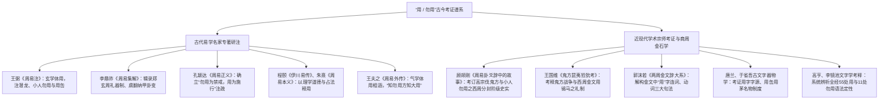
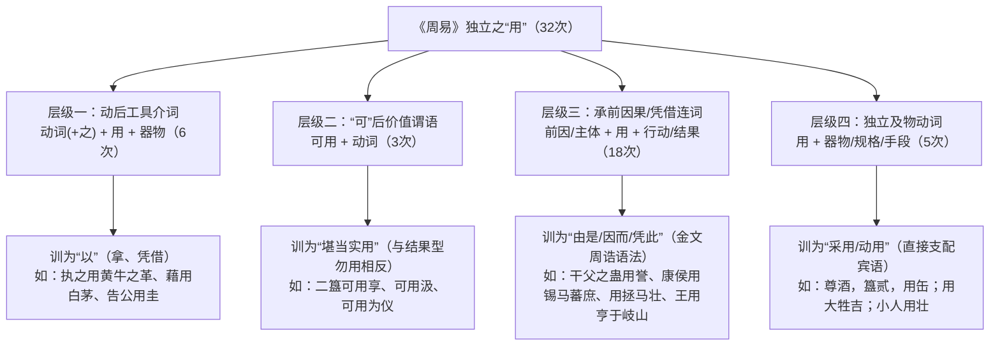

# 《周易》中“用”和“勿用”的词义与句法辩证研究

> **创建日期**：2026-10-18  
> **深化修订**：2026-10-20  
> **价值基准评级**：🟢 **1 级文档（核心依赖因子：0.4）**。2026-10-21 经用户裁定正式确权晋升为 1 级价值文档，确立为主体担当与句法结构核心训诂模型。  
> **研究范畴**：先秦两汉文字训诂、商周青铜金文句法互证、古今名家研注谱系（王弼、孔颖达、程颐、朱熹、王夫之 vs 顾颉刚、王国维、郭沫若、唐兰、于省吾、高亨）、唯物辩证法与“生生”价值标尺  
> **核心结论**：破除汉宋注疏将“用 / 勿用”混同为单一现代汉语词义的流弊；系统吸纳顾颉刚考辨“高宗伐鬼方与西周封建阶级史实”及郭沫若考订“商周金文用字句法”之成果；建立**“勿用”三类句法结构**、**古今名家研注考证谱系**与**独立“用”字四层语法功能**的严密训诂体系。

---

## 一、 全景统计与问题提出

通行本《周易》六十四卦（含乾坤用九、用六）经文中，含**“用”**字的卦爻辞共见于 **52 处**（累计出现 **55 次**）。传统注疏往往不辨词性位置与主宾关系，导致三大长期误读：
1. 将《师·上六》《既济·九三》的**“小人勿用”**误作“君主不可任用小人”（动宾倒装），割裂了《周易》全经“小人”100% 作主语的语法铁律；
2. 将《颐·六三》**“十年勿用”**与《坎·六三》独立的**“勿用”**混同于普通祈使禁令，忽视了其作为“因前序悖道行为导致主体不被所用（沦为弃子）”的客观因果断定；
3. 将《坎·六四》**“尊酒簋贰用缶”**误作“一樽酒配一簋食，副食装在瓦缶里”，掩盖了西周“藏礼于器”的祭祀等级制度与荒政实质。

按照词汇凝固度与句法位置，全经 55 次“用”字严格划分为三大矩阵：
- **第一矩阵：“勿用”结构**（11 处，11 次）——按“勿用”在前、在后及独立成句分为三类；
- **第二矩阵：“利用”双音结构**（14 处，14 次）——“利 + 用[宾语]”，其中“用”粘附于“利”之后，非独立存在；
- **第三矩阵：独立之“用”**（30 处卦爻，32 次，其中《益·六三》《坎·六三》与前两类交集）——按语法功能分为动后工具介词、“可”后价值谓语、承前因果连词、独立及物动词四层。

---

## 二、 “勿用”的三类句法结构与唯物辩证解构（11 处）

《说文解字》：“勿，州里所建旗，象其柄有三游，杂帛，幅半异，所以趣民，故遽称勿勿。”甲骨文、金文中假借为否定副词，表劝阻、禁止或客观否定。在《周易》中，“勿用”绝非单一含义，而是随句法位置呈现三种截然不同的战略定性：

### （一） 结构一：“勿用”在前（`勿用 + 行为`，共 6 处）——主动禁戒：“不要采取某行为”

此结构中，“勿用”位于动词短语之前，句义最为明确，相当于**“切勿施行 / 不要采取 [+ 具体行动]”**。其唯物辩证本质是：**客观时位条件尚未成熟，或刚柔交际存在结构性陷阱，强行盲动必损生生根基**。

| 序号 | 卦爻 | 经文原句 | 禁止采取的行为 | 时位与生生辩证本义 |
| :---: | :--- | :--- | :--- | :--- |
| 1 | **[《屯》卦辞](../03%20周易笺注/03_屯卦.md)** | 屯：元亨，利贞。**勿用有攸往**，利建侯。 | 有攸往（盲目远征） | 雷雨草创、万端待举，根基未稳之时，忌孤军远出，宜就地筑基建侯。 |
| 2 | **[《遯》初六](../03%20周易笺注/33_遁卦.md)** | 遯尾，厉，**勿用有攸往**。 | 有攸往（逆势强进） | 战略撤退殿后遇险，唯一生路是静伏隐蔽，严禁脱离大军妄动。 |
| 3 | **[《蒙》六三](../03%20周易笺注/04_蒙卦.md)** | **勿用取女**；见金夫，不有躬，无攸利。 | 取女（缔结丧失自主之同盟） | 对方见利忘义、丧失独立人格（不有躬），严禁引为姻亲或政治盟友。 |
| 4 | **[《姤》卦辞](../03%20周易笺注/44_姤卦.md)** | 姤：女壮，**勿用取女**。 | 取女（引狼入室之妥协结纳） | 异质强势力量突入系统底层（女壮），若贪图苟安与之结纳，必遭反噬。 |
| 5 | **[《泰》上六](../03%20周易笺注/11_泰卦.md)** | 城复于隍，**勿用师**。自邑告命，贞吝。 | 师（穷兵黩武、军事镇压） | 泰极否来、城墙倾颓于护城河，内部治理已崩，严禁动用军队强行弹压。 |
| 6 | **[《小过》九四](../03%20周易笺注/62_小过卦.md)** | 无咎，弗过遇之。往厉必戒，**勿用永贞**。 | 永贞（僵化死守同一教条） | 过渡微调期形势瞬息万变，不可将权宜之计当作永久教条执迷不悟。 |

---

### （二） 结构二：“勿用”在后之主谓禁戒（`[主体] + 勿用`，共 3 处）——主体担当界限：“某主体不可施用此道”

此结构为 **`[主语] + 勿用`**，共见于 3 处：
1. **[《乾》初九](../03%20周易笺注/01_乾卦.md)**：“**潜龙勿用。**”
   - 《文言传》释曰：“潜龙勿用，下也……是以**君子弗用也**。”主语为“潜龙（喻处底层蓄势之君子）”，“勿用”为主动敛藏锋芒、不轻试其力。
2. **[《师》上六](../03%20周易笺注/07_师卦.md)**：“**大君有命，开国承家，小人勿用。**”
3. **[《既济》九三](../03%20周易笺注/63_既济卦.md)**：“**高宗伐鬼方，三年克之，小人勿用。**”

#### 🔍 “小人勿用”语法与义理重考：破除“勿用小人”之流俗误读

汉唐以来流通注本（如王弼、孔颖达、程颐、朱熹）多将“小人勿用”训为宾语前置之“勿用小人”（即“分封时不要任用小人，只给金帛”、“伐鬼方不要派小人做将军”）。**此说在先秦语法与《周易》全经内证中均难以成立**：

1. **《周易》全经“小人”100% 作主语的铁律**：
   遍检通行本《周易》经文，“小人”共出现 **10 次**。除本处 2 例外，其余 8 例无一例外全部是**主谓结构中的主语**，且多与“君子 / 大君 / 公”构成严格的主体对比：
   - **[《否》六二](../03%20周易笺注/12_否卦.md)**：“包承，**小人吉**，大人否，亨。”（小人为主语）
   - **[《大有》九三](../03%20周易笺注/14_大有卦.md)**：“公用亨于天子，**小人弗克**。”（公能享献天子，**小人无法胜任此事**——**此句与“大君有命，开国承家，小人勿用”句法完全同构！**）
   - **[《观》初六](../03%20周易笺注/20_观卦.md)**：“童观，**小人无咎**，君子吝。”（小人为主语）
   - **[《剥》上九](../03%20周易笺注/23_剥卦.md)**：“君子得舆，**小人剥庐**。”（小人为主语）
   - **[《遯》九四](../03%20周易笺注/33_遁卦.md)**：“好遯，君子吉，**小人否**。”（小人为主语）
   - **[《大壮》九三](../03%20周易笺注/34_大壮卦.md)**：“**小人用壮**，君子用罔，贞厉。”（小人为主语，谓语正是“用”！）
   - **[《解》六五](../03%20周易笺注/40_解卦.md)**：“君子维有解，吉；有孚于**小人**。”（介宾补语，非倒装宾语）
   - **[《革》上六](../03%20周易笺注/49_革卦.md)**：“君子豹变，**小人革面**。”（小人为主语）

2. **“大君/高宗”与“小人”的担当鸿沟**：
   - 在《师·上六》中，“大君有命，开国承家”是平定天下后创立邦国制度、承袭宗庙社稷、生养万民的最高政治建构；
   - 在《既济·九三》中，“高宗伐鬼方，三年克之”是商王武丁为解除边患、保卫华夏农耕文明生存空间，历经三年艰苦卓绝的战略决战方才克敌制胜的宏大远征；
   - 此二者皆是**大道正行、承民之命、耗费举国心力**的千钧重担。而“小人”（器局褊狭、唯图私利、缺乏战略定力与苍生担当之人）既无此胸怀与德能，想做也根本做不了（如《大有·九三》“小人弗克”）。若小人妄图效尤“开国承家”之权柄，必沦为裂土分赃之乱政；若小人妄图效尤“伐鬼方”之远征，必因贪功急躁而致三军覆没。故经文严正告诫：**“小人勿用”——小人切勿妄用此等宏大战略与王道重器！**

---

### （三） 结构三：“勿用”在后/独立存在之结果断定（`[前因悖道] ➔ (十年)勿用`，共 2 处）——客观后果：“导致不被所用、沦为弃子”

当“勿用”位于一连串错误行为之后（带时间状语“十年勿用”或于句末独立成词“勿用”）时，其语义发生了从“主观劝阻”向**“客观结果断定”**的质变——**因为前面的违背客观规律之行，导致主体在长周期内丧失价值、“不被所用”**。

| 序号 | 卦爻 | 经文原句 | 前序悖道行为（因） | 客观结果判定（果） | 传文与经文内证 |
| :---: | :--- | :--- | :--- | :--- | :--- |
| 1 | **[《颐》六三](../03%20周易笺注/27_颐卦.md)** | **拂颐，贞凶，十年勿用，无攸利。** | **拂颐**（违背生养之道，掏空底层以自肥，执迷不悟） | **十年勿用**（在长达十年的完整政治/历史周期内被彻底唾弃，不复见用） | 《小象》：“十年勿用，道大悖也。” 互证《复·上六》：“迷复，凶……至于十年，不克征。”（“十年”表完整历史淘汰周期） |
| 2 | **[《坎》六三](../03%20周易笺注/29_坎卦.md)** | **来之坎坎，险且枕，入于坎窞，勿用。** | **来之坎坎，险且枕，入于坎窞**（进退皆险却不知止，反而枕险苟安，最终跌入水底最深死坑） | **勿用**（已彻底丧失机动能力与救援价值，沦为废棋，不堪所用） | 《小象》：“来之坎坎，**终无功也**。” 互证《剥·上九》小象：“小人剥庐，**终不可用也**。” |

> [!IMPORTANT]
> **“可用”与结果型“勿用”的辩证镜像**：  
> 《井·九三》云：“井渫不食，为我心恻，**可用汲**”（井水淘洗干净，具备“可供汲取使用”的客观价值）；《坎·六三》“入于坎窞，**勿用**”与《颐·六三》“拂颐……**十年勿用**”，则是主体自绝于生生正道、跌入深渊后**“彻底丧失可用性、不被世用”**的客观历史宣判。

---

## 三、 古今易学名家与现代学术宗师对“用/勿用”的研注考证谱系

围绕《周易》中“用”与“勿用”的词义属性、主谓关系与器物制度，历代经学家与现代史学宗师留下了脉络清晰的考证谱系：

### （一） 古代易学名家专著研注精要

#### 1. 魏晋王弼《周易注》：立足玄学体用与时位机变
王弼扫除汉儒繁琐象数，对“用与不用”进行了高度哲理化概括：
- **注《乾·初九》“潜龙勿用”**：“下也。德而隐者也。潜伏下位，未可适时，是以君子弗用也。”（明确主语为君子，谓语为弗用，顺时而隐）；
- **注《师·上六》“小人勿用”**：“小人不可使治国承家，故勿用也。”（传统义理派将此作君王不可任用小人解之开端）；
- **注《坎·六四》“尊酒，簋贰，用缶”**：“质素之至也。处坎险之时，不贵华文，而贵诚质，故用缶。”
- **王弼核心思想**：认为“用”之关键在“时”，合时则显其用，背时则守其勿用。

#### 2. 唐李鼎祚《周易集解》所引汉魏古易：礼制与卦变象数
李鼎祚辑存的汉易古注，保留了大量西周汉代名物礼制线索：
- **郑玄注《损·卦辞》**：“二簋，士礼也。旱荒之岁，虽公卿亦以士礼祭，用二簋，省礼以从简也。”（郑玄敏锐触及了《周易》“荒政从简”的护农礼制核心！）；
- **虞翻注《既济·九三》“高宗伐鬼方，三年克之，小人勿用”**：“离为戈兵，坎为险，震为东方……鬼方，北方国也。高宗，殷王武丁也。小人勿用，阴承阳位，非任治之才也。”
- **干宝注《师·上六》**：“师旅之末，小人虽有战功，不可使参国政也。”

#### 3. 唐孔颖达《周易正义》：统一汉唐注疏定调
孔颖达在《周易正义》中，将“勿用”与“利用”上升为吉凶决疑准则：
- 疏《乾》：“言潜龙之时，君子当自晦藏，未可施用……若妄动强用，则有凶咎。”
- 疏《蒙》初六“利用刑人，用说桎梏”：“以刑人正法，使民知禁，用此脱去其后之重刑也。”

#### 4. 宋程颐《伊川易传》与朱熹《周易本义》：理学视野下的道德担当
- **程颐《伊川易传》**：
  - 释《师·上六》：“圣人开国承家，劳臣虽有功，若小人则不可用。小人虽能效力于兵革，不可使治邦国，小人得位，必乱国家。”
  - 释《大壮·九三》：“小人尚力，故用壮；君子知理，故用罔。罔，无也，君子不用其力也。”
- **朱熹《周易本义》**：
  - 释“勿用”：“勿用者，占者之禁戒。筮得此爻，不可有所作为。”朱熹突出《周易》之占筮体例，将“勿用”视为行动禁令。

#### 5. 明末清初王夫之《周易外传》：气学体用合一与历史唯物萌芽
王夫之彻底超越程朱道德空谈，深刻阐发“用”之辩证法：
- 船山指出：“**天下之用，体之发也；非体外有用，非用后有体。**”
- 王夫之论《乾·初九》：“不知勿用，不足以言大用。藏其用者，蓄其体也。若躁动而轻进，力未充而先竭，则终身无可用之期矣。”
- 论《既济》与《师》之“小人勿用”：船山指出，小人器局褊急，唯利是图，天下大定之后，分封承家乃建极垂统之大事，若使小人行之，必化为私门攘夺之资，此乃势理之必然，非好恶之私也。

---

### （二） 近现代学术宗师考证与商周金石学突破

20 世纪疑古史学与商周甲骨、金文的大批出土，为解构《周易》“用”与“勿用”提供了坚不可摧的古文字学与社会史实证据：

#### 1. 顾颉刚《周易卦爻辞中的故事》(1929)：高宗伐鬼方与宗法分封阶级实录
顾颉刚先生在考辨《周易》历史故事时，对《既济·九三》“高宗伐鬼方，三年克之，小人勿用”进行了里程碑式的学术考据：
- **高宗伐鬼方的史实确证**：顾颉刚对勘《诗经·商颂·殷武》（“挞彼殷武，奋伐荆楚……昔有成汤，自彼氐羌”）、《竹书纪年》（“武丁三十二年，伐鬼方，次于荆”）、《尚书·无逸》及殷墟卜辞，证明“高宗”即殷商中兴之主武丁，商代北方、西北方的“鬼方”（即后之严狁、匈奴）常为边患，武丁历经整整三年大战，终于彻底克服边患；
- **“小人勿用”的西周社会阶层考辨**：顾先生深刻指出，西周宗法封建制下，社会被严格划分为“大君、公卿、君子（统治贵族）”与“小人、庶人、奴隶（被统治阶级）”。《师·上六》“大君有命，开国承家”是天下平定后分封诸侯、建立采邑的最高封建政治建制。而“小人”在当时被视为缺乏礼义教养、唯图温饱私利的底层，根本没有资格、也没有能力去承担“开国承家”或在克敌后受封建国的大任。
- **语法与史实互证**：经文原意直指“**小人切勿妄图施用此等军国重器与大政**”（小人为主语），汉唐宋儒不辨上古宗法等级，强解为后世帝王“勿任用小人做官”（动宾倒装），完全割裂了殷周时代的历史阶级原貌！

#### 2. 王国维《鬼方昆夷猃狁考》《殷周制度论》：战争征伐与锡命金文
王国维先生考释商周金文（如《小禹簋》《虢季子白盘》）：
- 金文中记载周王征讨外族大胜后，必行“策命封赏”，文辞格式严整：“王在某宫，王命某官……锡马蕃庶，用作宝彝”；
- 证明《晋卦》“康侯用锡马蕃庶，昼日三接”完全是西周青铜器策命辞的忠实摘录（康侯即卫康叔，成王与周公封其于卫，以其功大，频频在朝廷受天子恩赐良马并一日三接）；
- 确证句中“用”乃西周公文标准连词，表“凭此功绩，蒙受赏赐”。

#### 3. 郭沫若《两周金文辞大系图录考释》：西周“用”字三大句法归纳
郭沫若先生通考数百篇西周青铜铭文，指出铭文中“用”字用法高度成熟，分为三类：
1. **及物动词（施用、任用、祭祀）**：如《毛公鼎》“用克朔方”；
2. **凭借/因果连词（由是、因而、凭此）**：如《大盂鼎》“用祈天永命”、《毛公鼎》“用康保民”；
3. **工具介词（以也）**：如《散氏盘》“用自迺台”。
郭沫若指出，《周易》成书于西周晚期，其经文中的“用”字语法与两周金文完全处于同一语言发展阶段，后世将连词之“用”硬解为动词“使用”，乃是不知上古语法通例的臆解。

#### 4. 唐兰与于省吾：字形溯源与上古器物名物考订
- **唐兰《殷虚文字记》**：考证甲骨文“用”字本象“桶形盛物之器”（下有两足，上有提梁），因为是日常盛水盛粮之器，故引申为“堪资器用”，再引申为“施行、使用”；
- **于省吾《双剑誃易经新证》**：
  - 考释《大过·初六》“藉用白茅”与《系辞》互证，指出上古祭祀神明与盛放种子，必垫以吸湿洁白之生茅；
  - 考释《坎·六四》“尊酒簋贰用缶”，于先生考订“缶”为陶质日用器皿，在坎难险阻之时，士君子行二簋之礼，饮酒用素瓦缶，击缶而歌，正见先民安贫乐道、克难自强之坚忍操守。

---

## 四、 “利用”与独立“用”字的语法与语义体系（41 处卦爻、44 次）

除上述 11 次“勿用”外，其余 44 次“用”字分为**非独立的“利用”（14 次）**与**独立的“用”（30 处卦爻、32 次）**。

### （一） 非独立的“利用”（`利 + 用[宾语]`，共 14 次）

“利用”在《周易》中已趋于凝固，表**“有利于施行某项特定治理措施或礼法制度”**，“用”字受“利”字统摄，不独立成意：
- **司法刑政（2 次）**：[《蒙》初六](../03%20周易笺注/04_蒙卦.md) `利用刑人`、[《噬嗑》卦辞](../03%20周易笺注/21_噬嗑卦.md) `利用狱`；
- **军事征防（3 次）**：[《谦》六五](../03%20周易笺注/15_谦卦.md) `利用侵伐`、[《谦》上六](../03%20周易笺注/15_谦卦.md) `利用行师`、[《渐》九三](../03%20周易笺注/53_渐卦.md) `利用御寇`；
- **祭祀朝聘（4 次）**：[《观》六四](../03%20周易笺注/20_观卦.md) `利用宾于王`、[《萃》六二](../03%20周易笺注/45_萃卦.md) `利用禴`、[《升》九二](../03%20周易笺注/46_升卦.md) `利用禴`、[《困》九二](../03%20周易笺注/47_困卦.md) `利用享祀`；
- **重大工程与迁徙变革（5 次）**：[《益》初九](../03%20周易笺注/42_益卦.md) `利用为大作`、[《益》六四](../03%20周易笺注/42_益卦.md) `利用为依迁国`、[《家人》卦辞](../03%20周易笺注/37_家人卦.md) / [《损》初九](../03%20周易笺注/41_损卦.md) / [《益》卦辞](../03%20周易笺注/42_益卦.md) 等（另有 [《乾》用九](../03%20周易笺注/01_乾卦.md)、[《坤》用六](../03%20周易笺注/02_坤卦.md)“利永贞”之爻题“用九/用六”2 处，表爻变体例）。

---

### （二） 独立之“用”的四层语法功能与唯物实证（30 处卦爻、32 次）

甲骨文“用”字（）象桶状器物或竹木编织盛器之形，《说文》：“用，可施行也。”在西周金文（如《大盂鼎》《毛公鼎》）与《尚书》周诰中，独立的“用”字兼具**实词（使用、器用）**与**虚词（介词“以”、连词“由是/因而/凭此”）**双重属性。遍考《周易》32 次独立之“用”，可精确归纳为以下四层结构：

#### 1. 层级一：动后工具介词（`动词[+之] + 用 + 器物/事件`，共 6 次）——训为“以”（凭借、拿）

此结构是典型的上古汉语**工具状语后置句式**（`V + [O] + 用 + 工具名词`），这里的“用”完全等同于介词**“以”**，突出**所凭借的物质器用或特定契机**。

| 卦爻 | 经文原句 | 句法结构拆解 | 器物/介质 | 唯物考据与战略义理 |
| :--- | :--- | :--- | :--- | :--- |
| **[《大过》初六](../03%20周易笺注/28_大过卦.md)** | **藉用白茅**，无咎。 | `藉（垫）+ 用（以）+ 白茅` | **白茅**（洁白柔韧之茅草） | 上古洪泛潮湿期，将祭器或种子垫在吸湿柔韧的白茅之上，以极度审慎防微杜渐（《系辞》：“苟错诸地而可矣，藉之用茅，何咎之有？”）。 |
| **[《坎》上六](../03%20周易笺注/29_坎卦.md)** | **系用徽纆**，寘于丛棘，三岁不得，凶。 | `系（捆绑）+ 用（以）+ 徽纆` | **徽纆**（三股曰徽、两股曰纆之黑索刑具） | 坎险极位仍怙恶不悛，被以重刑绳索捆绑、关押于荆棘丛围成的牢狱中，彻底丧失自由。 |
| **[《遯》六二](../03%20周易笺注/33_遁卦.md)** | **执之用黄牛之革**，莫之胜说。 | `执之（捆缚它）+ 用（以）+ 黄牛之革` | **黄牛之革**（柔韧坚固的熟牛皮绳） | 战略撤退中枢（六二居中应五），用最坚韧中道的纽带将团队意志死死捆绑，任何外力无法拆解（莫之胜脱）。 |
| **[《革》初九](../03%20周易笺注/49_革卦.md)** | **巩用黄牛之革**。 | `巩（加固）+ 用（以）+ 黄牛之革` | **黄牛之革**（牛皮束缚带） | 变革初始阶段尚未到全面出击之时，先用坚韧牛皮加固自身防线与内部共识，防止盲动散架。 |
| **[《益》六三](../03%20周易笺注/42_益卦.md)** | **益之用凶事**，无咎。有孚中行，**告公用圭**。 | `益之 + 用（以）+ 凶事` `告公 + 用（以）+ 圭` | **凶事**（灾荒危难） **圭**（诸侯大夫瑞玉信物） | 处于震动基层之位，借救灾恤患之危难大事（凶事）磨砺并增益团队；向中枢（公）紧急禀报请命时，依礼持瑞玉（圭）为凭信，名正言顺。 |

---

#### 2. 层级二：“可”后价值谓语（`可用 + 动词`，共 3 次）——训为“堪当实用、可供施行”

此结构以**“可用”**连文，后接具体行为，核心在于肯定主语在特定条件下**具备真实的生生实用价值**（与前文《坎·六三》“入于坎窞，勿用”之丧失价值形成严整对称）：

| 卦爻 | 经文原句 | 主体 / 器物 | 实用价值（可用 + V） | 唯物与生生本义 |
| :--- | :--- | :--- | :--- | :--- |
| **[《损》卦辞](../03%20周易笺注/41_损卦.md)** | 曷之用？**二簋可用享**。 | **二簋**（基层父母官法定本分之两簋谷物，且依荒政法令免去三鼎肉食） | **可用享**（足以用来祭祀通诚、安定民心） | 损卦本义为旱季湖水干涸（山下有泽），自然消长非人力可强违。此处含两重制度与民生逻辑：① **礼法本分**：基层县邑父母官（士级）按列鼎列簋制本配“三鼎二簋”，“二簋”乃其法定上限，哪怕丰年亦不可逾越；② **荒政护农法令**：依《礼记·王制》“诸侯无故不杀牛，大夫无故不杀羊，士无故不杀犬豕”及《谷梁传》大旱荒年“鬼神祷而不祀”（不动用牲牢鼎肉）之法令，灾年彻底免去“三鼎”肉食、严禁宰杀耕畜与搜刮民脂，仅凭法定的“二簋”谷物祈雨安民，保护农业再生产的底层根基。 |
| **[《井》九三](../03%20周易笺注/48_井卦.md)** | 井渫不食，为我心恻，**可用汲**。王明，并受其福。 | **渫井**（已淘洗干净、泉水清冽之水井，喻干才与良法） | **可用汲**（完全可供百姓汲水日用） | 基础设施已修缮完备、人才已历练成熟，具备造福苍生的完全实用价值，唯待明君启用以泽被天下。 |
| **[《渐》上九](../03%20周易笺注/53_渐卦.md)** | 鸿渐于陆，**其羽可用为仪**，吉。 | **鸿羽**（超然功成者遗留的羽毛/精神风范） | **可用为仪**（可作为天下效法的典范礼仪） | 上位交接之际，功成不居、超然物外，其高洁操守与制度遗产成为后世楷模，实现精神层面的生生传承。 |

---

#### 3. 层级三：承前因果/凭借连词（`[前因/主体] + 用 + [行动/结果]`，共 18 次）——训为“由是、因而、凭此”

在西周甲骨金文及《尚书·周书》中，“用”极常作为**承上启下的因果/凭借连词或语气助动词**，意为**“由是、因此、凭此、遂以”**。例如：
- 《尚书·康诰》：“文王克明德慎罚……**用**肇造我区夏……**用**康乂民。”（文王能明德慎罚，**凭此/因此**创建我华夏邦国，**由是**安治百姓。）
- 《尚书·召诰》：“王先服殷御事，比介于我有周御事，节性，惟日其迈；王敬作所，不可不敬德。”又云：“**用**供王能祈天永命。”

用此西周本源语法审视《周易》中大量长期被含混放过的“用”字，其内在因果链条豁然贯通：

##### （1） 承前得果 / 凭此施为（10 次）

| 卦爻 | 经文原句 | 前因 / 客观条件 | “用”之训释 | 后果 / 凭此采取的行动 | 传文互证 |
| :--- | :--- | :--- | :--- | :--- | :--- |
| **[《蒙》初六](../03%20周易笺注/04_蒙卦.md)** | 发蒙，利用刑人，**用说桎梏**，以往吝。 | 发蒙，利用刑人（以受刑之人作典型警示教育民众） | **由是 / 借此** | **说（脱）桎梏**（使民众明了法度边界，从而免于重蹈覆辙、脱去刑具束缚；或释作以此解说桎梏之戒） | 《小象》：“利用刑人，**以正法也**。”（《象传》直接以“以”训“用”） |
| **[《泰》九二](../03%20周易笺注/11_泰卦.md)** | 包荒，**用冯河**，不遐遗，朋亡，得尚于中行。 | 包荒（即“匏巟”，身缚中空干透之大匏瓜/腰舟，详见 2 级暂定成果[`07_周易中包的词义训诂与名物实证研究.md`](07_周易中包的词义训诂与名物实证研究.md)） | **凭此 / 借此** | **冯河**（借空匏浮力徒步横渡大河，不抛弃远方遗散族众，虽失财货而得尚于中行） | 《小象》：“包荒，得尚于中行，以光大也。” |
| **[《谦》初六](../03%20周易笺注/15_谦卦.md)** | 谦谦君子，**用涉大川**，吉。 | 谦谦君子（居最底层而极致谦卑务实，深得人心） | **凭此 / 由是** | **涉大川**（能够济渡大险、克服重重难关） | — |
| **[《复》上六](../03%20周易笺注/24_复卦.md)** | 迷复，凶，有灾眚。**用行师**，终有大败，以其国君凶。 | 迷复，有灾眚（迷失生机复归之道，内政昏乱且遭天灾人祸） | **在此状态下 / 竟以此** | **行师**（盲目发动对外战争，结果必然终有大败、祸及国君） | 《小象》：“迷复之凶，反君道也。” |
| **[《蛊》六五](../03%20周易笺注/18_蛊卦.md)** | **干父之蛊，用誉**。 | 干父之蛊（居君位而以柔中任贤，成功整治前人遗留的积弊） | **由是 / 因而** | **誉**（赢得天下昭彰声誉与民心拥戴） | 《小象》：“干父用誉，承以德也。” |
| **[《晋》卦辞](../03%20周易笺注/35_晋卦.md)** | 晋，**康侯用锡马蕃庶**，昼日三接。 | 晋（光明地上，康侯辅佐周室、安定邦国有大功） | **是以 / 凭此** | **锡马蕃庶**（获天子赏赐众多良马，一日之内三次受召接见） | **《彖传》明证**：“顺而丽乎大明，柔进而上行，**是以**康侯用锡马蕃庶。” |
| **[《晋》上九](../03%20周易笺注/35_晋卦.md)** | 晋其角，**维用伐邑**，厉吉，无咎，贞吝。 | 晋其角（晋升至极点，如兽角刚猛过甚，不可再向外扩张） | **唯可借此** | **伐邑**（仅可用于整顿内部私邑之叛乱或弊病，不可对外穷兵） | 《小象》：“维用伐邑，道未光也。” |
| **[《明夷》六二](../03%20周易笺注/36_明夷卦.md)** | 明夷，夷于左股，**用拯马壮**，吉。 | 夷于左股（黑暗时期左腿受伤，危机迫近但尚存核心机动力） | **遂凭 / 急赖** | **拯马壮**（凭借强壮骏马疾驰救援脱险，保存革命火种） | 《小象》：“六二之吉，顺以则也。” |
| **[《涣》初六](../03%20周易笺注/59_涣卦.md)** | **用拯马壮**，吉。 | 初六居涣散之始，险难初萌而未深 | **即凭 / 遂赖** | **拯马壮**（第一时间凭借强健马力迅速脱险救弊） | 《小象》：“初六之吉，顺也。” |
| **[《升》卦辞](../03%20周易笺注/46_升卦.md)** | 升，元亨，**用见大人**，勿恤，南征吉。 | 升，元亨（木生尺土、积小成大，具备坚实上升势能） | **凭此 / 遂以** | **见大人**（主动觐见中枢大人以获战略背书，不必忧虑） | — |

##### （2） 王公祭政专属句式（`王用 / 公用 / 震用 + 重大政教行动`，8 次）

此 8 处皆以最高政治主体（王、公、震主）冠首，“用”字置于主谓之间，表**“王/公凭此大好时位，遂行[郊祀/征伐/田猎]之大典”**：
1. **[《比》九五](../03%20周易笺注/08_比卦.md)**：“显比，**王用三驱**，失前禽，邑人不诫，吉。”（周王行光明亲比之道，遂于田猎中施行三面驱禽、网开一面之礼。）
2. **[《大有》九三](../03%20周易笺注/14_大有卦.md)**：“**公用亨于天子**，小人弗克。”（诸侯公卿凭大有之资向天子献享朝贡，小人无法胜任。）
3. **[《随》上六](../03%20周易笺注/17_随卦.md)**：“拘系之，乃从维之，**王用亨于西山**。”（人心高度凝聚维系，周王遂于西山岐周举行盛大祭祀。）
4. **[《离》上九](../03%20周易笺注/30_离卦.md)**：“**王用出征**，有嘉折首，获匪其丑，无咎。”（周王凭离明之威出师征伐，只诛首恶、不滥杀胁从。）
5. **[《解》上六](../03%20周易笺注/40_解卦.md)**：“**公用射隼于高墉之上**，获之，无不利。”（公卿凭解难之机精准射杀盘踞高墙之恶隼。）
6. **[《益》六二](../03%20周易笺注/42_益卦.md)**：“或益之十朋之龟，弗克违，永贞吉。**王用享于帝**，吉。”（天人协应，周王遂执灵龟之兆祭祀天帝。）
7. **[《升》六四](../03%20周易笺注/46_升卦.md)**：“**王用亨于岐山**，吉，无咎。”（顺应上升之势，周王遂于岐山祭祀先祖以固国本。）
8. **[《未济》九四](../03%20周易笺注/64_未济卦.md)**：“贞吉，悔亡，**震用伐鬼方**，三年有赏于大国。”（未济转折枢纽，以雷霆之威兴师讨伐鬼方，三年克成受赏。）

---

#### 4. 层级四：独立及物动词（`用 + 器物/规格/手段`，共 5 次）——训为“采用、动用、使用”

此类“用”字直接充当核心及物动词，后接所采用的具体礼器、牺牲规格、阶层力量或巫史手段：

| 卦爻 | 经文原句（含正确断句） | “用”之宾语 | 唯物考据与制度解构 |
| :--- | :--- | :--- | :--- |
| **[《坎》六四](../03%20周易笺注/29_坎卦.md)** | **尊酒，簋贰，用缶**，纳约自牖，终无咎。 | **缶**（日常素朴瓦器，盛水浆或击节歌呼） | **断句铁证**：《小象》曰：“**樽酒簋贰**，刚柔际也。”汉代帛书《周易》及熹平石经皆以“尊酒，簋贰，用缶”四字一句成韵（缶、牖、咎古音同属幽部）。 **主体身份与变爻互证（切勿与《损》卦父母官祈雨混淆）**：坎难是人人都会遭遇的人生险境，非专指父母官为民请命。古之能称“君子”者，必具读书人即**“士”**之身份（如后世之秀才、举人始具基本君子资格），据《白虎通·礼乐》列鼎列簋制，“士”之法定食礼上限恰为**“二簋”**。对照其变爻**《困·九四》“来徐徐，困于金车，吝，有终”**，世俗之人在人生坎险中往往贪慕虚名利禄、被豪门权贵的“金车”排场所困而偏离正道；而读书明理的**士君子**则选择**一尊薄酒（尊酒）、二簋盛豆盛饼等简单粗食（簋贰）**，直接**采用日用瓦缶盛饮或击瓦缶而歌以达生乐命（用缶）**，在简陋明窗之下自守俭约正道（纳约自牖），正如孔子盛赞颜回**“一箪食，一瓢饮，在陋巷，人不堪其忧，回也不改其乐”**（《论语·雍也》）。 |
| **[《萃》卦辞](../03%20周易笺注/45_萃卦.md)** | 萃，亨，王假有庙……**用大牲吉**，利有攸往。 | **大牲**（牛羊豕齐全之太牢重祭） | 与《损》卦旱季荒年“二簋可用享”形成鲜明对比：《萃》卦天下物资丰聚、万民归心，周王亲临宗庙，此时**采用最高规格的太牢大牲（用大牲）**举行盛典，与民同乐、昭示国力，完全契合“丰年备礼、荒年从俭”的唯物辩证原则（《彖》曰：“用大牲吉……顺天命也”）。 |
| **[《巽》九二](../03%20周易笺注/57_巽卦.md)** | 巽在床下，**用史巫纷若**，吉，无咎。 | **史巫**（掌管文书策命之史官与掌管祝祷占卜之巫祝） | 在政令难以下达或民心疑惧之时，广泛**动用史官与巫祝（用史巫）**纷纭宣讲、沟通上下，将中枢战略意图转化为基层百姓可理解的仪式与共识。 |
| **[《大壮》九三](../03%20周易笺注/34_大壮卦.md)** | **小人用壮，君子用罔**，贞厉。羝羊触藩，羸其角。 | **壮**（匹夫蛮力） **罔**（无视规律/或罗网权术） | 力量鼎盛过头之时，小人**恃用蛮力（用壮）**横冲直撞，君子若亦盲目自信、**蔑视客观边界（用罔）**，皆如公羊撞篱笆而卡死双角。 |

---

## 五、 总结：《周易》“用 / 勿用”的方法论启示

1. **语法位置决定战略定性**：
   - **`勿用 + 行为`**：时位未至或前路有阱，**主动克制、不妄作为**；
   - **`[小人/潜龙] + 勿用`**：主体德能与时位不匹配，**严守能力边界、不妄担大道重器**；
   - **`[悖道行为] ➔ (十年)勿用`**：逆天害民、自陷绝境后的客观反噬，**沦为历史弃子、不堪复再用**；
   - **`可用 + 行为`**：修内功、省浮华（如淘井清洁、旱年二簋），**具备济世安民的真实价值**。
2. **器用唯物主义（“藏礼于器”与因时损益）**：
   从“藉用白茅”、“执之用黄牛之革”到“二簋可用享”、“尊酒，簋贰，用缶”与“用大牲吉”，《周易》对“用”的裁断始终立足于**礼法本分、民生底线与君子节操**——丰聚之时天子“用大牲”以凝天下之情；大旱灾年则基层父母官严守“二簋”本分、依荒政法令省去三鼎肉食以护农安民；而当个人遭遇人生坎险之时，读书明理之士君子（对应秀才、举人阶层，法定食器二簋）更拒绝“困于金车”之虚名利禄，以“一尊酒、二簋粗食、用素瓦缶”达生乐命、安贫守道。
