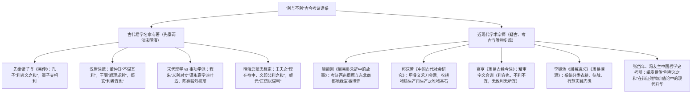

# 《周易》中“利”与“不利”的词义训诂与战略哲学辩证研究

> **创建日期**：2026-10-19  
> **深化修订**：2026-10-20  
> **价值基准评级**：🟢 **1 级文档（核心依赖因子：0.4）**。2026-10-21 经用户裁定正式确权晋升为 1 级价值文档，确立为农耕物质再生产与生生治理哲学核心公理。  
> **研究范畴**：先秦甲金文字训诂、西周农耕生产力考察、古今名家研注谱系（孔子文言、王弼、郑玄、程朱、永嘉事功学派叶适陈亮、王夫之 vs 顾颉刚、郭沫若、高亨、李镜池、张岱年）、句法结构解构、唯物辩证法与“生生”价值标尺  
> **核心结论**：破除汉儒“吉凶占验”与宋儒“重义轻利、义利二元割裂”的唯心流弊；系统吸纳顾颉刚关于“周原根据地利西南与东进灭商地缘政治实证”及郭沫若关于“禾刀会意农耕物质再生产基石”之宗师级成果；解构全经 **99 处“利”**、**21 处“不利”**（含 13 处强肯定的“无不利”与 8 处严格战略禁戒）及 **10 处“无攸利”**，确立其作为**系统动力学评估、战略行动可行性论证与生生治理指南**的先秦哲学体系。

---

## 一、 全景大数据与学术问题提出

在通行本《周易》经文（64 卦卦辞与 384 爻辞）中，“利”是出现频次最高、战略权重最重的主体裁断字之一。全经累计在 **99 处** 卦爻辞中密集出现：
- **卦辞**：全书 64 卦中，有多达 **42 卦** 卦辞包含“利”字（占比高达 **65.6%**），构成了全卦大势判定的核心纲领；
- **爻辞**：全书 384 爻中，共有 **57 处** 爻辞包含“利”字，直接导引具体情境下的行动决策；
- **“不利”**：累计出现 **21 处**；
- **“无攸利”**：累计出现 **10 处**。

然而，后世流俗注疏在此核心范畴上存在两大历史性误读与理论扭曲：

```
【三大历史误读流弊】
 ┌─────────────────────────────────────────────────────────────┐
 │ 1. 汉儒筮占化：将“利”降格为求神问卜的功利报应与吉凶符号     │
 │ 2. 宋儒道德化：将“义”与“利”二元割裂对立，将“利”贬为私欲私害 │
 │ 3. 句法混淆化：不辨“不利”中 62% 实为双重强肯定的“无不利”， │
 │    亦不辨“不利[行动]”之战术禁戒与“无攸利”之系统死局的质变区别 │
 └─────────────────────────────────────────────────────────────┘
```

1. **汉代象数谶纬之流毒**：将“利”浅薄化为占验之词，视作向天神祈求私利福报的利禄征兆，完全抹杀了其作为人类主动把握客观规律、进行能动实践的战略意蕴；
2. **宋儒道学“义利对立”之教条**：董仲舒“正其谊不谋其利，明其道不计其功”与宋代理学“存天理灭人欲”，将“义”与“利”机械割裂、截然对立，把“利”打成小人私欲的代名词。这种道德空谈严重悖离了《周易》“利者，义之和也”、“利物足以和义”的本义，掩盖了先民追求生存发展与物质再生产的客观必然性；
3. **句法结构含混不辨**：对 21 处“不利”缺乏定量解构，忽视了其中 **13 处是双重否定表强烈全面吉顺的“无不利”**，仅有 **8 处** 是真正的战略禁止性“不利”；同时混淆了针对特定方向/行动的“不利”与主体彻底陷入系统死局的“无攸利”。

---

## 二、 “利”的文字发生学与“生生”唯物本义

```
【甲骨文“利”之字形解构】
      禾（成熟禾穗垂颖） 
     ┌┴┐
     │ │   +  刂/刀（收割青铜镰刀）  ===>  【利】
     └┬┘
  （嘉谷收割，民食充盈，社会生产力与生命繁衍之源泉）
```

### （一） 甲金字源考：收割庄稼与物质资料再生产

《说文解字·刀部》：“**利，銛也。从刀。和然后利，从和省。《易》曰：『利者，义之和也。』**”许慎训“銛（锋利）”，实为后起之引申义。

商代甲骨文与西周金文（如大克鼎、毛公鼎）中的“利”字，字形左（或右）为“**禾**”（象嘉谷成熟、穗颖下垂之形），另一侧为“**刀**”（象青铜镰刀之刃）。
- **造字初义**：以镰刀收割成熟之禾稼庄稼。《管子·治国》：“凡治国之道，必先富民。民富则易治也，民贫则难治也……粟也者，民之所开而生也；稼穑者，给民之食而发也。”
- **唯物本质**：在黄河流域定居农耕文明的早期阶段，秋收时节以锋利农具顺利收割谷物，是维持氏族部落生命存续、渡过酷寒严冬、进行人口再生产的**最根本物质前提**。收割顺利、仓廪充实，即是天下之大“利”。

### （二） 《易传》对“利”的哲学升华：“利者，义之和也”

《文言传》（乾卦）对“利”做出了先秦思想史上最深刻的唯物辨证定性：
> **“利者，义之和也……利物足以和义。”**

- **“和”者，适宜与协和也**：符合事物的客观尺度与发展节奏（“各得其宜”）；
- **“利物”者，泽被天下万物也**：通过合理配置资源、兴修水利、适时耕种（“开物成务”），使万民安居乐业、物产丰盈；
- **辩证统一**：唯有使万民与万物均能获得其生存发展的现实利益（“利物”），各阶层矛盾才能达到动态协调平衡（“和义”）。没有物质利益的保障与满足，抽象的道义与礼法不过是空中楼阁。《系辞下》精辟总结：“**天地之大德曰生，圣人之大宝曰位。何以守位曰仁，何以聚人曰财。理财正辞，禁民为非曰义。**”这正是《周易》立足于经济基础决定上层建筑的先秦历史唯物主义光芒。

---

## 三、 “不利”的双重矩阵与战略定性（21 处）

通盘检索全经 21 处“不利”，其在语义和战略功能上呈现出极其清晰的**两极分化**：

```
               ┌── 矩阵 A：“无不利”全胜式肯定（13 处，占 62%）
               │    （双重否定：阻碍彻底出清，顺天应人，全面通达）
【全经 21 处“不利”】
               └── 矩阵 B：战略禁止性“不利”（8 处，占 38%）
                    ├── 方向与地缘禁止（1 处：蹇“不利东北”）
                    ├── 手段与行为禁止（4 处：蒙“不利为寇”、夬“不利即戎”等）
                    └── 主体与定性禁止（3 处：否“不利君子贞”、剥/无妄“不利有攸往”）
```

### （一） 矩阵 A：“无不利”全胜式肯定（13 处，占比 62%）

在 21 处包含“不利”的卦爻辞中，多达 **13 处** 以 **“无不利”**（常与“吉”连言构成“吉，无不利”）的双重否定句式出现。其战略内涵是：**主客观条件已经达到高度协调契合，内在矛盾已经完全化解，阻碍与风险彻底消除，主体无论采取何种前进行动均能获得正向成效**。

| 序号 | 卦爻 | 经文原句 | 达成“无不利”的时位与辩证条件 |
| :---: | :--- | :--- | :--- |
| 1 | **[《坤》六二](../03%20周易笺注/02_坤卦.md)** | 直方大，不习**无不利**。 | 地道纯正、直内方外、德量广大，顺应自然规律无需人为雕琢矫饰，故全面通达。 |
| 2 | **[《屯》六四](../03%20周易笺注/03_屯卦.md)** | 乘马班如，求婚媾，往，吉，**无不利**。 | 居柔得正、上应初九，草创之际求取政治盟友与生产力结合，顺应大势。 |
| 3 | **[《大有》上九](../03%20周易笺注/14_大有卦.md)** | 自天祐之，吉，**无不利**。 | 盛大富有之极而能履信思顺、尚贤谦逊，合于天道天理（《系辞》释：天之所助者顺也）。 |
| 4 | **[《谦》六四](../03%20周易笺注/15_谦卦.md)** | **无不利**，㧑谦。 | 居近君高位而能发挥谦逊品格，损己益下，无所施而不可。 |
| 5 | **[《谦》六五](../03%20周易笺注/15_谦卦.md)** | 不富，以其邻，**利**用侵伐，**无不利**。 | 谦德服众、邻里归心；在此崇高道义威望下动用武力征讨不义，正义之师无往不胜。 |
| 6 | **[《临》九二](../03%20周易笺注/19_临卦.md)** | 咸临，吉，**无不利**。 | 刚中得位、下临万民，以诚感通（咸者感也），统治基础极其稳固。 |
| 7 | **[《剥》六五](../03%20周易笺注/23_剥卦.md)** | 贯鱼，以宫人宠，**无不利**。 | 剥极转机之时，一阴统领诸阴如贯鱼有序列，顺应阳刚君子，转危为安。 |
| 8 | **[《大过》九二](../03%20周易笺注/28_大过卦.md)** | 枯杨生稊，老夫得其女妻，**无不利**。 | 阳刚居下、过而得中；阳刚老干焕发新机，阴阳相济实现生命再生产之新生。 |
| 9 | **[《遁》上九](../03%20周易笺注/33_遁卦.md)** | 肥遁，**无不利**。 | 超脱名利羁绊、远避权位旋涡，退隐得当、自得其乐，彻底消除政治清算风险。 |
| 10 | **[《晋》六五](../03%20周易笺注/35_晋卦.md)** | 悔亡，失得勿恤，往，吉，**无不利**。 | 居尊守柔、不计一时一域之私利得失（失得勿恤），大步前进必获宏大成就。 |
| 11 | **[《解》上六](../03%20周易笺注/40_解卦.md)** | 公用射隼于高墉之上，获之，**无不利**。 | 危机解散之际，藏器于身待时而动，精准清除盘踞高位的顽固恶势力（射隼）。 |
| 12 | **[《鼎》上九](../03%20周易笺注/50_鼎卦.md)** | 鼎玉铉，大吉，**无不利**。 | 新制度建设大成（鼎成），刚柔温润如玉，治理重器稳固传世。 |
| 13 | **[《巽》九五](../03%20周易笺注/57_巽卦.md)** | 贞吉悔亡，**无不利**。 | 深入改革（申命行事）、推陈出新，周密谋划（先庚后庚），法度大行。 |

---

### （二） 矩阵 B：战略禁止性“不利”（8 处）

除 13 处“无不利”外，全经真正的**战略禁止性“不利”仅见于 8 处**。其本质是：**在特定时空维度下，主客观条件严重不备，强行采取某类行动必然招致灾祸或导致生生系统的崩溃**。这 8 处严格划分为三大类型：

#### 1. 地缘空间与战略纵深禁止（1 处）
- **[《蹇》卦辞](../03%20周易笺注/39_蹇卦.md)**：“**蹇：利西南，不利东北；利见大人，贞吉。**”
  - **历史地理考**：周部族发祥于西南周原（歧下），西南地势平缓、民风淳朴，是周人的战略后方基本盘与盟友集聚区；东北则是商王朝统治中心（朝歌、中原腹地），关隘险阻密布，政治压迫严酷。
  - **战略定性**：在“前有险难（见险而能止）”的蹇难时期，利于退守西南巩固基本盘、休养生息；严禁孤军深入东北敌对势力的险隘腹地。

#### 2. 手段工具与行为方式禁止（4 处）
- **[《蒙》上九](../03%20周易笺注/04_蒙卦.md)**：“**击蒙，不利为寇，利御寇。**”
  - 治理愚蒙不能采取暴力压榨、剥夺其生存权利的“寇暴手段”（不利为寇），而应建立防范侵害、保卫民生秩序的“防御自卫手段”（利御寇）。
- **[《夬》卦辞](../03%20周易笺注/43_夬卦.md)**：“**扬于王庭，孚号，有厉，告自邑，不利即戎，利有攸往。**”
  - 铲除奸邪腐败势力，应当在王庭公开彰明法度（扬于王庭）、凝聚天下共识（孚号），严禁私自调动军队进行武装火并（不利即戎），否则必致内乱失控。
- **[《姤》九二](../03%20周易笺注/44_姤卦.md)**：“**包有鱼，无咎，不利宾。**”
  - 阴阳初相遇，机密核心物资与基础资产应在内部妥善封存掌控（包有鱼），不可外泄以待宾客享乐（不利宾），防范系统失控。
- **[《讼》卦辞](../03%20周易笺注/06_讼卦.md)**：“**利见大人，不利涉大川。**”
  - 争端调解期内部信任已崩解，唯有求助权威领袖秉公裁判，严禁在内部矛盾激化时发动对外重大冒险跨越（不利涉大川），入于深渊必灭顶。

#### 3. 主体担当与定性原则禁止（3 处）
- **[《否》卦辞](../03%20周易笺注/12_否卦.md)**：“**否之匪人，不利君子贞，大往小来。**”
  - 天地不交、群小跋扈的逆淘汰暗夜期，君子若死板固守平时的公开正道与正义规章（君子贞），必成政治绞杀的对象。此时当用晦而明、藏器守拙，“不利君子贞”是对君子保全生命的最高保护令！
- **[《剥》卦辞](../03%20周易笺注/23_剥卦.md)**：“**剥：不利有攸往。**”
  - 五阴剥一阳，系统底层基础与上层建筑均在急剧坍塌，对外出击的一切客观条件荡然无存，强行有所作为必加速毁灭。
- **[《无妄》卦辞](../03%20周易笺注/25_无妄卦.md)**：“**其匪正有眚，不利有攸往。**”
  - 动机不纯、违背客观规律，行动必然引发内生性灾眚，严禁盲目行动。

---

## 四、 “无攸利”的战略绝境辨析（10 处）

在《周易》否定性评价体系中，**“无攸利”**（无所往而获利）是比“不利[某具体行动]”更为严厉的系统性定性。

```
【“不利”与“无攸利”的本质跃迁】
┌──────────────────────────────────────┐     ┌──────────────────────────────────────┐
│        不利 [+ 行为/方向]            │     │               无攸利                 │
│  （战术禁戒：不可做A，但可做B）      │ ➔➔➔ │   （战略死局：做任何事皆零/负收益）   │
│  例：蹇“不利东北”——尚可“利西南”    │     │   例：颐“十年勿用，无攸利”——彻底出清 │
└──────────────────────────────────────┘     └──────────────────────────────────────┘
```

遍检全经，“无攸利”共出现 **10 处**（卦辞 2 处，爻辞 8 处），其共同特征是：**主体自身行为严重背离生生规律，导致其在系统中彻底丧失信用、功能或生态位，陷入“动辄得咎”的状态**。

| 序号 | 卦爻 | 经文原句 | 导致陷入“无攸利”的根本原因 | 历史唯物辩证诊断 |
| :---: | :--- | :--- | :--- | :--- |
| 1 | **[《蒙》六三](../03%20周易笺注/04_蒙卦.md)** | 勿用取女，见金夫，不有躬，**无攸利**。 | 见利忘义、丧失独立人格尊严（不有躬）。 | 丧失独立性与主体格位者，在任何合作关系中均毫无长远价值。 |
| 2 | **[《临》六三](../03%20周易笺注/19_临卦.md)** | 甘临，**无攸利**。既忧之，无咎。 | 依靠阿谀奉承、虚伪讨好来治理下民（甘临）。 | 形式主义与虚假治理无法解决现实矛盾，必无实质收益。 |
| 3 | **[《无妄》上九](../03%20周易笺注/25_无妄卦.md)** | 无妄，行有眚，**无攸利**。 | 穷极而动，自以为无妄却盲目妄动。 | 超越时位极限的妄动必然招致系统灾害。 |
| 4 | **[《颐》六三](../03%20周易笺注/27_颐卦.md)** | 拂颐，贞凶，十年勿用，**无攸利**。 | 违背养育大众之正道，自私自肥（拂颐）。 | 违背民生再生产底线，在长达十年的历史周期内沦为弃子。 |
| 5 | **[《恒》初六](../03%20周易笺注/32_恒卦.md)** | 浚恒，贞凶，**无攸利**。 | 刚进入新环境便过早苛求深远恒久（浚恒）。 | 急躁冒进、拔苗助长，根基未固便图全效，必然一无所获。 |
| 6 | **[《大壮》上六](../03%20周易笺注/34_大壮卦.md)** | 羝羊触藩，不能退，不能遂，**无攸利**，艰则吉。 | 盲目用壮猛冲，犄角卡在篱笆中进退失据。 | 失去战略腾挪余地，任何冲撞动弹都无法改变困局。 |
| 7 | **[《萃》六三](../03%20周易笺注/45_萃卦.md)** | 萃如，嗟如，**无攸利**，往无咎，小吝。 | 缺乏组织凝聚原则，孤立哀叹（嗟如）。 | 缺乏主心骨与共同目标的盲目聚合毫无效能。 |
| 8 | **[《归妹》卦辞](../03%20周易笺注/54_归妹卦.md)** | 归妹：征凶，**无攸利**。 | 违背伦理发展次序，急功近利、嫡庶倒错。 | 违背事物正常孕育发展秩序的强行结合，终无善果。 |
| 9 | **[《归妹》上六](../03%20周易笺注/54_归妹卦.md)** | 女承筐无实，士刲羊无血，**无攸利**。 | 宗庙祭祀女承空筐、男宰空羊，形式空洞。 | 形式主义走向极致、内容彻底空虚，生产关系全面瓦解。 |
| 10 | **[《未济》卦辞](../03%20周易笺注/64_未济卦.md)** | 小狐汔济，濡其尾，**无攸利**。 | 小狐狸过河行将登岸却弄湿了尾巴，前功尽弃。 | 关键转折关头缺乏慎终如始的定力，致使成果清零。 |

---

## 五、 独立与组合“利”字的七大战略行动网络

排除“无不利”与“不利/无攸利”后，经文中其余正面表述的“利”字构成了**先民指引组织实践、社会治理与军事博弈的七大战略行动网络**：

```
【“利”的七大战略行动网络】
 1. 利贞（40 处）：坚守再生产正道，维持系统动态稳定底线
 2. 利涉大川（12 处）：以大魄力破局，完成战略大转移与制度飞跃
 3. 利有攸往（16 处）：外部窗口期开启，主动出击拓展生存空间
 4. 利见大人（7 处）：寻找并依靠具有战略眼光的领导核心
 5. 利建侯（3 处）：奠定组织架构与地缘封建制度根基
 6. “利”用 [刑/狱/侵伐/禴/作]（14 处）：具体制度工具与战略手段之施用
 7. 特定主体与情境之贞（9 处）：女贞、牝马之贞、艰贞、居贞等差别化战略
```

### （一） 第一网络：“利贞”（40 处）——坚守再生产正道之底线

“利贞”是全经出现频率最高的凝固词组，见于《乾》《坤》《屯》《同人》《大畜》《离》《恒》《萃》《革》等 40 处卦爻辞中。
- **训诂解构**：清代焦循《易学三书》指出：“贞者，正也；利贞者，利于正也。”高亨《周易古经今注》考辨“贞”为卜问或持守常道，本文不取（见《04_周易中贞的词义训诂与战略哲学研究.md》）。
- **生生哲学**：在客观复杂多变的环境下，主体行动的唯一生路在于**“利于坚守客观规律与生生正道”**。偏离正道（“匪正”），则必生灾眚；回归正道，则系统生发有利。

### （二） 第二网络：“利涉大川”（12 处）——重大战略突围与质变飞跃

“涉大川”是先民生产生活中险峻的物理考验（渡河迁徙或出征探索）。在全经 12 处涉大川论述中，展现了鲜明的辩证法：

| 卦象 | 经文原句 | 是否可涉 | 战略决策依据 |
| :--- | :--- | :---: | :--- |
| **《需》卦辞** | 需：有孚，光亨。贞吉，**利涉大川**。 | **利** | 经过充分隐忍蓄力（需者须也），时机成熟可果断涉险跨越。 |
| **《讼》卦辞** | 利见大人，**不利涉大川**。 | **不利** | 内部矛盾对立白热化，基础不稳，涉水必溺。 |
| **《同人》卦辞** | 同人于野，亨。**利涉大川**，利君子贞。 | **利** | 破除宗族私见、大公于野，万众一心则无险不可平。 |
| **《谦》初六** | 谦谦君子，**用涉大川**，吉。 | **利** | 谦逊居下、深孚众望，以柔制险。 |
| **《蛊》卦辞** | 蛊：元亨。**利涉大川**。先甲三日，后甲三日。 | **利** | 制度沉疴已深，必须以刮骨疗毒之勇气实行根本性打破与重构。 |
| **《大畜》卦辞** | 大畜：利贞，不家食吉，**利涉大川**。 | **利** | 战略资源储备雄厚（大畜），具备经受大风大浪的物质基础。 |
| **《颐》六五** | 拂经，居贞吉，**不可涉大川**。 | **不可** | 违背养正之道、依靠下层托底，严禁进行重大冒险。 |
| **《颐》上九** | 由颐，厉吉，**利涉大川**。 | **利** | 担负天下生养之责的大将之才，关键时刻力挽狂澜。 |
| **《益》卦辞** | 益：利有攸往。**利涉大川**。 | **利** | 损上益下、民心归附，乘风破浪其势不可挡。 |
| **《涣》卦辞** | 涣：亨，王假有庙，**利涉大川**，利贞。 | **利** | 面对人心离散，以乘木舟之法（风行水上）化险为夷、重建向心力。 |
| **《中孚》卦辞** | 中孚：豚鱼吉，**利涉大川**，利贞。 | **利** | 极致诚信感通万物，木在泽上以虚舟济险。 |
| **《未济》六三** | 未济，征凶，**利涉大川**。 | **利** | 旧局未定、前路多险，唯有主动冒险渡河方能开拓新局。 |

### （三） 第三网络：“利有攸往”（16 处）——外部战略机遇期之主动出击

“有攸往”即“有所往也”（积极向外拓展行动）。
- **对比反差**：全经既有《屯》《剥》《无妄》的“勿用有攸往”或“不利有攸往”，更在《复》《恒》《损》《益》《夬》《萃》《巽》等 16 处高呼“**利有攸往**”。
- **决策标尺**：当且仅当系统内部完成了秩序整理（如《损》之克己、《复》之一阳来复、《夬》之决除私弊），且外部环境形成顺畅势能时，“利有攸往”要求领导者不要犹疑观望，必须雷厉风行、扩大战果。

### （四） 第四网络：“利见大人”（7 处）——寻找并确立战略领导核心

出现于《乾·九二》《乾·九五》《讼·卦辞》《蹇·卦辞》《蹇·上六》《萃·卦辞》《巽·卦辞》。
- **唯物辩证**：“大人”者，具备超越狭隘局部私利、通晓天下大势与生生规律之卓越战略领袖；
- 在《乾》之龙德升华、《讼》之争端仲裁、《蹇》之脱离险局、《萃》之聚合万民时，孤军奋战必败，唯有“利见大人”才能确立正确路线，获得破局的向心力与定盘星。

### （五） 第五网络：“利建侯”（3 处）——奠定分权治理与地缘政治底座

见于《屯·卦辞》《屯·初九》《豫·卦辞》。
- **制度考据**：商周之际从部落联盟向宗法封建制演进，“建侯”是派遣宗室功臣裂土分封、建立方国据点、拓荒垦殖的关键制度；
- 在面对宇宙与社会初开的动荡期（屯）或民心欢愉需要组织化的发展期（豫），不能依靠单点集权，唯有“利建侯”，将权责利益下沉，才能形成拱卫中央文明的稳固网状安全格局。

### （六） 第六网络：“利”用……（14 处）——具体制度工具的精准赋能

详见前研（《用和勿用的词义研究》第二矩阵）。在先秦句法中，“**利**用XX”实为“利于施用/使用某项治理工具或制度”（“利”为价值评价断语，“用”为操作动词），而非现代汉语之复合格词“利用”。涵盖：
- **司法刑政**：《蒙·初六》`**利**用刑人`、《噬嗑·卦辞》`**利**用狱`；
- **防务安全**：《谦·六五》`**利**用侵伐`、《渐·九三》`**利**用御寇`；
- **祭祀朝聘**：《萃·六二》/《升·九二》`**利**用禴`、《困·九二》`**利**用享祀`；
- **民生建设**：《益·初九》`**利**用为大作`、《益·六四》`**利**用为依迁国`。
- **战略本质**：制度与工具本身无所谓善恶，关键在于是否“**用之于其当利之时**”。

### （七） 第七网络：特定主体与情境之差别化贞定（9 处）

《周易》从不搞“一刀切”的抽象教条，而是根据主体的性情、角色与具体情境，制定极其精准的“利[某]贞”：
- **[《坤·卦辞》](../03%20周易笺注/02_坤卦.md)**：“**利牝马之贞。**”——阴柔主体的最高美德是温顺、健行而不争先；
- **[《蒙·卦辞》](../03%20周易笺注/04_蒙卦.md)** / **[《随·卦辞》](../03%20周易笺注/17_随卦.md)**：“**利女贞。**”——在顺应依附关系中，贵在坚守柔顺贞洁之德；
- **[《屯·初九》](../03%20周易笺注/03_屯卦.md)**：“**利居贞。**”——草创磐桓之初，不可轻浮盲动，利在安居守正；
- **[《大畜·九三》](../03%20周易笺注/26_大畜卦.md)** / **[《明夷·卦辞》](../03%20周易笺注/36_明夷卦.md)**：“**利艰贞。**”——在至暗时刻与艰难环境深处，利在以坚毅定力苦撑待机。

---

## 六、 古今易学名家与现代学术宗师对“利/不利/无攸利”的研注考证谱系

围绕《周易》中“利”、“不利”与“无攸利”的词义属性、先秦农耕生产力基石与义利之辨，历代经学家与现代史学宗师留下了波澜壮阔的考证与论争谱系：



### （一） 古代易学名家专著研注精要与义利之辨论争

#### 1. 先秦原典与《易传》：道义与功利的辩证合流
- **孔子与《乾·文言》**：世人常引《论语·子罕》“子罕言利与命与仁”，误以为孔子空谈道德、鄙弃利益。实则孔子在《易·文言传》中为“利”确立了先秦思想史上的最高地位：“**利者，义之和也……利物足以和义。**”朱熹亦不得不承认：“利，百物各得其宜也。”使天下万民各得其所、满足物质生存发展之客观需求（利物），正是实现社会普遍正义与和谐（和义）的根本前提；
- **孟子、墨子与荀子之分野**：
  - 孟子见梁惠王曰“王何必曰利，亦有仁义而已矣”，所痛斥者乃战国诸侯“以利相攘”、为一己私欲发动兼并战争之“私利与祸利”，非反对百姓之“生计大利”；
  - 墨子高扬“兼相爱，交相利”，指出“义，利也”（《墨子·经上》），直接将利作为义的本质；
  - 荀子《大略》强调：“先义而后利者荣，先利而后义者辱。荣者常通，辱者常穷。”

#### 2. 汉唐注疏：从神学谶纬到物理顺理
- **董仲舒与汉儒流弊**：《汉书·董仲舒传》提出“正其谊不谋其利，明其道不计其功”，开启了后世腐儒将道义与功利机械割裂、鄙视物质生产的恶劣先例；
- **魏晋王弼《周易注》**：王弼扫除谶纬，紧扣《文言》进行理性阐发。注《乾》：“利，不为妄生，顺理而成，故曰利者义之和也。”注《蹇·卦辞》：“蹇之为义，难也。西南平易，东北险阻。顺理而动则利，逆理而动则不利。”将“利与不利”牢牢锚定在客观物理与地势规律之中；
- **东汉郑玄与唐孔颖达**：郑玄注《易》训“利”为“宜”，结合四时农桑节律；孔颖达《周易正义》疏曰：“言圣人作易，以利济万物，使各得其所，是义之和适也。和适于物，物皆蒙利，故言利者义之和也。”

#### 3. 宋代理学空谈与永嘉事功学派的旷世交战
- **宋代理学的禁欲主义偏差**：程颐《伊川易传》、朱熹《周易本义》受佛教与道教心性论渗透，极度强调“存天理、灭人欲”，将“义”与“利”视为冰炭不相容的死敌。其注《周易》卦爻辞时，频频将经文中极其生动具体的物质生产之“利”，削足适履地塞入道德心性框架中；
- **南宋永嘉事功学派（叶适、陈亮）的深刻清算**：
  - **叶适《习学记言》**对董仲舒、理学家的空谈发出了石破天惊的批判：“**仁人正谊不谋利，明道不计功，此语初看极好，细看全疏！古人以利与人，而不自居其利，故道义光明。后世儒者，行仲舒之论，既无功利，则道义皆虚器耳！**”
  - **陈亮《与朱元晦书》**大声疾呼：“**功到成处，便是有德；事到济处，便是有理！**”直斥朱熹理学闭门谈心性、于国计民生毫无实益。永嘉学派的事功精神，正是对《周易》“开物成务、利涉大川”唯物精神的真正继承。

#### 4. 明清启蒙思想家反思：公利即至义
- **王夫之《周易外传》**：王夫之以深邃的气一元论彻底化解义利对立。船山指出：“**天下之公利，即天下之至义。理在欲中，义即利之得其平者也。**圣人未尝绝利，因天下之利而和之以义；圣人未尝空言义，行天下之义而收其效于利。舍利言义，虚妄之托也；舍义言利，盗贼之行也。”
- **颜元（颜习斋）**：直接针锋相对提出“**正其谊以谋其利，明其道而计其功**”，将是否有利于国计民生、是否具备实际功效，作为检验一切道德与政策的唯一真理标准；
- **焦循《易通释》**：系统检索经文，考辨“利者，通也。易穷则变，变则通，通则久。利即通也，事之顺遂无阻者谓之利”。

---

### （二） 近现代学术宗师考证与历史唯物主义重估

20 世纪疑古学派与马克思主义史学家，彻底剥除了两千年来依附在“利”字上的神学附会，将其还原为殷周之际的地缘政治斗争与生产力实践：

#### 1. 顾颉刚《周易卦爻辞中的故事》(1929)：周原战略大纵深与西周灭商地缘实证
顾颉刚先生在考据《周易》史实背景时，对经文中密集出现的“利与不利”做出了震动学界的地缘政治考据：
- **“利西南，不利东北”之历史地缘实证**：
  - 顾颉刚先生对勘《史记·周本纪》《诗经·大雅·绵》与西周地理：周人祖先古公亶父自豳迁于岐山之阳（周原），位于周原之**西南**。西南地势开阔平缓，氐羌等少数民族与周人世代通婚结盟（《诗》云“爰及姜女，聿来胥宇”），民风淳厚，乃周人稳固的战略大后方与基本盘（《坤》卦所谓“西南得朋”）；
  - 反观**东北**方向，乃商王朝统治核心（朝歌、中原腹地）。商纣暴虐，且密布崇国、密须等商之藩属敌对势力，关隘纵深险阻（《坤》卦所谓“东北丧朋”，《蹇》卦所谓“蹇：利西南，不利东北”）；
  - 顾先生确证：经文在此指明的绝非抽象卦占吉凶，而是周部族在面对大变局与危机险难时，必须坚守的**最高国防战略路线——退守西南基本盘，发展农耕生产与部族同盟（利西南）；严禁孤军深入东北敌对势力腹地盲动送死（不利东北）**！
- **“利建侯”、“利涉大川”与武王伐纣历史对勘**：
  - 考证“利涉大川”实录周武王十一年率兵渡过黄河孟津天险之生死决战（《尚书·泰誓》《史记》载“武王伐纣，渡于孟津，中流白鱼跃入王舟”）；
  - 考证“利建侯”乃武王克商后，周公、成王封建亲戚以蕃屏周的最高封建建国大策；
  - 考证“利用侵伐”乃商末周文王讨伐崇侯虎、季历征伐西落鬼戎的真实军事实践。经文中的“利”，全是先民以鲜血与汗水铸就的历史唯物战略总结。

#### 2. 郭沫若《中国古代社会研究》(1930)：生产力字源与收割嘉谷之唯物基石
郭沫若先生从马克思主义唯物史观出发，深刻解构甲骨文、金文中的“利”字：
- 郭沫若指出，“利”字字形由“**禾**”（成熟垂颖之谷物）与“**刀**”（青铜镰刀农具）构成。这雄辩地证明，“利”的最初来源就是黄河流域定居农耕文明在秋收时节的**割麦刈禾劳动**；
- 生产资料与劳动对象的结合产生“利”，仓廪充实、氏族得以渡过寒冬饥荒并繁衍生息即是“大吉大利”。《周易》通篇所言之“利”，其最深层的物质潜意识，正是农耕社会对生产力繁荣与生命繁衍（生生）的根本保障。

#### 3. 高亨《周易古经今注》：先秦语言文字学精密考订
高亨先生以乾嘉考据之严谨，对全经“利”字进行逐一音训考释：
- 训“利，宜也、吉也，便于事也”；
- 训“不利，不宜也，不可行也”；
- 训“无不利，无所往而不宜也，大顺之辞”；
- 训“无攸利，无所利也，犹言一无所获、动皆不利也”。
高先生的训诂为破除后世随意曲解经文设立了坚实的语文学篱笆。

#### 4. 李镜池《周易探源》《周易通义》：先民生活实态的系统还原
李镜池先生统计并分析了全经 99 处“利”，指出其覆盖了西周社会生活的方方面面：田猎农耕、涉水行商、建国立侯、征战平乱、婚姻结盟。经文中的“利”，是先民在恶劣自然与政治斗争中，通过无数次成败经验积累而成的**行为决策概率库**。

#### 5. 张岱年《中国哲学大纲》：辩证唯物主义价值哲学的先驱
张岱年先生系统梳理中国哲学中“天人”、“知行”与“义利”范畴，高度评价《易传》“利者义之和也”：
- 张先生指出，《周易》开创了中国哲学将“物质利益（利物）”与“道德正义（和义）”有机统一的优良传统，既反对不择手段谋取私利的利己主义，又彻底摒弃了宋儒轻视物质生产的唯心道学，是中国古代朴素唯物辩证价值论的最高峰。

---

## 七、 《周易》义利观与现代辩证法启示

梳理《周易》经文中 99 处“利”、21 处“不利”与 10 处“无攸利”，我们得以彻底拂去封建宋儒覆盖在经典之上的唯心道德尘埃，回归生机勃勃的先秦唯物辩证世界：

```
【《周易》生生义利观三维架构】
 ┌─────────────────────────────────────────────────────────────┐
 │ 1. 唯物基础论：利是生存与物质再生产的客观必然（民生为本）     │
 │ 2. 动态辩证论：利与不利随“时”与“位”而迁演转化（趣时变通） │
 │ 3. 价值终极论：利物足以和义，追求系统全体的可持续繁衍（生生）│
 └─────────────────────────────────────────────────────────────┘
```

1. **以民生再生产为本的唯物主义**：
   《周易》之“利”，本于农夫刈禾、王公建侯、商贾行市、舟楫济川。它毫不避讳对利益、财富与成功的追求，但将其严格锚定在“天下万民之整体福祉”与“社会物质财富之增殖”之上，是真正的**生产力哲学**。
2. **“时中”与动态转化的辩证法**：
   在《周易》中，没有绝对的“利”，也没有绝对的“不利”。同一行为（如“涉大川”），在需卦、同人卦是“利”，在讼卦则是“不利”；同一主体，顺时而动则“吉，无不利”，悖道而动则“十年勿用，无攸利”。一切取决于主观能动性是否精准契合客观发展的**时位节点（趣时者也）**。
3. **“利物和义”的高级系统论**：
   真正的“大义”，不是脱离柴米油盐的道德说教，而是能够协调好不同群体的利益关系、激发整个社会的生生创造力（“利者，义之和也”）。当代在推进治理体系现代化、跨越中等收入陷阱、进行重大改革决断时，《周易》关于“不利即戎，利有攸往”、“不利涉大川”与“利见大人”的严密战略推演，依然是不可多得的中国本土战略哲学智慧。

---

## 八、 全经 64 卦“利 / 不利 / 无攸利”完整数据检索总表

| 卦序 | 卦名 | 经文出现位置 | 原文摘录 | 词汇类别 | 战略属性归类 |
| :---: | :---: | :--- | :--- | :---: | :--- |
| 01 | 乾 | 卦辞 | 乾：元，亨。**利**，贞。 | 利 | 基础正道（利贞） |
| 01 | 乾 | 九二 | 见龙在田，**利**见大人。 | 利 | 寻找核心（利见大人） |
| 01 | 乾 | 九五 | 飞龙在天，**利**见大人。 | 利 | 建立核心（利见大人） |
| 01 | 乾 | 用九 | 见群龙无首，吉。（文言：**利**永贞） | 利 | 爻变体例 |
| 02 | 坤 | 卦辞 | 坤：元亨。**利**牝马之贞……西南得朋，乃与类行，东北丧朋，乃终有庆。安贞之吉，应地无疆。 | 利 | 主体贞定（利牝马之贞） |
| 02 | 坤 | 六二 | 直方大，不习**无不利**。 | 不利（无不利） | 全胜肯定（无不利） |
| 03 | 屯 | 卦辞 | 屯：元亨，**利**贞。勿用有攸往，**利**建侯。 | 利 | 组织奠基（利建侯） |
| 03 | 屯 | 初九 | 磐桓，**利**居贞，**利**建侯。 | 利 | 组织奠基（利建侯） |
| 03 | 屯 | 六四 | 乘马班如，求婚媾，往，吉，**无不利**。 | 不利（无不利） | 全胜肯定（无不利） |
| 04 | 蒙 | 卦辞 | 蒙：亨。匪我求童蒙，童蒙求我，初筮告，再三渎，渎则不告。**利**贞。 | 利 | 基础正道（利贞） |
| 04 | 蒙 | 初六 | 发蒙，**利**用刑人，用说桎梏，以往，吝。 | 利（利用） | 制度工具（利用刑人） |
| 04 | 蒙 | 六三 | 勿用取女，见金夫，不有躬，**无攸利**。 | 无攸利 | 系统死局（无攸利） |
| 04 | 蒙 | 上九 | 击蒙，**不利**为寇，**利**御寇。 | 不利 / 利 | 手段禁戒（不利为寇） |
| 05 | 需 | 卦辞 | 需：有孚，光亨。贞吉，**利**涉大川。 | 利 | 战略突围（利涉大川） |
| 06 | 讼 | 卦辞 | 讼：有孚，窒，惕，中吉，终凶。**利**见大人，**不利**涉大川。 | 利 / 不利 | 手段禁戒（不利涉大川） |
| 07 | 师 | 卦辞 | 师：贞，丈人吉，无咎。（彖：能以众正，可以王矣。刚中而应，行险而顺，以此毒天下而民从之，吉又何咎矣！） | — | — |
| 08 | 比 | 卦辞 | 比：吉。原筮，元永贞，无咎。不宁方来，后夫凶。 | — | — |
| 09 | 小畜 | 卦辞 | 小畜：亨。密云不雨，自我西郊。 | — | — |
| 10 | 履 | 卦辞 | 履：履虎尾，不咥人，亨。 | — | — |
| 11 | 泰 | 卦辞 | 泰：小往大来，吉，亨。 | — | — |
| 12 | 否 | 卦辞 | 否之匪人，**不利**君子贞，大往小来。 | 不利 | 主体禁戒（不利君子贞） |
| 13 | 同人 | 卦辞 | 同人于野，亨。**利**涉大川，**利**君子贞。 | 利 | 战略突围（利涉大川） |
| 14 | 大有 | 九二 | 大车以载，有攸往，无咎。 | — | — |
| 14 | 大有 | 上九 | 自天祐之，吉，**无不利**。 | 不利（无不利） | 全胜肯定（无不利） |
| 15 | 谦 | 卦辞 | 谦：亨，君子有终。 | — | — |
| 15 | 谦 | 六四 | **无不利**，㧑谦。 | 不利（无不利） | 全胜肯定（无不利） |
| 15 | 谦 | 六五 | 不富，以其邻，**利**用侵伐，**无不利**。 | 利（利用） / 无不利 | 制度工具 / 全胜肯定 |
| 16 | 豫 | 卦辞 | 豫：**利**建侯行师。 | 利 | 组织拓展（利建侯行师） |
| 17 | 随 | 卦辞 | 随：元亨，**利**贞，无咎。 | 利 | 基础正道（利贞） |
| 18 | 蛊 | 卦辞 | 蛊：元亨。**利**涉大川。先甲三日，后甲三日。 | 利 | 战略突围（利涉大川） |
| 19 | 临 | 卦辞 | 临：元亨，**利**贞。至于八月有凶。 | 利 | 基础正道（利贞） |
| 19 | 临 | 九二 | 咸临，吉，**无不利**。 | 不利（无不利） | 全胜肯定（无不利） |
| 19 | 临 | 六三 | 甘临，**无攸利**。既忧之，无咎。 | 无攸利 | 系统死局（无攸利） |
| 20 | 观 | 卦辞 | 观：盥而不荐，有孚颙若。 | — | — |
| 20 | 观 | 六二 | 窥观，**利**女贞。 | 利 | 主体贞定（利女贞） |
| 20 | 观 | 六四 | 观国之光，**利**用宾于王。 | 利（利用） | 制度工具（利用宾于王） |
| 21 | 噬嗑 | 卦辞 | 噬嗑：亨。**利**用狱。 | 利（利用） | 制度工具（利用狱） |
| 21 | 噬嗑 | 六二 | 噬肤灭鼻，无咎。（象：乘刚也） | — | — |
| 21 | 噬嗑 | 九四 | 噬干胏，得金矢，**利**艰贞，吉。 | 利 | 主体贞定（利艰贞） |
| 22 | 贲 | 卦辞 | 贲：亨。**小利**有攸往。 | 利 | 机遇出击（利有攸往） |
| 23 | 剥 | 卦辞 | 剥：**不利**有攸往。 | 不利 | 行动禁戒（不利有攸往） |
| 23 | 剥 | 六五 | 贯鱼，以宫人宠，**无不利**。 | 不利（无不利） | 全胜肯定（无不利） |
| 24 | 复 | 卦辞 | 复：亨。出入无疾，朋来无咎。反复其道，七日来复，**利**有攸往。 | 利 | 机遇出击（利有攸往） |
| 25 | 无妄 | 卦辞 | 无妄：元亨。**利**贞。其匪正有眚，**不利**有攸往。 | 利 / 不利 | 基础正道 / 行动禁戒 |
| 25 | 无妄 | 六二 | 不耕获，不菑畬，则**利**有攸往。 | 利 | 机遇出击（利有攸往） |
| 25 | 无妄 | 上九 | 无妄，行有眚，**无攸利**。 | 无攸利 | 系统死局（无攸利） |
| 26 | 大畜 | 卦辞 | 大畜：**利**贞，不家食吉，**利**涉大川。 | 利 | 战略突围（利涉大川） |
| 26 | 大畜 | 九三 | 良马逐，**利**艰贞，吉。日闲舆卫，**利**有攸往。 | 利 | 主体贞定 / 机遇出击 |
| 27 | 颐 | 卦辞 | 颐：贞吉。观颐，自求口实。 | — | — |
| 27 | 颐 | 六三 | 拂颐，贞凶，十年勿用，**无攸利**。 | 无攸利 | 系统死局（无攸利） |
| 27 | 颐 | 上九 | 由颐，厉吉，**利**涉大川。 | 利 | 战略突围（利涉大川） |
| 28 | 大过 | 卦辞 | 大过：栋桡，**利**有攸往，亨。 | 利 | 机遇出击（利有攸往） |
| 28 | 大过 | 九二 | 枯杨生稊，老夫得其女妻，**无不利**。 | 不利（无不利） | 全胜肯定（无不利） |
| 29 | 坎 | 卦辞 | 习坎：有孚，维心亨，行有尚。 | — | — |
| 30 | 离 | 卦辞 | 离：**利**贞，亨。畜牝牛，吉。 | 利 | 基础正道（利贞） |
| 31 | 咸 | 卦辞 | 咸：亨，**利**贞，取女吉。 | 利 | 基础正道（利贞） |
| 32 | 恒 | 卦辞 | 恒：亨，无咎。**利**贞，**利**有攸往。 | 利 | 基础正道 / 机遇出击 |
| 32 | 恒 | 初六 | 浚恒，贞凶，**无攸利**。 | 无攸利 | 系统死局（无攸利） |
| 33 | 遁 | 卦辞 | 遁：亨，**小利**贞。 | 利 | 基础正道（小利贞） |
| 33 | 遁 | 上九 | 肥遁，**无不利**。 | 不利（无不利） | 全胜肯定（无不利） |
| 34 | 大壮 | 卦辞 | 大壮：**利**贞。 | 利 | 基础正道（利贞） |
| 34 | 大壮 | 上六 | 羝羊触藩，不能退，不能遂，**无攸利**，艰则吉。 | 无攸利 | 系统死局（无攸利） |
| 35 | 晋 | 卦辞 | 晋：康侯用锡马蕃庶，昼日三接。 | — | — |
| 35 | 晋 | 六五 | 悔亡，失得勿恤，往，吉，**无不利**。 | 不利（无不利） | 全胜肯定（无不利） |
| 36 | 明夷 | 卦辞 | 明夷：**利**艰贞。 | 利 | 主体贞定（利艰贞） |
| 36 | 明夷 | 初九 | 明夷于飞，垂其翼。君子于行，三日不食。有攸往，主人有言。 | — | — |
| 37 | 家人 | 卦辞 | 家人：**利**女贞。 | 利 | 主体贞定（利女贞） |
| 38 | 睽 | 卦辞 | 睽：小事吉。 | — | — |
| 39 | 蹇 | 卦辞 | 蹇：**利**西南，**不利**东北；**利**见大人，贞吉。 | 利 / 不利 | 空间禁戒（不利东北） |
| 39 | 蹇 | 上六 | 往蹇来硕，吉；**利**见大人。 | 利 | 寻找核心（利见大人） |
| 40 | 解 | 卦辞 | 解：**利**西南，无所往，其来复吉。有攸往，夙吉。 | 利 | 地缘空间（利西南） |
| 40 | 解 | 上六 | 公用射隼于高墉之上，获之，**无不利**。 | 不利（无不利） | 全胜肯定（无不利） |
| 41 | 损 | 卦辞 | 损：有孚，元吉。无咎，可贞，**利**有攸往。曷之用？二簋可用享。 | 利 | 机遇出击（利有攸往） |
| 41 | 损 | 上九 | 弗损益之，无咎，贞吉，**利**有攸往，得臣无家。 | 利 | 机遇出击（利有攸往） |
| 42 | 益 | 卦辞 | 益：**利**有攸往。**利**涉大川。 | 利 | 突围与出击并进 |
| 42 | 益 | 初九 | **利**用为大作，元吉，无咎。 | 利（利用） | 制度工具（利用为大作） |
| 42 | 益 | 六二 | 或益之十朋之龟，弗克违，永贞吉。王用享于帝，吉。 | — | — |
| 42 | 益 | 六四 | 中行，告公从。**利**用为依迁国。 | 利（利用） | 制度工具（利用为依迁国） |
| 43 | 夬 | 卦辞 | 夬：扬于王庭，孚号，有厉，告自邑，**不利**即戎，**利**有攸往。 | 不利 / 利 | 手段禁戒（不利即戎） |
| 44 | 姤 | 九二 | 包有鱼，无咎，**不利**宾。 | 不利 | 行为禁戒（不利宾） |
| 45 | 萃 | 卦辞 | 萃：王假有庙，**利**见大人，亨。**利**贞。用大牲吉，**利**有攸往。 | 利 | 核心 / 正道 / 出击三重 |
| 45 | 萃 | 六二 | 引吉，无咎，孚，乃**利**用礿。 | 利（利用） | 制度工具（利用礿） |
| 45 | 萃 | 六三 | 萃如，嗟如，**无攸利**，往无咎，小吝。 | 无攸利 | 系统死局（无攸利） |
| 46 | 升 | 卦辞 | 升：元亨，用见大人，勿恤，南征吉。 | — | — |
| 46 | 升 | 九二 | 孚，乃**利**用礿，无咎。 | 利（利用） | 制度工具（利用礿） |
| 47 | 困 | 卦辞 | 困：亨，贞，大人吉，无咎。有言不信。 | — | — |
| 47 | 困 | 九二 | 困于酒食，朱紱方来，**利**用享祀，征凶，无咎。 | 利（利用） | 制度工具（利用享祀） |
| 48 | 井 | 卦辞 | 井：改邑不改井，无丧无得，往来井井。汔至，亦未繘井，羸其瓶，凶。 | — | — |
| 49 | 革 | 卦辞 | 革：巳日乃孚，元亨，**利**贞，悔亡。 | 利 | 基础正道（利贞） |
| 50 | 鼎 | 卦辞 | 鼎：元吉，亨。 | — | — |
| 50 | 鼎 | 上九 | 鼎玉铉，大吉，**无不利**。 | 不利（无不利） | 全胜肯定（无不利） |
| 51 | 震 | 卦辞 | 震：亨。震来虩虩，笑言哑哑。震惊百里，不丧匕鬯。 | — | — |
| 52 | 艮 | 卦辞 | 艮：艮其背，不获其身，行其庭，不见其人，无咎。 | — | — |
| 53 | 渐 | 卦辞 | 渐：女归吉，**利**贞。 | 利 | 基础正道（利贞） |
| 53 | 渐 | 九三 | 鸿渐于陆，夫征不复，妇孕不育，凶；**利**用御寇。 | 利（利用） | 制度工具（利用御寇） |
| 54 | 归妹 | 卦辞 | 归妹：征凶，**无攸利**。 | 无攸利 | 系统死局（无攸利） |
| 54 | 归妹 | 上六 | 女承筐无实，士刲羊无血，**无攸利**。 | 无攸利 | 系统死局（无攸利） |
| 55 | 丰 | 卦辞 | 丰：亨，王假之，勿忧，宜日中。 | — | — |
| 56 | 旅 | 卦辞 | 旅：小亨，旅贞吉。 | — | — |
| 57 | 巽 | 卦辞 | 巽：小亨。**利**有攸往。**利**见大人。 | 利 | 出击与核心双重 |
| 57 | 巽 | 九五 | 贞吉悔亡，**无不利**。无初有终，先庚三日，后庚三日，吉。 | 不利（无不利） | 全胜肯定（无不利） |
| 58 | 兑 | 卦辞 | 兑：亨，**利**贞。 | 利 | 基础正道（利贞） |
| 59 | 涣 | 卦辞 | 涣：亨，王假有庙，**利**涉大川，**利**贞。 | 利 | 战略突围与正道 |
| 60 | 节 | 卦辞 | 节：亨。苦节不可贞。 | — | — |
| 61 | 中孚 | 卦辞 | 中孚：豚鱼吉，**利**涉大川，**利**贞。 | 利 | 战略突围与正道 |
| 62 | 小过 | 卦辞 | 小过：亨，**利**贞，可小事，不可大事。飞鸟遗之音，不宜上，宜下，大吉。 | 利 | 基础正道（利贞） |
| 63 | 既济 | 卦辞 | 既济：亨，**小利**贞，初吉终乱。 | 利 | 基础正道（小利贞） |
| 64 | 未济 | 卦辞 | 未济：亨。小狐汔济，濡其尾，**无攸利**。 | 无攸利 | 系统死局（无攸利） |
| 64 | 未济 | 六三 | 未济，征凶，**利**涉大川。 | 利 | 战略突围（利涉大川） |

---

<sub>© 2026 徐时言 · 《《周易》中“利”与“不利”的词义训诂与战略哲学辩证研究》 · 徐时言-易经研究 · 采用 CC BY-NC-ND 4.0 许可， 转载请署名并注明来源 https://wole278.github.io/xushiyan-YiJing/ · 禁止商业使用与改编传播 · 商业授权：wole278@hotmail.com / 微信 wole278</sub>
