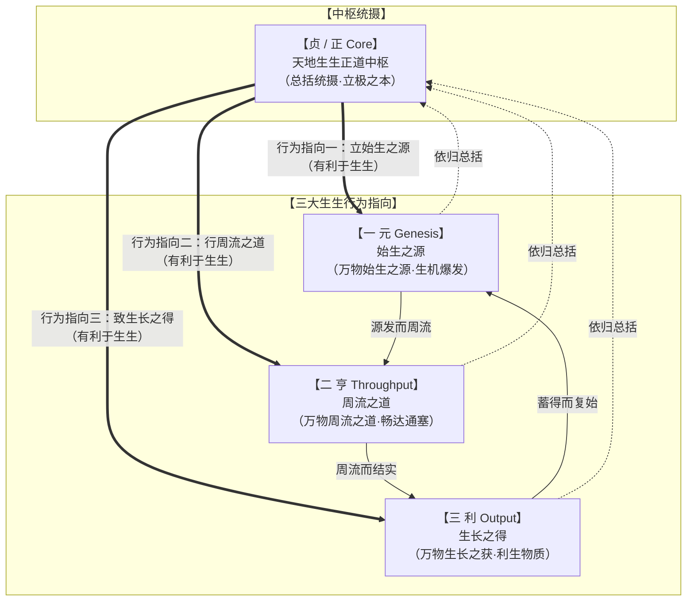

# 《周易》中“元、亨、利、贞”的词义通考与生生系统演进哲学研究

> **创建日期**：2026-10-20  
> **价值基准评级**：🟢 **1 级文档（核心依赖因子：0.4）**。2026-10-21 经用户裁定正式确权晋升为 1 级价值文档，确立为全书生生系统动力学核心总公理。  
> **深化修订**：2026-10-20（全面吸纳乾坤本体单字论、各卦复合形态质变规律、“亨”字两音两义训诂、屯卦《彖传》句读纠偏与“贞为元亨利之总结”最高裁决）  
> **研究范畴**：乾炁本体论、乾坤化生、各卦复合形态、字音两读（hēng 通达 vs xiǎng 祭享同“享”）、商周甲金文字考据、屯卦天地大理考辨、《彖传》“大亨，贞”精准句读、四德演化史与生生自然正道哲学体系  
> **核心结论**：
> 1. **乾卦单字独立表达的本体唯一性**：唯有在《乾》卦中，“元、亨、利、贞”是纯粹的单字独立表达——**元**，言乾炁乃万物之始；**亨**，言乾炁通达无界；**利**，言乾炁利生万物；**贞**，言乾炁煌煌正正。《坤》卦承接化生——**元**，言坤地乃万物生成之所；**亨**，言坤地“不习无不利”，所以能成万物之生，乾坤由此化生。
> 2. **乾坤之后无单字表达的结构质变**：乾坤之后，其余 62 卦中，“元、亨、利、贞”**严格皆非单字表达**，全部进入具体时空制约下的复合结构（如“元亨”、“利贞”、“小亨”、“元吉”、“利涉大川”、“利建侯”等），揭示易道由本体创生进入具体情境博弈之规律。
> 3. **“亨”字两音两义严格训诂分野**：明确区分 **hēng（亨通周流）** 与 **xiǎng（同“享/烹”，祭祀宴飨）**。爻辞中大有九三、随上六、升六四严格训 xiǎng，其余及卦辞皆训 hēng。
> 4. **屯卦与《彖传》句读订正**：屯卦卦辞“元亨，利贞”，言自开始便生长之道通达，处天地大理，利于正守自然生发之道；《彖传》“动乎险中，大亨，贞”，**断句必为“大亨，贞”，绝非机械合读【大亨贞】**！“大亨”在于屯生之道乃个体皆有权拥有的天地大理，“贞”在于正守自然生发之道。
> 5. **“贞”作为元亨利生生大闭环的终极总结**：**元**，自然万物皆始于此；**亨**，自然万物皆周流；**利**，自然万物皆利于生发；**贞**，此为天地自然正道！**贞是易道元、亨、利于自然万物生发的总括与总结；凡有所归于元、亨、利者，方可以为贞（正）！** 破除脱离生民福祉与物类生发之抽象道德空谈。

---

## 一、 乾坤本体与乾坤之后各卦的句法形态质变

在《周易》64 卦的文本结构中，“元、亨、利、贞”的出现形态存在一道贯通全书的**根本性分水岭**：**乾坤本体与后天各卦的句法形态质变**。

```
【“元亨利贞”从先天乾坤本体到后天各卦演进图谱】

   ┌────────────────────────────────────────────────────────┐
   │ 【乾卦：纯阳乾炁本体（唯一单字独立表达）】            │
   │  - 元：乾炁乃万物之始                                  │
   │  - 亨：乾炁通达无界                                    │
   │  - 利：乾炁利生万物                                    │
   │  - 贞：乾炁煌煌正正                                    │
   └──────────────────────────┬─────────────────────────────┘
                              │
                              ▼ 【乾坤化生】
   ┌────────────────────────────────────────────────────────┐
   │ 【坤卦：纯阴承载实体（具象赋形）】                    │
   │  - 元：坤地乃万物生成之所                              │
   │  - 亨：坤地不习无不利，成万物之生                      │
   │  - 利贞：特系“牝马之贞”，限定柔顺承天                 │
   └──────────────────────────┬─────────────────────────────┘
                              │
                              ▼ 【形态质变：本体降落入具体时空】
   ┌────────────────────────────────────────────────────────┐
   │ 【乾坤之后 62 卦：严格皆非单字表达（复合情境化）】     │
   │  - 元亨：战略始发通达（屯、随、临、无妄、革等）       │
   │  - 利贞 / 贞吉 / 贞凶：具体时位下之底线守持与禁戒      │
   │  - 小亨 / 亨小：受限条件下的局部流通（旅、巽、既济）    │
   │  - 元吉 / 元永贞：具体行动与法权之极高赞誉             │
   └────────────────────────────────────────────────────────┘
```

### （一） 《乾》卦：四字单字独立表达的本体唯一性

全书 64 卦中，**唯有乾卦卦辞是“乾：元，亨，利，贞。”四个单字独立表达**：
1. **元**：言**乾炁乃万物之始**。纯阳刚健，宇宙初始能量之大爆发，生命原初生机之勃发源泉。《彖》曰：“大哉乾元，万物资始，乃统天。”
2. **亨**：言**乾炁通达无界**。至阳周流，无所不入，无滞无碍，化育万象。《彖》曰：“云行雨施，品物流形。”
3. **利**：言**乾炁利生万物**。阳和普照，无私普施，滋养群品而不自居其德。《文言》曰：“乾始能以美利利天下，不言所利，大矣哉！”
4. **贞**：言**乾炁煌煌正正**。大中至正，纯粹精纯，永恒持守天地至健至正之道。《文言》曰：“大哉乾乎！刚健中正，纯粹精也。”

### （二） 《坤》卦：承载生成与乾坤化生

《坤》卦紧承《乾》卦，构成了生命生发的物质再生产与承载底座：
1. **元**：言**坤地乃万物生成之所**。大地厚德载物，为乾炁所始发之万物提供形体寄托与生长土壤。《彖》曰：“至哉坤元，万物资生，乃顺承天。”
2. **亨**：言**坤地乃“不习无不利”，所以能成万物之生**。地道广大，不求自作聪明，纯任自然造化，地力周流充盈，由此实现“品物咸亨”，乾坤合德而化生万物。
3. **利牝马之贞**：与乾卦纯阳单字“利，贞”不同，坤卦之利贞特加“牝马”限定——牝马顺从大地，奔驰无疆，代表阴柔之质必须以顺承天道为正固。

> **生命本体论深义（生死合离之宇宙律则）**：  
> 这一乾坤化生的最高原理，正源自于生命诞生的真实律则：人胎生受孕之后，一点生机自宇宙太虚中感应降落，点燃生命之火。这一炁生机，即是**纯阳乾炁**（生命真正的源头、始生之源，通达无界而利生万物）；而人体躯壳、精血形骸便是**坤土**（万物生成之所）。  
> **乾坤相合，便是生发（生）；乾坤相离，便是死亡（死）！**  
> 佛家言神识入胎成羯罗蓝、道家言先天一炁落入肉身坤炉，皆同此宇宙大道。详见本库专题理论专论 `02 元研究/乾坤生息论.md`。

### （三） 乾坤之后：其余各卦严格皆非单字表达

**这是一条被后世流俗注疏普遍忽略的易学结构规律：乾坤之后，其余 62 卦中，元、亨、利、贞都不再是单字表达！**

通盘检索 64 卦经文：
- **无独立单字“元”**：乾坤之后，经文中从未出现单字“元。”。凡出现“元”，必与其他字组合成词——卦辞中必作“元亨”（屯、随、临、无妄、蛊、升、革等）或“元吉”（损、鼎）；爻辞中必作“元吉”（12 处）、“元永贞”（萃九五）或“元夫”（睽九四）；
- **无独立单字“利”**：乾坤之后，经文中严格无单字“利。”作断语。凡“利”，必连带指向对象与行为——“利贞”、“利建侯”、“利涉大川”、“利见大人”、“利有攸往”、“利用狱”等；
- **极少独立单字“亨”与“贞”**：即使偶尔单字出现（如蒙卦“蒙：亨。”），亦受全卦险阻童蒙之具体情境严格约束，再无乾卦纯阳四德并具的形而上学本体地位。

> **唯物演化法则**：乾坤代表天地宇宙总体的创生与承载本体，故能直书“元、亨、利、贞”单字独立挺拔立极；乾坤一旦化生万物，世界便进入具体的自然生态、阶级社会与地缘博弈的时空网络中。任何生命活动与战略行动，都必须在特定约束条件下展开，故其表达必然降落为“复合表达”与“有条件表达”。

---

## 二、 “亨”字两音两义之严格界定与文字发生学

在训诂学与易经词义体系中，**“亨”字具有两大截然不同的读音与义项，必须严格辨析，绝不可含混混同**。

```
【“亨”字两大读音、字源与义项严格对照表】
┌──────┬──────────┬──────────┬──────────────────────┬──────────────────────────────────────────┐
│ 读音 │ 对应本字 │ 核心字义 │ 语法功能与情境       │ 经传典型出处与实证                       │
├──────┼──────────┼──────────┼──────────────────────┼──────────────────────────────────────────┤
│ hēng │ 亨（亨通）│ 通达、周流│ 描述生命/社会之畅达无│ 1. 卦辞：乾、坤、屯、随、临、革等 39 卦  │
│      │          │ 无碍、生发│ 阻；系统流通网络     │ 2. 爻辞：否初六、否六二、大畜上九、节六四│
│      │          │          │                      │ 3. 传文：品物咸亨、大亨以正、大亨贞      │
├──────┼──────────┼──────────┼──────────────────────┼──────────────────────────────────────────┤
│ xiǎng│ 享（祭享）│ 享献、祭祀│ 专指宗庙告祭、朝贡天│ 1. 爻辞：大有九三“公用亨于天子”        │
│      │ 通“烹饪” │ 宴飨、烹调│ 子与诸侯宴饮礼仪     │ 2. 爻辞：随上六“王用亨于西山”          │
│      │          │          │                      │ 3. 爻辞：升六四“王用亨于岐山”          │
│      │          │          │                      │ 4. 彖传：鼎卦“圣人亨以享上帝，大亨以养”│
└──────┴──────────┴──────────┴──────────────────────┴──────────────────────────────────────────┘
```

### （一） 读 xiǎng：殷周宗庙祭享与宴飨之礼

殷商甲骨文与西周早期金文中，“**亨**”、“**享**”、“**烹**”三字同源同构，象宗庙重屋之上设鼎俎进献熟食之形：
1. **《大有》九三**：“公用亨于天子，小人弗克。”
   - **音义**：此“亨”必读 **xiǎng**，通“享”。指诸侯（公侯）入朝觐见天子，举行盛大的朝享献贡典礼与宴飨礼。小人若僭用此礼，则招致祸乱；
2. **《随》上六**：“拘系之，乃从维之。王用亨于西山。”
   - **音义**：此“亨”必读 **xiǎng**，通“享”。西周先王（文王、太王）在西山（岐山一带）举行宗庙祭享之盛礼，会合诸侯，结成政治同盟；
3. **《升》六四**：“王用亨于岐山，吉无咎。”
   - **音义**：此“亨”必读 **xiǎng**，通“享”。周王在发祥根据地岐山举行告祭大礼，告慰先祖，凝结人心；
4. **《鼎》卦《彖传》之互训**：“鼎，象也。以木巽火，**亨（pēng烹）饪**也。圣人**亨（pēng/xiǎng）以享上帝**，而**大亨（xiǎng宴飨）以养圣贤**。”
   - 此处孔子《彖传》极其精准地将“烹饪”、“享上帝”、“养圣贤”三层含义在同一字下彻底贯通，显露出商周礼制宗庙祭飨的原生面貌。

### （二） 读 hēng：自然周流与社会系统之大通达

除去上述特定礼制语境中的 3 处爻辞，其余全书 39 卦卦辞与 4 处爻辞中，“亨”字皆读 **hēng**：
- **含义**：通达、周流、无阻碍流通。
- **唯物系统学内涵**：阴阳二气交通，上下政令通达，农耕水利畅流，商品贸易无滞。《彖传》赞乾坤曰“品物流形”、“品物咸亨”，赞益卦曰“天施地生，其益无方”，赞泰卦曰“天地交而万物通也”。此即“**亨者，嘉之会也**”，是系统要素之间无边界、无阻滞的协同周流。

---

## 三、 屯卦考析与《彖传》句读之精准纠偏

在乾坤化生之后，首开第一卦即是《屯》卦。深刻理解《屯》卦的经文与传文，是把握后天各卦“元亨利贞”演变规律的关键枢纽。

### （一） 《屯》卦卦辞：“元亨，利贞”的天地大理

《屯》卦辞曰：“**屯：元亨，利贞。勿用有攸往，利建侯。**”
- **生长之道自始通达**：屯虽为草创初生、万物稚嫩、充满艰难险阻（“动乎险中”）之象，但其内蓄之生命冲力与生长之道，自开始便处于与天地大化相接的通达之中；
- **处天地大理**：生命之所以能在草创艰难中“大亨”，在于生生不息、繁衍扩张乃是**天地自然赋予一切独立生命个体的普遍权利与根本大理**！任何个体在草创时期顺应天理生发，其道必通；
- **利于正守自然生发之道**：“利贞”，并非机械守旧，而是在草创的剧烈动荡中，牢牢守住自然生发的初心与根据地（“利居贞”、“利建侯”），不盲目冒险躁进（“勿用有攸往”）。

### （二） 《彖传》“动乎险中，大亨，贞”句读之千古订正

长期以来，流俗注疏常将《屯》卦《彖传》与《随》卦《彖传》的文本机械合读为【大亨贞】，误以为是一个三个字的专有名词，从而掩盖了其深邃的义理脉络。

```
【《屯》卦《彖传》断句正误深度比照】

 ❌ 流俗误读：屯，刚柔始交而难生，动乎险中，【大亨贞】。
              （将“大亨贞”合为一词，语义含混不清）

 ✅ 正准断句：屯，刚柔始交而难生，动乎险中，【大亨，贞】。
              （“大亨”承接动乎险中，“贞”独立立极，正守天理）
```

> **《彖传》精准句读辨正**：
> 1. **“动乎险中，大亨”**：在艰难险阻的深渊中运动生长，为什么反能“大亨”？因为屯卦所体现的生存与自强之道，是宇宙一切生命个体皆有权拥有的**天地大理**！大理在身，虽动于险中而前途必然大通！
> 2. **“贞”**：独立为一句！面对险阻草创，“贞”即是坚定不移地正守这一自然生发之道，锚定根本根据地，不为浮华虚妄所动。
> 3. 后文“雷雨之动满盈，天造草昧，宜建侯而不宁”，正是对“大亨，贞”的制度化展开——通过建立根据地（建侯）来组织社会生产，以日夜警惕（不宁）来践行“贞”的战略定力。

---

## 四、 生生系统动力学模型：以“贞（正）”为中心的三大生生行为指向

依据生生易道的最高哲学法则，在生生系统动力学模型中，**贞（正）绝非与元、亨、利并列于外周圆环的一隅，而是居于绝对中枢的核心！**

```
【生生系统动力学模型（The Core-Periphery Generative Dynamics Model）】

                        【一 元 Genesis】
                            始生之源
                     （万物之始，生机爆发）
                             ▲   │
                             │   │ 行为指向一：立始生之源
                             │   ▼
                     ┌───────────────────┐
                     │   【贞 / 正 Core】  │
                     │  天地生生正道中枢  │
                     │ （总括统摄·立极之本）│
                     └───────────────────┘
                      ▲   │         │   ▲
                      │   │         │   │
          行为指向二  │   ▼         ▼   │  行为指向三
        行周流之道    │                 │  致生长之得
  【二 亨 Throughput】─┘                 └─> 【三 利 Output】
        周流之道                                  生长之得
  （万物周流，畅达通塞）                    （生长之获，利生物质）
```



### （一） 中枢与三大外生行为指向解构：三者皆有利于生生

以“贞（正）”为中心，向外生发三个不可分割的行为指向，三者皆有利于天地万物之生生：

1. **中枢本体：【贞 / 正】——天地生生正道中枢（立极之本）**
   - 《说文》：“贞，卜问也，从卜贝。”《尔雅》：“贞，正也，定也。”《文言》：“贞者，事之干也。”
   - “贞（正）”居于整个生生系统动力的**核心中枢**。天道以“生生”为大德，万物以繁衍成长为大理。贞之所以为“正”，正在于其坚定不移地以促成生命演进、社会再生产与文明存续为终极准绳。
   - 贞居中心，立主干，统摄全局，向外生发出三大必然行为指向。

2. **行为指向一：【一 元】——始生之源（有利于生生）**
   - **元为始生之源**。万物皆始于此，初始生机之大爆发，生机动能之原发地；
   - 贞道向外辐射的第一行为指向：**立始生之源**。任何系统要存续发展，中枢必须首先开启创生之源泉，注入初始动力（乾元资始、坤元资生、春生破土、科技创新、组织初创）。若无始生之源，天地万物陷于死寂枯槁，何谈正道！

3. **行为指向二：【二 亨】——周流之道（有利于生生）**
   - **亨为周流之道**。万物皆周流通达，要素无边界交互流转之通路；
   - 贞道向外辐射的第二行为指向：**行周流之道**。生机始发之后，必须打破一切内外阻隔壁垒，促使气机、资源、信息通畅流转（云行雨施、品物咸亨、上下政通、经脉畅达）。流通则生机盎然，阻塞则痈疽立生。故正道必须行周流之道，确保系统各层级要素无障碍协同！

4. **行为指向三：【三 利】——生长之得（有利于生生）**
   - **利为生长之得**。万物生长之收获，生命得到真实物质滋养与再生产；
   - 贞道向外辐射的第三行为指向：**致生长之得**。周流大化必落实为实在的生命成果（禾刀收割、仓廪丰盈、人民得其养、物类遂其生）。“利者，义之和也”，唯有让广大人民与自然万物真正享有生长之得，社会生产关系才能和谐协调。没有生长之得的物质实体支撑，一切理念皆成泡影。

### （二） 核心哲学总结：元为始生之源，亨为周流之道，利为生长之得，所以此为天地生生正道！

这一“中心-三向放射”模型的提出，彻底击碎了后世理学家将“贞（正）”孤立化、教条化、反人性的唯心桎梏：

- **元为始生之源；**
- **亨为周流之道；**
- **利为生长之得；**
- **三者皆有利于生生，合归于中心，所以此为天地生生正道（贞/正）！**

> **终极判定法则**：
> **“贞是易道元、亨、利于自然万物生发的总括与总结；所有所归于元、亨、利，则可以为贞（正）！”**
> 凡能激发始生之源（元）、通畅周流之道（亨）、实现生长之得（利）者，方得称为真正的“贞（正道）”；
> 反之，若扼杀生机源泉、阻塞周流通道、剥夺人民生长之得，纵然口含天宪、高呼道德，亦属大逆不道之伪正，必在天地自然大理面前遭遇“不可贞”与“贞凶”的毁灭性清算！

### （三） 全经反向排他性实证：“不可贞/贞凶”必导向不亨不利毁元，“可贞/贞吉”必导向或元或亨或利

这一唯物哲学命题绝非后壁主观构造，而是贯穿整部《周易》卦爻辞经文的**客观经验法则与数学级严密证据链**：

```
【全经“贞”字判定与“元亨利”导向反向排他证据链】

   【前后行为导向】                    【卦爻辞判定】
   ┌────────────────────────────────┐       ┌────────────┐
   │ 毁元（扼杀生机，摧残根本动能） │       │            │
   │ 不亨（闭塞通道，要素阻塞穷极） │ ────> │ 【不可贞】 │
   │ 不利（剥夺民食，摧毁物质基础） │       │ 【贞  凶】 │
   └────────────────────────────────┘       └────────────┘
                                                  ▲
                                             反向绝对排他
                                                  ▼
   ┌────────────────────────────────┐       ┌────────────┐
   │ 或  元（激发创生，蓄养生机火种）│       │            │
   │ 或  亨（打通壁垒，促进要素周流）│ ────> │ 【可  贞】 │
   │ 或  利（利物济民，保障物质生产）│       │ 【贞  吉】 │
   └────────────────────────────────┘       └────────────┘
```

#### 1. “不可贞”与“贞凶”的经文实证：凡反生生者，绝不可贞，贞之必凶！

通盘检索全经所有出现“不可贞”与“贞凶”之卦爻，其前后所描述之主体行为与情境，无一例外皆必然导向**“不亨”、“不利”、“毁元”**：

| 卦爻出处 | 经文断语 | 前后行为与情境特征 | 导向之后果（毁元 / 不亨 / 不利） | 象传/经文义理解析 |
| :--- | :--- | :--- | :--- | :--- |
| **《节》卦辞** | **苦节不可贞** | 推行残酷苦涩之极限节制，剥夺民生最基本生存条件 | **不亨**（节其道穷）、**不利**（民不能堪）、**毁元**（扼杀社会再生产） | 《彖》：“苦节不可贞，其道穷也。”反人性的极端固守，必致系统死亡！ |
| **《节》上六** | **苦节，贞凶** | 身处节卦穷极之顶，强行顽固死守残酷节制 | **毁元、不亨、不利**三者俱备 | 《象》：“苦节贞凶，其道穷也。”把死路当正道去“贞”，必致灭亡！ |
| **《屯》九五** | **屯其膏，大贞凶** | 居至尊之位却囤积恩泽财富，垄断资源不施于天下 | **不亨**（恩泽壅塞）、**不利**（民生凋敝）、**毁元**（根据地根基崩解） | 《象》：“屯其膏，施未光也。”垄断财富却自诩正道，大贞必招天翻地覆之凶！ |
| **《师》六五** | **弟子舆尸，贞凶** | 统帅权紊乱，任用无能弟子干政指挥，致军士暴尸沙场 | **毁元**（国之精锐丧尽）、**不亨**（三军溃乱）、**不利**（民罹兵祸） | 《象》：“长子帅师，以中行也；弟子舆尸，使不当也。”此等逆乱若以为常，国必亡！ |
| **《蛊》九二** | **干母之蛊，不可贞** | 纠正母辈弊政时，机械教条、刚猛过度 | **毁元**（骨肉破裂）、**不亨**（内部猜疑）、**不利**（治理受挫） | 《象》：“干母之蛊，得中道也。”在伦常修复中不可僵硬执念，故“不可贞”！ |
| **《随》九四** | **随有获，贞凶** | 居权臣之位，利用权势大肆收罗私恩私利、结党营私 | **毁元**（公信荡然）、**不亨**（猜疑丛生）、**不利**（损害公天下） | 《象》：“随有获，其义凶也。”以私利私党为正，其义大凶！ |
| **《剥》初/二** | **剥床蔑贞凶** | 阴柔自下而上层层蚕食瓦解社会栋梁与物质基座 | **毁元**（动摇根基）、**不利**（基础摧毁）、**不亨**（全面坍塌） | 《象》：“剥床以足，以灭下也。”把剥蚀正道当作胜利，结果必然是“灭下安宅”之惨祸！ |
| **《颐》六三** | **拂颐，贞凶，无攸利** | 违逆自然养正则“十年勿用”，经文直书“无攸利” | **不利**（无攸利！）、**毁元**（十年勿用！）、**不亨**（求养失道） | 经文自身明确宣告：因违逆生生而“无攸利”，故断然“贞凶”！ |
| **《恒》初六** | **浚恒，贞凶，无攸利** | 初处微贱即贪求深厚之位，拔苗助长，经文直书“无攸利” | **不利**（无攸利！）、**毁元**（始求深而伤根）、**不亨**（违逆时序） | 《象》：“浚恒之凶，始求深也。”欲速不达，破坏生命节奏，岂能为正！ |
| **《巽》上九** | **丧其资斧，贞凶** | 卑躬屈膝过度，尽失立身资本与权柄工具 | **不利**（失去生产资料）、**毁元**（丧失独立人格）、**不亨**（穷极受制） | 《象》：“巽在床下，上穷也；丧其资斧，正乎凶也。”丧失经济自主之“贞”，实乃取侮取凶！ |
| **《中孚》上九**| **翰音登于天，贞凶** | 虚火上升，无真实诚信底座，徒发虚夸高调 | **毁元**（诚信破产）、**不亨**（声闻过情不能长）、**不利**（空中楼阁） | 《象》：“翰音登于天，何可长也！”脱离实体生发的虚伪道德，持守必凶！ |

#### 2. “可贞”与“贞吉”的经文实证：凡合生生者，其行必归于元、亨、利！

反观全经出现“可贞”与“贞吉”之卦爻，其行为无一例外皆导向**生机开创（元）、周流通达（亨）或普惠利生（利）**：

1. **《损》卦卦辞：“损：有孚，元吉。无咎，可贞，利有攸往。曷之用？二簋可用享。”**
   - **行为本质**：减损上层浮华奢靡，增益下层农耕民生；省鼎护农，二簋诚享；
   - **导向全套配套**：经文自身直接完整给出——**“元吉”（大元始发！）**、**“利有攸往”（利也！）**、**“二簋可用享（亨也，读xiǎng）”**！正因为其行为全方位归于元、亨、利，经文才毫无保留地断为**“可贞”**！
2. **《坤》六三：“含章，可贞。或从王事，无成有终。”**
   - **行为本质**：胸怀美德才能而不张扬抢功，任劳任怨辅佐生生事业；
   - **导向**：保全集体事业之存续（元）、促进政令上下之顺达（亨）、最终达成天下之福（利），《象》赞曰“知光大也”，故断为**“可贞”**！
3. **《无妄》九四：“可贞，无咎。”**
   - **行为本质**：顺应自然法则，杜绝虚妄冒险，坚守客观规律之本分（“固有之也”）；
   - **导向**：杜绝非分贪欲，保全系统核心资产与生命元气（保元、通亨、利生），故断为**“可贞，无咎”**！
4. **全经 34 处“贞吉”的普遍验证**：
   - 从《需》卦之“有孚，光亨，贞吉”（战略等待蓄养元气，打通光大亨途）；
   - 到《否》初六之“拔茅茹以其汇，贞吉，亨”（在至暗时刻与志同道合者连根并进，保留火种，导向大亨）；
   - 再到《益》六二之“或益之十朋之龟，弗克违，永贞吉”（自外来益，藏富于民，极利天下）。
   - **铁律彰显**：全经严格没有任何一处“贞吉”是建立在“残民以自肥”、“闭塞通道”或“毁灭生机”的基础之上的！**凡言“贞吉”者，必归于元，或归于亨，或归于利！**

---

## 五、 64 卦母本笺注与四级审议实操指南

在《周易笺注》64 卦的四级审议体系中，对“元、亨、利、贞”的判定必须严格执行以下四项工程化审议基准：

### （一） 乾卦与各卦的表达体例审议
- **审议原则**：除乾卦母本可独立阐释纯阳乾炁四维单字本体外，其余 63 卦母本【卦解】中，**严禁将“元亨利贞”割裂为四个孤立单字分别机械罗列**；
- 必须严格结合全卦时位与矛盾主线，将“元亨”、“利贞”作为**复合战略单元**阐析（如屯卦之自始通达与正守大理、临卦之规模扩张与八月防衰、革卦之范式革命与顺天应人）。

### （二） “亨”字读音与释义校核门禁
- **音义审查**：遇大有九三、随上六、升六四爻辞时，**必须明确注音 xiǎng 并释为祭享/宴飨礼仪**，严禁误读为 hēng 或泛泛解作亨通；
- 其余各卦卦爻辞遇“亨”字，则严格注音 hēng 并从系统流通协同角度展开博弈阐释。

### （三） 《彖传》引证与断句核验
- 引证《屯》卦、《随》卦《彖传》时，**必须规范标点为“动乎险中，大亨，贞”**，严禁不加区分连作【大亨贞】；
- 必须在笺注中阐明“大亨”乃个体所秉天地自然大理、“贞”乃正守自然生发之道的哲学纵深。

### （四） 生生四级审议的价值裁决总纲
- **初审（元）**：考订底本经文与典论真源，确认系统创生初始动能；
- **复审（亨）**：核对 384 爻时位矩阵，检验行为与流通环境之自洽性（要素周流）；
- **三审（利）**：执行生生四判据（存续、再生产、修复、传承），核验基层物质再生产与民生实利；
- **终审（贞）**：全卦矛盾运动闭环检验。**唯有切实归于元、归于亨、归于利者，方能终审裁定为“贞（正）”并予予定稿**！

---

## 六、 结论

“元、亨、利、贞”是中华原典哲学中最为宏伟的宇宙生命演进体系。

通过本专论的全面通考与义理重构：
1. **立其本体**：确立了乾卦单字独立挺拔的乾炁本体地位，揭示了乾坤化生与乾坤之后 62 卦走向复合情境化的演变铁律；
2. **正其字音**：严格划清了“亨”字 hēng（亨通周流）与 xiǎng（祭享宴飨）的两大音义分野；
3. **明其大理**：通过对屯卦与《彖传》句读的精准纠偏（“大亨，贞”），阐发了生命个体皆享有蓬勃生发之天地大理；
4. **终其正道**：彻底奠定了**“贞是元、亨、利于自然万物生发之总结”**的历史唯物主义总括命题。凡符合生机发轫（元）、周流通达（亨）、惠利民生（利）者，方为天地自然正道（贞）。这一光辉论断，为整部《周易笺注》的四级审议体系提供了坚不可摧的哲学风骨与理论基石！
