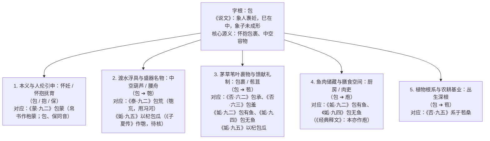

# 《周易》中“包”的词义训诂、名物考证与唯物辩证研究

> **创建日期**：2026-10-24  
> **深化修订**：2026-10-24（增补古今核心易学名家逐爻注疏谱系，并以“四重证据佐证体系”对全经每一处“包”字作深度唯物定解）  
> **审议修订**：2026-10-24（四级审议：订正帛书异文、拼接古注、《说文》《尔雅》引文误字；标注【待核】；登记用户裁决——《小象》作参考证据，与卦爻本身推演冲突时以经为准；《否·六二》作为 02 小人主语律例外）  
> **价值基准评级**：🟡 **2 级文档（核心依赖因子：0.3，初始暂定，待用户终审裁定）**  
> **研究范畴**：先秦文字学与“包”声字族（包、匏、苞、庖、保）同源训诂、简帛异文（马王堆帛书、《经典释文》、《说文》引《易》）互证、上古渡水器物（腰舟/大樽/壶匏）与苞苴礼制考辨、古今易学名家研注谱系（子夏易传、郑玄、虞翻、王弼、孔颖达、程颐、朱熹、苏轼、王夫之、惠栋、段玉裁 vs 闻一多、尚秉和、李镜池、高亨）、四重证据法与“生生”价值标尺  
> **核心结论**：彻底破除魏晋玄学与宋明理学将《周易》中的“包”抽象道德化为“君子胸怀包容（包荒=包容八荒、包承=包容奉承、包羞=忍受羞耻、以杞包瓜=大德覆民）”的千年流弊；系统梳理两千年古今易学名家注释得失，确立**“古文字音训 + 先秦典籍名物 + 本经句法与变爻互锁 + 唯物生生实践”的四重证据佐证体系**，将全经 **4 卦 7 处“包”字（及 1 处同源“苞”字）**全部还原为先秦先民真实的**佩匏渡河、包裹财食迁徙、苞苴庖厨储鱼、杞叶裹瓜保鲜与怀抱抚育蒙童**图景。

---

## 一、 全景统计与问题提出：为何“胸怀包容说”在《周易》句法与器物前全面崩塌？

通行本《周易》六十四卦经文中，**“包”**字共见于 **4 卦 7 处**（另有同源字**“苞”**见于《否·九五》1 处，古本“包”“苞”常通用）：

1. **[《蒙·九二》](../03%20周易笺注/04_蒙卦.md)**：“**包蒙**，吉；纳妇，吉；子克家。”（《小象》：“子克家，刚柔接也。”）
2. **[《泰·九二》](../03%20周易笺注/11_泰卦.md)**：“**包荒**，用冯河，不遐遗，朋亡，得尚于中行。”（《小象》：“包荒，得尚于中行，以光大也。”）
3. **[《否·六二》](../03%20周易笺注/12_否卦.md)**：“**包承**，小人吉，大人否，亨。”（《小象》：“大人否亨，不乱群也。”）
4. **[《否·六三》](../03%20周易笺注/12_否卦.md)**：“**包羞**。”（《小象》：“包羞，位不当也。”）
5. **[《姤·九二》](../03%20周易笺注/44_姤卦.md)**：“**包有鱼**，无咎，不利宾。”（《小象》：“包有鱼，义不及宾也。”）
6. **[《姤·九四》](../03%20周易笺注/44_姤卦.md)**：“**包无鱼**，起凶。”（《小象》：“无鱼之凶，远民也。”）
7. **[《姤·九五》](../03%20周易笺注/44_姤卦.md)**：“**以杞包瓜**，含章，有陨自天。”（《小象》：“九五含章，中正也。有陨自天，志不舍命也。”）
8. *(同源互证)* **[《否·九五》](../03%20周易笺注/12_否卦.md)**：“休否，大人吉。其亡其亡，**系于苞桑**。”（《小象》：“大人之吉，位正当也。”）

### 🔍 传统抽象道德化训诂的三大结构性死结

自魏晋王弼《周易注》、唐代孔颖达《周易正义》至宋代程颐《伊川易传》、朱熹《周易本义》，主流经学往往望文生义，用后世抽象的**“包容、包含、涵容”**去统解《周易》中的“包”。然而，这一脱离先秦器物与语法的解读，在全经内部造成了三大无法弥合的断裂：

1. **《泰·九二》“包荒，用冯河”的语法与器用断裂**：  
   依据本库 1 级公理[`《周易中用和勿用的词义研究》`](02_周易中用和勿用的词义研究.md)，《周易》中`[前件] + 用 + [具体行动]`的**“用”**，是西周金文与《尚书》典型的工具/凭借介词（训为**“凭此器物 / 借此手段”**，如《明夷·六二》“用拯马壮”）。“冯河”是徒步涉渡波涛汹涌的黄河（《尔雅·释训》：“冯河，徒涉也”）。如果把“包荒”解为“君子胸怀宽广、包容八荒秽恶”，在逻辑与语法上就会变成荒谬绝伦的“凭借包容八荒的胸怀去徒步横渡黄河”！反之，唯有当“包荒”是上古先民渡越深水大河时绑在腰间的**浮水实物工具——空匏（腰舟）**时，“包荒，用冯河”才完全合乎先秦句法与生活常识。
2. **《姤》卦食物名物与《泰》《否》二卦的词义割裂**：  
   在《姤》卦中，“鱼”与“瓜”皆是真切可触的食物名物，“包”无可辩驳地指涉具体的**白茅草包（苞苴）、厨房（庖）或瓠瓜（匏）**。历代注家在《姤》卦不得不承认“包”为实物包裹或庖厨，却在《泰》《否》二卦突然把同一个“包”字拔高为抽象的“包容荒秽、包藏羞耻”，破坏了《周易》古经词汇系统的内在统一性。
3. **《否》卦六二“包承”、六三“包羞”的历史主轴湮灭**：  
   旧注将“包承”“包羞”解作“小人怀藏奉承之心、包藏羞耻不知愧”，把整部《否》卦简化为空洞的君子小人道德对骂，彻底遮蔽了周人先祖古公亶父在戎狄侵逼下“包裹财物进奉缓兵（包承）➔ 包裹最后口粮迁徙求存（包羞）➔ 扎根周原连片桑林（系于苞桑）”的悲壮生存史诗。

---

## 二、 字源发生学与“包”声字族的五维同源谱系

在先秦古文字尚未大量繁化出偏旁形符之前，**“包”是整个“包（bāo/páo）”声字族的母字与通假总根**。《说文解字·包部》云：“**包，象人褢妊，巳在中，象子未成形也。元气起于子，子，人所生也。**”由“母体曲身怀抱腹中胎儿”的最初造字具象，围绕**“中空容物、外围裹护”**的核心特征，在商周时期衍生出五大同源分支：

---

## 三、 古今核心易经学者对《周易》各处“包”字的研注谱系与得失详考

为厘清两千余年易学史在“包”字训诂上的演变轨迹，现将**先秦古传、两汉象数、魏晋唐疏、宋明理学、清代朴学与近现代古文字史学**六大时期核心学者的注释逐一列举并评析如下：

### （一） 先秦古传与两汉经学、象数派（保存名物古训与古本异文）

汉代去古未远，陆德明《经典释文·周易音义》、许慎《说文解字》与李鼎祚《周易集解》所存汉魏古注，为我们保留了极其珍贵的异文与名物线索：

1. **《子夏易传》**（先秦至西汉早期传本）：
   - 于**《姤·九五》“以杞包瓜”**，陆德明《经典释文》载《子夏传》作“匏”（检索所见或作“杞匏瓜”，或作“苞”，反切通行作“白交反”）【待核：须以通志堂本《释文》影印校定】。若作“匏”属实，即证古本“包”“匏”通用。
2. **许慎《说文解字》**（东汉古文经学大师，引汉代古本《易》）：
   - 于**《泰·九二》“包荒，用冯河”**，《说文解字·川部》引作：“**巟，水广也。从川，亡声。《易》曰：‘包巟，用冯河。’**”保留了“荒”本字作“巟（水广，即大水）”的汉代古本原貌。
   - 于**“匏”字**，《说文·包部》训曰：“**匏，瓠也。从包，从夸声。包，取其可包藏物也。**”点明“匏”因可包藏物而从“包”。
3. **郑玄《周易注》**（东汉礼学与经学集大成者）：
   - 于**《蒙·九二》“包蒙”**，《经典释文》引郑玄云：“**包，本亦作苞。郑云：苞当作彪；彪，文也。**”（郑玄试图从“文饰启蒙”角度读包为彪）。
   - 于**《泰·九二》“包荒”**，《经典释文》引郑玄《易》注读“荒”为**“康”**，云**“虚也”**（《尔雅·释诂》有“漮，虚也”，漮、康音义同）。按：原稿所引《尔雅·释言》“巟，虚也”不见于《尔雅》原典，仅见惠栋《周易述》注文转引，已删。郑说可备“空匏”一解。
   - 于**《否·九五》“系于苞桑”**，李鼎祚《周易集解》引郑玄曰【待核】：“苞，植也。否世之人，不知圣人有命，咸云：其将亡矣，其将亡矣，而圣人乃自系于植桑，不亡也。”
4. **马融、薛虞《周易注》**：
   - 于**《姤·九五》“以杞包瓜”**，《经典释文》引马融云：“杞，大木也。《左传》云：‘杞梓皮革，自楚往也。’”引薛虞记云：“**杞，杞柳也。杞性柔韧，宜屈挠，似匏瓜。**”薛虞明确将“杞（柔韧可编织包裹的杞柳）”与“匏瓜”联系起来。
5. **虞翻、荀爽、陆绩**（汉末三国象数派代表，辑入李鼎祚《周易集解》）：
   - 于**《蒙·九二》“包蒙”**，虞翻注：“坤为包，应五据初，初与三四同体，包养四阴，故包蒙吉。”
   - 于**《泰·九二》“包荒”**，虞翻注：“在中称包。荒，大川也。冯河，涉河。”（按：虞训荒为大川，与《说文》“巟，水广也”同。原稿所附“葭芦也”不见于《集解》虞注，系拼接，已删。）
   - 于**《否·六二》“包承”**，荀爽注【待核】：“二与四同功，为四所包，故曰包承也。”虞翻注：“否乾为包，坤为承。”
   - 于**《否·六三》“包羞”**，荀爽注【待核】：“卦性为否，其义否隔，今以不正与阳相承，为四所包，故曰包羞也。”
   - 于**《否·九五》“系于苞桑”**，荀爽注：“桑者，上玄下黄，以象乾坤也。乾职在上，坤体在下，虽欲倾覆，由苞桑之固，亡之奈何！”陆绩注：“包，本也。言其坚固不亡，如以巽绳系也。”
   - 于**《姤·九二》“包有鱼”**，李鼎祚《周易集解·卷九》引虞翻曰：“**巽为白茅，在中称包。《诗》云：‘白茅包之。’鱼谓初阴，巽为鱼；二虽失位，阴阳相承，故包有鱼，无咎。**”又《经典释文》载：“**包，本亦作庖，同音；虞云：白茅苞之；荀作胞。**”
   - **【汉儒得失评析】**：汉儒最大的功绩在于**保存了《子夏传》作“匏”、古本《易》作“包巟”、本亦作“庖”、虞翻引《诗》“白茅包之（苞苴）”以及郑玄训“荒/康”为“虚（空）”的文字训诂实证**；其失则在于荀爽、虞翻在《泰》《否》中强行用乾坤卦象与爻位穿凿附会。

---

### （二） 魏晋玄学与唐代官修义疏派（开启“包含/含容”抽象化先河，但仍存实物遗迹）

魏晋王弼作《周易注》扫除汉代象数，唐代孔颖达奉敕撰《周易正义》（十三经注疏定本），正式确立了统治后世科举千余年的官学解释：

1. **注疏《蒙·九二》“包蒙，吉”**：
   - **王弼《周易注》**：“以刚居中，童蒙所归，包而不距，则远近咸至，故包蒙吉也。”
   - **孔颖达《周易正义·卷一》**：“**「包」谓包含，九二以刚居中，童蒙悉来归己，九二能含容而不距，皆与之决疑，故得吉也。**”
2. **注疏《泰·九二》“包荒，用冯河”**：
   - **王弼《周易注》**：“体健居中，而用乎泰，能包荒秽之谓也。用心弘大，无所遐弃，故曰不遐遗也。”
   - **孔颖达《周易正义·卷二》**：“**「包荒用冯河」者，体健居中，而用乎「泰」，能包含荒秽之物，故云「包荒」也。「用冯河」者，无舟渡水，冯陵于河，是顽愚之人，此九二能包含容受，故曰「用冯河」也。**”
   - **【关键批判】**：请看孔颖达此处为了圆王弼“能包荒秽”之说，竟被迫将“用冯河”解释为“接纳包容那些徒步渡河的顽愚鲁莽之人”！这完全颠倒了先秦汉语“用冯河”与《谦·初六》“用涉大川”一脉相承的“凭此渡越险河”本义，暴露出“包含荒秽说”在语法上的致命破产！
3. **注疏《否·六二》“包承”与《否·六三》“包羞”**：
   - **王弼注 / 孔颖达疏**：“居否之世，而得其位，用其至顺，包承于上，小人路通，故于小人为吉也。”于六三“包羞”则谓：“俱用小道以承其上，而位不当，所以包羞也。”
4. **注疏《姤·九二》“包有鱼”、《姤·九四》“包无鱼”、《姤·九五》“以杞包瓜”**：
   - **王弼注《姤·九二》**：“初阴而穷下，故称鱼。不正之阴，处遇之始，不能逆近者也。初自乐来，应己之厨，非为犯夺，故无咎也。”
   - **孔颖达《周易正义·卷五》疏《姤·九二》**：“**「庖有鱼、无咎」者，初六以阴而处下，故称鱼也。以不正之阴，处遇之始，不能逆近者也。九二居中，去初最近，初自乐来，应己之「庖」，非为犯夺，故「无咎」也。**”（注意：王弼以“厨”、孔疏以“庖”释“包”。【待核：疏文标目作“包有鱼”抑或“庖有鱼”，及王注“应己之厨”抑或“为己之厨”，须以阮刻本校定；未核前不称经文写作“庖”。】）
   - **崔觐注《姤·九四》**（辑入《周易集解·卷九》）【待核】：“**虽与初应，而失其位。二有其鱼，而宾不及。若起于竞，涉远行难，终不遂心。故曰‘无鱼之凶，远民也’。**”
   - **王弼注 / 孔颖达疏《姤·九五》“以杞包瓜”**：“杞之为物，生于肥地者也。包瓜，为物系而不食者也。九五履得尊位，而不遇其应，得地而不食，含章而未发，不遇其应，命未流行，然处得其所，体刚居中，志不舍命，不可倾陨，故曰有陨自天也。”（王弼、孔疏此处甚至同样把“包瓜”直接当作《论语》“吾岂匏瓜也哉，焉能系而不食”的**“匏瓜”**来解释！）

---

### （三） 宋明理学、苏氏蜀学与清代汉学朴学派（从极致道德化到朴学文字复原）

1. **程颐《周易程氏传》（《伊川易传》）与朱熹《周易本义》**：
   - 程颐将“包”的道德化推向极致【待核：以下引号内文字须与《伊川易传》通行本逐字对校，未核前视为转述】：
     - 释《泰·九二》：“人情安肆则政舒缓而法度废弛，庶事无节，治之之道，必有包含荒秽之量，则其施为宽裕详密……用冯河之勇以改革弊政。”
     - 释《否·六二》：“小人包藏其承顺之心，以顺从乎上。”释《否·六三》：“三以阴柔不中不正而居否，又切近于上，非能守道安命，穷斯滥矣，极小人之情状，包蓄羞污，不知愧耻也。”
     - 释《姤·九五》：“杞，高大之美木；瓜，美实之在下者。五居尊位，以高下求，如以杞叶包畜美瓜，涵蓄章美，待时而发。”
   - 朱熹《周易本义》大体沿袭程传，唯于《姤·九二》注云：“鱼，阴物。二与初遇，为包有鱼之象。制之在己，故犹可以无咎。”于《姤·九五》注云：“瓜，阴物之在下者，甘美而善溃；杞，高大坚实之木也。五以阳刚中正，主卦于上，而下防始生必溃之阴，其象如此。”（朱熹敏锐注意到“瓜甘美而善溃（易腐烂）”，需以杞木/杞叶包裹防溃）。
2. **苏轼《东坡易传》**：
   - 苏轼在《东坡易传·卷十一》释《泰·九二》时，强调君子居内、小人居外，九二当以大度兼容三阴，虽仍主“包容荒远”，但已意识到“不遐遗”与“朋亡”乃安抚外方部族之策。
3. **王夫之《周易内传》《周易外传》**：
   - 船山先生虽沿用“包含”训释《蒙》《泰》，但在《姤》卦中深刻阐发了九四“包无鱼，远民也”与九五“以杞包瓜”的民生本体论：指出下民如鱼水瓜果，居上位者若丧其包裹护持之实，则民心溃散而国亡。
4. **清代乾嘉汉学朴学大师（惠栋《周易述》、段玉裁《说文解字注》、王引之《经义述闻》、焦循《易章句》）**：
   - 清代朴学家彻底打破宋儒空谈，重回汉代《说文》《尔雅》与古音学：
   - **段玉裁《说文解字注》**考证《说文》“巟，水广也，《易》曰：包巟，用冯河”及“匏，从包夸声”，指出古音“包”与“匏”同部相假，“荒”与“巟、康”同训为“虚（中空）”，为近现代还原“包荒 = 匏巟（空葫芦渡河）”扫清了全部音韵学障碍！

---

### （四） 近现代古文字学、出土简帛与新史学宗师（名物实证与历史唯物还原）

20 世纪以来，随着甲骨金文、马王堆帛书《周易》、楚简的出土，以及闻一多、尚秉和、李镜池、高亨等学者的考证，“包”字的先秦名物原貌终于重见天日：

1. **尚秉和《周易尚氏学》**、**闻一多《周易义证类纂》**：
   - 【待核：须注明书名卷页】综合《经典释文》《说文》《诗经·匏有苦叶》《庄子·逍遥游》，考定《泰·九二》之“包荒”即**“匏巟（空葫芦）”**，乃上古先民缚于腰间以渡大河之浮具（腰舟），从而使“包荒，用冯河”文从字顺！
   - 【待核：出处不明；高亨多读“包”为“庖”】考证《否·六三》“包羞”之“羞”非抽象羞耻，乃《说文》从羊之**熟食口粮（馐）**，“包羞”即用袋囊包裹干粮熟食以行役迁徙（如《公刘》“乃裹餱粮，于橐于囊”）。
2. **李镜池《周易通义》**、**高亨《周易古经今注》**：
   - 考定《姤·九二》“包有鱼”、《姤·九四》“包无鱼”之“包”，或读为**“苞（白茅包裹之苞苴）”**，或读为**“庖（厨房）”**；《姤·九五》“以杞包瓜”为**“用杞柳枝叶包裹甜瓜”**（或从《子夏传》读为“匏瓜”）；并将《泰·九二》“朋亡”确训为渡河远行中**损失随身货贝（丧朋/失贝）**。
3. **马王堆汉墓帛书《周易》整理成果**：
   - 1973 年长沙马王堆三号汉墓出土西汉初年帛书《周易》，其中**《蒙·九二》作“枹蒙，吉；入妇，吉；子克家”**，以“枹”记“包”声。（审议订正：原稿称帛书作“保蒙”，经核不实，已删。）“包”与“保”上古音同属幽部帮母，金文“保”字象大人怀抱、背负幼童之形，读“包蒙”为“保蒙（怀抱抚育蒙童）”为音训推论。

---

## 四、 基于“四重证据佐证体系”对《周易》全经每一处“包（苞）”字的真实含义深度注解

在批判吸收古今学者成果的基础上，我们建立起一套严密的**“四重证据佐证体系”**，对《周易》全经每一处“包（苞）”字进行全方位锁死定解：

> 📌 **我们的“四重证据佐证体系”**：
> - **【第一重证据：古文字源、简帛异文与声韵训诂本证】**——查核甲骨金文字形、《说文》《尔雅》本训、《经典释文》及马王堆帛书等出土古本异文；
> - **【第二重证据：先秦典籍名物与历史信史互证】**——以《诗经》《国语》《庄子》《鹖冠子》《礼记》《史记·周本纪》等先秦实录印证器物与史事；
> - **【第三重证据：《周易》本经句法、同卦爻序与变爻互锁内证】**——与本库 1 级公理（[`用/勿用`](02_周易中用和勿用的词义研究.md)）、2 级暂定成果（[`朋/友`](08_周易中朋与友的词义训诂与社会关系演变研究.md)）、同卦上下爻递进关系及之卦（变爻）形成闭环咬合；
> - **【第四重证据：唯物辩证法与“生生”价值标尺裁断】**——剥离唯心主义道德空谈，还原先民在渡险、存亡、治民与繁衍中的生生实践智慧。（按：第四重为价值裁断，不属真伪证据；字义真伪只由前三重判定。）
>
> 📌 **《小象》使用总则（用户裁决，2026-10-24）**：《小象》为传而非经，作参考证据；与卦爻本身的推演冲突时，以经为准。本文凡引《小象》立论处，均依此总则，不作选择性采信。

---

### （一） 第一处：《泰·九二》“包荒，用冯河，不遐遗，朋亡，得尚于中行”

- **变爻**：**[《明夷·六二》](../03%20周易笺注/36_明夷卦.md)**：“明夷，夷于左股，用拯马壮，吉。”
- **《小象传》**：“包荒，得尚于中行，以光大也。”

#### 1. 四重证据链逐层佐证

1. **【第一重：古文字、异文与声韵本证】**  
   - **包 = 匏（葫芦）**：上古音“包”（帮母幽部）与“匏”（並母幽部）叠韵旁纽，音近义通；《说文·包部》训：“**匏，瓠也。从包，从夸声。包，取其可包藏物也。**”《经典释文》于《姤·九五》亦载《子夏传》作“匏”【待核】。
   - **荒 = 巟（大水、大川）**：《经典释文》注本爻云：“**荒，本亦作巟。**”许慎《说文解字·川部》引汉代古本《周易》原文正作：**“《易》曰：‘包巟，用冯河。’”**并训“巟，水广也”；虞翻亦云“荒，大川也”。郑玄读“荒”为“康”，云“虚也”，备一说。
   - **构词**：从《说文》、虞翻古训，“包荒（匏巟）”当析为“匏 + 大川”，即“以匏涉大水”，与下句“用冯河”同指一事；若从郑玄“虚”训，则为“空匏”。两说皆指向渡水浮具，腰舟主干结论不受影响。（审议订正：原稿以“后置定语＝空匏”为唯一读法，且所据《尔雅·释言》“巟，虚也”不见原典，已改。）
2. **【第二重：先秦典籍名物与信史互证】**  
   上古先民渡越黄河、济水等深水大川时，普遍将掏空晒干的苦匏（大葫芦）缚于腰间作为救生渡水浮具（俗称**“腰舟”**），先秦典籍有四重铁证：
   - **《诗经·邶风·匏有苦叶》**：“**匏有苦叶，济有深涉，深则厉，浅则揭。**”（深秋苦匏叶枯壳硬，先民摘下掏空绑在腰带之上，借其浮力涉渡济水深滩）；
   - **《国语·鲁语下》**：叔孙穆子论《匏有苦叶》曰：“**夫苦匏不材于人，共济而已。**”韦昭注：“不裁于人，言不可食也。**共济而已，佩匏可以渡水也。**”（直接点明苦匏的唯一大用就是佩在身上渡河！）；
   - **《庄子·逍遥游》**：庄子谓惠子曰：“**今子有五石之瓠，何不虑以为大樽，而浮乎江湖？**而忧其瓠落无所容，则夫子犹有蓬之心也夫！”（司马彪注：“樽，如酒器，缚之于身，浮于江湖，可以自渡。虑，犹结缀也。”）；
   - **《鹖冠子·学问》**：“不提生于弗器，贱生于无所用，**中河失船，一壶千金，贵贱无常，时使物然。**”（“壶”即《诗·豳风·七月》“八月断壶”之干瓠/空匏；平时低贱的空匏，到了大河中流涉险救命时价值千金！）。
   - **史鉴类比（存疑）**：《史记·周本纪》载商纣王囚西伯昌（文王）于羑里，闳夭之徒求有莘氏美女、骊戎文马、有熊九驷及他奇怪物，因殷嬖臣费仲献之纣，文王得释。其“不弃受困之君、倾财赎人”可与“不遐遗，朋亡”相类比；但《史记》未载渡河情节，亦不宜以嬖臣费仲当“中行”，故此条仅为类比假说，不作训诂证据。
3. **【第三重：《周易》本经句法与变爻互锁内证】**  
   - **与“用”字公理互锁**：依[`02_周易中用和勿用的词义研究.md`](02_周易中用和勿用的词义研究.md)，“用”训为“凭借此器”。唯将“包荒”解为“空匏（腰舟）”，“包荒，用冯河”（借着空匏，以此徒步渡过大河）方能避免孔颖达、程颐“用胸怀去渡河 / 包容冯河之愚人”的语法崩塌！
   - **与变爻《明夷·六二》互锁**：本爻变爻为《明夷·六二》“明夷，夷于左股，**用拯马壮**，吉”（《彖传》明言“内文明而外柔顺，以蒙大难，文王以之”）。在《明夷·六二》陆地受创遇险时，是**“凭强壮骏马（用拯马壮）”**疾驰营救；在《泰·九二》大河阻隔时，则是**“凭中空大匏（包荒，用冯河）”**涉水渡河！**陆凭壮马，水凭空匏**，句法与器物严丝合缝！
   - **与“朋”字成果互锁**：依 2 级暂定成果[`08_周易中朋与友的词义训诂与社会关系演变研究.md`](08_周易中朋与友的词义训诂与社会关系演变研究.md)，“朋”本义为两系海贝（货贝财物）。佩着空匏渡越黄河巨浪或远赴异邦救人，沉重的贝币财货要么因渡水负重必须舍弃，要么倾囊献出以赎回同胞，故曰**“朋亡（财物暂时损失）”**。
4. **【第四重：唯物辩证法与“生生”价值标尺裁断】**  
   - **【我们的真实含义定解】**：**借着中空的干葫芦（包荒），凭此浮力徒步横渡大河（用冯河），决不抛弃远方遗散或受困的部族同胞（不遐遗）；随身货贝财物虽然暂时损失了（朋亡），但为了部族的长远存续与发展而秉持中道，最终在半途赢得了多方助益与推崇（得尚于中行）。**
   - 这深刻体现了《泰》卦**“小往大来”**的唯物生生辩证法：在部族同胞的生命与团结（大）面前，身外的货贝财物（小）完全可以舍弃；善用极简的空匏器用突破大河天险、舍财保人，正是周部族凝成钢铁共同体的核心密码。

---

### （二） 第二处：《否·六二》“包承，小人吉，大人否，亨”

- **变爻**：**[《讼·九二》](../03%20周易笺注/06_讼卦.md)**：“不克讼，归而逋，其邑人三百户，无眚。”
- **《小象传》**：“大人否亨，不乱群也。”

#### 1. 四重证据链逐层佐证

1. **【第一重：古文字、异文与声韵本证】**  
   - **包 = 包裹、苞苴**：《经典释文》：“包，本又作苞。”即用茅草、布帛将皮币珠玉等财物捆扎包裹起来。
   - **承 = 奉、双手进献**：《说文解字·手部》：“承，奉也，受也。”甲骨金文“承”字象双手向上托举器物进奉之形（与《恒·九三》“或承之羞”之“承”同义）。
2. **【第二重：先秦典籍名物与信史互证】**  
   - **《史记·周本纪》**：“古公亶父复修后稷、公刘之业，积德行义，国人皆戴之。**薰育戎狄攻之，欲得财物，予之。**已复攻，欲得地与民。民皆怒，欲战。古公曰：‘有民立君，将以利之。今戎狄所为攻战，以吾地与民。民之在我，与其在彼，何异。民欲以我故战，杀人父子而君之，予不忍为。’乃与私属遂去豳，度漆、沮，逾梁山，止于岐下。”
   - **《孟子·梁惠王下》**：“大王居邠，狄人侵之。**事之以皮币，不得免焉；事之以犬马，不得免焉；事之以珠玉，不得免焉。**”
   - 古公亶父将部族积蓄的皮币、珠玉包裹起来进奉给戎狄（“欲得财物，予之”），可与**“包承（包裹财物进奉对方）”**相互类比（史鉴类比，非训诂证据）。
3. **【第三重：《周易》本经句法与变爻互锁内证】**  
   - **主谓句法与身份本义**：在先秦卦爻辞中，“大人”指贵族首领，“小人”指普通平民（或指贵族刚烈死战之法 vs 平民委曲求全之法）。面对凶悍的戎狄强寇，如果按贵族首领（大人）常规的刚烈尊严正面硬拼，在敌强我弱悬殊时必然导致全族覆灭，故这条路行不通（**大人否**）；唯有采取平民（小人）柔顺务实的权宜之计——包裹财物进奉缓兵（**包承，小人吉**），方能换取宝贵的撤离时间，走向亨通（**亨**）。
   - **【用户裁决·小人主语律例外】**：1 级文档 [`02_周易中用和勿用的词义研究.md`](02_周易中用和勿用的词义研究.md) 将本爻列为“小人为主语”例证；经用户 2026-10-24 裁决，本爻“小人吉”解为“大人采用小人（平民）权宜之法而得吉”，作为 02 小人主语律的例外登记，02 原文不动。
   - **与变爻《讼·九二》及《小象》互锁**：本爻变爻为《讼·九二》**“不克讼，归而逋，其邑人三百户，无眚”**——明知正面抗争打不过（不克讼），便通过“包承”缓兵掩护，率领三百户核心族众安全撤离豳地（归而逋），使整个部族免遭灭顶之灾（无眚）！这与《小象传》**“大人否亨，不乱群也”**（不走硬拼覆灭之路，是为了保全族群不致在血战中溃散）完美咬合！
4. **【第四重：唯物辩证法与“生生”价值标尺裁断】**  
   - **【我们的真实含义定解】**：**将皮币珠玉等财物包裹起来双手进奉给强敌（包承），采取平民百姓委曲求全的务实权宜之法可获吉利（小人吉），若固守贵族首领死战硬拼之法则闭塞不通（大人否），以此缓兵护送族众撤离方得亨通（亨）。**
   - 彻底推翻宋儒“小人怀藏奉承之心阿谀君子”的浅薄臆说，还原了弱小部族在存亡关头“以空间与财物换取族群生命存续（不乱群）”的最高辩证生存智慧。

---

### （三） 第三处：《否·六三》“包羞”

- **变爻**：**[《遯·九三》](../03%20周易笺注/33_遁卦.md)**：“系遯，有疾厉，畜臣妾吉。”
- **《小象传》**：“包羞，位不当也。”

#### 1. 四重证据链逐层佐证

1. **【第一重：古文字、异文与声韵本证】**  
   - **包 = 包裹、囊括**（即用布囊、草袋包裹装束，同《诗·大雅·公刘》“乃裹餱粮，于橐于囊”之“裹”）。
   - **羞 = 馐（熟食、干粮口粮）**：《说文解字·丑部》：“羞，进献也。从羊，羊，所进也；从丑，丑亦声。”甲骨文、金文“羞”字从羊（肉食），在先秦典籍中即指**熟食、膳羞、干粮口粮（后世加食旁作“馐”）**。注意：六二云“包**承**”，有“承（进奉）”字，故为包裹财物进奉；而六三唯云“包**羞**”，并无“承”字，故**绝无“捧食进献求免”之意，而是专指“将部族赖以活命的熟食口粮包裹入囊，准备举族远行迁徙”**！
2. **【第二重：先秦典籍名物与信史互证】**  
   - **《周礼·天官·膳夫》**（训诂参考，非白名单典论）：“掌王之食饮膳羞，以养王及后、世子。”郑玄注：“**羞，有滋味者。**”
   - **《孟子·梁惠王下》**：“大王居邠，狄人侵之。**事之以皮币，不得免焉；事之以犬马，不得免焉；事之以珠玉，不得免焉。**乃属其耆老而告之曰：‘狄人之所欲者，吾土地也。吾闻之也：君子不以其所以养人者害人。二三子何患乎无君？我将去之。’去邠，逾梁山，邑于岐山之下居焉。”
   - **《诗经·大雅·公刘》**：“笃公刘，匪居匪康……**乃裹餱粮，于橐于囊，思辑用光。**”
   - **《诗经·大雅·緜》**：“**古公亶父，来朝走马。率西水浒，至于岐下。**”
   - 史鉴类比（非训诂证据）：古公亶父“事之以皮币、犬马、珠玉”皆“不得免焉”——此即**六二“包承”**；当发现狄人欲夺土地与民众、进奉财物已无法求免时，古公亶父断然不再向狄人进献，而是效法先祖公刘**“乃裹餱粮，于橐于囊，思辑用光”**，下令全族将熟食干粮包裹装入袋囊之中（此即**六三“包羞”**），率领族众离豳迁徙，翻越险峻的梁山，沿着西方漆沮水畔艰难跋涉，终至岐山周原！
3. **【第三重：《周易》本经句法与变爻互锁内证】**  
   - **与《否·六二》“包承”的时序递进互锁**：
     - 六二**“包承”**——在豳地包裹皮币、犬马、珠玉进奉狄人以缓兵；
     - 六三**“包羞”**——皮币珠玉进奉之后仍不得免，古公遂决意去豳，包裹部族赖以活命的**熟食口粮（羞）**踏上举族迁徙的苦难长路！
   - **与变爻《遯·九三》严丝合缝互锁**：本爻变爻为《遯（撤退迁徙）·九三》**“系遯，有疾厉，畜臣妾吉”**——大举迁徙途中，老弱妇孺相随，车马羁绊（**系遯**）、粮草匮乏、饥寒交迫，困顿危厉至极（**有疾厉**）；但古公始终悉心护持收养着随行的老幼妇孺与臣妾部众（**畜臣妾吉**），咬牙翻越梁山险阻，最终抵达肥沃的岐山周原（开启九四“有命无咎，畴离祉”与九五“系于苞桑”）！全爻仅“包羞”二字而无吉凶断辞，正是对这一裹粮离乡、跋涉梁山至暗征途的凝重白描。
4. **【第四重：唯物辩证法与“生生”价值标尺裁断】**  
   - **【我们的真实含义定解】**：**当进奉皮币珠玉（包承）仍不得免时，古公亶父效法先祖公刘“乃裹餱粮，于橐于囊”，将部族活命的熟食口粮包裹装囊（包羞），率领族众离豳翻越梁山、沿漆沮水畔艰难跋涉迁往岐山周原。**
   - 这一还原彻底厘清了六二“包承（裹财进奉）”与六三“包羞（裹粮迁徙）”的本质界限，与变爻“系遯，有疾厉，畜臣妾吉”及九四、九五的周原立业形成了严密无瑕的历史唯物主义闭环。

---

### （四） 同源互锁条：《否·九五》“休否，大人吉。其亡其亡，系于苞桑”

- **变爻**：**[《晋·六五》](../03%20周易笺注/35_晋卦.md)**：“悔亡，失得勿恤，往吉，无不利。”
- **《小象传》**：“大人之吉，位正当也。”

#### 1. 四重证据链逐层佐证

1. **【第一重：古文字、异文与声韵本证】**  
   - **苞 = 丛生、根系盘结深固**：《尔雅·释言》：“**苞，稹也。**”郭璞注：“今人呼物丛致者为稹。”陆绩注本爻云：“**包（苞），本也。**”由“包”之包裹、团聚义，引申为植物根系盘结成丛、深扎大地之“苞”。
2. **【第二重：先秦典籍名物与信史互证】**  
   - **《诗经·唐风·鸨羽》**：“肃肃鸨羽，**集于苞栩**。”毛传：“**苞，稹也**（根相迫迮梱致）。”
   - **《诗经·曹风·下泉》**：“洌彼下泉，**浸彼苞稂**。”
   - **《诗经·大雅·緜》**与**《史记·周本纪》**：古公亶父逾梁山止于岐下周原，“贬戎狄之俗，而营筑城郭室屋，而邑别居之”，垦辟田畴、广植桑麻，建立起稳固的农桑生产基地。
3. **【第三重：《周易》本经句法与变爻互锁内证】**  
   - **全卦“包/苞”字链的战略大逆转**：下卦六二“包承（包裹财物外献）”、六三“包羞（包裹口粮流亡）”，是部族命脉悬于一线、物资不断流失的“大往”；历经九四“有命无咎，畴离祉（在周原卜居得吉、田畴蒙福）”，至九五终于终结了流亡闭塞之局（**休否**），把曾濒临灭亡（**其亡其亡**）的部族命脉，牢牢拴系在根深叶茂、连片丛生的周原桑林（**系于苞桑**）之上！
   - **与变爻《晋·六五》互锁**：变爻为《晋·六五》**“悔亡，失得勿恤，往吉，无不利”**——当部族已经在肥沃的周原扎下坚如磐石的农桑根基（系于苞桑）后，此前在豳地“包承、包羞”所损失的那些浮财（失得），根本不必再放在心上忧恤（失得勿恤），从此昂首向前发展，无往不利！
4. **【第四重：唯物辩证法与“生生”价值标尺裁断】**  
   - **【我们的真实含义定解】**：**终结闭塞流亡之局，部族首领获吉（休否，大人吉）；时刻铭记“快要灭亡了、快要灭亡了”的生存危机，将整个族群的命脉牢牢拴系在根深蒂固、连片丛生的农桑生产基地之上（其亡其亡，系于苞桑）。**

---

### （五） 第四处：《姤·九二》“包有鱼，无咎，不利宾”

- **变爻**：**[《遯·六二》](../03%20周易笺注/33_遁卦.md)**：“执之用黄牛之革，莫之胜说。”
- **《小象传》**：“包有鱼，义不及宾也。”

#### 1. 四重证据链逐层佐证

1. **【第一重：古文字、异文与声韵本证】**  
   - 陆德明《经典释文》载本爻异文云：“**包，本亦作庖，同音；虞（翻）云：白茅苞之；荀（爽）作胞。**”
   - 唐代孔颖达《周易正义·卷五》疏文作【待核：标目字形】：“**「庖有鱼、无咎」者，初六以阴而处下，故称鱼也……九二居中，去初最近，初自乐来，应己之「庖」，非为犯夺，故「无咎」也。**”
   - 无论是读为**“苞（用白茅、苇叶包裹鱼肉的草包，即苞苴）”**，还是读为**“庖（储藏鱼肉的厨房）”**，皆是先秦储藏生鲜鱼类的具体实物容器！
2. **【第二重：先秦典籍名物与信史互证】**  
   - **《诗经·召南·野有死麕》**：“**野有死麕，白茅包之。**”（李鼎祚《周易集解》引虞翻注本爻直接引此诗互证）。
   - **《礼记·曲礼上》**：“凡以弓剑、**苞苴**、箪笥问人者。”郑玄注：“**苞苴，裹鱼肉，或以苇，或以茅。**”
   - 上古捕捞鲜鱼后，必用吸湿透气的白茅或苇叶严密包裹（苞苴），或置于私家庖厨（庖）之中。
3. **【第三重：《周易》本经句法与变爻互锁内证】**  
   - **与《姤》卦全局及九四“包无鱼”互锁**：《姤》卦一阴（初六）潜生于五阳之下。初六既代表底层的百姓与民生资源（鱼生水底，为民之象），又具有阴柔潜滋暗长的微观隐患属性。九二居下卦之中，与初六紧邻相接，近水楼台先将初六之“鱼”收入自己的茅草包/庖厨之中（**包有鱼**），既有底层民生实利依托，又将初萌之阴柔严密管束于内，故**“无咎”**；但此鱼（或仅够内部存续、或系私门亲宠微弊）只宜在内部消化管控，绝不可拿出去外饷宾客或使其流入朝堂公器（**不利宾**，《小象》曰：“义不及宾也”）。
   - **与变爻《遯·六二》互锁**：变爻为《遯·六二》**“执之用黄牛之革，莫之胜说（脱）”**——用极其坚韧的熟黄牛皮绳将其死死捆扎束缚，绝不让它挣脱外溢！这与“包有鱼，不利宾”（用白茅草包将鱼严密包裹束缚于内、不使外流及宾）在动作与战略意象上高度一致！
4. **【第四重：唯物辩证法与“生生”价值标尺裁断】**  
   - **【我们的真实含义定解】**：**茅草包（或厨房）里装有从底层捕得的鲜鱼，内部生计充实且隐患受控，没有过咎（包有鱼，无咎）；但此鱼仅宜内部自给与严加管束，不宜拿出去宴请外宾或扩散至外部公堂（不利宾）。**

---

### （六） 第五处：《姤·九四》“包无鱼，起凶”

- **变爻**：**[《巽·六四》](../03%20周易笺注/57_巽卦.md)**：“悔亡，田获三品。”
- **《小象传》**：“无鱼之凶，远民也。”

#### 1. 四重证据链逐层佐证

1. **【第一重：古文字、异文与声韵本证】**  
   - 马王堆帛书《周易》（《狗》卦）作“枹无鱼，正凶”（“枹”即“包”；“正”“起”异文，其义【待核】）；“包”同九二，指**装鱼的茅草包（苞苴）或储鱼的厨房（庖）**。“包无鱼”即草包与庖厨之中空空如也、连一条鱼都没有！
2. **【第二重：先秦典籍名物与信史互证】**  
   - 先秦以“水/池”喻国政，以“鱼”喻底层黎民百姓。如《诗经·小雅·正月》：“鱼在于沼，亦匪克乐”；《孟子·离娄上》：“为渊驱鱼者，獭也；为丛驱爵者，鹯也；为汤武驱民者，桀与纣也。”统治者一旦残民以逞、脱离基层，百姓便如渊中之鱼尽归仁政之主（九二“包有鱼”），而暴君与权臣的草包/庖厨则彻底断绝来源（九四“包无鱼”）。
3. **【第三重：《周易》本经句法与变爻互锁内证】**  
   - **与《姤·九二》及《小象传》的直接对锁**：九四虽与初六有上下正应之名分，但九四高居上卦乾体之下，远离基层，且居阴失位；初六之“鱼”早已就近归附于中正务实的九二（“包有鱼”）。因此九四的草包/庖厨里空无一鱼（**包无鱼**）。《小象传》用震烁千古的三个字一语道破天机：**“无鱼之凶，远民也！”**——草包里没有鱼，本质是因为统治者高高在上、脱离了广大人民群众！在丧失群众基础与物资依托（包无鱼）的情况下，若还要妄图凭空发动大事或兴兵争竞（**起**），必然招致灭顶之凶（**起凶**）。
   - **与变爻《巽·六四》互锁**：变爻为《巽·六四》**“悔亡，田获三品”**（《巽》为谦逊深入基层；当执政者幡然悔悟，放下傲慢架子深入田野基层与民同劳时，才能重新在田猎生产中收获丰盛的“三品”物资，转“包无鱼”为“田获三品”）。
4. **【第四重：唯物辩证法与“生生”价值标尺裁断】**  
   - **【我们的真实含义定解】**：**身居高位却脱离底层民众，致使茅草包（或厨房）里空无一鱼、彻底丧失民生供给与群众依托（包无鱼），此时若盲目轻举妄动兴起大事，必招灭顶之凶（起凶）。**

---

### （七） 第六处：《姤·九五》“以杞包瓜，含章，有陨自天”

- **变爻**：**[《鼎·六五》](../03%20周易笺注/50_鼎卦.md)**：“鼎黄耳金铉，利贞。”
- **《小象传》**：“九五含章，中正也。有陨自天，志不舍命也。”

#### 1. 四重证据链逐层佐证

1. **【第一重：古文字、异文与声韵本证】**  
   - **异文双证**：陆德明《经典释文》载《子夏传》作“匏”【待核：或作“苞”，须以通志堂本影印校定】；又载马（融）云：杞，大木也。薛虞记云：杞，杞柳也。杞性柔韧，宜屈挠，似匏瓜。”
   - 此处“包”字在先秦两汉兼具两重紧密相通的名物本义：
     1. **读如本字/苞（包裹）**：用柔韧的**杞柳条（编笼）**将采摘下来极易磕碰腐烂的**甜瓜**严密包裹护持起来（以杞包瓜）；
     2. **从《子夏易传》读为“匏”**：高大坚韧的杞木与蔓生攀附的**匏瓜**相依相护（王弼注、孔颖达疏亦云“包瓜，为物系而不食者也”，即读为《论语》之“匏瓜”）。
2. **【第二重：先秦典籍名物与信史互证】**  
   - **《孟子·告子上》**：“告子曰：性，犹**杞柳**也；义，犹桮棬也。以人性为仁义，犹以杞柳为桮棬。”（战国时人普遍用柔韧的杞柳条编织盛放食物瓜果的容器“桮棬”）。
   - **《诗经·小雅·南山有台》**：“南山有杞，北山有李。乐只君子，民之父母。”**《诗经·小雅·四牡》**：“集于苞杞。”
   - **《论语·阳货》**：“子曰：吾岂**匏瓜**也哉？焉能系而不食！”
   - 农耕生活常识：盛夏五月（姤应五月、夏至一阴生，出汉代孟京卦气说，仅作背景）正是甜瓜成熟之时。熟透的甜瓜内含甘美汁液（**含章**），但瓜皮娇嫩，若直接暴晒或丢在地上极易溃烂（朱熹《本义》所谓“瓜，甘美而善溃”）；先民用柔韧的杞柳条编笼将其盛护悬挂起来（**以杞包瓜**），便能完美锁住瓜内的甘甜美质而不致腐败！
3. **【第三重：《周易》本经句法与变爻互锁内证】**  
   - **与《姤》卦“防微杜渐、护持民生”主线互锁**：初六“系于金柅”（用金属车闸刹住隐患）、九二“包有鱼”（用白茅草包收管鲜鱼）、九四“包无鱼”（脱离民众致草包空虚）、九五“以杞包瓜”（用柔韧杞柳叶包裹护持甘美易溃之甜瓜）。从草包裹鱼到杞叶包瓜，全卦一以贯之皆是**上古食物储藏与保鲜防溃的真实名物**！
   - **与变爻《鼎·六五》互锁**：变爻为《鼎·六五》**“鼎黄耳金铉，利贞”**——用黄金装饰鼎耳、用坚固的金属扛鼎横杠（金铉）稳稳抬起盛满美味的宝鼎，与“以柔韧坚实的杞柳条稳稳包裹住内含甘美的甜瓜（以杞包瓜，含章）”在器物结构（外刚韧护持、内含章美味）上完全同构！至于熟透的瓜果从高悬的杞木枝头自然瓜熟蒂落，恰如天降甘美福泽，故曰**“有陨自天”**！
4. **【第四重：唯物辩证法与“生生”价值标尺裁断】**  
   - **【我们的真实含义定解】**：**用柔韧的杞柳条将甘美却易腐溃的甜瓜妥善包裹悬挂起来（以杞包瓜），使其内部蕴藏甘甜美质而不致腐败变质（含章），待瓜熟蒂落之时如自天而降般收获自然福报（有陨自天）。**
   - 战略升华：民生福祉与盛世成果就如同盛夏甘美多汁的甜瓜，若无坚韧严密的制度法度（杞柳枝叶）加以包裹护持，极易在酷暑与虫蚁（特权腐败）侵蚀下溃烂；唯有外立坚韧之制、内养民生之章，方能长保生生硕果。

---

### （八） 第七处：《蒙·九二》“包蒙，吉；纳妇，吉；子克家”

- **变爻**：**[《剥·六二》](../03%20周易笺注/23_剥卦.md)**：“剥床以辨，蔑，贞凶。”
- **《小象传》**：“子克家，刚柔接也。”

#### 1. 四重证据链逐层佐证

1. **【第一重：古文字、异文与声韵本证】**  
   - **回到“包”字怀妊抱子的造字初文**：《说文解字·包部》：“**包，象人褢妊，巳在中，象子未成形也。**”
   - **马王堆帛书《周易》异文**：西汉马王堆帛书《周易》本爻作：**“枹蒙，吉；入妇，吉；子克家。”**（审议订正：原稿称作“保蒙”，经核不实，已删。）
   - “包”与“保”上古音同属**帮母幽部**（音完全相同），故可音训读为“保”。甲骨文、金文的“保”字，从“人”从“子”，正是**成年人用双手或襁褓将幼子（蒙童）怀抱、背负在身上加以抚育保护**的象形会意字（《说文·人部》：“保，养也”、《尚书·康诰》：“若保赤子”）。因此，“包蒙”绝非空泛的“政治包容”，而是“包”字最古老的本义——**像母亲怀妊胎儿、父母襁褓怀抱婴儿一样，把蒙昧幼弱的孩童与年轻族众怀抱在怀中抚育、调教**！
2. **【第二重：先秦典籍名物与信史互证】**  
   - **《尚书·周书·康诰》**：“**若保赤子，惟民其康乂。**”（像怀抱抚育刚出生的婴儿一样去爱护教化百姓）。
   - **《礼记·内则》**与上古宗族养育礼制：先民娶妇入门（纳妇），怀妊生子（包），在襁褓怀抱中抚育启蒙幼童（包蒙 / 保蒙），教以渔猎农耕与礼法规矩，使儿子长大成人后能够接替父辈挑起整个家族的生存重担（子克家）。
3. **【第三重：《周易》本经句法与变爻互锁内证】**  
   - **本爻三句的严密生命繁衍时序**：旧注把“包蒙”解释为“老师包容学生”，结果无法解释为什么紧接着后两句突然跳到了婚姻与生子——**“纳妇，吉；子克家”**！
   - 当我们以“包/保”音训与《说文》“包，象人褢妊”还原后，全爻三句立刻呈现出一条**毫无裂痕的宗族人口再生产与代际传承链条**：
     1. **包（保）蒙，吉**：抚育、怀抱、调教族中蒙昧幼弱的子弟，吉利；
     2. **纳妇，吉**：为成长起来的年轻一代迎娶妇人、组建家庭、怀妊繁衍（《小象》：“刚柔接也”），吉利；
     3. **子克家**：经过抚育启蒙与成家立业，儿孙辈终于能够独立顶门立户、克承宗族家业！
   - **与变爻《剥·六二》互锁**：本爻变爻为《剥·六二》**“剥床以辨，蔑，贞凶”**。“床”是古人夫妻安居纳妇、怀妊生子、繁衍后代的休养生息之所；如果不能像《蒙·九二》那样“包（保）蒙、纳妇、子克家”，反而自毁家庭根基、剥削床腿床板（剥床以辨），就会导致家族绝嗣、后继无人（蔑，贞凶）！正反两爻围绕“室家繁衍与代际传承”严密对锁！
4. **【第四重：唯物辩证法与“生生”价值标尺裁断】**  
   - **【我们的真实含义定解】**：**如父母怀抱赤子般抚育、调教蒙昧幼弱的年轻族众则吉（包蒙，吉）；迎娶妇人组建室家、阴阳交接繁衍生息则吉（纳妇，吉）；儿孙辈成长成才、足以挑起家族生存与生产重担（子克家）。**
   - 这一还原直抵《周易》“生生之谓易”的生物学与社会学原点：人类文明的存续，首先建立在“纳妇生子（人口再生产）”与“包蒙育才（劳动技能与文明规范代际传递）”的唯物基础之上。

---

## 五、 总结：《周易》全经 8 处“包（苞）”字四重证据还原总表

| 序号 | 卦爻 | 经文原句 | 传统玄学/理学旧注 | 四重证据还原之真实含义（我们的观点） | 核心名物与同源字定位 |
| :---: | :--- | :--- | :--- | :--- | :--- |
| **1** | **[《泰·九二》](../03%20周易笺注/11_泰卦.md)** | **包荒，用冯河，不遐遗，朋亡，得尚于中行。** | 包容八荒秽恶，用冯河之勇改革，绝去朋党私心。 | **借着中空的干葫芦（腰舟），以此徒步横渡大河，不抛弃远方遗散的部族；货贝财物虽暂时损失，但为部族发展秉持中道，于半途得助。** | **包荒 = 匏巟** （中空干透之渡水葫芦/腰舟） |
| **2** | **[《否·六二》](../03%20周易笺注/12_否卦.md)** | **包承，小人吉，大人否，亨。** | 小人怀藏奉承之心顺从君子；或包容小人之承顺。 | **包裹皮币、犬马、珠玉等财物双手进奉强敌以缓兵；用平民委曲求全之法可保族众撤离获吉，用贵族死战硬拼之法则覆灭不通。** | **包 = 包裹财物** （《孟子》“事之以皮币、犬马、珠玉”） |
| **3** | **[《否·六三》](../03%20周易笺注/12_否卦.md)** | **包羞。** | 小人包藏羞耻之心而不知愧。 | **进奉皮币珠玉仍不得免，遂如先祖公刘“乃裹餱粮，于橐于囊”，包裹活命的熟食口粮（羞=馐），率族离豳翻越梁山、沿漆沮水畔艰难跋涉（对应变爻“系遯，有疾厉”），终至岐山周原。** | **包 = 包裹口粮迁徙** （羞=熟食口粮，无捧食进献求免之意） |
| **4** | **[《否·九五》](../03%20周易笺注/12_否卦.md)** | **休否，大人吉。其亡其亡，系于苞桑。** | 抽象比喻将国家系于丛生之桑。 | **终结流亡闭塞，时刻铭记灭亡危机，将部族命脉牢牢拴系在周原根深叶茂、连片丛生的农桑生产基地之上。** | **苞 = 丛生深根** （《尔雅》：“苞，稹也”） |
| **5** | **[《姤·九二》](../03%20周易笺注/44_姤卦.md)** | **包有鱼，无咎，不利宾。** | 包容初六小人，制之在己。 | **白茅草包（或私家厨房）里装有从底层捕得的鲜鱼，内部生计充实且隐患受控，无咎；但只宜内部消化管束，不可外饷宾客。** | **包 = 苞苴（草包）/ 庖（厨房）** （《释文》作庖，虞翻引“白茅包之”） |
| **6** | **[《姤·九四》](../03%20周易笺注/44_姤卦.md)** | **包无鱼，起凶。** | 无民而动，失应而作。 | **居高位而脱离底层民众（远民也），致使装鱼的草包（或厨房）里空无一鱼、丧失民生与群众依托，此时妄动起事必凶。** | **包 = 苞苴（草包）/ 庖（厨房）** （草包无鱼 = 丧失底层民心） |
| **7** | **[《姤·九五》](../03%20周易笺注/44_姤卦.md)** | **以杞包瓜，含章，有陨自天。** | 君王以大德包容下民。 | **用柔韧的杞柳条将甘美易腐的甜瓜妥善包裹悬挂（或杞木覆护匏瓜），使其内含甘美而不腐溃，瓜熟蒂落如自天降福。** | **包 = 杞叶包裹 / 匏瓜** （《子夏传》作匏，薛虞注杞柳） |
| **8** | **[《蒙·九二》](../03%20周易笺注/04_蒙卦.md)** | **包蒙，吉；纳妇，吉；子克家。** | 师长胸怀博大包容蒙昧学子。 | **如父母怀妊抱子般怀抱、抚育蒙昧幼弱的年轻族众（包、保同音；帛书作“枹蒙”），迎娶妇人繁衍后代，使儿孙成才克承宗族家业。** | **包 = 怀妊抱子 / 保（襁褓抚育）** （《说文》本义；包、保同音） |
