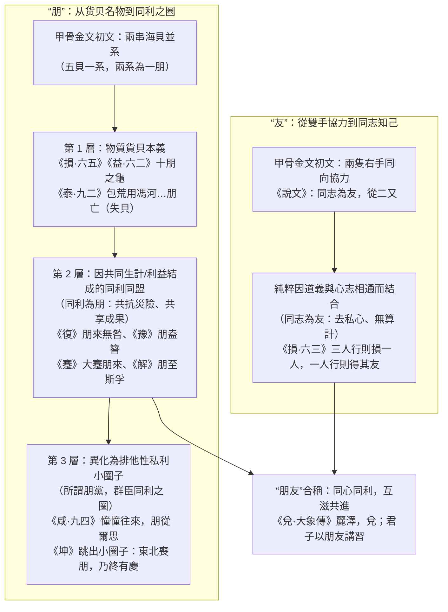

# 《周易》中“朋”与“友”的词义训诂、名物考证与社会关系辩证研究

> **创建日期**：2026-10-24  
> **价值基准评级**：🟡 **2 级文档（核心依赖因子：0.3，初始暂定，待用户终审裁定）**  
> **研究范畴**：甲骨金文“朋（双系贝币）”与“友（双手协力）”字源发生学、古今易学名家研注考证谱系（郑玄、虞翻、王弼、孔颖达、程颐、朱熹、王夫之 vs 王国维、郭沫若、顾颉刚、高亨）、先秦典籍（《诗》《书》《礼》《国语》《论》《孟》《荀》）互证、唯物辩证法与“生生”社会关系学  
> **核心结论**：确立**“同利为朋，同志为友；同心同利，可称朋友；所谓朋党，群臣同利之圈”**的核心社会关系训诂总纲。追溯“朋”自商周**五贝一系、两系一朋之货贝实物**（《损》《益》“十朋之龟”、《泰·九二》“包荒，用冯河……朋亡”）向**利益共同体与同利同盟**（《坤》《复》《豫》《蹇》《解》），再向**官僚私利小圈子即“朋党”**（《咸·九四》“憧憧往来，朋从尔思”）的三阶唯物演进；揭示“友”作为**“两手同向协力、纯粹志向相通之知己（同志为友）”**在《周易》古经中仅见于《损·六三》“一人行，则得其友”的崇高稀缺性；最终于《兑·大象传》“丽泽，兑；君子以朋友讲习”实现**“同心同利”**的生生合流。

---

## 一、 核心命题与总纲：同利为朋，同志为友

现代汉语将“朋友”凝固为一个泛化的日常社交名词，导致后人在阅读《周易》及先秦典籍时，既看不懂为何《损》《益》称**“十朋之龟”**、《泰·九二》称**“包荒，用冯河，不遐遗，朋亡”**，也无法理解为何《周易》古经对**“朋”**（出现 9 卦 10 次）屡加戒惧（如“东北丧朋”、“朋亡”、“朋从尔思，未光大也”），却对全经唯一一次出现的**“友”**（《损·六三》“一人行，则得其友”）给予无保留的至高赞誉。

穿透甲骨金文字源、西周货币礼制与先秦诸子文献，还原古人言“朋”与“友”的根本分野，可以高度凝练为四句总纲：

> 📌 **核心训诂总纲**：  
> **同利为朋，同志为友；同心同利，可称朋友；所谓朋党，群臣同利之圈。**

### 1. 何以“同利为朋”？——源于“两系货贝”的物质利益纽带
- **甲骨文与金文字源**：“朋”字在商代甲骨文与西周青铜铭文中，字形为**两串穿在绳索上的海贝（或玉珏）并排悬挂之象**。王国维《观堂集林·说珏朋》考证指出：殷周之际，五贝（或五玉）串成一系，两系并悬为一“朋”（汉代《汉书·食货志》亦存“两贝为朋”之古训）。西周金文中赏赐臣下最核心的硬通货即是“贝若干朋”（如《遽伯睘簋》“锡贝十朋”、《戍嗣子鼎》“王商（赏）戍嗣子贝廿朋”），《诗经·小雅·菁菁者莪》亦云：“**既见君子，锡我百朋。**”
- **词义引申的唯物轨迹**：正因为“朋”的物质本体是**两串并列相系的货币财宝（贝朋）**，由“两串贝币并系于一绳”引申到社会人际关系，其天然基因就是**“因共同的物质生产、生计温饱、功名利禄或阵营得失而捆绑在一起的人群”**——此即**“同利为朋”**！
  - 当这种利益捆绑符合天下公利、用于共克时艰时，它是积极的**正道利益同盟**（如《蹇·九五》“大蹇朋来”、《豫·九四》“勿疑，朋盍簪”）；
  - 当这种利益捆绑退化为朝堂之上群臣互相勾结、围猎君主、排斥异己、瓜分私利的封闭集团时，就成了先秦政治最痛恨的**“朋党”——即“群臣同利之圈”**（如《咸·九四》“憧憧往来，朋从尔思”、《荀子·臣道》“朋党比周，以环主图私为务”）。

### 2. 何以“同志为友”？——源于“双手同向协力”的心志共鸣
- **甲骨文与金文字源**：“友”字在甲骨文、金文中，由两个“又”（即两只右手）朝着同一个方向并排伸出构成，本义是**两只手朝着同一目标共同发力、彼此相助**。
- **先秦训诂定论**：
  - **《说文解字·又部》**：“**友，同志为友。从二又，相交友也。**”
  - **《周礼·地官·大司徒》**郑玄注：“**同师曰朋，同志曰友。**”
  - **《国语·晋语四》**司空季子曰：“**同姓为兄弟……同姓则同德，同德则同心，同心则同志。**”
- **与“朋”的本质区别**：“朋”靠外在的货贝利益或同门渊源牵系，利聚则合、利尽则散；而“友”不靠货贝利益捆绑，纯粹是因为**心志所向完全一致（同心则同志）**，哪怕在“一人独行”、毫无物质私利可图的孤独征途上，依然能因理想与道义的共鸣而生死相托（《损·六三》：“**一人行，则得其友**”）。

---

## 二、 古今易学名家与近现代学术宗师对《周易》“朋/友”的研注谱系

在两千余年易学史上，围绕《周易》中的“朋”与“友”，形成了汉代象数经学、魏晋玄学唐疏、宋明理学与近现代古文字史学四大解经范式：

| 学术时期与代表学者 | 核心解经取向 | 对《周易》“朋 / 友”的代表性注解与得失评析 |
| :--- | :--- | :--- |
| **1. 两汉经学与象数派** （郑玄、马融、荀爽、虞翻；辑入李鼎祚《周易集解》） | **礼制训诂 + 阴阳类聚 + 月体纳甲** | - **得（保存名物古训）**：郑玄注《礼》首明“同师曰朋，同志曰友”；汉儒于《损》《益》“十朋之龟”据《尔雅》《汉书·食货志》确训“朋”为货贝单位（“五贝曰朋”或“两贝为朋”）。 - **失（流于机械象数）**：马融、荀爽注《坤》“西南得朋，东北丧朋”仅以“阴起于午至申三阴成坤（得朋），终寅三阳成乾（丧朋）”解释；虞翻更以“月体纳甲”（月十五盈于甲为得朋，三十灭于乙为丧朋）强解全经之“朋”，抹杀了鲜活的历史与社会博弈。 |
| **2. 魏晋玄学与唐代官疏** （王弼《周易注》、孔颖达《周易正义》、崔憬） | **扫除纳甲 + 辨析“同类私党 vs 大公无私”** | - **王弼注《坤》**：“西南致群，东北反西南也。以柔顺之道，往诣于阳，必丧其朋党，乃能得其主。”首次将“丧朋”上升为**“脱离阴柔同类小圈子以归顺大道”**。 - **孔颖达《正义》疏《咸·九四》**：“若能正而固，则吉而悔亡；若憧憧然往来，念虑不息，唯系意于一己之私党，则唯尔之朋党从尔之思耳，不能感通天下也！”深刻点出“朋从尔思”之“朋”乃**狭隘私利之朋党**。 |
| **3. 宋明理学与清初气学** （程颐《伊川易传》、朱熹《周易本义》、王夫之《周易外传》） | **批判朝堂“朋党”政治 + 阴阳专一哲学** | - **程颐《伊川易传》**：身处北宋激烈党争之中，程颐对“群臣同利之圈（朋党）”体会最深。其注《解·九四》云：“四居上位而亲小人，则贤人正士远退矣；斥去小人（解而拇），则君子之朋至而相孚。” - **程朱之失**：因不明《泰·九二》“包荒（空匏）”与“朋（货贝）”之先秦实物本义，程颐将“包荒，用冯河，不遐遗，朋亡”强解为“包容荒秽、改革弊政、绝去朋党私心”，虽义理可通，却造成了“用（凭借）胸怀去徒步渡黄河”的句法断裂。 - **王夫之《周易外传》**：精辟阐述《损·六三》“一人行则得其友”，指出多人因私利结伙必生猜忌（“三则疑也”），唯独行守正者方得天地真友。 |
| **4. 近现代古文字与新史学** （王国维、郭沫若、闻一多、顾颉刚、李镜池、高亨） | **甲骨金文考据 + 商周社会唯物还原** | - **王国维《说珏朋》**、**郭沫若《甲骨文字研究》**：从出土商周甲骨金文确证“朋”初文为两系海贝，“友”初文为两手协力。 - **李镜池《周易通义》**、**高亨《周易古经今注》**：将《泰·九二》之“朋亡”还原为**“丧贝（在渡河涉险或远行中损失随身货贝财物）”**，将《坤》“西南得朋，东北丧朋”还原为商周之际外出经商行役“西南获利得贝（或得盟友）、东北折本丧贝（或失盟友）”的实录。 |

---

## 三、 《周易》全经 10 处“朋”与 2 处“友”的四维矩阵全景通考

通行本《周易》经传中，**“朋”**字共出现于 **9 卦 10 处**（全部在古经卦爻辞及对应《彖》《小象》中，另有《兑·大象传》“朋友讲习”1 处）；**“友”**字在古经中仅出现 **1 处**（《损·六三》），在《易传》中仅出现 **1 处**（《兑·大象传》）。

按照从**“物质货贝本义”**到**“同利同盟”**、**“朋党戒惧”**，再到**“同志为友与朋友讲习”**的辩证演进逻辑，全经 11 处经传条文可严密划分为**四大矩阵**：

### 第一矩阵：物质货贝本义层——作为货币与财富计量单位的“朋”（2 卦 3 处）

在《损》《益》《泰》三卦中，“朋”完全保留了商周青铜铭文“锡贝若干朋”的**货贝财物本义**。这也是理解为何引申义中“同利为朋”的物质原点：

| 卦爻 | 经文原句（含传文） | “朋”之训释 | 唯物考据与“生生”战略解构 |
| :---: | :--- | :--- | :--- |
| **《损·六五》** | **或益之，十朋之龟，弗克违，元吉。** 《小象》：“六五元吉，自上祐也。” | **货币/价值单位（两系海贝为一朋）**；“十朋之龟”指价值十朋贝币的国宝级大灵龟。 | **损下益上 vs 损上益下的辩证法**： 损卦六五居尊位而柔顺虚中，减损君上之奢靡以惠及下民。当执政者不与民争利时，四方诸侯与万民反而争相进献价值“十朋”的绝世宝龟，天人共祐，大吉无不利。 |
| **《益·六二》** | **或益之，十朋之龟，弗克违，永贞吉。王用享于帝，吉。** 《小象》：“或益之，自外来也。” | **同上（价值十朋海贝之大宝龟）**。 | **基层实干者的最高奖赏**： 益卦六二居中得正，在下位踏实推行益民实政，不求私利而外来的天赐重宝（十朋之龟）不期而至；周王遂凭此吉兆隆重祭祀天帝，上下一心。 |
| **《泰·九二》** | **包荒，用冯河，不遐遗，朋亡，得尚于中行。** 《小象》：“包荒，得尚于中行，以光大也。” | **货贝、随身财物（朋亡 = 财货散失 / 舍弃贝币）**。 | **与[`07_包`](07_周易中包的词义训诂与名物实证研究.md)、[`02_用`](02_周易中用和勿用的词义研究.md)三大词义公理的完美闭环**： - **包荒（匏巟）**：绑在腰间渡河的中空干葫芦（腰舟）； - **用冯河**：凭此空匏徒步横渡波涛汹涌的大河； - **不遐遗，朋亡，得尚于中行**：为了渡过黄河去救援远方遗散或受困的部族同胞（不遐遗，如周人渡河赴殷营救文王），要么在湍急河水中舍弃沉重的随身贝币（朋），要么倾尽全部财宝（朋亡）以赎回族人！ - 正如《鹖冠子》“中河失船，一壶千金”：**账面上的财货（朋）虽然暂时损失了（朋亡），但借着空匏渡过大河保全了部族有生力量，秉持“人本高于物本”的生生中道，最终在半途赢得多方鼎力相助（得尚于中行）！** |

---

### 第二矩阵：正道同利同盟层——共克时艰、利益与共的“同利之朋”（4 卦 4 处）

由“两串货贝并系”引申为人群关系，“朋”首先指**在共同生存危机或共同事业中，因休戚与共、利害一致而汇聚起来的同盟力量（同利为朋）**。在《复》《豫》《蹇》《解》四卦中，要让天下“同利之朋”真心来归，核心前提是**领导者必须消除猜忌（勿疑）、斩断身边吸血的私宠小圈子（解而拇）、坚守大公中节（以中节也）**：

| 卦爻 | 经文原句（含传文） | “朋”之属性 | 唯物辩证与组织统战法则 |
| :---: | :--- | :--- | :--- |
| **《复·卦辞》** | **复：亨。出入无疾，朋来无咎。反复其道，七日来复，利有攸往。** 《彖》：“刚反，动而以顺行，是以出入无疾，朋来无咎。” | **顺应新生大势、共同致力于复苏重建的同利盟友**。 | **顺天应人则同盟自聚**： 严冬剥极之后，一阳初生于地下（雷在地中）。此时新生力量顺应自然复苏规律休养生息（至日闭关），内部出入健康无病，外部有共同利益诉求的同盟力量（朋）自然慕义来附，绝无过咎。 |
| **《豫·九四》** | **由豫，大有得；勿疑，朋盍簪。** 《小象》：“由豫大有得，志大行也。” | **因共同功业与共同福祉而快速聚合的天下豪杰同盟**（盍，合也；簪，聚发之笄）。 | **去猜忌方能聚同利**： 九四为全卦唯一阳爻，总揽全局动员（如萧何镇关中、诸葛亮治蜀）。为什么天下“同利之朋”能像发簪束发一样迅速凝聚在他周围（朋盍簪）？核心在于**“勿疑”**——执政中枢公开透明、推诚布公、利益共享而毫无猜忌私心！ |
| **《蹇·九五》** | **大蹇，朋来。** 《小象》：“大蹇朋来，以中节也。” | **在大难关头因生死存亡利益一致而万里赴援的勤王同盟**。 | **存亡共同体的感召力**： 九五居至尊之位而陷于天下大难（大蹇，如安史之乱唐肃宗灵武即位、赤壁之战孙刘联军）。变爻为《谦·六五》**“不富以其邻，利用侵伐”**——君主在国难当头绝不独自敛财（不富），而是把利益与生存权同四方盟友（邻/朋）深度绑定，故能“大蹇朋来”，力挽狂澜。 |
| **《解·九四》** | **解而拇，朋至斯孚。** 《小象》：“解而拇，未当位也。” | **大公无私的广大正道同盟**（与脚下缠缚私利的“拇”形成尖锐对立）。 | **破“小圈子私党”方得“天下大朋”**： 九四居近君要津，却与底层初六阴柔私宠暗通款曲，犹如大脚趾（拇）被私欲捆绑。经文一针见血：**如果不挥刀斩断身边吃独食的裙带私党（解而拇），天下真正有实力的同盟者（朋）就绝不会信任你；唯有先破除私门小圈子，天下广大的同利盟友才会至诚来归（朋至斯孚）！** |

---

### 第三矩阵：朋党戒惧与格局跃升层——批判“群臣同利之圈”与跳出安乐窝（2 卦 3 处）

既然“同利为朋”是以利益与同类属性为纽带的，一旦主体沉溺于既得利益圈，或者居高位者每天用私利算计去拉拢亲信，“朋”就会立刻异化为毒害系统的**“朋党（群臣同利之圈）”**。对此，《坤》卦与《咸·九四》发出了振聋发聩的警示：

| 卦爻 | 经文原句（含传文） | 唯物考据与反朋党战略哲学 |
| :---: | :--- | :--- |
| **《坤·卦辞》** | **利西南得朋，东北丧朋，安贞吉。** 《彖》：“西南得朋，乃与类行；东北丧朋，乃终有庆。” 《文言》：“阴虽有美，含之；以从王事，弗敢成也。” | **双重唯物意涵（地缘经济层 + 组织突破层）**： 1. **商周地缘与货贝贸易层**：从周原或殷都出发，西南方地势平旷、物产丰饶、部族柔顺相亲，往西南开拓则易获货贝财利与部族结盟（**西南得朋**）；东北方崇山峻岭、戎狄强悍（或商军主力所在），往东北进发则需耗散货贝军资、脱离原有后方（**东北丧朋**）。 2. **跳出“同利舒适圈”的战略跃升层**：为什么《彖传》不仅不以“东北丧朋”为凶，反而盛赞**“东北丧朋，乃终有庆”**？因为在西南方与同类抱团取暖、共享现成利益（得朋，乃与类行），只能维持存量；唯有毅然走出熟悉的“同利小圈子（丧朋）”，奔赴东北险阻之地与阳刚乾道配合创业，才能打破利益固化的藩篱，开创更高维度的历史大局（乃终有庆）！ |
| **《咸·九四》** | **贞吉，悔亡。憧憧往来，朋从尔思。** 《小象》：“贞吉悔亡，未感害也。**憧憧往来，未光大也。**” 《系辞下》孔子专论：“天下何思何虑？天下同归而殊涂，一致而百虑。天下何思何虑？” | **对“所谓朋党，群臣同利之圈”最深刻的哲学审判**： 九四居《咸》（交感）之心脏中枢（上体之下、下体之上），本应如天地日月般大公无私、普照万物（贞吉悔亡）。 若九四心怀私利算计，整日心神不定、忙于迎来送往、拉帮结派（**憧憧往来**），结果会怎样？**“朋从尔思”——只有那一小撮与你利益挂钩、窥伺你私心好恶的“同利之朋（朋党幕僚、利益附庸）”，才会顺着你的私心转悠！**而天下真正的苍生大众与志士仁人，早已离你而去！故《小象》严厉批驳：**“憧憧往来，未光大也！”** 这正是“群臣同利之圈（朋党）”导致政权格局坍缩、走向灭亡的病灶所在。 |

---

### 第四矩阵：精神升华层——“同志为友”的纯粹专一与“同心同利”的丽泽讲习（2 卦 2 处）

当《周易》要表达超越货贝算计、超越私利小圈子的最高人际结合时，它果断舍弃了单字“朋”，而在《损·六三》祭出了全经唯一的一个**“友”**字，并于《兑·大象传》熔铸出**“朋友讲习”**的千古楷模：

| 卦爻 | 经文 / 传文原句 | 为什么这里不用“朋”而用“友 / 朋友”？ | 唯物辩证与“生生”心志哲学 |
| :---: | :--- | :--- | :--- |
| **《损·六三》** *(古经唯一“友”字)* | **三人行，则损一人；一人行，则得其友。** 《小象》：“**一人行，三则疑也。**” 《系辞下》：“天地缊蕴，万物化醇；男女构精，万物化生。易曰：‘三人行则损一人，一人行则得其友。’**言致一也。**” | **“同利为朋”必怕人多争利，“同志为友”唯求心志致一**： - 若是“同利为朋”，三人结伙往往各怀鬼胎、互相猜忌算计（《小象》：“三则疑也”），或两人联手排挤第三人以分利，故必须主动“损一人”（剥离多余的利益投机者与私心杂念）； - 当主体斩断一切抱团分利的算计，勇敢地踏上看似孤单的“一人行”正道时，那个在前方与你不期而遇、无需任何利益捆绑便双手协力并肩作战的人，绝不是逐利之“朋”，而是真正的**“同志之友（得其友）”**！ - 如管仲与鲍叔牙（鲍叔甘居管仲之下以成齐桓霸业）、马克思与恩格斯，皆因纯粹“致一”的共同志向而成为千古至友。 |
| **《兑·大象传》** *(全书唯一“朋友”连文)* | **丽泽，兑；君子以朋友讲习。** 孔颖达《正义》：“**同门曰朋，同志曰友。**朋友聚居，讲习道义，相说之盛，莫过此也。” | **“同心同利，可称朋友”的终极辩证统合**： - 兑卦上泽下泽，两泽相连（丽泽），既在水源物质上**互相滋润补给（同利之正——朋）**，又在清波映照中**心志澄澈相通（同志之诚——友）**。 - 君子效法“丽泽”之象，将良性的物质互助（朋）与崇高的道义志向（友）熔铸为一——**同心同利，始称“朋友”**！他们聚在一起不是为了搞“群臣同利之圈”的朋党私谋，而是为了**“讲习”**（讲明真理、习行实事），使生生之道在切磋砥砺中日益光明。 |

---

## 四、 先秦典籍中“朋”、“友”、“朋党”核心文献全息互证表

为全面夯实**“同利为朋，同志为友；同心同利，可称朋友；所谓朋党，群臣同利之圈”**的历史语言学根基，现将先秦核心原典（全部经 `tools/verify.cmd` 核验一致）按四大语义维度汇纂如下：

### （一） “朋”为货贝、对等偶列与同利之群

1. **《诗经·小雅·菁菁者莪》**：“菁菁者莪，在彼中陵。**既见君子，锡我百朋。**”（毛传：“五贝为朋。”郑玄笺：“古者货贝，五贝为朋。锡我百朋，得禄多，言得意也。”——明证“朋”之本义即君上赏赐的货贝厚禄，“得朋”即得利禄、得同利之助。）
2. **《诗经·鲁颂·閟宫》**：“不亏不崩，不震不腾，**三寿作朋**，如冈如陵。”（三卿高寿并列相偶，共享鲁邦福禄。）
3. **《诗经·小雅·常棣》**：“**每有良朋，况也永叹。**兄弟阋于墙，外御其侮。**每有良朋，烝也无（戎）。**”（毛传：“况，兹；永，长也。烝，填；戎，相也。”——极具深意的对比：平时酒肉利益往来的“良朋”，一旦遇到死丧急难与外敌入侵，往往只能站在旁边长吁短叹，根本不会像同胞兄弟那样拼死出兵相救！为什么？因为**“同利为朋”**，当利害冲突危及自身性命时，利益之“朋”便暴露出其局限界限！）

### （二） “友”为兄弟延伸、双手相助与同志知己

1. **《国语·晋语四》**：“**同姓为兄弟……同姓则同德，同德则同心，同心则同志。**”（揭示先秦从血缘“兄弟”向精神“同志”演进的逻辑链条：**同德 ➔ 同心 ➔ 同志**。）
2. **《说文解字·又部》**（传承先秦古训）：“**友，同志为友。从二又，相交友也。**”
3. **《诗经·小雅·伐木》**：“伐木丁丁，鸟鸣嘤嚶。出自幽谷，迁于乔木。**嘤其鸣矣，求其友声。相彼鸟矣，犹求友声；矧伊人矣，不求友生？**神之听之，终和且平。”（林中伐木协力劳作，如飞鸟鸣叫呼唤志同道合之伴侣，强调精神共鸣与劳动互助。）
4. **《论语·学而》**：“子曰：学而时习之，不亦说乎？**有朋自远方来，不亦乐乎？**” & **《论语·颜渊》**：“曾子曰：**君子以文会友，以友辅仁。**”（孔门将“同门共学之朋”提升为“以文会聚、以仁道相辅之同志益友”。）
5. **《孟子·万章下》**：“孟子谓万章曰：**一乡之善士，斯友一乡之善士**；一国之善士，斯友一国之善士；天下之善士，斯友天下之善士。以友天下之善士为未足，又尚论古之人。颂其诗，读其书，不知其人，可乎？是以论其世也，是尚友也。”（“友”完全超越了当世的物质利益交换，甚至可以跨越千年时空，与古圣先贤成为“尚友”之同志！）

### （三） “朋党”为群臣同利之圈与王道之大敌

1. **《尚书·周书·洪范》**：“无偏无陂，遵王之义；无有作好，遵王之道；无有作恶，遵王之路。**无偏无党，王道荡荡；无党无偏，王道平平。**”（西周立国大法将结党营私定性为破坏“王道荡荡”的头号祸源。）
2. **《论语·卫灵公》**：“子曰：**君子矜而不争，群而不党。**” & **《论语·为政》**：“子曰：**君子周而不比，小人比而不周。**”（君子为了天下公义可以合群共事，但绝不结成排他性的私利“朋党”。）
3. **《荀子·臣道》**：“上不忠乎君，下善取誉乎民，不恤公道通义，**朋党比周，以环主图私为务，是篡臣者也。**”（荀子对**“所谓朋党，群臣同利之圈”**作出了最精准的制度画像：不顾天下公道通义，群臣互相勾结成同利小圈子，把君主团团围住以谋取私利，此乃篡国之臣！）
4. **《韩非子·孤愤》**：“朋党比周以弊主，言曲以便私者，重臣也。”（法家直斥权臣利用“同利之朋党”蒙蔽中枢、侵吞国家生生根基。）

---

## 五、 总结：《周易》“朋”与“友”的辩证方法论启示

将[`07_周易中包的词义训诂与名物实证研究.md`](07_周易中包的词义训诂与名物实证研究.md)与本篇对读，我们可以清晰看到《周易》唯物辩证训诂体系的强大解释力：

| 维度 | “朋”（同利为朋） | “友”（同志为友） | “朋友”（同心同利） | “朋党”（群臣同利之圈） |
| :--- | :--- | :--- | :--- | :--- |
| **字源与名物** | 两串海贝并系（五贝一系、两系一朋） | 两只右手同向并排发力（从二又） | 丽泽相连（两泽水流互通滋润） | 群臣环主图私之封闭利益圈 |
| **核心纽带** | **物质利益、货贝财富、生存互助** | **心志专一（致一）、道义与理想共鸣** | **志同道合且利益共享、讲习共进** | **私利分肥、排斥异己、零和博弈** |
| **《周易》典型爻例** | - 《损·六五》《益·六二》：**十朋之龟** - 《泰·九二》：包荒，用冯河，不遐遗，**朋亡**（舍货贝以存族众） - 《复》**朋来**、《豫》**朋盍簪**、《蹇》**大蹇朋来**、《解》**解而拇，朋至斯孚** | - 《损·六三》：**三人行，则损一人；一人行，则得其友**（剥离算计杂念，纯粹同志相交） | - 《兑·大象传》：**丽泽，兑；君子以朋友讲习** | - 《咸·九四》：**憧憧往来，朋从尔思**（《小象》：未光大也） - 《坤》：**东北丧朋，乃终有庆**（主动跳出狭隘同利圈） |
| **“生生”战略裁断** | 1. 在同胞性命与部族存续面前，货贝之“朋”可舍（**朋亡，得尚于中行**）； 2. 凝聚天下同利盟友，必须去猜忌（**勿疑**）、斩私宠（**解而拇**）、守中节（**大蹇朋来**）。 | 拒绝多人利益勾兑的狐疑内耗（**三则疑也**），以独立纯粹的道义定力感召真正的事业知己。 | 以真理讲明（讲）与实践笃行（习）统一心志与利益，如两泽互润、永不枯竭。 | 坚决警惕并破除“憧憧往来”的私门朋党，以“王道荡荡”保持系统的开放性与生机。 |

---

© 2026 徐时言 · 《《周易》中“朋”与“友”的词义训诂、名物考证与社会关系辩证研究》 · 徐时言-易经研究 · 采用 CC BY-NC-ND 4.0 许可， 转载请署名并注明来源 https://wole278.github.io/xushiyan-YiJing/ · 禁止商业使用与改编传播 · 商业授权：wole278@hotmail.com / 微信 wole278
