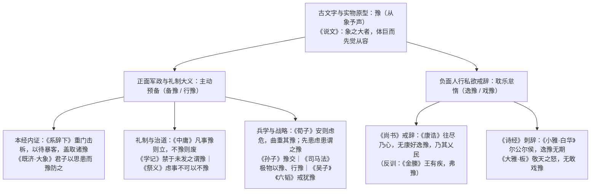

# 《周易》“豫”的本义辨析

> **创建日期**：2026-10-25  
> **模块归属**：05 词义研究记录  
> **价值基准评级**：🟡 **2 级文档（核心依赖因子：0.3，初始暂定，待用户终审裁定）**  
> **研究范畴**：甲骨金文与《说文》“豫”字源流、先秦两汉白名单原典词频与褒贬分野实证、《谦》《豫》覆卦（互综）结构内证、《周易·豫》卦爻辞全息训诂与西周初年周公辅政历史唯物互证  
> **理论基石**：历史唯物主义与唯物辩证法、《矛盾论》《实践论》、生生系统动力学总公理（1-C03《利与不利》、1-C04《贞》、1-C06《元亨利贞》、1-R04《藏礼于器》）、四重证据法（《标准 v3.5》）  
> **核心结论**：破除汉唐宋以来王弼、孔颖达等将《豫》卦单向训为“欢歌逸乐”之千年偏蔽。通过先秦原典穷尽式普查证实：“豫”在先秦典籍中具有鲜明的二元分野——凡言人行私欲之“逸豫、戏豫”皆为贬义戒辞；凡言兵事、建制、治国、礼祭之正面大义，皆取**“主动预备、先患虑患、当仁不让之行豫”**。结合《谦》（退守不居）与《豫》（临难担当）互为覆卦（综卦）之结构，以及孔子《系辞下》“重门击柝，以待暴客，盖取诸《豫》”之本经内证，确立《豫》卦以**“预先筹备、当仁不让之战略担当（豫备）”**为核心本义，并与西周初年周公旦辅政、平三监、建侯营洛、制礼作乐、反政成王之全周期历史唯物实证严密咬合。

---

## 一、 问题意识：传统“逸乐说”在《豫》卦经传中的三大训诂死结

自东汉马融、魏王弼《周易注》、唐孔颖达《周易正义》至于宋代程颐《伊川易传》、朱熹《周易本义》，传统注疏主流皆依《尔雅·释诂》“豫，乐也”，将《周易》第十六卦《豫》（䷏，坤下震上）的核心卦意定性为“和乐、喜豫、逸乐”（孔颖达疏：“谓之豫者，取逸豫之义，以和顺而动，故动而皆乐”）。

然而，若依博士至教授级学术规范与“四重证据法”对读《豫》卦经传原文，单纯以“逸乐、欢愉”解《豫》，立即面临**三大无法自洽的训诂死结**：

1. **卦辞“利建侯行师”的军政逻辑悖论**：
   - 《豫》卦卦辞仅五字：**“豫：利建侯行师。”**
   - “建侯”乃武装分封诸侯、授土授民以控扼战略要冲；“行师”乃兴兵出征、讨伐叛逆。在商周之际，“建侯”与“行师”皆属生死存亡之最高国家军政行动（《孙子兵法·计篇》：“兵者，国之大事，死生之地，存亡之道”）。若“豫”的核心本义仅是“吃喝欢乐、安逸舒泰”，试问：岂有在举国沉溺欢乐安逸之时，反而最宜兴师动众、远征伐叛之理？
2. **六爻吉凶分布的反向排他悖论**：
   - 检视《豫》卦六爻爻辞：
     - **初六**：“鸣豫，凶。”《小象》：“初六鸣豫，志穷凶也。”
     - **六二**：“介于石，不终日，贞吉。”《小象》：“不终日，贞吉；以中正也。”
     - **六三**：“盱豫悔。迟有悔。”《小象》：“盱豫有悔，位不当也。”
     - **九四**：“由豫，大有得。勿疑。朋盍戠（簪）。”《小象》：“由豫，大有得；志大行也。”
     - **六五**：“贞疾，恒不死。”《小象》：“六五贞疾，乘刚也。恒不死，中未亡也。”
     - **上六**：“冥豫，成有渝，无咎。”《小象》：“冥豫在上，何可长也。”
   - 统计可见：全卦六爻中，凡以阴爻居位而直接标举“X豫”者——初六“鸣豫”、六三“盱豫”、上六“冥豫”——**100% 断为“凶”、“悔”或被《象传》痛斥“何可长也”**！相反，全卦获得“贞吉”与“恒不死”的六二、六五两中位爻，**只字不言“豫”**，反而强调“介于石，不终日（坚如磐石、见微知著）”与“贞疾（常怀沉疴在身之忧患）”；唯一以“豫”获“大有得”的九四阳爻，则是全卦之统帅枢纽（“由豫”）。若“豫”是正面的“欢愉享乐”，为何六爻之中凡耽于欢乐者皆凶悔，唯独戒惧备患者得吉？
3. **本经《系辞下》“制器尚象”内证的直接冲突**：
   - 孔子与七十子后学在《周易·系辞下》第二章系统总结圣人观十三卦之象以创制华夏文明器物制度时，明确写道：
     > **“重门击柝，以待暴客，盖取诸《豫》。”**
   - 东汉郑玄注云：“坤下震上，九四体震，又互体有艮，艮为门，震日所出亦为门，重门象也；艮又为手，巽爻也，应曰豫，艮手击震木，击柝象也。”李鼎祚《周易集解》引《九家易》云：“下有坤，地上有木，为重门；击木作声，以警守备，盖取诸《豫》，**备豫之义也**。”《既济·大象传》亦云：“水在火上，既济；君子以**思患而豫防之**。”
   - 《系辞传》作为解释《周易》经文的第一权威内证，将《豫》卦直接锚定为**“设置重重城门、昼夜敲击木柝巡逻，以预先防备暴客突袭”**的军事防御与战略预警制度！这直接证明：在先秦易学本源中，《豫》的核心大义正是**“备豫（主动预备、先患防患）”**。

---

## 二、 第一、二重证据：“豫”之字源考辨与先秦原典语义二元分野

### 1. 古文字源流与物候生理基础
- **《说文解字·象部》**：“**豫，象之大者。贾侍中（贾逵）说：不害于物。从象，予声。**”
- 在殷商至西周早期，黄河流域气候温润，中原地区广泛栖息亚洲象（殷墟甲骨卜辞屡见“获象”，殷墟王陵区亦出土象坑与青铜象尊，“豫州”之得名即源于此）。大象在陆生动物中体魄最为宏伟，性情沉稳，感官敏锐（能提前感知地震、洪水与猛兽逼近而预先迁徙设防），行止从容不迫。
- 由此实物原型出发，“豫”字在先秦汉语中分化出两条截然不同的引申链条：
  1. **正面战略链条（从容宽裕 ➔ 预先筹备 ➔ 当仁不让之行豫）**：因力量充沛、超前感知而做到“胸有成竹、先事虑事、先患虑患”；
  2. **负面惰性链条（宽裕安舒 ➔ 耽乐怠惰 ➔ 昏冥恋栈之逸豫）**：因处境安舒而放松警惕，滑向贪图安逸、戏谑怠慢。

### 2. 先秦白名单原典穷尽式证据比对

为严格贯彻《标准 v3.5》第十二条“准入白名单”（剔除东晋梅赜伪古文《尚书·五子之歌/说命中/君陈》等黑名单伪篇），将先秦原典中“豫”字的两大用法对勘如下：

#### （1）言兵事、建制、礼祭、治国：一致取“主动预备（备豫）”
| 典籍出处 | 原典引文（经维基文库与四部丛刊本核验） | 语义内核与制度指向 |
| :--- | :--- | :--- |
| **《周易·系辞下》** | “重门击柝，以待暴客，盖取诸《豫》。” | 观《豫》卦之象创制城防重门与巡夜击柝制度，**预先戒备暴客寇盗** |
| **《周易·既济·大象》** | “水在火上，既济；君子以思患而豫防之。” | 在大功既成（既济）之时，**超前思虑祸患而预先设防** |
| **《礼记·学记》** | “大学之法，禁于未发之谓豫，当其可之谓时，不陵节而施之谓孙，相观而善之谓摩。此四者，教之所由兴也。” | 在邪僻与隐患**尚未萌发之前预先防禁**，谓之“豫” |
| **《礼记·祭义》** | “孝子将祭，虑事不可以不豫；比时具物，不可以不备。” | 宗庙大祭前，**谋虑祭事必须预先筹划**，与“备”字互文同义 |
| **《礼记·中庸》** | “凡事豫则立，不豫则废。言前定则不跲，事前定则不困，行前定则不疚，道前定则不穷。” | 治国九经之总枢：**一切政事唯有预先定计筹备方能成立**，不预备则必败废 |
| **《荀子·仲尼》** | “故知兵者之举事也，满则虑嗛，平则虑险，安则虑危，曲重其豫，犹恐及其旤，是以百举而不陷也。” | 知兵统帅举事之铁律：**居安思危，委曲周密地层层加固预备（曲重其豫）** |
| **《荀子·大略》** | “先事虑事谓之接，接则事优成。先患虑患谓之豫，豫则祸不生。” | 给出“豫”之经典定义：**在祸患发生之前预先谋虑防备，谓之“豫”** |
| **《荀子·儒效》** | “仲尼将为司寇，沈犹氏不敢朝饮其羊……鲁之粥牛马者不豫贾，必蚤正以待之也。” | “不豫贾”即不敢预先虚抬物价以诈人，“蚤（早）正以待之”即预先端正自守 |
| **《孙子兵法·九地》** | “是故不知诸侯之谋者，不能豫交；不知山林、险阻、沮泽之形者，不能行军。” | 军事外交上，洞察诸侯战略意图方能**预先缔结盟交（豫交）** |
| **《司马法·用众》** | “凡战，有天，有财，有善……人习陈利，极物以豫，是谓有善。人勉及任，是谓乐人。大军以固，多力以烦，堪物简治，见物应率，是谓行豫。” | 军政准备达到极致（**极物以豫**），临阵从容调度、见机立应（**行豫**） |
| **《吴子·治兵》** **《六韬·龙韬》** | 《吴子》：“用兵之害，犹豫最大；三军之灾，生于狐疑。” 《六韬》：“故曰：无恐惧，无犹豫。用兵之害，犹豫最大；故智者从之而不释，巧者一决而不犹豫。” | 反面印证：用兵最忌像兽类般左顾右盼、迟疑不决（**犹豫**，正好对应《豫·六三》“盱豫悔，迟有悔”） |

#### （2）言人行私欲、怠政失德：多取“逸豫（耽乐安逸）”且全作贬义戒辞
| 典籍出处 | 原典引文（剔除伪古文《尚书》后之真古信源） | 语义内核与褒贬性质 |
| :--- | :--- | :--- |
| **《尚书·康诰》** | “往尽乃心，无康好逸豫，乃其乂民。” | **贬义戒辞**：周公训诫卫康叔治殷民，严禁贪图安乐逸豫 |
| **《诗经·小雅·白华》** | “尔公尔侯，逸豫无期。慎尔优游，勉尔遁思。” | **贬义刺辞**：讽刺王侯沉溺安逸享乐、漫无止境而荒废国事 |
| **《诗经·大雅·板》** | “敬天之怒，无敢戏豫。敬天之渝，无敢驰驱。” | **贬义戒辞**：警告执政重臣敬畏天道民变，绝不可戏谑怠慢 |
| **《尚书·金縢》** | “既克商二年，王有疾，弗豫。” | **病体反训**：武王身患重病而体气不适（弗豫） |
| **《孟子·梁惠王下》** | “夏谚曰：‘吾王不游，吾何以休？吾王不豫，吾何以助？一游一豫，为诸侯度。’” | **巡狩制度**：春省耕而补不足（游），秋省敛而助不给（豫），实为天子巡行预察农事法度，非私人淫乐 |
| **《孟子·公孙丑下》** | “夫天未欲平治天下也；如欲平治天下，当今之世，舍我其谁也？吾何为不豫哉？” | **担当裕如**：孟子因确立“平治天下舍我其谁”之使命担当而心怀从容宽裕 |

**实证结论**：在先秦语境中，只要涉及军事（“行师”）、建国（“建侯”）、礼制（“作乐崇德，殷荐之上帝”），“豫”绝无“贪图逸乐”之义，而是**100% 指向“先患虑患、主动预备、当仁不让之行豫”**；而一旦主体将“豫”异化为私欲享乐、虚骄张扬或昏昧恋栈，即堕入《诗》《书》所痛斥的“逸豫/戏豫”，在《豫》卦六爻中必然招致“鸣豫凶”、“盱豫悔”、“冥豫何可长”的严厉制裁！

---

## 三、 《谦》《豫》互综（覆卦）结构与“当仁不让”的行动哲学

在《周易》六十四卦的卦体结构中，第十五卦 **《谦》（䷎，艮下坤上）** 与第十六卦 **《豫》（䷏，坤下震上）** 是一组严格的一阳五阴**覆卦（互综之卦）**（此乃六画卦象客观空间翻转拓扑，绝非《序卦传》机械相因）。

将《谦》《豫》二卦并置对勘，可以无比清晰地看见先秦唯物辩证法的完整人格与战略闭环：

| 维度 | 第 15 卦 · 地山谦（䷎ 艮下坤上） | 第 16 卦 · 雷地豫（䷏ 坤下震上） |
| :--- | :--- | :--- |
| **一阳所在爻位** | **九三**（下卦艮体之终，“劳谦君子，有终，吉”） | **九四**（上卦震体之始，“由豫，大有得。勿疑。朋盍戠”） |
| **内卦与外卦** | 内艮（止）而外坤（顺）：止于内而顺于外 | 内坤（顺）而外震（动）：顺于内而动于外 |
| **核心行为姿态** | **退守不伐，不主动张扬表现**（功成之后退居下卦） | **先患虑患，主动预备，当仁不让**（危机之时挺身居近君枢要） |
| **卦辞战略指向** | “谦：亨，君子有终。”（守成保终） | “豫：利建侯行师。”（开基平乱、封建拓殖） |
| **儒家经典印证** | 《论语·泰伯》：“三分天下有其二，以服事殷” / 《老子》：“功遂身退” | **《论语·卫灵公》：“子曰：‘当仁，不让于师。’”** / 《孟子》：“当今之世，舍我其谁也？吾何为不豫哉？” |

为什么《谦》卦翻转过来就是《豫》卦？
- 当天下已定、功业已成之时，君子当行 **《谦》道**——不居功、不自傲、退藏于密；
- 但当国家面临主少国疑、强敌环伺、三监叛乱的存亡危局时，如果核心统帅还一味讲“退让、不主动表现”，那就是逃避历史责任！此时必须翻转《谦》卦，挺身进入 **《豫》道**——九四一阳从下卦翻上四位近君枢要，化“艮止”为“震动”，以**“当仁不让于师”**的政治魄力，预先筹备（备豫），果断承担起**“建侯行师”**的历史重任！

---

## 四、 《豫》卦经传全息训诂与周公辅政时间阶段对应表

将“豫 = 主动预备与当仁不让之担当”放回《豫》卦卦辞与六爻的时间阶段序列中，全卦每一句经文、每一条《象传》都得到了严丝合缝的唯物解释：

| 经文位置 | 经文原句（法定底本 `zhouyi.json`） | “豫”及核心词训诂 | 时间阶段与周公辅政历史唯物对应 |
| :---: | :--- | :--- | :--- |
| **卦辞** | **豫：利建侯行师。** | **豫**：顺应天时民心而主动预备、当仁不让。 **利**：有利于国家物质再生产与地缘安全（1-C03）。 | **总纲**：周公辅政，率师东征平定三监与淮夷（行师），大封鲁、卫、宋、齐、燕并营建洛邑（建侯），奠定西周宗法国家基石。 |
| **彖传** | **豫，刚应而志行，顺以动，豫……刑罚清而民服。** | **刚应而志行**：九四一阳居上，群阴顺应，备豫平天下之志得以推行。 | 周公居九四摄政枢要，顺应天命民心而兴师立制，明德慎罚（《康诰》），万邦悦服。 |
| **大象传** | **雷出地奋，豫。先王以作乐崇德，殷荐之上帝，以配祖考。** | **作乐崇德，殷荐配祖**：以最高礼乐与郊祀配天大典完成国家意识形态整合。 | 《孝经·圣治章》：“昔者周公郊祀后稷以配天，宗祀文王于明堂以配上帝。”制《大武》《酌》之乐，铸《宗周钟》等礼器，凝聚华夏认同。 |
| **初六** | **鸣豫，凶。** （变爻震初九：震来虩虩，后笑言哑哑，吉） | **鸣豫**：在根基未固、上下未孚之初位，高调声张威权或急迫对抗（戒辞）；亦指小人仗势鼓噪流言。 | **第一阶段（流言初起）**：管蔡散布流言“公将不利于孺子”。周公若在初位急迫高调自辩或强行在朝堂动武对抗（鸣豫），必致周室分裂（志穷凶也）；周公凛遵此戒，取变爻“震来虩虩”，避位居东二年查实叛情（罪人斯得），作《鸱鸮》寤王，终获“后笑言哑哑，吉”（《尚书·金縢》）。 |
| **六二** | **介于石，不终日，贞吉。** （变爻解九二：田获三狐，得黄矢，贞吉） | **介于石，不终日**：心志坚如磐石，在危几微萌之初不待终日即超前立定万全预备。 | **第二阶段（危萌立备）**：克商二年武王病危微几之时，周公心如磐石，不俟终日筑三坛植璧代武王，并将册祝深藏金縢之匮（今文《尚书·金縢》、清华简《金縢》）。这一超前预备在日后成王启金縢时如“黄矢”射穿管蔡武庚“三狐”之谗疑，得“贞吉”。 |
| **六三** | **盱豫悔。迟有悔。** （变爻小过九三：弗过防之，从或戕之，凶） | **盱豫**：张目观望、贪恋眼下安逸。 **迟有悔**：畏难狐疑、迟疑拒战而失机致悔。 | **第三阶段（临战决疑）**：三监及淮夷叛，周公作《大诰》将东征。朝中庶邦君与御事贪恋王宫邦君室之苟安而张目观望（盱豫），畏惧“艰大”劝王违卜拒战（迟）。周公痛斥迟疑不防必遭叛军残戕（弗过防之，从或戕之），力排众议挥师东征（《尚书·大诰》）。 |
| **九四** | **由豫，大有得。勿疑。朋盍戠（簪）。** （变爻坤六四：括囊，无咎无誉） | **由豫**：天下备豫平难皆由九四一阳担当。 **朋盍戠（簪）**：同利同志之诸侯百官如簪括发、埴土凝合般归聚（参 2-C08《朋与友》）。 | **第四阶段（东征大成）**：周公当仁不让总揽东征全局（由豫），作《君奭》至诚去疑（勿疑），合友邦诸侯三年平定三监与东夷，封微子、伯禽、康叔（大有得），并在盛功下谨守坤四“括囊”臣节，戒伯禽“无以鲁国骄士”（《尚书·大诰》《君奭》《史记·鲁周公世家》）。 |
| **六五** | **贞疾，恒不死。** （变爻萃九五：萃有位，无咎。匪孚，元永贞，悔亡） | **贞疾**：常怀如带沉疴之制度性戒惧定力（1-C04）。 **恒不死，中未亡也**：守持天下之中而基业长存（1-M02）。 | **第五阶段（营洛治殷）**：成王幼主下乘周公之刚（乘刚），且东方殷遗民未靖如沉疴在体（贞疾）。周公与成王封康叔作《康诰》《酒诰》《梓材》，戒“无康好逸豫”；同时营建东都成周洛邑居天下之中（《召诰》《洛诰》《何尊》），四方民大和会，奠定八百年基业。 |
| **上六** | **冥豫，成有渝，无咎。** （变爻晋上九：晋其角，维用伐邑，厉，吉，无咎，贞吝） | **冥豫**：居终极之位而昏冥沉迷于摄政豫行之恋栈深渊（《象》曰：何可长也）。 **成有渝**：大功告成而主动改变领导位置。 | **第六阶段（功成反政）**：周公行政七年，平叛建侯、制礼作乐大功告成（成），成王已长。周公绝不堕入“冥豫”恋栈之渊，断然改变当仁不让之摄政地位（有渝），作《洛诰》“朕复子明辟”，反政成王，北面就群臣之位，严饬封邑礼法（维用伐邑），获“无咎”之善终。 |

---

## 五、 价值分级建议报告（供用户主理人裁决）

- **建议级别**：🟡 **初始纳入 2 级文档（核心依赖因子：0.3）**，具备晋升 **1 级文档（核心依赖因子：0.4）** 之潜力（唯由用户主理人终审裁定）。
- **核心贡献**：
  1. 彻底厘清先秦“豫”字“主动预备（备豫/行豫）”与“耽乐安逸（逸豫/戏豫）”的二元分野，解决了《豫》卦“利建侯行师”与六爻吉凶分布的千年训诂难题；
  2. 贯通《谦》《豫》互综结构与 1 级公理库（1-C03 利、1-C04 贞、1-C06 反向排他律、1-R04 藏礼于器），直接支撑 [`03 周易笺注史鉴/16_豫卦.md`](../03%20周易笺注史鉴/16_豫卦.md) 与 [`06 融合研究记录/06_周公制礼作乐的历史唯物考证.md`](../06%20融合研究记录/06_周公制礼作乐的历史唯物考证.md)。

---

© 2026 徐时言 · 《《周易》“豫”的本义辨析》 · 徐时言-易经研究 · 采用 CC BY-NC-ND 4.0 许可， 转载请署名并注明来源 https://wole278.github.io/xushiyan-YiJing/ · 禁止商业使用与改编传播 · 商业授权：wole278@hotmail.com / 微信 wole278
