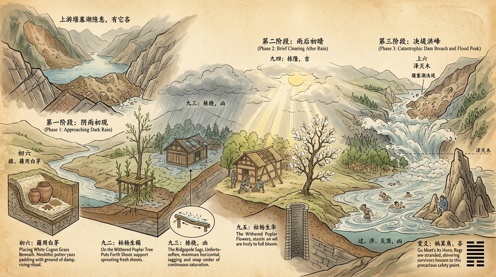
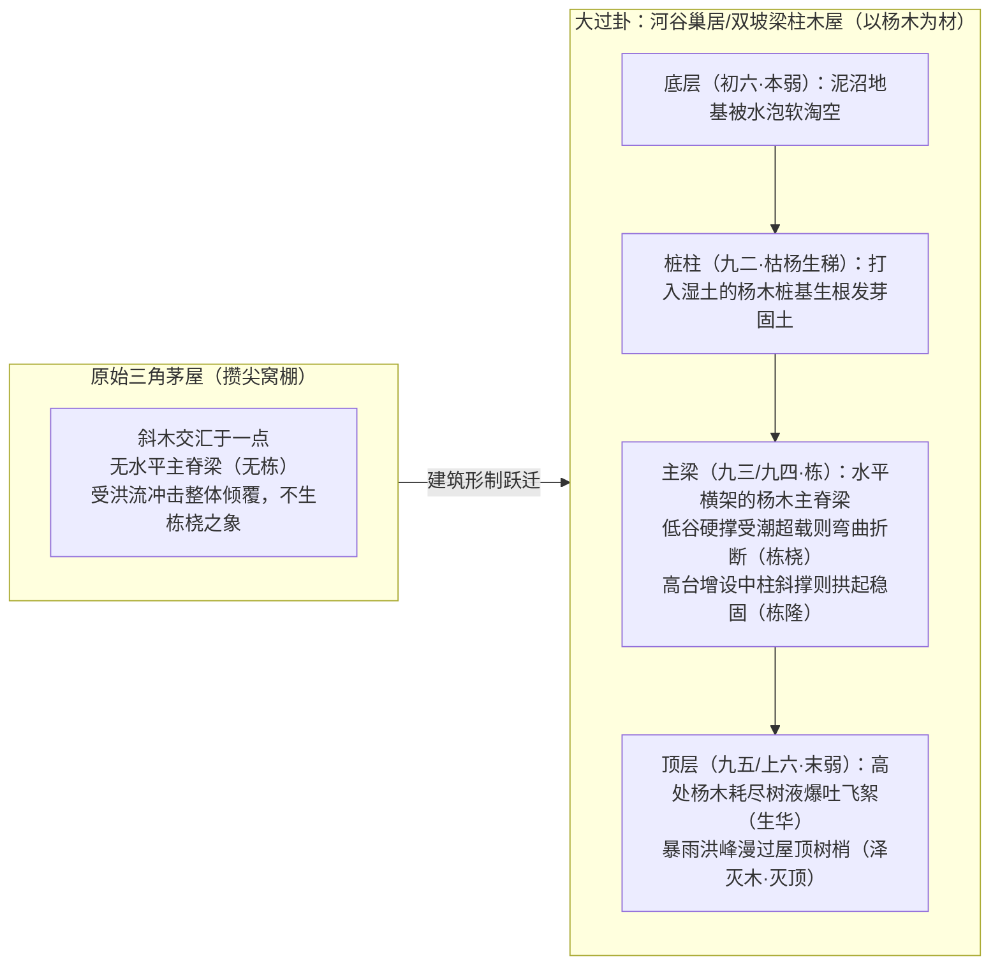
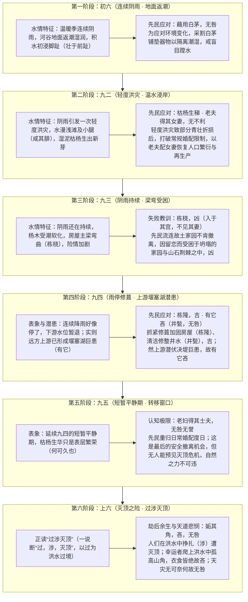

# 03_从大过卦看上古洪水时期的先民应对过程

> **模块归属**：06 融合研究记录  
> **价值基准评级**：🟢 **1 级文档（核心依赖因子：0.4）**。2026-10-21 经用户裁定正式确权晋升为 1 级价值文档，确立为极端灾变演进与先民应对全过程实证模型。  
> **研究主题**：尧舜禹洪泛巨灾下华夏先民的巢居杨木建筑考据、六阶段应急响应与治水文明范式演进  
> **方法论**：历史唯物主义、木材考古与聚落建筑力学、马克思主义“两种生产”理论、本爻与变爻空间统合考据（标准 v3.3）  
> **成文日期**：2026-10-17  
> **审议状态**：2026-10-17 四级审议后修订（详见母本 `03 周易笺注/28_大过卦.md` 与单卦研究记录之“审议修订要点”）

> [!IMPORTANT]
> **审议修订要点（2026-10-17）**
> - 本文为**意象推演与跨学科假说**。爻辞成文约在商周之际，与距今约 3900 年的洪水事件之间缺乏传承证据，不得称为“历史实录”。
> - 上六正读为“过涉灭顶”（《小象》连读），“过，涉，灭顶”只作一说；“无咎”须按“个体层凶、全局层以穷尽人力与续存火种为无咎”分层书写。
> - 积石峡堰塞坝由**地震**滑坡形成，喇家房屋毁于地震（吴庆龙等，2016），原稿“暴雨山崩”“山洪泥石流冲塌”的表述已更正；该研究学界尚有商榷。
> - “南方与四川无杨树”属**事实错误**（川杨、大叶杨、响叶杨均为西南、华中乡土树种），已删改。
> - 各遗址杨属鉴定、白营井层数、禹会村测年均标【待核】，须补原始报告。

---

## 摘要

《周易》第二十八卦《大过》（䷛，下巽上兑，泽风大过），其《大象传》明言“泽灭木，大过”。本文提出一项**研究假说**：大过六爻物象可与**尧舜禹大洪水时期（距今约 4200–4000 年龙山时代晚期）**先民直面洪水、水位逐级抬升并吞没河谷聚落的过程相互参照。

本文尝试以**建筑考古学、木材解剖学、古水文学与先秦文献学**交叉参证，提出三项考据推论与六个阶段的应对推演：
1. **建筑形制推论**：“栋桡（九三）”“栋隆（九四）”之“栋”为水平屋脊主梁，表明所指建筑已具“上栋下宇”的梁架结构（《系辞下》），而非无脊梁的原始攒尖窝棚。
2. **木材学推论（枯杨与栋木）**：“枯杨（九二、九五）”与“栋（九三、九四）”或可统一于杨木用材：
   - 杨柳科扦插再生力强，湿土中的杨木桩可萌蘖生根（**枯杨生稊**）；
   - 杨木为软阔叶材，抗弯性能较弱，受潮超载易弯（**栋桡**）；
   - **枯杨生华**取《小象》“何可久也”之义，指老杨枝头开花、耗液而难结实。〔原稿“架空梁木残液抽生杨花”一说不合植物学常识，已删。〕
3. **考古参证【待核】**：原稿列陶寺、二里头、瓦店、石峁、喇家等遗址检出杨属（*Populus*）、柳属（*Salix*）建筑用材，各条须补原始鉴定报告。新疆小河墓地等大量使用胡杨，为公认事实。

---

## 一、建筑与木材考古多维考辨：巢居木屋、杨木栋梁与尧舜禹洪水记忆

### 1. 从“三角茅屋”到“有栋巢居木屋”：建筑史上的结构跃迁
在仰韶文化早中期及更早阶段，先民的简易居所多为圆形半地穴式“三角茅屋（攒尖顶窝棚）”——四周斜立木杆，顶端交汇捆扎成圆锥状，外覆白茅草（如西安半坡部分圆形房址）。此类圆锥形三角茅屋在力学上依靠斜杆相互抵撑，**根本不存在水平方向贯穿屋顶最高处的承重主脊梁——“栋”**。

而《大过》卦辞与九三、九四爻辞反复聚焦于**“栋桡（屋脊主梁弯曲折断）”**与**“栋隆（屋脊主梁高高隆起）”**，这一工程力学特征直接标定了其建筑形态：
- **必须具备水平主脊梁（栋）与立柱（柱/桩）**：《说文》：“栋，极也。”《尔雅·释宫》：“栋谓之桴。”即双坡屋顶最高处水平横架的承重主梁。《系辞下》云：“上古穴居而野处，后世圣人易之以宫室，上栋下宇，以待风雨。”只有脱离了原始三角茅屋，进入**矩形/方形双坡屋面、以立柱（或底部巢居木桩）承托水平主脊梁（栋）、再由主梁架设斜椽（宇）**的成熟木构阶段，才会发生主梁因跨度过大或底部桩柱下沉而“栋桡”的力学现象。
- **洪泛区的“巢居木屋”结构（下者为巢）**：《孟子·滕文公下》记载尧舜大洪水时：“水逆行，泛滥于中国，蛇龙居之，民无所定；**下者为巢，上者为营窟**。”在低洼多水的河谷平原，先民为避水患虫蛇，或直接依托高大活树干架木筑巢（《淮南子》“民皆上丘陵，赴树木”），或将粗大原木打入湿地泥土作为底层桩柱，在桩柱之上架设木板与“上栋下宇”的木屋。当洪水漫入聚落，底层泥土被泡软淘空（初六阴柔，**本弱**），屋顶遭受狂风暴雨与洪浪冲击（上六阴柔，**末弱**），中间四阳所代表的木屋立柱与水平横梁承受极限载荷，遂生“栋桡”之危。

---

### 2. 古代中原利用杨树的习惯：为何以“杨木”为建房木料？
旧注将九二、九五的“枯杨”仅看作路边野树，未能识破**“枯杨”正是被先民砍伐下来、剥去枝叶以充当巢居桩柱与屋梁的杨木原木**！在上古中原与黄河流域，先民以杨树（杨属 *Populus*，常与柳属 *Salix* 统称杨柳）为主要建筑木料，源于三大客观物质条件：

1. **河谷泽畔的第一优势树种（泽木）**：
   全新世大暖期至龙山时代（距今 5000–4000 年），中原大地河流纵横、湖泽密布。杨树是典型的喜湿、耐水淹、速生高大乔木，广泛分布于黄河、伊洛河、颍河、汾河两岸的河漫滩与低湿地带（正合《大过》上兑泽、下巽木之“泽畔之木”）。先民依水建村，走出房门即可砍伐高大通直的杨树，无需远途跋涉上山采运松柏硬木。
2. **石器与铜石并用时代的加工优势**：
   在尧舜禹所处的龙山时代，先民的伐木与木作工具仍以**磨制石斧、石锛、石凿**为主（青铜工具尚未普及于民间土木）。栎木（青冈）、檀木等硬阔叶材虽然坚硬耐腐，但质地极硬，用石斧砍伐、截断、开槽凿榫极为艰难；而**杨木材质轻软均匀（气干密度约 $0.40\text{–}0.50\text{ g/cm}^3$）、树干通直少节、顺纹极易劈裂与砍削**，且生长速度极快（十余年即可长成合抱大木），因此成为上古先民搭建巢居桩柱、房舍梁架、护岸木桩与独木舟的首选大众木料！
3. **杨木用作建筑构件的三大生物与物理奇观（完美解开九二、九三、九五爻辞之谜）**：
   - **“枯杨生稊（九二）”——杨木地桩的扦插生根**：杨柳科植物细胞内富含水杨酸与潜伏不定根原基，“插柳成荫、插杨成林”。当先民把砍伐下来、外表看似干枯的粗大杨木原木（**枯杨**）打入河岸潮湿泥土中作为巢居底桩（九二阳木下接初六湿土）时，杨木桩在水分滋养下竟从入土基部重新萌发出新根须与嫩芽（**生稊**）！木桩变活树，根系深抓泥土，使木屋地基愈发坚固。
   - **“栋桡（九三）”——杨木横梁的抗弯软肋**：杨木虽易加工、打桩能生根，但用作**水平承重横梁（栋）**时力学性能较弱：木质松软，抗弯强度低，吸湿后易蠕变弯曲。洪水漫入、屋面潮湿而又荷载加重时，跨度较大的杨木主梁易向下弯曲乃至折断（栋桡，凶）；唯有如九四般加密立柱、增设斜撑顶托（**栋隆，不桡乎下也**），方能补其易弯之短。
   - **“枯杨生华（九五）”**：取《小象》“枯杨生华，何可久也”之义，指老杨枝头开花，耗其余液而难以结实，只是表层繁荣。〔审议注：原稿“架空梁木以残存淀粉抽生杨花”一说不合植物学常识；杨属早春先花后叶，花期受季节制约，已删。〕

---

### 3. 中国考古参证：出土“杨木（杨属 *Populus*）”建筑遗址【全表待核】

> [!WARNING]
> 下表各遗址的杨属鉴定（除新疆小河墓地等胡杨用材为公认事实外）均未注明原始报告，**全部标【待核】**，须补齐发表文献（报告名、期刊、年份、样品编号）后方可引为证据。“与卦象对应”一栏属类比推演。

| 遗址名称与年代 | 地理位置与文化属性 | 杨木（杨属 *Populus*）考古出土位置与建筑用途 | 与《大过》卦象及洪水背景的对应印证 |
| :--- | :--- | :--- | :--- |
| **青海民和喇家遗址** （距今约 4000 年） | 黄河上游官亭盆地 · **齐家文化** （房屋毁于地震，其后为洪水沉积覆盖） | 【待核】原稿称房址柱洞残木与木炭中检出杨属、柳属、圆柏属，须补报告出处。 | **类比**：F4 等房址中母子相拥遗骸为人熟知，但其房屋系毁于**地震**而非山洪冲塌（吴庆龙等，2016）。与“入于其宫，不见其妻”的对应只是意象类比。 |
| **山西襄汾陶寺遗址** （距今约 4300–3900 年） | 晋南临汾盆地汾河阶地 · **中原龙山文化陶寺类型**（公认尧舜之都核心遗址） | 遗址房址、宫殿区与灰坑出土木材及木炭显微鉴定中，明确包含**杨属（*Populus*）**、柳属、栎属、松属等。先民就地采伐汾河谷地杨柳木用于普通房屋木构架、棚架与木骨泥墙支撑。 | 印证尧舜时代晋南河谷先民在温暖湿润、水系发达环境下，广泛砍伐河岸杨柳木营建聚落居室的用材传统。 |
| **陕西神木石峁遗址** （距今约 4300–3800 年） | 陕北黄土高原秃尾河流域 · **龙山晚期至夏代早期超大型石城** | 在石峁皇城台东护墙及城垣内部，发现成排横向插入石墙内部起拉结稳固作用的原木构件（**“纴木”**，即史前建筑的木质钢筋）及房址木柱，树种鉴定包含**杨属（*Populus*）**、榆属、松属等。 | 印证先民在山腰高阜台地（九四）营建大型防洪护坡与高台建筑时，采用粗大杨木原木进行结构加固以防坍塌（**栋隆，不桡乎下也**）。 |
| **河南偃师二里头遗址** （距今约 3800–3500 年） | 豫西洛阳盆地伊洛河冲积平原 · **夏代中晚期都邑**（早期国家宫室制度成型） | 二里头遗址古伊洛河水网密布，曾多次遭受洪泛侵袭。木炭与木材遗存分析显示，除核心大殿巨柱优选山地硬质栎木外，聚落中大量存在**杨属（*Populus*）**、柳属木材，用于一般建筑构件、木骨泥墙与水井护木。 | 体现先民在经历大洪水洗礼后，对杨木（轻软易加工，宜作辅助构件或增设斜撑）与硬木的力学特性有了深刻认知。 |
| **河南禹州瓦店遗址 / 新密新砦遗址** （距今约 4200–3800 年） | 豫中颍河、双洎河流域 · **龙山晚期至新砦期**（“禹都阳城/钧台”核心传世区） | 遗址位于河谷台地，周边古水文显示龙山末期曾发生剧烈洪水事件。植物与木炭考古检出杨柳科（杨属、柳属）等河岸阔叶林木，伴随高台建筑基址与深井遗存。 | 印证大禹治水核心区先民在颍水洪泛期，从低湿地撤往高台（九四）、利用河岸杨木建房筑防并开凿深井的历史实景。 |
| **甘肃秦安大地湾遗址** （距今约 6000–5000 年） | 渭河上游葫芦河支流 · **仰韶文化中晚期** | 见证了中国北方建筑从早期圆形“三角茅屋”向大型长方形分间木构殿堂（如 F901，具主梁、顶柱、挑檐）的演进，出土木炭鉴定中明确含有**杨属（*Populus*）**等阔叶木材。 | 提供了北方先民脱离三角茅屋、发展出有水平主脊梁（**上栋下宇**）并使用杨木等乡土木材的源头物证。 |
| **新疆罗布泊小河墓地 / 克里雅河北方墓地** （距今约 4000–3500 年） | 塔里木盆地古河道绿洲 · **青铜时代早期** | 极端干燥环境使木构件完好保存，所有居住遗址桩柱、墓上立木与棺木**几乎全用胡杨（*Populus euphratica*）与灰杨原木**砍削搭建。 | 展现了上古河道泽畔先民“全杨木建筑体系”的直观实物标本。 |

---

### 4. 尧舜禹时代大洪水与大禹治水主战场：中原与黄淮流域说（论证）
近代以来，部分论者据汉晋以后晚出方志（如《华阳国志》）之说，以为大禹治水主要在四川盆地（岷江流域）。以下四项论据倾向于把《大过》意象的地理参照与**大禹治水的主要区域置于中原与黄淮流域（黄河中下游—伊洛河—颍水—淮河流域）**。须说明：这是多项旁证叠加的倾向性结论，不是“定谳”。

1. **第一项论据（已修订）：杨木建房的用材传统以北方为多见**
   - 〔审议更正：原稿称“中国南方与四川盆地古代无乡土杨树”，属事实错误。川杨（*Populus szechuanica*）、大叶杨（*P. lasiocarpa*）、响叶杨（*P. adenopoda*）等均为西南、华中乡土树种。〕
   - 可以成立的表述是：已报道的南方史前干栏建筑用材多为樟科、壳斗科、杉木等；以杨属为主要建材的报道多见于北方。但这只是用材**倾向**，不能据此从植物地理上“排除”南方；北方各遗址的杨属鉴定本身亦待核（见上表）。
2. **第二项论据：“营窟、井甃”与黄土台地**
   - 《孟子》“上者为营窟”之营窟，以具有直立性的黄土台地最为便利（晋南、豫西、豫中黄土台地）；四川盆地地下水位高、紫色土黏重，窑穴营建条件较差。此为倾向性论据。
   - 九四变爻《井》六四“井甃，无咎”，可与龙山时代中原深井护壁技术相参照（如河南汤阴白营龙山文化木构水井，原稿“深 11 米、60 余层木框”【待核】）。
3. **第三项论据：古水文学与《淮南子》**
   - 尧舜都邑传说多指向晋南（陶寺遗址），夏文化核心区位于豫西伊洛与豫中颍水流域。
   - 吴庆龙等（Science, 2016）提出约公元前 1920 年黄河积石峡地震滑坡坝溃决洪水，并推论下游河道变迁；该研究的年代与规模学界尚有商榷。“4.2 千年事件”与黄淮洪泛的关联亦属研究中的推论，不宜写作已证事实。
   - 《淮南子·本经训》“龙门未开，吕梁未发，江、淮通流，四海溟涬，民皆上丘陵，赴树木”，所列地名多指向黄淮一带，可作文献旁证。
4. **第四项论据：“涂山会盟”与禹会村遗址**
   - 《左传·哀公七年》：“禹合诸侯于涂山，执玉帛者万国。”
   - 中国社会科学院考古研究所自 2006 年起发掘安徽蚌埠怀远涂山南麓的**禹会村遗址**，发现龙山晚期大型礼仪台基、烧祭坑及多区域文化因素器物（测年“距今约 4400–4100 年”及“迎宾大道”“工棚”等细节【待核】，须对照发掘报告）。
   - 该遗址与“禹会诸侯”传说在地望上相合，可作有力旁证；但考古遗存本身不能直接证明“大禹”其人其事，故只能称“支持黄淮说”，不宜称“确凿无疑地证明”。

---

## 二、上古先民应对洪灾演进的六阶段推演：从连续阴雨、雨后平静假象（上游潜患）到灭顶之险

以下依意象假说，对《大过》六爻及其变爻作水文、物候与应对逻辑上的推演，可得一条**“前期连续阴雨引发涨水与屋梁受潮（初六至九三）→ 中期雨停的短暂平静与视野之外的潜患（九四至九五）→ 终局灭顶之险（上六）”**的灾害链。须注意，以下各阶段细节多属推演，并非经文明文。

为什么推测灭顶之险与**九四、九五平静期背后的上游潜患**相关？
- **水文学常识**：单纯由本地降雨引起的涨水多为渐次抬升，人们尚有时间转移；大规模骤然没顶，常与溃决洪水相关。
- **“有它吝（九四）”的推演**：上游若因滑坡堵江形成**堰塞湖**，下游可能出现水退的假象（九四、九五）。先民修屋治井（栋隆、井甃），重归日常（恒其德），而视野之外的“它”尚在。〔审议注：积石峡实例中的堰塞坝由**地震**诱发，并非暴雨所致，只能作为“视野之外突变”的类比。〕
- **上六的读法与“无咎”**：正读为“过涉灭顶”（《小象》连读），“过，涉”一读只作一说。“无咎”不宜归结为“天灾不可抗、被动受灾”。王弼注“志在救时，故不可咎也”，据此应分层书写：没顶毁身，个体层为凶；先民穷尽人力，幸存者守高保种、续存火种，全局层为无咎。

### 1. 第一阶段（初六）：连续阴雨·地面返潮——“藉用白茅”的隔离潮湿与底线备灾
- **经文与变爻**：初六，藉用白茅，无咎（变爻：泽天夬·初九，壮于前趾，往不胜为咎）。
- **应对过程还原**：连续的阴雨让河谷聚落的地面慢慢渗水返潮，低洼处积水刚浸脚趾（壮于前趾）。上古先民为了应对天气与环境的变化，立即采割河滩柔韧干燥的**白茅草**，层层铺垫在谷种、火种与陶器之下，**用白茅隔离潮湿**（藉用白茅），防止核心生存物资受潮霉变，同时克制盲目涉险之举，故得“无咎”。

### 2. 第二阶段（九二）：轻度洪灾·温水生稊——“枯杨生稊”与“老夫得其女妻”的人口再生产恢复
- **经文与变爻**：九二，枯杨生稊，老夫得其女妻，无不利（变爻：泽山咸·六二，咸其腓，凶，居吉）。
- **应对过程还原**：连日阴雨引发了一次轻度洪灾，河水漫过浅滩没及小腿肚（咸其腓）。
  1. **枯杨生稊**：在温暖湿润的水土浸润下，干枯的杨木桩或岸边老杨树从根部萌发出勃勃新芽（稊），展现出灾后生态的自我修复力；
  2. **老夫得其女妻**：部落在经历了这次轻度洪灾、导致部分冲锋在前的青壮年男丁折损后，为了生存繁衍，果断打破常态下的婚配年龄限制（“过以相与也”），由经验丰富的年长男子迎娶年轻健壮的女子（老夫得其女妻），迅速恢复人口繁衍与再生产活力，故断为**“无不利”**。

### 3. 第三阶段（九三）：阴雨持续·栋梁弯曲——“栋桡”与流连家园者的受困之凶
- **经文与变爻**：九三，栋桡，凶（变爻：泽水困·六三，困于石，据于蒺藜，入于其宫，不见其妻，凶）。
- **应对过程还原**：阴雨还在持续，雨水浸泡使地基松软，房屋的**杨木主脊梁（栋）**因长期受潮软化与屋顶积水重压，都已经弯曲变形了（栋桡），情况越来越危急！此时本应果断转移，但部分先民流连故土家园、舍不得坛罐家产，拒绝外援与撤离建议（不可以有辅也），结果因为留恋家园而受困于坍塌的房屋与山石荆棘之中，折返屋室时妻儿亦已离散罹难（困于石，据于蒺藜，入于其宫，不见其妻），故断为**“凶”**。

### 4. 第四阶段（九四）：雨停修葺·井水重清——“栋隆，吉”与“有它吝（上游堰塞湖危机）”
- **经文与变爻**：九四，栋隆，吉。有它吝（变爻：水风井·六四，井甃，无咎）。
- **应对过程还原**：连续的降雨好像终于停了，河水暂退（甚至因上游堵江而异常回落）。
  1. **修葺房屋、清洁井水（栋隆，吉 / 井甃，无咎）**：趁着雨停，先民抓紧修葺加固受损的房屋，用立柱斜撑将弯曲的屋脊主梁重新顶起加固（**栋隆**），同时修砌井壁、淘洗清洁被雨水弄浑的井水（变爻**“井甃”**），聚落恢复秩序，故获**“吉”**；
  2. **“有它吝”的推演：视野之外的潜患**：既然房屋修好了、井水清洁了，为何爻辞警告**“有它吝”**？“它”为意外之患（《说文》“上古草居患它”）。依假说，可推演为上游滑坡堵江所成的**堰塞湖**一类潜患：表面雨停水退之“吉”背后，视野之外仍有溃决之险，故曰“有它吝”。〔审议注：经文未指“它”为何物；积石峡实例中的坝体由地震诱发，并非暴雨所致。〕

### 5. 第五阶段（九五）：短暂平静——“枯杨生华、老妇士夫”与错过的转移窗口
- **经文与变爻**：九五，枯杨生华，老妇得其士夫，无咎无誉（变爻：雷风恒·六五，恒其德，贞。妇人吉，夫子凶）。
- **应对过程推演**：
  1. **表层繁荣（枯杨生华，老妇得其士夫）**：老杨枝头开花，耗液而难结实；老妇配少夫，难以生育。皆为表层繁荣，《小象》曰“何可久也”。聚落以为灾情已过、重归日常（变爻“恒其德”）。〔审议注：原稿“雨后阳光激发杨花”不合杨属物候，已删。〕
  2. **无咎无誉**：守常度日并无主观过错（无咎），却也未在平静期把余力投向根部修复与转移预备，故无建立根本之功（无誉）。变爻“夫子凶”是对担当全局者的警示：守常不足以应非常。但本爻断辞是“无咎无誉”，不得据变爻改判。

### 6. 第六阶段（上六）：灭顶之险——“过涉灭顶”与“姤其角”
- **经文与变爻**：上六，过涉灭顶，凶，无咎（变爻：天风姤·上九，姤其角，吝，无咎）。
- **读法**：正读“过涉灭顶”（《小象》“过涉之凶”连读；王弼注“涉难过甚，故至于灭顶，凶。志在救时，故不可咎也”）；一说断为“过，涉，灭顶”，以“过”为洪水过境，与《小象》不合，存以备考。
- **分层推演**：
  1. **个体层“凶”**：涉险过甚而没顶，主体毁身；
  2. **变爻“姤其角，吝”**：角居最上，刚极而孤；依假说可推演为幸存者困守孤高之地、衣食俱乏，故吝。“山角高地”属推演；
  3. **全局层“无咎”**：先民防潮、修屋、治井，已穷尽人力；救难者“志在救时”，幸存者守高保种、为族群续存火种，故“不可咎也”。“无咎”的根据是穷尽人力、向死续火，而非单纯的被动受灾（标准“法则二”）。

---

## 三、理论总结：从《大过》六爻看人类直面自然巨灾的四重历史唯物主义启示

| 阶段与维度 | 《大过》卦爻符号锚定 | 上古洪灾演进与先民应对实景 | 历史唯物主义与现代风险治理启示 |
| :--- | :--- | :--- | :--- |
| **1. 慢变量备灾与人口韧性** | 初六：藉用白茅，无咎 九二：枯杨生稊，老夫得其女妻 | 连续阴雨初起时用白茅隔离潮湿；灾后（推演），打破常规婚配限制，以老夫配女妻恢复人口再生产 | 面对可感知的渐变危机，第一时间做好底层物资防护（白茅隔湿），并打破僵化陈规恢复核心再生产活力（老夫女妻） |
| **2. 存量迷恋之戒** | 九三：栋桡，凶 （变爻：困于石……入于其宫，不见其妻） | 阴雨持续致杨木栋梁受潮弯曲，情况危急，但先民因流连家园而不肯撤离，终致受困于坍塌家园之中 | 当既有空间的物理承载力已达极限（栋桡），最忌因留恋沉没成本而死守危局，当断不断必受其困 |
| **3. 平静假象与视野之外的潜患** | 九四：栋隆，吉，有它吝（井甃） 九五：枯杨生华，老妇得其士夫 | 雨停后修葺房屋、清洁井水（吉）；枯杨生华只是表层繁荣，“何可久也”；视野之外仍有潜患（有它），平静期实为转移窗口 | 警惕“小灾暂歇后的平静假象”！本地修屋淘井虽吉，仍须把视野投向系统上游，排查结构性潜患（“有它”），把余力投向根部修复与转移预备 |
| **4. 灭顶之险与向死续火** | 上六：过涉灭顶，凶，无咎 （变爻：姤其角，吝，无咎） | 涉险过甚而没顶（个体层凶）；幸存者困守孤高之地（姤其角，吝）；穷尽人力、志在救时、续存火种（全局层无咎） | 敬畏客观规律的刚性，同时不以“天灾不可抗”取代主体担当：加强上游监测与高地应急储备，在绝境中优先保全人口与火种 |

---

© 2026 徐时言 · 《03_从大过卦看上古洪水时期的先民应对过程》 · 徐时言-易经研究 · 采用 CC BY-NC-ND 4.0 许可， 转载请署名并注明来源 https://wole278.github.io/xushiyan-YiJing/ · 禁止商业使用与改编传播 · 商业授权：wole278@hotmail.com / 微信 wole278
