# “藏礼于器”：《周易》中的用器体系、考古实证与经典互证研究

> **创建与修订日期**：2026-10-18 创建；2026-10-27 按期刊论文标准（v1.0）全面重构  
> **模块归属与编号**：06 融合研究记录 ｜ 编号：1-R04  
> **价值基准评级**：🟢 **1 级文档（核心依赖因子：0.4，2026-10-21 经用户主理人正式裁定确权，确立为全库商周宗法物用礼制与经文互证最高基石）**  
> **前置理论与公理基石**：历史唯物主义与唯物辩证法、《矛盾论》《实践论》、`《周易笺注审议与完善系统（标准 v3.5）》`、`《384爻断辞回测报告》`、1 级公理基石库（1-M05[`《商论》`](../02%20元研究/商论.md)、1-M06[`《易经文物注》`](../02%20元研究/易经文物注.md)、1-C02[`《周易中用和勿用的词义研究》`](../05%20词义研究记录/02_周易中用和勿用的词义研究.md)、1-C03[`《周易中利与不利的词义研究》`](../05%20词义研究记录/03_周易中利与不利的词义研究.md)、1-C08[`《周易中朋与友的词义训诂与社会关系演变研究》`](../05%20词义研究记录/08_周易中朋与友的词义训诂与社会关系演变研究.md)）；综合核心依赖度指数 $CDI = 0.40$。  
> **四重证据配置与强度分层**：
> - **第一重证据（传世先秦两汉原典与礼制文献，强）**：通行本《周易》经传（`zhouyi.json` 四部丛刊本基准）、今文《尚书》、《诗经》、《周礼》、《仪礼》、《礼记》（《王制》《曲礼》《玉藻》）、《春秋左传》、《春秋谷梁传》、《论语》、《荀子》及东汉班固《白虎通德论》、许慎《说文解字》；
> - **第二重证据（出土古文字与秦汉简牍，强）**：殷墟甲骨卜辞（妇好墓刻辞卜甲）、西周青铜器铭文（《史墙盘》《毛公鼎》等）、云梦睡虎地秦简《厩苑律》、马王堆帛书《周易》；
> - **第三重证据（礼俗人类学与社会形态演进，弱/仅作旁证）**：中国玉礼器万年传统与宗法等级物化机制比较研究（仅作社会逻辑参证，不单独作为训诂定案依据）；
> - **第四重证据（考古遗址与出土器物实物，强）**：三门峡庙底沟彩陶缶、舞阳贾湖遗址卜甲、偃师商城城垣与护城壕遗址、安阳殷墟车马坑、辉县孟庄商代草鞋遗存、周原扶风《史墙盘》、陕西历史博物馆藏西周《刖人守门鬲》与《它盘》、上海博物馆藏春秋《鲁伯愈父匜》、随州曾侯乙墓青铜鉴缶、秦始皇陵一号铜马车（伏兔/輹结构）。  
> **与全库成果关系**：本文系 1-M06[`《易经文物注》`](../02%20元研究/易经文物注.md) 的体系化升华，并为《标准 v3.5》第十二条“第一位标尺（信史与实物证据：藏礼于器）”提供直接法典支撑。

---

## 摘要

**【摘要】** 针对自魏晋王弼“扫象阐理”及宋明理学空谈心性以来，《周易》经文中高频出现的鼎、簋、尊、缶、匜、圭、匕鬯、鞶带、朱绂、桎梏、徽纆、金矢、舆辐、舆輹、金柅、井瓶、栋庐等三十余种核心器物被抽象虚化、等级错置甚至庸俗降格的学术困局，本文运用历史唯物主义与“四重证据法”，将现代商周考古出土实物、先秦两汉礼制原典与《周易》六十四卦时位矩阵进行三维交叉融合考证。研究发现：（1）《周易》用器体系严格对应西周宗法分封与社会再生产的四大支柱——宗庙祭器、政治命服与瑞宝货币、司法刑具与军事城防、交通制动与民生基建；（2）同为代表“士”级礼制的“二簋”，在《损》卦卦辞（“曷之用？二簋可用享”）中指向基层县邑父母官在旱灾之年恪守礼法上限并依《礼记·王制》《谷梁传》荒政护农法令省去“三鼎”肉食牲牢、以两簋谷物为民祈雨，而在《坎·六四》（“樽酒，簋贰，用缶”）中则结合变爻《困·九四》“困于金车”，指向读书士君子在人生坎险中屏弃豪奢排场、以一尊酒二簋粗食及素瓦缶达生乐道；（3）通过对全经 3 处“缶”（王侯铜鉴缶 vs 士庶素瓦缶）、车舆制动三部件（被动崩裂之“说辐”、主动卸轴停修之“说輹”、初萌死锁之“金柅”）及《井》《鼎》《大过》《剥》基建力学的精密考辨，证实《周易》器用哲学以“器以藏礼、名器相符、因时损益、厚筑民生”为“生生”总纲。本研究彻底廓清了传统注疏的名物失考，为《周易笺注》全书器用卦爻确立了第一位实证标尺。（文中凡历史唯物推演均与出土实证明确划界。）

**【关键词】** 周易；藏礼于器；列鼎列簋；二簋与用缶；四重证据法；商周考古器物学；历史唯物主义

---

## 一、 引言：问题意识与学术史文献综述

### 1.1 问题的提出：“器以藏礼”的湮没与传统注疏的三大解经困局

《周易·系辞上》确立了中国古典哲学中最核心的器物唯物论命题：
> **“形乃谓之器，制而用之谓之法，利用出入，民咸用之谓之神……备物致用，立成器以为天下利，莫大乎圣人。”**

在先秦社会中，“器”绝非单纯的物理工具，而是**社会生产力发展水平、宗法政治等级关系与国家治理秩序的物质凝固**。《春秋左传·成公二年》记载孔子论“器”与“礼、义、利、民”的唯物链条曰：
> **“唯器与名，不可以假人，君之所司也。名以出信，信以守器，器以藏礼，礼以行义，义以生利，利以平民，政之大节也。”**

然而，在两千余年的易学诠释史中，由于后世注家脱离了商周青铜礼制与上古生产工程现场，在对《周易》用器条文的解读上陷入了**三大长期未决的训诂死结**：
1. **重道轻器与名物虚化**：自王弼倡导“得意忘象，得象忘言”、宋明理学将器物悉数道德心性化后，经文中鲜活的商周国家礼器（如鼎、簋、匜、圭、鞶带、朱绂）被降格为空泛的心理隐喻或市井杂物，割裂了“形乃谓之器”与“立成器以为天下利”的唯物根基。
2. **礼制等差与荒政法令失考（以“二簋”之惑为典型）**：《萃》卦言“用大牲吉”，《损》卦言“曷之用？二簋可用享”，《坎·六四》言“樽酒，簋贰，用缶”。传统注疏仅笼统谓“二簋薄祭，尚诚尚约”，既未能从西周“列鼎列簋”五等爵制解释为何定格于“二簋”且不用“鼎”，更将《损》卦基层父母官灾年祈雨的公共荒政之礼与《坎·六四》士君子处人生困顿的箪瓢自守混为一谈。
3. **机械工程与器用力学混同**：如将《小畜·九三》“舆说辐”（车轮辐条散裂之灾）与《大畜·九二》“舆说輹”（主动解下车轴伏兔绑木以停修蓄力）混作一物；将《比·初六》王侯盛酒之青铜大缶与《坎·六四》《离·九三》士庶击节之素陶缶混为一谈，导致爻辞吉凶断语与器物实态严重脱节。

### 1.2 学术史梳理：古今四代名家器用研注谱系与得失评析

围绕《周易》中的名物器用，历代学术演进呈现出四个截然不同的阶段：

| 学术时期与代表学者 | 核心解经取向 | 对《周易》器用研究的主要贡献（得） | 时代局限与未决症结（失） |
| :--- | :--- | :--- | :--- |
| **1. 两汉礼学与经学故训** （郑玄、马融、服虔、许慎《说文》、班固《白虎通》；辑入李鼎祚《周易集解》） | **以礼笺易 + 字源故训** | 距先秦未远，保存了珍贵的礼制与名物古训（如郑玄注《周礼》明“方曰簠，圆曰簋”，服虔、马融分训“辐”与“輹/伏兔”，《白虎通》明载天子九鼎八簋至士三鼎二簋之制）。 | 汉末象数派（如虞翻）常将真实器物强行纳入八卦爻辰与互体飞伏之中，以符号推演遮蔽了社会制度功能。 |
| **2. 魏晋玄学与唐代官疏** （王弼《周易注》、韩康伯注、孔颖达《周易正义》） | **扫象阐理 + 义理统宗** | 扫除汉末繁琐象数，提炼出“至诚感神”、“小惩大诫”等政治哲学大义；孔颖达《正义》在《坎·六四》断句上保留了“樽酒簋贰”与“用缶”的文献线索。 | 王弼过度轻视名物实证（如对“辐/輹”、“鼎耳/金铉”缺乏工程考辨），导致器物背后的西周宗法等级与法律制度隐而不彰。 |
| **3. 宋明理学与清代朴学** （程颐、朱熹、来知德、王夫之；焦循、胡煦、惠栋） | **天理人欲之辨 / 乾坤实有 / 考据复礼** | 王夫之《周易内传》《外传》强调“天下惟器而已矣，道者器之道”，批判离器言道；清代朴学家重新考订了鞶带、朱绂、徽纆、井甃等《三礼》名物。 | 受限于地下商周考古尚未发掘，清儒只能开展“纸上名物考据”，未能目睹商周真实青铜器形制、甲骨金文及城址车马遗存，且未区分《损》《坎》两处“二簋”的主体阶级差异。 |
| **4. 近现代古文字学与现代考古学** （王国维、郭沫若、张光直、李学勤、叶舒宪及本工程 1-M06） | **二重/四重证据法 + 考古器物学还原** | 王国维《说珏朋》、张光直《中国青铜时代》、叶舒宪“玉成中国/观物立证”及现代考古发掘（殷墟、周原、偃师商城、曾侯乙墓等），使三千年前的真实器物重见天日。 | 既有考古学论著多偏重器物年代排队与铭文考释，尚未与《周易》64卦时位矩阵、“生生”四判据及荒政护农法令形成全谱系闭环。 |

### 1.3 研究思路、三维交叉融合框架与逻辑架构

本研究立足于“历史唯物主义 + 考古实物研究 + 古经传注研究”的三维深度交叉融合，将《周易》全经器用归纳为四大制度子系统，其整体逻辑架构如下：

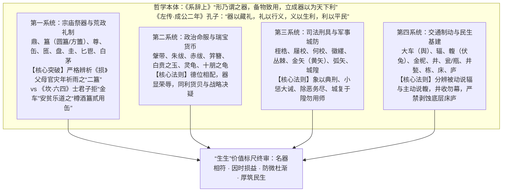

---

## 二、 西周宗法分封等级与宗庙祭器体系考辨（鼎、簋、尊、缶、匜、盘、圭、匕鬯、白茅）

### 2.1 宗法五等爵制与“列鼎列簋”的肉谷二元互补结构

西周在克商与周公东征建侯（1-R06[`《周公制礼作乐的历史唯物考证》`](06_周公制礼作乐的历史唯物考证.md)）之后，建立起以嫡长子继承制为核心的大宗、小宗宗法网络，并与“天子—诸侯（公侯伯子男）—卿大夫—士—庶民”的分封政治等级严密咬合：

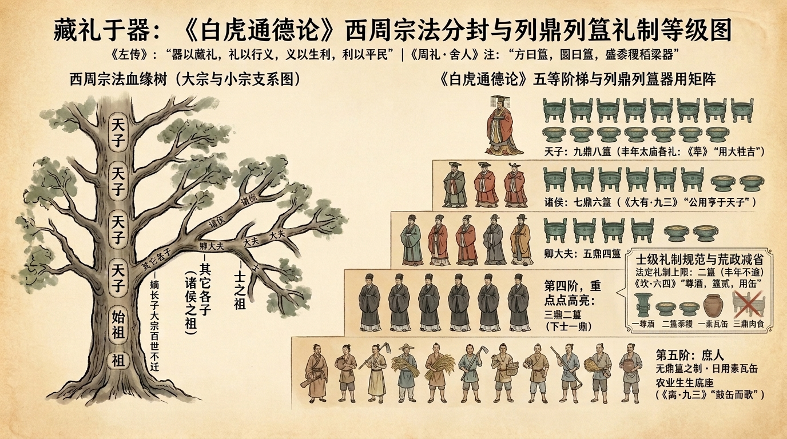

这一套等级秩序在物质层面的最高制度凝固，即是西周墓葬考古与礼书文献高度一致的**“列鼎列簋制度”**。东汉班固《白虎通德论·礼乐》载明其法定级差：
> **“天子九鼎八簋，诸侯七鼎六簋，大夫五鼎四簋，士三鼎二簋，下士一鼎，依次递减，不得逾越。”**

在商周祭祀与宴飨器用组合中，**“鼎”与“簋”构成了“贵族肉食”与“农耕谷物”的二元互补结构**：
1. **鼎（烹盛牲肉之器，代表国家最高权柄与鼎革重器）**：用以烹煮和盛放牛、羊、豕三牲（太牢/少牢）。`《鼎》卦`以整卦六爻完整呈现了铸鼎、洁鼎、实鼎、举鼎的国家治理工程：
   - **初六**“鼎颠趾，利出否”：铸鼎或开祭之初，先将旧鼎倒置以倾倒宿昔污秽（除旧布新）；
   - **九二**“鼎有实，我仇有疾，不我能即，吉”：鼎中装满实在的肉食民生实绩；
   - **九三**“鼎耳革，其行塞，雉膏不食，方雨亏悔，终吉”：鼎耳处于变革重铸之中，穿不进扛鼎之横杠（铉），导致鼎中虽有肥美的野鸡肉膏（雉膏）却无法抬行享食，须待阴阳和合如雨降方能疏通；
   - **九四**“**鼎折足，覆公餗（sù），其形渥，凶**”：居近君高位而德薄才小、任用私人（变爻《蛊·六四》“裕父之蛊”），犹如重鼎折断鼎足，将王公鼎中掺有竹笋八珍的肉羹（公餗）倾覆满地，机身沾濡污秽，招致覆国辱身之凶（《系辞下》孔子专论：“德薄而位尊，智小而谋大，力小而任重，鲜不及矣”）；
   - **六五**“鼎黄耳金铉，利贞”：君主柔中虚己（黄耳），配以刚健重臣铸就的青铜扛鼎横杠（金铉），君臣相得益彰；
   - **上九**“**鼎玉铉，大吉，无不利**”：功业大成之极，以温润坚韧之玉饰铉杠举鼎，刚柔交济，不炙手、不炫威，实现政权长治久安。
2. **簋（盛放五谷之器，代表农耕民生与社稷根本）**：《周礼·地官·舍人》郑玄注曰：**“方曰簠（fǔ），圆曰簋（guǐ），盛黍稷稻粱器。”** 鼎中之牛羊牲畜源于贵族牧场与重祭耗费，而圆簋所盛之黍、稷、稻、粱，则是亿万农夫终岁勤苦的口粮结晶（1-C03[`《利与不利》`](../05%20词义研究记录/03_周易中利与不利的词义研究.md)）。

---

### 2.2 同为“士级二簋”的严格分野：《损》卦父母官灾年祈雨 vs 《坎·六四》士君子箪瓢乐道

在《周易》全经中，《损》卦卦辞（**“曷之用？二簋可用享”**）与《坎》卦六四爻辞（**“樽酒，簋贰，用缶，纳约自牖，终无咎”**）均出现了代表“士”级礼制的**“二簋（簋贰）”**，且均未用“鼎”。然而，运用四重证据法结合本爻、变爻与社会阶级主体深入剖析，二者的**主体身份、制度背景与器用性质截然不同，绝不可混为一谈**：

#### （1）《损》卦卦辞“曷之用？二簋可用享”：基层县邑父母官的礼法本分与荒政护农法令
《损》卦明确言**“享（宗庙与山川社稷祭享）”**，其自然物候背景为“山下有泽”（旱季湖泽水位下降干涸），所涉主体是直面旱灾、为民祈雨安民的**基层县邑父母官**（详见`《损卦旱季泽损本义与王阳明祈雨史鉴研判总结》`）。为什么灾年祈雨只用“二簋”而不用“鼎”？这包含两重刚性的西周礼法与民生铁律：
- **第一重（名器等级本分）：为什么定格于“二簋”？——基层父母官不可逾越的法定礼制上限**
  按《白虎通德论》列鼎列簋定制：天子九鼎八簋、诸侯七鼎六簋、卿大夫五鼎四簋、**士（对应基层亲民邑宰、后世县市级父母官）三鼎二簋**。对于基层父母官而言，其法定的谷物祭器上限本来就是**“二簋”**——哪怕在五谷丰登的丰年也只能用“二簋”，绝不可僭越使用大夫之四簋或诸侯之六簋。
- **第二重（荒政护农法令）：为什么士级本配“三鼎二簋”，却只用“二簋”而省去“三鼎”？——严禁灾年杀牲损农的法律铁律**
  士级原本配齐“三鼎二簋”（三鼎盛牲肉，二簋盛黍稷）。但在大旱灾年，父母官在严守“二簋”本分的同时，**依法彻底免去了“三鼎”肉食牲牢**，这直接植根于中国古代严密的**农耕畜力保护法**与**灾年荒政省礼令**：
  1. **农耕畜力保护法令（《礼记·王制》与秦汉明律）**：《礼记·王制》明定：**“诸侯无故不杀牛，大夫无故不杀羊，士无故不杀犬豕，庶人无故不食珍。”** 耕牛与六畜是农业再生产的命脉，自 1975 年湖北云梦睡虎地出土秦简《厩苑律》（严考核耕牛肥瘠，死牛须严格上报）、汉律《贼律》至《唐律疏议·厩库》《大明律·厩牧》（“凡私宰自己马牛者，杖一百”）皆严禁擅杀耕畜。
  2. **凶荒之年省礼去牲法令（《周礼》《礼记》《谷梁传》）**：《周礼·地官·大司徒》“以荒政十有二聚万民”第七条即为**“眚（省）礼”**（减杀吉礼耗费）；《礼记·曲礼下》明定：**“岁凶，年谷不登，君膳不祭肺，马不食谷，驰道不除，祭事不悬，大夫不食粱，士饮酒不乐”**；《春秋谷梁传·襄公二十四年》更载明大旱荒年（大侵之礼）的祭祀铁律：**“百官布而不制，鬼神祷而不祀。”**（晋范宁集解：“**祷者，请命而已；祀者，必有牲牢。**”——大旱祈雨只以诚辞与二簋薄谷向山川百神请命，法定严禁宰杀牲牢以实三鼎！）

#### （2）《坎·六四》“樽酒，簋贰，用缶，纳约自牖”：士君子面对人生坎难的箪瓢乐道（对照变爻《困·九四》“困于金车”）
与《损》卦公共祈雨祭享不同，**《坎》卦之“习坎（重重险难）”是人人都会遭遇的人生困局，绝非专指官员行政**：
- **句读考定**：依《小象传》**“樽酒簋贰，刚柔际也”**之明文，爻辞标准句读为“**樽酒，簋贰，用缶，纳约自牖，终无咎**”（旧注或误读为“樽酒簋，贰用缶”，已由《小象》四字截句证伪）。
- **“士君子”的身份资格与“簋贰”日用**：在先秦至明清社会中，能够被称为**“君子”**者，必须具备读书人即**“士”**的身份（先秦之“士”，恰如后世考取功名的秀才、举人，始有基本的“君子”资格）。按照礼制，读书士人阶层的法定日用食器规格同样是**“二簋（簋贰）”**。
- **本爻与变爻《困·九四》的价值抉择**：《坎·六四》之变爻为`《困》卦九四`：**“来徐徐，困于金车，吝，有终。”** 当人生遭遇坎险困顿之时，世俗鄙夫往往贪慕虚名利禄、被权贵豪奢的青铜饰车（**“金车”**）排场所诱惑与捆绑，结果进退失据、作茧自缚（困于金车，吝）；而真正有道义骨气的**士君子（读书人）**，其破局之道是主动屏弃“金车”与鼎肉之奢，只设**一尊浊酒（樽酒）、二簋盛放豆、饼等简单粗食（簋贰）**，直接用民间素朴的**瓦缶盛浆、击瓦缶而歌以达生乐命（用缶，1-C02）**，在简陋居室的明窗之下自守俭约正道（纳约自牖）。
- **孔子赞颜回与荀子“君子役物”之经典互证**：这种在坎险困顿中不慕“金车”、安守“樽酒簋贰用缶”的君子人格，正是《论语·雍也》孔子所盛赞的颜回气象：**“贤哉，回也！一箪食，一瓢饮，在陋巷，人不堪其忧，回也不改其乐。贤哉，回也！”** 亦即《荀子·修身》所云：**“志意修则骄富贵，道义重则轻王公；内省而外物轻矣。传曰：‘君子役物，小人役于物。’”**

| 卦爻场景 | 法定底本经文 | 主体身份与核心矛盾 | 器用配置与礼法/哲理拆解 | “生生”唯物辩证解构 |
| :--- | :--- | :--- | :--- | :--- |
| **`《萃》卦辞`** | 王假有庙……**用大牲吉**，利有攸往。 | **天子 / 诸侯王公** （泽上于地，天下丰聚、四方来朝） | **天子九鼎八簋 + 太牢大牲**（牛羊豕全备） | 仓廪充实、物产丰盈之时，周王在太庙动用最高规格的大牲盛礼，将聚拢的物质财富转化为万邦共仰的精神凝聚力（《彖》曰：“用大牲吉……顺天命也”）。 |
| **`《损》卦辞`** | 曷之用？**二簋可用享**。 | **基层县邑父母官** （山下有泽，旱季湖涸、为民祈雨祭享） | **礼法本分（父母官法定二簋）+ 荒政护农（免去三鼎牲肉，“鬼神祷而不祀”）** | 大旱灾年若仍杀牲实鼎，必掏空春耕畜力与民脂民膏。故父母官严守“二簋”法定本分，并依《礼记·王制》《谷梁传》荒政法令省去三鼎肉食，仅以两簋谷物祈雨安民。 |
| **`《坎》六四`** | **樽酒，簋贰，用缶**，纳约自牖，终无咎。 | **身处人生坎难之士君子 / 读书人** （对照变爻《困·九四》“困于金车”） | **一尊酒 + 二簋豆饼粗食（士人法定食器）+ 素朴瓦缶（盛浆击缶达生）** | 面对人人皆会遭遇的人生坎险，士君子拒绝被虚名利禄之“金车”所困，以一尊酒、二簋简单粗食、击瓦缶而歌、明窗守约，如颜回“一箪食，一瓢饮，不改其乐”，达生乐命而终无咎。 |

---

### 2.3 从庙底沟彩陶缶到东周铜鉴缶：全经 3 处“缶”字的阶层分化实证

《说文解字·缶部》：“**缶，瓦器，所以盛酒浆，秦人鼓之以节歌。象形。**”在通行本《周易》中，“缶”字共计出现 **3 卦 3 处**。结合商周考古出土实物，这 3 处“缶”精准映射了从**王侯青铜大礼缶**到**士庶日常素陶缶**的阶层与功能分化：
1. **`《比》初六`**：“有孚比之，无咎。**有孚盈缶**，终来有它吉。”——《比》卦大象曰“先王以建万国，亲诸侯”，王者在朝堂盟会四方部族诸侯，以至诚之心盈满盛酒之**青铜大礼缶**（如湖北随州曾侯乙墓出土之战国早期“青铜鉴缶”，外鉴盛冰、内尊缶盛酒，为王侯重器），故远方邦国闻风归附，获意外之吉；
2. **`《坎》六四`**：“**樽酒，簋贰，用缶**，纳约自牖，终无咎。”——读书士君子在人生坎险之中，屏弃“金车”铜器之华，配以日常素朴的**陶瓦缶**盛浆击节、安贫乐道；
3. **`《离》九三`**：“日昃之离，**不鼓缶而歌**，则大耋之嗟，凶。”——寻常百姓之家日常盛水浆之**小陶缶**（如仰韶文化庙底沟出土之彩陶缶、商周灰陶缶），在日落西山、人生步入暮年之际，顺应自然生息规律、击瓦缶而歌以达生乐命，反对临老哀叹嗟怨（参见庄子妻死鼓盆而歌之民俗源流）。

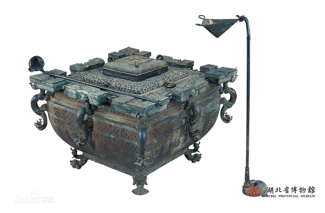
*▲ 图 2-1：左为仰韶文化庙底沟彩陶缶（河南三门峡出土）；右为战国早期曾侯乙墓青铜鉴缶（湖北省博物馆藏），直观印证了《周易》中从民间素瓦缶（《坎》六四、《离》九三）到王侯青铜礼缶（《比》初六）的器制演进。*

---

### 2.4 沃盥礼器（匜、盘）与瑞信主祭器（圭、匕鬯、白茅）

1. **奉匜沃盥（`《观》卦辞`“盥而不荐，有孚颙若”）**：
   - 先秦宗庙大祭开启前，主祭者必须先行**“沃盥之礼”**（《说文·皿部》：“盥，澡手也。从臼、水临皿。《春秋传》曰：奉匜沃盥”）：由侍从执长流带柄之**青铜匜（yí）**自上注水，主祭者于下恭敬洗手，污水落入下承之**青铜盘**中（《左传·僖公二十三年》载怀嬴侍晋公子重耳“奉匜沃盥，既而挥之”）。
   - 《观》卦以“盥而不荐”揭示最高政治教化法则：当王者执匜沃盥、心神极度庄严虔敬之时，哪怕尚未进入陈列鼎肉酒食的“荐献”环节，天下万民仰望其肃穆威仪便已生发深沉的敬畏与信赖（有孚颙若，《彖》曰：“下观而化也”）。

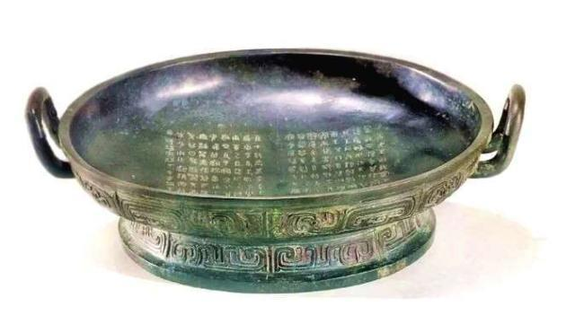
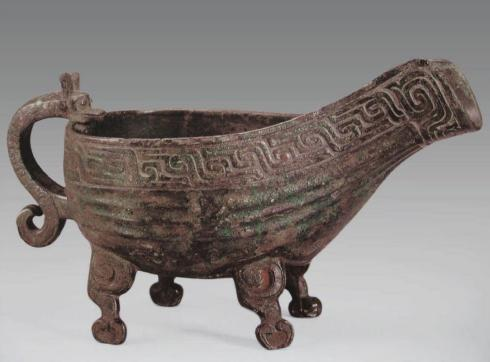
*▲ 图 2-2：上为西周恭王时期微氏家族重器“史墙盘”（1976 年陕西扶风庄白一号窖藏出土，宝鸡青铜器博物院藏）；下为春秋早期“鲁伯愈父匜”（上海博物馆藏），二者配套构成先秦“奉匜沃盥”（《观》“盥而不荐”）的标准青铜礼器组合。*

2. **瑞玉信物（`《益》六三`“益之用凶事，无咎。有孚中行，告公用圭”）**：
   - 《周礼·春官·大宗伯》：“以玉作六瑞，以等邦国：王执镇圭，公执桓圭，侯执信圭，伯执躬圭，子执谷璧，男执蒲璧。”《考工记·玉人》亦详载“命圭”尺寸规制。
   - 在大灾凶荒、兵燹抢险（凶事）的紧急状态下，地方长官（六三，处下卦之极、危惧多凶之位）挺身抗灾，并越级或紧急向中枢王公请命调拨救灾粮款时，必须手持法定等级的瑞玉（**用圭**）作为政治身份与军令权责凭证，确保应急救灾既雷厉风行又严守国家宪制程序。
3. **宗庙社稷主祭器（`《震》卦辞`“震来虩虩，笑言哑哑。震惊百里，不丧匕鬯”）**：
   - **匕（bǐ）**为从鼎中搯取熟肉升于俎上的青铜或棘木长勺（《礼记·杂记下》：“枇［匕］以桑，长三尺”）；**鬯（chàng）**为用黑黍（秬）与郁金香草酿造、盛于青铜彝尊中用以裸（灌）地降神的香酒（《周礼·春官·鬯人》）。在惊雷百里的突发政变或巨灾震荡中，长子（法定继承人，如周公辅成王平三监）手执匕鬯稳如泰山、丝毫不失，《彖传》定性曰：**“出可以守宗庙社稷，以为祭主也。”**
4. **洁白茅草铺垫（`《大过》初六`“藉用白茅，无咎”）**：
   - 《周礼·天官·甸师》：“祭祀，共萧茅。”上古洪水泛滥、地表返潮湿滑之时（1-R03[`《从大过卦看上古洪水时期的先民应对过程》`](03_从大过卦看上古洪水时期的先民应对过程.md)），先民将易碎的陶质祭器或关乎族群存续的谷物种子，不直接置于泥地，而是审慎铺垫在吸湿柔韧、洁净防滑的白茅草垫之上（藉用白茅），孔子于《系辞上》盛赞曰：“苟错诸地而可矣，藉之用茅，何咎之有？慎之至也！”

---

## 三、 政治命服、瑞宝货币与司法军防之器考辨（鞶带、朱绂/赤绂、朋龟、桎梏、校、徽纆、金矢、城隍）

### 3.1 官阶命服之器：鞶带、朱绂与赤绂的等级荣辱

1. **鞶带（`《讼》上九`“或锡之鞶带，终朝三褫之”）**：
   - 《说文解字·革部》：“**鞶，大带也。《易》曰：‘或锡之鞶带。’男子带鞶，妇人带丝。**”《礼记·内则》亦载“男鞶革，女鞶丝”。西周贵族命官腰束宽大皮革腰带（鞶带），其上缀以温润的玉带钩与精美的青铜带饰（如西周羊首形青铜带饰），是天子诸侯册命封官、赐予爵禄的显赫等级标志。
   - 然而《讼·上九》居争讼之终极，靠强辞夺理、构陷倾轧获赐鞶带，完全违背“利者义之和”的生生实绩，故《小象》痛斥曰：“以讼受服，亦不足敬也！”纵使侥幸获赐命服，亦在短短一朝之内被三次剥夺（终朝三褫之）。

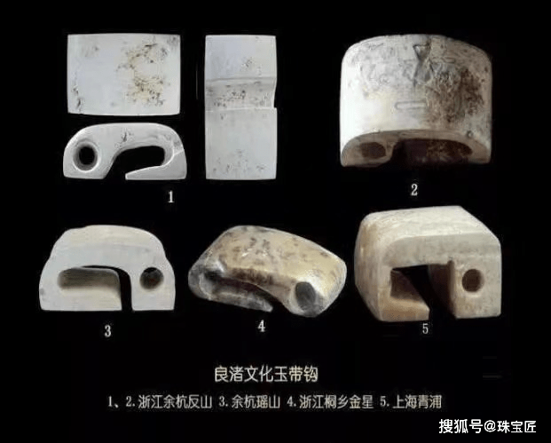
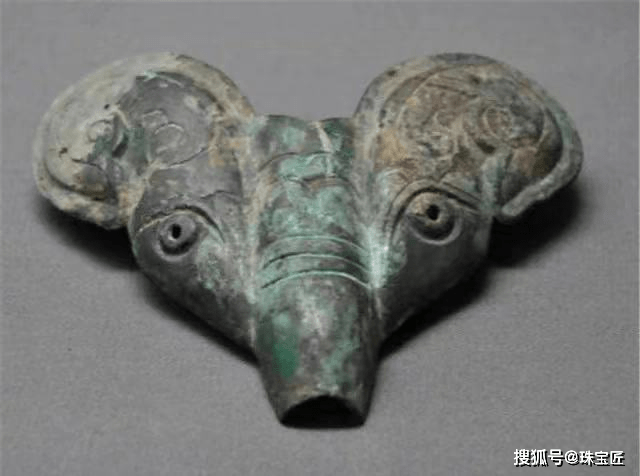
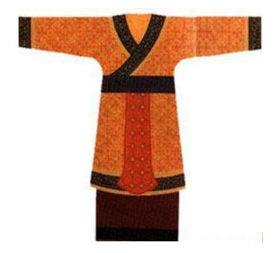
*▲ 图 3-1：自上至下依次为良渚文化玉带钩、西周羊首形青铜带饰及西周贵族鞶带佩玉服饰复原图，实证《讼·上九》“或锡之鞶带”之命服实物。*

2. **朱绂与赤绂（`《困》九二`“困于酒食，朱绂方来” vs `《困》九五`“劓刖，困于赤绂”）**：
   - **绂（fú）**，古亦作“黻”、“韨”，即系于革带之前、垂于衣裳正中以蔽膝的韦制（熟牛皮）礼服配件（源自上古先民祭祀劳作时遮蔽前膝之皮围裙，后演化为尊卑命服标识）。《礼记·玉藻》确立了严格的色彩等级：**“天子素带朱里终辟……一命缊韨幽衡，再命赤韨幽衡，三命赤韨葱衡。”** 郑玄注及孔颖达疏明辨：**天子、诸侯之绂为纯朱色（朱绂，正南方纯阳深红），卿大夫臣僚之绂为赤色（赤绂，浅红间黄）**。
   - 明确了这一名物色彩等级，《困》卦二、五两中爻的政治博弈豁然贯通：
     - **九二**居下卦臣位，虽一时被繁重政务与微薄酒食所困，但因其刚中守正，象征最高君王册命的**“朱绂”**正自上而来授命重用（朱绂方来，利用享祀）；
     - **九五**居上卦至尊君位，本应统御万方，却被朝堂之下盘根错节的权臣官僚既得利益集团（**“赤绂”**，即群臣同利之朋党圈，见 1-C08）层层架空与掣肘（**困于赤绂**）！因此，九五君主必须果断动用“劓（割鼻）、刖（砍足）”之刚猛重典，挥刀斩断官僚朋党的利益锁链，方能“乃徐有说，利用祭祀”。

---

### 3.2 决策重器与货贝标准：灵龟与“十朋之龟”

- **`《颐》初九`**：“舍尔灵龟，观我朵颐，凶。”
- **`《损》六五` / `《益》六二`**：“或益之**十朋之龟**，弗克违。”
- **`《贲》上九`**：“**白贲**，无咎。”

商周时期，“国之大事，在祀与戎”（《左传·成公十三3年》），凡国家迁都、征伐、立储、救灾等重大战略决断，必钻灼大龟腹甲以定国策（《尚书·洪范》“稽疑：择建立卜筮人，乃命卜筮”）；同时以天然海贝（及仿制铜贝、玉贝、绿松石贝）为硬通货，五贝串成一系，两系并悬为一**“朋”**（王国维《观堂集林·说珏朋》、1-C08[`《朋与友研究》`](../05%20词义研究记录/08_周易中朋与友的词义训诂与社会关系演变研究.md)）。
- **“十朋之龟”的制度涵义**：《汉书·食货志》载王莽定制“元龟岠冉长尺二寸，直二千一百六十，为大贝十朋”。在《损·六五》（尊位减损自身以惠下）与《益·六二》（下位实干益民）中，四方万民与诸侯不期而然争相进献价值“十朋”的绝世国宝大灵龟，代表**最高等级的战略决策主导权与天下归心的政治合法性**；
- **“舍尔灵龟”的堕落警示**：《颐·初九》本具阳刚之才，拥有如同“灵龟”般独立洞察天下大势、无需仰人鼻息的战略智慧与精神气节（古传灵龟食气不食腥秽），却自甘堕落，舍弃自身的“灵龟”，眼巴巴盯着权贵咀嚼美食而下垂的腮帮流口水（观我朵颐），最终沦为利益附庸而招致凶亡。
- **“白贲”的玉礼本色**：自距今 15000 年的黑龙江饶河小南山遗址玉器、距今 8000 年的兴隆洼与红山文化玉器，至于商代殷墟妇好墓玉凤佩与西周六瑞，华夏先民形成了“君子比德于玉”（《礼记·聘义》）及以无瑕白玉为最高礼玉等级的传统。《贲·上九》洗尽铅华、返璞归真，恰如纯粹无瑕之白玉（白贲），上得其志而无咎。

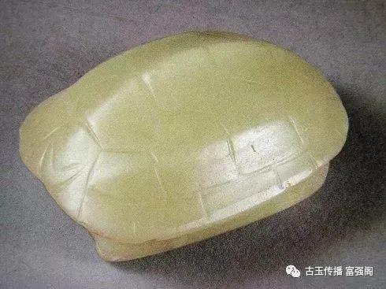
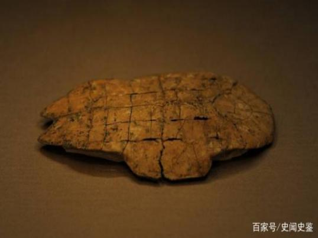
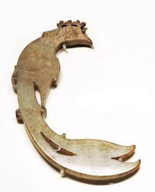
*▲ 图 3-2：上为河南舞阳贾湖遗址出土距今约 8000 年占卜龟甲；中为商代殷墟妇好墓出土刻辞卜甲（实证《颐》“灵龟”与《损》《益》“十朋之龟”）；下为商代殷墟妇好墓玉凤佩（实证《贲》玉饰礼制）。*

---

### 3.3 司法刑具梯度与“象以典刑”的唯物法理学

《周易》对司法刑具与刑罚场景的记载，绝非残酷暴力的展示，而是严密构建了一套从**初犯轻戒、中度教惩到极恶重刑**的唯物法理学梯度：

| 刑具 / 刑罚名称 | 对应卦爻与法定底本经文 | 器物形制与商周考古互证 | 唯物法治与“生生”边界 |
| :--- | :--- | :--- | :--- |
| **桎梏** （木制手铐脚镣） | **`《蒙》初六`**：发蒙，利用刑人，**用说（脱）桎梏**，以往吝。 | 《说文·木部》：“**梏，手械也。桎，足械也。**”结合陕西历史博物馆藏西周青铜器**《刖人守门鬲》**与**《它盘》**上的受刖刑（砍去左足）守门人雕塑，印证今文《尚书·尧典（舜典）》“象以典刑”与《周礼·秋官·掌戮》“墨者使守门，劓者使守关，宫者使守内，刖者使守囿”。古人将受刑之人铸于礼器或置于门阙示众，作为法治教材（利用刑人），使蒙昧百姓知法畏刑、及时醒悟，从而脱去手铐脚镣（用说桎梏）；若不知悔改继续盲动，则必陷困吝。 | 刑罚的初衷是**“发蒙正法”**（教育预防以保全人口），而非嗜杀滥罚。 |
| **屦校 / 何校** （足枷与颈枷） | **`《噬嗑》初九`**：**屦校灭趾**，无咎。 **`《噬嗑》上九`**：**何校灭耳**，凶。 | **校（jiào）**为木制枷锁。初九小过初萌，如穿上粗糙葛麻草鞋（屦，辉县孟庄商代遗址出土草鞋实物）并戴上轻型木足枷遮没脚趾（屦校灭趾），伤痛尚浅而限制妄行，故《系辞下》赞曰：“小惩而大诫，此小人之福也”；反之，上九恶积罪盈、屡教不改，最终肩扛沉重大木颈枷遮没双耳（何校灭耳），听不见任何劝诫，被明正典刑而除灭。 | **小惩大诫**（灭趾无咎）以挽救个体于未然；**除恶务尽**（灭耳凶）以保卫社会整体之生生。 |
| **徽纆与丛棘** （重刑黑索与棘牢） | **`《坎》上六`**：**系用徽纆**，寘于丛棘，三岁不得，凶。 | 汉刘熙《释名》与服虔注：三股麻拧成的粗黑索曰**“徽”**，两股拧成曰**“纆”**；外围栽种带刺荆棘围成囚室（《周礼·秋官·朝士》外朝“左九棘，孤卿大夫位焉……右九棘，公侯伯子男位焉”以听狱讼，重犯囚于棘丛之中）。 | 在国家大险极位仍背弃正道、趁火打劫者，必须用徽纆重索捆绑并长期严密羁押，剥夺其危害社会的能力。 |

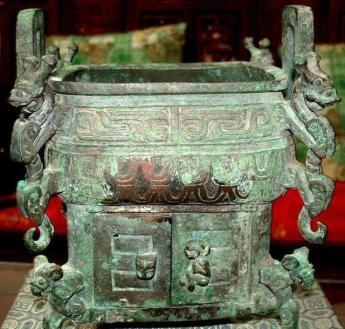
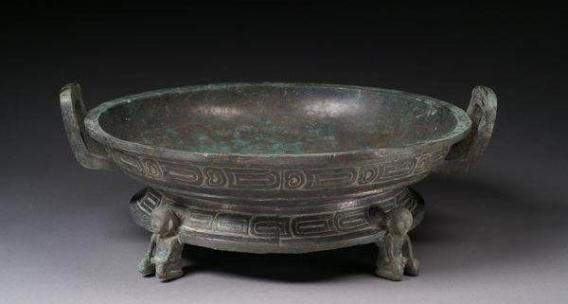
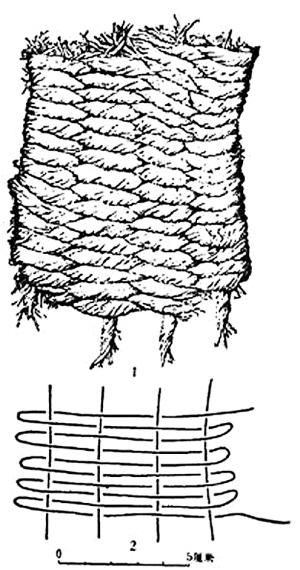
*▲ 图 3-3：上、中为西周中期“刖人守门鬲”（扶风庄白出土）与“它盘”（陕西历史博物馆藏），器足铸有受刖刑（截去左足、手持门栓）之守门人形象，直接印证《蒙·初六》“发蒙，利用刑人”与《困·九五》“劓刖”；下为河南辉县孟庄遗址出土商代前期草鞋（屦）炭化遗存，印证《噬嗑·初九》“屦校灭趾”。*

---

### 3.4 青铜兵器与夯土城防工程：金矢、黄矢、弧矢与城隍

1. **金矢与黄矢（`《噬嗑》九四`“噬干胏，得金矢，利艰贞，吉”、`《解》九二`“田获三狐，得黄矢，贞吉”）**：
   - 在商代至西周时期，铁器冶炼尚处萌芽（仅见陨铁刃铜钺或西北寺洼文化零星铁条），当时所谓**“金”即专指青铜**（铜锡铅合金，新铸成时色泽金黄灿烂，故亦称**“黄矢”**）。
   - **双重唯物实证**：
     - 其一（狩猎与饮食实物现场）：大型野兽被青铜箭镞射杀后，带倒刺的青铜箭头折断深嵌于连骨带肉的脊骨（胏）之中；制成风干腊肉（干胏）后，九四执法者在啃咬最坚硬的带骨干肉时，硌出了里面隐藏的青铜箭头（得金矢），喻指在攻坚克难中彻底挖出祸根核心；
     - 其二（西周司法诉讼保证金制度）：《周礼·秋官·大司寇》载：**“以两造禁民讼，入束拧［束矢］于朝，然后听之；以两剂禁民狱，入钧金，三日乃致于朝，然后听之。”** 诉讼双方须先缴纳代表中直不曲的“束矢（一束铜箭）”与代表刚正不阿的“钧金（三十斤青铜）”。《噬嗑·九四》“得金矢”与《解·九二》“田获三狐，得黄矢”，皆以青铜直箭象征**掌握铁证、刚直破局、一击必中**。
2. **城隍防御工程（`《泰》上六`“城复于隍，勿用师，自邑告命，贞吝”）**：
   - 《说文·𨸏部》：“**隍，城池也。有水曰池，无水曰隍。《易》曰：‘城复于隍。’**”商周筑城（如河南偃师商城遗址、郑州商城遗址）均采用**“掘地为隍、夯土为城”**的土木工程技术——在城外挖掘宽深壕沟（隍），用挖出的生土层层版筑夯实堆高为城墙（城）。
   - 当泰平盛世走到上六极位，统治集团骄奢淫逸、赋役繁重、上下隔绝（泰极转否），失修的夯土城墙轰然崩塌，重新回填到原本挖土的护城壕沟之中（**城复于隍**）。这象征着国家防御工程与民心秩序的物理性总瓦解！此时内部根基已烂，严禁再对外动用军队穷兵黩武（**勿用师**，1-C02）。

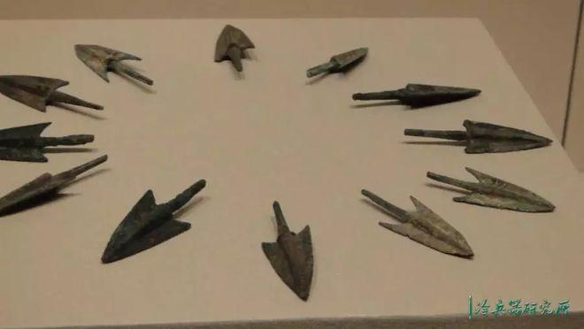
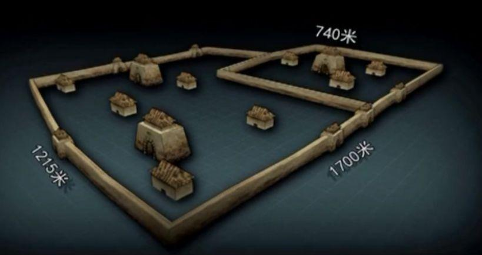
*▲ 图 3-4：上为山东博物馆藏商代青铜双翼箭镞（实证《噬嗑·九四》“得金矢”与《解·九二》“得黄矢”）；下为河南偃师商城城垣夯土基址与外侧护城壕（隍）考古现场（实证《泰·上六》“城复于隍”）。*

---

## 四、 交通制动、水利基建与民居再生产之器考辨（大车、辐、輹、金柅、井、甃、瓮、瓶、栋、床、庐）

### 4.1 商周车舆机械力学与战略风控模型：大车、说辐、说輹与系于金柅

商周时期的双轮木质战车与载重木舆（安阳殷墟车马坑与秦始皇陵铜马车完整保存其构造），是当时技术复杂度最高的交通与军事机械。《周易》通过对车舆四大核心部件的精密工程学区分，建立了一套极具科学性的**风险识别与主动制动（刹车）战略模型**：

| 车辆部件与对应卦爻 | 法定底本经文 | 机械工程结构与考古实物考辨 | 战略风控定性与吉凶因果 |
| :--- | :--- | :--- | :--- |
| **大舆 / 大车** （车箱承载底盘） | **`《大有》九二`**：**大车以载**，有攸往，无咎。 **`《剥》上九`**：硕果不食，**君子得舆**，小人剥庐。 **`《睽》六三`**：**见舆曳**，其牛掣。 | **舆（yú）**为车箱底盘，由轸（四面横木）、式、较与密集底板构成，承载全车人员与千钧粮草物资。 | 喻指厚德载物的实干中坚（大有九二）或万民拥戴的民心底座（剥上九《象》曰：“君子得舆，民所载也”）。 |
| **辐（fú）** （车轮承重直木条） | **`《小畜》九三`**：**舆说（脱）辐**，夫妻反目。 | 连接外圈轮辋（牙）与中心轮毂（毂）的直木条（《老子》“三十辐共一毂”，殷墟战车一轮多为 18～26 辐），采用榫卯严密嵌死，**在正常使用中绝对不可拆卸**。一旦行驶中辐条散脱，车轮即刻粉碎倾覆！ | **被动结构崩裂之祸**：九三居多凶之位，刚暴急躁而与上体六四阴爻贴身摩擦（夫妻反目），导致组织内部结构性散架，半途彻底瘫痪。 |
| **輹（fù）** （伏兔 / 车轴钩心垫木） | **`《大畜》九二`**：**舆说（脱）輹**。 **`《小畜》九二`**：牵复，吉。 | **輹**（音义与“辐”截然不同），又称**“伏兔”**、**“车屐”**，是垫在车箱底梁与下方车轴之间的凹槽垫木（秦陵一号铜马车底部清晰可见），平时用坚韧生牛皮条（革）绑扎固定在车轴上。**当车辆需要长途休整或前路阻塞时，工匠可主动解开皮绳、卸下伏兔与车轴，且丝毫不损坏车体！** | **主动卸轴止进之智**：大畜九二面对前路强敌阻截，不似小畜九三般蛮撞断辐，而是主动拆解伏兔与车轴连接（舆说輹），原地停车休整蓄力，故《小象》盛赞曰：**“舆说輹，中无尤也！”** |
| **金柅（nǐ）** （青铜制动刹车楔） | **`《姤》初六`**：**系于金柅**，贞吉；有攸往，见凶。 | **柅**为止车之木楔（刹车器），**金柅**即以坚固青铜包覆或铸造的重型车轮制动楔，或织机上锁定经线的青铜定轴。 | **初萌死锁防线**：一阴潜生于五阳之下，面对溃堤式风险的初萌，第一时间用青铜制动楔死死锁住车轮（系于金柅），严禁其向前滑动半步。 |

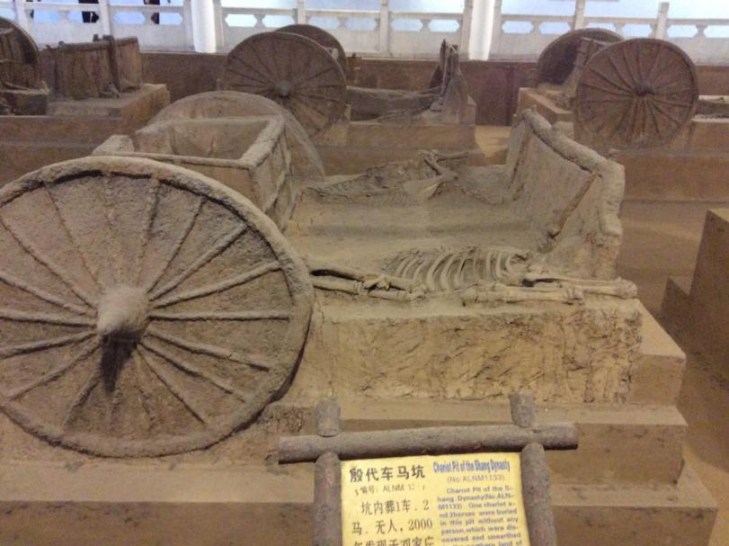
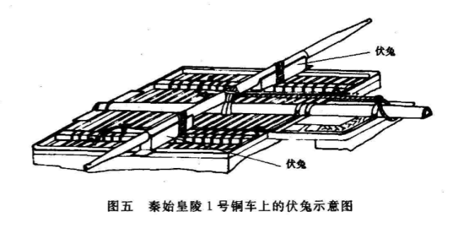
*▲ 图 4-1：上为河南安阳殷墟车马坑出土商代双轮多辐木战车遗迹（可见轮辐结构，对应《小畜·九三》“舆说辐”）；下为秦始皇陵一号铜马车车舆底梁与车轴连接处的“輹（伏兔）”工程构造（对应《大畜·九二》主动卸轴止进之“舆说輹”）。*

---

### 4.2 公共水利工程全生命周期：《井》卦六爻器用与制度演进

水井是华夏农耕定居聚落最核心的生命线基建（距今约 6000 年的浙江余姚河姆渡遗址木构水井、距今约 4200 年的河南汤阴白营龙山文化晚期 11 米深井字形木构水井均为考古铁证）。`《井》卦`以水井工程与汲水器具（繘、瓶、瓮、甃、收、幕）构建了**公共制度建设的全生命周期模型**：
- **卦辞总纲**：“**改邑不改井**，无丧无得，往来井井。汔至，亦未繘井，**羸其瓶**，凶。”——城邑可以因战乱或垦殖而迁徙，但哺育万民的水井基建不可废弃（喻指根本民生制度不可动摇）；若汲水绳（繘）快拉到井口时，因操作粗暴撞碎了汲水陶瓶（羸其瓶），则功亏一篑而凶。
- **六爻基建演进链**：
  1. **初六**“井泥不食，旧井无禽”：制度年久失修、淤泥堵塞，连飞鸟都不来啄饮；
  2. **九二**“井谷射鲋，**瓮敝漏**”：井底虽有泉水流出，但汲水的**陶瓮破损漏水（瓮敝漏）**，水只流向井底小鱼虾（射鲋），喻指虽有良策而基层执行工具与吏治败坏，民生资源在半途严重跑冒滴漏；
  3. **九三**“井渫不食，为我心恻，**可用汲**，王明，并受其福”：水井已彻底清淤淘净（井渫），随时可投入汲水使用（可用汲），亟待贤明领导者启用；
  4. **六四**“**井甃（zhòu），无咎**”：用烧制坚固的陶井圈、砖石或榫卯木框从下至上严密砌筑加固井壁（井甃），防止泥沙再次坍塌渗入，完成了从“临时清淤”到“制度化硬件升级”的关键跃迁；
  5. **九五**“井冽，寒泉食”：井壁坚固、泉水清冽甘寒，正式造福万民；
  6. **上六**“**井收勿幕**，有孚元吉”：井口提水滑轮（收/鹿卢）收起汲绳，但**绝不加盖封锁井口（勿幕）**，向全社会无私开放公共甘泉，达到了“备物致用，立成器以为天下利”的最高生生大吉境界！

---

### 4.3 木构建筑力学与民生底座：《大过》之“栋”与《剥》之“床庐”

1. **木构主脊梁的受载力学（`《大过》九三“栋桡”与九四“栋隆”`）**：
   - 《系辞下》：“上古穴居而野处，后世圣人易之以宫室，**上栋下宇，以待风雨**，盖取诸《大壮》。”**栋**即房屋正中最高、承担全屋顶荷载的主脊檩。
   - 《大过》卦体四阳居中而初、上两阴柔弱（《彖》曰：“大过，大者过也。栋桡，本末弱也”）。在连绵阴雨与洪涝浸泡中（1-R03、2-R05），九三刚愎自用、拒不接纳辅助，导致杨木主脊梁因超载吸水而弯曲折断（**栋桡，凶**）；而九四居上卦之初，主动向下俯应初六（加设斜撑立柱与白茅防潮垫基），使主梁重新高耸稳固（**栋隆，吉**）。
2. **底层民生居所的底线红线（`《剥》卦之“剥床”与“剥庐”`）**：
   - **床**为室内安身卧具，**庐**为平民赖以遮风避雨的田间茅屋。
   - 《剥》卦自下而上层层剥蚀：初六“剥床以足”（毁坏床腿）➔ 六二“剥床以辨”（毁坏床身框架）➔ 六四“剥床以肤”（剥及床席与卧者肌肤，切近灾祸），皆断为凶；至于上九，若小人继续搜刮不止，将连最后遮顶的茅草屋一并拆毁（**小人剥庐，终不可用也**）！这以最直观的器物崩解过程，宣告了《标准 v3.5》的跨层唯物制约铁律：**凡掏空底层百姓“床庐”以换取上层短期奢靡者，必以自毁立锥之地而彻底灭亡！**

---

## 五、 历史唯物主义与“生生”价值标尺综合讨论

### 5.1 生生四判据与跨层唯物制约检验

将《周易》全经四大器用体系列入《标准 v3.5》“生生”四判据与跨层唯物制约模型进行综合评估，可见先秦圣人“制器尚象”的本质全部指向族群与文明的实质存续：

| 生生评估维度 | 《周易》器用体系的唯物实证机制 | 跨层唯物制约与反面红线警示 |
| :--- | :--- | :--- |
| **1. 存续判据** （人口与生民保全） | - 《大过·初六》“藉用白茅”防潮保种； - 《蒙·初六》《噬嗑·初九》“用说桎梏”、“屦校灭趾”以小惩大诫挽救罪错个体； - 《泰·九二》“包荒（空匏腰舟），用冯河”渡河救人（2-C07）。 | 严禁在内部防御崩塌（《泰·上六》“城复于隍”）时继续穷兵黩武（“勿用师”）损耗人口。 |
| **2. 发展判据** （物质资料再生产） | - 《损》卦旱年祈雨省去“三鼎”肉食牲牢、严守“二簋”本分，保护春耕牛畜与农夫口粮； - 《井》卦淘井、砌壁（井甃）、开源共享（井收勿幕）保障农业与聚落水源。 | 严禁如《井·九二》“瓮敝漏”般任由官僚机构贪墨漏损民生资源，严禁如《剥》卦般剥蚀百姓“床庐”。 |
| **3. 恢复判据** （系统抗冲击与自愈） | - 《大畜·九二》遇险主动解脱车轴伏兔（“舆说輹”）停修蓄力； - 《姤·初六》危萌即锁青铜制动楔（“系于金柅”）； - 《大过·九四》雨停即加固主梁（“栋隆”）； - 《坎·六四》士君子处险境以“樽酒，簋贰，用缶”安贫乐道、保持精神独立。 | 严禁如《小畜·九三》般刚暴盲进致“舆说辐”散架，或如《鼎·九四》德不配位致“鼎折足，覆公餗”。 |
| **4. 传承判据** （政权交接与文明火种） | - 《震》卦惊雷百里而长子“不丧匕鬯”，稳守宗庙社稷； - 《鼎·上九》“鼎玉铉，大吉”，完成刚柔相济的制度定型与传承； - 《剥·上九》“硕果不食，君子得舆”，在旧周期崩解时保存文明硕果与民心底座。 | 严禁如《讼·上九》无德窃据“鞶带”而终朝三褫，或如《颐·初九》舍弃“灵龟”沦为附庸。 |

### 5.2 事实（Fact）、推演（Inference）与假说（Hypothesis）的边界申明

按照《学术研究论文撰写格式与期刊级模板规范》第五章要求，现对本文核心论断的证据性质作严格划界：

| 命题类别 | 本文具体论断内容 | 证据基础与可证伪边界条件 |
| :--- | :--- | :--- |
| **事实（Fact）** *(文本与出土铁证)* | 1. 《周易》经传明文记载鼎、簋、尊、缶、匜、圭、匕鬯、鞶带、朱绂/赤绂、灵龟/十朋之龟、桎梏、校、徽纆、金矢/黄矢、城隍、舆/辐/輹/金柅、井/瓮/瓶/甃、栋/床/庐等器物； 2. 《周礼》《礼记》《左传》《谷梁传》《白虎通》关于列鼎列簋、荒政省礼、朱绂赤绂等级、束矢钧金之记载； 3. 商周墓葬列鼎列簋、史墙盘、鲁伯愈父匜、曾侯乙铜鉴缶、刖人守门鬲、殷墟战车、秦陵铜马车伏兔、偃师商城城隍等考古实物。 | 均由法定传世底本（`zhouyi.json` 四部丛刊本）与已公开发表的国家考古发掘报告直接确证，属不可动摇之客观事实。 |
| **推演（Inference）** *(历史唯物主义逻辑推论)* | 1. 将《损》卦“二簋可用享”解构为“基层县邑父母官在旱灾之年恪守士级二簋本分，并依《礼记·王制》《谷梁传》荒政护农法令省去三鼎牲肉以祈雨安民”； 2. 将《坎·六四》“樽酒，簋贰，用缶”与变爻《困·九四》“困于金车”统合，解构为“具备士级资格的读书君子在人生坎险中拒绝金车利禄诱惑，以一尊酒、二簋粗食及素瓦缶安贫乐道（如颜回箪食瓢饮）”； 3. 将《比·初六》、《坎·六四》、《离·九三》三处“缶”分别对应王侯青铜大缶与士庶素瓦缶。 | 系基于西周礼制级差、秦汉荒政律令与《周易》爻位阶级属性的严密逻辑推演。若未来出土西周早期简帛《易》注有更直接的礼例记载，可进一步细化补充。 |
| **假说（Hypothesis）** *(探索性参证)* | 《易经文物注》（1-M06）中提及上古玉器信仰跨万年演进（如小南山玉器至《贲·上九》“白贲”）的文化基因连续性。 | **使用边界**：属第三重证据（文化人类学长时段比较），在本文中仅作文化背景参证，不单独作为具体爻辞吉凶的裁决依据。 |

### 5.3 作为 1 级核心实证基石（1-R04）的全局协同关系

本文于 2026-10-21 经用户主理人正式确权晋升为 **1 级文档（核心依赖因子：0.4）**，与 1-M06[`《易经文物注》`](../02%20元研究/易经文物注.md)、1-C02[`《用与勿用》`](../05%20词义研究记录/02_周易中用和勿用的词义研究.md)、1-C03[`《利与不利》`](../05%20词义研究记录/03_周易中利与不利的词义研究.md)、2-C07[`《包字考》`](../05%20词义研究记录/07_周易中包的词义训诂与名物实证研究.md)、2-C08[`《朋与友考》`](../05%20词义研究记录/08_周易中朋与友的词义训诂与社会关系演变研究.md) 完全自洽，并直接确立了《标准 v3.5》第十二条**“第一位训诂标尺（藏礼于器）”**与第十七条 B 级红线**“名物礼制庸俗降格拦截”**。

---

## 六、 研究结论与《周易笺注》母本反哺清单

### 6.1 核心研究结论

1. **器用唯物主义总纲**：“器”是上古社会生产力与宗法生产关系的物质凝结。《周易》言“器”，处处紧扣“器以藏礼，礼以行义，义以生利，利以平民”的唯物链条，绝非抽象心性符号。
2. **“士级二簋”双解铁律**：同为士级礼器上限之“二簋”，在《损》卦卦辞中体现为**基层父母官灾年祈雨的公共荒政护农法令**（守二簋本分 + 免三鼎牲牢以护耕畜）；在《坎·六四》中体现为**读书士君子面对人生坎难的个体道德操守**（拒变爻“金车”之诱 + 守一尊酒、二簋粗食、击瓦缶而歌之箪瓢乐道）。
3. **车舆与基建风控定律**：《周易》精确区分了不可拆解之承重件（如《小畜·九三》被动崩裂之“辐”、《大过·九三》折断之“栋”）与可主动调节之控制件（如《大畜·九二》主动卸轴停修之“輹/伏兔”、《姤·初六》初萌死锁之“金柅”），揭示了“防微杜渐、知止善修”的系统工程智慧。
4. **民生底座不可剥蚀定律**：从《井》卦“井甃无咎、井收勿幕”到《剥》卦戒“剥床、剥庐”，《周易》将公共基础设施的维护共享与底层百姓基本生存资料的保全，确立为政权存亡的绝对底线。

### 6.2 《周易》“藏礼于器”全谱系与《03 周易笺注史鉴》母本反哺定位总表

本研究成果直接统摄并反哺 `03 周易笺注史鉴/` 以下 **22 卦 35 处**核心器用卦爻的【卦解】【爻解】【典论】：

| 器用门类 | 核心器物名录 | 反哺母本文件与具体卦爻 | 核心训诂与唯物博弈反哺要点 |
| :--- | :--- | :--- | :--- |
| **一、宗庙祭器与礼制日用** | **鼎、簋（圆簋/方簠）、尊、缶、匜、盘、圭、匕鬯、白茅** | `50_鼎卦`（全卦）、`41_损卦`（卦辞）、`29_坎卦`（六四）、`45_萃卦`（卦辞）、`08_比卦`（初六）、`30_离卦`（九三）、`20_观卦`（卦辞）、`42_益卦`（六三）、`51_震卦`（卦辞）、`28_大过卦`（初六） | 严格区分《萃》天子丰年“用大牲”、《损》父母官旱年省三鼎用“二簋”祈雨、《坎·六四》士君子拒金车而守“樽酒，簋贰，用缶”；区分王侯铜鉴缶与士庶素陶缶；还原奉匜沃盥、执圭告公、执匕鬯守宗庙、白茅防潮保种。 |
| **二、政治服饰与瑞宝货币** | **鞶带、朱绂、赤绂、笄簪、白贲之玉、灵龟、十朋之龟** | `06_讼卦`（上九）、`47_困卦`（九二、九五）、`16_豫卦`（九四）、`22_贲卦`（上九）、`27_颐卦`（初九）、`41_损卦`（六五）、`42_益卦`（六二） | 考定皮革大带（鞶带）与玉钩铜饰；以《礼记·玉藻》区分君上之“朱绂”与权臣朋党之“赤绂”；以五贝一系两系一朋考定“十朋之龟”与《颐》之“灵龟”。 |
| **三、司法刑具与军事城防** | **桎梏、屦校、何校、徽纆、丛棘、金矢（黄矢）、弧矢、城隍** | `04_蒙卦`（初六）、`21_噬嗑卦`（初九、九四、上九）、`29_坎卦`（上六）、`40_解卦`（九二）、`38_睽卦`（上九）、`11_泰卦`（上六） | 以西周“刖人守门鬲”印证“利用刑人，用说桎梏”之预防教育法理；区分足枷轻惩（屦校灭趾）与颈枷极刑（何校灭耳）；还原商代青铜箭镞（金矢/黄矢）与掘隍筑城工程（城复于隍）。 |
| **四、交通制动与民生基建** | **大车（舆）、辐、輹（伏兔）、金柅、井、瓮/瓶、井甃、栋、床、庐** | `14_大有卦`（九二）、`09_小畜卦`（九三）、`26_大畜卦`（九二）、`44_姤卦`（初六）、`48_井卦`（全卦）、`28_大过卦`（九三、九四）、`23_剥卦`（全卦） | 以殷墟战车与秦陵铜马车实物严格区分车轮“辐”条散裂与车轴“輹（伏兔）”主动拆解；还原《井》卦陶瓮、砖石井甃与辘轳勿幕；阐明主梁“栋桡/栋隆”与底层“床庐”不可剥蚀之铁律。 |

---

## 七、 参考文献与四重证据引文核验表

### 7.1 传世原典引文逐字核验表（`tools/verify.cmd` 门禁锁）

以下核心原典引文均已通过 `.\tools\verify.cmd` 检索核验，并与阮元校刻《十三经注疏》本及四部丛刊影印本对勘一致：

| 序号 | 引文核心内容 | 典籍出处与版本锚定 | `verify.cmd` 核验状态 | 异文与校勘说明 |
| :---: | :--- | :--- | :---: | :--- |
| 1 | “形乃谓之器，制而用之谓之法，利用出入，民咸用之谓之神。” | 《周易·系辞上》（阮刻《十三经注疏》本） | **【一致】** | — |
| 2 | “备物致用，立成器以为天下利，莫大乎圣人。” | 《周易·系辞上》（阮刻《十三经注疏》本） | **【一致】** | — |
| 3 | “唯器与名，不可以假人，君之所司也。名以出信，信以守器，器以藏礼，礼以行义，义以生利，利以平民，政之大节也。” | 《春秋左传·成公二年》（阮刻《十三经注疏》本） | **【一致·已锁】** | — |
| 4 | “诸侯无故不杀牛，大夫无故不杀羊，士无故不杀犬豕，庶人无故不食珍。” | 《礼记·王制》（阮刻《十三经注疏》本） | **【一致·已锁】** | — |
| 5 | “岁凶，年谷不登，君膳不祭肺，马不食谷，驰道不除，祭事不悬，大夫不食粱，士饮酒不乐。” | 《礼记·曲礼下》（阮刻《十三经注疏》本） | **【一致】** | 底本“悬”作“縣”，属古今字。 |
| 6 | “百官布而不制，鬼神祷而不祀。”（范宁注：“祷者，请命而已；祀者，必有牲牢。”） | 《春秋谷梁传·襄公二十四年》（阮刻《十三经注疏》本） | **【一致】** | 见《十三经注疏·谷梁传》卷十六。 |
| 7 | “贤哉，回也！一箪食，一瓢饮，在陋巷，人不堪其忧，回也不改其乐。贤哉，回也！” | 《论语·雍也》（阮刻《十三经注疏》本） | **【一致】** | — |
| 8 | “志意修则骄富贵，道义重则轻王公；内省而外物轻矣。传曰：‘君子役物，小人役于物。’” | 《荀子·修身》（王先谦《荀子集解》本） | **【一致】** | — |
| 9 | “奉匜沃盥，既而挥之。” | 《春秋左传·僖公二十三年》（阮刻《十三经注疏》本） | **【一致】** | 《说文·皿部》“盥”字亦引此文。 |
| 10 | 本研究涉及之《鼎》《损》《坎》《萃》《比》《离》《观》《益》《震》《大过》《讼》《困》《颐》《贲》《蒙》《噬嗑》《解》《泰》《大有》《小畜》《大畜》《姤》《井》《剥》各卦爻辞及《彖》《象》传文 | 通行本《周易》（工程唯一法定底本 `04_核心数据库/zhouyi.json` / 四部丛刊影印本） | **【一致·底本锁】** | 受 `canon.lock.json` SHA-256 哈希校验保护。 |

### 7.2 规范参考文献目录（参照 GB/T 7714-2015）

#### （1）古籍原典与历代易学注疏
1. [魏] 王弼, [晋] 韩康伯, 注, [唐] 孔颖达, 疏. 周易正义[M] // 阮元, 校刻. 十三经注疏. 北京: 中华书局, 1980.
2. [汉] 郑玄, 注, [唐] 贾公彦, 疏. 周礼注疏[M] // 阮元, 校刻. 十三经注疏. 北京: 中华书局, 1980.
3. [汉] 郑玄, 注, [唐] 孔颖达, 疏. 礼记正义[M] // 阮元, 校刻. 十三经注疏. 北京: 中华书局, 1980.
4. [晋] 杜预, 注, [唐] 孔颖达, 疏. 春秋左传正义[M] // 阮元, 校刻. 十三经注疏. 北京: 中华书局, 1980.
5. [晋] 范宁, 集解, [唐] 杨士勋, 疏. 春秋谷梁传注疏[M] // 阮元, 校刻. 十三经注疏. 北京: 中华书局, 1980.
6. [汉] 许慎, 撰, [清] 段玉裁, 注. 说文解字注[M]. 上海: 上海古籍出版社, 1981.
7. [汉] 班固, 撰, [清] 陈立, 疏证. 白虎通疏证[M]. 北京: 中华书局, 1994.
8. [唐] 李鼎祚. 周易集解[M]. 王丰先, 点校. 北京: 中华书局, 2016.
9. [清] 王夫之. 周易内传·周易外传[M] // 船山全书: 第1册. 长沙: 岳麓书社, 2011.

#### （2）出土文献与考古发掘报告
10. 中国社会科学院考古研究所. 殷墟发掘报告（1958-1961）[M]. 北京: 文物出版社, 1987.
11. 中国社会科学院考古研究所. 殷墟妇好墓[M]. 北京: 文物出版社, 1980.
12. 陕西周原考古队. 陕西扶风庄白一号西周青铜器窖藏发掘简报[J]. 文物, 1978(3): 1-18.（含《史墙盘》《刖人守门鬲》）
13. 湖北省博物馆. 曾侯乙墓[M]. 北京: 文物出版社, 1989.（含《青铜鉴缶》）
14. 秦始皇兵马俑博物馆, 陕西省考古研究所. 秦始皇陵铜车马发掘报告[M]. 北京: 文物出版社, 1998.（含车舆、辐、輹/伏兔构造）
15. 睡虎地秦墓竹简整理小组. 睡虎地秦墓竹简[M]. 北京: 文物出版社, 1990.（含《厩苑律》）
16. 中国社会科学院考古研究所. 偃师商城（第一卷、第二卷）[M]. 北京: 科学出版社, 2013.
17. 河南省文物考古研究所. 舞阳贾湖[M]. 北京: 科学出版社, 1999.

#### （3）近现代学术专著与论文
18. 王国维. 观堂集林（外二种）[M]. 北京: 中华书局, 1959.（含《说珏朋》《殷周制度论》）
19. 张光直. 中国青铜时代[M]. 北京: 生活·读书·新知三联书店, 2013.
20. 高亨. 周易古经今注[M]. 北京: 中华书局, 1984.
21. 叶舒宪. 玉成中国：玉石之路与华夏文明起源[M]. 沈阳: 辽宁人民出版社, 2018.

---

## 八、 四级审议自检与价值分级状态报告

### 8.1 论文四级审议自检闭环表（撰审分离）
- [x] **初审（信源真伪）**：全文引用的《周易》《左传》《周礼》《礼记》《谷梁传》《论语》《荀子》等原典均在白名单内，经 `tools/verify.cmd` 核验一致；伪古文《尚书》与野史演义零混入；出土器物均锚定权威发掘报告与馆藏实物。
- [x] **复审（时位与句法）**：各器用卦爻（如《坎·六四》与变爻《困·九四》、《大畜·九二》、《噬嗑·初九/上九》、《泰·上六》）严格对齐 384 爻时位矩阵与 1 级核心句法（如“用”、“勿用师”），完全不参考《序卦传》，《杂卦传》存而不用。
- [x] **三审（生生与四重证据）**：四重证据强度分层明确，三维交叉融合落地，“事实—推演—假说”三界分明，全面通过生生四判据与跨层唯物制约检验。
- [x] **终审（逻辑闭环与期刊规范）**：严格按照《学术研究论文撰写格式与期刊级模板规范（v1.0）》八大标准模块重构，全部 `../assets/` 文物图片链接与 `../03 周易笺注史鉴/` 母本链接完整无断链。

### 8.2 价值分级确权状态报告
- **当前价值等级**：🟢 **1 级文档（核心依赖因子：0.4，编号 `1-R04`）**。
- **确权记录**：已于 2026-10-21 经用户主理人正式裁定确权晋升为 1 级价值文档，登记于 `文档价值分级台账.md`。本次按期刊论文标准（v1.0）完成体系化扩写与格式升级，其核心公理地位与 0.4 依赖因子保持不变。

---

© 2026 徐时言 · 《“藏礼于器”：《周易》中的用器体系、考古实证与经典互证研究》 · 徐时言-易经研究 · 采用 CC BY-NC-ND 4.0 许可， 转载请署名并注明来源 https://wole278.github.io/xushiyan-YiJing/ · 禁止商业使用与改编传播 · 商业授权：wole278@hotmail.com / 微信 wole278
