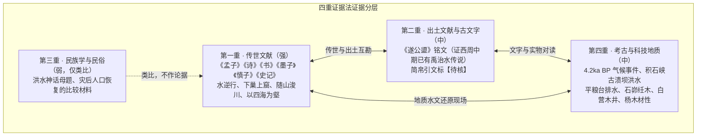
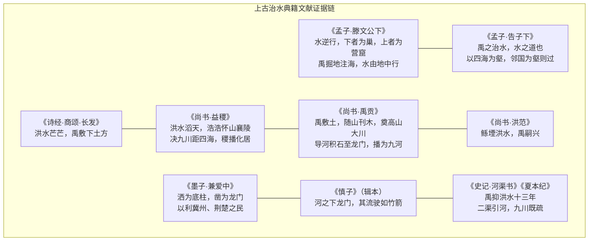
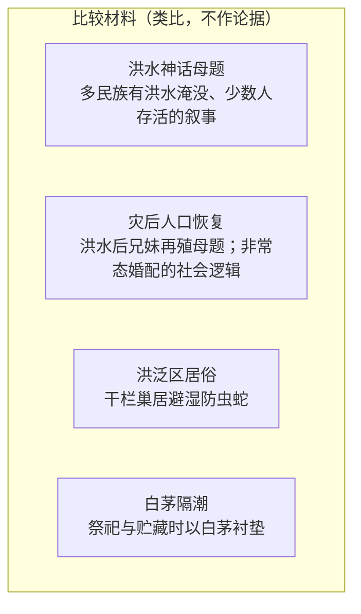
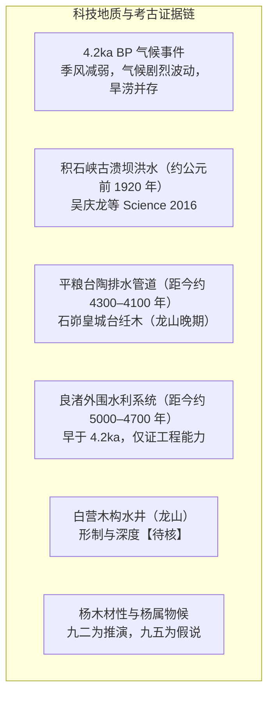
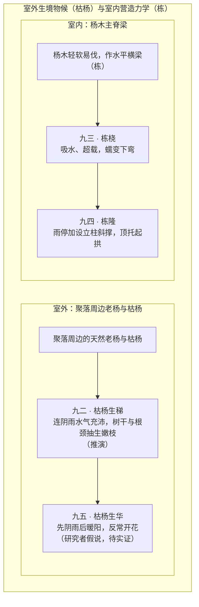
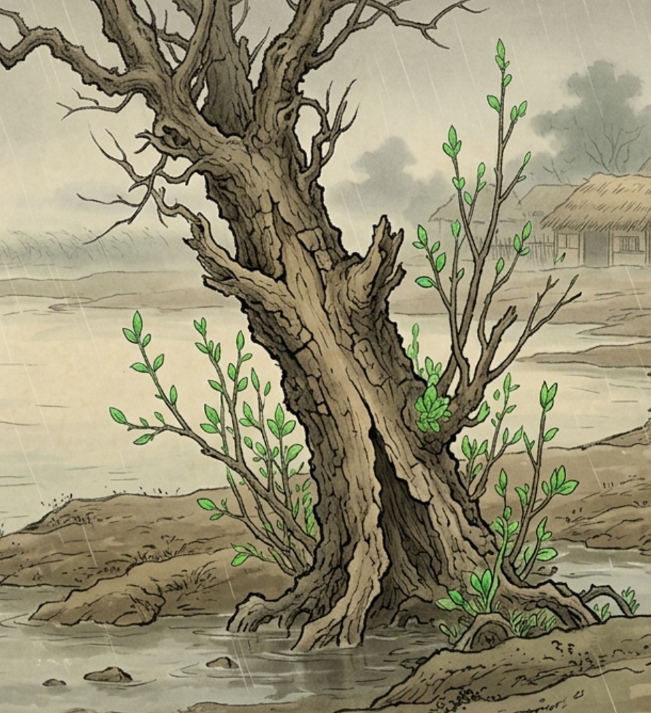
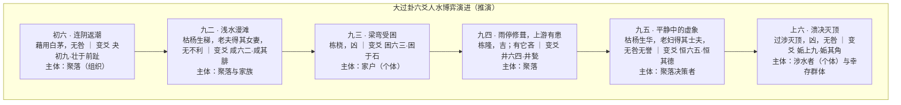
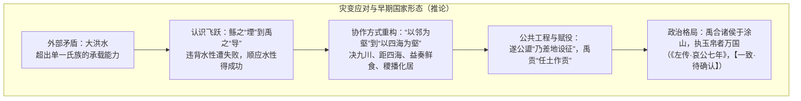

# 05_大过卦中的先民洪水记忆

> **模块归属**：06 融合研究记录  
> **研究定位**：以“四重证据法”考察《大过》六爻与上古洪水记忆的相关性，属跨学科推演性研究。文中凡推演、假说，均明确标注，不与经文断辞、出土实证混同。  
> **价值基准评级**：🟡 **2 级文档（核心依赖因子：0.3），初始暂定，待用户终审是否晋升**。与 `文档价值分级台账.md` 一致；位阶唯由用户裁定。  
> **与 1 级成果的关系**：本文承续 1-R03（[`03_从大过卦看上古洪水时期的先民应对过程.md`](03_从大过卦看上古洪水时期的先民应对过程.md)，1 级，0.4），**对其“枯杨”解读提出修正方案**，差异见第六章第 2 节。1-R03 原文未作任何改动；在用户裁定前，1-R03 仍具向下约束力，本文的差异点均作“修正提案”处理。  
> **审议状态**：2026-10-21 经四级审议退回，按 `审议报告` 完成修订，待终审复核。  
> **理论基石**：生生之追求、历史唯物主义、《实践论》《矛盾论》、上古社会国家形态演进论。  
> **四重证据**：
> - **第一重（传世文献）**：《周易》《孟子》《诗经》《尚书》《墨子》《慎子》《史记》；
> - **第二重（出土文献与古文字）**：《遂公盨》铭文；清华简《厚父》、上博简《容成氏》、马王堆帛书《周易》（后三者引文均标【待核】）；
> - **第三重（民族学与民俗记忆）**：洪水神话母题与灾后人口恢复的比较材料，仅作类比旁证；
> - **第四重（考古遗存与科技地质）**：4.2ka BP 气候事件、积石峡古溃坝洪水、平粮台、石峁、白营、杨木材性等。  
> **成文日期**：2026-10-21；2026-10-21 审议后修订

---

## 摘要

《周易》第二十八卦《大过》（䷛，下巽木、上兑泽，名曰“泽风大过”），《大象传》直指其自然原型为“泽灭木，大过”。传统注疏常把“藉用白茅”“枯杨生稊/生华”“老夫女妻/老妇士夫”“栋桡/栋隆”“过涉灭顶”分作互不相干的意象。本文把六爻连读，并与传世文献、出土文献、比较民族学材料和考古、地质、植物材料相互对照，提出一个推演性模型：

**《大过》六爻可读作先民面对洪水灾变的六个阶段——地表返潮、浅水漫滩、栋梁受潮弯曲、雨停修葺而上游有患、短暂平静中的虚象、溃决灭顶与保种。** 这是研究者的推演，爻辞本身并未写明“洪水”二字，文中各阶段细节除经文明文外，均属推演。

在空间与物候上，本文区分两组意象：

- **室内营造之“栋”**：杨木主脊梁在连阴雨中吸水、超载而下弯（九三“栋桡”），雨停后加撑顶托（九四“栋隆”）。
- **室外生境之“枯杨”**：聚落周边的老杨与枯杨，在连阴雨中从树干与根颈抽出嫩枝（九二“枯杨生稊”）；九五“枯杨生华”则被读作灾变进程中气候反常的物候征兆。**后一读法属研究者假说，待实证**（见第五章第 4 节）。

这场人水博弈在实践层面推动了居所形制与治水认识的演进：从鲧之“堙”到禹之“导”，从“以邻国为壑”到“以四海为壑”。至于由此产生的跨流域协作与早期国家形态，本文只作历史唯物主义的推论，不作定论。

---

## 一、四重证据法：证据分层与强度

“四重证据”依次为传世文献、出土文献与古文字、民族学与民俗学材料、考古实物与科技测年。本文为每一重证据标明强度，避免把不同性质的材料混为同一等级的“证明”。

| 证据层 | 本文用途 | 强度 | 使用限制 |
|---|---|---|---|
| 第一重 | 洪灾图景、治水路线、政治伦理 | 强 | 《慎子》为辑本；《禹贡》与《书序》须分清；各引文以第八章核验表为准 |
| 第二重 | 证明禹治水传说在西周中期已入礼器铭文 | 中 | **只证“传说存在”，不直接证夏代史实**；简帛引文待核 |
| 第三重 | 旁证灾后“恢复人口”的社会逻辑 | 弱 | 仅作类比，不得作为训诂或史实的论据 |
| 第四重 | 灾变背景、工程实物、材料力学 | 中 | 年代须与灾变事件对齐；植物物候部分为假说 |

---

## 二、第一重证据：传世文献中的洪水与治水

### 1. 水态逆乱与居住选择：《孟子》
- **《孟子·滕文公下》**：“当尧之时，水逆行，泛滥于中国。蛇龙居之，民无所定。下者为巢，上者为营窟。《书》曰：‘洚水警余。’洚水者，洪水也。使禹治之，禹掘地而注之海，驱蛇龙而放之菹。水由地中行，江、淮、河、汉是也。险阻既远，鸟兽之害人者消，然后人得平土而居之。”
  - “水逆行”：本文取其水文学读法——干流壅塞、泥沙淤高或潮汐顶托，使支流与洼地之水排泄不出，反向倒灌；
  - “下者为巢，上者为营窟”：低湿处架木为巢，高阜处掘土为窟；这是居住选择的两端，与《大过》“栋”象的关联是推演；
  - “水由地中行”“平土而居”：治水的目标是使水归河槽，人重回平原定居农耕。
- **《孟子·告子下》**：“禹之治水，水之道也。是故禹以四海为壑，今吾子以邻国为壑。水逆行，谓之洚水。洚水者，洪水也，仁人之所恶也。吾子过矣。”
  - “水之道”是顺应水性的客观规律；“以四海为壑”是全流域视野，与“以邻国为壑”的割据思路相对。

### 2. 疆域与救荒：《诗经》《尚书·益稷》
- **《诗经·商颂·长发》**：“浚哲维商，长发其祥。洪水芒芒，禹敷下土方，外大国是疆。”（底本作“濬哲”，“外大国是疆，幅陨既长”，本文截句。）
- **《尚书·益稷》**：“禹曰：‘洪水滔天，浩浩怀山襄陵，下民昏垫。予乘四载，随山刊木，暨益奏庶鲜食。予决九川，距四海，浚畎浍距川；暨稷播，奏庶艰食鲜食。懋迁有无，化居。烝民乃粒，万邦作乂。’”（底本“浚”作“濬”。《益稷》在今文本属《皋陶谟》下半。）
  - 治水、救荒、重建三者并举：随山刊木（勘察）→ 畎浍、川、九川、四海（四级排水）→ 益奏鲜食、稷播（食物供应）→ 懋迁有无（跨部族调剂）。

### 3. 路线与法度：《尚书·禹贡》《洪范》，以及《书序》
- **《禹贡》正文**：“禹敷土，随山刊木，奠高山大川。”（底本作“隨（墮）山刊木”。）  
  “导河积石，至于龙门；南至于华阴，东至于砥柱，又东至于孟津，东过洛汭，至于大伾；北过降水，至于大陆，又北，播为九河，同为逆河，入于海。”（底本“砥柱”作“厎柱”。）
- **《书序》**（非《禹贡》正文）：“禹别九州，随山浚川，任土作贡。”《史记·河渠书》亦有“以别九州，随山浚川，任土作贡”之文。**本文仅将此句作为《书序》与《史记》转述使用**，《书序》不在白名单，不入【典论】。
- **《尚书·洪范》**：“我闻在昔，鲧堙洪水，汩陈其五行。帝乃震怒，不畀‘洪范’九畴，彝伦攸斁。鲧则殛死，禹乃嗣兴，天乃锡禹‘洪范’九畴，彝伦攸叙。”（**【待核】**：维基文库作“鯀陻水”，缺“洪”字；本文从通行本，须以识典四部丛刊本复核。）
  - 鲧之“堙”（堆土硬堵）违水性而致败，禹之“导”顺水性而成功，此为治水认识上的分界。

### 4. 水势、公共性与总括：《慎子》《墨子》《史记》
- **《慎子》**（辑本，不在白名单，仅作论据，不入【典论】）：“河之下龙门，其流驶如竹箭，驷马追弗能及。”
- **《墨子·兼爱中》**：“古者禹治天下，西为西河渔窦，以泄渠孙皇之水；北为防原泒，注后之邸，呼池之窦，洒为底柱，凿为龙门，以利燕、代、胡、貉与西河之民；东方漏之陆防孟诸之泽，洒为九浍，以楗东土之水，以利冀州之民；南为江、汉、淮、汝，东流之，注五湖之处，以利荆、楚、干、越与南夷之民。此言禹之事，吾今行兼矣。”（底本“呼池”作“嘑池”。）
- **《史记·河渠书》**：“《夏书》曰：禹抑洪水十三年，过家不入门。陆行载车，水行载舟，泥行蹈毳，山行即桥。以别九州，随山浚川，任土作贡。通九道，陂九泽，度九山。然河灾衍溢，害中国也尤甚。唯是为务。故道河自积石历龙门，南到华阴，东下砥柱，及孟津、雒汭，至于大邳。于是禹以为河所从来者高，水湍悍，难以行平地，数为败，乃二渠以引其河。北载之高地，过降水，至于大陆，播为九河，同为逆河，入于勃海。”（底本作“河菑”。）
- **《史记·夏本纪》**：“九川既疏，九泽既洒，诸夏艾安，功施于三代。”
- **《史记·河渠书·太史公曰》**：“余南登庐山，观禹疏九江，遂至于会稽太湟，上姑苏，望五湖；东闚洛汭、大邳，迎河，行淮、泗、济、漯洛渠；西瞻蜀之岷山及离碓；北自龙门至于朔方。曰：甚哉，水之为利害也！余从负薪塞宣房，悲瓠子之诗而作河渠书。”

---

## 三、第二重证据：出土文献与古文字

### 1. 《遂公盨》铭文（强度：中）
2002 年发现的西周中期青铜器《遂公盨》（又称豳公盨），内底铸铭 98 字，开篇释文为：

> “天命禹敷土，墮（读作‘随’）山濬川，乃差地设征，降民监德……”

- **与传世文献对读**：与《禹贡》“禹敷土，随山刊木”、《诗经·长发》“禹敷下土方”以及《书序》“随山浚川，任土作贡”文句相应。
- **证明范围**：铭文证明**西周中期（约公元前 10–9 世纪）已把禹治水、划地定赋作为礼器铭文的德政源头**，即这一传说早于战国。它**不能直接证明夏代的洪水与禹的史实**；疑古说所谓“战国托古”的断限，据此应当上移，但夏代史实仍须其他证据。
- 释文与断代以李学勤《论豳公盨及其重要意义》（《中国历史文物》2002 年第 6 期）为参照，【待核】。

### 2. 战国简牍（引文均标【待核】）
- **清华简《厚父》**：整理本相关简文大意为“……闻禹……川，乃降之民，建夏邦”，**简 1 处有残缺**，学界多以《遂公盨》及传世文献补读。本文只取其“禹与川、建夏邦”的大意，不作逐字引用。【待核：清华简（伍）整理本】
- **上博简《容成氏》**：与治水直接相关的简文，检索所得为“禹乃通伊、洛，并瀍、涧，东注之河，于是乎豫州始可处也”，叙事结构为“治水—某州始可居”。【待核：上博简（二）整理本】本文不再沿用此前文稿中的其他引文。
- **马王堆帛书《周易》**：帛书中《大过》卦名作“泰过”，九二作“枯杨生梯”（“梯”通“稊”）。其余各爻帛书异文本文未逐字核对。【待核】经文传抄保真度的评价，须待逐爻对照后再下结论。

### 3. 经文内证：以身体部位记水位（推演，非古文字学论断）
本文不作甲骨文、金文字形考释（此前文稿所列字形无字编出处，已删）。可以确定的只是《大过》本爻与变爻在文字上呈现一条递进线：

- 初六变爻《夬》初九“壮于前趾”（足趾）；
- 九二变爻《咸》六二“咸其腓”（小腿）；
- 上六“过涉灭顶”（头顶），变爻《姤》上九“姤其角”（高处孤角）。

“以身体部位度量水深”是据此作出的**推演**，经文未明言。

---

## 四、第三重证据：比较民族学材料（强度：弱，仅作类比）

1. **洪水神话母题**：西南与南方多个民族的口传史诗都有洪水淹没大地、少数人存活的叙事（如彝族、苗族、纳西族、羌族传统）。**本文不再引用具体文句**：此前文稿以引号呈现的诗句无可查照的整理本与页码，已撤销。【待核：具体史诗名称、整理本、页码】
2. **“老夫女妻”的社会逻辑（类比）**：在人口严重折损的情形下，社会通常会突破平时的婚配规范，以尽快恢复生育能力。这一类比有助于理解九二“过以相与也”（《小象》）的取义，**但本文对九二的解释以经文和《小象》为据，民族志仅作旁证**。具体可对读的材料为汉族伏羲女娲、苗族兄妹再殖等洪水后婚配母题。【待核：出处】
3. **干栏居俗**：长江流域及西南山地的干栏式建筑，可与《孟子》“下者为巢”作居住形态上的比较。
4. **白茅**：白茅（*Imperata cylindrica*）质地蓬松、吸湿性弱，古代祭祀与贮藏时用作衬垫。初六“藉用白茅”的潮湿隔离读法，是据这一用法作出的推演。

---

## 五、第四重证据：考古遗存与科技地质

### 1. 气候与洪水地质背景
- **4.2ka BP 事件**：距今约 4200 年前后，全球多地发生气候突变。在东亚，这一事件的主要表现是**季风减弱、干旱化和气候剧烈波动**，不同区域旱涝不一，洪涝只是其间的极端事件之一。本文**不再**把它写成“北方连绵暴雨”，只取其“气候失稳、极端事件增多”这一层。
- **积石峡古溃坝洪水**：吴庆龙等（*Science*, 2016, 353: 579）据积石峡堰塞坝溃决沉积，推定黄河上游曾发生特大洪水，年代约公元前 1920 年，并联系到喇家遗址的灾变。该研究**是否可与“大禹治水”直接对应，学界尚有争议**；喇家的毁灭是地震、山洪还是溃坝所致，亦有不同意见。本文仅将其作为“黄河上游确有特大洪水”的旁证。【待核】
- **水动力解读**：《史记》“河所从来者高，水湍悍，难以行平地”，可从“出峡谷后比降骤降、泥沙淤积、河床抬升”作水文学解释，这是现代读法，属推演。

### 2. 居所与工程：考古实证与时序
- **居所形制**：仰韶早期多为圆形半地穴三角窝棚，无水平主脊梁；至仰韶晚期（如大地湾 F901，距今约 5000 年）已出现带立柱与梁架的大型房址，龙山时期梁架大屋更普遍。《系辞下》“上栋下宇，以待风雨”所指的形制，唯有具备水平主梁，才会出现“栋桡”“栋隆”的力学问题。
- **平粮台龙山城址**（距今约 4300–4100 年，河南淮阳）：发现较完整的陶质排水管道，见于南门通道之下，并有城壕。发掘简报见《文物》1983 年第 3 期，【待核】。
- **良渚外围水利系统**（距今约 5000–4700 年，浙江）：由多条堤坝组成，控制流域面积逾 100 平方公里。**其年代早于 4.2ka 事件**，只能证明史前社会具备大尺度水利工程能力，**不能作 4.2ka 洪水时期的同期证据**。
- **白营龙山文化水井**（河南汤阴）：发现木构井圈，可与《井》六四“井甃，无咎”作形制对读。井深与榫卯构造的具体描述，以发掘报告为准，【待核】。
- **石峁皇城台纴木**（陕西神木）：护墙内有横向插入的原木（纴木），可与“以斜撑顶托主梁”的加固原理作工程类比；纴木树种鉴定，【待核】。

### 3. 杨属植物与杨木材性
- **生境**：杨属（*Populus*）、柳属（*Salix*）为河漫滩先锋树种，耐短期水浸，聚落周边最易取得。老杨与枯杨在聚落周边很常见。
- **材性**：杨木质地轻软，气干密度约 0.40–0.50 g/cm³，顺纹易劈，适合石斧加工；同时抗弯弹性模量较低，吸湿后易发生蠕变（Creep）。

### 4. 室外“枯杨”与室内“栋”：两组意象

- **九二“枯杨生稊”（推演，采纳用户修正）**：枯杨在此指聚落周边站立的老杨，而非屋内梁木。连阴雨使土壤与树体水分充足，老杨可能从树干裂隙、断枝残茬和根颈萌发新枝（“稊”，今语“萌蘖”）。聚落先民见此生机，作出“老夫得其女妻”的人口恢复之举。《小象》“过以相与也”可作这一读法的佐证。
  
- **九三“栋桡”**：杨木横梁吸湿后蠕变，加上屋面吸水增重，主脊梁中段下垂。**“流连家产而拒绝外援”属推演**，经文与《小象》仅言“栋桡，凶”“不可以有辅也”。
- **九四“栋隆”**：雨暂止，在屋内加设中柱与斜撑，将弯梁顶起，《小象》言“栋隆之吉，不桡乎下也”。
- **九五“枯杨生华”（研究者假说，待实证）**：
  - 研究者的读法：连阴雨之后骤然暖阳高温，老杨受反常温湿刺激，把残余养分集中于枝头，生出病态的花絮，《小象》“何可久也”可作“难以持久”的佐证；这一反常物候可与聚落“误以为灾过、回归日常”的心态相映。
  - **须说明的疑点**：1-R03 的审议注曾指出，杨属多在早春先花后叶，花期受季节制约，“雨后阳光激发杨花”不合杨属常态。本文把这一读法保留为假说，并提出**证伪条件**：若植物学或物候文献表明杨属在夏秋高温后不会发生反季节开花，则应回到 1-R03 的“表层繁荣、难结实”的中性读法；在此之前，**不得写成“科学阐明”或“实验证实”**。
  - 此前文稿所列“植物生理学实验测定”并无文献出处，已撤销。

---

## 六、六爻演进：主体、判据与推演

### 1. 六阶段推演总图

### 2. 与 1-R03 的差异（修正提案）

| 爻 | 1-R03（1 级，原文保持不变） | 本文（2 级，修正提案） | 说明 |
|---|---|---|---|
| 九二 枯杨生稊 | 砍伐后的杨木桩，打入湿土后生根发芽 | 聚落周边的老杨、枯杨，连阴雨中抽生嫩枝 | 采纳用户 2026-10-21 修正；“枯杨”与“栋”是两组不同意象 |
| 九五 枯杨生华 | 老杨枝头开花，耗液而难结实，“雨后阳光激发杨花”一说已删 | 先阴雨后暖阳所致的反季节开花（假说） | **与 1-R03 审议注相左，须待证伪检验；用户裁定前不作定论** |
| 九三、九四 栋 | 杨木主脊梁蠕变与斜撑加固 | 同上 | 一致 |
| 六阶段骨架 | 阴雨受困 → 平静期有潜患 → 决堤灭顶 | 同上，细分为六阶段 | 一致 |

### 3. 六爻研判表（经文断辞不改判）

环境判定为“差”（大者过、栋桡），矩阵取待时守正（阳爻）、避时柔行（阴爻）。

| 爻 | 爻性位与时位 | 矩阵行为 | 经文断辞 | 主体层级 | 推演要点 |
|---|---|---|---|---|---|
| 初六 | 阴居阳位，初位平稳 | 避时柔行 | 无咎 | 聚落（组织） | 以白茅衬垫种子、火种，防潮防霉，于微处备灾 |
| 九二 | 阳居阴位，中位 | 待时守正 | 无不利 | 聚落与家族 | “老夫女妻”并非妄动，是**守住再生产底线的守正之举**，目的在恢复人口，不在扩张 |
| 九三 | 阳居阳位，三位危 | 待时守正，惕厉 | 凶 | 家户（个体） | 梁弯而不撤，是贪恋存量、延误转移的后果（推演） |
| 九四 | 阳居阴位，四位戒惧 | 待时守正，戒惧 | 吉，有它吝 | 聚落（组织） | 修梁、清井是守正；“有它”提示视野之外的上游隐患 |
| 九五 | 阳居阳位，中位 | 待时守正 | 无咎无誉 | 聚落决策者 | 见下文“九五的张力” |
| 上六 | 阴居阴位，上位过极 | 避时柔行 | 凶，无咎 | 涉水者（个体）与幸存群体 | 见下文“上六三项检验” |

### 4. 生生四判据与双层评估

| 爻 | 存续 | 发展（生计、物资） | 恢复（制度、组织） | 传承 | 个体层 | 全局层 |
|---|---|---|---|---|---|---|
| 初六 | 保种子、火种 | 防霉，保存下一季播种 | 初步建立备灾习惯 | 备灾经验 | 无咎 | 无咎 |
| 九二 | 恢复生育人口 | 劳动力补充 | 打破平时婚配成规的非常措施 | 人口谱系延续 | 无不利 | 无不利 |
| 九三 | 受困者生命受威胁 | 家产被占用 | 无 | 无 | **凶**：贪恋存量，家户陷于覆屋 | 对聚落是失败案例，警示后续 |
| 九四 | 暂时保全 | 修梁、清井恢复居住与饮水 | 工程性恢复 | 修葺技术 | 吉 | 吝：上游隐患未除 |
| 九五 | 表面安定 | 回归日常生产 | 日常秩序恢复 | 无 | 无咎无誉 | 风险：对上游隐患警觉不足（推演） |
| 上六 | 涉水者以身殉；幸存者保全 | 无 | 无 | **火种**：幸存者退保高地 | **凶**：涉水者灭顶 | **无咎**：全局上留下了火种 |

**跨层校验**：九三是个体以家产为重而延误，已有警示；九五则是决策者若固守日常、不作“制义”，上层安定会掏空下层的安全，这是下文变爻提示的风险所在。

### 5. 九五的张力：“无咎无誉”与“错失窗口”

- **经文断辞不改判**：九五爻辞断“无咎无誉”，《小象》言“枯杨生华，何可久也。老妇士夫，亦可丑也”。“无咎”意为循常行事本身无过失，“无誉”意为无功；“可丑”意为难以持久、不足称道。
- **“错失撤离窗口”是推演，不是对本爻的定罪**：这一风险来自**变爻恒六五**：“恒其德，贞，妇人吉，夫子凶。”《小象》曰：“妇人贞吉，从一而终也；夫子制义，从妇凶也。”
  - 守常之“贞”，若用于日常生产生活之“常”，则导向存续与再生产，属贞吉，故“妇人吉”；
  - 若决策者（夫子）把“守常”当作应对一切局势的办法，不作“制义”（据时势裁断），则凶。反向排他律在此成立：“贞”不是一概守旧，须落在导向元亨利之处，在局势已变而仍守旧，则“贞”落空而凶；
  - 因此变爻的“夫子凶”只作戒惧防范的边界约束，**不用来给本爻“无咎”免责，也不用来把本爻定为有咎**。

### 6. 上六三项检验

“强行涉水求生”若不加检验，可能被美化为向死续火。依标准三项检验：

1. **退路检验**：若九五阶段仍有向高地转移的窗口而不用，则后续涉水属硬撑，此即九五的警示意义。就上六本爻而言，溃决已至，退路已被洪水切断，涉水是在无路可退之下的求生，不属有路不走。
2. **代价检验**：涉水者以自身承担代价，未把代价转嫁给他人；这一点支持“无咎”。
3. **火种检验**：变爻姤上九“姤其角”，幸存者退保高处孤角，为群体争得保种空间，《小象》“过涉之凶，不可咎也”。

**须分清两类主体**：本爻“过涉灭顶”者是涉水的个体；变爻“姤其角”者是退守高处的幸存群体。前者个体为凶，后者全局为无咎，两者不可混为同一群体。

---

## 七、历史唯物主义推论：从灾变应对到早期国家形态

以下是研究者的推论，供后续研究检验。

### 1. 《实践论》：从“堙”到“导”
- 鲧之“堙”，以人力硬堵，无视“河所从来者高，水湍悍，难以行平地”的客观水性；水积愈高，决溃愈烈，《洪范》所谓“汩陈其五行，彝伦攸斁”。
- 禹之“导”，先“乘四载，随山刊木”，实地勘察，再“掘地而注之海，水由地中行”。这一过程可视为认识由失败、总结、再实践而上升的典型。

### 2. 《矛盾论》：外部主要矛盾与协作的组织化
- 平水期，各部族各据河滩，彼此争地；洪灾一来，以邻为壑，造成连锁损害（《孟子·告子下》）。
- 当人与洪水的矛盾上升为主要矛盾，单一氏族无力自保，客观上要求跨流域的粮食调配（“奏庶鲜食”）、农耕恢复（“稷播”）、物资流通（“懋迁有无”）和工程动员（“决九川，距四海”）。
- **推论**：长期的跨流域协作需要稳定的决策、调度与赋役，可能推动了从部落联盟向早期国家的转变。但国家形成是渐进、多源的过程，治水只是其中一条线索，本文不作“彻底完成”的断语。

### 3. 生生之追求：向死续火
与洪水叙事常见的“被动逃遁”相比，《大过》的六爻叙事更强调主体能动：

1. 初六“藉用白茅”：于微处备灾，守护根基；
2. 九二“枯杨生稊、老夫女妻”：在族群折损之际，先把人口恢复放在首位；
3. 九四“栋隆”：雨停即修梁、清井，恢复居住与饮水；
4. 上六“过涉灭顶，无咎”：个体涉水灭顶为凶，而幸存者退保高处，使群体得以存续；
5. 禹“十三年过家门不入”的治水实践，则把“导”落到全流域工程。

《大象》曰：“泽灭木，大过；君子以独立不惧，遁世无闷。”《彖》曰：“大过之时大矣哉！”

---

## 八、引文核验表与待核清单

核验工具：`tools\verify.cmd`（含 `--page` 原典页复核）。版本：经部默认阮元校刻《十三经注疏》，史部默认中华书局点校本；维基文库命中仅作初筛。

### 1. 传世文献核验（2026-10-21）

| # | 引文 | 工具结论 | 异文与处置 |
|---|---|---|---|
| 1 | 《周易·大过》彖、大象 | 【一致】周易/大過 | 大象“遁”底本作“遯” |
| 2 | 《周易·系辞下》“上栋下宇” | 【一致】易傳/繫辭下 | — |
| 3 | 《孟子·滕文公下》 | `--page` 后【一致】孟子/滕文公下；自动检索仅得【一致·待确认】 | — |
| 4 | 《孟子·告子下》 | 【一致】孟子/告子下 | — |
| 5 | 《诗经·长发》 | `--page` 后【一致】詩經/長發 | 底本“濬哲”“外大国是疆，幅陨既长” |
| 6 | 《尚书·益稷》 | 【未见】98%，仅“浚→濬”异文 | 字形异文；今文本属《皋陶谟》下半 |
| 7 | 《尚书·禹贡》正文 | 【未见】94%，异文：厎柱、隨（墮）山、标点 | 本文已改为“禹敷土，随山刊木”，并注异文 |
| 8 | 《书序》“禹别九州，随山浚川，任土作贡” | 不在《禹贡》正文 | 原误作《禹贡》，已改作《书序》；《书序》不在白名单，不入【典论】 |
| 9 | 《尚书·洪范》 | 【未见】96%，底本“鯀陻水”，缺“洪”字 | **【待核】**：以识典四部丛刊本复核“堙洪水” |
| 10 | 《墨子·兼爱中》 | 【一致】，差异“呼→嘑” | 异文已注 |
| 11 | 《慎子》 | 【一致】慎子页 | 辑本，不在白名单，仅作论据，不入【典论】 |
| 12 | 《史记·河渠书》 | 【一致】史記/卷029；差异“灾→菑” | 已改为单篇引用 |
| 13 | 《史记·夏本纪》“九川既疏……功施于三代” | 不在《河渠书》正文，属《夏本纪》 | 此前误与《河渠书》连写，已拆开 |
| 14 | 《左传·哀公七年》“禹合诸侯于涂山，执玉帛者万国” | 【一致·待确认】（命中《左传纪事本末》转录） | 以原典页复核，【待核】 |

### 2. 出土文献与其他证据

| 项目 | 状态 | 说明 |
|---|---|---|
| 《遂公盨》释文 | 【待核】 | 参照李学勤《论豳公盨及其重要意义》（《中国历史文物》2002 年第 6 期） |
| 清华简《厚父》 | 【待核】 | 仅取大意，不作逐字引用；此前文稿的整句引文已删 |
| 上博简《容成氏》 | 【待核】 | 引文已换为“禹乃通伊、洛……豫州始可处也”，须核对整理本 |
| 马王堆帛书《周易》 | 【待核】 | 仅九二“梯”与卦名“泰过”；其余各爻未核 |
| 少数民族史诗 | 撤销引文 | 无整理本与页码，改为概述并标【待核】 |
| 吴庆龙等，*Science*, 2016 | 【待核】 | 积石峡溃坝洪水年代与是否对应禹治水，有争议 |
| 平粮台 | 【待核】 | 《文物》1983 年第 3 期简报 |
| 白营、石峁 | 【待核】 | 井深、榫卯、纴木树种以发掘报告为准 |
| 杨属物候与材性 | 假说 / 常识 | 九五“暖阳催花”为假说，待植物学或物候文献检验，无实验出处 |

### 3. 本次审议整改对照

| 审议编号 | 整改情况 |
|---|---|
| A-1《厚父》伪引文 | 已删，改为大意并标【待核】 |
| A-2《容成氏》拼接引文 | 已删，换为检索所得真实简文并标【待核】 |
| A-3 民族史诗引号文句 | 已撤销，改为概述 |
| B-1 核验表失实 | 已重写 |
| B-2、B-3 类比与措辞 | 第三重证据降为类比；“铁证”等断言已去除 |
| B-4 与 1-R03 冲突 | 已增“差异表”，九五标为假说并给出证伪条件 |
| B-5 位阶 | 已改为 2 级暂定 |
| B-6 九五张力 | 已增第六章第 5 节 |
| B-7、B-8 主体与四判据 | 已增第六章第 3、4 节 |
| B-9 上六三项检验 | 已增第六章第 6 节 |
| B-10 出处与拼接 | 《书序》、《史记》、《慎子》已分别处置 |
| B-11 《遂公盨》、古文字、帛书 | 结论收缩，古文字字形考释已删 |
| B-12 F901、良渚、4.2ka | 已订正 |
| C 类字形异文与格式 | 已在第二章与第八章标注 |
