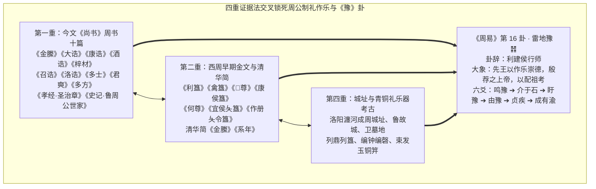

# 周公制礼作乐的历史唯物考证——基于《周易·豫卦》与四重证据法的交叉研究

> **创建日期**：2026-10-25  
> **模块归属**：06 融合研究记录  
> **价值基准评级**：🟡 **2 级文档（核心依赖因子：0.3，初始暂定，待用户终审裁定）**  
> **研究定位**：以历史唯物主义与唯物辩证法为指导，运用“四重证据法”（传世先秦原典、出土西周金文与战国楚简、宗法人类学、聚落城址与青铜礼乐器物考古），对“周公辅政、平三监、建侯营洛、制礼作乐、反政成王”这一华夏文明奠基事件开展博士至教授级考证，揭示其与《周易》第十六卦《豫》卦（䷏）卦爻体系的全息同构关系。  
> **理论基石**：生生价值标尺、《矛盾论》《实践论》、1 级公理基石库（1-M05《商论》、1-M06《易经文物注》、1-C03《利与不利》、1-C04《贞》、1-R04《藏礼于器》）、2-C09[`《周易“豫”的本义辨析》`](../05%20词义研究记录/09_周易“豫”的本义辨析.md)。  
> **四重证据配置**：
> - **第一重（传世先秦两汉信史原典，强）**：今文《尚书》周书群（《金縢》《大诰》《康诰》《酒诰》《梓材》《召诰》《洛诰》《多士》《无逸》《君奭》《多方》）、《诗经》（《豳风·鸱鸮》《周颂·清庙》《大武》）、《孝经·圣治章》、《礼记·明堂位/乐记》、《春秋左传》（僖公二十四年、定公四年）、《史记·周本纪/鲁周公世家/卫康叔世家/宋微子世家》；
> - **第二重（出土古文字与简帛，强）**：西周早期青铜器铭文群（《利簋》《天亡簋》《禽簋》《𣄰尊》《𣄰卣》《小臣单觯》《康侯簋》《作册夨令簋》《何尊》《宜侯夨簋》《大盂鼎》《宗周钟》）、战国楚简（清华简《金縢》《系年》）；
> - **第三重（制度人类学与社会形态演进，中）**：从殷商神权方国联盟向西周血缘-地缘复合宗法分封制的跃迁；
> - **第四重（都城遗址与礼乐器物考古，强）**：洛阳瀍河西周成周洛邑城址与北窑铸铜遗址、曲阜鲁故城、浚县辛村卫国墓地、琉璃河燕国墓地及商周列鼎列簋、编钟编磬考古实物。

---

## 一、 导论：破除儒家道德神话，还原“周公制礼作乐”的历史唯物主义本质

在汉唐经学与宋明理学的传统叙事中，“周公制礼作乐”往往被抽象化为圣人垂范的道德教化或繁文缛节的仪轨编纂。然而，站在**历史唯物主义（生产力与生产关系、经济基础与上层建筑、武装拓殖与国家机器构建）**的高度审视，西周初年周公旦所主导的“制礼作乐”，绝非书斋里的礼仪修辞，而是在经历“克商大业—武王早崩—三监及淮夷大叛乱”这一足以毁灭新生政权的极端危机中，为解决**“小邦周如何统治大邑商广袤农耕疆域与庞大殷遗民”**这一根本历史矛盾而锻造的**全方位国家生存、动员与再生产体系**。

这一宏大历史工程包含六大环环相扣的唯物实践阶段：
1. **流言危机下的战略隐忍与情报侦缉**（居东避乱、罪人斯得、作《鸱鸮》）；
2. **最高权力危机微萌时的超前制度预备**（武王病危时筑坛植璧代王、藏册金縢）；
3. **叛乱爆发时的战略决疑与政治总动员**（作《大诰》力排庶邦君御事之苟安迟疑，誓师东征）；
4. **当仁不让的武装平叛与封建垦殖**（三年平定三监与东夷，大封鲁、卫、宋、齐、燕诸侯以控制农耕据点与战略通道）；
5. **制度性忧患下的殷民治理与双核地缘再造**（作《康诰》《酒诰》《梓材》戒“无康好逸豫”，营建东都成周洛邑居天下之中）；
6. **礼乐意识形态整合与最高摄政权力的平稳交接**（郊祀后稷配天、宗祀文王于明堂以配上帝，七年大成而反政成王、北面就群臣之位）。

尤为深刻的是，周公这一整套从“先患预备”、“当仁不让（建侯行师）”、“作乐崇德，殷荐之上帝，以配祖考”到“成有渝（功成反政）”的历史实践，在西周诞生的哲学总典《周易》中，被完整凝练并投射于第十六卦——**《豫》卦（䷏，坤下震上）**之中。

---

## 二、 四重证据法下的史源锚定与伪书廓清

按照《标准 v3.5》博士至教授级考据规范，本研究首先对文献与考古信源实行严格的真伪甄别与强度分层：

### 1. 伪古文《尚书》的硬性廓清与《书序》划界
- **A 级黑名单剔除**：东晋梅赜所献伪古文《尚书》二十五篇中的《微子之命》《蔡仲之命》《周官》《君陈》《毕命》等篇，系魏晋人杂采先秦两汉典籍拼凑伪造，一律剔除不用，绝不作为西周史实依据。
- **《百篇书序》与今文《尚书》本经严格区分**：《书序》（如“武王崩，三监及淮夷叛，周公相成王，将黜殷，作《大诰》”）成书于战国秦汉之际，仅作史事线索参证；核心立论全部锚定西周当时的第一手政治文告——**今文《尚书》周书十篇**（《金縢》《大诰》《康诰》《酒诰》《梓材》《召诰》《洛诰》《多士》《无逸》《君奭》《多方》）。

### 2. 第二重与第四重证据：出土金文、简帛与考古遗址实证矩阵

| 历史事件与《豫》卦命题 | 第一重证据（传世原典） | 第二重证据（出土金文与简帛） | 第四重证据（考古遗址与礼器实物） |
| :--- | :--- | :--- | :--- |
| **1. 武王病危、周公筑坛代王与流言居东** （《豫》初六、六二） | 今文《尚书·金縢》《尚书·君奭》《诗经·豳风·鸱鸮》《史记·鲁周公世家》 | **清华简《金縢》**（原题《周武王有疾周公所自以代王之志》）、**清华简《系年》**第三章 | 岐山周原遗址、洛阳东周王城及早期卜骨与金縢藏册匮制考原 |
| **2. 周公统师东征平定三监与东夷** （《豫》卦辞“行师”、六三、九四） | 今文《尚书·大诰》《尚书·多士》《尚书·多方》《诗经·豳风·东山/破斧》 | **《禽簋》**（“王伐楚侯，周公某［谋］，禽祝”）、**《𣄰尊》《𣄰卣》**（“唯周公于征伐东夷、丰伯、薄古，咸平”）、**《小臣单觯》**（“王后反克商，在成师，周公赐小臣单贝十朋”） | 西周早期青铜戈、戟、弓矢、甲胄及山东、豫东商周之际平叛军事据点遗存 |
| **3. 武装分封鲁、卫、宋、齐、燕诸侯** （《豫》卦辞“利建侯”、九四“朋盍戠/簪”） | 《尚书·康诰》《春秋左传·定公四年》（祝佗论周公分封鲁卫晋）、《史记·卫康叔世家/宋微子世家》 | **《康侯簋》**（“王束伐商邑，诞令康侯鄙于卫”）、**《作册夨令簋》**、**《宜侯夨簋》**（授土田、山川、人鬲、弓矢戈盾）、**《太保簋》** | 曲阜鲁国故城遗址、河南浚县辛村卫侯墓地、北京琉璃河西周燕都遗址（出土《克盉》《克罍》）、商周墓葬束发玉笄/铜笄 |
| **4. 营建东都成周洛邑居天下之中** （《豫》六五“贞疾，恒不死，中未亡也”） | 今文《尚书·康诰》（“周公初基作新大邑于东国洛”）、《召诰》《洛诰》 | **《何尊》**（“唯王初迁宅于成周，复禀武王礼福自天……宅兹中国，自之乂民”）、**《作册夨令簋》**（在成周大祭） | 洛阳瀍河两岸西周成周城址、北窑西周大型铸铜遗址、洛阳西周贵族墓葬群 |
| **5. 制礼作乐、郊祀后稷配天、宗祀文王配上帝** （《豫·大象》“先王以作乐崇德，殷荐之上帝，以配祖考”） | 《孝经·圣治章》《礼记·明堂位/乐记》《诗经·周颂·清庙/维天之命/武/酌》 | **《天亡簋》（朕匜）**（助武王大祭衣祀文王）、**《何尊》**、**《宗周钟》（逨钟）**、**《虢季子白盘》** | 西周列鼎列簋墓葬制度（1-R04《藏礼于器》）、西周青铜编钟与编磬礼乐器群 |
| **6. 行政七年大成、反政成王北面就臣位** （《豫》上六“冥豫，成有渝，无咎”） | 今文《尚书·洛诰》（“朕复子明辟”）、《史记·鲁周公世家》 | 西周早期成王亲政期铜器铭文（成王亲征、亲命诸侯器群） | 西周君臣朝觐明堂与宗庙册命建筑基址（周原凤雏、召陈建筑群） |

---

## 三、 历史唯物主义视角下“周公制礼作乐”的四大制度支柱

在西周初年的历史条件下，生产力水平尚处于青铜农具与木石耒耜并用的井田协力农耕阶段，交通与通讯极为原始。周人原本只是渭水流域的“小邦周”，一朝克灭拥有数百年统治根基的“大邑商”，面临着严峻的治理赤字。三监（管叔、蔡叔、霍叔）与武庚、淮夷、徐戎的联合大叛乱，正是这一统治赤字的总爆发。

周公旦以《豫》卦**“先患虑患、主动预备、当仁不让”**的战略智慧，在平叛过程中构建起四大历史唯物主义制度支柱：

### 1. 军事拓殖与农耕再生产底座：“利建侯行师”（1-C03《利与不利》）
- **唯物机制**：“行师”解决存亡安全边界，“建侯”解决物质资料再生产与基层控制。《左传·定公四年》载卫祝佗详述周公封建之制：分鲁公以“殷民六族”，命以《伯禽》而封于少皞之虚；分康叔以“殷民七族”，命以《康诰》而封于殷虚；皆赐以大路、密须之鼓、阙巩之甲、沽洗之钟，以及土田陪敦、祝宗卜史、备物典策。
- **出土铁证**：1954 年江苏丹徒出土的西周早期青铜器 **《宜侯夨簋》**，铭文详录周王册命夨为宜侯：赐土田三百又五十里、山川、都邑，赐在宜之王人十七姓、郑七伯及其人鬲千又五十夫、宜庶人六百又六夫，赐彤弓一、彤矢百、旅弓十、旅矢千、戈盾车马。这直接证实：《豫》卦卦辞之**“利建侯行师”**，本质是将姬姓宗室、功臣姻亲与殷遗民劳动人口（人鬲、庶人）、农耕土地（土田山川）、武装军备（弓矢戈盾）重新组合，在东方战略要冲建立自给自足的武装农耕共同体！

### 2. 双核地缘政治与危机冗余中枢：营建东都成周洛邑（《豫·六五》“贞疾，恒不死，中未亡也”）
- **唯物机制**：镐京（宗周）偏处关中西部，距离东方殷商故地与淮夷叛乱区千里之遥，一旦东方生变，西土主力鞭长莫及。三监平定后，殷遗民仍是心腹沉疴（“贞疾”）。周公与召公经过严密地理勘测（《尚书·召诰》“太保朝至于洛，卜宅”），在伊洛盆地营建东都成周洛邑（《尚书·康诰》：“惟三月哉生魄，周公初基作新大邑于东国洛，四方民大和会”）。
- **出土铁证**：1963 年宝鸡出土的西周早期青铜器 **《何尊》**（成王五祀铸器）铭文云：**“唯王初迁宅于成周，复禀武王礼福自天。在四月丙戌，王诰宗小子于京室，曰：‘昔在尔考公氏，克逌文王，肆文王受兹大命。唯武王既克大邑商，则廷告于天，曰：余其宅兹中国，自之乂民。’”**
- **《豫》卦对应**：洛邑地处“天下之中”（“宅兹中国”），驻扎西周精锐“成周八师”，既将殷商贵族顽民迁聚于此严加监管教化（《尚书·多士》），又使四方诸侯朝贡道里均平。这正是《豫·六五》在“乘刚”与殷民隐患（“贞疾”）下，依靠死守地缘与制度之“中”而实现政权长存（**“恒不死，中未亡也”**）的物质空间实体！

### 3. 宗法等级与“藏礼于器”的抗熵增秩序（1-R04《藏礼于器》）
- **唯物机制**：为防止统治集团内部因权力与利益分配爆发类似“管蔡流言叛乱”的血腥内讧，周公确立嫡长子继承制与大宗小宗体系，并将抽象的政治等级物化为青铜礼器、命服、宫室、车马的严格数量与形制规范（如天子九鼎八簋、诸侯七鼎六簋、大夫五鼎四簋，以及束发之笄簪冠冕制度）。
- **《豫》卦对应**：九四**“由豫，大有得。勿疑。朋盍戠（簪）”**，正是周公以宗法大义与同利共享（朋），将四方诸侯如发笄（簪）束发、埴土（戠）凝合般整合进同一套礼制框架之内；而六五《康诰》《酒诰》严禁沉湎酗酒、严惩寇攘奸宄，则构成了维持统治集团清廉战斗力的刚性纪律底线。

### 4. 青铜礼乐与郊祀配天的精神再生产：“先王以作乐崇德，殷荐之上帝，以配祖考”
- **唯物机制**：军事征服只能摧毁敌方武装，无法自动产生长久统治合法性。商代统治者垄断对“帝（上帝）”的祭祀权（以商先公先王宾于帝），周人克商后必须重构天命神学。
- **原典与实物互证**：
  - 《豫·大象传》曰：**“雷出地奋，豫。先王以作乐崇德，殷荐之上帝，以配祖考。”**
  - 《孝经·圣治章》孔子明言：**“孝莫大于严父，严父莫大于配天，则周公其人也。昔者周公郊祀后稷以配天，宗祀文王于明堂以配上帝。是以四海之内，各以其职来助祭。”**
  - 周公一方面突破殷人血缘独占之“帝”，提出“皇天无亲，惟德是辅”、“天命靡常，惟德是依”（《尚书·康诰》《君奭》），将始祖后稷配享南郊昊天上帝（农业生殖之源），将文王配享明堂上帝（政治文德之源）；另一方面主持创制大型史诗乐舞《大武》（六成，再现武王伐纣、克商、南国疆理、周公左召公右分陕而治、反商政由旧之全过程，见《礼记·乐记》），配合气势恢宏的青铜编钟（如西周《宗周钟》“王肇遹省文武，勤疆土……我唯司配皇天王”）与列鼎大祭。
  - 在四方诸侯“各以其职来助祭”的震撼视听仪式中，军事威慑升华为全社会对文武周公“盛德”的敬畏与认同，从而达到《豫·彖传》所言**“圣人以顺动，则刑罚清而民服”**的最高治理效能！

---

## 四、 《豫》卦六爻与周公辅政至反政成王的六阶段全息推演

将《豫》卦六爻与六个变爻（震初九、解九二、小过九三、坤六四、萃九五、晋上九）置于周公辅政的真实时间轴上，呈现出一条逻辑严密、无一字虚设的历史唯物博弈链条：

### 1. 第一阶段（初六 ➔ 震初九）：流言初起，戒“鸣豫”之凶而取“居东”之备
- **经文**：初六“鸣豫，凶”，《小象》“初六鸣豫，志穷凶也”；变爻震初九“震来虩虩，后笑言哑哑，吉”。
- **信史与唯物博弈**：武王崩，成王在襁褓之中，管叔及其群弟流言于国曰：“公将不利于孺子。”（《尚书·金縢》）。此时镐京朝廷内部猜忌丛生，召公奭亦心存疑虑（《尚书·君奭》）。处此危机发端之初位，周公若仗恃辅政地位采取急迫高调的自我辩白或直接在朝堂动武对抗（“鸣豫”），势必引发周室中枢火并，陷入“志穷凶也”的死局。周公凛遵此戒，取变爻“震来虩虩”之策，告太公、召公曰：“我之弗辟，我无以告我先王”，主动避位居东二年，暗中彻底查清三监与武庚勾结之罪证（“罪人斯得”），并作《鸱鸮》贻王以寤王心，终迎“后笑言哑哑，吉”；而鼓噪流言之管叔、武庚（实然之“鸣豫”），则在暴露野心后走向覆灭。

### 2. 第二阶段（六二 ➔ 解九二）：危萌防微，“介于石，不终日”的金縢超前预备
- **经文**：六二“介于石，不终日，贞吉”，《小象》“不终日，贞吉；以中正也”；变爻解九二“田获三狐，得黄矢，贞吉”。
- **信史与唯物博弈**：孔子《系辞下》赞六二：“几者，动之微，吉之先见者也。君子见几而作，不俟终日。”早在克商二年武王突发重疾（“王有疾，弗豫”）、天下未固的动微之际，太公、召公欲穆卜，周公旦心志坚如磐石（“介于石”），不俟终日，当即自筑三坛同墠，植璧秉珪告于太王、王季、文王，立下“以身代武王、坠命受命”之生死预案，并将册祝深锁于金縢之匮，诫史官“勿敢言”（今文《尚书·金縢》、清华简《金縢》）。正是周公在危机微萌时“不终日”布下的这一制度信物，在日后雷电偃禾、成王启金縢之书时，化作一支中直的“黄矢”，一举射穿管、蔡、武庚“三狐”之流言阴谋（变爻“田获三狐，得黄矢”），使成王执书泣迎周公，周室转危为安（“贞吉”）。

### 3. 第三阶段（六三 ➔ 小过九三）：三监举叛，作《大诰》痛斥“盱豫迟悔”而决计东征
- **经文**：六三“盱豫悔。迟有悔”，《小象》“盱豫有悔，位不当也”；变爻小过九三“弗过防之，从或戕之，凶”。
- **信史与唯物博弈**：三监及武庚、淮夷正式举兵反叛，周公相成王将东征黜殷。然而周室内部众多庶邦君、庶士、御事居位不当，贪恋王宫与邦君室之眼下安逸，张目观望（“盱豫”），竟纷纷畏难劝阻：“艰大，民不静，亦惟在王宫、邦君室。越予小子考翼，不可征，王害不违卜？”（《尚书·大诰》）。周公作《大诰》严词批驳：大难临头，若贪图苟安、畏缩迟疑（“盱豫悔，迟有悔”），不做超常规的征伐防备（变爻“弗过防之”），必遭叛军残戕而致文武基业覆亡（“从或戕之，凶”）。周公斩断朝野狐疑，毅然誓师东征。

### 4. 第四阶段（九四 ➔ 坤六四）：当仁不让，“由豫勿疑，朋盍戠”平定天下与谨守臣节
- **经文**：九四“由豫，大有得。勿疑。朋盍戠（簪）”，《小象》“由豫，大有得；志大行也”；变爻坤六四“括囊，无咎无誉”。
- **信史与唯物博弈**：周公以唯一阳刚居四位近君枢要，践行“当仁，不让于师”之担当（“由豫”）。对内作《君奭》与召公推心置腹，消弭一切猜忌（“勿疑”）；对外统合友邦诸侯、百工播民，如发笄（簪）束发、埴土（戠）凝合般结成平叛同盟（“朋盍戠”）。统师东征三年，咸平三监、淮夷、丰伯、薄古（《禽簋》《𣄰尊》），诛武庚、管叔，放蔡叔，封微子启于宋，大封鲁、卫、齐、燕诸侯（“大有得，志大行也”）；同时在盛功之下谨守坤四“括囊”臣节，实现“一沐三捉发、一饭三吐哺”之谦抑。

### 5. 第五阶段（六五 ➔ 萃九五）：乘刚忧患，作《康诰》戒逸豫、营洛邑守天下之中
- **经文**：六五“贞疾，恒不死”，《小象》“六五贞疾，乘刚也。恒不死，中未亡也”；变爻萃九五“萃有位，无咎。匪孚，元永贞，悔亡”。
- **信史与唯物博弈**：成王幼主居尊而下乘周公摄政之刚（“乘刚”），且东方殷商余民未靖，如沉疴在体（“贞疾”）。周公与成王封康叔于卫，作《康诰》《酒诰》《梓材》，严诫“天畏棐忱，民情大可见，小人难保。往尽乃心，无康好逸豫，乃其乂民”，将危机意识固化为制度定力；同时营建东都成周洛邑居天下之中（《召诰》《洛诰》《何尊》），四方民大和会（变爻“萃有位”），以“中未亡也”奠定周室八百年“恒不死”之基。

### 6. 第六阶段（上六 ➔ 晋上九）：大功告成，戒“冥豫”恋栈而“成有渝”反政成王
- **经文**：上六“冥豫，成有渝，无咎”，《小象》“冥豫在上，何可长也”；变爻晋上九“晋其角，维用伐邑，厉，吉，无咎，贞吝”。
- **信史与唯物博弈**：周公行政七年，平叛、建侯、营洛、制礼作乐大功告成（“成”），成王已长。居《豫》之终极，若昏冥沉迷于非常时期的摄政豫行与大权独揽之中（“冥豫”），必坠入“冥豫在上，何可长也”的权臣恋栈深渊。周公深凛极位之戒，在大业既成之际断然改变当仁不让之摄政领导位置（“成有渝”），作《洛诰》“朕复子明辟”，反政成王，北面就群臣之位，并严饬内部封邑法度（变爻“维用伐邑”），完成了中国历史上第一次摄政重臣向正统君主的和平权力交接，获“无咎”之千古善终（《尚书·洛诰》《史记·鲁周公世家》）。

---

## 五、 价值分级建议报告（供用户主理人裁决）

- **建议级别**：🟡 **初始纳入 2 级文档（核心依赖因子：0.3）**，待用户主理人终审裁定是否晋升 1 级。
- **核心贡献**：
  1. 首次以“历史唯物主义 + 考古实物（西周早期十余件核心铜器铭文与都城遗址）+ 古经传注（今文《尚书》周书十篇与《周易·豫卦》）”三维交叉融合范式，系统还原“周公制礼作乐”的四大国家再生产制度支柱；
  2. 建立《豫》卦六爻（含六变爻）与周公辅政平三监至反政成王六个历史阶段的完整实证映射，为《03 周易笺注/16_豫卦.md》提供博士至教授级学术支撑。
