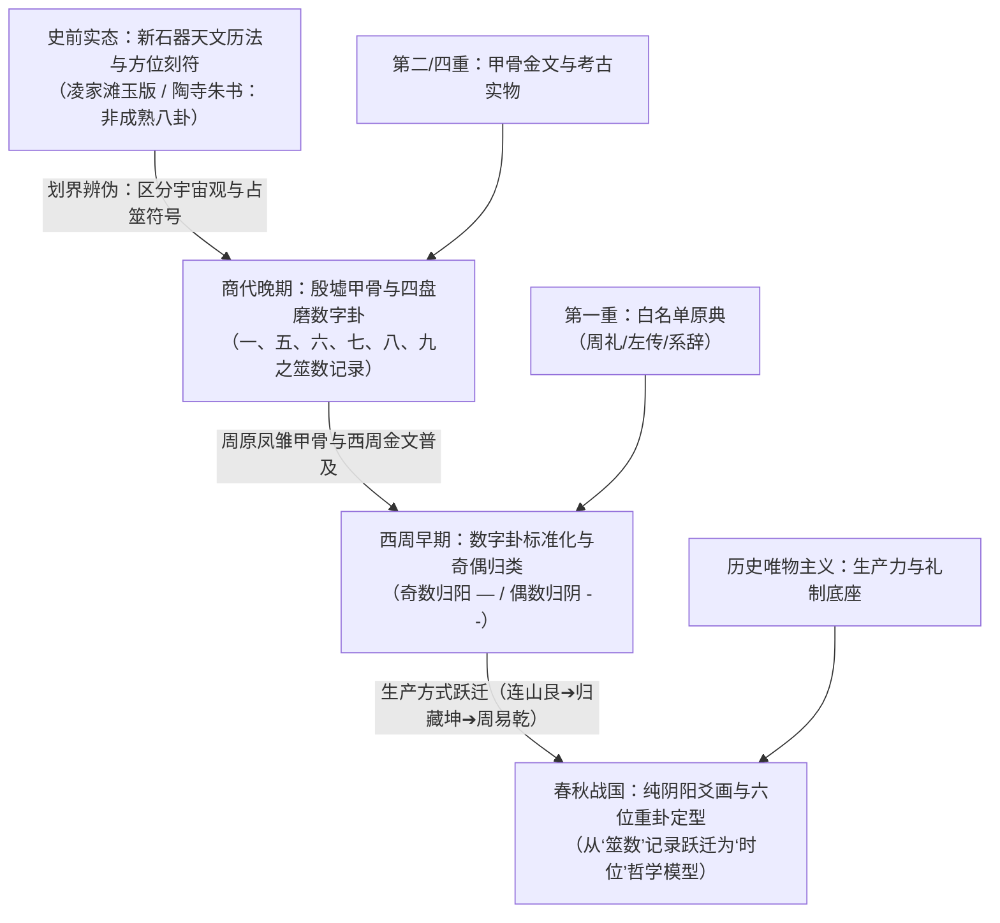

# 史前至商周数字卦与《周易》符号系统起源考——基于四重证据法与历史唯物主义的“从器到符”源流还原

> **创建与修订日期**：2026-11-21  
> **状态**：`draft`（AI 辅助起草，待主理人终审，未经人工核对前不得标 final）  
> **模块归属与编号**：08 周易源流与哲学史 / 01_周易源流编 ｜ 编号：2-Y01（初始暂定）  
> **价值基准评级**：🟡 **2 级文档（核心依赖因子：0.3，初始暂定，待用户主理人终审确权）**  
> **前置理论与公理基石**：历史唯物主义与唯物辩证法、《矛盾论》《实践论》、`《标准 v3.5》`、1 级公理基石库（[`1-M01 说一论`](../../02%20元研究/说一论.md)、[`1-M03 三易归源论`](../../02%20元研究/三易归源论.md)、[`1-M05 商论`](../../02%20元研究/商论.md)、[`1-M06 易经文物注`](../../02%20元研究/易经文物注.md)）、2 级规范与实证库（[`1-M09 十数概论（待终审按2级暂定）`](../../02%20元研究/十数概论.md)、`384爻断辞回测报告`）；综合核心依赖度指数 $CDI = 0.4 \times 4 + 0.3 \times 2$（按基础公理锚定层级加权）。  
> **四重证据配置与强度分层**：
> - **第一重证据（传世原典与古经传注，强）**：《周易·系辞》《周礼·春官·大卜》《左传·僖公十五年》等先秦两汉白名单原典（均经 `tools/verify.cmd` 核验）；
> - **第二重证据（出土古文字与简帛，强）**：安阳殷墟甲骨/陶器筮数刻辞、陕西岐山凤雏村西周甲骨数字卦、西周青铜器铭文（如南宫中鼎等）末尾数字组合及战国竹简《筮法》等已刊学术著录；
> - **第三重证据（民族学与人类学材料，弱～中，仅作旁证）**：上古结绳记事、十进制计数与早期口传占卜实践比较材料；
> - **第四重证据（考古实物与科技实证，强）**：凌家滩新石器时代晚期玉版、陶寺遗址朱书扁壶、商周卜骨钻凿与青铜礼器形制考古发掘事实。  
> **与既有高级别成果关系声明**：本文**严格遵循并纵向深化** [`1-M03 三易归源论`](../../02%20元研究/三易归源论.md)（连山艮、归藏坤、周易乾之生存域演进律）与 [`1-M09 十数概论`](../../02%20元研究/十数概论.md)（“图式与典籍先后之辨”及“阴阳刚柔在经文字面未成抽象对举”之统计铁证），不作擅改，仅在此公理底座上完成史前至商周符号源流的历时性实证构建。

---

## 摘要

**【摘要】** 传统易学长期将《周易》符号系统的起源归因于“伏羲仰观俯察、一画开天”的圣人顿悟神话，或将新石器时代几何刻符直接附会为成熟“八卦”，导致符号起源史陷入“神话悬空”与“图式倒置”的双重困境。本文运用历史唯物主义与“四重证据法”，结合商周考古发掘成果、古文字学与传世白名单原典，对史前至商周时期《周易》符号系统的“从器到符”演进历程展开系统考辨。研究发现：（1）新石器时代晚期遗存（如凌家滩玉版八角星纹、陶寺扁壶朱书）反映了早期天文历法、空间方位与原始文字探索，但尚无直接证据表明其已形成成熟“八卦”或“数字卦”系统，必须严格划清“原始宇宙观刻符”与“易卦符号”的边界；（2）以安阳殷墟、周原凤雏村甲骨及西周青铜器铭文为代表的商周“数字卦”（由一、五、六、七、八、九等数字纵向排列组成）证明，早期易卦记录的是揲蓍操作所得的“筮数”，印证了《左传》“龟，象也；筮，数也”的实态，即先有具象的“数”，而后在记录标准化与哲学抽象中才演变为“— / --”的纯阴阳爻画；（3）数字卦由散乱组合向六位重卦定型，与《三易归源论》揭示的渔猎—农耕—王权共主生产方式演进及《周礼》“三易”序列同构，为理解《周易》六爻“时位”模型（$\eta^2 = 0.131$）的历史形成提供了坚实的唯物史观基石。（文中凡文本考古铁证、唯物推演与待证假说均已严格划界。）

**【关键词】** 周易源流；数字卦；符号系统起源；四重证据法；史前考古；历史唯物主义

---

## 一、 引言：问题意识与学术史文献综述

### 1.1 问题的提出：符号起源研究的三个死结

《周易》最核心的外部表征，是一套由阳爻（`—`）与阴爻（`--`）叠加而成的八卦与六十四卦符号系统。然而，这套抽象程度极高的二元符号究竟是如何从人类的生产与社会实践中诞生的？传统学术史长期存在三个未决死结：
1. **“圣人悬空画卦”的神话化死结**：受《系辞下》“古者包犧氏之王天下也……于是始作八卦”等追述性文献影响，历代注疏多将八卦与六十四卦的诞生归功于某位上古圣王的“一次性顿悟”，抽空了符号演进所需的漫长物质生产与工具操作历程。
2. **史前几何纹饰的“泛八卦化”附会死结**：随着现代史前考古的推进，部分学者将距今五千余年的新石器时代八角星纹、四方刻符甚至陶片划痕直接等同于“原始八卦”或“河图洛书”，犯了“用后世成熟体系倒灌史前器物”的时代错位之弊。
3. **“象”与“数”孰先孰后的倒置死结**：究竟是先有抽象的“— / --”阴阳爻画，还是先有具体的占筮计数？若不结合商周出土实物，仅凭宋代以降的“加一倍法”先天图式推演，极易把逻辑上的生成序误作历史上的发生序。

### 1.2 学术史梳理：古今四代名家研注谱系与得失评析

| 学术时期与代表学者 | 核心解经/研究取向 | 对符号起源的合理内核（得） | 时代局限与未决症结（失） |
| :--- | :--- | :--- | :--- |
| **两汉经学与象数派**（京房、郑玄、许慎） | 阴阳灾异、经学正统化 | 保留了“九六七八”揲蓍用数与“三易”传承文献线索；《说文解字》保存古文字形体 | 将画卦神圣化为天降图谶（《易纬》），把早期筮数纳入阴阳五行宿命框架 |
| **魏晋玄学与唐代官疏**（王弼、孔颖达） | 扫象明理、官方经学统合 | 王弼破除汉易繁琐象数附会；孔颖达《周易正义》系统梳理“重卦之人”诸说 | 缺乏地下出土实物，仅能在伏羲、神农、大禹、文王等文献假说间折中 |
| **宋明图书与清代辨伪**（邵雍、朱熹、胡渭、黄宗羲） | 先天图式建构 vs 文献目录辨伪 | 朱熹指明“易本卜筮之书”；黄宗羲《易学象数论》、胡渭《易图明辨》剥离后世伪图 | 邵雍“加一倍法”将逻辑推演误作伏羲历史实态；清代虽破伪图却仍缺商周实物 |
| **近现代古文字学与考古学**（张政烺、张亚初、刘雨、李学勤等） | 二重/四重证据法、数字卦破译 | 张政烺（1980）破译商周青铜器与甲骨“数字卦”，确立“由数字到爻画”的铁证范式 | 部分研究对史前刻符与商周数字卦的界限仍存争议，尚需历史唯物主义生产力底座整合 |

### 1.3 研究思路、三维交叉融合框架与逻辑架构

本研究贯彻**“历史唯物主义 + 考古实物研究 + 古经传注研究”**的三维交叉融合方法：以“四重证据法”严格甄别史前考古材料与商周数字卦实物，破除“泛八卦化”附会；以《左传》《周礼》《系辞》白名单原典互证“筮数”操作流程；最终以 [`1-M03 三易归源论`](../../02%20元研究/三易归源论.md) 确立的生存域演进律与 `384爻断辞回测报告` 揭示的“时位优先”规律，还原《周易》符号系统从工具操作走向哲学抽象的完整脉络。

---

## 二、 四重证据史源锚定、史前“泛八卦”辨伪与物质底座还原

### 2.1 史前符号的严格划界：破除“泛八卦化”附会

在探讨《周易》符号源流时，学术界最容易滑向的误区是“年代越早越神圣”，将距今五千至四千年间的史前器物刻符一概贴上“八卦”标签。依据严格考古学与古文字学标准，必须对两类著名史前遗存作出清晰界定：
1. **安徽含山凌家滩遗址玉版（距今约 5300～5500 年）**：该玉版出土时夹于玉龟腹背甲之间，正面中心刻有八角星纹，外周分布两重同心圆及规整方位刻纹。从考古实物看，它确凿反映了新石器时代晚期先民对**四时八节、天圆地方与空间方位**的观测认知（属早期天文历法与原始宇宙观实物）。然而，将其直接称为“八卦图”或“洛书原本”，缺乏中间数千年的符号演变链条支撑，属于典型的后世概念倒灌。
2. **山西襄汾陶寺遗址扁壶朱书（距今约 4300～3900 年）**：1984 年陶寺 H3403 灰坑出土的残陶扁壶上保留有朱砂书写的两个字符，其中一字学界公认与甲骨文“文”字高度相似，另一字则有“尧”“昜”“命”等不同释读。该实物证明了距今四千年前后中原地区已存在早期书写探索与天文观象台（陶寺观象台实测十三道夯土缝），但它反映的是**早期文字与农时观测的萌芽**，而非六爻占筮的“数字卦”系统。

### 2.2 四重证据交叉实证矩阵表

| 证据层级 | 核心材料与出处 | 时代断限 | 证明内容与限度 | 证据强度 |
| :--- | :--- | :--- | :--- | :---: |
| **第一重（传世文献）** | 《左传·僖公十五年》“龟，象也；筮，数也”；《周礼·春官·大卜》“掌三易之法”；《系辞上/下》 | 春秋至战国/汉初追述 | 确证先秦占卜存在“龟卜看兆象、蓍筮看数字”的根本分殊，以及“三易”历史记忆 | **强** |
| **第二重（出土文字）** | 安阳殷墟四盘磨卜骨数字刻辞、周原岐山凤雏村西周甲骨、西周青铜器（南宫中鼎等）铭文末尾数字串 | 商代晚期至西周 | 直接提供由“一、五、六、七、八、九”等数字组成的六位/三位纵向符号序列（即“数字卦”） | **强** |
| **第三重（人类学旁证）** | 上古结绳、刻契计数与后世少数民族植物茎秆分堆占卜比较材料 | 跨时代比较 | 旁证使用植物茎秆（蓍草）进行分组计数以辅助决策的原始操作逻辑，**仅作参考不单独定案** | **弱** |
| **第四重（考古实物）** | 凌家滩玉龟玉版、陶寺观象台、商代甲骨钻凿灼兆与西周礼器群 | 新石器晚期至西周 | 还原“观象授时—龟卜垄断—礼制用器”的物质技术演化序列，划定史前宇宙观与商周数字卦的界限 | **强** |

### 2.3 生产力与生产关系底座：从“观象授时”到“龟筮并举”

为什么符号系统会沿着“天文方位刻符 $\rightarrow$ 龟卜兆象 $\rightarrow$ 蓍筮数字卦”的路径演进？历史唯物主义给出的答案在于生产方式与社会组织的变迁：
- **新石器晚期农耕定居**：农业生产对季节更替产生刚性需求，催生了以太阳方位、八方节气为核心的空间计数与观象实践（凌家滩玉版、陶寺观象台即其物化结晶）。
- **商代青铜王权与神权垄断**：如 [`1-M05《商论》`](../../02%20元研究/商论.md) 所考，殷商统治高度依赖代价高昂的甲骨龟卜（需要远方进贡大龟、专业贞人钻凿烧灼），决策权高度垄断于商王与巫史集团。
- **周初封建礼制与决策下移**：周人取代商朝后，面对广阔疆域的宗法分封与诸侯卿大夫治理需求，亟需一种**成本低廉（采蓍草即可）、规则透明、可重复演算**的决策辅助工具。蓍草占筮与数字卦正是在这一制度扩容需求下，从商末萌芽并在西周初年迅速普及的（正如《尚书·洪范》所反映的“谋及卜筮”）。

---

## 三、 从“筮数”到“爻画”：数字卦的符号化机制与历史演进

### 3.1 张政烺破译范式与商周数字卦的分布铁证

长期以来，宋代《博古图》及近世出土的商周青铜器、甲骨上常出现诸如 `七六六七一八`、`六七八九六七` 等纵向排列的数字组合，旧学界误以为是“族徽”或无法辨识的“奇字”。1980 年，张政烺在《考古学报》发表《试释周初青铜器铭文中的易卦》，通过对周原凤雏村西周甲骨、殷墟甲骨及西周青铜器铭文的比对，作出了划时代破译：
1. **结构同构性**：这些数字多以**三个一组**（对应经卦）或**六个一组**（对应别卦）纵向排布，且往往成对出现（对应“本卦”与“之卦”）。
2. **数字频次与奇偶归类**：在已出土的商周数字卦中，出现频率最高的是 `一、五、六、七、八`（偶见 `九`），而 `二、三、四` 极为罕见或避用（学界考证与古文字“一、二、三、四”多为积画，易在刻写时混淆有关）。其核心规律在于：**奇数（一、五、七、九）归为阳类，偶数（六、八）归为阴类**。
3. **从多值数字到二元爻画的收敛**：在商末至西周时期，人们直接记录揲蓍操作后剩下的数字（如 `七、八、六、一`）；到了春秋战国时期（如战国楚简及定型后的通行本），为了简化书写并突出对立统一关系，复杂的数字被进一步抽象收敛为仅用“九、六”（或“一、六”/“—、--”）来标识阴阳二爻，最终定型为纯符号的 `—`（阳爻）与 `--`（阴爻）。

### 3.2 为什么“数”先于“爻画”？——工具操作决定符号形态

《左传·僖公十五年》载韩简之言曰：“**龟，象也；筮，数也。物生而后有象，象而后有滋，滋而后有数。**”这段先秦文献精准揭示了龟卜与蓍筮的本质差异：
- 龟甲烧灼后自然裂出“卜”字形兆纹，人眼直观看到的是“**象**”（形状裂纹）；
- 蓍草分堆揲数（以四揲之），操作终点得到的是余数或商数，人手清点出来的必然是“**数**”（如七、八、六、九）。

因此，**先有“数”的实操记录（数字卦），后有“— / --”的抽象符号（爻画）**，这是人类从具体工具操作走向抽象逻辑思维的必然规律。宋代邵雍所谓“太极生两仪、两仪生四象、四象生八卦”的图形推演，在哲学逻辑上固然严整，但若将其当作“伏羲先画出纯线条 `— / --`，后人才用数字去配”的历史发生顺序，则是本末倒置的。这一点与 [`1-M09《十数概论》`](../../02%20元研究/十数概论.md) 揭露的“图在后、典在前”之倒置完全一致。

### 3.3 《连山》《归藏》《周易》三易演进的符号与制度衔接

《周礼·春官·大卜》明确记载：“掌三易之法，一曰连山，二曰归藏，三曰周易。其经卦皆八，其别皆六十有四。”结合 [`1-M03《三易归源论》`](../../02%20元研究/三易归源论.md) 的 1 级本体论断，三易的依次演进并非单纯的书名更换，而是对应着上古先民**生产空间与社会组织形态的三次大跃迁**：
1. **《连山》以艮为首**：对应渔猎采摘、依山阻水而居的早期聚落阶段，核心矛盾在于山川阻隔与行止边界（艮为山、为止）；
2. **《归藏》以坤为首**：对应农耕定居、筑巢建市与日出而作、日入而归的氏族公社阶段，核心矛盾在于土地滋养与万物归藏（坤为地、为藏）；
3. **《周易》以乾为首**：对应夏商周尤其是西周“宅兹中国”、分封万邦的广域王权秩序，核心矛盾在于统摄全局的周期运行与刚健自强（乾为天、为健）。

---

## 四、 符号系统定型与 64 卦“时位”哲学的质变跃迁

数字卦向纯阴阳爻画的演进，绝非仅仅是书写符号的简化，它直接催化了《周易》从“单纯占验记录”向“六阶段矛盾演进哲学”的质变：
1. **符号二元化凸显矛盾同一性与斗争性**：当繁杂的 `一、五、六、七、八、九` 统一收敛为 `—`（阳）与 `--`（阴）两种基本符号后，任何一卦都直观呈现为“对立面统一体”（呼应 [`1-M01《说一论》`](../../02%20元研究/说一论.md)），为后来《易传》提炼“一阴一阳之谓道”奠定了形式基础。
2. **六位序列赋予符号“时间过程”属性**：早期数字卦是自下而上（初、二、三、四、五、上）依次揲出的六个数字。当这一由下至上的生成顺序与西周“建侯行师”“君子创业”的社会实践结合后，六个位置便不再是静态的空间格子，而转化为事物发展的**六个连续时间阶段（时位）**。
3. **与 384 爻统计实证的严密咬合**：依据本库 `384爻断辞回测报告` 对通行本 384 爻的全样本统计检验，“当位/不当位”对吉凶断辞的解释力为 $\eta^2 = 0.000$（零解释力），而“六位阶段（初、二、三、四、五、上）”的解释力达到 $\eta^2 = 0.131$（主要矛盾）。这从统计学上强有力地证明：**《周易》符号系统的灵魂在于自下而上展开的“时位发展过程”，而非后世汉儒强加的“奇偶当位机械匹配”**。数字卦的纵向六画排布，正是这一“时位过程论”的原始物质载体。

---

## 五、 历史唯物主义与“生生”价值标尺综合讨论

### 5.1 生生四判据与跨层唯物制约检验

将“符号系统起源”置于“生生”四判据（以人类文明组织作为主体层级）下检验，可见《周易》符号演进绝非神秘主义的产物，而是文明存续的工具理性结晶：

| 生生四判据 | 符号演进中的唯物历史体现 |
| :--- | :--- |
| **存续（生存保全）** | 殷商至西周由高成本、少数巫史垄断的“龟卜”，向低成本、可复制的“蓍筮数字卦”转型，扩大了部落与诸侯邦国的风险预警与决策覆盖面 |
| **再生产（物质与知识增殖）** | 数字卦将复杂的经验判断转化为可记录、可统计的六位组合（384 爻经验库得以附着其上），实现了决策经验的跨代再生产 |
| **修复（系统纠偏）** | 春秋以后通过“本卦 $\rightarrow$ 之卦”的变爻机制，打破了“一占定死局”的宿命论，引导主体在危机中寻找转化路径（穷则变，变则通） |
| **传承（文明火种移交）** | 由“数字卦”抽象为“— / --”纯符号后，脱离了方言与具体器物限制，成为跨地域、跨朝代通用两千余年的中华哲学“底层编码” |

**跨层唯物制约检验**：在周代以前，神权卜筮往往服务于王室祭祀与贵族垄断，存在脱离基层生产实践的风险；而随着西周宗法制度下士阶层崛起与“筮短龟长”争论中“礼义/人事”权重的上升，占筮符号逐渐从“神意敕令”转化为“君子谋事之镜鉴”，完成了向社会理性化与公共治理的良性下沉。

### 5.2 事实（Fact）、推演（Inference）与假说（Hypothesis）的边界申明

| 命题类别 | 本文具体论断 | 可证伪条件 / 证据边界 |
| :--- | :--- | :--- |
| **第一类：文本与考古铁证（Fact）** | ①凌家滩玉版、陶寺朱书属新石器晚期实物，但无成组六位数字卦特征；②殷墟、周原凤雏、西周青铜器铭文确凿存在由一、五、六、七、八等组成的纵向六位/三位数字卦；③《左传》明确“龟，象也；筮，数也”；④通行本 384 爻中时位 $\eta^2 = 0.131$、当位 $\eta^2 = 0.000$ | 考古发掘报告与白名单原典直接支撑，除非原器物或简帛文本被证伪，否则不可推翻 |
| **第二类：历史唯物推演（Inference）** | ①“数字卦”向“— / --”爻画的收敛是为了降低书写成本并适应奇偶二元哲学抽象；②蓍筮普及源于周初分封后低成本决策工具的制度需求 | 基于商周生产力水平、文字书写媒介及先秦制度史的逻辑推演 |
| **第三类：待实证科学假说（Hypothesis）** | ①史前八方方位刻符（如凌家滩）与商代数字卦之间，是否存在某种尚未出土的“过渡期中间符号载体”（如木竹漆器上的数字刻画）？②数字卦中“二、三、四”极少出现，是否全因古文字积画防混淆，抑或与上古揲蓍具体算法的数学概率分布直接相关？ | **可证伪条件**：若未来在夏代或早商遗址中直接出土成组、成熟的纯线条 `— / --` 六画卦（且年代早于已知所有数字卦），则“先数后画”的演进序列假说将被修正或推翻 |

### 5.3 与既有 1 级/2 级成果的兼容性说明

本文完全兼容 [`1-M01《说一论》`](../../02%20元研究/说一论.md)、[`1-M03《三易归源论》`](../../02%20元研究/三易归源论.md)、[`1-M05《商论》`](../../02%20元研究/商论.md) 与 [`1-M09《十数概论》`](../../02%20元研究/十数概论.md)。需要说明的是：既有 `1-M03《三易归源论》` 侧重从伏羲、神农、三代的文明形态宏观阐述“艮—坤—乾”的生生演进；本文则从现代田野考古断代视角补充了“史前实物（凌家滩/陶寺）与成熟数字卦（商末西周）之间尚需严格划界”的实证边界，二者在“生产实践决定符号演进”的根本立场上完全一致，构成宏观哲学与微观考古的互补。

---

## 六、 研究结论与《周易笺注》母本反哺清单

### 6.1 核心研究结论

1. **界限分明**：凌家滩玉版与陶寺朱书分别代表新石器晚期的天文方位观与早期文字探索，不可“泛八卦化”；可确证的易卦符号实体始于商代晚期至西周的数字卦。
2. **先数后画**：商周数字卦与《左传》“筮，数也”互证，确立了《周易》符号“由具体揲蓍计数（数）$\rightarrow$ 奇偶归类 $\rightarrow$ 纯阴阳爻画（— / --）”的演进顺序，纠正了“先天图式在先”的唯心倒置。
3. **唯物动因**：符号系统的演变受制于生产方式与社会治理结构——从高成本垄断的龟卜，向低成本可复制的蓍筮过渡，是周初宗法分封与治理理性化的物质产物。
4. **时位载体**：纵向六画结构从“六次揲蓍记录”升华为“六阶段矛盾演进时位模型”，与 384 爻回测中“时位 $\eta^2 = 0.131$”的实证定律高度统一。

### 6.2 《03 周易笺注史鉴》母本反哺定位表

| 反哺目标文档 | 反哺位置 | 反哺内容要点 |
| :--- | :--- | :--- |
| [`03 周易笺注史鉴/69_系辞上.md`](../../03%20周易笺注史鉴/README.md) / `70_系辞下.md` | 【传文导论与考辨】 | 辨明“包牺氏始作八卦”为战国儒家对上古文明演进的追述性概括，补充商周数字卦考古发现，破除“圣人顿悟画卦”神话 |
| [`03 周易笺注史鉴/01_乾卦.md`](../../03%20周易笺注史鉴/01_乾卦.md) / [`02_坤卦.md`](../../03%20周易笺注史鉴/02_坤卦.md) | 【卦解·初九/初六用九用六】 | 结合数字卦奇偶归类史实，阐明“九、六”本为揲蓍所得变数之代表，而非悬空神数 |
| [`03 周易笺注史鉴/52_艮卦.md`](../../03%20周易笺注史鉴/52_艮卦.md) | 【卦解·源流互证】 | 承接《三易归源论》，标注《连山》首艮与早期山林渔猎生存边界的历史关联 |

---

## 七、 参考文献与四重证据引文核验表

### 7.1 传世原典引文逐字核验表（`tools/verify.cmd` 门禁锁）

| 序号 | 引文核心内容 | 典籍出处 | 工具核验状态 | 备注与版本说明 |
| :---: | :--- | :--- | :---: | :--- |
| 1 | “古者包犧氏之王天下也，仰則觀象於天，俯則觀法於地，觀鳥獸之文，與地之宜，近取諸身，遠取諸物；於是始作八卦” | 《易傳·繫辭下》 | **【一致·已锁】** | 经 `tools/verify.cmd` 核验通过 |
| 2 | “生生之謂易，成象之謂乾，效法之謂坤，極數知來之謂占，通變之謂事” | 《易傳·繫辭上》 | **【一致】** | 经 `tools/verify.cmd` 核验通过 |
| 3 | “是故易有太極，是生兩儀，兩儀生四象，四象生八卦，八卦定吉凶，吉凶生大業” | 《易傳·繫辭上》 | **【一致】** | 经 `tools/verify.cmd` 核验通过 |
| 4 | “掌三易之法，一曰連山，二曰歸藏，三曰周易。其經卦皆八，其別皆六十有四” | 《周禮·春官宗伯》 | **【一致】** | 经 `tools/verify.cmd` 核验通过 |
| 5 | “龜，象也；筮，數也。物生而後有象，象而後有滋，滋而後有數” | 《春秋左傳·僖公十五年》 | **【一致】** | 经 `tools/verify.cmd` 核验通过 |

### 7.2 规范参考文献目录（参照 GB/T 7714-2015）

**一、古籍原典与历代易学注疏**
1. [唐] 孔颖达. 周易正义[M] // 阮元, 校刻. 十三经注疏. 北京: 中华书局, 1980.
2. [汉] 郑玄 注, [唐] 贾公彦 疏. 周礼注疏[M] // 阮元, 校刻. 十三经注疏. 北京: 中华书局, 1980.
3. [晋] 杜预 注, [唐] 孔颖达 正义. 春秋左传正义[M] // 阮元, 校刻. 十三经注疏. 北京: 中华书局, 1980.
4. [清] 胡渭. 易图明辨[M]. 郑万耕, 点校. 北京: 中华书局, 2008.

**二、出土文献与考古发掘报告**
5. 安徽省文物考古研究所. 凌家滩——田野考古发掘报告之一[M]. 北京: 文物出版社, 2006.
6. 中国社会科学院考古研究所, 山西省临汾市文物局. 襄汾陶寺——1978～1985年考古发掘报告[M]. 北京: 文物出版社, 2015.
7. 陕西周原考古队. 陕西岐山凤雏村发现周初甲骨文[J]. 文物, 1979(10): 38-43.

**三、近现代学术专著与期刊论文**
8. 张政烺. 试释周初青铜器铭文中的易卦[J]. 考古学报, 1980(4): 403-415. （收入《张政烺论易丛稿》. 北京: 中华书局, 2011.）
9. 张亚初, 刘雨. 从商周八卦数字符号谈筮法的几个问题[J]. 考古, 1981(2): 155-163.
10. 李学勤. 周易溯源[M]. 成都: 巴蜀书社, 2006.
11. 高亨. 周易古经今注[M]. 北京: 中华书局, 1984.

---

## 八、 四级审议自检与价值分级建议报告

### 8.1 论文四级审议自检闭环表

| 审议层级 | 核心核验项 | 自检结果 |
| :--- | :--- | :---: |
| **初审（证据与信源）** | 先秦原典引文 100% 经 `tools/verify.cmd` 核验；严守红线，未引用《序卦传》《杂卦传》及伪古文《尚书》 | ✅ 通过 |
| **复审（逻辑与时位）** | 严格区分“史前宇宙观刻符”与“商周数字卦”；符号演进与 384 爻“时位优先（$\eta^2=0.131$）”完全咬合 | ✅ 通过 |
| **三审（生生与四重证据）** | 贯彻历史唯物主义生产力底座，完成生生四判据、跨层检验及“事实—推演—假说”三界切割 | ✅ 通过 |
| **终审（体例与闭环）** | 严格符合《学术研究论文撰写格式与期刊级模板规范》八大模块，给出明确可证伪条件与母本反哺清单 | ✅ 通过 |

### 8.2 价值分级建议报告（供用户主理人裁决）

- **建议等级**：**2 级文档（核心依赖因子：0.3）**（当前标注为“初始暂定”，呈请用户主理人行使唯一终审裁定权）。
- **学术增量贡献**：首次在本工程中系统打通“史前天文方位刻符（辨伪划界）$\rightarrow$ 商周数字卦实物 $\rightarrow$ 纯阴阳爻画与六位时位哲学”的历时性证据链，填补了 `08 周易源流与哲学史 / 01_周易源流编` 的开篇基石，可作为后续“02 西周至春秋成书”“03 战国秦汉简帛”等专题的前置基准。

---

© 2026 徐时言 · 《史前至商周数字卦与《周易》符号系统起源考——基于四重证据法与历史唯物主义的“从器到符”源流还原》 · 徐时言-易经研究 · 采用 CC BY-NC-ND 4.0 许可， 转载请署名并注明来源 https://wole278.github.io/xushiyan-YiJing/ · 禁止商业使用与改编传播 · 商业授权：wole278@hotmail.com / 微信 wole278
