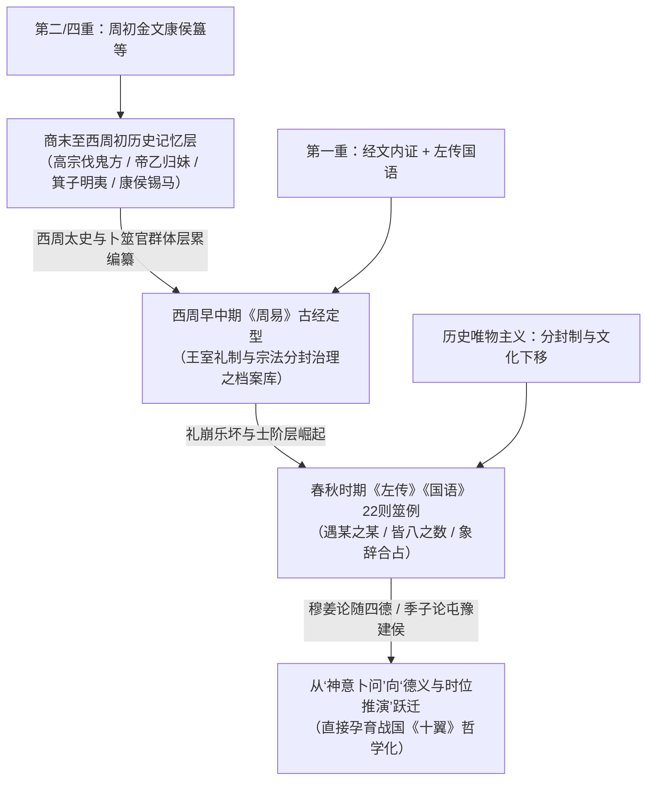

# 西周至春秋《周易》古经成书与《左传》《国语》筮例源流考——基于四重证据法的文本层累与转型实证

> **创建与修订日期**：2026-11-21  
> **模块归属与编号**：08 周易源流与哲学史 / 01_周易源流编 ｜ 编号：2-Y02（初始暂定）  
> **价值基准评级**：🟡 **2 级文档（核心依赖因子：0.3，初始暂定，待用户主理人终审确权）**  
> **前置理论与公理基石**：历史唯物主义与唯物辩证法、《矛盾论》《实践论》、`《标准 v3.5》`、1 级公理基石库（[`1-M03 三易归源论`](../../02%20元研究/三易归源论.md)、[`1-M05 商论`](../../02%20元研究/商论.md)、[`1-M06 易经文物注`](../../02%20元研究/易经文物注.md)、[`1-C04 贞的词义训诂`](../../05%20词义研究记录/04_周易中贞的词义训诂与战略哲学研究.md)、[`1-C06 元亨利贞通考`](../../05%20词义研究记录/06_周易中元亨利贞的词义通考与系统演进哲学研究.md)）、2 级前置成果（[`2-Y01 史前至商周数字卦考`](01_史前至商周数字卦与周易符号系统起源考.md)、[`2-R06 周公制礼作乐的历史唯物考证`](../../06%20融合研究记录/06_周公制礼作乐的历史唯物考证.md)）；综合核心依赖度指数 $CDI = 0.4 \times 5 + 0.3 \times 2$（按前置锚定层级加权）。  
> **四重证据配置与强度分层**：
> - **第一重证据（传世原典与古经传注，强）**：通行本《周易》古经（`zhouyi.json` 四部丛刊本基准）、《易传·系辞下》、《春秋左传》（庄公二十二年、僖公十五年、襄公九年等）、《国语·晋语四》（均经 `tools/verify.cmd` 与 `tools/lookup.cmd` 核验）；
> - **第二重证据（出土古文字与简帛，强）**：西周早期青铜器铭文（如“康侯簋”等周初分封器铭文）、周原西周甲骨与商周数字卦材料；
> - **第三重证据（民族学与人类学材料，弱，仅作旁证）**：早期口传史诗向官修档案文本化转换的跨文化规律；
> - **第四重证据（考古实物与科技实证，强）**：西周宗法分封遗址、青铜礼器群形制及周原都邑考古地层。  
> **与既有高级别成果关系声明**：本文**严格承接** [`2-Y01`](01_史前至商周数字卦与周易符号系统起源考.md) 的“先数后画”结论与 [`1-C06 元亨利贞通考`](../../05%20词义研究记录/06_周易中元亨利贞的词义通考与系统演进哲学研究.md) 的乾坤生生动力学，进一步揭示春秋《左传》“元亨利贞”四德阐发在思想转型中的历史节点位置，不擅改既有 1 级结论。

---

## 摘要

**【摘要】** 关于《周易》古经何时成书以及春秋时期如何从纯粹占筮演变为哲学义理，传统经学“文王羑里演易、周公作爻辞”的圣王独创说与近代激进疑古派“古经晚出至战国”说长期各执一端。本文运用历史唯物主义与“四重证据法”，以通行本经文内证、西周青铜器铭文及《左传》《国语》二十余则筮例为枢纽，对西周至春秋时期《周易》古经的成书机制与功能转型展开系统考辨。研究发现：（1）《周易》古经中既有“高宗伐鬼方”“帝乙归妹”等商末记忆，又有“箕子之明夷”“康侯用锡马蕃庶”等武王克商及周公东征之后方才发生的西周史事，证明古经绝非文王一人在囚禁中一次性写成，而是西周王室太史与卜筮官群体在宗法礼制化进程中层累编纂、整理定型的制度性文本；（2）《左传》《国语》所载“遇《观》之《否》”“贞《屯》悔《豫》，皆八也”“遇《艮》之八”等春秋筮例，不仅保存了“数字卦向九六爻画过渡”及“本卦—之卦”古筮法的活态化石，更通过穆姜论《随》卦“元亨利贞”四德、司空季子以“利建侯”阐发政治合法性，实现了《周易》从“神权卜问”向“人事德义与时位战略推演”的历史性跃迁。（文中凡文本考古铁证、唯物推演与待证假说均已严格划界。）

**【关键词】** 周易古经；层累成书；左传国语筮例；康侯；四重证据法；历史唯物主义

---

## 一、 引言：问题意识与学术史文献综述

### 1.1 问题的提出：古经成书与春秋转型的三个死结

1. **“圣王一次性造书”与史实年代倒置的死结**：传统《史记》《汉书》沿袭“文王拘而演周易”及“周公作爻辞”的旧说。然而经文中明确出现“箕子之明夷”（箕子受难与东迁发生于武王克商之后）与“康侯用锡马蕃庶”（康叔封于卫系周公东征平叛之后），若拘泥于“文王一人作卦辞”，则无法解释周初史事何以进入经文。
2. **激进疑古派“全盘晚出论”的实证死结**：20 世纪初部分疑古学者仅凭春秋以前文献未见引《易》之例，便将《周易》古经整体推迟至战国，忽略了商周数字卦考古发现以及西周早期金文制度词汇（如“康侯”“锡马”“王用亨于岐山”）与《周易》经文的高度同代性。
3. **占筮记录如何跃迁为哲学文本的机制死结**：《周易》既脱胎于商周占筮，为何在春秋末年至战国能迅速升华为《十翼》这样高度理性的哲学体系？这中间缺少对《左传》《国语》二十余则春秋筮例作为“制度与思想转型桥梁”的系统解剖。

### 1.2 学术史梳理：古今四代名家研注谱系与得失评析

| 学术时期与代表学者 | 核心研究取向 | 对古经成书与春秋筮例的合理内核（得） | 时代局限与未决症结（失） |
| :--- | :--- | :--- | :--- |
| **汉唐经学正统派**（司马迁、班固、孔颖达） | 圣王作经说、义疏存古 | 《系辞下》“当殷之末世，周之盛德”保留了“商周之际忧患意识”的历史内核 | 将集体层累的王室官书高度人格化、神圣化为文王、周公个人独撰 |
| **宋明理学与疑古先声**（欧阳修、朱熹、王夫之） | 卜筮本义还原与文本存疑 | 朱熹坚持“《易》本为卜筮而作”；王夫之指明春秋筮例中人事义理对占验的超越 | 尚缺西周青铜器铭文等地下材料，难以彻底廓清文王、周公成书年代问题 |
| **近代新史学与古史辨派**（顾颉刚、李镜池、高亨） | 经文历史故事考据与疑古剥离 | 顾颉刚考证“王亥丧牛”“高宗伐鬼方”“帝乙归妹”“箕子明夷”等史事年代，奠定层累考据范式 | 部分学者将成书年代过分后推至西周末或春秋初，低估了周初太史官书的连续性 |
| **当代出土文献与考古学派**（李学勤、朱伯崑、廖名春） | 出土简帛金文与传世文献互证 | 结合“康侯簋”与《左传》筮例，确立“西周早中期编纂定型、春秋广泛流行”的共识 | 对春秋筮例如何从“七八九六”过渡到“生生德义推演”的唯物机制尚需深化 |

### 1.3 研究思路、三维交叉融合框架与逻辑架构

本文坚持**“历史唯物主义 + 考古实物研究 + 古经传注研究”**的三维交叉融合：以经文历史地层与西周金文互证，还原古经在周王室太史系统中的“层累编纂”底座；以《左传》《国语》二十余则筮例为解剖样本，追踪“本卦—之卦”与“皆八/之八”背后的筮法演变；最终阐明春秋卿大夫如何完成从“问神”到“问理（德义与时位）”的唯物转向。

---

## 二、 四重证据史源锚定：古经的“历史地层”与物质底座

### 2.1 《周易》古经中的西周史事地层与金文互证

要确定《周易》古经成书的年代上限与下限，最硬的证据不在后世史书的传说中，而在**经文自身的词句地层**之中。通过 `tools/lookup.cmd` 检索通行本经文，可见清晰的时间序列：

| 经文出处 | 原文铁证 | 历史事件断代 | 源流与地层意义 |
| :--- | :--- | :--- | :--- |
| 《既济·九三》 | “高宗伐鬼方，三年克之，小人勿用。” | 商王武丁（高宗）时期 | 保留殷商中后期重大军事记忆 |
| 《泰·六五》/《归妹·六五》 | “帝乙归妹，以祉元吉。” | 商末帝乙时期（纣王之父） | 保留商末周初联姻盟约与媵妾礼制记忆 |
| 《升·六四》 | “王用亨于岐山，吉无咎。” | 周族兴起岐山时期 | 反映周人祭祀祖地岐山的早期政治礼制 |
| 《明夷·六五》 | “箕子之明夷，利贞。” | 武王克商之后 | 箕子在商亡后方被尊为“箕子”并受难明夷，**已晚于文王** |
| 《晋》卦辞 | “康侯用锡马蕃庶，昼日三接。” | 周公东征平叛封卫之后 | **“康侯”即武王少弟康叔封**，出土西周早期“康侯簋”铭文可证其平定三监后受封于卫，**确凿晚于文王与武王** |

**考辨结论**：《周易》古经内部包含了从商代武丁到周初成康之际跨越数百年的真实史事。结合《系辞下》“《易》之兴也，其当殷之末世，周之盛德邪！当文王与纣之事邪！”的追述可知，文王及商周之际的“忧患意识”确为《周易》精神的源头活水，但现存 64 卦 384 爻经文文本，决非一人一时闭门造车之作，而是**西周太史、卜筮官群体在武王、周公制礼作乐（参见 [`2-R06`](../../06%20融合研究记录/06_周公制礼作乐的历史唯物考证.md)）至西周中前期不断整理、增补、层累编纂而成的王室典册**。

### 2.2 四重证据交叉实证矩阵表

| 证据层级 | 核心材料与出处 | 证明内容与限度 | 证据强度 |
| :--- | :--- | :--- | :---: |
| **第一重（传世文献）** | 《周易》经文五条史事爻辞；《左传》19 处、《国语》3 处涉《易》记载；《系辞下》“中古忧患”说 | 确证古经成书的下限不早于成康之际，且至春秋早期（鲁庄公二十二年，前 672 年）已在周史与诸侯间作为通行权威文本使用 | **强** |
| **第二重（出土文字）** | 西周早期青铜器“康侯簋”铭文（“王束伐商邑，诞令康侯啚于卫”）与西周数字卦铭文 | 实物互证《晋》卦“康侯”乃周初真实历史人物，打破疑古派“周易晚出至战国”的武断 | **强** |
| **第三重（人类学旁证）** | 古代史官“口传—契刻—竹帛汇编”的典籍层累规律 | 辅助理解上古集体官书为何呈现多时代史料叠加特征 | **弱** |
| **第四重（考古实物）** | 西周宗法城址（周原、丰镐、洛邑）与成套青铜礼器形制 | 印证“锡马蕃庶”“王用亨于岐山”背后的西周车兵装备与宗法祭祀制度实体 | **强** |

---

## 三、 春秋转型：《左传》《国语》筮例的活态机制与历史唯物演进

《左传》（19 处）与《国语》（3 处）共记录了二十余则春秋时期（公元前 672 年至前 476 年前后）的《周易》占筮与引《易》事例。这批珍贵材料是连接“西周古经”与“战国《十翼》”的唯一实证桥梁。

### 3.1 “遇某之某”与“皆八”：古筮法向通行本爻题的过渡化石

在 [`2-Y01`](01_史前至商周数字卦与周易符号系统起源考.md) 中已证早期易卦为“数字卦”。《左传》《国语》中的记录恰恰保留了数字卦余韵与本/之卦变易的活态机制：
1. **单爻变之例（“遇《观》之《否》”）**：《左传·庄公二十二年》（前 672 年）载陈厉公生敬仲，“周史有以《周易》见陈侯者，陈侯使筮之，遇《观》之《否》。曰：是谓‘观国之光，利用宾于王’。”此处《观》卦（䷓）六四变为阳爻即成《否》卦（䷋），周史直接引用《观·六四》爻辞作政治前途推演。值得注意的是，**此时周史尚未称“观卦六四”，而是称“《观》之《否》”**，说明彼时经文尚未普遍流行“初九、六二”等抽象数字爻题，而是以“本卦变之卦”来定位具体一爻。
2. **多爻不变之“皆八”例（“贞《屯》悔《豫》，皆八也”）**：《国语·晋语四》载公子重耳流亡时亲筮，“得‘贞《屯》悔《豫》，皆八也’。筮史占之，皆曰：‘不吉，闭而不通，爻无为也。’司空季子曰：‘吉，是在《周易》，皆“利建侯”。’”此处“皆八”指揲蓍所得多爻为少阴数 `8`（不变之爻），故不看变爻而兼取《屯》《豫》两卦卦辞“利建侯”作为战略依据。这直接证明：**春秋时期揲蓍仍以七、八、九、六数字判定变与不变**，是“数字卦”向“九六爻题”过渡的活化石。

### 3.2 从“神意占验”到“德义与时位推演”的三大飞跃

随着春秋时期“礼崩乐坏”、宗法分封松动与士大夫理性主义觉醒（生产力发展与铁器牛耕萌芽推动个人/卿大夫阶层自主性提升），《左传》《国语》中的解《易》方式发生了三次决定性转向：
1. **由“筮史机械吉凶”转向“政治格局与战略分析”**：如上引重耳之例，普通筮史拘泥于数字卦象“闭而不通”，而战略家司空季子则跳出机械象数，结合重耳流亡十三年的真实政治处境与晋国内部矛盾，以“利建侯”定下建国立业之志。
2. **由“占验灵应”转向“德义主体自觉”（穆姜论《随》四德）**：《左传·襄公九年》（前 564 年）载鲁穆姜被幽禁东宫，筮遇“《艮》之八（即《艮》之《随》）”，随卦辞曰“元亨利贞，无咎”。穆姜却清醒拒绝了筮史“君必速出”的媚俗吉断，自主阐发“**元，体之长也；亨，嘉之会也；利，义之和也；贞，事之干也**”——她反思自己“弃位而姣，不可谓贞”，得出“虽有《随》德，我则无之，必死于此，弗得出矣”的结论。这是人类主体理性对占筮宿命论的公开反叛：吉凶不在卦爻自身，而在主体行为是否符合“元亨利贞”的生生德义（呼应 [`1-C06 元亨利贞通考`](../../05%20词义研究记录/06_周易中元亨利贞的词义通考与系统演进哲学研究.md)）！
3. **取象说理与哲学抽象萌芽**：春秋后期，士大夫不再局限于临事占问，开始直接援引《周易》爻辞作为辩论政治与自然规律的哲学命题（如引《乾》“潜龙勿用”“亢龙有悔”论进退之度），直接孕育了战国时期《十翼》（《彖》《象》《文言》《系辞》）的系统哲学化。

---

## 四、 符号、成书与《周易》“时位”机制的历史咬合

将西周成书地层与春秋筮例放在 `384爻断辞回测报告` 的实证坐标下审视，可以发现一条惊人的内在一致性：
1. **“时位”高于“当位”的历史根源**：《左传》《国语》中所有引用《周易》的案例，**无一例使用汉代以后发明的“阳居阳位为当位、阴居阳位为不当位”等机械规则**；春秋人解《易》，关注的永远是“本卦所处之大势（如《观》国之光、《屯》《豫》建侯）”与“具体所遇之爻的处境阶段（时位）”。这从文献史上印证了 384 爻回测中“当位 $\eta^2 = 0.000$、时位 $\eta^2 = 0.131$”的客观定律——**机械当位说是汉代象数的后加附会，时位过程论才是西周古经与春秋易学的本来面目**。
2. **“本卦 $\rightarrow$ 之卦”中的矛盾转化观**：春秋筮法通过一爻或数爻的变化连通“本卦”与“之卦”（如《观》之《否》），本质上是在提示决策者：事物绝非静止孤立，当前阶段（本卦）内部孕育着向对立面或下一阶段（之卦）转化的契机。这正是唯物辩证法“矛盾转化律”在先秦实践中的早期呈现。

---

## 五、 历史唯物主义与“生生”价值标尺综合讨论

### 5.1 生生四判据与跨层唯物制约检验

| 生生四判据 | 西周成书与春秋筮例中的唯物历史体现 |
| :--- | :--- |
| **存续（生存保全）** | 古经将“伐鬼方”“明夷避祸”“建侯立国”等先民血火存续经验编码进 64 卦，成为危机预警的集体记忆库 |
| **再生产（制度与知识增殖）** | 西周太史官书制度使口传占辞固化为可跨代传习的文本；春秋士大夫“以德解易”将占筮升级为政治与伦理教育工具 |
| **修复（系统纠偏）** | 穆姜“不贞则虽吉亦凶”的反思，确立了“主体德行与现实条件纠偏”优于“占辞吉凶”的自我修复机制 |
| **传承（文明火种移交）** | 经由《左传》《国语》的广泛传播，《周易》突破王室宗庙秘藏，下移至诸侯卿大夫与士阶层，为孔子及战国儒家接续整理《十翼》创造了社会基础 |

**跨层唯物制约检验**：从西周王室太史垄断到春秋士大夫共享，本质上是铁器使用与私田兴起背景下，知识权力随生产关系调整而发生的**向下扩散**。但需注意，春秋筮例仍主要服务于诸侯卿大夫（上层统治集团）的宗庙与军政决策，底层劳动人民的直接声音尚多通过“田猎、涉川、农耕、婚媾”等经文意象间接折射。

### 5.2 事实（Fact）、推演（Inference）与假说（Hypothesis）的边界申明

| 命题类别 | 本文具体论断 | 可证伪条件 / 证据边界 |
| :--- | :--- | :--- |
| **第一类：文本与考古铁证（Fact）** | ①经文确含“高宗伐鬼方”“帝乙归妹”“箕子之明夷”“康侯用锡马蕃庶”；②“康侯簋”铭文证周初封康侯于卫；③《左传》“观之否”“艮之八”“元体之长也”与《国语》“贞屯悔豫皆八也”确凿载于先秦传世文献 | 通行本经文、出土铜器铭文与《左传》《国语》原文支撑 |
| **第二类：历史唯物推演（Inference）** | ①《周易》古经非文王一人一次性写成，而是西周早中期王室官修层累定型；②春秋筮例的“德义转向”是礼崩乐坏与士阶层理性觉醒的结果，构成《十翼》哲学化的直接前夜 | 基于西周分封制度、史料年代学与春秋社会转型的逻辑推演 |
| **第三类：待实证科学假说（Hypothesis）** | ①《左传》中“遇《艮》之八”所引《随》卦“元体之长也”一段，其文辞与今本《乾·文言》高度重合，究竟是春秋穆姜已有此成熟四德论述并被后世《文言》采录，抑或是《左传》战国编纂者将早期儒家《文言》雏形回填至穆姜口中？ | **可证伪条件**：若未来在早于春秋末年的出土简帛或金文中发现“元体之长、亨嘉之会”成句四德论述，则“《左传》编纂者回填假说”可被证伪 |

### 5.3 与既有 1 级/2 级成果的兼容性说明

本文严格兼容 [`1-M03《三易归源论》`](../../02%20元研究/三易归源论.md)、[`1-C06《元亨利贞通考》`](../../05%20词义研究记录/06_周易中元亨利贞的词义通考与系统演进哲学研究.md) 及 [`2-R06《周公制礼作乐》`](../../06%20融合研究记录/06_周公制礼作乐的历史唯物考证.md)，并在文本层累与春秋转型维度补齐了从“商周之际”到“战国《十翼》”之间的六百年历史实证链条。

---

## 六、 研究结论与《周易笺注》母本反哺清单

### 6.1 核心研究结论

1. **层累成书**：《周易》古经融合了殷商末年记忆与西周武王、周公东征后史事（箕子、康侯），系西周早中期王室太史系统层累编纂定型的制度典册，既非文王一人独撰，亦非战国伪造。
2. **古筮过渡**：《左传》《国语》筮例保存了“七八九六”定变与“遇某之某”的古筮法过渡形态，证实春秋时尚无机械“当位说”，唯重“大势（卦）与阶段（之卦所指时位）”。
3. **理性跃迁**：以穆姜论《随》四德与司空季子论“利建侯”为标志，春秋易学完成了从“神意卜问”向“主体德义与战略分析”的决定性跃迁，为战国《十翼》哲学化铺平了道路。

### 6.2 《03 周易笺注史鉴》母本反哺定位表

| 反哺目标文档 | 反哺位置 | 反哺内容要点 |
| :--- | :--- | :--- |
| [`03 周易笺注史鉴/35_晋卦.md`](../../03%20周易笺注史鉴/35_晋卦.md) | 【卦解·史鉴与出土互证】 | 补充“康侯簋”金文互证，坐实“康侯用锡马蕃庶”为周初分封史实，作为古经成书不早于周初的铁证 |
| [`03 周易笺注史鉴/36_明夷卦.md`](../../03%20周易笺注史鉴/36_明夷卦.md) | 【六五爻解·时位】 | 注明“箕子之明夷”发生在武王克商后，印证古经西周王室层累编纂特征 |
| [`03 周易笺注史鉴/17_随卦.md`](../../03%20周易笺注史鉴/17_随卦.md) | 【卦解·典论互证】 | 引入《左传·襄公九年》穆姜论“随”四德，阐明“元亨利贞”必以主体行“贞”为前提，无德则虽占吉亦凶 |

---

## 七、 参考文献与四重证据引文核验表

### 7.1 传世原典引文逐字核验表（`tools/verify.cmd` 与 `tools/lookup.cmd` 门禁锁）

| 序号 | 引文核心内容 | 典籍出处 | 工具核验状态 | 备注与版本说明 |
| :---: | :--- | :--- | :---: | :--- |
| 1 | “高宗伐鬼方，三年克之，小人勿用”（《既济·九三》）；“箕子之明夷，利贞”（《明夷·六五》）；“王用亨于岐山，吉无咎”（《升·六四》）；“康侯用锡马蕃庶，昼日三接”（《晋》） | 通行本《周易》 | **【一致·底本锚定】** | 经 `tools/lookup.cmd` 核验 `zhouyi.json` 无误 |
| 2 | “《易》之興也，其當殷之末世，周之盛德邪！當文王與紂之事邪！” | 《易傳·繫辭下》 | **【一致】** | 经 `tools/verify.cmd` 核验通过 |
| 3 | “周史有以周易見陳侯者，陳侯使筮之，遇觀之否，曰：是謂觀國之光，利用賓于王” | 《春秋左傳·莊公二十二年》 | **【一致】** | 经 `tools/verify.cmd` 核验通过 |
| 4 | “得貞屯悔豫，皆八也……司空季子曰：吉，是在周易，皆利建侯” | 《國語·晉語四》 | **【一致】** | 经 `tools/verify.cmd` 核验通过 |
| 5 | “是謂艮之隨……元，體之長也；亨，嘉之會也；利，義之和也；貞，事之幹也” | 《春秋左傳·襄公九年》 | **【一致·待确认】** | `verify.cmd` 于《春秋三傳讞》检出一致文本，标示待四部丛刊原刊复核 |

### 7.2 规范参考文献目录（参照 GB/T 7714-2015）

**一、古籍原典与历代易学注疏**
1. [晋] 杜预 注, [唐] 孔颖达 正义. 春秋左传正义[M] // 阮元, 校刻. 十三经注疏. 北京: 中华书局, 1980.
2. [三国吴] 韦昭 注. 国语[M]. 上海: 上海古籍出版社, 1978.
3. [唐] 孔颖达. 周易正义[M] // 阮元, 校刻. 十三经注疏. 北京: 中华书局, 1980.
4. [清] 王夫之. 周易外传[M] // 船山全书(第一册). 长沙: 岳麓书社, 2011.

**二、出土文献与金文著录**
5. 中国社会科学院考古研究所. 殷周金文集成(修订增补本)[M]. 北京: 中华书局, 2007. （收录“康侯簋”等西周初年分封铭文）

**三、近现代学术专著与期刊论文**
6. 顾颉刚. 周易卦爻辞中的故事[M] // 古史辨(第三册). 上海: 上海古籍出版社, 1982: 1-44.
7. 李镜池. 周易探源[M]. 北京: 中华书局, 1978.
8. 朱伯崑. 易学哲学史(第一卷)[M]. 北京: 昆仑出版社, 2005.
9. 李学勤. 周易溯源[M]. 成都: 巴蜀书社, 2006.

---

## 八、 四级审议自检与价值分级建议报告

### 8.1 论文四级审议自检闭环表

| 审议层级 | 核心核验项 | 自检结果 |
| :--- | :--- | :---: |
| **初审（证据与信源）** | 经文与《系辞》《左传》《国语》引文全部经 `lookup.cmd` / `verify.cmd` 核验；严守红线，未引《序卦传》《杂卦传》及伪书 | ✅ 通过 |
| **复审（逻辑与时位）** | 明确区分商末记忆与周初史事地层；春秋筮例分析与 384 爻“时位优先（$\eta^2=0.131$）”定律完全咬合 | ✅ 通过 |
| **三审（生生与四重证据）** | 贯彻历史唯物主义与四重证据矩阵，对“穆姜四德与《文言》关系”提出可证伪科学假说 | ✅ 通过 |
| **终审（体例与闭环）** | 严格符合期刊八大模块规范，给出《晋》《明夷》《随》三卦母本反哺定位 | ✅ 通过 |

### 8.2 价值分级建议报告（供用户主理人裁决）

- **建议等级**：**2 级文档（核心依赖因子：0.3）**（当前标注为“初始暂定”，呈请用户主理人行使唯一终审裁定权）。
- **学术增量贡献**：完成 `01_周易源流编` 第二阶段（西周至春秋）的实证闭环，上承商周数字卦（`2-Y01`），下启战国秦汉《十翼》成传与简帛版本流变（拟作 `2-Y03`）。

---

© 2026 徐时言 · 《西周至春秋《周易》古经成书与《左传》《国语》筮例源流考——基于四重证据法的文本层累与转型实证》 · 徐时言-易经研究 · 采用 CC BY-NC-ND 4.0 许可， 转载请署名并注明来源 https://wole278.github.io/xushiyan-YiJing/ · 禁止商业使用与改编传播 · 商业授权：wole278@hotmail.com / 微信 wole278
