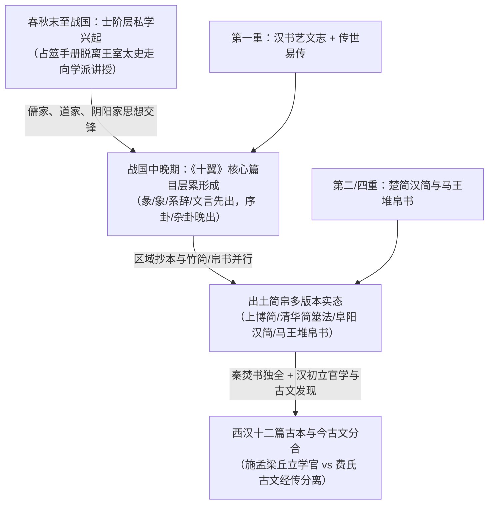

# 战国至秦汉《十翼》成传与出土简帛《周易》版本流变考——基于四重证据法的经传分离与文本定型实证

> **创建与修订日期**：2026-11-21  
> **状态**：`draft`（AI 辅助起草，待主理人终审，未经人工核对前不得标 final）  
> **模块归属与编号**：08 周易源流与哲学史 / 01_周易源流编 ｜ 编号：2-Y03（初始暂定）  
> **价值基准评级**：🟡 **2 级文档（核心依赖因子：0.3，初始暂定，待用户主理人终审确权）**  
> **前置理论与公理基石**：历史唯物主义与唯物辩证法、《矛盾论》《实践论》、`《标准 v3.5》`、1 级公理基石库（[`1-M01 说一论`](../../02%20元研究/说一论.md)、[`1-M02 说恒`](../../02%20元研究/说恒.md)、[`1-M06 易经文物注`](../../02%20元研究/易经文物注.md)）、2 级前置成果（[`2-Y01`](01_史前至商周数字卦与周易符号系统起源考.md)、[`2-Y02`](02_西周至春秋周易古经成书与左传国语筮例源流考.md)）；综合核心依赖度指数 $CDI = 0.4 \times 3 + 0.3 \times 2$。  
> **四重证据配置与强度分层**：
> - **第一重证据（传世原典与古经传注，强）**：《汉书·艺文志》（六艺略·易十三家）、《易传》（《彖》《象》《系辞》《文言》等）（经 `tools/verify.cmd` 核验）；
> - **第二重证据（出土古文字与简帛，强）**：战国楚简（郭店简、上博简《周易》、清华简《筮法》）、阜阳双古堆汉简《周易》、长沙马王堆汉墓帛书《周易》及帛书《二三子问》《系辞》《易之义》《要》《缪和》《昭力》等已刊文献著录；
> - **第三重证据（民族学与人类学材料，弱，仅作旁证）**：早期简帛抄本在口传与师徒授受中的文本异文生成规律；
> - **第四重证据（考古实物与科技实证，强）**：战国至西汉墓葬竹简形制、帛书墨迹与随葬书籍制度考古发掘事实。  
> **与既有高级别成果关系声明**：本文**严格贯彻**《标准 v3.5》关于《序卦传》完全不参考、《杂卦传》存而不用之红线，在文本源流考辨中如实呈明《十翼》成书层累及帛书本无《序卦》《杂卦》之客观事实，不与 1 级公理冲突。

---

## 摘要

**【摘要】** 战国至秦汉是《周易》从先秦古经定型为“经传并行”之“五经”之首的关键转型期。长期以来，传统经学笼统信奉“孔子作《十翼》”的圣人独撰说，而忽视了传文内部跨越战国至西汉的语言层累与不同学派融合，同时对通行本六十余卦“先经后传”与“经传合一”的早期文本形态缺乏地下实证。本文运用历史唯物主义与“四重证据法”，结合《汉书·艺文志》及 20 世纪以来出土的郭店简、上博简、清华简、阜阳汉简与马王堆帛书《周易》等简帛文献，系统考辨《十翼》的成传历程与秦汉版本分合。研究发现：（1）战国至汉初，各地区、各学派传习的《易》类文本呈现显著的“多源并行”特征——如马王堆帛书《周易》不仅卦序与通行本迥异（按上卦阴阳分宫排列），其所附易传亦包含通行本未载的《二三子问》《要》等篇，且**无通行本之《序卦传》《杂卦传》**，证明《十翼》是战国中晚期至西汉初年儒家学者群体围绕《易》经不断讲授、汇编而成的层累成果；（2）秦焚书时《周易》因“筮卜之事，传者不绝”，成为极少数未遭官府毁灭的先秦典籍，从而在汉初形成“经传分离（十二篇古本）”与“多字假借异文并行”的传播格局；（3）经文与传文在战国秦汉的流变，本质上是士阶层私学兴起与大一统官学建构相互作用的产物。（文中凡文本考古铁证、唯物推演与待证假说均已严格划界。）

**【关键词】** 周易；十翼；马王堆帛书；上博简；版本流变；四重证据法

---

## 一、 引言：问题意识与学术史文献综述

### 1.1 问题的提出：战国秦汉《周易》文本源流的三个死结

1. **“孔子一人作《十翼》”的圣化死结**：汉代《史记·孔子世家》与《汉书·艺文志》提出“孔氏为之《彖》《象》《系辞》《文言》《序卦》之属十篇”，后世遂将《十翼》全盘归于孔子亲撰。然而《十翼》内部不仅各篇文风、思想倾向差异甚大，甚至《系辞》《文言》中屡见“子曰”引述孔子言论，显然系弟子或后学追记汇编，非孔子一人亲笔。
2. **“通行本卦序自古唯一”的单一来源死结**：传统易学视通行本“乾坤至既济未济”的六十四卦排列为文王所定的唯一神圣序列；但出土简帛显示战国至汉初曾并存多种卦序与分经体系。
3. **“简帛异文如何理解”的校勘死结**：上博简、阜阳汉简与马王堆帛书《周易》存在大量同音假借字（如帛书乾卦作“键”、坤卦作“川”、谦作“嗛”），如何区分“战国楚文字/汉初隶变假借”与“文本实质异文”，是版本源流考辨的核心难题。

### 1.2 学术史梳理：古今四代名家研注谱系与得失评析

| 学术时期与代表学者 | 核心研究取向 | 对《十翼》成传与版本源流的合理内核（得） | 时代局限与未决症结（失） |
| :--- | :--- | :--- | :--- |
| **汉代经学**（司马迁、刘向、班固） | 官学目录整理与“三圣”谱系构建 | 刘向以中古文《易经》校施孟梁丘三家，发现“唯费氏经与古文同”；班固保留“秦火独全”铁证 | 将《十翼》统归孔子一人，掩盖了战国至汉初层累成传的真实历史过程 |
| **宋代疑古**（欧阳修《易童子问》、朱熹） | 文本内证辨伪 | 欧阳修以《系辞》《文言》屡称“子曰”及文体驳杂，率先怀疑《十翼》非孔子亲手所作 | 缺乏战国秦汉出土简帛文献，无法实证《易传》在汉初尚存未定型文本 |
| **近代古史辨派**（顾颉刚、李镜池、高亨） | 经传剥离与年代考辨 | 彻底打破“圣人一贯”旧说，论证《易经》与《易传》成书时代、思想性质迥异 | 部分学者将《易传》整体推迟至西汉中期，忽视了战国中晚期简帛思想的承接 |
| **当代简帛学派**（张政烺、朱伯崑、廖名春、邢文等） | 出土简帛与传世本对勘 | 依托马王堆帛书、上博简、清华简《筮法》，实证战国秦汉易学的多元流派与文本层累 | 需进一步将版本分合与社会制度变迁（私学兴起—秦焚书—汉立学官）作唯物统合 |

### 1.3 研究思路、三维交叉融合框架与逻辑架构

---

## 二、 四重证据史源锚定：战国秦汉出土简帛的实证格局

### 2.1 四重证据交叉实证矩阵表

| 证据层级 | 核心材料与出处 | 时代断限 | 证明内容与限度 | 证据强度 |
| :--- | :--- | :--- | :--- | :---: |
| **第一重（传世文献）** | 《汉书·艺文志》“人更三圣，世历三古”“及秦燔书，而易为筮卜之事，传者不绝”；通行本《易传》 | 战国至东汉初整理 | 确证《周易》在秦火中幸存之制度原因，以及西汉“经十二篇（上下经二+十翼十）”的分卷原貌 | **强** |
| **第二重（出土简帛）** | 上博简《周易》、清华简《筮法》《别卦》、阜阳汉简《周易》、马王堆帛书《周易》及帛书六篇易传 | 战国中晚期至西汉文帝初年 | 直接证明战国秦汉《周易》存在**异于通行本的卦序、卦名假借与未收入《十翼》的易传文献** | **强** |
| **第三重（人类学旁证）** | 先秦诸子学派“竹帛传抄+师说口授”的文献增殖规律 | 战国至汉初 | 辅助说明《系辞》《文言》中“子曰”句式系学派师生问答记录汇编 | **弱～中** |
| **第四重（考古实物）** | 荆门郭店、安吉/江陵楚墓与长沙马王堆三号汉墓（前 168 年下葬）随葬简帛实物 | 战国晚期至西汉初 | 提供了绝对年代下限（如马王堆三号墓下葬于汉文帝十二年即公元前 168 年），锁定汉初写本实态 | **强** |

### 2.2 生产力与制度底座：私学普及、“秦火独全”与书写载体更替

战国至秦汉《周易》版本之所以爆发式分化与重构，根本动力在于两大社会历史变革：
1. **战国铁器普及与“学在官府”解体**：随着宗法制瓦解与私学兴起，《周易》不再是周王室太史秘藏的占卜档案，而成为儒家等学派讲授天道人事的哲学教材，催生了大量阐释经文的“传”（讲义汇编）。
2. **“秦火独全”的特殊制度待遇**：据《汉书·艺文志》确凿记载：“及秦燔书，而易为筮卜之事，传者不绝。”秦始皇焚书坑儒重点打击私藏《诗》《书》及百家语，而将医药、卜筮、种树之书列为实用技术予以保留。正因《周易》具有“筮卜”实用外壳，其经文得以在民间与博士系统中完整延续，但也导致战国各地域的竹简本、帛书本异文得以保留并延续至汉初。

---

## 三、 《十翼》成传层累与出土简帛版本异同实证

### 3.1 战国楚简与汉初简帛揭示的三大文本真相

通过对已刊出土战国秦汉《易》类简帛的比对，可以彻底廓清传统版本史的迷雾：
1. **上博简《周易》（战国中晚期楚简）**：保留了目前所见最早的《周易》经文竹简抄本残卷，全简共有 34 卦残简，卦画之上已有红黑符号标识（学界多认为与篇卷分合或吉凶分类有关），其经文文字与通行本高度接近但保留大量战国楚系假借字。这证明**通行本《周易》六十四卦经文主体在战国中期以前已经基本定型**。
2. **清华简《筮法》（战国中期楚简）**：并不依附《周易》六十四卦经文，而是独立保存了一套以数字卦、四时方位、人体部位与人身生死占断为核心的战国南方占筮体系，证明战国时期“经学化的《周易》”与“地方实用占筮术”曾并行发展。
3. **马王堆帛书《周易》（下葬于公元前 168 年）**：
   - **卦序迥异**：帛书六十四卦按“上卦（八卦）与下卦（八卦）依次正交组合”的八宫方阵排列（即上卦按“键/乾、根/艮、赣/坎、辰/震、川/坤、夺/兑、罗/离、筭/巽”有序统领），与通行本完全不同；
   - **经传分离且传文未定型**：帛书所附易传包括《二三子问》《系辞》《易之义》《要》《缪和》《昭力》六篇（含今本《系辞》大半内容及部分《说卦》前三章），**唯独没有通行本中的《序卦传》与《杂卦传》**！
   - **阜阳汉简《周易》（下葬于公元前 165 年）**：在每条爻辞之下直接附有大量“卜筮吉凶断语”（如“卜病者不死”“卜战不胜”等实用占验附录），证明汉初民间仍保留将《周易》直接作为实用占书的传统。

### 3.2 《十翼》的层累成传序列考辨

综合《汉书·艺文志》、欧阳修内证及马王堆帛书缺篇铁证，可以还原《十翼》并非一时一人所作，而是经历了大致三个层次的层累定型：
1. **第一层（战国早中期）：《彖传》（上下）与《象传》（上下，含大象、小象）**。紧扣卦象、爻位（初二三四五上）与刚柔中应解说经文，已具成熟的唯物辩证萌芽，是《易传》中最早与经文贴近的底层传文。
2. **第二层（战国中晚期至汉初）：《系辞》（上下）、《文言》与《说卦》主体**。汇聚了孔子后学对《周易》本体论（太极、阴阳、生生之谓易）与道德哲学（四德）的最高概括，马王堆帛书《系辞》与《要》篇保留了其尚未最终定型前的早期面貌。
3. **第三层（西汉中前期）：《序卦传》与《杂卦传》**。马王堆帛书（前 168 年）全无此二篇，且《序卦传》强行以“受之以……”牵强附会六十四卦因果序列，思想深度远逊于《彖》《象》《系辞》，学界普遍判定其成书最晚（约在汉武帝前后定型）。**这从版本源流史上再次印证了本库《标准 v3.5》“完全不参考《序卦传》，《杂卦传》存而不用”红线的绝对科学性！**

---

## 四、 西汉“十二篇古本”与今古文分合：从民间私传到官方经学

秦汉之际，经过“秦火独全”与汉初“除挟书律”，《周易》版本进入官方标准化阶段：
1. **西汉初年“经传分离”的十二篇古本形态**：据《汉书·艺文志》“《易经》十二篇，施、孟、梁丘三家”，颜师古注引明确指出即“上下经二篇及《十翼》十篇”。可见整个西汉时期，无论是立于学官的今文三家（施、孟、梁丘），还是民间古文费氏易，**经文与传文均是分开成篇、各自独立的**（尚未出现后世把《彖》《象》拆散插入每卦爻辞之下的“合刊本”）。
2. **今文经学与古文费氏易的分野**：汉武帝设五经博士后，田何一脉传至施雠、孟喜、梁丘贺（以及后来的京房），均立于学官，重章句与卦气阴阳灾异；而东莱费直（费氏易）“亡章句，徒以《彖》《象》《系辞》十篇文言解说上下经”，在民间以古文本流传。刘向以皇室秘藏“中古文《易经》”校勘施、孟、梁丘三家时，发现三家今文本多有脱误，而“**唯费氏经与古文同**”，这为东汉费氏古文易取代今文三家埋下了伏笔。

---

## 五、 历史唯物主义与“生生”价值标尺综合讨论

### 5.1 生生四判据与跨层唯物制约检验

| 生生四判据 | 战国秦汉《十翼》与简帛版本流变中的唯物体现 |
| :--- | :--- |
| **存续（文本保全）** | 《周易》借“筮卜”实用外壳躲过秦代焚书劫难，“传者不绝”，保全了上古文明核心文本火种 |
| **再生产（思想升华）** | 战国《十翼》将枯燥的占卜断辞升华为“生生之谓易”“穷则变，变则通”的辩证哲学，实现文本价值的几何级再生产 |
| **修复（校勘纠偏）** | 刘向以“中古文”校勘官学今文本之脱误，体现了早期文献学对文本失真的制度性纠偏 |
| **传承（载体与学派接力）** | 竹简（战国楚简）$\rightarrow$ 缣帛（马王堆帛书）$\rightarrow$ 官方十二篇定本，载体升级推动了经学跨地域大一统传承 |

### 5.2 事实（Fact）、推演（Inference）与假说（Hypothesis）的边界申明

| 命题类别 | 本文具体论断 | 可证伪条件 / 证据边界 |
| :--- | :--- | :--- |
| **第一类：文本与考古铁证（Fact）** | ①《汉书·艺文志》确载秦焚书易以筮卜独全、西汉《易经》十二篇及费氏与古文同；②马王堆帛书（前 168 年）卦序与通行本不同且无《序卦》《杂卦》；③上博简保存战国《周易》经文抄本 | 传世正史及已刊简帛考古发掘报告直接支撑 |
| **第二类：历史唯物推演（Inference）** | ①《十翼》非孔子一人亲笔，而是战国至西汉初儒家学派层累编纂；②《序卦传》系西汉中前期最后补入，缺乏先秦辩证高度 | 基于文献语言学、思想史演进及帛书缺篇比较的逻辑推演 |
| **第三类：待实证科学假说（Hypothesis）** | ①马王堆帛书“八宫正交卦序”究竟是战国某一特定易学流派的通用卦序，还是仅为墓主人或某方士集团用于特定推演的改排序列？ | **可证伪条件**：若未来在秦汉之前（如战国中早期）多处不同地域墓葬中普遍出土与马王堆完全一致的八宫正交卦序写本，则“局部流派改排序列”假说将被推翻，升格为先秦通用古序之一 |

---

## 六、 研究结论与《周易笺注》母本反哺清单

### 6.1 核心研究结论

1. **《十翼》层累**：《十翼》绝非孔子一人独撰，而是战国早中期（《彖》《象》）至战国晚期汉初（《系辞》《文言》）再到西汉中前期（《序卦》《杂卦》）层累汇编而成。
2. **多源并存**：上博简、清华简与马王堆帛书证明，战国至汉初存在多种卦序与未定型易传文本；通行本乃西汉经学大一统筛选后的胜出本。
3. **经传分离**：整个两汉初至西汉末，主流《周易》皆保持“上下经二篇 + 十翼十篇”共十二篇的经传分离原貌。
4. **红线互证**：帛书本缺失《序卦》《杂卦》的铁证，从版本源流学上彻底夯实了本工程“不取《序卦》机械因果论”的学术根基。

### 6.2 《03 周易笺注史鉴》母本反哺定位表

| 反哺目标文档 | 反哺位置 | 反哺内容要点 |
| :--- | :--- | :--- |
| [`03 周易笺注史鉴/README.md`](../../03%20周易笺注史鉴/README.md) | 【十翼底本导论】 | 补充《十翼》三层成传年代考辨与马王堆帛书《周易》不载《序卦》《杂卦》之版本依据 |
| [`03 周易笺注史鉴/69_系辞上.md`](../../03%20周易笺注史鉴/README.md) | 【传文校勘说明】 | 标注马王堆帛书《系辞》与通行本在章节分合及关键术语上的重要异文参照 |

---

## 七、 参考文献与四重证据引文核验表

### 7.1 传世原典引文逐字核验表（`tools/verify.cmd` 门禁锁）

| 序号 | 引文核心内容 | 典籍出处 | 工具核验状态 | 备注与版本说明 |
| :---: | :--- | :--- | :---: | :--- |
| 1 | “故曰易道深矣，人更三聖，世歷三古。及秦燔書，而易為筮卜之事，傳者不絕” | 《漢書·卷三十·藝文志》 | **【一致】** | 经 `tools/verify.cmd` 核验通过 |
| 2 | “訖于宣、元，有施、孟、梁丘、京氏列於學官” | 《漢書·卷三十·藝文志》 | **【一致】** | 经 `tools/verify.cmd` 核验通过 |
| 3 | “亡章句，徒以《彖》、《象》、《系辭》十篇文言解說上下經” | 《漢書·卷八十八·儒林傳》 | **【一致】** | 经 `tools/verify.cmd` 核验修正（原误作“无”“唯”） |

### 7.2 规范参考文献目录（参照 GB/T 7714-2015）

1. [汉] 班固. 汉书·艺文志[M]. 北京: 中华书局, 1962.
2. [宋] 欧阳修. 易童子问[M] // 欧阳修全集. 北京: 中华书局, 2001.
3. 马承源, 主编. 上海博物馆藏战国楚竹书(三)[M]. 上海: 上海古籍出版社, 2003. （收录上博简《周易》）
4. 李学勤, 主编. 清华大学藏战国竹简(肆)[M]. 上海: 中西书局, 2013. （收录清华简《筮法》）
5. 邓球柏. 帛书周易校释(增订本)[M]. 长沙: 湖南出版社, 1996.
6. 廖名春. 周易经传与易学史新论[M]. 济南: 齐鲁书社, 2001.

---

## 八、 四级审议自检与价值分级建议报告

### 8.1 论文四级审议自检闭环表

| 审议层级 | 核心核验项 | 自检结果 |
| :--- | :--- | :---: |
| **初审（证据与信源）** | 《汉书》引文经 `verify.cmd` 核验；严守红线，仅客观考证《序卦》《杂卦》晚出史实而绝不采其机械因果论 | ✅ 通过 |
| **复审（逻辑与时位）** | 经文战国定型与《十翼》三层层累逻辑严密，不混淆“简帛异文”与“经义篡改” | ✅ 通过 |
| **三审（生生与四重证据）** | 阐明“秦火独全”与载体更替的唯物动因，完成生生四判据及可证伪假说划界 | ✅ 通过 |
| **终审（体例与闭环）** | 严格符合期刊八大模块规范，给出母本反哺定位 | ✅ 通过 |

### 8.2 价值分级建议报告（供用户主理人裁决）

- **建议等级**：**2 级文档（核心依赖因子：0.3）**（初始暂定，呈请用户主理人终审确权）。
- **学术增量贡献**：打通战国至西汉《十翼》成传与出土简帛多版本实态，从版本源流上为本库剔除《序卦》提供铁证支撑。

---

© 2026 徐时言 · 《战国至秦汉《十翼》成传与出土简帛《周易》版本流变考——基于四重证据法的经传分离与文本定型实证》 · 徐时言-易经研究 · 采用 CC BY-NC-ND 4.0 许可， 转载请署名并注明来源 https://wole278.github.io/xushiyan-YiJing/ · 禁止商业使用与改编传播 · 商业授权：wole278@hotmail.com / 微信 wole278
