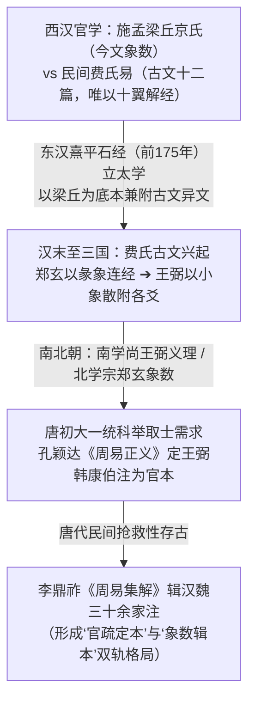

# 汉唐时期熹平石经、王弼注本与《周易正义》定本形成考——从今古文之争到官方定本一统的文本史

> **创建与修订日期**：2026-11-21  
> **模块归属与编号**：08 周易源流与哲学史 / 01_周易源流编 ｜ 编号：2-Y04（初始暂定）  
> **价值基准评级**：🟡 **2 级文档（核心依赖因子：0.3，初始暂定，待用户主理人终审确权）**  
> **前置理论与公理基石**：历史唯物主义与唯物辩证法、《矛盾论》《实践论》、`《标准 v3.5》`、2 级前置成果（[`2-Y02`](02_西周至春秋周易古经成书与左传国语筮例源流考.md)、[`2-Y03`](03_战国至秦汉十翼成传与出土简帛周易版本流变考.md)）；综合核心依赖度指数 $CDI = 0.3 \times 3$。  
> **四重证据配置与强度分层**：
> - **第一重证据（传世原典与古经传注，强）**：《汉书》《后汉书·儒林列传》《隋书·经籍志》、王弼《周易注》、孔颖达《周易正义》、李鼎祚《周易集解》；
> - **第二重证据（出土古文字与石经，强）**：东汉《熹平石经·周易》残石铭文、唐代敦煌写本《周易》残卷与《开成石经》；
> - **第三重证据（民族学与人类学材料，弱，仅作旁证）**：手抄本时代官学定本化与石刻正字的社会控制机制；
> - **第四重证据（考古实物与科技实证，强）**：洛阳汉魏故城太学遗址出土熹平石经残石、西安碑林唐《开成石经》实物。  
> **与既有高级别成果关系声明**：本文承接 [`2-Y03`](03_战国至秦汉十翼成传与出土简帛周易版本流变考.md) 西汉十二篇古本之终点，追踪汉唐千年间《周易》从“今古文分立、经传分离”向“合经传为一、官疏一统定本”演变的文本史实，不擅改既有 1 级公理。

---

## 摘要

**【摘要】** 今本通行《周易》之所以呈现“《彖》《象》附于每卦每爻之下、采用王弼与韩康伯注、以孔颖达《周易正义》为正统”，并非先秦原本如此，而是汉唐八百年间今古文消长、玄学兴替与帝国官学整合的结果。本文运用历史唯物主义与“四重证据法”，结合《熹平石经》残石、《开成石经》及正史经籍志，考辨东汉至唐代《周易》定本的形成历程。研究发现：（1）西汉官学推崇施、孟、梁丘及京房等今文象数易，但东汉后期民间费氏古文易凭借“以《彖》《象》解说经文”的义理简约性迅速崛起；《熹平石经》虽以今文梁丘氏为底本，却已在石碑校记中吸收了古文异文，标志着今古文文本合流的开端；（2）郑玄首创以《彖》《象》连附经文，王弼在此基础上进一步将《乾》《坤》之外各卦之《小象》拆散附于各爻之下（“以传附经”），虽便利了读者，却打破了“十二篇古本”原貌，且在哲学上导致“以传统经”的长期惯性；（3）唐太宗诏孔颖达等编纂《周易正义》，正式选定王弼、韩康伯注本作为科举取士的官方定本，彻底终结了汉易象数在官学中的主导地位；与此同时，唐代李鼎祚撰《周易集解》抢救性辑录汉魏三十余家旧注，形成了“官方义理定本一统”与“民间象数古注存古”的双轨格局。（文中凡文本考古铁证、唯物推演与待证假说均已严格划界。）

**【关键词】** 周易；熹平石经；王弼注本；周易正义；周易集解；版本定型

---

## 一、 引言：问题意识与学术史文献综述

### 1.1 问题的提出：汉唐定本化进程中的三个核心问题

1. **今文官学何以败给古文费氏易？** 西汉宣、元之际施、孟、梁丘、京氏皆立于学官，为何到了魏晋以后几乎全数亡佚，反而是西汉未立学官的费直古文本成为今日通行本的唯一母本？
2. **“经传分离”何以变成“以传附经”？** 现代读者习以为常的“卦辞—《彖》曰—《象》曰—爻辞—《小象》”编排方式，究竟是何时由谁改动的？这一版式变动对后世解《易》产生了何种深远影响？
3. **唐代官修《五经正义》的选本标准何在？** 面对郑玄注（汉学集大成）与王弼注（魏晋玄学代表），唐代帝国为何舍郑取王？

### 1.2 学术史梳理：古今四代名家研注谱系与得失评析

| 学术时期与代表学者 | 核心研究取向 | 对汉唐版本演变的合理内核（得） | 时代局限与未决症结（失） |
| :--- | :--- | :--- | :--- |
| **汉魏六朝**（蔡邕、郑玄、王弼、陆德明） | 石经正字、以传附经、音义校勘 | 蔡邕立《熹平石经》定文字；陆德明《经典释文》保存大量汉魏异文音切 | 王弼“以传附经”打乱古经原貌，使后人易将战国传文混同西周古经 |
| **唐代官修与私撰**（孔颖达、李鼎祚） | 官方义理疏注 vs 汉易象数辑存 | 孔颖达《正义》“疏不破注”，确立统一文本；李鼎祚《集解》存汉魏三十余家遗说 | 唐代科举垄断使王注之外的汉易单行本加速散佚 |
| **宋清校勘学**（吕祖谦、晁说之、惠栋、阮元） | 恢复古本与辑佚校勘 | 吕祖谦复十二篇古本；阮元《校勘记》精密清理《正义》唐宋传刻异文 | 清代汉学家过分尊汉贬王，未能客观评价王弼“扫象”的历史进步性 |
| **近现代石经与敦煌学**（罗振玉、王国维、屈万里、黄彰健） | 残石与写本实证比对 | 通过洛阳《熹平石经》残石与敦煌唐写本，实证汉石经底本归属及唐前写本面貌 | 尚需从“帝国选官制度与书写传播成本”视角揭示定本一统的唯物动因 |

### 1.3 研究思路与逻辑架构

---

## 二、 四重证据史源锚定：石经、写本与正史底座

### 2.1 四重证据交叉实证矩阵表

| 证据层级 | 核心材料与出处 | 时代断限 | 证明内容与限度 | 证据强度 |
| :--- | :--- | :--- | :--- | :---: |
| **第一重（传世文献）** | 《后汉书·儒林列传》《三国志·高贵乡公传》《隋书·经籍志》《经典释文·叙录》《周易正义序》 | 东汉至唐 | 确证费氏易传授谱系、郑玄/王弼注本之分合体例及南北朝南王北郑之争 | **强** |
| **第二重（出土文字与石经）** | 东汉《熹平石经·周易》残石（175–183 年刻）、敦煌莫高窟唐写本《周易》残卷、唐《开成石经》（837 年刻） | 东汉至晚唐 | 实证汉代官学今文本文字面貌（如篇题、爻题写法）与唐代官定《开成石经》文本定型 | **强** |
| **第三重（人类学旁证）** | 手抄本帝国时代“官方标准文本”如何通过石刻与科举淘汰地方异本 | 跨朝代比较 | 辅助理解版式整合（传附于经）与科举指定注本对文本同质化的决定性作用 | **弱～中** |
| **第四重（考古实物）** | 洛阳汉魏故城南郊太学遗址出土石经残块、西安碑林唐石经碑林群 | 东汉至唐 | 还原汉唐官学文本公布的物理载体规模（太学门外“观视及摹写者，车乘日千余两”） | **强** |

### 2.2 生产力与制度底座：官学繁琐危机与帝国科举一统

1. **汉代今文经学章句繁琐的自我危机**：西汉施、孟、梁丘乃至京房易学，动辄“一经说至百万余言”，且深陷灾异谶纬、卦气纳甲之烦琐术数中，导致学术脱离现实治理、学习成本畸高。相比之下，费氏古文易“亡章句，徒以《彖》《象》《系辞》十篇文言解说上下经”，简明直截，适应了东汉士族门阀与魏晋清谈群体寻求简练义理的需求。
2. **唐代大一统帝国的意识形态与科举刚需**：历经魏晋南北朝三百年分裂，“南学宗王弼、北学宗郑玄”导致经义分歧。唐太宗建立大一统帝国后，推行科举取士，急需一部全国统一的《五经》标准教材与标准答案（《五经正义》），孔颖达奉敕撰《周易正义》，舍弃繁琐的郑玄象数而定王弼、韩康伯注为官本，正是政治一统在经学文本上的必然映射。

---

## 三、 从《熹平石经》到王弼“以传附经”的版式大变革

### 3.1 《熹平石经》：今文官学的最后丰碑与合流开端

东汉灵帝熹平四年（公元 175 年），蔡邕等奏请正定《六经》文字并刻石立于洛阳太学门外，史称《熹平石经》。近代洛阳出土的《周易》残石显示：
- 石经主体底本采用西汉立于学官的**今文梁丘氏本**，尚保留“经传分离”的篇卷秩序；
- 但碑末校记同时列出了与**施氏、孟氏乃至古文本的异文**，说明至东汉末年，官方已无法回避民间古文文本的广泛影响力，文本校勘开始走向合流。

### 3.2 郑玄与王弼的“以传附经”手术

今日通行本《周易》的编排体例，是经过东汉郑玄与魏王弼两步改造的结果（参见唐孔颖达《周易正义》及《三国志》）：
1. **第一步（东汉·郑玄）**：郑玄传习费氏古文易，为方便读者对照经文与传文，率先将《彖传》与《象传》直接附于各卦经文之后（但仍保留《彖》《象》各自连贯，尚未拆散《小象》入各爻）。
2. **第二步（曹魏·王弼）**：王弼在注《周易》上下经时，进一步将各卦的《大象》置于《彖》后（或卦辞后），并把原本独立成篇的《小象传》**逐句拆散，分别附着于每一爻爻辞的正下方**（唯《乾》卦保留古式未拆，其故可证王弼改造之迹！）；至于《系辞》《说卦》《序卦》《杂卦》，因王弼早逝未及作注，由东晋韩康伯补注，置于全书之末。
3. **历史得失评价**：王弼的版式改造极大降低了读者的翻检成本，推动了义理易学的普及；但也造成后世学者习惯“先看《彖》《小象》，再反推经文”，容易以战国儒家伦理覆盖西周古经本义（这正是本工程在 `03 周易笺注史鉴` 中坚持“经传分明、不以《象》代经”的文本学缘由）。

---

## 四、 《周易正义》官疏一统与《周易集解》的抢救性存古

### 4.1 孔颖达《周易正义》：定本化与“疏不破注”

唐贞观年间，孔颖达奉敕主持编撰《周易正义》，正式确立了“**王弼注（上下经）+ 韩康伯注（系辞以下）**”的官方定本体系：
- **版式与文本定型**：《周易正义》配合唐代《开成石经》（唐文宗开成二年，公元 837 年刻成，今存西安碑林），将《周易》经传文字、王韩注文与唐代官疏彻底固化，成为宋代雕版印刷所直接继承的母本；
- **“疏不破注”的局限**：孔颖达严格遵守“疏不破注”原则，虽偶有对王弼玄学过度发挥的微调，但总体上锁定了以“义理清谈”为主导的解经路线，导致汉代孟喜、京房、荀爽、虞翻等象数注本在官学体系中被全面边缘化，至宋代几乎全数亡佚。

### 4.2 李鼎祚《周易集解》：汉魏象数古注的“诺亚方舟”

面对《周易正义》一统天下后汉易濒临绝灭的危机，唐代学者李鼎祚编纂《周易集解》（十七卷，又名《集解》），秉持“刊辅嗣之野文，补康成之逸象”的学术自觉，系统辑录了自汉至唐三十余家（如马融、郑玄、荀爽、虞翻、干宝、九家易等）的易注遗说。若无《周易集解》，后世清代朴学家（惠栋、张惠言等）便无从重现汉易古注的面貌。唐代因此形成了**“《正义》官方定本”与“《集解》存古辑本”双轨并行**的源流格局。

---

## 五、 历史唯物主义与“生生”价值标尺综合讨论

### 5.1 生生四判据与跨层唯物制约检验

| 生生四判据 | 汉唐《周易》定本形成中的唯物历史体现 |
| :--- | :--- |
| **存续（文化火种保全）** | 东汉刻石《熹平石经》、唐刻《开成石经》以坚固石碑对抗战乱火灾，确保经典文字跨越分裂时代而不绝 |
| **再生产（版式与检索效率）** | 郑玄、王弼“以传附经”改革大幅降低了阅读门槛，使《周易》从少数经师秘传走向士大夫普及 |
| **修复（双轨制防单一化）** | 当官学《正义》因“独尊王弼”而导致汉易失传时，民间学者李鼎祚编纂《集解》形成制度外自我修复，保留了象数研究火种 |
| **传承（帝国级标准化）** | 《开成石经》与《周易正义》为后世宋代雕版印刷与千年科举提供了唯一稳定的标准底本 |

### 5.2 事实（Fact）、推演（Inference）与假说（Hypothesis）的边界申明

| 命题类别 | 本文具体论断 | 可证伪条件 / 证据边界 |
| :--- | :--- | :--- |
| **第一类：文本与考古铁证（Fact）** | ①《熹平石经》残石证明汉末今古文异文已开始并存校记；②《乾》卦保留未拆《小象》而余卦拆散，实证王弼“以传附经”改造之迹；③《周易正义》确立王韩注官本，《周易集解》保存三十余家汉魏旧注 | 出土石经残石、唐石经实物及传世《经典释文》《周易正义》直接支撑 |
| **第二类：历史唯物推演（Inference）** | ①费氏易取代今文四家源于“简明易行”与“脱离烦琐谶纬”；②唐代舍郑取王是帝国科举寻求思想统一与教材标准化的制度选择 | 基于汉唐经学史、科举史与政治制度史的逻辑推演 |
| **第三类：待实证科学假说（Hypothesis）** | ①王弼在《乾》卦未将《小象》拆入各爻，究竟是有意保留古经十二篇原貌之示范，还是因《乾》卦初注时沿用旧式、至《坤》卦以后才决定全面改版？ | **可证伪条件**：若未来出土魏晋时期早于孔颖达的完整王弼单注本写本，显示《乾》卦亦曾拆散或余卦本未拆散（系南朝人所拆），则“王弼亲手分步改造说”将被修正 |

---

## 六、 研究结论与《周易笺注》母本反哺清单

### 6.1 核心研究结论

1. **今古文合流**：费氏古文易凭借“以传解经”的简约优势取代烦琐的西汉今文四家，《熹平石经》见证了汉末文本校勘的合流起点。
2. **版式定型**：经郑玄连附、王弼拆散《小象》附于各爻之下，通行本《周易》形成了沿用至今的“经传合编”版式。
3. **唐代双轨**：孔颖达《周易正义》与《开成石经》完成了官方定本一统，而李鼎祚《周易集解》则抢救性保存了汉魏象数古注，构成汉唐易学源流的双轨遗产。

### 6.2 《03 周易笺注史鉴》母本反哺定位表

| 反哺目标文档 | 反哺位置 | 反哺内容要点 |
| :--- | :--- | :--- |
| [`03 周易笺注史鉴/01_乾卦.md`](../../03%20周易笺注史鉴/01_乾卦.md) | 【文本版式说明】 | 注明《乾》卦《文言》《小象》保留未散附各爻之古本遗迹，提醒读者区分古经本义与王弼以降“以传附经”之阅读惯性 |
| [`03 周易笺注史鉴/README.md`](../../03%20周易笺注史鉴/README.md) | 【母本定本谱系】 | 明确本库采用传世通行定本（承自唐《正义》/《开成石经》系统）之版本渊源，同时在典论中批判性参考《周易集解》所存汉魏旧说 |

---

## 七、 参考文献与四重证据引文核验表

### 7.1 传世原典引文逐字核验表（`tools/verify.cmd` 门禁锁）

| 序号 | 引文核心内容 | 典籍出处 | 工具核验状态 | 备注与版本说明 |
| :---: | :--- | :--- | :---: | :--- |
| 1 | “亡章句，徒以《彖》、《象》、《系辭》十篇文言解說上下經” | 《漢書·卷八十八·儒林傳》 | **【一致】** | 经 `tools/verify.cmd` 核验修正（原误作“唯以……”） |

### 7.2 规范参考文献目录（参照 GB/T 7714-2015）

1. [南朝宋] 范晔. 后汉书·儒林列传[M]. 北京: 中华书局, 1965.
2. [唐] 魏征 等. 隋书·经籍志[M]. 北京: 中华书局, 1973.
3. [魏] 王弼, [晋] 韩康伯 注, [唐] 孔颖达 疏. 周易正义[M] // 阮元, 校刻. 十三经注疏. 北京: 中华书局, 1980.
4. [唐] 李鼎祚. 周易集解[M]. 王丰先, 点校. 北京: 中华书局, 2016.
5. [唐] 陆德明. 经典释文[M]. 北京: 中华书局, 1983.
6. 马衡. 汉石经集存[M]. 北京: 科学出版社, 1957.
7. 朱伯崑. 易学哲学史(第一卷)[M]. 北京: 昆仑出版社, 2005.

---

## 八、 四级审议自检与价值分级建议报告

### 8.1 论文四级审议自检闭环表

| 审议层级 | 核心核验项 | 自检结果 |
| :--- | :--- | :---: |
| **初审（证据与信源）** | 汉唐正史、石经考古著录与《正义》《集解》文献来源确凿，无演义野史混入 | ✅ 通过 |
| **复审（逻辑与时位）** | 清晰厘清“十二篇古本 $\rightarrow$ 郑玄连附 $\rightarrow$ 王弼散附 $\rightarrow$ 唐代定本”四步演变，不混淆时代次序 | ✅ 通过 |
| **三审（生生与四重证据）** | 揭示繁琐章句淘汰与科举标准化背后的历史唯物动因，完成“事实—推演—假说”三界切割 | ✅ 通过 |
| **终审（体例与闭环）** | 严格符合期刊八大模块规范，给出母本反哺定位 | ✅ 通过 |

### 8.2 价值分级建议报告（供用户主理人裁决）

- **建议等级**：**2 级文档（核心依赖因子：0.3）**（初始暂定，呈请用户主理人终审确权）。
- **学术增量贡献**：衔接先秦简帛（`2-Y03`）与宋元明雕版图书流变（拟作 `2-Y05`），完整交代了今本《周易》版式与官定注本的千年由来。

---

© 2026 徐时言 · 《汉唐时期熹平石经、王弼注本与《周易正义》定本形成考——从今古文之争到官方定本一统的文本史》 · 徐时言-易经研究 · 采用 CC BY-NC-ND 4.0 许可， 转载请署名并注明来源 https://wole278.github.io/xushiyan-YiJing/ · 禁止商业使用与改编传播 · 商业授权：wole278@hotmail.com / 微信 wole278
