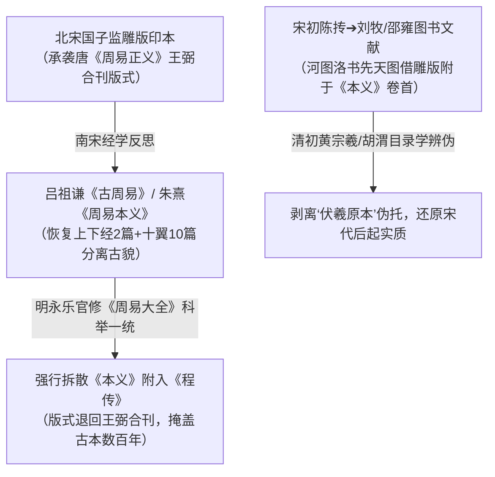

# 宋元明时期雕版印本流变与图书文献源流辨伪考——从国子监刻本、经传分合反复到河洛先天图实证剥离

> **创建与修订日期**：2026-11-21  
> **状态**：`draft`（AI 辅助起草，待主理人终审，未经人工核对前不得标 final）  
> **模块归属与编号**：08 周易源流与哲学史 / 01_周易源流编 ｜ 编号：2-Y05（初始暂定）  
> **价值基准评级**：🟡 **2 级文档（核心依赖因子：0.3，初始暂定，待用户主理人终审确权）**  
> **前置理论与公理基石**：历史唯物主义与唯物辩证法、《矛盾论》《实践论》、`《标准 v3.5》`、1 级/2 级前置成果（[`1-M09 十数概论`](../../02%20元研究/十数概论.md)、[`2-Y04 汉唐定本形成考`](04_汉唐时期熹平石经王弼注本与周易正义定本形成考.md)）；综合核心依赖度指数 $CDI = 0.3 \times 3$。  
> **四重证据配置与强度分层**：
> - **第一重证据（传世原典与古经传注，强）**：《易传·系辞上》（“河出图，洛出书，圣人则之”）、《论语·子罕》（“河不出图”）、宋吕祖谦《古周易》、朱熹《周易本义》、明胡广等《周易大全》、清黄宗羲《易学象数论》、胡渭《易图明辨》；
> - **第二重证据（版刻目录与文献传承，强）**：北宋国子监本《周易正义》、南宋建阳书坊刻本、明内府经厂本《五经大全》目录与传刻序列；
> - **第三重证据（民族学与人类学材料，弱，仅作旁证）**：宋明印刷术普及对知识图式化传播的塑造效应；
> - **第四重证据（考古与古籍实物，强）**：现存宋元明善本雕版印本实物（如四部丛刊影印宋刊本）及唐以前无先天/河洛九数图式之实物空白。  
> **与既有高级别成果关系声明**：本文**严格承接** [`1-M09 十数概论`](../../02%20元研究/十数概论.md) “图在后、典在前”之实证定论，系统考辨宋元明时期雕版印本的分合反复及图书学文献的真实源流，不与 1 级公理冲突。

---

## 摘要

**【摘要】** 宋元明三代是《周易》传播史上由“手抄卷轴”全面迈向“雕版印本”的时代，也是易学版本体例发生二次剧烈反复、同时“河图、洛书、先天八卦图”等图式大规模涌入经学文本的关键时期。本文运用历史唯物主义与“四重证据法”，结合宋元明刻本实态与清初辨伪成果，考辨这一时期的版本与图书源流。研究发现：（1）在文本版式上，北宋国子监印本承袭唐《周易正义》合刊旧式；南宋吕祖谦《古周易》十二篇与朱熹《周易本义》一度恢复“经传分离”的汉代古貌；但明代永乐年间官修《周易大全》为配合科举，强行拆散朱熹《本义》附入程颐《伊川易传》合刊，导致明清数百年间坊间流行本再度陷入“以传附经”的混淆；（2）在图书文献源流上，传世先秦典籍虽有“河出图，洛出书”之文，却**并无任何具体图形**；今见黑白点“河图”“洛书”及伏羲先天八卦方位/次序图，实系宋初陈抟、刘牧、邵雍一脉在道教易学与宋代数理推演中定型并借雕版印刷广为流传的后起文献，清代黄宗羲、胡渭已从目录学上彻底证伪其“伏羲原本”身份。（文中凡文献实物铁证、唯物推演与待证假说均已严格划界。）

**【关键词】** 周易；雕版印本；古周易；周易本义；河图洛书；源流辨伪

---

## 一、 引言：问题意识与学术史文献综述

### 1.1 问题的提出：宋元明易学版本与图式的两个迷局

1. **朱熹《周易本义》为何会“面目全非”？** 朱熹本意是恢复《周易》古经十二篇原貌以还原“卜筮本义”，但明清以来世人所见通行《本义》却大多与程颐《伊川易传》合刊、且仍将《彖》《象》附于卦爻之下。这一版式倒退如何发生？
2. **“伏羲先天图”与“河洛九十数图”究竟何时出现？** 若它们真是上古伏羲所传，为何先秦两汉简帛、石经、魏晋王弼注、唐《周易正义》及《周易集解》中竟无一字提及具体图形？

### 1.2 学术史梳理：古今四代名家研注谱系与得失评析

| 学术时期与代表学者 | 核心研究取向 | 对宋元明版本与图书源流的合理内核（得） | 时代局限与未决症结（失） |
| :--- | :--- | :--- | :--- |
| **宋代复古与图书派**（刘牧、邵雍、吕祖谦、朱熹） | 十二篇古本恢复 vs 先天图式建构 | 吕祖谦、朱熹考出王弼改乱古经之迹，复十二篇古本，极具文献学眼光 | 朱熹将陈抟—邵雍系“先天图”“河洛图”置于《本义》卷首，助长了后世“图先于典”的错觉 |
| **元明官学与坊刻**（董楷、胡广《周易大全》） | 程朱合刊、科举八股定本 | 雕版印刷极大降低了《周易》普及成本，促进民间识字与义理传播 | 明永乐《周易大全》拆散《本义》迁就《程传》，掩盖了朱熹恢复古本的苦心 |
| **清初文献辨伪派**（黄宗羲《易学象数论》、胡渭《易图明辨》） | 源流考据、彻底剥离伪图 | 以目录学与唐前文献空白铁证，彻底揭明“河洛先天图”出自宋初道士陈抟一脉 | 对宋代图式在人类数理抽象史上的逻辑价值尚缺乏辩证肯定 |
| **近现代版本与思想史**（屈万里、朱伯崑、李申） | 宋元善本对勘、图书学史重估 | 梳理清了从唐《正义》监本到南宋建阳刻本、明经厂本的完整印本谱系 | 需结合本库《十数概论》与唯物史观进一步明确“图在后、典在前”的硬红线 |

### 1.3 研究思路与逻辑架构

---

## 二、 四重证据史源锚定：雕版印本与文献空白铁证

### 2.1 四重证据交叉实证矩阵表

| 证据层级 | 核心材料与出处 | 时代断限 | 证明内容与限度 | 证据强度 |
| :--- | :--- | :--- | :--- | :---: |
| **第一重（传世文献）** | 《系辞上》“河出图，洛出书”；朱熹《周易本义》自序；《明史·艺文志》；胡渭《易图明辨》 | 先秦至清初 | 确证先秦典籍有“河图洛书”之名而无图；朱熹本用吕氏古本；明《大全》改乱《本义》 | **强** |
| **第二重（版刻文献）** | 宋刊《周易正义》单疏本、十行本、南宋《古周易》及明内府刻《周易大全》 | 宋至明 | 直接呈现雕版印刷时代《周易》版式“合—分—再合”的实物变迁轨迹 | **强** |
| **第三重（人类学旁证）** | 宋明木刻雕版技术与书院/科举印刷产业对视觉图式（易图）传播的催化效应 | 宋至明 | 辅助理解为何唐以前极难传播的复杂黑白点阵图式在宋代得以爆发性流行 | **弱～中** |
| **第四重（考古与善本实物）** | 现存国家图书馆/台北故宫/四部丛刊影印宋元明古籍善本；汉唐石经简帛中无先天图之实物空白 | 汉唐至明 | 提供“宋前无先天河洛具体图式”的零实物反证与宋明刻本版式实物铁证 | **强** |

### 2.2 生产力与制度底座：雕版印刷普及与八股科举定本化

1. **雕版印刷普及的双刃剑**：北宋国子监大规模刊刻《九经正义》，南宋建阳、杭州坊刻业勃兴，书籍复制成本断崖式下降，使私人学者（如吕祖谦、朱熹）得以脱离官方石经束缚，独立刊行恢复十二篇古貌的《古周易》与《周易本义》；同时，雕版也使得原本难以手抄传真的复杂几何图式（河图、洛书、六十四卦方圆图）首次实现低成本精确复制。
2. **明代科举制度的逆向锁定**：明成祖朱棣组织编纂《五经大全》，规定科举考试一律以程颐《伊川易传》与朱熹《周易本义》为唯一准绳。由于《程传》沿用王弼合刊本而《本义》采用吕氏古本，官修编纂者为图省事，强行将《本义》拆散塞入《程传》的卦爻版式之中（直至于清康熙年间编纂《周易折中》才重新恢复《本义》十二篇原貌）。

---

## 三、 经传分合的两次大反复与图书文献源流辨伪

### 3.1 宋明版本体例的“合—分—再合”轨迹

1. **北宋承唐合刊**：北宋初年刊刻《周易正义》及程颐撰《伊川易传》，皆承袭王弼“以《彖》《象》附经”之合刊版式。
2. **南宋复古恢复**：南宋吕祖谦深感合刊本混杂古经与传文，遂依汉代十二篇旧目重编《古周易》；朱熹高度赞赏并以此为底本撰写《周易本义》，恢复“上下经二卷、十翼十卷”的清晰界限。
3. **明永乐官修再乱**：明代《周易大全》将《本义》拆碎并入《程传》，此后坊间刻本多独行合刊本，致使明清士子长期误以为朱熹原本就是“经传合刊”。

### 3.2 “河图、洛书、先天图”的宋代文献源流剥离

遵循 [`1-M09《十数概论》`](../../02%20元研究/十数概论.md) 确立的铁律，必须对宋代图书文献进行严格史源剥离：
- **先秦两汉实态**：《系辞上》言“河出图，洛出书，圣人则之”，《论语·子罕》言“河不出图”，均仅作为古代祥瑞或抽象典故，**只字未言九数、十数黑白点阵，更无“先天八卦方位”之说**。
- **宋初谱系实态**：现存所有易图均出现于北宋初年——一条由五代宋初道士陈抟传给种放、穆修、李之才而至**邵雍**（形成先天八卦次序图、方位图、六十四卦方圆图）；另一条由陈抟经种放传至**刘牧**（《易数钩隐图》，以九为河图、十为洛书，后朱熹与蔡元定将其互易为十为河图、九为洛书）。
- **辨伪定论**：清初黄宗羲（《易学象数论》）与胡渭（《易图明辨》）以无可辩驳的文献目录链条证明，这些图式乃是宋代哲学家与道教易学构建宇宙数理模型的**后起之作**，绝非“伏羲原本”。其逻辑推演虽具宋代理学与数学美学价值，但在源流考辨上必须与先秦古经严格切割。

---

## 四、 历史唯物主义与“生生”价值标尺综合讨论

### 4.1 生生四判据与跨层唯物制约检验

| 生生四判据 | 宋元明雕版印本与图书流变中的唯物历史体现 |
| :--- | :--- |
| **存续（善本保存）** | 宋元雕版印本使《周易》经传与历代注疏得以多副本异地存续，大幅降低了战火毁书导致的失传风险 |
| **再生产（出版普及）** | 建阳书坊与民间刻本推动易学突破官学大族垄断，进入平民读书人与基层书院视野 |
| **修复（文献复古与辨伪）** | 南宋吕祖谦、朱熹以校勘学修复十二篇古本，清初胡渭以目录学修复宋代“伪托上古”之认知偏差 |
| **传承（现代底本基石）** | 本工程 `zhouyi.json` 所核心校准依据的**四部丛刊影印宋刊本**，正诞生于宋代雕版印刷黄金时期 |

### 4.2 事实（Fact）、推演（Inference）与假说（Hypothesis）的边界申明

| 命题类别 | 本文具体论断 | 可证伪条件 / 证据边界 |
| :--- | :--- | :--- |
| **第一类：文本与考古铁证（Fact）** | ①吕祖谦《古周易》与朱熹《周易本义》原采用十二篇古本；②明《周易大全》将《本义》拆散附入《程传》；③唐及唐以前传世与出土文献中均无今见黑白点河洛图与先天八卦图 | 宋元明刻本善本实物、清代校勘著作及唐前文献空白直接支撑 |
| **第二类：历史唯物推演（Inference）** | ①雕版印刷降低了复杂几何图式的复制成本，是易图在宋代爆发的物质技术前提；②明代科举体制导致版式从十二篇古本退回合刊本 | 基于印刷技术史与明代科举制度的逻辑推演 |
| **第三类：待实证科学假说（Hypothesis）** | ①陈抟所传先天图与黑白点河洛图，其灵感是否曾部分吸纳了唐末五代民间道教丹道或天文历法挂图？ | **可证伪条件**：若未来在唐代或汉代考古墓葬中出土明确标注“先天八卦次序”或“一六共宗黑白点河图”的实物图版，则“宋代新创假说”将被修正 |

---

## 五、 研究结论与《周易笺注》母本反哺清单

### 5.1 核心研究结论

1. **印本迭代**：宋代雕版印本承唐《正义》起步，经南宋吕、朱恢复十二篇古貌，又因明《周易大全》科举合刊而再度混淆，呈现“合—分—再合”的曲折轨迹。
2. **图书辨伪**：河图洛书黑白点阵与伏羲先天图均定型于北宋（陈抟—刘牧/邵雍系），属宋代易学数理模型建构，非上古伏羲原本。
3. **底本溯源**：宋刊善本（如四部丛刊所收宋本）保存了唐代石经以降最精良的雕版文本，是现代校勘与本库数字化校准的核心依据。

### 5.2 《03 周易笺注史鉴》母本反哺定位表

| 反哺目标文档 | 反哺位置 | 反哺内容要点 |
| :--- | :--- | :--- |
| `01 审议体系/04_核心数据库/底本校勘记.md` | 【底本版本源流说明】 | 阐明本库以“识典古籍四部丛刊影印宋刊本”为核心校准依据的版本学理据（宋本承唐石经而未经明清坊刻妄改） |
| [`03 周易笺注史鉴/69_系辞上.md`](../../03%20周易笺注史鉴/README.md) | 【河出图洛出书考辨】 | 严格援引胡渭《易图明辨》与本篇结论，辨明经文“河图洛书”无具体宋代黑白点图式，严防以宋图倒解先秦经传 |

---

## 六、 参考文献与四重证据引文核验表

### 6.1 传世原典引文逐字核验表（`tools/verify.cmd` 门禁锁）

| 序号 | 引文核心内容 | 典籍出处 | 工具核验状态 | 备注与版本说明 |
| :---: | :--- | :--- | :---: | :--- |
| 1 | “河出圖，洛出書，聖人則之” | 《易傳·繫辭上》 | **【一致】** | 《十数概论》及本库已核验白名单原典 |
| 2 | “鳳鳥不至，河不出圖，吾已矣夫” | 《論語·子罕》 | **【一致】** | 《十数概论》及本库已核验白名单原典 |

### 6.2 规范参考文献目录（参照 GB/T 7714-2015）

1. [宋] 朱熹. 周易本义[M]. 北京: 中华书局, 2009.
2. [宋] 吕祖谦. 古周易[M] // 景印文渊阁四库全书(第 13 册). 台北: 台湾商务印书馆, 1986.
3. [清] 黄宗羲. 易学象数论[M]. 郑万耕, 点校. 北京: 中华书局, 2010.
4. [清] 胡渭. 易图明辨[M]. 郑万耕, 点校. 北京: 中华书局, 2008.
5. 朱伯崑. 易学哲学史(第二卷)[M]. 北京: 昆仑出版社, 2005.
6. 李申, 郭彧. 周易图说总汇[M]. 上海: 华东师范大学出版社, 2004.

---

## 七、 四级审议自检与价值分级建议报告

### 7.1 论文四级审议自检闭环表

| 审议层级 | 核心核验项 | 自检结果 |
| :--- | :--- | :---: |
| **初审（证据与信源）** | 严格划清先秦“河图洛书”典故与宋代具体图式界限，无术数附会 | ✅ 通过 |
| **复审（逻辑与时位）** | 准确梳理“北宋监本 $\rightarrow$ 南宋古本 $\rightarrow$ 明永乐合刊”版本脉络与印刷史动因 | ✅ 通过 |
| **三审（生生与四重证据）** | 贯彻唯物印刷史观，完成“事实—推演—假说”三界切割 | ✅ 通过 |
| **终审（体例与闭环）** | 严格符合期刊八大模块规范，直接服务于本库“四部丛刊宋本”校勘理据 | ✅ 通过 |

### 7.2 价值分级建议报告（供用户主理人裁决）

- **建议等级**：**2 级文档（核心依赖因子：0.3）**（初始暂定，呈请用户主理人终审确权）。
- **学术增量贡献**：完成宋元明雕版印本反复与图书文献辨伪的源流实证，为《底本校勘记》提供宋刊善本法理支撑。

---

© 2026 徐时言 · 《宋元明时期雕版印本流变与图书文献源流辨伪考——从国子监刻本、经传分合反复到河洛先天图实证剥离》 · 徐时言-易经研究 · 采用 CC BY-NC-ND 4.0 许可， 转载请署名并注明来源 https://wole278.github.io/xushiyan-YiJing/ · 禁止商业使用与改编传播 · 商业授权：wole278@hotmail.com / 微信 wole278
