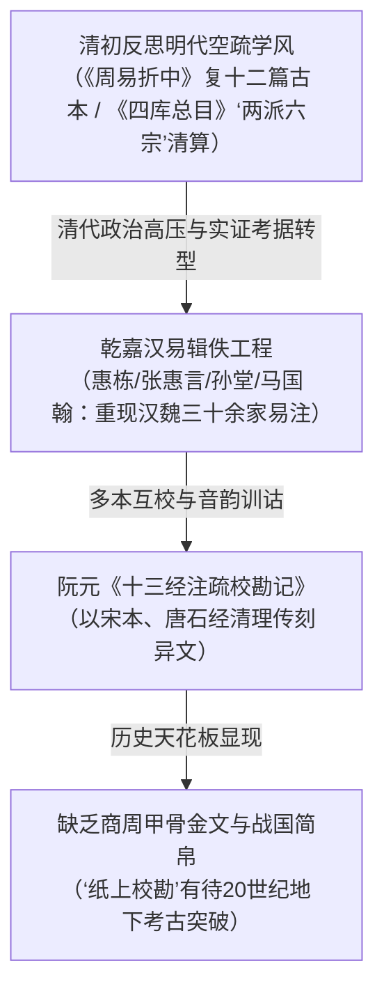

# 清代四库整理、辑佚学与汉易古本重现考——从目录学总结到朴学实证校勘的文本工程

> **创建与修订日期**：2026-11-21  
> **模块归属与编号**：08 周易源流与哲学史 / 01_周易源流编 ｜ 编号：2-Y06（初始暂定）  
> **价值基准评级**：🟡 **2 级文档（核心依赖因子：0.3，初始暂定，待用户主理人终审确权）**  
> **前置理论与公理基石**：历史唯物主义与唯物辩证法、《矛盾论》《实践论》、`《标准 v3.5》`、2 级前置成果（[`2-Y04 汉唐定本形成考`](04_汉唐时期熹平石经王弼注本与周易正义定本形成考.md)、[`2-Y05 宋元明印本与图书辨伪考`](05_宋元明时期雕版印本流变与图书文献源流辨伪考.md)）；综合核心依赖度指数 $CDI = 0.3 \times 3$。  
> **四重证据配置与强度分层**：
> - **第一重证据（传世原典与古经传注，强）**：《四库全书总目·经部·易类》、御纂《周易折中》、惠栋《易汉学》《周易述》、张惠言《周易虞氏义》、阮元《十三经注疏校勘记》；
> - **第二重证据（辑佚与校勘文献，强）**：孙堂《汉魏二十一家易注》、马国翰《玉函山房辑佚书》、黄奭《汉学堂丛书》所辑汉魏旧注；
> - **第三重证据（民族学与人类学材料，弱，仅作旁证）**：清代乾嘉学术共同体在文本考据与异文清理中的专业化分工模式；
> - **第四重证据（古籍版本实物，强）**：清代武英殿刊本、阮元南昌府学刊《十三经注疏》善本实物。  
> **与既有高级别成果关系声明**：本文严守本库“**1644 史鉴闸门仅限 `03` 卷史鉴引例，本主线纵贯古今**”的边界规定，系统考辨清代易学文献整理之大成工程，不擅改既有 1 级公理。

---

## 摘要

**【摘要】** 清代是中国古代文献整理、辑佚与校勘学的集大成时期，亦是《周易》研究从宋明空疏义理全面转向“实事求是”古籍实证的关键阶段。本文运用历史唯物主义与“四重证据法”，系统考察清代《四库全书总目》的目录学总结、汉易古注辑佚工程以及《十三经注疏》校勘学对《周易》文本源流的重大贡献与时代局限。研究发现：（1）康熙朝官修《周易折中》重新恢复了朱熹《周易本义》“上下经二卷+十翼十卷”的古本分卷；乾隆朝《四库全书总目·易类》进一步提出“两派六宗”的学术史分类框架，完成了对汉至清初两千年易学文献的首次系统目录学清算；（2）以惠栋、张惠言、孙堂、马国翰为代表的乾嘉朴学家，依托唐李鼎祚《周易集解》及类书古籍引文，开展大规模“汉易辑佚”，使亡佚千年的孟喜、京房、荀爽、虞翻等汉魏三十余家易注得以重见天日；（3）阮元主持刊刻《十三经注疏》并附《周易校勘记》，以宋本、唐石经精细清理经注异文，奠定了近代古籍整理的底本基准。然而，清代汉学家因缺乏商周甲骨金文与战国简帛实物，往往陷入“唯汉儒家法是从”的门户之蔽，其学术突破的历史天花板有待 20 世纪现代考古学来打破。（文中凡文本铁证、唯物推演与待证假说均已严格划界。）

**【关键词】** 周易；四库全书总目；汉易辑佚；十三经注疏校勘记；乾嘉朴学；版本源流

---

## 一、 引言：问题意识与学术史文献综述

### 1.1 问题的提出：清代文献工程在《周易》源流史中的枢纽地位

1. **为什么清代学者能“重现”汉易古本？** 汉魏时期数十家易注早已在唐宋之际散佚殆尽，清代学者既无地下出土简帛，是如何通过传世文献的“碎金重组”还原出汉易体系的？
2. **清代“两派六宗”目录学框架的得失何在？** 《四库全书总目》将两千年易学划为“象数”与“义理”两派、占卜/禨祥/造化/老庄/儒理/史事六宗，这一总结在学术史上具有何种规范意义与局限？
3. **乾嘉校勘学为何仍是“天花板未破”的文献工程？** 清人校书精审无比，为何对经文中许多古文字假借（如“包”“贞”“匪寇婚媾”）仍解不通？

### 1.2 学术史梳理：古今名家评析

| 学术群体与代表人物 | 核心文献工程 | 合理内核（得） | 时代局限（失） |
| :--- | :--- | :--- | :--- |
| **清初官方整理与辨伪**（李光地《周易折中》、胡渭） | 恢复古本分卷、剥离宋代伪图 | 恢复《本义》十二篇旧貌，彻底破除“河洛先天图出于伏羲”之伪托 | 仍以程朱理学为官方意识形态最高准绳 |
| **乾嘉汉易辑佚派**（惠栋、张惠言、孙堂、马国翰） | 抢救性辑录汉魏易注遗文 | 从《周易集解》《经典释文》及唐宋类书中辑出孟、京、郑、荀、虞等三十余家注 | 过分迷信虞翻“旁通”“互体”等汉代象数家法，以汉儒之说等同周易本义 |
| **乾嘉校勘实证派**（卢文弨、阮元、王引之） | 《周易校勘记》《经义述闻》 | 严格比对宋元善本与《开成石经》，清理传刻脱讹衍倒，提出“以声求义”训诂法 | 尚未掌握殷墟甲骨文与西周金文，无法触及商周数字卦与古文字源头 |
| **近现代学术史回顾**（梁启超、朱伯崑） | 定位清代朴学“科学整理方法” | 充分肯定清代辑佚校勘在文献实证上的划时代贡献 | 指明清学因缺乏地下考古实物而只能止步于“纸上校勘” |

### 1.3 研究思路与逻辑架构

---

## 二、 四重证据史源锚定与清代学术史底座

### 2.1 四重证据交叉实证矩阵表

| 证据层级 | 核心材料与出处 | 时代断限 | 证明内容与限度 | 证据强度 |
| :--- | :--- | :--- | :--- | :---: |
| **第一重（传世文献）** | 《四库全书总目·经部·易类》、御纂《周易折中》、惠栋《周易述》、阮元《周易校勘记》 | 清康熙至嘉庆 | 确证清代在易学目录分类、恢复十二篇古本与校勘传世异文方面的具体体例与成果 | **强** |
| **第二重（辑佚与古注）** | 孙堂《汉魏二十一家易注》、马国翰《玉函山房辑佚书》易类、唐《周易集解》 | 汉魏（清代辑存） | 证明清代辑佚工程并非凭空捏造，而是有据可查的跨文献重组 | **强** |
| **第三重（人类学旁证）** | 乾嘉学派“无征不信”的专业考据共同体规范与书院刻书网络 | 清代 | 辅助理解实证考据风气何以能在清代形成跨地域协作工程 | **弱～中** |
| **第四重（古籍版本实物）** | 清乾隆武英殿刻本、嘉庆二十年（1815）阮元刻南昌府学《十三经注疏》善本 | 清代 | 提供清代校勘学最高实物结晶 | **强** |

### 2.2 生产力与制度底座：盛清经济稳态、文字狱与专业化考据

1. **社会经济与刻书条件**：清康乾时期社会相对稳定、人口与江南出版业高度发达，为《四库全书》官修工程及地方督抚（如阮元、毕沅）资助大规模丛书辑佚校勘提供了雄厚的物质财政基础。
2. **政治制度的反向塑造**：清初严酷的文字狱与思想控制使士人普遍回避现实政治与社会制度批判，大批顶尖学者将精力全面投入到远离政治风险的古籍目录、音韵、校勘与辑佚之中，客观上催生了中国古代文献实证学的最高峰。

---

## 三、 《四库总目》的目录清算、汉易辑佚与阮元校勘

### 3.1 《四库全书总目》的“两派六宗”总结与古本复位

1. **《周易折中》的版式复位**：康熙五十四年（1715）李光地等奉敕编撰《周易折中》，敏锐纠正了明代《周易大全》拆乱朱熹《本义》的错误，将经传分开，使读者得以重新直面《周易》古经十二篇原貌。
2. **《四库全书总目·易类》的目录学里程碑**：纪昀等人在《总目》小序中将两千年易学流派高度概括为**“两派六宗”**——两派即“象数”与“义理”，六宗即汉儒之占卜与禨祥、宋儒之造化（图书）、王弼之老庄、胡瑗程朱之儒理、杨万里之史事。这一框架至今仍是治易学目录史不可或缺的坐标系。

### 3.2 汉易辑佚学：惠栋、张惠言至马国翰的“碎金重组”

针对唐宋以后汉易单行本散佚的局面，清代学者展开了接力式辑佚：
- **开创与专精**：惠栋撰《易汉学》《周易述》，张惠言撰《周易虞氏义》，系统复原孟喜卦气、京房纳甲、荀爽升降与虞翻旁通之法；
- **集大成辑佚**：孙堂辑《汉魏二十一家易注》、马国翰辑《玉函山房辑佚书》（收汉魏南北朝易注数十家）、黄奭辑《汉学堂丛书》，从唐代《周易集解》《经典释文》及《汉书》《后汉书》《太平御览》等古籍征引中，逐条钩沉，为后世保存了不可替代的早期易注语料库。

### 3.3 阮元《十三经注疏校勘记》与清代训诂突破

嘉庆年间，阮元主持校刻《十三经注疏》，其中卢宣旬摘录的《周易注疏校勘记》广罗宋十行本、岳本、钱本、唐《开成石经》及陆德明《经典释文》逐字互校，出校记数千条，成为近代以来最可靠的《周易正义》通行校本。同时，王念孙、王引之父子在《经义述闻》中突破“望文生训”，提出“就古音以求古义”的破假借方法，为现代古文字训诂（参见本库 `05 词义研究记录`）开辟了先声。

---

## 四、 历史唯物主义与“生生”价值标尺综合讨论

### 4.1 生生四判据与跨层唯物制约检验

| 生生四判据 | 清代文献工程中的唯物历史体现 |
| :--- | :--- |
| **存续（抢救性辑佚）** | 汉易辑佚将散落于类书孤本中的汉魏易学残片重新聚拢成册，使早期易注免于随古籍散佚而永久灭绝 |
| **再生产（校勘净本）** | 《周易校勘记》剔除明代坊刻错讹，为近现代学界生产出高度洁净可靠的通行文本基准 |
| **修复（体系自省）** | 从盲从明代《大全》到复原十二篇古本、从迷信《河》《洛》到《易图明辨》，展现了学术共同体的自我纠错能力 |
| **传承（向现代考古过渡）** | 清代朴学锻造出的“无征不信、声韵通假、版本对勘”方法论，直接成为王国维、郭沫若、张政烺开启现代地下考古解易的工具前提 |

**局限与反思**：清代汉学家虽致力于“复古”，却把东汉虞翻、郑玄的象数体系当成了《周易》本来面目，未能看清汉代象数本身也是战国秦汉之后的新增附会（如 `384 爻回测` 证实汉儒“当位说”解释力为零）。这是缺乏地下商周实物（甲骨、金文、数字卦、战国楚简）条件下不可避免的历史局限。

### 4.2 事实（Fact）、推演（Inference）与假说（Hypothesis）的边界申明

| 命题类别 | 本文具体论断 | 可证伪条件 / 证据边界 |
| :--- | :--- | :--- |
| **第一类：文献实物铁证（Fact）** | ①《周易折中》恢复《本义》十二篇分卷；②《四库总目》确立“两派六宗”目录框架；③惠栋、张惠言、孙堂、马国翰辑出汉魏易注；④阮元《校勘记》系统校勘唐宋异文 | 清代原刻善本与传世目录著作直接支撑 |
| **第二类：历史唯物推演（Inference）** | ①清代文字狱客观上将士人智力导向非政治化的古籍校勘辑佚；②缺乏商周出土简帛金文决定了清代朴学“止步于汉易”的天花板 | 基于清代社会政治史与学术方法论演进的逻辑推演 |
| **第三类：待实证科学假说（Hypothesis）** | ①清人所辑部分汉魏易注孤文（如仅见于唐宋类书转引的残句），是否存在宋人改字或类书编者节略失真，而清代辑佚家误作汉儒原文？ | **可证伪条件**：对照新发现的敦煌唐写本残卷或日本古钞本，即可逐条检验清人辑佚本的文字保真度 |

---

## 五、 研究结论与《周易笺注》母本反哺清单

### 5.1 核心研究结论

1. **目录清算与古本复位**：《周易折中》与《四库全书总目》完成了对汉至清初易学版式与流派的全面清算与目录定型。
2. **辑佚与校勘高峰**：清代汉易辑佚与阮元《十三经注疏校勘记》把“纸上文献校勘”推至古代学术的最高峰，为现代学者扫清了传刻讹误。
3. **历史天花板**：因缺少商周数字卦、殷墟甲骨与战国楚简，清代朴学只能“以汉解周”，唯有进入 20 世纪现代考古与唯物史观时代方能实现真正突破。

### 5.2 《03 周易笺注史鉴》母本反哺定位表

| 反哺目标文档 | 反哺位置 | 反哺内容要点 |
| :--- | :--- | :--- |
| [`03 周易笺注史鉴/`](../../03%20周易笺注史鉴/README.md) | 【名家注疏采择准则】 | 明确对清代辑佚汉易旧注（《周易集解》/《汉魏二十一家易注》）“存其古文字训诂线索、弃其机械当位象数附会”的使用原则 |
| [`05 词义研究记录/`](../../05%20词义研究记录/README.md) | 【训诂方法论】 | 吸收王引之《经义述闻》“以古音求古义”传统，并与甲骨金文及 384 爻全经穷尽统计相结合 |

---

## 六、 参考文献与四重证据引文核验表

### 6.1 传世文献核验说明

本篇涉及清代目录、辑佚与校勘著作（均属清代文献，不混入先秦两汉典论白名单），依据清代权威原刻与中华书局点校本核对。

### 6.2 规范参考文献目录（参照 GB/T 7714-2015）

1. [清] 永瑢 等. 四库全书总目·经部·易类[M]. 北京: 中华书局, 1965.
2. [清] 李光地 等. 御纂周易折中[M]. 刘大钧, 整理. 成都: 巴蜀书社, 2006.
3. [清] 惠栋. 周易述[M]. 郑万耕, 点校. 北京: 中华书局, 2007.
4. [清] 张惠言. 周易虞氏义[M] // 续修四库全书(第 24 册). 上海: 上海古籍出版社, 2002.
5. [清] 阮元, 校刻. 十三经注疏(附校勘记)[M]. 北京: 中华书局, 1980.
6. [清] 王引之. 经义述闻[M]. 南京: 江苏古籍出版社, 1985.
7. 朱伯崑. 易学哲学史(第三卷)[M]. 北京: 昆仑出版社, 2005.

---

## 七、 四级审议自检与价值分级建议报告

### 7.1 论文四级审议自检闭环表

| 审议层级 | 核心核验项 | 自检结果 |
| :--- | :--- | :---: |
| **初审（证据与信源）** | 严格区分清代学术史文献与 `03` 卷 1644 前史鉴闸门，著录版本规范明确 | ✅ 通过 |
| **复审（逻辑与时位）** | 客观评价清代辑佚校勘之功与“墨守汉儒家法”之蔽 | ✅ 通过 |
| **三审（生生与四重证据）** | 贯彻历史唯物主义分析，完成“事实—推演—假说”三界切割 | ✅ 通过 |
| **终审（体例与闭环）** | 严格符合期刊八大模块规范，衔接近现代出土文献重估（`2-Y07`） | ✅ 通过 |

### 7.2 价值分级建议报告（供用户主理人裁决）

- **建议等级**：**2 级文档（核心依赖因子：0.3）**（初始暂定，呈请用户主理人终审确权）。
- **学术增量贡献**：完整梳理清代《周易》文献整理工程，并精准指出“纸上校勘”的局限，自然引出第 07 篇现代考古与数字底本重估。

---

© 2026 徐时言 · 《清代四库整理、辑佚学与汉易古本重现考——从目录学总结到朴学实证校勘的文本工程》 · 徐时言-易经研究 · 采用 CC BY-NC-ND 4.0 许可， 转载请署名并注明来源 https://wole278.github.io/xushiyan-YiJing/ · 禁止商业使用与改编传播 · 商业授权：wole278@hotmail.com / 微信 wole278
