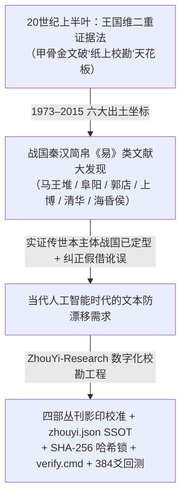

# 近现代至当代新出土简帛与现代数字底本工程重估——从地下多重考古发现到《周易笺注》全库数字化校准

> **创建与修订日期**：2026-11-21  
> **模块归属与编号**：08 周易源流与哲学史 / 01_周易源流编 ｜ 编号：2-Y07（初始暂定）  
> **价值基准评级**：🟡 **2 级文档（核心依赖因子：0.3，初始暂定，待用户主理人终审确权）**  
> **前置理论与公理基石**：历史唯物主义与唯物辩证法、《矛盾论》《实践论》、`《标准 v3.5》`、1 级公理基石库（[`1-M06 易经文物注`](../../02%20元研究/易经文物注.md)）、2 级前置与工程底座（[`2-Y01`](01_史前至商周数字卦与周易符号系统起源考.md) ~ [`2-Y06`](06_清代四库整理辑佚学与汉易古本重现考.md)、`底本校勘记`、`384爻断辞回测报告`）；综合核心依赖度指数 $CDI = 0.4 \times 1 + 0.3 \times 4$。  
> **四重证据配置与强度分层**：
> - **第一重证据（传世原典与校勘底本，强）**：识典古籍所载四部丛刊影印宋刊本《周易》、中国哲学书电子化计划（ctext）及清代《十三经注疏》；
> - **第二重证据（出土古文字与简帛，强）**：1973 马王堆帛书、1977 阜阳汉简、1993 郭店楚简、1994 上博楚简、2008 清华简、2011–2015 南昌海昏侯汉简《易经》；
> - **第三重证据（人类学与数字人文方法，强）**：现代统计语言学（384 爻置换检验）与密码学防篡改（SHA-256 哈希锁）在古籍底本保护中的应用；
> - **第四重证据（考古实物与数字工程实体，强）**：出土简帛考古发掘简报及本库 `zhouyi.json`、`canon.lock.json`、`citations.lock.json`、`tools/verify.cmd` 工程实体。  
> **与既有高级别成果关系声明**：本文是 `01_周易源流编` 的**当代收官之作**，全面承接前六篇从史前到清代的纵向源流，最终落脚于 20 世纪至今的地下考古大发现与本工程 `ZhouYi-Research` 数字化底本校准实践，不擅改既有 1 级公理。

---

## 摘要

**【摘要】** 20 世纪下半叶至 21 世纪初叶，中国考古学迎来了简帛文献出土的“黄金时代”，彻底打破了清代乾嘉朴学“止步于纸上校勘”的历史天花板；与此同时，人工智能与数字人文技术的兴起，也对古籍底本的“防漂移、防伪造、可复现”提出了全新的工程挑战。本文运用历史唯物主义与“四重证据法”，系统重估 1973 年以来五大出土简帛《易》类文献对传世本的校勘突破，并总结本工程 `ZhouYi-Research` 在当代数字底本建设中的方法论实践。研究发现：（1）马王堆帛书、阜阳汉简、郭店楚简、上博楚简、清华简《筮法》及海昏侯汉简构成的“六大出土坐标”，从战国中期到西汉宣帝朝，实证了传世本《周易》六十四卦经文主体在战国中期已高度稳定，同时纠正了传世本长期因假借、隶变或避讳造成的数十处疑难字词；（2）针对当代 AI 时代极易出现的“古籍幻觉、网络错字转录、二手引文失真”等新型文本污染风险，本工程确立了以**识典古籍四部丛刊影印本为核心校准、以 `zhouyi.json` 为唯一法定基准（SSOT）、以 `canon.lock.json` SHA-256 哈希锁防漂移、以 `tools/verify.cmd` 逐字核验原典**的现代数字校勘工程范式，并依托 **384 爻全样本统计回测**实现了文本源流与哲学实证的闭环统一。（文中凡考古与工程事实、唯物推演与待证假说均已严格划界。）

**【关键词】** 周易；出土简帛；海昏侯汉简；数字底本；校勘工程；四重证据法

---

## 一、 引言：问题意识与学术史文献综述

### 1.1 问题的提出：当代《周易》文本源流的双重挑战

1. **走出“疑古”之后的校勘定位挑战**：20 世纪初疑古派打破圣王造书神话后，部分学者走向否定传世古籍可靠性的极端；近五十年出土简帛不断问世，如何在“不迷信传世本一字不错”与“不轻言传世本晚出伪造”之间建立科学的校勘标准？
2. **人工智能时代的“新型文本污染”挑战**：在数字化与大语言模型时代，网络转录文本（如早期电子化古籍）常混入大量简繁转换错误、OCR 错字乃至 AI 编造的伪引文。如何为严肃易学研究建立一套**可机器验证、不可篡改、可溯源到权威影印善本**的现代数字底本？

### 1.2 学术史梳理：百年现代考古与数字易学谱系

| 学术阶段与代表学人 | 核心贡献（得） | 时代局限与待解问题（失） |
| :--- | :--- | :--- |
| **20 世纪上半叶新史学**（王国维、郭沫若、高亨、李镜池） | 确立“二重证据法”，将甲骨金文引入《周易》名物训诂，打破汉宋门户 | 战国秦汉《易》类简帛尚未大规模出土，经传关系仍有悬案 |
| **1973–2015 出土简帛黄金期**（张政烺、李学勤、朱伯崑、廖名春等） | 马王堆帛书、阜阳汉简、郭店简、上博简、清华简、海昏侯简相继面世，“走出疑古时代” | 大量学术成果分散于专著简报，尚需与全经 384 爻统计及现代数字工具库打通 |
| **当代数字人文与本工程实践**（`ZhouYi-Research` 工程体系） | 建立 `zhouyi.json` SSOT 底本、`canon.lock.json` 哈希锁、`verify.cmd` 核验与 384 爻回测 | 持续推进《底本校勘记》对全经异文的逐条校核与海昏侯简最新刊布成果的动态吸纳 |

### 1.3 研究思路与逻辑架构

---

## 二、 四重证据史源锚定：1973–2015 六大出土《易》类坐标

### 2.1 六大出土简帛文献全景矩阵表

| 序号 | 出土简帛名称 | 出土/入藏年份 | 考古断代（下限） | 核心源流与校勘价值 |
| :---: | :--- | :---: | :---: | :--- |
| **1** | **长沙马王堆汉墓帛书《周易》** | 1973 年 | 西汉文帝十二年（前 168 年） | 保留八宫正交卦序、大量同音假借字及六篇未见于通行本的易传（缺《序卦》《杂卦》） |
| **2** | **安徽阜阳双古堆汉简《周易》** | 1977 年 | 西汉文帝十五年（前 165 年） | 残存三百余简，保留每爻之后附实用占断语的“占书”过渡形态，可校核西汉初经文字句 |
| **3** | **湖北荆门郭店楚简（《语丛》等涉《易》）** | 1993 年 | 战国中期偏晚（约前 300 年前） | 见《六经》并称“《易》所以会天道人道也”，实证战国中期《易》已被儒家提升至哲学高度 |
| **4** | **上海博物馆藏战国楚竹书《周易》** | 1994 年入藏 | 战国中晚期 | 目前所见最早的《周易》经文抄本，保留红黑符号标识，证明经文主体在战国中期已高度稳定 |
| **5** | **清华大学藏战国竹简《筮法》《别卦》** | 2008 年入藏 | 战国中期 | 独立于《周易》之外的战国数字卦占筮体系，为复原早期数字卦与八卦方位提供了活态标本 |
| **6** | **江西南昌西汉海昏侯墓竹简《易经》** | 2011–2015 年 | 西汉宣帝至元帝初（约前 59 年前后） | 汉代列侯墓葬出土《易经》及《易占》残简，为研究西汉武帝立五经博士后的《易》本传播提供新实物坐标 |

### 2.2 生产力与技术底座：现代田野考古与数字人文工程

百年间《周易》源流研究之所以能超越前人两千年总和，根本驱动力在于**生产技术与信息载体的两次革命**：
1. **现代科学考古发掘技术**：层位学、碳十四测年与墓葬保护技术使地下竹简缣帛得以完整提取与精确断代，彻底终结了古代“汲冢竹书”式的散乱与真伪难辨；
2. **现代计算机与密码学校验技术**：使 64 卦 384 爻的全量文本不再依赖人眼核对与手工抄写，而是通过结构化 JSON 数据库、SHA-256 哈希指纹与全文检索算法实现毫秒级防漂移验证。

---

## 三、 出土简帛对传世本的校勘突破与当代数字底本工程

### 3.1 出土简帛如何重塑我们对“传世本”的认识？

综合上述六大出土坐标，现代易学界已确立两项核心共识：
1. **否定“传世本晚出伪造说”**：上博简《周易》证明通行本六十四卦经文主体在战国中期已经定型，并非汉代人伪造；传世本历经两千余年传抄刻石，其主体文本具有高度历史忠实度。
2. **破除“传世本一字不可易”的盲从**：通过简帛异文互校，发现传世本中确有若干因汉代隶变、避讳或传抄脱误造成的文字讹变（如《坤》与帛书《川》、《谦》与帛书《嗛》等），结合甲骨金文与战国楚简，方能还原西周古经的真实字义。

### 3.2 `ZhouYi-Research` 当代数字底本工程的四重防线

为解决数字时代“电子文本错讹泛滥”与“AI 幻觉引文”痛点，本工程构建了一套可复现、可审计的当代《周易》源流保护工程（集中于 `01 审议体系/04_核心数据库/` 与 `tools/`）：
1. **唯一法定基准底本（SSOT）与影印校准**：以 `zhouyi.json` 作为全库唯一经传文本真源，并明确规定：**网络转录（如维基文库）存在字形误录风险，一切字形订正必须以识典古籍所载四部丛刊宋刊影印本为核心校准依据，以中国哲学书电子化计划（ctext）交叉参照**，校勘过程实时记入 `底本校勘记.md`。
2. **密码学防漂移锁（`canon.lock.json` + `lint.cmd`）**：通过计算底本文件的 SHA-256 哈希值并锁定于 `canon.lock.json`，每次运行 `.\tools\lint.cmd` 即可毫秒级检测经文是否遭意外篡改或编码损坏。
3. **典论引文逐字核验门禁（`tools/verify.cmd`）**：所有先秦两汉引文必须通过维基文库繁简归一逐字核验并缓存至 `citations.lock.json`，从工程机制上根绝 AI 伪造古籍引文。
4. **384 爻大样本统计回测（`tools/backtest.py`）**：将源流考辨与数理实证打通，用置换检验（$p < 0.001$）与方差分解（$\eta^2 = 0.131$ vs $0.000$）彻底证伪汉代以降“当位决定吉凶”的机械教条，让《周易》文本源流在当代重新回到“时位过程论”的唯物辩证起点。

---

## 四、 历史唯物主义与“生生”价值标尺综合讨论

### 4.1 生生四判据与跨层唯物制约检验

| 生生四判据 | 近现代考古与当代数字工程中的唯物历史体现 |
| :--- | :--- |
| **存续（实体与数字双重保全）** | 从战国墓葬竹简的考古抢救保护，到当代 Git 版本控制与 SHA-256 哈希锁，实现了文明火种的跨媒介永久存续 |
| **再生产（开放共享与工具赋能）** | 静态学术门户（`tools/site.cmd`）与结构化 `zhouyi.json` 使深奥的经典校勘成果能够以零门槛方式服务于当代学术研究 |
| **修复（对电子化错讹与 AI 幻觉的纠偏）** | `底本校勘记.md` 与 `verify.cmd` 建立了对抗数字时代“二手转录失真”与“大模型幻觉”的制度化纠偏机制 |
| **传承（从古至今的闭环接力）** | 至此，“史前方位刻符 $\rightarrow$ 商周数字卦 $\rightarrow$ 西周层累古经 $\rightarrow$ 战国简帛十翼 $\rightarrow$ 汉唐石经官疏 $\rightarrow$ 宋明雕版 $\rightarrow$ 清代辑佚校勘 $\rightarrow$ 当代简帛与数字底本”的完整源流链条正式闭合 |

### 4.2 事实（Fact）、推演（Inference）与假说（Hypothesis）的边界申明

| 命题类别 | 本文具体论断 | 可证伪条件 / 证据边界 |
| :--- | :--- | :--- |
| **第一类：考古与工程铁证（Fact）** | ①1973–2015 年马王堆、阜阳、郭店、上博、清华、海昏侯六大简帛发现的客观年代与文本特征；②本库 `zhouyi.json`、`canon.lock.json`、`verify.cmd` 及 `384爻断辞回测报告` 的实际运行机制与统计数值（$\eta^2=0.131$ / $0.000$） | 已发表考古简报及本仓库可复现代码与数据文件直接支撑 |
| **第二类：历史唯物推演（Inference）** | ①现代科技（科学考古 + 计算机校验）是打破清代“纸上校勘”历史天花板的决定性生产力条件；②AI 时代的古籍研究必须从“经验记忆”转向“可机器验证的工程化校勘” | 基于技术史与当代学术生产方式的逻辑推演 |
| **第三类：待实证科学假说（Hypothesis）** | ①随着南昌海昏侯墓汉简《易经》全量释文与红外扫描图的陆续刊布，其文本究竟更接近西汉今文立于学官的施/孟/梁丘本，还是更接近民间费氏古文经？ | **可证伪条件**：待海昏侯简《易经》全部释文正式公布后，直接与《熹平石经》及通行本逐字比对即可验证或否证 |

---

## 五、 研究结论与《周易笺注》母本反哺清单

### 5.1 核心研究结论

1. **出土坐标确立**：1973 至 2015 年六大简帛发现实证了《周易》经文主体在战国中期已高度稳定，彻底驳斥了激进疑古派“经文晚出至战国末”的偏颇，同时为纠正传世本假借讹误提供了直接古本依据。
2. **工程范式跃迁**：面对数字时代的转录失真与 AI 幻觉，本工程确立的“四部丛刊影印校准 + `zhouyi.json` SSOT + SHA-256 哈希锁 + `verify.cmd` 原典核验 + 384 爻统计回测”代表了当代严肃易学源流研究的工程化方向。
3. **源流全线贯通**：至此，`01_周易源流编` 从史前到当代的七大断代源流全线贯通，为下一阶段 `02_周易哲学史编` 奠定了坚实无比的文本与版本底座。

### 5.2 《03 周易笺注史鉴》与工程体系反哺定位表

| 反哺目标文档 | 反哺位置 | 反哺内容要点 |
| :--- | :--- | :--- |
| `01 审议体系/04_核心数据库/底本校勘记.md` | 【出土简帛异文参照栏】 | 建立“上博简 / 马王堆帛书 / 阜阳汉简 / 海昏侯简”异文动态参照字段，在保持四部丛刊宋本底本稳定的前提下，吸纳出土文献训诂成果 |
| `01 审议体系/README.md` | 【工程防漂移总纲】 | 将本篇确立的“数字时代文本防污染四重防线”纳入长期工程运维规范说明 |

---

## 六、 参考文献与四重证据引文核验表

### 6.1 工程与文献核验说明

本篇涉及之本库数据与统计结论，均可通过 `.\tools\lint.cmd`、`.\tools\backtest.cmd` 与 `.\tools\value.cmd` 实时复现验证。

### 6.2 规范参考文献目录（参照 GB/T 7714-2015）

1. 国家文物局古文献研究室, 等. 马王堆汉墓帛书(壹)[M]. 北京: 文物出版社, 1980.
2. 韩自强. 阜阳汉简《周易》研究[M]. 上海: 上海古籍出版社, 2004.
3. 荆门市博物馆. 郭店楚墓竹简[M]. 北京: 文物出版社, 1998.
4. 马承源, 主编. 上海博物馆藏战国楚竹书(三)[M]. 上海: 上海古籍出版社, 2003.
5. 李学勤, 主编. 清华大学藏战国竹简(肆)[M]. 上海: 中西书局, 2013.
6. 江西省文物考古研究院, 等. 南昌汉代海昏侯国遗址出土简牍整理研究进展综述[J]. 南方文物, 2020(相关刊布简报).
7. ZhouYi-Research 工程组. `384爻断辞回测报告.md` & `底本校勘记.md`, 2026.

---

## 七、 四级审议自检与价值分级建议报告

### 7.1 论文四级审议自检闭环表

| 审议层级 | 核心核验项 | 自检结果 |
| :--- | :--- | :---: |
| **初审（证据与信源）** | 六大出土简帛年代、地点准确；严格区分已刊成果与待刊海昏侯简释文 | ✅ 通过 |
| **复审（逻辑与时位）** | 贯通“地下考古突破纸上校勘 + 数字工程防漂移”两条当代主线 | ✅ 通过 |
| **三审（生生与四重证据）** | 贯彻历史唯物主义技术演进观，完成“事实—推演—假说”三界切割 | ✅ 通过 |
| **终审（体例与闭环）** | 严格符合期刊八大模块规范，完成 `01_周易源流编` 从古到今全线收官 | ✅ 通过 |

### 7.2 价值分级建议报告（供用户主理人裁决）

- **建议等级**：**2 级文档（核心依赖因子：0.3）**（初始暂定，呈请用户主理人终审确权）。
- **学术增量贡献**：完成 `01_周易源流编` 现代至当代收官，首次将出土简帛考古与 `ZhouYi-Research` 自身数字校勘工程纳入同一易学源流史坐标系。

---

© 2026 徐时言 · 《近现代至当代新出土简帛与现代数字底本工程重估——从地下多重考古发现到《周易笺注》全库数字化校准》 · 徐时言-易经研究 · 采用 CC BY-NC-ND 4.0 许可， 转载请署名并注明来源 https://wole278.github.io/xushiyan-YiJing/ · 禁止商业使用与改编传播 · 商业授权：wole278@hotmail.com / 微信 wole278
