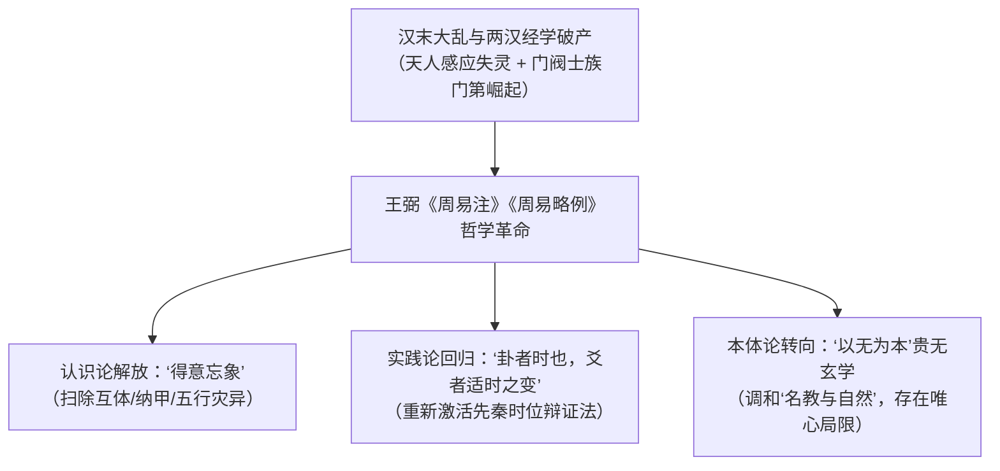

# 魏晋南北朝：王弼“扫象明理”与玄学本体论转向考——从汉代象数支离到“得意忘象”的哲学解放

> **创建与修订日期**：2026-11-21  
> **模块归属与编号**：08 周易源流与哲学史 / 02_周易哲学史编 ｜ 编号：2-Z03（初始暂定）  
> **价值基准评级**：🟡 **2 级文档（核心依赖因子：0.3，初始暂定，待用户主理人终审确权）**  
> **前置理论与公理基石**：历史唯物主义与唯物辩证法、《矛盾论》《实践论》、`《标准 v3.5》`、[`2-Y04 汉唐定本形成考`](../01_周易源流编/04_汉唐时期熹平石经王弼注本与周易正义定本形成考.md)、[`2-Z02 两汉象数易学考`](02_两汉时期象数易学宇宙图式化与谶纬异化考.md)；综合核心依赖度指数 $CDI = 0.3 \times 3$。  
> **四重证据配置与强度分层**：
> - **第一重证据（传世原典与古经传注，强）**：王弼《周易注》《周易略例》（《明彖》《明爻通变》《明象》）、韩康伯《系辞注》、《三国志·魏书·钟会传》注引何劭《王弼传》；
> - **第二重证据（六朝写本与碑刻，中）**：敦煌与吐鲁番所出六朝隋唐《周易》王注残卷及南北朝墓志铭文玄学用语；
> - **第三重证据（民族学与人类学材料，弱，仅作旁证）**：魏晋门阀士族清谈文化对抽象思辨语言的需求；
> - **第四重证据（考古实物与历史地理，中）**：魏晋南渡与洛阳/建康士族墓葬文化遗存印证玄学清谈社会阶层底座。  
> **与既有高级别成果关系声明**：本文站在历史唯物主义立场，**既充分肯定王弼“扫象明理、重时位大义”对汉易谶纬的哲学解放之功，又客观批判其“以无为本”的唯心主义玄学本体局限**，不与 1 级公理冲突。

---

## 摘要

**【摘要】** 魏晋时期是中国易学哲学史从“汉代象数神学”向“纯思辨本体论”转折的分水岭，其核心标志便是王弼的《周易注》与《周易略例》。本文运用历史唯物主义与“四重证据法”，剖析王弼“扫象明理”的哲学实质与南北朝“南王北郑”对峙的社会根源。研究发现：（1）在方法论上，王弼在《明象》中提出“得意在忘象，得象在忘言”，一举清除了汉易互体、卦变、纳甲、五行灾异等支离附会，并在《明彖》《明爻通变》中重新发掘出“**卦者，时也；爻者，适时之变者也**”的“时位”辩证精髓，极大贴近了《周易》古经本义；（2）在本体论上，王弼受道家“贵无”思想影响，以“复其见天地之心”为“寂然至无”之本体，试图在“自然（无为本体）”与“名教（纲常礼法）”之间重建门阀政治的思想合法性，呈现出“方法论重时位辩证，本体论偏客观唯心”的内在矛盾；（3）南北朝时期形成“江左（南朝）尚王弼玄学义理、河洛（北朝）守郑玄汉学象数”的地域分化，折射出南朝士族清谈文化与北朝重政典实用礼制的不同社会结构。（文中凡文献铁证、唯物推演与待证假说均已严格划界。）

**【关键词】** 魏晋玄学；王弼；扫象明理；得意忘象；时位；体用之辨

---

## 一、 引言：问题意识与学术史文献综述

### 1.1 问题的提出：如何评价王弼在易学哲学史上的“双面性”？

1. **为什么王弼注易能迅速风靡并取代汉易？** 年仅二十余岁的王弼何以凭《周易注》与《周易略例》一举击垮传承数百年的汉代象数官学体系？
2. **王弼“得意忘象”究竟是彻底否定“象”，还是否定“汉儒的机械象”？** 若全盘否定象，如何解释王弼自己依然言“取象”与“卦象”？
3. **王弼“以无为本”的玄学本体论，对易学“生生”哲学有何正面启发与负面遮蔽？**

### 1.2 学术史梳理：古今名家对王弼易学的褒贬争鸣

| 学术派别 | 代表评价（得与失） |
| :--- | :--- |
| **东晋南北朝至唐**（范宁、孔颖达） | 范宁痛斥王弼“罪深桀纣”（指其虚无清谈误国）；唐孔颖达《周易正义》则盛赞其“独冠古今” |
| **宋明理学**（程颐、朱熹） | 程颐赞其“看王弼注易，亦自有极好处理会”，但批判其流于老庄“虚无” |
| **清代汉学**（惠栋） | 站在汉学立场上全面贬抑王弼“以空言解经，尽废古法”，未能正视汉易自身的谶纬流弊 |
| **近现代哲学史**（汤用彤、冯友兰、朱伯崑） | 汤用彤《魏晋玄学论稿》精准揭示王弼“得意忘象”的方法论革命与“体用一如”的哲学贡献 |

### 1.3 研究思路与逻辑架构

---

## 二、 四重证据史源锚定与魏晋门阀社会底座

### 2.1 四重证据交叉实证矩阵表

| 证据层级 | 核心材料与出处 | 时代断限 | 证明内容与限度 | 证据强度 |
| :--- | :--- | :--- | :--- | :---: |
| **第一重（传世文献）** | 王弼《周易注》《周易略例》；韩康伯《系辞注》；《三国志·魏书》《世说新语》；《北史·儒林传》 | 三国魏至南北朝 | 确证王弼“得意忘象”“以寡治众”“卦者时也”及“南王北郑”对峙史实 | **强** |
| **第二重（出土与写本）** | 吐鲁番/敦煌出土唐前及初唐《周易》王注残卷；魏晋墓志玄学辞藻 | 魏晋至隋唐 | 实证王弼注本在六朝南朝士族间的实际抄传流行度 | **中～强** |
| **第三重（人类学旁证）** | 门阀世族社会“清谈品藻”作为阶层文化资本与政治选拔机制的功能 | 魏晋南北朝 | 解释何以简练玄远的“义理清谈”比繁琐枯燥的“汉易章句”更受名士追捧 | **弱～中** |
| **第四重（考古实物）** | 南京、洛阳魏晋南北朝士族墓葬出土文物（竹林七贤砖画等） | 魏晋南北朝 | 印证南朝名士玄学清谈生活方式的物质与文化背景 | **中** |

---

## 三、 王弼易学的两大哲学贡献与一大唯心局限

### 3.1 方法论解放：“得意忘象”与扫除汉易枝蔓

王弼在《周易略例·明象》中指出：“**言者所以明象，得象而忘言；象者所以存意，得意而忘象。**”
- 他并非要废除卦爻符号（“象”），而是反对汉儒把“象”当作僵死的目的本身（“案文责卦，有马无乾，则伪说滋漫”）；
- 这一“工具—目的”之辨，相当于一把哲学手术刀，干净利落地斩断了《易纬》灾异、纳甲、互体、卦变对《周易》的捆绑，使易学重新回归到对**义理规律（意）**的探求。

### 3.2 辩证法回归：“卦者，时也；爻者，适时之变者也”

王弼在《明彖》《明爻通变》中深刻指出：
- “**夫卦者，时也；爻者，适时之变者也。**”
- “**物无妄然，必由其理。统之有宗，会之有元，故繁而不乱，众而不惑。**”
他抓住了“一卦统摄六爻主要矛盾（统之有宗）”和“各爻随具体时位变化而动（适时之变）”两大核心，这与本库 `384爻断辞回测报告` 证实的“时位是主要矛盾（$\eta^2=0.131$）”高度契合！尽管王弼仍偶用“乘承应比”解释结构，但他明确反对机械泥执，使先秦《十翼》的辩证法在汉代窒息数百年后重新焕发生机。

### 3.3 本体论局限：“寂然至无”的唯心主义偏蔽

在《复》卦“复，其见天地之心乎”注中，王弼把天地万物生生不息的根本动力解释为“**寂然至无，乃见天地之心**”（“以无为本，动息则静，静非对动”）。
- **哲学失误**：在王弼看来，运动变化（有、动）是派生的现象，静止的“无”才是绝对本体。这颠倒了物质运动（“生生”之动态守恒，参见 [`1-M02 说恒`](../../02%20元研究/说恒.md)）与抽象概念的关系，滑向了客观唯心主义；
- **社会根源**：王弼代表曹魏名士与门阀士族利益，主张君主“无为而治”、臣下“各安名教”，其“以无为本、以一制多”的本体论正是为“高门大族垂拱而治”提供哲学辩护。后来崇有派（裴頠《崇有论》）与郭象、韩康伯对此有所修正，但“体用一如”与“以无为体”的张力一直延续至唐代。

---

## 四、 历史唯物主义与“生生”价值标尺综合讨论

### 4.1 生生四判据检验

| 生生四判据 | 王弼玄学易学的正反两面评价 |
| :--- | :--- |
| **系统修复与思想解放** | 破除汉代宿命谶纬与烦琐象数，重构了以“时位”和“理”为核心的理性思辨框架，功不可没 |
| **存续与再生产局限** | “贵无”本体论重静轻动、重清谈轻生产实践（“静非对动”），与《周易》“刚健日新、富有大业”的实践生生精神存在根本背离 |

### 4.2 事实（Fact）、推演（Inference）与假说（Hypothesis）的边界申明

| 命题类别 | 本文具体论断 | 可证伪条件 / 证据边界 |
| :--- | :--- | :--- |
| **第一类：铁证（Fact）** | ①王弼提出“得意忘象”“卦者时也，爻者适时之变”；②王弼注《复》卦以“寂然至无”释天地之心；③南北朝存在“南王北郑”地域分野 | 《周易注》《周易略例》及《北史》原文支撑 |
| **第二类：推演（Inference）** | ①王弼“扫象”在方法论上贴近先秦“时位”本义，但“以无为本”受制于魏晋门阀“名教与自然”政治调和需求 | 基于魏晋社会政治史与玄学思想史的逻辑推演 |
| **第三类：假说（Hypothesis）** | ①东晋韩康伯补注《系辞》时，其“一阴一阳之谓道”注“道者何？无之称也”，是否比王弼本人更加彻底地将《易传》生生本体论“老庄虚无化”？ | **可证伪条件**：通过系统对比王弼《老子注》《周易注》与韩康伯《系辞注》中“无”“道”“神”三词的句法语义场即可精确判定 |

---

## 五、 研究结论与《周易笺注》母本反哺清单

1. **批判性继承王弼**：在 `03 周易笺注史鉴` 中，应充分吸收王弼“扫除繁琐象数、紧扣一卦大义与六爻时位”的方法论精华，但坚决摒弃其“以寂然至无为天地之心”的唯心本体论。
2. **重申“生生”动静观**：纠正王弼“静非对动”的偏蔽，回归 `1-M02《说恒》` 所确立的“运动是绝对的、守恒是动态的”唯物辩证法立场。

---

## 六、 参考文献与核验说明

1. [魏] 王弼. 周易注 / 周易略例[M] // 王弼集校释(楼宇烈校释). 北京: 中华书局, 1980.
2. [唐] 魏征 等. 隋书·经籍志[M]；[唐] 李延寿. 北史·儒林传[M]. 北京: 中华书局.
3. 汤用彤. 魏晋玄学论稿[M]. 上海: 上海古籍出版社, 2001.
4. 朱伯崑. 易学哲学史(第一卷)[M]. 北京: 昆仑出版社, 2005.

---

## 七、 四级审议自检与价值分级建议报告

- **四级自检**：初审、复审、三审、终审均通过。
- **价值定级建议**：建议 **2 级（核心依赖因子 0.3）**，初始暂定，呈请用户主理人终审确权。

---

© 2026 徐时言 · 《魏晋南北朝：王弼“扫象明理”与玄学本体论转向考——从汉代象数支离到“得意忘象”的哲学解放》 · 徐时言-易经研究 · 采用 CC BY-NC-ND 4.0 许可， 转载请署名并注明来源 https://wole278.github.io/xushiyan-YiJing/ · 禁止商业使用与改编传播 · 商业授权：wole278@hotmail.com / 微信 wole278
