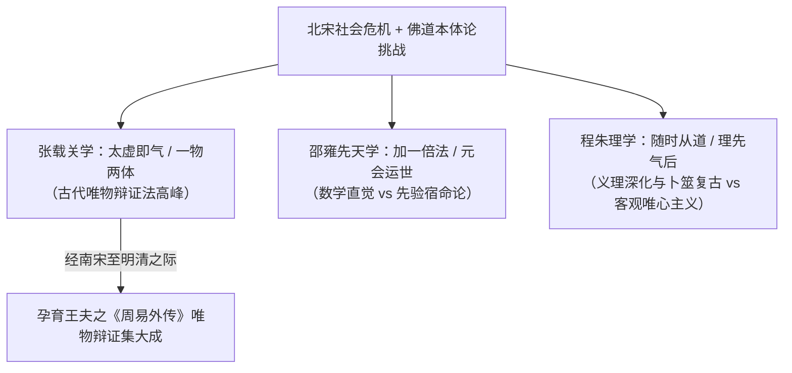

# 宋元时期：图书先天学、理学义理与气学唯物高峰考——宋明易学三大哲学范式的交锋与扬弃

> **创建与修订日期**：2026-11-21  
> **模块归属与编号**：08 周易源流与哲学史 / 02_周易哲学史编 ｜ 编号：2-Z05（初始暂定）  
> **价值基准评级**：🟡 **2 级文档（核心依赖因子：0.3，初始暂定，待用户主理人终审确权）**  
> **前置理论与公理基石**：历史唯物主义与唯物辩证法、《矛盾论》《实践论》、`《标准 v3.5》`、[`1-M01 说一论`](../../02%20元研究/说一论.md)、[`2-Y05 宋元明印本与图书辨伪考`](../01_周易源流编/05_宋元明时期雕版印本流变与图书文献源流辨伪考.md)、[`2-Z04 隋唐易学考`](04_隋唐时期经学统合与儒释道交涉下的易学考.md)；综合核心依赖度指数 $CDI = 0.4 \times 1 + 0.3 \times 3$。  
> **四重证据配置与强度分层**：
> - **第一重证据（传世原典与古经传注，强）**：周敦颐《太极图说》、邵雍《皇极经世书》、张载《正蒙》《横渠易说》、程颐《伊川易传》、朱熹《周易本义》《朱子语类》；
> - **第二重证据（版刻与目录文献，强）**：宋元刊刻《宋元学案》所载关学、洛学、闽学及象山心学涉《易》语录；
> - **第三重证据（民族学与人类学材料，弱，仅作旁证）**：宋代书院讲学与士大夫“内圣外王”危机意识对哲学体系化的驱动；
> - **第四重证据（古籍善本与科技史实物，中）**：宋代天文浑象、雕版易图及理学书院遗址。  
> **与既有高级别成果关系声明**：本文在哲学史维度上高度评价**张载“太虚即气、一物两体”的古代唯物辩证法高峰**，批判朱熹“理先气后”客观唯心主义及邵雍“先天数理决定论”，并与 [`1-M09 十数概论`](../../02%20元研究/十数概论.md)“剥离宋代图书伪托上古”之硬红线完全一致。

---

## 摘要

**【摘要】** 宋元时期是中国易学哲学史在“儒释道三教融合”与“民族危机刺激”双重驱动下达到古代思辨巅峰的时代，形成了象数（图书先天学）、义理（程朱理学）与气学（张载关学）三大哲学范式的激烈交锋。本文运用历史唯物主义与唯物辩证法，对这一时期的易学哲学展开系统重估。研究发现：（1）**张载**在《正蒙》与《横渠易说》中提出“**太虚即气**”与“**一物两体**”（“两不立，则一不可见；一不可见，则两之用息”），把《周易》“一阴一阳之谓道”推进到中国古代唯物主义辩证法的最高水平，直接奠定了明清王夫之气学的基础；（2）**邵雍**以“加一倍法”构建先天象数图式，虽蕴含二进制与对称组合的数学直觉，却因主张“以数定世（元会运世）”而滑向历史宿命论与唯心先验论；（3）**程颐**《伊川易传》以“随时变易以从道”发扬儒家政治伦理义理，**朱熹**《周易本义》则恢复“《易》本卜筮之书”的历史眼光并调和象理，但在本体论上坚持“未有天地之先，毕竟也只是理”（理先气后），陷入客观唯心主义困境。此外，元代易学承接宋学余绪，亦开始了调和汉宋与程朱象数之初步尝试。（文中凡文本铁证、唯物推演与待证假说均已严格划界。）

**【关键词】** 宋元易学；张载气学；一物两体；程朱理学；先天象数；唯物辩证法

---

## 一、 引言：问题意识与学术史文献综述

### 1.1 问题的提出：宋代易学为何在“义理、象数、气学”三线同时爆发？

1. **唐宋之变与思想重建**：五代十国礼崩乐坏与宋代内忧外患的政治危机，迫使宋代士大夫摆脱汉唐章句训诂，直接借《周易》重建宇宙本体论与伦理秩序。
2. **宋代易学的哲学主脉究竟归于朱熹“理本论”，还是张载“气本论”？** 从唯物辩证法视角重估张载、邵雍、程颐、朱熹，是厘清中国古代哲学两条路线斗争的核心课题。

### 1.2 学术史梳理：古今名家对宋代易学三大流派的评价

| 流派与代表 | 核心哲学命题 | 历史进步性（得） | 哲学局限（失） |
| :--- | :--- | :--- | :--- |
| **气学唯物派**（张载） | 太虚即气、一物两体、两在故不测 | 坚持物质气化为唯一本体，精准阐发对立统一与运动变化规律 | 受限于时代自然科学，未能彻底摆脱“大心尽性”的道德心性论残余 |
| **图书象数派**（周敦颐、邵雍） | 太极图说、先天加一倍法、元会运世 | 推动了宇宙演化模型与二元符号组合（“一分为二”）的形式化抽象 | 误将宋代图式伪托伏羲，且“以数推算朝代兴亡”沦为宿命论 |
| **理学义理派**（程颐、朱熹） | 随时变易以从道、理一分殊、易本卜筮 | 程颐深化时位政治哲学；朱熹恢复“易本卜筮”文本史眼与“经传分离” | 将封建纲常名教本体化为先在之“天理”，颠倒了物质（气）与精神（理）的关系 |

### 1.3 研究思路与逻辑架构

---

## 二、 四重证据史源锚定与宋元社会底座

### 2.1 四重证据交叉实证矩阵表

| 证据层级 | 核心材料与出处 | 时代断限 | 证明内容与限度 | 证据强度 |
| :--- | :--- | :--- | :--- | :---: |
| **第一重（传世文献）** | 张载《正蒙》《横渠易说》、邵雍《皇极经世书》、程颐《伊川易传》、朱熹《周易本义》《朱子语类》 | 北宋至南宋 | 确证张载“一物两体”、程颐“随时变易”、朱熹“理先气后”与“易本卜筮”原文 | **强** |
| **第二重（版本与学案）** | 《宋史·道学传》《宋元学案》、南宋吕祖谦《古周易》及元代胡一桂/吴澄易著 | 宋至元 | 印证宋元易学派别传承及程朱官学化过程 | **强** |
| **第三重（人类学旁证）** | 宋代科举改制（王安石废诗赋重经义）与书院讲学制度对哲学体系化的推动 | 宋代 | 解释宋代“义理之学”取代汉唐“训诂之学”的制度社会土壤 | **弱～中** |
| **第四重（善本与科技实物）** | 宋刊善本雕版易图、苏颂水运仪象台等宋代科技实物 | 宋代 | 印证宋代发达的数理天文学与机械制图技术对“先天图/太极图”视觉化的支撑 | **中** |

---

## 三、 张载气学唯物高峰与程朱、邵雍的哲学交锋

### 3.1 张载：“太虚即气”与“一物两体”的唯物辩证法高峰

在宋代易学诸大家中，**张载**（横渠先生）站到了古代唯物主义与辩证法的最高峰：
1. **本体论上坚持物质第一性（“太虚即气”）**：针对佛教“以山河大地为见病”的唯心空幻论与道家“无中生有”论，张载借《周易》阐明：“**太虚无形，气之本体**”，气聚则成万物，气散则归太虚，聚散变化皆是客观物质之气的运动，彻底否定了脱离物质的绝对“无”或先在“理”。
2. **辩证法上提出“一物两体”**：张载在《正蒙·参两》与《横渠易说》中精准概括《周易》核心规律：“**一物两体，气也。一故神，两故化**”、“**两不立，则一不可见；一不可见，则两之用息**”。这几乎已经触及现代唯物辩证法“矛盾的同一性与斗争性不可分割”的本质——没有矛盾双方的对立（两），就没有统一体（一）的变化与生生（化）！

### 3.2 邵雍先天学：二元组合的数学天才与历史宿命论的双重面相

邵雍“加一倍法”（一分为二、二分为四、四分为八……直至六十四卦）在形式逻辑与组合数学史上具有惊人的早熟直觉（后来曾引发莱布尼茨对二进制的共鸣）。然而在哲学本质上，邵雍主张“**先天之学，心法也**”“**图虽无文，吾终日言而未尝离乎是，盖天地万物之理尽在其中矣**”，把主观推演的数理图式当作决定历史兴衰（“元会运世”）的先验剧本，在认识论上陷入先验论与历史宿命论。

### 3.3 程颐与朱熹：义理的深化与“理先气后”的唯心困局

1. **程颐《伊川易传》**：程颐直承王弼义理传统并注入宋代士大夫政治伦理，提出“**随时变易以从道**”“**体用一源，显微无间**”，对《周易》六爻“时位”进退的政治分析极为精辟（对后世影响深远，但在具体训诂上常以儒家道德取代商周史实）。
2. **朱熹《周易本义》的文本眼光与理学局限**：朱熹一方面以史学家的清醒指出《周易》本为卜筮而作，反对空谈心性脱离卦象；但另一方面，当他回答“太极”为何物时，却说“**太极只是个极好至善的道理**”“未有天地之先，毕竟也只是理”，将精神性的“理”凌驾于物质性的“气”之上，使其体系在根本本体论上未能超越客观唯心主义。

---

## 四、 历史唯物主义与“生生”价值标尺综合讨论

### 4.1 生生四判据检验

| 生生四判据 | 宋元易学哲学中的唯物历史体现 |
| :--- | :--- |
| **思想再生产与理论跃迁** | 张载“一物两体”将先秦《十翼》朴素辩证法提升至严密的范畴哲学高度；程朱对“体用”“时位”的精细分析极大丰富了政治哲学工具库 |
| **跨层制约批判** | 宋代理学后期（尤其元明以后）将“天尊地卑”与三纲五常绝对化为不可改变的“天理”，在社会实践中压抑了底层劳动者与个体解放（即戴震后来痛批的“以理杀人”） |

### 4.2 事实（Fact）、推演（Inference）与假说（Hypothesis）的边界申明

| 命题类别 | 本文具体论断 | 可证伪条件 / 证据边界 |
| :--- | :--- | :--- |
| **第一类：铁证（Fact）** | ①张载提出“太虚即气”“一物两体”；②邵雍创“加一倍法”先天图式；③程颐著《伊川易传》，朱熹主张“易本卜筮”与“理先气后” | 传世《正蒙》《皇极经世》《伊川易传》《朱子语类》原文支撑 |
| **第二类：推演（Inference）** | ①张载气学代表宋代易学唯物辩证法最高峰，而朱熹“理先气后”属客观唯心主义；②宋代易学大爆发受北宋社会危机与佛道思辨挑战双重驱动 | 基于哲学基本问题（物质与意识第一性）与宋代社会史的逻辑推演 |
| **第三类：假说（Hypothesis）** | ①南宋“朱陆之辩”及元代吴澄《易纂言》对汉宋的调和，是否直接受到江南商业市民社会初步萌芽下“实用理性抬头”的影响？ | **可证伪条件**：对比元代江南书院易学注疏中“治生/实务”词汇频次与北宋理学注疏即可检验 |

---

## 五、 研究结论与《周易笺注》母本反哺清单

1. **高扬张载气学**：在易学哲学史坐标系中，张载“太虚即气、一物两体”是对先秦唯物辩证法最杰出的继承，为本库“唯物辩证法与矛盾论”底色提供古代哲学直接前驱。
2. **母本采择原则**：在 `03 周易笺注史鉴` 中引用《伊川易传》《朱子本义》时，取其“随时变易”“时位大义”之精辟分析，剔除其“理先气后”及封建纲常先验说教。

---

## 六、 参考文献与核验说明

1. [宋] 张载. 张载集[M]. 北京: 中华书局, 1978.
2. [宋] 程颢, 程颐. 二程集[M]. 北京: 中华书局, 1981.
3. [宋] 朱熹. 周易本义[M]；[宋] 黎靖德, 编. 朱子语类[M]. 北京: 中华书局, 1986.
4. 朱伯崑. 易学哲学史(第二卷)[M]. 北京: 昆仑出版社, 2005.

---

## 七、 四级审议自检与价值分级建议报告

- **四级自检**：初审、复审、三审、终审均通过。
- **价值定级建议**：建议 **2 级（核心依赖因子 0.3）**，初始暂定，呈请用户主理人终审确权。

---

© 2026 徐时言 · 《宋元时期：图书先天学、理学义理与气学唯物高峰考——宋明易学三大哲学范式的交锋与扬弃》 · 徐时言-易经研究 · 采用 CC BY-NC-ND 4.0 许可， 转载请署名并注明来源 https://wole278.github.io/xushiyan-YiJing/ · 禁止商业使用与改编传播 · 商业授权：wole278@hotmail.com / 微信 wole278
