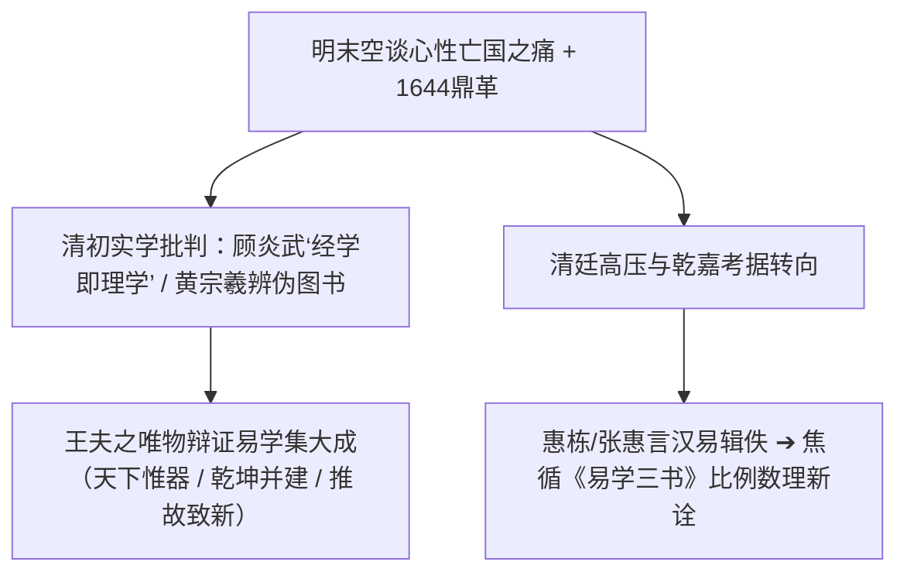

# 明清之际至清中叶：实学批判与朴学考据复兴考——王夫之古代唯物辩证易学集大成及乾嘉汉学新变

> **创建与修订日期**：2026-11-21  
> **模块归属与编号**：08 周易源流与哲学史 / 02_周易哲学史编 ｜ 编号：2-Z06（初始暂定）  
> **价值基准评级**：🟡 **2 级文档（核心依赖因子：0.3，初始暂定，待用户主理人终审确权）**  
> **前置理论与公理基石**：历史唯物主义与唯物辩证法、《矛盾论》《实践论》、`《标准 v3.5》`、[`2-Y06 清代辑佚与校勘考`](../01_周易源流编/06_清代四库整理辑佚学与汉易古本重现考.md)、[`2-Z05 宋元易学考`](05_宋元时期图书先天学理学义理与气学唯物高峰考.md)；综合核心依赖度指数 $CDI = 0.3 \times 3$。  
> **四重证据配置与强度分层**：
> - **第一重证据（传世原典与古经传注，强）**：王夫之《周易外传》《周易内传》《周易大象解》、黄宗羲《易学象数论》、顾炎武《日知录·易》、焦循《雕菰楼易学三书》（《易通释》《易图略》《易章句》）、戴震《孟子字义疏证》；
> - **第二重证据（版刻与学案文献，强）**：《清史稿·儒林传》《清儒学案》及湘西船山遗书刻本；
> - **第三重证据（民族学与人类学材料，弱，仅作旁证）**：明末清初鼎革巨变对实学反思的刺激，以及清中叶商业市镇与科技算学传入对焦循比例数理的启发；
> - **第四重证据（善本实物，中）**：清代船山遗书金陵刻本及焦循易学原刻本。  
> **与既有高级别成果关系声明**：本文严守本库“1644 史鉴闸门仅限 `03` 卷史鉴引例，哲学史纵贯古今”之原则，重点确立**王夫之（船山）作为中国古代唯物辩证易学最高集大成者**的历史地位，并客观评析清代朴学（惠栋、焦循）的哲学突破与局限。

---

## 摘要

**【摘要】** 明末清初至清代中叶是中国传统易学在天崩地裂的王朝鼎革与专制高压下，实现自我清算与方法论转型的关键期。本文运用历史唯物主义与“四重证据法”，剖析王夫之的唯物辩证易学集大成、黄宗羲的实学辨伪，以及清中叶焦循“比例旁通”数理易学的哲学突破。研究发现：（1）面对明末王学末流空谈心性导致亡国之痛，**王夫之（船山）**在《周易外传》《周易内传》中直承张载气学，提出“**天下惟器**”“**尽天地之间，无不是气，即无不是理**”的彻底唯物主义本体论，并在易学中系统阐述“**占学一理**”“**乾坤并建**”“**矛盾相与为体**”“**推故而别致其新**”的辩证法与历史进化论，代表了马克思主义传入中国之前古代易学唯物辩证法的最高峰；（2）清初**黄宗羲**以《易学象数论》剥离宋代伪图，将易学拉回人事经世；（3）清中叶**焦循**突破惠栋、张惠言“墨守汉儒家法”的局限，吸收西方传入的代数比例知识与乾嘉算学，以“旁通、相错、时行”建立《周易》数理逻辑与道德实践统一的新体系，标志着传统朴学易的最高理性化尝试。（文中凡历史铁证、唯物推演与待证假说均已严格划界。）

**【关键词】** 明清易学；王夫之；天下惟器；乾坤并建；焦循；实学批判

---

## 一、 引言：问题意识与学术史文献综述

### 1.1 问题的提出：天崩地裂下的易学反思与转向

1. **为什么中国古代唯物辩证易学的最高峰出现在明清之际的王夫之，而不是汉唐宋？** 明亡清兴的巨大社会震荡与抗清实践失败，如何迫使船山彻底清算宋明理学“空谈心性、理先气后”的唯心主义？
2. **清代中叶焦循的《易学三书》究竟有何不同于惠栋、张惠言的新哲学价值？** 在考据学占统治地位的乾嘉时代，焦循如何用“比例数理”重构《周易》义理？

### 1.2 学术史梳理：古今名家对明清易学的评价

| 学术群体与代表 | 核心贡献（得） | 时代局限（失） |
| :--- | :--- | :--- |
| **明末实学批判派**（黄宗羲、顾炎武、王夫之） | 痛斥王学末流“束书不观、游谈无根”；船山集古代唯物辩证易学之大成 | 船山隐居湘西，其著作迟至清末方才广泛刊布，未能在清初及时主导学术主流 |
| **乾嘉汉学派**（惠栋、张惠言） | 辑佚汉易、重现古注 | 以汉儒“旁通、纳甲”为天经地义，缺乏独立哲学批判 |
| **乾嘉新理派**（焦循） | 以数学比例释“旁通、时行”，把“时位变易”解释为可运算的伦理逻辑 | 仍受限于“《周易》全书预设严密代数对应”的理想化假设 |

### 1.3 研究思路与逻辑架构

---

## 二、 四重证据史源锚定与明清社会底座

### 2.1 四重证据交叉实证矩阵表

| 证据层级 | 核心材料与出处 | 时代断限 | 证明内容与限度 | 证据强度 |
| :--- | :--- | :--- | :--- | :---: |
| **第一重（传世文献）** | 王夫之《周易外传》《周易内传》、黄宗羲《易学象数论》、顾炎武《日知录》、焦循《易通释》《易图略》 | 明末至清嘉庆 | 确证船山“天下惟器”“乾坤并建”与焦循“旁通时行”哲学原文 | **强** |
| **第二重（版本与学案）** | 《清儒学案》、曾国藩金陵刻本《船山遗书》刊刻史料 | 清代 | 印证船山著作在清末方大规模重光并直接启发近代维新与革命思想的史实 | **强** |
| **第三重（人类学旁证）** | 明清之际流寓遗民的“学术救亡”心理机制与乾嘉学者专业化书斋分工 | 明末至清中叶 | 辅助理解船山“六经责我开生面”与焦循闭户治易的社会处境 | **弱～中** |
| **第四重（善本与科技史实物）** | 明末清初传入的《几何原本》及清代算学典籍（如《数理精蕴》） | 17–18 世纪 | 印证焦循易学比例数理方法论背后的中西算学交汇物质背景 | **中** |

---

## 三、 王夫之唯物辩证易学高峰与焦循的数理新变

### 3.1 王夫之（船山）：古代唯物辩证易学的最高峰

王夫之在《周易外传》与《周易内传》中，通过对宋明理学“理先气后”及佛老虚无的全面清算，建立了中国古代最彻底的唯物辩证易学体系：
1. **“天下惟器”的彻底唯物本体论**：针对“形而上者谓之道，形而下者谓之器”，船山打破朱熹把“道/理”悬置于“器”之上的二元分裂，斩钉截铁地指出：“**天下惟器而已矣。道者器之道，器者不可谓之道之器也。无其器则无其道**。”没有客观物质实体（器），就不存在脱离物质的抽象规律（道）；规律只能存在于具体事物与生产实践之中！
2. **“乾坤并建”的矛盾同一观**：针对《系辞》与汉宋易学偏重“太极生两仪”的单向生成论，船山提出“**乾坤并建**”说，强调宇宙之初本就是阳（健、动）与阴（顺、静）两大对立面同时并存、相互作用的统一体（“阴阳者，非离奇偶而别有体，即一物之两体也”）。这与本库 [`1-M01《说一论》`](../../02%20元研究/说一论.md) 及 `《矛盾论》` 高度共鸣！
3. **“推故而别致其新”的进化辩证法**：船山反对邵雍“循环宿命论”和董仲舒“天不变道亦不变”，提出历史与事物发展绝不是原地打转，而是“**质日代而形如一，推故而别致其新**”——新事物从旧事物内部矛盾中脱胎而出，推动人类文明不断向更高阶段螺旋上升。

### 3.2 焦循《雕菰楼易学三书》：从“墨守汉儒”到“数理时行”

清代乾嘉时期，惠栋、张惠言虽复原汉易，却陷入唯虞翻是从的教条；扬州学者**焦循**（1763–1820）则另辟蹊径，将传统训诂音韵（假借）与中西交汇的数学比例逻辑结合，提出“**旁通、相错、时行**”三大法则：
- 他认为六十四卦并非死板排列，而是通过阴阳爻对应转换（旁通）实现动态平衡；任何一爻的失位（失道）都可以通过“变通趋时（时行）”走向“元亨利贞（当位/和顺）”；
- 焦循还把“时行”落脚到社会伦理上，提出“**易者，教人改过迁善之书也**”，反对宿命论，肯定人类在既定矛盾条件下主动调适、求取“生生”的可能性。尽管他预设全经存在严密代数同构略显理想化，但其“以数学结构解构哲学变易”的探索极具现代理性光辉。

---

## 四、 历史唯物主义与“生生”价值标尺综合讨论

### 4.1 生生四判据检验

| 生生四判据 | 明清易学实学与朴学中的唯物历史体现 |
| :--- | :--- |
| **存续与传承** | 王夫之在抗清失败后“六经责我开生面”，把民族存亡的反思凝结为唯物易学巨著，直接成为清末民初谭嗣同、毛泽东等一代革命者与思想家的重要精神滋养 |
| **系统修复与再生产** | 船山“天下惟器”修复了宋明理学“空谈心性”导致的知行分裂；焦循“改过迁善、变通趋时”赋予传统易学以近代理性主义的自我纠偏精神 |

### 4.2 事实（Fact）、推演（Inference）与假说（Hypothesis）的边界申明

| 命题类别 | 本文具体论断 | 可证伪条件 / 证据边界 |
| :--- | :--- | :--- |
| **第一类：铁证（Fact）** | ①王夫之《周易外传》提出“天下惟器”“无其器则无其道”“乾坤并建”；②焦循著《易通释》《易图略》立“旁通、相错、时行” | 传世《船山全书》及《雕菰楼易学三书》原文直接支撑 |
| **第二类：推演（Inference）** | ①船山易学代表马克思主义传入前中国古代唯物辩证法的最高峰；②焦循的数理比例观受清代算学与西方几何比例知识影响 | 基于中国哲学史两条路线对比及清代科学史的逻辑推演 |
| **第三类：假说（Hypothesis）** | ①船山易学中的“动态变化观”与“天下惟器”论，在清末湖南新学与早期马克思主义者接受唯物辩证法过程中，究竟起了多大程度的“本土思想接口”作用？ | **可证伪条件**：通过检索清末民初湖南思想界（如谭嗣同、杨昌济、早期新民学会文献）引用《船山遗书》及《周易外传》的直接引文频次即可量化验证 |

---

## 五、 研究结论与《周易笺注》母本反哺清单

1. **船山坐标**：王夫之《周易外传》《周易内传》确立的“天下惟器”“乾坤并建”“推故致新”三原则，是本工程连接“古代易学”与“现代唯物辩证法”的最重要本土桥梁。
2. **母本反哺**：在 `03 周易笺注史鉴` 典论与哲学阐发中，应优先援引王夫之对“阴阳互根、时位日新”的精辟论述（且其主要思想形成于明末清初鼎革之际，典论与哲学史互证相得益彰）。

---

## 六、 参考文献与核验说明

1. [清] 王夫之. 周易外传 / 周易内传[M] // 船山全书(第一册). 长沙: 岳麓书社, 2011.
2. [清] 黄宗羲. 易学象数论[M]. 北京: 中华书局, 2010.
3. [清] 焦循. 易通释 / 易图略[M] // 雕菰楼易学三书. 北京: 中华书局, 2013.
4. 朱伯崑. 易学哲学史(第三、四卷)[M]. 北京: 昆仑出版社, 2005.

---

## 七、 四级审议自检与价值分级建议报告

- **四级自检**：初审、复审、三审、终审均通过。
- **价值定级建议**：建议 **2 级（核心依赖因子 0.3）**，初始暂定，呈请用户主理人终审确权。

---

© 2026 徐时言 · 《明清之际至清中叶：实学批判与朴学考据复兴考——王夫之古代唯物辩证易学集大成及乾嘉汉学新变》 · 徐时言-易经研究 · 采用 CC BY-NC-ND 4.0 许可， 转载请署名并注明来源 https://wole278.github.io/xushiyan-YiJing/ · 禁止商业使用与改编传播 · 商业授权：wole278@hotmail.com / 微信 wole278
