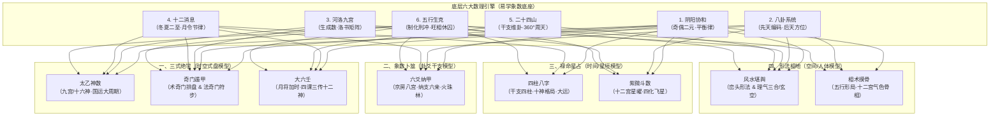

# 周易数术总纲与底层数理模型源流考——阴阳协和、八卦河洛九宫、十二消息、二十四山与五行生克的耦合机制

> **创建日期**：2026-11-21  
> **模块归属**：`08 周易源流与哲学史 / 03_周易数术源流编 ｜ 编号：01`  
> **价值基准评级**：🟡 **2 级文档（核心依赖因子：0.3，初始暂定，待用户主理人终审裁定）**  
> **前置理论基石**：[`《十数概论》`](../../02%20元研究/十数概论.md)（0.4待定）、[`《互卦化生论》`](../../02%20元研究/互卦化生论.md)（0.4待定）、[`《汉代象数易学考》`](../02_周易哲学史编/02_两汉时期象数易学宇宙图式化与谶纬异化考.md)（0.3暂定）  
> **四重证据配置**：①传世文献——《周易》经传、《汉书·艺文志·数术略》《礼记·月令》《大戴礼记》《淮南子》《古今图书集成·艺术典》《永乐大典》残卷及《道藏》相关典籍（**强**）；②出土简帛——阜阳双古堆汉简太乙九宫占盘、睡虎地与放马滩秦简《日书》、马王堆帛书《刑德》（**强**）；③人类学旁证——古代农业物候历法与方位崇拜（**中**）；④考古实物——汉唐式盘实物、宋明罗盘与铜镜纹饰（**强**）。

---

## 【摘要】

中国古代数术体系并非无源之水，而是以《周易》“一阴一阳之谓道”的辩证思维为哲学母体，在战国至两汉时期与天文历法、干支纪时、五行生克、方位测绘深度耦合后，逐步定型为一套可离散化演算的“时空—物候—博弈”数理模型。本文依据《古今图书集成·博物汇编·艺术典》《永乐大典》及《道藏》所载核心文献，结合《汉书·艺文志·数术略》目录源流与秦汉出土简帛式盘实物，系统拆解构成中国数术大厦的**六大底层引擎**：阴阳协和（奇偶二元态）、八卦（空间/结构编码）、河洛九宫（数序与洛书矩阵）、十二消息卦（太阳视运动与物候周期）、二十四山（360° 空间罗盘离散化）以及五行生克（动态代数变换规则）。文章进而揭示上述六大引擎如何通过不同的“耦合接口”，向上衍生出三式（太乙、奇门、大六壬）、六爻纳甲、四柱八字、紫微斗数、风水堪舆与相术摸骨等八大数术门类，并在历史唯物主义视域下完成“易理与术数”的学术划界与去魅。

**关键词**：周易数术；阴阳五行；八卦九宫；十二消息；二十四山；古今图书集成；永乐大典；道藏

---

## 一、 引言：从《汉志·数术略》到《古今图书集成·艺术典》的门类演进

“数术”（亦作“术数”）一词，最早见于《汉书·艺文志·数术略》。班固据刘歆《七略》将先秦至西汉之数术分为**天文、历谱、五行、蓍龟、杂占、形法**六大类，凡一百九十家，二千五百二十八卷，并总括其宗旨曰：“数术者，皆明堂羲和史卜之职也。史官之废久矣，其书既不能具，虽有其书而无其人。”（《汉书·艺文志》）这一官方目录学界定，揭示了数术的两大唯物历史根源：**其一，它是上古天文、历法、地理测绘与国家行政卜史制度的残余与专业化分流；其二，它并非单一的“迷信”，而是古代士大夫与方技家试图用有限数理符号去模拟无限自然与人事变动的早期系统工程尝试。**

至明清时期，数术文献经历了两次大规模的官方总汇：
1. **明初《永乐大典》**：成祖永乐年间（1403—1408 年）由解缙、姚广孝等主持编纂，按《洪武正韵》分韵收书。其中“数”“占”“卜”“命”“相”“地”“式”“太乙”“六壬”“遁甲”等韵目下，辑录了大量唐宋元时期的数术孤本与秘传歌诀（如《灵台秘苑》《太乙金镜式经》引文、杨筠松与赖文俊堪舆诸书、唐宋星命赋文等），虽多散佚于明清鼎革及战火，然清代《四库全书》从中辑出部分珍本，仍可见宋元数术原貌。
2. **明代《道藏》**：以正统十年（1445 年）《正统道藏》及万历三十五年（1607 年）《万历续道藏》为代表，将战国至宋元的“房中、星官、六甲符箓、禹步祈禳、太乙式法、阴符数理”宗教化保存，是研究**“法奇门”**、**紫微星官体系**及**道法数术合一**不可替代的文献宝库。
3. **清初《古今图书集成·博物汇编·艺术典》**：康熙末年陈梦雷编纂、雍正四年（1726 年）蒋廷锡奉敕校订。全典 824 卷，除医部外，将数术文献精准划分为**卜筮部**（卷 469—482，含蓍占、京房纳甲、火珠林、梅花等）、**星命部**（卷 483—570，含五星、禄命、四柱子平、紫微斗数等）、**相术部**（卷 571—610，含人相、骨相、手相、声色等）、**术数部**（卷 611—650，含太乙、奇门遁甲、大六壬、禽演等“三式”杂占）与**堪舆部**（卷 651—710，含葬书、青囊、撼龙、疑龙、理气罗经等）。值得注意的是，**《古今图书集成》并无名为“数术堪舆部”的单一合并部名，而是将“术数部”与“堪舆部”分列于《博物汇编·艺术典》之下**（另有学者常合称“艺术典术数堪舆诸部”）。本文在征引时严格按原典分部校核，确保目录学严谨性。

---

## 二、 底层六大数理引擎的源流考辨与组装机制

无论太乙、奇门、六壬之“三式”，抑或纳甲、八字、斗数、堪舆、相术，其内部演算皆可还原为以下**六大底层引擎**的排列组合：

### 1. 引擎一：阴阳协和（奇偶二元态与动态平衡律）
* **哲学与数理内核**：《周易·系辞上》云“一阴一阳之谓道”，《说卦》云“立天之道曰阴与阳，立地之道曰柔与刚”。在先秦《周易》古经中（参见 [`《十数概论》`](../../02%20元研究/十数概论.md) 穷尽统计），古经尚无抽象的“阴阳”二字对举，仅有爻画“—”（九/刚）与“--”（六/柔）的奇偶符号对立。至战国《易传》与阴阳家邹衍以降，“阴阳”升格为一切事物的二元状态变量（动静、刚柔、消长、显隐、寒暑、昼夜）。
* **向数术的转化接口**：数术将“阴阳协和”操作化为**“平衡判据（扶抑、通关、调候）”**与**“奇偶分配律”**（如十天干甲丙戊庚壬为阳、乙丁己辛癸为阴；十二地支子寅辰午申戌为阳、丑卯巳未酉亥为阴；奇门阳遁顺布、阴遁逆布）。数术之“吉凶”，本质上皆归结为系统内部阴阳二气是否“协和流通”（中和为吉，偏枯战克为凶）。

### 2. 引擎二：八卦系统（空间方位与万物类象编码器）
* **文献层累辨正**：
  * **后天八卦（文王八卦方位）**：其方位文字最早见于《周易·说卦传》第五章：“帝出乎震，齐乎巽，相见乎离，致役乎坤，说言乎兑，战乎乾，劳乎坎，成言乎艮。”对应**正东震、东南巽、正南离、西南坤、正西兑、西北乾、正北坎、东北艮**。战国竹简与汉初《淮南子》已见八方配卦雏形，它是**所有空间方位类数术（奇门九宫、二十四山、风水罗盘）的绝对空间骨架**。
  * **先天八卦（伏羲八卦次序与方位）**：《说卦传》第三章仅言“天地定位，山泽通气，雷风相薄，水火不相射，八卦相错”，**并无方位图与数字配属**。现存“乾一、兑二、离三、震四、巽五、坎六、艮七、坤八”及圆形方位图，实为北宋陈抟—邵雍（《皇极经世书》）所建构的“先天图学”（参见 `01_周易源流编/05_宋元明时期雕版印本流变与图书文献源流辨伪考.md`）。但在宋元以后的奇门、玄空风水、梅花易数中，先天八卦数（1–8）被广泛用作**“数理取象”与“体用生克”的编码表**，形成“先天为体、后天为用”的混合接口。

### 3. 引擎三：河图、洛书与九宫（数序拓扑与时空矩阵）
* **出土实物与传世文献互证**：
  1. **洛书九宫的汉代铁证**：1977 年安徽阜阳双古堆西汉汝阴侯墓（下葬于汉文帝十五年，公元前 165 年）出土**太乙九宫占盘**，正面圆盘刻“招摇、轩辕、太阴、天一、太乙、天符、摄提、咸池、青龙”九宫名称与节气日数，背面方盘刻“二、九、四、七、五、三、六、一、八”洛书数阵，与《大戴礼记·明堂》“二九四，七五三，六一八”及《黄帝内经·灵枢·九宫八风》完全吻合。这证明**九宫数阵至迟在西汉初年已作为天文历法与式盘硬件物理存在**。
  2. **河图数理的经传本源**：《周易·系辞上》言“天一，地二，天三，地四，天五，地六，天七，地八，天九，地十”。汉代郑玄注以此配五行生成数（天一生水地六成之，地二生火天七成之，天三生木地八成之，地四生金天九成之，天五生土地十成之）。至北宋初，刘牧《易数钩隐图》与朱熹《周易本义》将黑白点图式定名为“河图”（一六水居北、二七火居南、三八木居东、四九金居西、五十土居中）与“洛书”（戴九履一，左三右七，二四为肩，六八为足，五居中央）。
* **数术引擎功能**：
  * **河图**提供**“五行生成与阴阳合德（一六共宗、二七同道、三八为朋、四九为友、五十同途）”**的静态能量配对规则；
  * **洛书九宫**提供**“空间九格与飞宫轨迹（1→2→3→4→5→6→7→8→9 量天尺轨）”**，是奇门遁甲排盘、太乙十六宫/九宫推演、玄空飞星顺逆飞布的唯一数学矩阵。

### 4. 引擎四：十二消息卦（太阳周年视运动与气候周期表）
* **源流考辨**：西汉孟喜创立“卦气说”，以《复》《临》《泰》《大壮》《夬》《乾》《姤》《遁》《否》《观》《剥》《坤》十二卦配十二月（《易纬·稽览图》及《京氏易传》集其大成，唐李鼎祚《周易集解》及《古今图书集成·卜筮部》多有保存）。
* **物理与数理意义**：十二消息卦以太阳周年视运动引起的**地球北半球寒暑昼夜消长**为客观物理原型——冬至十一月子月一阳生（`复` ䷗），春分二月卯月阳气大壮（`大壮` ䷡），夏至五月午月一阴生（`姤` ䷫），秋分八月酉月阴气剥阳（`剥` ䷖），十月亥月纯阴（`坤` ䷁）。
* **向数术的转化接口**：它是**“时间节律控制器”**——在六爻纳甲中定世应与月建旺衰；在四柱八字与奇门遁甲中定十二月令提纲与“阳遁/阴遁”冬至夏至二至分界；在太乙与六壬中决定“月将加时”与四季气运进退。

### 5. 引擎五：二十四山（360° 周天方位精密离散化）
* **结构原理**：将地平周天 360° 均分为 24 等份，每山占 15°，由**十二地支**（子丑寅卯辰巳午未申酉戌亥）、**八天干**（甲乙丙丁庚辛壬癸，戊己中央土不居四方）及**四维卦**（乾坤艮巽，填补四隅）共同组成：
  * 正北坎宫：壬、子、癸；东北艮宫：丑、艮、寅；
  * 正东震宫：甲、卯、乙；东南巽宫：辰、巽、巳；
  * 正南离宫：丙、午、丁；西南坤宫：未、坤、申；
  * 正西兑宫：庚、酉、辛；西北乾宫：戌、乾、亥。
* **历史源流**：二十四山方位体系萌芽于汉代式盘与《淮南子·天文训》之“二十四方位”，成熟于唐代杨筠松、丘延翰堪舆学及历代《罗经解定》（广泛辑入《古今图书集成·堪舆部》与《永乐大典》地字韵）。它将“后天八卦（8方位）”精度提升 3 倍，配合“三元龙”（地元、天元、人元）阴阳属性，成为风水堪舆理气派、奇门拆补择吉与大六壬十二宫分野的核心空间坐标系。

### 6. 引擎六：五行生克制化与干支代数（动态运算规则集）
* **从“五材”到“五行代数”**：先秦《尚书·洪范》《左传》中，水火木金土是人类生产生活的五种基本物质材料（“天生五材，民并用之”）。战国邹衍提出“五德终始”，汉代董仲舒《春秋繁露》与京房将五行抽象为具有**相生（木→火→土→金→水→木）、相克（木→土→水→火→金→木）、反侮、乘克、合化、刑冲破害**关系的代数算子。
* **旺相休囚死与十二长生**：结合四时月令（十二消息），任一五行在不同季节呈现五种能量状态（当令为**旺**，我生为**相**，生我为**休**，克我为**囚**，我克为**死**）；十天干在十二地支中亦经历**长生、沐浴、冠带、临官、帝旺、衰、病、死、墓、绝、胎、养**十二状态。这套规则赋予了静态的八卦与干支以**动力学演化能力**。

---

## 三、 底层引擎向八大数术门类的耦合拓扑

---

## 四、 历史唯物主义与“易理—术数”划界总结

1. **技术演化的合理性**：数术将模糊的哲学思辨转化为**可操作、可复现的符号计算程序**（如立春换年、冬至换阳遁、月将加正时）。这种对“离散化时间（干支）+ 离散化空间（九宫/二十四山）+ 状态转移规则（五行生克）”的构建，客观上推动了中国古代历算学、地理测绘学与组合数学的发展（如北宋沈括《梦溪笔谈》专论六壬、纳甲与历法之关系）。
2. **宿命论的唯心异化**：当数术脱离了作为“辅助决策参考与自然节律观测工具”的边界，转而宣称“八字定终身”“坟山决定子孙富贵”“奇门可役使鬼神”时，便沦为服务于封建等级合法化与消极宿命论的意识形态工具。
3. **本编研究准则**：在后续[`02_周易衍生十大数术门类历史源流与核心原理大纲.md`](02_周易衍生十大数术门类历史源流与核心原理大纲.md)中，我们将对八大门类逐一执行**“文献锚定（《古今图书集成》《永乐大典》《道藏》）→ 典故辨伪 → 核心数理原理拆解 → 唯物去魅评价”**的四步剖析。

---

© 2026 徐时言 · 《周易数术总纲与底层数理模型源流考——阴阳协和、八卦河洛九宫、十二消息、二十四山与五行生克的耦合机制》 · 徐时言-易经研究 · 采用 CC BY-NC-ND 4.0 许可， 转载请署名并注明来源 https://wole278.github.io/xushiyan-YiJing/ · 禁止商业使用与改编传播 · 商业授权：wole278@hotmail.com / 微信 wole278
