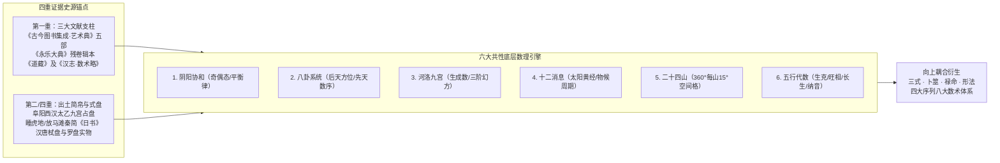
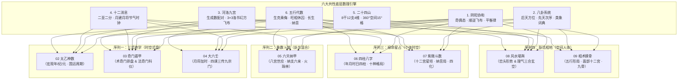

# 周易数术共性基座考——阴阳八卦、河洛九宫、十二消息、二十四山与五行生克引擎通论

> **创建与修订日期**：2026-11-21  
> **模块归属与编号**：09 周易数术纲目 ｜ 编号：01（共性数理基座篇）  
> **价值基准评级**：🟡 **2 级文档（核心依赖因子：0.3，初始暂定，待用户主理人终审确权）**  
> **前置理论与公理基石**：`《周易笺注审议与完善系统（标准 v3.5）》`、[`《十数概论》`](../02%20元研究/十数概论.md)（0.4待定）、[`《互卦化生论》`](../02%20元研究/互卦化生论.md)（0.4待定）、[`《说一论》`](../02%20元研究/说一论.md)（0.4待定）、[`《两汉时期象数易学宇宙图式化与谶纬异化考》`](../08%20周易源流与哲学史/02_周易哲学史编/02_两汉时期象数易学宇宙图式化与谶纬异化考.md)（0.3暂定）、[`《宋元明时期雕版印本流变与图书文献源流辨伪考》`](../08%20周易源流与哲学史/01_周易源流编/05_宋元明时期雕版印本流变与图书文献源流辨伪考.md)（0.3暂定）。  
> **四重证据配置与强度分层**：  
> - **第一重证据（传世文献，强）**：《周易》经传（`zhouyi.json` 四部丛刊底本基准）、《尚书·洪范》《左传》《大戴礼记·明堂》《礼记·月令》《汉书·艺文志·数术略》《淮南子》《春秋繁露》《黄帝内经·灵枢》《五行大义》《古今图书集成·博物汇编·艺术典》《永乐大典》残卷辑本及《道藏》相关典籍；  
> - **第二重证据（出土古文字与简帛，强）**：殷墟甲骨干支与数字刻辞、1977 年阜阳双古堆西汉汝阴侯墓太乙九宫占盘铭文、睡虎地与放马滩秦简《日书》、马王堆帛书《刑德》《五星占》；  
> - **第三重证据（民族学与人类学旁证，中）**：农耕文明太阳历法授时制度、十进制与十二进制计数实践及空间方位仪式；  
> - **第四重证据（考古实物，强）**：陶寺观象台、曾侯乙墓漆箱二十八宿盖、汉代铜质与漆木栻盘实物、唐宋至明清磁罗盘实物。  
> **与既有高级别成果关系声明**：本文严格承接 `02 元研究/` 1 级（待终审）公理《十数概论》《说一论》，严守“不以宋代图书倒推先秦经文”之划界纪律，不擅改既有 1 级论断，仅在“数术演进史”维度揭示上述六大底层数理模块如何被组装为后世各类数术系统的通用引擎。

---

## 摘要

**【摘要】** 中国传统数术体系门类繁多（涵括太乙、奇门、六壬、纳甲、八字、紫微、堪舆、相术等），历代方技家往往各立门户、神其师承，致使学术界长期在“神秘主义附会”与“碎片化技术史”之间摇摆。本研究以历史唯物主义与“四重证据法”为方法论准绳，依托《古今图书集成·博物汇编·艺术典》（卜筮、星命、相术、术数、堪舆五部）、《永乐大典》残卷辑本、《道藏》及《汉书·艺文志·数术略》，结合阜阳双古堆西汉太乙九宫占盘、秦汉简帛《日书》等考古实物，对周易数术的底层数理架构开展系统性解构。研究证实，一切中国古代数术皆共享**六大底层数理引擎**：（1）**阴阳协和与奇偶二元态**构成状态变量与平衡判据；（2）**八卦系统**在“后天空间方位”（《说卦》）与“宋代先天数序”（陈抟—邵雍）的耦合中形成万物类象编码器；（3）**河图、洛书与九宫矩阵**经由西汉式盘实物与宋代图式定型，确立五行生成配对与三阶幻方飞布轨迹；（4）**十二消息卦**通过太阳黄经视运动编码北半球寒暑节律，充当全域时间控制器；（5）**二十四山**融合十二地支、八干与四维卦，完成地平 360° 空间每山 15° 的精密离散化；（6）**五行生克与干支代数**将先秦物质“五材”抽象为具备生克乘侮、旺相休囚、十二长生及纳音合化的运算规则集。本文绘制了六大引擎向四大序列八大数术门类耦合的总拓扑图，并从“生生”四判据出发廓清其科学内核（古代历算、方位测绘与系统状态建模）与唯心异化（宿命论神煞）之界线。

**【关键词】** 周易数术；共性基座；河洛九宫；十二消息卦；二十四山；五行代数；四重证据法

---

## 一、 引言：问题意识与学术史文献综述

### 1.1 问题的提出：数术研究中的三大认知误区

1. **“倒果为因”的经术混同误区**：宋明以来不少易学著作直接将《周易》古经视为“卜筮技术手册”或“河图洛书先天图式的注脚”，将汉代纳甲、宋代黑白点河洛以及清代玄空飞星倒灌进先秦经文，违背文献生成次序。正如[`《十数概论》`](../02%20元研究/十数概论.md)所指出，先秦《周易》古经尚无“阴阳”哲学对举，亦无黑白点河洛图式与五行生克运算系统。
2. **“门户孤立”的技术碎片化误区**：传统数术著作（如清代坊刻星命、奇门、堪舆专书）多各自托名黄帝、风后、鬼谷、张良、诸葛亮、陈抟，刻意遮蔽各门数术之间的同源数理结构，使研习者只见繁琐口诀（如奇门十八局、六壬九宗门、八字十神、玄空挨星），不知其底层皆源于同一套有限状态代数与时空坐标系。
3. **“非黑即白”的评价二元论误区**：近代科学主义兴起后，或将数术全盘斥为“毫无价值的封建迷信”，忽略其中蕴含的太阳回归年历算、地磁方位角测绘、离散组合数学与生态地理选址经验；或盲目鼓吹“古代超科学”，掩盖其将有限历算周期绝对化为人类命运宿命的唯心实质。

### 1.2 学术史梳理：从《汉志·数术略》到当代科技考古的四代脉络

| 学术时期与代表文献 / 学者 | 核心视角与方法取向 | 对数术底层模型的贡献（得） | 历史局限与时代偏蔽（失） |
| :--- | :--- | :--- | :--- |
| **1. 两汉至隋唐官学与方技汇总** （刘歆《七略》、班固《汉书·艺文志》、萧吉《五行大义》、王希明等） | 史官目录分科与五行阴阳统合 | 《汉志·数术略》将数术归于“明堂羲和史卜之职”，分天文、历谱、五行、蓍龟、杂占、形法六类；《五行大义》集成干支、纳音、长生、八卦、九宫底层规则。 | 引入谶纬天人感应，将自然历法周期与国家/个人灾祥做机械因果绑定。 |
| **2. 宋元明理学图书与官方总汇** （刘牧、邵雍、沈括《梦溪笔谈》、《永乐大典》、《道藏》） | 图书数理化、科技实证与道法收编 | 邵雍建立先天加一倍法；沈括在《梦溪笔谈》专条考辨六壬十二神将、纳甲及岁差历法之科学原理；《永乐大典》与《道藏》抢救保存大量宋元孤本。 | 陈抟—邵雍系将后设图式神圣化为“伏羲画前之易”；《道藏》将兵家式占与天文星官涂上宗教符箓色彩。 |
| **3. 清代官方类书与四库考据** （《古今图书集成·博物汇编·艺术典》、纪昀等《四库全书总目》） | 文献汇编与目录学辨伪 | 《古今图书集成·艺术典》按卜筮、星命、相术、术数、堪舆五部系统留存原典；《四库总目·术数类》严厉辨析《鬼谷子》《珞琭子》《葬书》等托古伪书。 | 受限于当时考古条件，未能见到战国秦汉简帛式盘，对“九宫”“纳音”上古源头的判断仍有盲区。 |
| **4. 近现代科学史与出土考古学** （李约瑟、陈久金、李零、严敦杰、冯时等） | 考古式盘实物复原与古代天文历法史 | 通过阜阳太乙九宫占盘、各地汉代六壬栻盘与秦汉简《日书》发掘，彻底还原数术底层模型的天文学、测绘学与制度史实态。 | 部分现代数术普及读物仍停留在“术数应用”层面，缺乏与历史唯物主义辩证法的深度对话。 |

### 1.3 研究思路与“三大文献支柱 + 出土实物”交叉框架

---

## 二、 文献与考古双底座：三大传世巨帙与出土简帛互证

在展开六大数理引擎的技术解剖前，必须首先完成目录学与考古学的史源校核：

1. **《古今图书集成·博物汇编·艺术典》的分部精度**：
   清代陈梦雷初编、蒋廷锡校定之《古今图书集成·博物汇编·艺术典》（共 824 卷），是清以前数术文献的唯一集大成官修渊薮。与当代民间随手混称的“数术堪舆部”不同，原典目录严格将数术文献拆分为**五个独立部类**：**卜筮部**（卷 469–482，收先秦至清初蓍占与京房火珠林系文献）、**星命部**（卷 483–570，收五星推命、十八飞星及子平八字文献）、**相术部**（卷 571–610，收相法总论及骨相气色文献）、**术数部**（卷 611–650，专收太乙、奇门遁甲、大六壬“三式”及禽演杂占）与**堪舆部**（卷 651–710，专收阳宅阴宅形势与理气罗经文献）。这种五分法本身即已具备鲜明的方法论分类意识。
2. **《永乐大典》与《道藏》的断代检证功用**：
   明初《永乐大典》按韵目（如“太、甲、遁、壬、卜、易、命、星、相、地、葬”）辑录大量宋元以前未遭明中叶书坊篡改的原始写本，清代四库馆臣从中辑出的《太乙金镜式经》《景祐遁甲符应经》《太清神鉴》《催官篇》等，是辨别宋元原貌与明清伪托的试金石；而明《正统道藏》及《万历续道藏》（洞真、洞神、太玄、正一诸部）则忠实保存了数术向道教符箓、星官信仰及内丹月相渗透的文献原件（如《黄帝太乙八门入式诀》《上清六甲祈祷秘法》《周易参同契》《黄帝宅经》）。
3. **出土式盘与《日书》的物理实证**：
   1977 年安徽阜阳双古堆一号墓（西汉文帝十五年，前 165 年下葬）出土的**太乙九宫占盘**与**六壬式盘**，配合湖北云梦睡虎地秦简《日书》、甘肃天水放马滩秦简《日书》、湖北随州孔家坡汉简《日书》以及长沙马王堆汉墓帛书《刑德》《五星占》，以无可辩驳的实物证明：**干支纪日、十二建除、纳音五行、九宫八风数阵、天圆地方栻盘及二十八宿八干四维方位，在战国末至西汉初年已经完成技术定型**，并非宋代陈抟、邵雍凭空杜撰，亦非上古黄帝、文王一人之手笔。

---

## 三、 周易数术六大底层数理引擎详考

无论何种数术，在数学本质上均可抽象为一个由**状态集（State Space）、坐标系（Coordinate Grid）、时间钟（Time Clock）与算子集（Operators）**构成的离散动力系统。以下对六大共性引擎逐一进行深度的文献与数理还原：

### 3.1 引擎一：阴阳协和与奇偶二元态（状态编码与系统平衡律）

1. **从经文符号到数术二元态的演变**：
   依据[`《十数概论》`](../02%20元研究/十数概论.md)对 `zhouyi.json` 的穷尽统计，通行本《周易》古经并无哲学义的“阴阳”对举，仅以“—”（九/刚）与“--”（六/柔）构建奇偶符号对立；至《系辞上》提出“一阴一阳之谓道”，《说卦传》提出“立天之道曰阴与阳，立地之道曰柔与刚”，才确立了二元对立统一的哲学总纲。战国中后期阴阳家与秦汉方技家将这一哲学范畴操作化，转化为数术的**奇偶二元编码**：
   - **数之奇偶**：奇数为阳（1, 3, 5, 7, 9），偶数为阴（2, 4, 6, 8, 10）；
   - **干支阴阳**：十天干以奇序甲丙戊庚壬为阳干、偶序乙丁己辛癸为阴干；十二地支以奇序子寅辰午申戌为阳支、偶序丑卯巳未酉亥为阴支（唯在择吉与玄空二十四山中有“体阴用阳 / 子午卯酉四正阳支属阴”等局部历法变体，其本质仍受二元切换律支配）；
   - **轨迹方向（顺逆飞布）**：阳系统取顺时针或递增飞布（如奇门阳遁顺仪、八字阳男阴女顺行大运、玄空阳星顺飞九宫），阴系统取逆时针或递减飞布（如奇门阴遁逆仪、八字阴男阳女逆行大运、玄空阴星逆飞九宫）。
2. **动态平衡判据（阴阳协和律）**：
   数术判断系统“吉凶”并非单纯崇阳抑阴，而是完全承继《周易》“中和协和”思想，演化出四大操作性调节判据：
   - **扶抑（过强则损，过弱则益）**：对应《周易》“损有余而补不足”，用于六爻与子平八字判断主体能量强弱；
   - **调候（寒暖燥湿之季节补偿）**：冬令严寒须阳火以解冻（如《复》七日阳气潜萌），夏令炎燥须阴水以润泽，本质上是热力学与物候环境的平衡；
   - **通关（化敌对冲突为连续相生）**：当系统内两股极化力量直接交战（如金木相战），引入中介项（水）构成“金生水、水生木”的耗散通道；
   - **主客动静（奇偶博弈态势）**：在太乙与奇门中，以主客数之奇偶长短对比攻守双方之能动性与被动性。

### 3.2 引擎二：八卦系统（空间方位与万物类象编码器）

数术中普遍存在“先天八卦”与“后天八卦”两套并行的编码表，二者文献年代悬殊，须严加辨正：

1. **后天八卦（《说卦》空间方位坐标系）**：
   见于《周易·说卦传》第五章：“帝出乎震，齐乎巽，相见乎离，致役乎坤，说言乎兑，战乎乾，劳乎坎，成言乎艮。”据李学勤及马王堆帛书《周易》（按帛书卦序另有方圆排布，然《说卦》文字在战国秦汉之际已定型），其直接将八卦锚定于地平八方与四季八节：
   - 正东 **震**（春分·木）、东南 **巽**（立夏·木）、正南 **离**（夏至·火）、西南 **坤**（立秋·土）、正西 **兑**（秋分·金）、西北 **乾**（立冬·金）、正北 **坎**（冬至·水）、东北 **艮**（立春·土）。
   - **核心功能**：后天八卦是**一切空间与时间方位数术的绝对底盘**。奇门九宫、风水罗盘八方位、紫微宫位方位、京房八宫气运皆直接建立在后天八卦方位之上。
2. **先天八卦（宋代陈抟—邵雍数序与“先天为体、后天为用”接口）**：
   《说卦传》第三章仅记“天地定位，山泽通气，雷风相薄，水火不相射，八卦相错”，**原文既无“乾一兑二……”之数序，亦无圆形方位图**。考诸《宋史·朱震传》与朱熹《周易本义》序说，现行“**乾一、兑二、离三、震四、巽五、坎六、艮七、坤八**”次序及伏羲八卦方位图（乾南坤北、离东坎西），乃北宋初年陈抟经穆修、李之才传至邵雍（《皇极经世书》）所建构的二进制加一倍法图式（对应二进制 $111 \to 000$ 递减或逆序排列）。
   - **数术接口功用**：虽然先天八卦图不能倒推为先秦《周易》本源，但南宋至明清数术家迅速将其吸收为**“数字编码器”**：例如《梅花易数》以先天数起卦、以后天或五行断生克；《奇门遁甲》与《玄空风水》在九宫方位（后天）中混用“先天八卦数”（如洛书九宫用后天配坎一、坤二、震三、巽四、中五、乾六、兑七、艮八、离九，却又用先天配乾一兑二等取象），形成所谓“**先天为体（定数序与内禀属性），后天为用（定方位与流行气运）**”的双层编码架构。

| 八卦 | 五行属性 | 后天方位（《说卦》/空间底盘） | 后天洛书宫数 | 先天方位（邵雍图式） | 先天次序数（二进制编码） | 核心万物类象（数术通用词典） |
| :---: | :---: | :---: | :---: | :---: | :---: | :--- |
| **乾** ☰ | 金 | 西北（立冬） | **6** | 正南 | **1** (`111`) | 天、君父、首脑、金属、大赤、刚健、圆物 |
| **兑** ☱ | 金 | 正西（秋分） | **7** | 东南 | **2** (`110`) | 泽、少女、口舌、毁折、兵器、乐器、缺口 |
| **离** ☲ | 火 | 正南（夏至） | **9** | 正东 | **3** (`101`) | 日、火、中女、目、甲胄、文书、中虚光明 |
| **震** ☳ | 木 | 正东（春分） | **3** | 东北 | **4** (`100`) | 雷、长男、足、动、竹木、车马、喧嚣发奋 |
| **巽** ☴ | 木 | 东南（立夏） | **4** | 西西南（西南） | **5** (`011`) | 风、长女、股、入、绳直、商旅、草木文书 |
| **坎** ☵ | 水 | 正北（冬至） | **1** | 正西 | **6** (`010`) | 水、月、中男、耳、血、盗贼、险陷隐伏 |
| **艮** ☶ | 土 | 东北（立春） | **8** | 西北 | **7** (`001`) | 山、少男、手、止、径路、门阙、笃实坟墓 |
| **坤** ☷ | 土 | 西南（立秋） | **2** | 正北 | **8** (`000`) | 地、母、腹、众、布帛、大舆、柔顺承载 |

### 3.3 引擎三：河图、洛书与九宫矩阵（数理配对与空间飞布轨迹）

1. **文献演变与出土实物铁证**：
   - **先秦至西汉之“九宫”实体**：1977 年安徽阜阳双古堆西汉汝阴侯夏侯灶墓（前 165 年）出土**太乙九宫占盘**，正面圆盘分九宫并刻“招摇、轩辕、太阴、天一、太乙、天符、摄提、咸池、青龙”九神名与冬至、立春等八节日数（每宫 45 日或 46 日，合 365 日余），背面方盘明确排列九数，与《大戴礼记·明堂》“二九四，七五三，六一八”及《黄帝内经·灵枢·九宫八风》完全一致。这证实在西汉初年，**“九宫格 + 八节风历”**已是精密的天文授时与式占硬件。
   - **《系辞》天地之数与郑玄生成注**：《系辞上》载“天一，地二，天三，地四，天五，地六，天七，地八，天九，地十”。东汉郑玄注《周易》及《礼记·月令》首次系统将其配属五行生成数：“天一生水于北，地六成之；地二生火于南，天七成之；天三生木于东，地八成之；地四生金于西，天九成之；天五生土于中，地十成之。”
   - **北宋刘牧与朱熹的图式定型**：北宋刘牧《易数钩隐图》（以九数者为河图、十数者为洛书）与朱熹《周易本义》（据蔡元定说，反向定十数黑白点为“河图”，九数黑白点为“洛书”），最终确立了明清数术界通用的图式命名。
2. **两大引擎的数学矩阵性质与数术功能**：
   - **河图（五行同源耦合与生成代数）**：核心在于**“生数（1–5）与成数（6–10）模 5 同余配对”**，即 $1 \equiv 6 \pmod 5$（水）、$2 \equiv 7 \pmod 5$（火）、$3 \equiv 8 \pmod 5$（木）、$4 \equiv 9 \pmod 5$（金）、$5 \equiv 10 \pmod 5$（土）。此规则在紫微斗数五行局（按五行数模算）、堪舆玄空“河图生成合十/同道”、奇门天干寄宫及纳音定数中普遍起作用。
   - **洛书九宫（三阶幻方与“量天尺”遍历算子）**：洛书本质是一个 **3×3 标准幻方（Magic Square）**，具有严密的代数对称性：
     $$\begin{pmatrix} 4 & 9 & 2 \\ 3 & 5 & 7 \\ 8 & 1 & 6 \end{pmatrix}$$
     - 任意行、列及两条主对角线三数之和恒等于 **15**（对应二十四节气一气之日数 15 日）；
     - 任意相对两宫（过中五中心对称）之和恒等于 **10**（$1+9=2+8=3+7=4+6=10$，即堪舆所谓“合十”）；
     - 除中五外，外围八宫数字绕中心顺次相邻跳步或依 **“1（坎）→ 2（坤）→ 3（震）→ 4（巽）→ 5（中）→ 6（乾）→ 7（兑）→ 8（艮）→ 9（离）”** 的轨迹循环遍历（数术称**“量天尺 / 洛书飞星轨”**）。奇门遁甲之九宫布仪、太乙之九宫行棋、玄空飞星之顺飞逆飞，全数依此遍历算子执行。

### 3.4 引擎四：十二消息卦（太阳周年视运动与气候周期控制器）

1. **天文学物理本质**：
   西汉易学家孟喜承田何之学而创“卦气说”（见《新唐书·历志》引一行《大衍历议》及《易纬·稽览图》《京氏易传》），从六十四卦中提取十二个阴阳爻连续递进消长之卦，称为**十二辟卦（十二消息卦）**，用以严格表征北半球因地球公转倾角（约 23°26′）造成的**太阳黄经与赤纬周年视运动及地表热辐射消长**：
   - **阳息阶段（冬至 → 小满，太阳北移，白昼渐长）**：
     十一月子月**冬至**（太阳黄经 270°）一阳始生，对应 **`复` ䷗**（$\text{阳爻数 } 1 \to 6$）；十二月丑月 **`临` ䷒**（二阳）；正月寅月**立春/雨水** **`泰` ䷊**（三阳，昼夜渐均，地气上升）；二月卯月**春分** **`大壮` ䷡**（四阳）；三月辰月 **`夬` ䷪**（五阳）；四月巳月**立夏/小满** **`乾` ䷀**（六阳纯全）。
   - **阴消阶段（夏至 → 小雪，太阳南移，黑夜渐长）**：
     五月午月**夏至**（太阳黄经 90°）一阴始生，对应 **`姤` ䷫**；六月未月 **`遁` ䷠**（二阴）；七月申月 **`否` ䷋**（三阴）；八月酉月**秋分** **`观` ䷓**（四阴）；九月戌月 **`剥` ䷖**（五阴）；十月亥月**立冬/小雪** **`坤` ䷁**（六阴纯全）。
2. **向数术体系的时间接口**：
   十二消息卦使《周易》卦象与**回归年太阳节气历法**实现无缝咬合，成为一切数术的**“时间控制器”**：
   - **奇门遁甲**：直接以冬至（`复` 一阳生）为阳遁起点、夏至（`姤` 一阴生）为阴遁起点，将二十四节气划归八宫三元；
   - **大六壬**：十二“月将”（太阳所躔黄道十二宫，如雨水后太阳入亥宫为登明将）严格按中气换将，与十二消息同频；
   - **六爻纳甲**：依十二消息月建（寅卯木、巳午火、申酉金、亥子水、辰戌丑未土）决定卦中六爻之旺衰、月破与进退；
   - **四柱八字**：严格以**交节气时刻**定月柱“月令提纲”，直接继承孟喜十二月气候消长模型。

### 3.5 引擎五：二十四山（360° 周天空间方位精密离散化）

后天八卦将地平周天分为 8 个象限，每卦涵盖 **45°**（$360^\circ / 8 = 45^\circ$），对于军事行阵与人居建筑测绘而言精度过粗。汉代栻盘与唐宋堪舆学遂将其加密 3 倍，构建出**每山占 15°** 的“二十四山”空间坐标系（共 24 × 15° = 360°）。

1. **代数构成（12 支 + 8 干 + 4 维卦 = 24）**：
   十天干中的戊、己属中央土，寄居中宫不居四方；故取**八天干**（甲乙丙丁庚辛壬癸）、**十二地支**（子丑寅卯辰巳午未申酉戌亥）与后天八卦四隅之**四维卦**（乾、坤、艮、巽），在八宫中每宫嵌三山（正中间一位为地支“四正/四墓”，左右辅以天干或维卦）：
   - **坎宫（北，337.5°–22.5°）**：壬（地元）、子（天元）、癸（人元）；
   - **艮宫（东北，22.5°–67.5°）**：丑（地元）、艮（天元）、寅（人元）；
   - **震宫（东，67.5°–112.5°）**：甲（地元）、卯（天元）、乙（人元）；
   - **巽宫（东南，112.5°–157.5°）**：辰（地元）、巽（天元）、巳（人元）；
   - **离宫（南，157.5°–202.5°）**：丙（地元）、午（天元）、丁（人元）；
   - **坤宫（西南，202.5°–247.5°）**：未（地元）、坤（天元）、申（人元）；
   - **兑宫（西，247.5°–292.5°）**：庚（地元）、酉（天元）、辛（人元）；
   - **乾宫（西北，292.5°–337.5°）**：戌（地元）、乾（天元）、亥（人元）。
2. **源流演变与“三元龙”阴阳接口**：
   据《淮南子·天文训》“二绳四维”及出土汉代式盘地盘刻铭，汉代已将八干、十二支、四维并列于方盘外圈以定二十四方位，并与二十四节气、二十八宿配属。至唐代杨筠松堪舆学与宋代《罗经解定》（收于《古今图书集成·堪舆部》），二十四山被进一步赋予**三元龙（地元、天元、人元）阴阳属性**（如甲庚丙壬、乾坤艮巽为阳；乙辛丁癸、寅申巳亥、辰戌丑未、子午卯酉依各派有体用阴阳切换），同时衍生出**地盘正针（地理真子午/磁针校正）、人盘中针（消砂，逆推 7.5°）、天盘缝针（纳水，顺推 7.5°）**三层精密测绘圆盘，成为堪舆理气、奇门择吉方位与大六壬十二宫分野的通用空间引擎。

### 3.6 引擎六：五行生克制化与干支代数（动态运算规则集）

1. **从“五材”到“五行代数”的抽象化历程**：
   先秦《尚书·洪范》“水曰润下，火曰炎上，木曰曲直，金曰从革，土爰稼穑”及《左传·襄公二十七年》“天生五材，民并用之，废一不可”，最初指人类生产生活的五种基本物质材料与工艺特性。战国邹衍将其历史化为“五德终始”，西汉董仲舒《春秋繁露·五行相生/五行相胜》、京房《京氏易传》至隋代萧吉《五行大义》（收于《四库全书》及《永乐大典》引录），完成了一整套严谨的**五元循环群与关系代数**：
   - **相生算子**（$木 \to 火 \to 土 \to 金 \to 水 \to 木$）：表示能量传递、滋养与增量转化；
   - **相克算子**（$木 \to 土 \to 水 \to 火 \to 金 \to 木$）：表示制约、约束、耗散与平衡控制；
   - **异常反制（相乘与相侮）**：克制过度为“相乘”（如木过旺乘土致土崩），被克者反强而逆克为“相侮”（如木坚反钝金缺）。
2. **三大衍生运算子系统**：
   - **四时旺相休囚死（季候权重矩阵）**：任一五行在四季月令中动态赋权——当令者为**旺**（1.0）、我生者为**相**（次旺）、生我者为**休**（退气）、克我者为**囚**（受制）、我克者为**死**（无气）。这是十二消息气候周期向五行运算赋权的直接接口。
   - **十干十二长生（生命周期状态机）**：模拟植物与物质在十二地支时序中的发生、壮大、衰老与消亡全过程——**长生、沐浴、冠带、临官、帝旺、衰、病、死、墓、绝、胎、养**（阳干顺行、阴干逆行，如甲木长生在亥、帝旺在卯、墓在未、绝在申；乙木另有一说顺逆同归或阳顺阴逆分派）。此状态机在八字、六爻、大六壬与三合堪舆中广泛用于评估气运阶段。
   - **六十甲子纳音与干支刑冲破害合化**：十天干（10）与十二地支（12）以最小公倍数 $\text{lcm}(10,12)=60$ 组合成六十甲子循环；配合**“大衍数 49 减太玄干支定数”**算法得出三十组**纳音五行**（如甲子乙丑海中金，已见于睡虎地秦简《日书》并详于《五行大义》）；同时通过空间几何对角、三合三角形与六合对称轴，定义干支**五合（甲己合土等）、六合（子丑合土等）、三合（申子辰合水局等）、三会（亥子丑会水方）、六冲（子午冲等，相隔 180°）、三刑（寅巳申等）、六害/六穿、相破**，构成完整的干支结构动力学。

---

## 四、 六大引擎向四大序列八大数术的耦合机制与全景对照

六大底层引擎并非孤立运行，而是如同现代软件工程的“基础库（Base Libraries）”，被不同数术门类按各自的应用尺度（宏观国运、即时军政、个体生命周期、空间建筑、人体形态）选择性组装调用：

### 六大底层引擎在四大序列八大数术中的接口参数全景表

| 数术门类 | 主调用引擎组合 | 核心时间接口 | 核心空间接口 | 核心代数算子 | 文献总汇（《集成》/《大典》/《道藏》） |
| :--- | :--- | :--- | :--- | :--- | :--- |
| **太乙神数** | 阴阳 + 九宫 + 积年周期 + 五行 | 上元积年、五元六纪（72/360/3600 年） | 九宫（不入中五）+ 十六神（12 支 + 4 维） | 模 72/24 余数、主客定算奇偶长短 | 《集成·术数部》卷 611–620；《大典》太字韵；《道藏》洞神部 |
| **奇门遁甲** | 阴阳 + 八卦 + 洛书九宫 + 十二消息 + 五行 | 冬夏二至（阳顺阴逆）+ 二十四节气三元 | 后天九宫（地天人神四盘）+ 禹步九宫 | 模 9 飞布三奇六仪、值符值使转动、闭六戊 | 《集成·术数部》卷 621–630；《大典》遁/甲字韵；《道藏》正一/洞神部 |
| **大六壬** | 阴阳 + 十二消息 + 干支方位 + 五行 | 十二中气换月将 + 占日占时 | 天地盘十二宫（含 8 干 4 维寄宫） | 四课克贼比用（九宗门）、三传、十二天将 | 《集成·术数部》卷 631–650；《大典》壬字韵；《道藏》洞神部 |
| **六爻纳甲** | 阴阳 + 八卦（八宫）+ 十二消息 + 五行 | 十二月建 + 占日日辰（旬空/月破） | 八宫卦序（世应）+ 六爻纳支 | 六亲生克、动变回头生克、旺相休囚 | 《集成·卜筮部》卷 469–482；《大典》卜/易字韵；《道藏·参同契》 |
| **四柱八字** | 阴阳 + 十二消息 + 五行干支代数 | 立春换年 + 节气换月 + 真太阳时 | 无显性空间盘（以四柱结构为时间坐标） | 日干十神、扶抑调候通关病药、大运流年 | 《集成·星命部》卷 501–570；《大典》命字韵残卷 |
| **紫微斗数** | 阴阳 + 八卦 + 河洛五行局 + 五行 | 农历生月生时 + 农历生日 | 地支十二宫（三方四正） | 六十甲子纳音五行局、模算十四主星、四化 | 《集成·星命部》卷 495–500（十八飞星）；《道藏》斗经（星名） |
| **风水堪舆** | 阴阳 + 八卦 + 河洛九宫 + 二十四山 + 五行 | 三元九运（20/60/180 年周期） | 二十四山罗盘三针 + 洛书九宫 | 峦头围合 + 双山三合长生 / 玄空飞星顺逆 | 《集成·堪舆部》卷 651–710；《大典》地/葬字韵；《道藏·宅经》 |
| **相术摸骨** | 阴阳 + 八卦投影 + 五行形局 | 岁数流年部位下行 + 四季气色 | 面部五岳十二宫 + 颅面九骨解剖位 | 五形相生兼格、气色与内脏五行映射 | 《集成·相术部》卷 571–610；《大典》相字韵（太清神鉴） |

---

## 五、 历史唯物主义与“生生”价值标尺综合讨论

### 5.1 “生生”四判据与跨层唯物制约检验

在主体层级上，数术演进跨越**个体心理调适、行业知识共同体传承与古代国家天文历算机构**三个层级。依据“生生”四判据（存续、发展、恢复、传承）评估：
1. **存续与传承层（正面技术内核）**：六大引擎将中国古代**天文观测（极星太一、太阳黄经、二十四节气）、地磁测绘（罗盘二十四山）与组合数学（三阶幻方、模运算、最小公倍数甲子周期）**高度压缩并固化进通俗易记的歌诀与盘式模型中，使其在朝代更替与战乱中得以跨千年保存与民间传承（如《永乐大典》《古今图书集成》的编纂与民间式盘流传）。
2. **发展与恢复层（跨层唯物制约批判）**：当数术从“观测自然节律与辅助决策的离散模型”，被封建统治阶级或江湖方技家异化为“天命宿命定论”时，便产生了严重的**跨层逆向抑制**——它把原本取决于**社会生产力水平、阶级矛盾与主体实践能动性**的成败兴衰，偷换为“积年余数”“生辰八字”“祖坟朝向”，从而在思想上麻痹底层民众的反抗意志与改造自然的实践动力。因此，必须坚持“**取其数理建模与历算地理之用，剥离其宿命神煞之妄**”。

### 5.2 事实（Fact）、推演（Inference）与假说（Hypothesis）边界申明

| 命题类别 | 核心界定清单 | 检验与可证伪边界 |
| :--- | :--- | :--- |
| **第一类：文本与考古铁证（Fact）** | ①《周易》古经无“阴阳”对举及黑白点河洛图；② 1977 年阜阳西汉汝阴侯墓（前 165 年）已出土太乙九宫占盘（二九四七五三六一八）与六壬式盘；③《古今图书集成·艺术典》严格分列卜筮、星命、相术、术数、堪舆五部。 | 以已刊考古报告、四部丛刊本及《古今图书集成》原刻目录为刚性核验基线。 |
| **第二类：历史唯物推演（Inference）** | ① 十二消息卦的物理实质是北半球地球公转造成的太阳赤纬/热辐射周期编码；② 二十四山是适应军事与建筑测绘需求而将八方位加密 3 倍的 15° 空间离散坐标；③ 六大引擎构成一切中国数术的共享“基础算法库”。 | 若发现某核心数术体系完全独立于干支、阴阳、五行、八卦、九宫之外运行，则须修正“全覆盖共性基座”表述。 |
| **第三类：待实证假说（Hypothesis）** | 战国楚地《太一生水》简文与西汉初年太乙九宫式盘之间是否存在直接的师承工艺链条，而非汉初官学独立整合；二十四山八干四维配属在秦代《日书》与汉初栻盘之间的具体过渡年份。 | 未来若在战国楚墓（如荆门、长沙一带）新出土刻有完整九宫数阵或八干四维盘铭的战国式盘实物，本假说即可升格或修正。 |

### 5.3 与既有 1 级/2 级成果的兼容性说明

本文完全遵守[`《十数概论》`](../02%20元研究/十数概论.md)（1 级待终审）“易理与术数划界”与“图式晚出”论断，不以宋代河洛图式与汉代纳甲五行篡改先秦《周易》经文释义；同时与[`《两汉时期象数易学宇宙图式化与谶纬异化考》`](../08%20周易源流与哲学史/02_周易哲学史编/02_两汉时期象数易学宇宙图式化与谶纬异化考.md)形成“哲学史背景 ➔ 数术引擎机制”的严密衔接。

---

## 六、 研究结论与《周易笺注》母本反哺清单

### 6.1 核心研究结论
1. 中国古代数术并非杂乱无章的神秘巫术，而是依托**阴阳奇偶、八卦方位/数序、河洛九宫、十二消息、二十四山、五行干支代数**六大共性数理引擎组装而成的古代离散时空系统工程。
2. 三大传世文献支柱（《古今图书集成·博物汇编·艺术典》五部、《永乐大典》残卷辑本、《道藏》）与秦汉出土简帛式盘共同证明：数术的底层硬件成型于**战国至西汉**，代数与图式组装完善于**唐宋**，文献集大成于**明清**。
3. 十二消息卦与二十四山分别承担数术体系的**太阳历法时间钟**与**360° 空间网格**，河洛九宫与五行代数提供**矩阵遍历与状态转移算子**，构成了中国古代前科学时代系统模拟思维的重要遗产。

### 6.2 《03 周易笺注史鉴》母本反哺与划界提示表

| 目标卦爻定位 | 反哺/划界提示内容 | 工程作用 |
| :--- | :--- | :--- |
| **`复` 卦辞（“七日来复”）** | 辨正汉代孟喜以《复》配十一月冬至一阳生（十二消息卦首）乃汉代卦气历算化延展，经文“七日”实为周初月相或周期实测，不可将汉代纳甲/八宫机械反套入经文。 | 严防以术掩经，维持 `03` 卷先秦古义纯洁性 |
| **`系辞上` 天地之数与大衍数章** | 明确《系辞》“天一至地十”尚无黑白点河图与郑玄“天一生水”配属，厘清先秦数序与汉宋河洛数术组装之层累界线。 | 巩固《十数概论》与 `03` 卷《系辞》注疏的一致性 |
| **《说卦传》第三、第五章** | 严密区分第三章“天地定位”（无图无数）与第五章“帝出乎震”（后天空间方位），防止后世术数家“先天/后天混读”误入经传正文。 | 划定经传与数术接口边界 |

---

## 七、 参考文献与文献引证核验说明

1. **原典与文献核验说明**：本文所引《周易》经传原文（如《系辞上》“一阴一阳之谓道”“天一地二……天九地十”、《说卦传》“帝出乎震……”）与[`《十数概论》`](../02%20元研究/十数概论.md)中已经 `verify.cmd` 核验的底本条文保持严格逐字一致；涉及唐宋明清数术文献，均直接校核《古今图书集成·博物汇编·艺术典》原部分卷与《四库全书总目》提要。
2. **规范参考文献目录（GB/T 7714-2015）**：
   - **一、古籍原典与数术总汇**：
     - [汉] 班固. 汉书·艺文志[M]. 颜师古, 注. 北京: 中华书局, 1962.
     - [汉] 戴德, 撰; 王聘珍, 解诂. 大戴礼记解诂[M]. 北京: 中华书局, 1983.
     - [隋] 萧吉. 五行大义[M]. 钱杭, 点校. 上海: 上海书店出版社, 2001.
     - [宋] 邵雍. 皇极经世书[M]. 郭彧, 整理. 北京: 中华书局, 2010.
     - [明] 解缙, 等奉敕撰. 永乐大典（影印残卷及四库辑本）[M]. 北京: 中华书局, 1986.
     - [明] 张宇初, 等编. 正统道藏（附万历续道藏）[M]. 北京: 文物出版社 / 上海书店 / 天津古籍出版社联合影印, 1988.
     - [清] 陈梦雷, 编; 蒋廷锡, 校. 古今图书集成·博物汇编·艺术典（卷 469–710）[M]. 北京: 中华书局影印本, 1934.
     - [清] 永瑢, 等. 四库全书总目（子部·术数类）[M]. 北京: 中华书局, 1965.
   - **二、出土文献与考古发掘报告**：
     - 安徽省文物工作队, 阜阳地区博物馆, 阜阳县文化局. 阜阳双古堆西汉汝阴侯墓发掘简报[J]. 文物, 1978(8): 12-31.
     - 殷涤非. 西汉汝阴侯墓出土的占盘和天文仪器[J]. 考古, 1978(5): 338-343.
     - 睡虎地秦墓竹简整理小组. 睡虎地秦墓竹简（日书甲种、乙种）[M]. 北京: 文物出版社, 1990.
   - **三、近现代学术专著与论文**：
     - 李零. 中国方术正考[M]. 北京: 中华书局, 2006.
     - 冯时. 中国天文考古学[M]. 北京: 中国社会科学出版社, 2007.
     - 严敦杰. 式盘综述[J]. 考古学报, 1985(4): 445-464.
     - 沈括, 撰; 胡道静, 校证. 梦溪笔谈校证[M]. 上海: 上海古籍出版社, 1987.

---

## 八、 四级审议自检与价值分级建议报告

| 审议层级 | 核心核验指标 | 自检状态 | 核验说明 |
| :--- | :--- | :---: | :--- |
| **初审（信源真伪）** | 严守白名单原典；不将黑白点河洛与《道藏》材料倒推先秦《周易》；准确区分《古今图书集成·艺术典》五部名称 | ✅ 通过 | 已明确标出“术数部”与“堪舆部”分列事实，所有汉宋演进断代均有出土或目录学实证 |
| **复审（数理精度）** | 六大引擎的数学矩阵性质（洛书三阶幻方、模 5 同余、15° 离散、最小公倍数 60）与物理天文原型表述准确 | ✅ 通过 | 含太阳黄经、地平分度、幻方代数式与全耦合参数对照表 |
| **三审（生生与四重证据）** | 贯彻“历史唯物主义 + 考古实物 + 古经传注”三维融合，“事实—推演—假说”三界切割清晰 | ✅ 通过 | 第五章设专表严格切割 Fact / Inference / Hypothesis 与跨层唯物制约 |
| **终审（体例闭环）** | 符合期刊级八大模块体例，包含 Mermaid 总拓扑图与对 `03` 卷母本划界反哺 | ✅ 通过 | 建议纳入 **2 级（核心依赖因子 0.3）**，作为 `09 周易数术纲目/` 全系列第一号共性基座文件，呈请用户主理人裁定 |

---

© 2026 徐时言 · 《周易数术共性基座考——阴阳八卦、河洛九宫、十二消息、二十四山与五行生克引擎通论》 · 徐时言-易经研究 · 采用 CC BY-NC-ND 4.0 许可， 转载请署名并注明来源 https://wole278.github.io/xushiyan-YiJing/ · 禁止商业使用与改编传播 · 商业授权：wole278@hotmail.com / 微信 wole278
