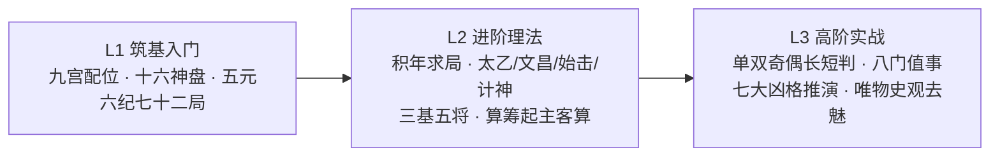

# 太乙神数分级教程——从九宫十六神筑基到主客定算实战推演

> **本门导航（02_太乙神数·6篇）**：[🏠 总纲](../README.md) ｜ [① 源流详考](01_源流详考.md) ｜ **② 分级教程（当前）** ｜ [③ 动画实操演练](03_动画实操演练.md) ｜ [④ 《太乙金镜式经》](04_经典全文1_《太乙金镜式经》.md) ｜ [⑤ 《景祐太乙福应经》](05_经典全文2_《景祐太乙福应经》.md) ｜ [⑥ 《黄帝太乙八门入式诀》](06_经典全文3_《黄帝太乙八门入式诀》.md)

> **创建与修订日期**：2026-11-21  
> **状态**：`draft`（AI 辅助起草，待主理人终审）  
> **模块归属**：09 周易数术纲目 ｜ `02_太乙神数` ｜ 教学梯度：L1 筑基 → L2 理法 → L3 实战  
> **前置基座**：[`01_阴阳八卦河洛九宫十二消息二十四山与五行生克详考.md`](../01_共性基座/01_阴阳八卦河洛九宫十二消息二十四山与五行生克详考.md)

---

## 学习路径总览

太乙神数居“三式绝学”之首，历史上由司天监太史官秘传，其算法结构堪比一套古代**离散时空状态机**。本教程将繁复的唐宋式经拆解为三级阶梯，剥除神煞迷雾，纯以数理逻辑与式盘拓扑结构展开教学：

---

## 一、 L1 筑基入门：认盘、定位与周期框架

### 1.1 九宫式盘的两种数序辨正（初学者第一关）

研习太乙神数最容易卡壳的环节，在于唐宋式经中存在**“太乙专属理宫数序”**与后世**“洛书后天方位数序”**两种编号体系的并存。动手排盘前必须先彻底厘清：

1. **《太乙金镜式经》原始式盘理宫序（阳遁起乾一）**：
   唐·王希明《太乙金镜式经》承袭汉代式盘天门（乾）地户（巽）传统，将八宫按特定象数步长编码为：
   - **一宫（乾·西北）** → **二宫（离·正南）** → **三宫（艮·东北）** → **四宫（震·正东）** → **五宫（中天虚位，不用）** → **六宫（兑·正西）** → **七宫（坤·西南）** → **八宫（坎·正北）** → **九宫（巽·东南）**。
   - **校验和性质**：注意该排列依然构成一个旋转对称的**三阶幻方**！即 $(8, 3, 4 / 1, 5, 9 / 6, 7, 2)$ 或相对两宫之和恒等于 **10**（乾 1 + 巽 9 = 10；离 2 + 坎 8 = 10；艮 3 + 坤 7 = 10；震 4 + 兑 6 = 10），只是将传统洛书的“一坎、九离、六乾、四巽”按太乙式盘天门乾宫置一重新旋转了坐标标签。
2. **传统洛书后天八宫序（《统宗宝鉴》及部分明清注本并用）**：
   - 即一坎（北）、二坤（西南）、三震（东）、四巽（东南）、五中、六乾（西北）、七兑（西）、八艮（东北）、九离（南）。
3. **本教程通用约定**：为紧扣唐宋官修真源，教程与动画演练核心算法严格依照**《太乙金镜式经》理宫序（乾一、离二、艮三、震四、中五、兑六、坤七、坎八、巽九）**推步，并在关键宫位旁注传统地盘方位以防混淆。

### 1.2 “理天不入中五”与十六神间辰盘

太乙中五宫为“天枢皇极虚位”，**太乙神及主客大小将皆不落中五宫**，仅在外围八宫（1, 2, 3, 4, 6, 7, 8, 9）巡行。为了把八个方位（每方 45°）与十二地支时辰/月份咬合，太乙圆盘在十二地支之间嵌入**乾、坤、艮、巽**四维卦，形成 **16 个方位扇区（十六神盘，每格 22.5°）**：

| 序号 | 方位字 | 归属宫位（按金镜式经数序） | 太乙十六神专名 | 五行 | 核心军政象义速记 |
| :---: | :---: | :--- | :--- | :---: | :--- |
| **1** | **子** | 八宫（正北·坎） | **地主** | 水 | 建国基业、府库、潜伏夜行 |
| **2** | **丑** | 三宫（东北·艮） | **阳德** | 土 | 恩赦、赏赐、生机初萌 |
| **3** | **艮** | 三宫（东北维·艮） | **和德** | 土 | 停战、关塞、边防盟约 |
| **4** | **寅** | 三宫（东偏北·艮） | **吕申** | 木 | 号令、发兵端绪（计神阳局起点） |
| **5** | **卯** | 四宫（正东·震） | **高丛** | 木 | 车骑、鼓噪、迅疾行军 |
| **6** | **辰** | 九宫（东偏南·巽） | **太阳** | 土 | 显明威仪、强攻破阵 |
| **7** | **巽** | 九宫（东南维·巽） | **大暭** | 木 | 风宪、军令文书、风声传播 |
| **8** | **巳** | 九宫（南偏东·巽） | **大神** | 火 | 主帅威望、突变、火器/火攻 |
| **9** | **午** | 二宫（正南·离） | **大威** | 火 | 堂皇正阵、礼乐朝会、决战 |
| **10** | **未** | 七宫（南偏西·坤） | **天道** | 土 | 粮道补给、礼秩、犒赏 |
| **11** | **坤** | 七宫（西南维·坤） | **大武** | 土 | 屯兵要塞、重装步兵、守御 |
| **12** | **申** | 七宫（西偏南·坤） | **武德** | 金 | 兵刑肃杀、法令（文昌阳局起点） |
| **13** | **酉** | 六宫（正西·兑） | **太簇** | 金 | 斩获、兵器、金铁刑杀 |
| **14** | **戌** | 一宫（西偏北·乾） | **阴主** | 土 | 伏兵、谍报、暗中谋划 |
| **15** | **乾** | 一宫（西北维·乾） | **阴德** | 金 | 隐秘功德、幕后助力、天门 |
| **16** | **亥** | 一宫（北偏西·乾） | **大义** | 水 | 渡水、法度、终结更始 |

> **记忆口诀（十六神分布规律）**：**四正宫（坎子、震卯、离午、兑酉）各管 1 神**；**四维宫（艮、巽、坤、乾）各管 3 神**（顺时针为“前支 + 维卦 + 后支”，如艮宫管丑、艮、寅；巽宫管辰、巽、巳；坤宫管未、坤、申；乾宫管戌、乾、亥）。$4 \times 1 + 4 \times 3 = 16$。

### 1.3 五元六纪与四计七十二局

1. **五元六纪（360 年一小周）**：
   - **五元**：以阳干配子，即**甲子元、丙子元、戊子元、庚子元、壬子元**。每元 **72 年**，$5 \times 72 = 360$ 年。
   - **六纪**：以六十甲子为一纪，**六纪** $6 \times 60 = 360$ 年。
   - **大周**：$360 \times 10 = 3600$ 年。
2. **四计七十二局**：
   太乙按时间尺度分为**年计（国运）、月计（岁时）、日计（战役）、时计（即时攻防）**四计。每计均以 **72 局**为一个基本循环（即一元之数，因为每宫驻 3 单位，8 宫共 24 单位，巡行 3 周 $24 \times 3 = 72$ 局，恰好回到起点；其中**岁计、月计仅用阳遁 72 局**，**日计、时计则分冬至后阳遁 72 局、夏至后阴遁 72 局**，合 144 局）。

---

## 二、 L2 进阶理法：积年求局与排盘全套算筹规则

### 2.1 第一步：上元积年与入局数求法

设所求年份（或日时）距“上元甲子”之总积年为 $N$（例如唐开元十二年甲子岁，《太乙金镜式经》定岁积 $N = 10153917$；或使用《太乙统宗宝鉴》常用简法：公元纪年直接换算距最近甲子大周起点之余数）。

1. **求所入纪元与局数**：
   $$R_{360} = N \bmod 360 \quad (\text{定五元六纪总余数})$$
   $$R_{72} = N \bmod 72 \quad (\text{若余 0 则作 72，即当前第几局 } K \in [1, 72])$$
   - 判断所在**五元**：将 $R_{360}$ 除以 72，商 0 为甲子元、商 1 为丙子元、商 2 为戊子元、商 3 为庚子元、商 4 为壬子元。
   - 判断所在**六纪**：将 $R_{360}$ 除以 60，商 0~5 分别为第一至第六纪。
2. **求时计/日计阴阳二遁**：
   - **冬至后至芒种前**：太阳北移，用**阳遁**，按时辰/日干支入上元起算（72 局顺推）。
   - **夏至后至大雪前**：太阳南移，用**阴遁**，同样按 72 局推算，唯太乙与诸神顺逆方向反转。

### 2.2 第二步：定太乙落宫（每宫三年/三时律）

将局数 $K$（$1 \le K \le 72$）对 24 取模（若 $K$ 为 24 的倍数则余数记作 24）：
$$M = ((K - 1) \bmod 24) + 1 \quad (1 \le M \le 24)$$
计算整除商（减 1 除以 3 取整）：
$$Q = \lfloor (M - 1) / 3 \rfloor \quad (Q \in \{0, 1, 2, 3, 4, 5, 6, 7\})$$
对应太乙在外八宫的落位（跳过中五）：
- **阳遁顺行宫序**：$Q = 0 \to 1$（乾）、$1 \to 2$（离）、$2 \to 3$（艮）、$3 \to 4$（震）、$4 \to 6$（兑）、$5 \to 7$（坤）、$6 \to 8$（坎）、$7 \to 9$（巽）。
- **阴遁逆行宫序**：$Q = 0 \to 9$（巽）、$1 \to 8$（坎）、$2 \to 7$（坤）、$3 \to 6$（兑）、$4 \to 4$（震）、$5 \to 3$（艮）、$6 \to 2$（离）、$7 \to 1$（乾）。
- **示例验证**：若为**阳遁第一局**（$K=1$），则 $M=1, Q=0 \implies$ **太乙落一宫（乾宫）**，驻守第 1~3 局。

### 2.3 第三步：推文昌（主目）、计神与始击（客目）

这是太乙排盘最精妙的“双目定位法”——以**文昌**代表主方侦察耳目，以**始击**代表客方先锋耳目：

1. **文昌（天目/主目）推步法**：
   - **周期**：18 步一循环（对应 16 神中特定 **2 神重留一算**，故 $16 + 2 = 18$；72 局恰好行 4 周，$72 / 18 = 4$）。
   - **阳遁规则**：自 **申（武德）** 起第 1 步，**顺时针**行十六神；按《太乙金镜式经》法，每行至**阴德（乾）**、**大武（坤）**（部分传本作“武德、大武”或“阴德、地主”，须依各派式经；《金镜式经》明文规定阳局遇**阴德、大武**重留一算，使 18 局刚好回到申宫）。
   - **阴遁规则**：自 **寅（吕申）** 起第 1 步，**逆时针**行十六神，逢**和德（艮）**、**大暭（巽）**重留一算。
   - **速算公式（阳遁第 $K$ 局）**：令 $idx = ((K - 1) \bmod 18) + 1$。当 $idx = 1$（第一局），**文昌即居申（武德，七宫坤位）**。
2. **计神推步法（12 地支周期）**：
   - **作用**：计神不直接主吉凶，而是作为定位“始击”的跳板游标。
   - **阳遁规则**：自 **寅** 起第 1 步，**逆时针**逐一数十二地支（寅→丑→子→亥→戌→酉→申→未→午→巳→辰→卯），每 12 局一周。即第 1 局计神在 **寅**，第 2 局在 **丑**，第 3 局在 **子**……。
   - **阴遁规则**：自 **申** 起第 1 步，**逆时针**（或依《统宗》顺行，唐《金镜》作起申逆行）数十二地支。
3. **始击（客目）推步法**：
   - **步骤**：先找出当前局的**计神**所在十六神方位，从**计神**出发，**顺时针**数至**太乙**所临宫之正神（即乾、离、艮、震、兑、坤、坎、巽对应的维卦或正支位，记跨步数为 $S$）；再将此跨步数 $S$ 从 **艮（和德）** 起（或记为：**自计神加临和德，顺数至太乙即得始击**——即数学上的相对位移映射！）。
   - **直观口诀**：盘面上“把计神移到和德（艮）上，看此时太乙在十六神盘的哪一格，那一格就是始击！”（用数学表示即：$\text{Pos}(\text{始击}) = (\text{Pos}(\text{太乙}) - \text{Pos}(\text{计神}) + \text{Pos}(\text{和德})) \bmod 16$，遇重留按十六神实格计）。

### 2.4 第四步：三基（君、臣、民）推步法

三基用于监测国家内部君主、百官、百姓三个阶层的慢变量状态，均在**十二地支盘**上运行（按总积年或入纪积数模算）：

| 三基名称 | 每宫/辰驻留年数 | 周行十二辰大周期 | 起算点与方向（岁计） | 象征监控层级 |
| :--- | :---: | :---: | :--- | :--- |
| **君基太乙** | **30 年** | $30 \times 12 = \mathbf{360\text{ 年}}$ | 自 **午** 起顺行十二辰（据《金镜式经》积年加 250 除 360 算） | 最高统治中枢与政体稳固度 |
| **臣基太乙** | **3 年** | $3 \times 12 = \mathbf{36\text{ 年}}$ | 自 **午** 起顺行十二辰 | 辅政大臣、军事将领阶层 |
| **民基太乙** | **1 年** | $1 \times 12 = \mathbf{12\text{ 年}}$ | 自 **戌** 起顺行十二辰 | 民间农桑、物价、流民动向 |

### 2.5 第五步：起主算、客算、定算与定五将（大小将）

这是太乙排盘最核心的**“算筹累加规则”**，决定主客双方的资源量级与将帅落宫：

1. **主算与客算求法（顺行累加法）**：
   - **求主算**：从**文昌（主目）**所在宫位出发，**顺行**九宫外八宫（按宫序或空间顺时针？注意：《太乙金镜式经》铁律为**顺宫数飞序或顺十六神盘环绕九宫**：**实为从文昌所在宫起，顺时针绕外八宫数至太乙所在宫前一位止，把经过的所有宫位的“数字”相加**；若文昌与太乙同宫，则只计该宫本身之数！特别注意：**如起于四维宫与四正宫之间的间辰，需依该神所隶属之宫起算**；又《金镜式经》中**文昌从本宫起数至太乙宫前止**，不计太乙本宫，除非二者同宫或特殊成算）。
   - **算例核验（阳遁第一局）**：在“一乾、二离、三艮、四震、六兑、七坤、八坎、九巽”理宫盘上，太乙在一宫（乾），文昌在申（隶属七宫坤）。按空间顺时针（西北乾1 → 北坎8 → 东北艮3 → 东震4 → 东南巽9 → 南离2 → 西南坤7 → 西兑6）：从坤七宫顺时针绕外八宫至太乙乾一宫前（即西兑六宫止），经过坤(7) + 兑(6) = **13**！（注：若按理宫数字序 7→8→9→1，则 7+8+9 = 24；不同流派对“顺盘数”有“按空间方位顺时针”与“按宫数 1→9 递增”之别，宋代《景祐太乙福应经》明确采用**按九宫实际空间方位顺时针巡行累加宫数**，阳遁第一局主算得 **13**（主大将 3 艮、主参将 9 巽）！在实操演练篇我们将逐宫绘表验算这一经典算例）。
   - **求客算**：完全同理，从**始击（客目）**所隶属之宫位出发，顺时针绕外八宫数至太乙所在宫前一位止，累加所经各宫宫数。
2. **主客大将、参将落宫公式**：
   - 设算数为 $S$（如主算 $S_{\text{主}}$ 或客算 $S_{\text{客}}$）：
   - **大将落宫** $G_{\text{大}}$：取算数 $S$ 的**个位数**（$S \bmod 10$）。
     - **特殊边界规则**：① 若个位数为 **0**（即整十数 10、20、30、40），因无十宫，古法规定**取十外之个位数，纯十则用 1 或“十数不计，无大将/取原宫”**（《金镜》：“算得十、二十、三十整者，为**无天/无地/无人之算**，主大将囚于本宫或发于一宫”）；② 若个位数为 **5**（如 5、15、25、35），因“中五无宫”，古法称为**“杜塞”**（将星被阻，无法立营，主有凶格或以本目宫代之，按《金镜式经》：“五数无宫，大将杜而不发，或寄理于本宫/看三五成败”）。
   - **参将落宫** $G_{\text{参}}$：用大将宫数乘以 3，取个位数：
     $$G_{\text{参}} = (G_{\text{大}} \times 3) \bmod 10$$
     - 同理，若乘积个位为 0 或 5，则视为参将杜塞或取相应替代法则（如 $5 \times 3 = 15$ 亦作 5 杜）。
3. **定算求法（三才算）**：
   - 将**合神**（主算所起或当日干支所合之神，具体如日计从天目，岁计从合神：寅合亥、卯合戌等）顺数至太乙宫前止，累加宫数得**定算**，用以校核天、地、人三才是否完备（有十位为天、有个位为人、满五以上或成数全为地）。

---

## 三、 L3 高阶实战：断辞矩阵、八门七格与唯物辩证去魅

### 3.1 主算、客算“单双·长短·奇偶和断”三维判准矩阵

得到主算 $S_{\text{主}}$ 与客算 $S_{\text{客}}$ 后，实战断局分三步对比（参见《太乙金镜式经》与《景祐太乙福应经》）：

| 判定维度 | 数值区间条件 | 术语定性 | 军政博弈含义（《孙子兵法》对照） |
| :--- | :--- | :--- | :--- |
| **1. 单双（体量）** | $1 \le S \le 9$ | **单算** | 兵力单薄、后勤孤立、缺乏战略预备队（主弱/孤悬） |
| **1. 单双（体量）** | $S \ge 10$ | **双算** | 兵甲充足、盟友或预备队齐备、具持久作战资本（主众/盛） |
| **2. 长短（纵深）** | $S \ge 16$ | **长算** | 战线纵深长、资源调动幅度大，**利远征、大兵团决战** |
| **2. 长短（纵深）** | $S \le 12$（含 1~12） | **短算** | 战线短促、机动半径小，**利近守、短促突击、速战速决** |
| **2. 长短（纵深）** | $13 \le S \le 15$ | **中适之算** | 不长不短，攻守皆备，视奇偶与八门动静定胜负 |
| **3. 奇偶（和/不和）** | $S$ 为**奇数**（纯阳） | **利客**（和于客） | 阳气发散主先动——**利进攻方（客方）先发制人、主动出击** |
| **3. 奇偶（和/不和）** | $S$ 为**偶数**（纯阴） | **利主**（和于主） | 阴气凝聚主静守——**利防守方（主方）后发制人、固守待敌** |
| **3. 奇偶（交叉组合）** | 主算**偶数** ∧ 客算**奇数** | **主客各和** | 守方稳固、攻方锐利，势均力敌，需看“七大凶格”打破平衡 |
| **3. 奇偶（交叉组合）** | 主算**奇数** ∧ 客算**偶数** | **主客俱不和** | 守方浮躁妄动、攻方迟疑不前，双方皆失其节律，多耗损无功 |

> **实战口诀**：“**双算胜单算，长算宜远图；奇数利客先举，偶数利主安居；主算偶而客算奇，各得其宜；主算奇而客算偶，两失其理。**”

### 3.2 八门值事与流转规则

太乙八门与奇门遁甲八门名称完全相同，但**排序与值事周期不同**：
1. **原始宫位配属（据《太乙金镜式经》）**：
   休门（坎/八宫）、生门（艮/三宫）、伤门（震/四宫）、杜门（巽/九宫）、景门（离/二宫）、死门（坤/七宫）、惊门（兑/六宫）、开门（乾/一宫）。
2. **值事直使轮转**：
   - 在岁计太乙中，每 **30 年**（一世）值一门（30 × 8 = 240 年一周）；在时计/日计太乙中，则随太乙或直符顺行外八宫迁转（如休门起一宫/坎宫，依积年除 30 模 8 定值事之门）。
   - **吉凶门分类**：开、休、生为**三吉门**（宜政令、出师、屯垦、外交）；伤、杜、景为**三中平/偏门**（伤利讨伐捕捉，杜利闭关潜伏，景利文书宣谕火攻）；死、惊为**二凶门**（死主丧亡刑杀，惊主恐慌兵变）。

### 3.3 七大凶格拓扑检验清单

将太乙、文昌（主目）、始击（客目）、主大将、客大将五颗核心节点标入九宫后，按以下顺序检查是否触发系统拓扑冲突：

1. **掩（掩蔽）**：文昌或始击**与太乙同宫**。
   - *研判*：耳目遮蔽中枢，若主目掩太乙则主方内部决策被蒙蔽、政令失灵；若客目掩太乙则敌方斥候直插核心腹地。
2. **迫（逼迫）**：主大将或客大将落入**太乙顺逆紧邻之前后两宫**（宫序或空间相邻，如太乙在乾一、大将在离二或巽九）。
   - *研判*：分“内迫”（主大将逼太乙，权臣/悍将逼宫）与“外迫”（客大将逼太乙，强敌兵临城下）。
3. **击（冲击）**：主目、客目或大小将从**正对宫（冲宫）**或特定相刑对角冲向太乙。
   - *研判*：正面突袭或远程打击，冲击力猛烈但难持久。
4. **囚（囚禁）**：**主大将或客大将与太乙同宫**。
   - *研判*：将帅受困于皇极之下无法施展机动，哪一方大将入囚，哪一方指挥体系瘫痪。
5. **关（关锁）**：**主大将与客大将同宫**（或主大将与客目同宫）。
   - *研判*：两军正面纠缠胶着、交通线被截断，形成消耗战死锁。
6. **格（格阻）**：**主大将与客大将分居 180° 对冲两宫**（如一在乾、一在巽，一在坎、一在离）。
   - *研判*：敌我两大主力对峙交锋，绝无妥协空间。
7. **对（正对）**：太乙与主/客将或目星隔中五呈 **180° 直线正对**（如太乙在乾一，文昌或始击在巽九）。
   - *研判*：立场公开决裂，朝野或敌我矛盾表面化。

### 3.4 历史唯物主义去魅与“防玄学化”操作原则

在完成所有排盘算筹后，必须用**唯物辩证法**进行最后一道冷静校核：
- **剔除积年宿命论**：任何“上元甲子积年”都是古代天文历算人为设定的零点坐标系（各朝代因测算岁差不同，甚至自行修改上元积年！）。因此，积年余数并不具备“超自然决定国家灭亡”的魔力。
- **保留动态博弈与周期警觉**：太乙真正的思维精华，在于教导决策者从**时间周期律（气候与财政周期波动）**、**信息畅通度（掩/对）**、**兵力与后勤纵深（单双/长短）**及**攻防先手权（奇数利客先动/偶数利主后发）**四个维度评估复杂局面。

---

## 四、 核心公式速查表与自测练习题

### 4.1 排盘核心公式速查卡片

| 步骤 | 算法公式 / 口诀 | 周期模数 |
| :--- | :--- | :---: |
| **入局数 $K$** | $K = ((N - 1) \bmod 72) + 1$ | 72 |
| **太乙落宫** | $M = ((K - 1) \bmod 24) + 1$，$Q = \lfloor (M-1)/3 \rfloor$，按外八宫序（跳过 5）取第 $Q$ 位 | 24（每宫 3） |
| **文昌（主目）** | 阳遁起申（武德）顺行十六神，逢阴德（乾）、大武（坤）重留一算 | 18 |
| **计神** | 阳遁起寅（吕申）逆行十二支 | 12 |
| **始击（客目）** | 以计神加临和德（艮），顺数至太乙所在神位即得 | 16 |
| **主算 / 客算** | 分别从文昌/始击本宫起，顺时针绕外八宫数至太乙宫前一位止，累加所经宫数 | 八宫外环 |
| **大将 / 参将** | $G_{\text{大}} = S \bmod 10$（0/5 杜塞特殊处理）；$G_{\text{参}} = (G_{\text{大}} \times 3) \bmod 10$ | 10（跳过 0, 5） |

### 4.2 课后自测练习题（附核对答案）

1. **【概念题】** 为什么太乙神数中十六神盘共有 16 个方位，而文昌（主目）的运行周期却是 18 步？
   > **提示与核对**：因为 16 神中在阳遁时**阴德（乾）、大武（坤）**二神各重留一算（阴遁亦有二神重留），使 $16 + 2 = 18$ 步为一周期，从而保证 $72 / 18 = 4$ 整除，与五元 72 局严密同步。
2. **【计算题】** 在阳遁第 **4** 局（$K=4$）时，太乙落于《太乙金镜式经》理宫序的第几宫？计神落在哪一地支？
   > **提示与核对**：$M = 4$，$Q = \lfloor (4-1)/3 \rfloor = 1$，故太乙从乾一宫移入**二宫（离宫，正南）**；计神阳遁起寅逆行 4 步（1 寅、2 丑、3 子、4 亥），故第 4 局计神落于 **亥**。
3. **【辩证题】** 若某局算得主算 24（双、长、偶）、客算 7（单、短、奇），应如何运用《孙子兵法》思维解读该态势？
   > **提示与核对**：主算 24 为“双、长、偶”，代表防守方（主）资源雄厚、纵深广阔且得偶数之宜，最宜**深沟高垒、后发制人、以持久战消耗对手**；客算 7 为“单、短、奇”，代表进攻方（客）兵力单薄、后勤线短，惟得奇数利于先动，若客方企图发动闪电战偷袭虽有一时锐气，但绝不可陷入持久拉锯。

---

© 2026 徐时言 · 《太乙神数分级教程——从九宫十六神筑基到主客定算实战推演》 · 徐时言-易经研究 · 采用 CC BY-NC-ND 4.0 许可， 转载请署名并注明来源 https://wole278.github.io/xushiyan-YiJing/ · 禁止商业使用与改编传播 · 商业授权：wole278@hotmail.com / 微信 wole278
