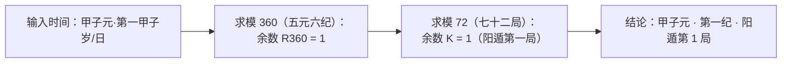
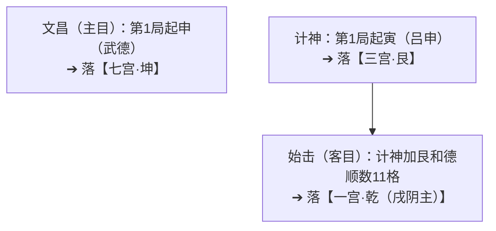

# 太乙神数动画实操演练——阳遁第一局（甲子岁/日）排盘与主客博弈全拆解

> **本门导航（02_太乙神数·6篇）**：[🏠 总纲](../README.md) ｜ [① 源流详考](01_源流详考.md) ｜ [② 分级教程](02_分级教程.md) ｜ **③ 动画实操演练（当前）** ｜ [④ 《太乙金镜式经》](04_经典全文1_《太乙金镜式经》.md) ｜ [⑤ 《景祐太乙福应经》](05_经典全文2_《景祐太乙福应经》.md) ｜ [⑥ 《黄帝太乙八门入式诀》](06_经典全文3_《黄帝太乙八门入式诀》.md)

> **创建与修订日期**：2026-11-21  
> **状态**：`draft`（AI 辅助起草，待主理人终审）  
> **模块归属**：09 周易数术纲目 ｜ `02_太乙神数` ｜ 交互式沙盘演练  
> **算法依据**：唐·王希明《太乙金镜式经》理宫序（乾一、离二、艮三、震四、中五、兑六、坤七、坎八、巽九）

---

## 一、 交互式动态排盘沙盘（`shushu-anim`）

在进入逐帧拆解前，请先通过下方交互式太乙沙盘观察**阳遁第一局（甲子岁/日）**九宫与十六神间辰盘的动态流转、主客算累加路径及五将落宫拓扑：

```shushu-anim
{"type": "taiyi", "title": "太乙神数·阳遁第一局（甲子岁/日）十六神九宫动态推演沙盘"}
```

---

## 二、 演练前参数锚定（甲子局标准坐标系）

为确保演练每一步算筹均可独立验证，先把《太乙金镜式经》的**空间方位—宫数—十六神**底盘固定如下（注意外八宫顺时针空间序为：**乾1 → 坎8 → 艮3 → 震4 → 巽9 → 离2 → 坤7 → 兑6**）：

| 空间方位 | 乾（西北） | 坎（正北） | 艮（东北） | 震（正东） | 巽（东南） | 离（正南） | 坤（西南） | 兑（正西） |
| :--- | :---: | :---: | :---: | :---: | :---: | :---: | :---: | :---: |
| **金镜宫数** | **1** | **8** | **3** | **4** | **9** | **2** | **7** | **6** |
| **所辖十六神** | 戌阴主·乾阴德·亥大义 | 子地主 | 丑阳德·艮和德·寅吕申 | 卯高丛 | 辰太阳·巽大暭·巳大神 | 午大威 | 未天道·坤大武·申武德 | 酉太簇 |

---

## 三、 Step 1 → Step 7 动态推演帧序列拆解

### Step 1：求上元积年与入纪元局数



- **算筹动作**：取目标年份（或日时）距上元甲子总积年 $N$，当 $N \equiv 1 \pmod{72}$ 时，确定进入**甲子元第一纪阳遁第一局**（$K = 1$）。
- **物理意义**：标记时间周期归零重启，启动“阳遁顺飞”模式。

---

### Step 2：定太乙落乾一宫（理天不入中五）

- **算筹公式**：
  $$M = ((1 - 1) \bmod 24) + 1 = 1, \qquad Q = \lfloor (1 - 1) / 3 \rfloor = 0$$
- **排盘结果**：商 $Q = 0$，对应外八宫顺行序列第 1 站——**太乙落一宫（乾宫，西北方，正神阴德）**。
- **沙盘帧状态**：

```
[巽 9]       [离 2]       [坤 7]
[震 4]       [中 5·虚]    [兑 6]
[艮 3]       [坎 8]       [乾 1 ★太乙]
```
> *注：按传统地图“上南下北、左东右西”式盘视角展示（巽东南居左上、离南居中上、坤西南居右上、乾西北居右下）。*

---

### Step 3：排文昌（主目）、计神与始击（客目）

这是主客双方情报与先锋哨位的同时部署：

1. **文昌（主目）定位**：
   - 阳遁文昌起于 **申（武德）** 顺行，逢阴德、大武重留。
   - 第 1 局为起点第 1 步，故 **文昌落于 申（武德），隶属七宫坤位（西南方）**。
2. **计神定位**：
   - 阳遁计神起于 **寅（吕申）** 逆行十二地支。
   - 第 1 局为起点第 1 步，故 **计神落于 寅（吕申），隶属三宫艮位（东北方）**。
3. **始击（客目）定位**：
   - 规则：把计神（寅）移加至和德（艮），依相对跨步顺行十六神，看太乙（乾）映射落于何神。
   - 查十六神环（1 子、2 丑、3 艮和德、4 寅吕申、5 卯、6 辰、7 巽、8 巳、9 午、10 未、11 坤、12 申、13 酉、14 戌阴主、15 乾阴德、16 亥）：
     - 计神（4 寅）至太乙（15 乾）顺行跨度为 $15 - 4 = \mathbf{+11\text{ 格}}$；
     - 从和德（3 艮）顺行 $+11$ 格：$3 + 11 = \mathbf{14}$（**戌·阴主**）。
   - 查归属表：**戌（阴主）隶属一宫乾位（西北方）**，故 **始击落一宫乾（戌），与太乙同宫**！



---

### Step 4：起主算，定主大将与主参将

- **累加路径**：从 **文昌所在宫（坤 7）** 出发，沿空间顺时针方向绕外八宫行走，直到 **太乙所在宫（乾 1）的前一位（即兑 6）** 止。
- **逐宫累加**：
  - 起点：坤宫（**7**）
  - 顺行下一宫：兑宫（**6**）
  - 下一宫即为太乙所在的乾宫（1），**停止累加（不计太乙本宫）**！
  - **主算总额**：
    $$S_{\text{主}} = 7 + 6 = \mathbf{13}$$
- **定主方两将**：
  - **主大将** $= 13 \bmod 10 = \mathbf{3}$ $\implies$ 落 **三宫艮（东北）**。
  - **主参将** $= (3 \times 3) \bmod 10 = \mathbf{9}$ $\implies$ 落 **九宫巽（东南）**。

---

### Step 5：起客算，定客大将与客参将

- **累加路径**：从 **始击所在宫（乾 1）** 出发，寻至 **太乙所在宫（乾 1）**。
- **同宫边界处理**：因始击与太乙同落一宫（乾），按《太乙金镜式经》法“目与太乙同宫，不绕他宫，直取本宫之数”，故：
  - **客算总额**：
    $$S_{\text{客}} = \mathbf{1}$$
- **定客方两将**：
  - **客大将** $= 1 \bmod 10 = \mathbf{1}$ $\implies$ 落 **一宫乾（西北，与太乙同宫）**。
  - **客参将** $= (1 \times 3) \bmod 10 = \mathbf{3}$ $\implies$ 落 **三宫艮（东北，与主大将同宫）**。

```
[巽 9 ◆主参将]     [离 2]          [坤 7 ◎文昌]
[震 4]              [中 5·虚]       [兑 6]
[艮 3 ◆主大将/客参] [坎 8]          [乾 1 ★太乙/◎始击/◇客大将]
```

---

### Step 6：起定算与八门值事

1. **定算求解**：
   - 取甲子合神（寅亥合，亥位大义亦隶属**乾一宫**），顺数至太乙乾一宫，同宫取本宫数得 **定算 = 1**（或按三才成算以天一单数论之，主开端草创、天时未全）。
2. **八门值事**：
   - 阳遁第一局为三十年一世之首局，八门依式经原位排布（开门居乾一、休门居坎八、生门居艮三、伤门居震四、杜门居巽九、景门居离二、死门居坤七、惊门居兑六），由**休门（或开门，随岁时直使）**值事。
   - **将门叠加检验**：
     - 主方**主大将（3 艮）**临**生门**大吉之位（得地利与后勤生发之象），**主参将（9 巽）**临**杜门**（主秘密包抄、封锁退路）；
     - 客方**客大将（1 乾）**虽临**开门**，却与太乙同宫受囚；**文昌（7 坤）**临**死门**，提示主方前方情报与外围边鄙仍有损折压力。

---

### Step 7：综合断掩迫关格与主客胜负复盘

将 Step 1~6 所得全部参数汇总成**局象诊断矩阵**：

| 检验维度 | 主方（守势/朝廷） | 客方（攻势/挑战者） | 拓扑冲突与博弈判辞 |
| :--- | :--- | :--- | :--- |
| **目星落位** | 文昌在 **坤 7**（死门位） | 始击在 **乾 1**（与太乙同宫） | 触发 **【客目掩太乙】** 凶格：敌方先遣直逼中枢，形成情报干扰与突发危机。 |
| **算数性质** | **主算 13**（双算·中适·奇数） | **客算 1**（单算·短算·奇数） | **双胜单**：主方体量（13）远大于客方（1），唯主算得奇数（不和于阴），主方初始内部亦有焦躁动摇。 |
| **将星分布** | 主大将 **艮 3**（生门）<br/>主参将 **巽 9**（杜门） | 客大将 **乾 1**（与太乙同宫）<br/>客参将 **艮 3**（与主大将同宫） | ① 触发 **【客大将囚】**（客大将入太乙本宫，孤军深入却陷于重围）；<br/>② 艮三宫出现 **主大将与客参将同宫**（前锋局部交锋）。 |
| **综合决策** | **稳固两翼 · 合围收网** | **孤军冒进 · 后继乏力** | **终局判辞**：阳遁第一局呈现出典型的“**敌强突中枢而自陷绝地，主方大军在外翼生门蓄势反包**”之局。主方切忌盲目冲锋（避奇数躁动之弊），宜借艮三生门稳固粮饷兵源、巽九杜门切断退路，待客方单算枯竭而擒之。 |

---

## 四、 唯物辩证复盘：从式盘演练看古代参谋思维

通过上述 7 步推演可见，太乙阳遁第一局的排盘并不是“念咒问鬼”，而是一次高度结构化的**兵棋推演**：
- 当“初始状态（局数 1）”输入系统后，规则自动制造了一个“客方突袭核心（掩）、但体量极度单薄（算 1）且陷入包围（囚）”的非对称博弈场景；
- 推演者通过主算 13 与生/杜二门的分布，训练出**“中枢遇袭不乱、依托两翼生发之地截断敌军退路”**的战略定力。这正是古代司天监与兵阴阳家将军事辩证法编码入九宫式盘的真实价值所在。

---

<sub>© 2026 徐时言 · 《太乙神数动画实操演练——阳遁第一局（甲子岁/日）排盘与主客博弈全拆解》 · 徐时言-易经研究 · 采用 CC BY-NC-ND 4.0 许可， 转载请署名并注明来源 https://wole278.github.io/xushiyan-YiJing/ · 禁止商业使用与改编传播 · 商业授权：wole278@hotmail.com / 微信 wole278</sub>
