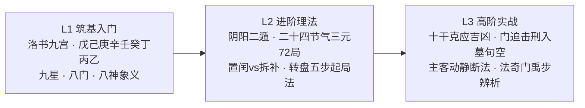

# 奇门遁甲分级教程——从洛书奇仪筑基到四盘实战与法奇门去魅

> **本门导航（03_奇门遁甲·6篇）**：[🏠 总纲](../README.md) ｜ [① 源流详考](01_源流详考.md) ｜ **② 分级教程（当前）** ｜ [③ 动画实操演练](03_动画实操演练.md) ｜ [④ 《烟波钓叟赋》](04_经典全文1_《烟波钓叟赋》.md) ｜ [⑤ 《景祐遁甲符应经》](05_经典全文2_《景祐遁甲符应经》.md) ｜ [⑥ 《抱朴子内篇·登涉六甲秘祝》](06_经典全文3_《抱朴子内篇·登涉六甲秘祝》.md)

> **创建与修订日期**：2026-11-21  
> **状态**：`draft`（AI 辅助起草，待主理人终审）  
> **模块归属**：09 周易数术纲目 ｜ `03_奇门遁甲` ｜ 教学梯度：L1 筑基 → L2 理法 → L3 实战  
> **前置基座**：[`01_阴阳八卦河洛九宫十二消息二十四山与五行生克详考.md`](../01_共性基座/01_阴阳八卦河洛九宫十二消息二十四山与五行生克详考.md)

---

## 学习路径总览

奇门遁甲是一套高度耦合的**四层时空旋转矩阵（地盘、天盘九星、人盘八门、神盘八神）**。本教程将明清主流**转盘奇门**与古法**法奇门**拆解为三级阶梯，直指数学本质，彻底告别死记硬背：

---

## 一、 L1 筑基入门：四盘符号字典与绝对排布序列

### 1.1 洛书九宫绝对底盘（奇门标准坐标系）

与太乙理宫序不同，奇门遁甲**100% 严格采用标准洛书后天九宫**（“戴九履一、左三右七、二四为肩、六八为足、五居中央”）：

| 宫位 | 巽 4（东南） | 离 9（正南） | 坤 2（西南） |
| :--- | :---: | :---: | :---: |
| **原星 / 原门** | 天辅星 / 杜门 | 天英星 / 景门 | 天芮星 / 死门 |
| **宫位** | **震 3（正东）** | **中 5（中央）** | **兑 7（正西）** |
| **原星 / 原门** | 天冲星 / 伤门 | 天禽星（寄坤二） | 天柱星 / 惊门 |
| **宫位** | **艮 8（东北）** | **坎 1（正北）** | **乾 6（西北）** |
| **原星 / 原门** | 天任星 / 生门 | 天蓬星 / 休门 | 天心星 / 开门 |

### 1.2 三奇六仪永恒排布序（9 符号循环链）

奇门不用“甲”字直接上盘，而将六甲旬首遁入六仪（戊己庚辛壬癸），再配以乙丙丁三奇，形成一条**永远不可打乱顺序的 9 符号环形序列**：

$$\mathbf{戊 \to 己 \to 庚 \to 辛 \to 壬 \to 癸 \to 丁 \to 丙 \to 乙}$$

- **六仪遁甲对照**：
  `甲子` 遁 **戊** ｜ `甲戌` 遁 **己** ｜ `甲申` 遁 **庚** ｜ `甲午` 遁 **辛** ｜ `甲辰` 遁 **壬** ｜ `甲寅` 遁 **癸**
- **三奇**：**乙**（日奇·阴木）、**丙**（月奇·阳火）、**丁**（星奇·阴火）。
- **记忆法**：六仪按十天干自然序顺排（戊己庚辛壬癸），三奇则按**逆序（丁→丙→乙）**接在癸后！原因在于地盘飞布时，三奇从第 7、8、9 步逆列后，恰好对应**阳遁顺飞、阴遁逆飞**时的相生护甲结构。

### 1.3 九星、八门、八神基础象义表

1. **天盘九星（原位序顺时针：蓬→任→冲→辅→英→芮[禽]→柱→心）**：
   - **天蓬**（坎1·水）：盗贼、险阻、大智、破财暗流；
   - **天任**（艮8·土）：慈祥、稳重、农商、拖延滞留（吉星）；
   - **天冲**（震3·木）：雷厉风行、突击、果断、鲁莽（吉星）；
   - **天辅**（巽4·木）：文教、师长、制度、风雅（大吉星）；
   - **天英**（离9·火）：文明、名声、暴躁、血光虚火（中平）；
   - **天芮**（坤2·土）：疾病、错误、师友、贪婪（大凶星，转盘带**天禽**中五吉星同行）；
   - **天柱**（兑7·金）：口舌、破坏、撑柱中流、杀伐（凶星）；
   - **天心**（乾6·金）：医药、谋略、高层领导、法治（大吉星）。
2. **人盘八门（原位序顺时针：休→生→伤→杜→景→死→惊→开）**：
   - **三吉门**：**休**（坎水，休养贵人）、**生**（艮土，生发财利）、**开**（乾金，开创公开）；
   - **三中平门**：**伤**（震木，讨伐捕猎损伤）、**杜**（巽木，隐藏堵塞技术）、**景**（离火，文书计划血光）；
   - **二凶门**：**死**（坤土，终结刑戮不动产）、**惊**（兑金，官非口舌惊恐）。
3. **神盘八神（永恒序列：值符→螣蛇→太阴→六合→白虎→玄武→九地→九天）**：
   - *注*：传统古法常分“阳遁用勾陈/朱雀，阴遁用白虎/玄武”，明清转盘主流普遍统一简称为**白虎、玄武**。
   - **值符**（护甲头领）、**螣蛇**（虚惊纠缠）、**太阴**（隐秘策划）、**六合**（媒妁合作）、**白虎**（猛烈兵戈伤亡）、**玄武**（偷盗欺诈暧昧）、**九地**（潜伏固守长久）、**九天**（张扬远行进攻）。

---

## 二、 L2 进阶理法：定局历法与转盘五步排盘法

### 2.1 二十四节气三元七十二局全表（阴阳二遁）

奇门以**冬至**（一阳生，阳遁）和**夏至**（一阴生，阴遁）为两大切换点，每节气分上、中、下三元（每元 5 日 = 60 时辰），对应洛书九宫局数，严格遵循**“阳遁顺布、阴遁逆布，相邻两元局数差 6（或递加 6 模 9）”**的严密数学规律：

| 阳遁节气（冬至→芒种） | 上元 / 中元 / 下元 | 阴遁节气（夏至→大雪） | 上元 / 中元 / 下元 |
| :--- | :---: | :--- | :---: |
| **冬至 · 惊蛰** | `1 · 7 · 4` | **夏至 · 白露** | `9 · 3 · 6` |
| **小寒** | `2 · 8 · 5` | **小暑** | `8 · 2 · 5` |
| **大寒 · 春分** | `3 · 9 · 6` | **大暑 · 秋分** | `7 · 1 · 4` |
| **立春** | `8 · 5 · 2` | **立秋** | `2 · 5 · 8` |
| **雨水** | `9 · 6 · 3` | **处暑** | `1 · 4 · 7` |
| **清明 · 立夏** | `4 · 1 · 7` | **霜降 · 立冬** | `6 · 9 · 3` |
| **谷雨 · 小满** | `5 · 2 · 8` | **小雪** | `5 · 8 · 2` |
| **芒种** | `6 · 3 · 9` | **大雪** | `4 · 7 · 1` |

> **如何通过日干支确定上、中、下三元（求符头法）**：
> 先找到当日干支所属六十甲子的“五日一头”（即向前逆推至最近的 **甲日** 或 **己日**，称为**符头**）：
> - 符头地支为 **子、午、卯、酉**（四仲） $\implies$ **上元**；
> - 符头地支为 **寅、申、巳、亥**（四孟） $\implies$ **中元**；
> - 符头地支为 **辰、戌、丑、未**（四季） $\implies$ **下元**。
> *速算口诀*：日干天干数减日支地支数（不够加 12），或看当日往前推几步到甲/己即可秒定符头地支！

### 2.2 置闰法（超神接气）vs 拆补法操作规程

由于回归年 365.2422 日与 24 节气三元 360 日之间每年差 5.2422 日：
1. **置闰法（古法正宗）**：
   - 若甲己符头先于交节气日到来，叫**超神**；若交节气先到而符头未到，叫**接气**。
   - 当超神累计超过 **9 天**（通常约 2~3 年一遇），于**芒种**或**大雪**节气后重复再行一次上中下三元 15 天（置闰），使符头重新紧贴二至。
2. **拆补法（现代天文实历派）**：
   - 绝对忠实于天文馆公布的交节时刻。交节一到立刻转入新节气，依据新节气下当日所对应的符头地支直接定上/中/下元，不做任何跨节气借位。

### 2.3 转盘奇门排盘五步标准流水线

1. **Step 1 布地盘（固定底座）**：
   - 依定出的“阳/阴遁第 $N$ 局”，将 `戊` 放在第 $N$ 宫，然后按 `戊→己→庚→辛→壬→癸→丁→丙→乙` 顺序：**阳遁顺飞九宫（$N \to N+1 \dots$ 逢 9 归 1）**；**阴遁逆飞九宫（$N \to N-1 \dots$ 逢 1 归 9）**。
2. **Step 2 寻旬首，定“值符”与“值使”**：
   - 找出**时柱**所属六十甲子的旬首（如丙寅时属于**甲子戊**旬），查看该旬首六仪在地盘的落宫 $P_0$。
   - 宫 $P_0$ 的地盘原始星称为**值符**（天盘统帅）；宫 $P_0$ 的地盘原始门称为**值使**（人盘执行官）。*（注：若 $P_0 = 5$ 中宫，则值符为天禽星寄坤二宫，值使一般随死门寄坤二宫）。*
3. **Step 3 转天盘（九星 + 天盘奇仪）**：
   - 找到**时干**（若是甲时，即找旬首六仪本身）在地盘的落宫 $P_{\text{干}}$。
   - 将**大值符**直接加临到 $P_{\text{干}}$ 上（若 $P_{\text{干}} = 5$ 则寄坤二宫），其余七星连同各自在地盘携带的三奇六仪，按九宫外环顺时针顺序同步旋转就位！（天禽星与坤二天芮星同宫旋转）。
4. **Step 4 转人盘（八门）**：
   - 从旬首所遁宫位 $P_0$ 起，数**旬首至当前时支**的步数（如甲子旬至丙寅时，经子[0]→丑[1]→寅[2]，共走 2 步）：
   - **阳遁顺数九宫**（1→2→3…9）、**阴遁逆数九宫**（9→8→7…1），数至尽头落宫 $P_{\text{使}}$；将**值使门**加临于 $P_{\text{使}}$（若落 5 宫则寄坤二宫），其余七门按外环顺时针顺序旋转就位！
5. **Step 5 排神盘（八神）**：
   - 将小**值符**加临于天盘**大值符**所在宫位（即 $P_{\text{干}}$），然后按**阳遁顺时针、阴遁逆时针**绕外八宫排布 `值符→螣蛇→太阴→六合→白虎→玄武→九地→九天`。

---

## 三、 L3 高阶实战：克应断局、主客博弈与法奇门辨析

### 3.1 十干克应吉凶格与四大能量阻滞态

排好四盘后，观察每宫“**天盘干（客）加临地盘干（主）**”的十干克应关系，并排查四大系统阻滞态：

1. **核心吉凶克应精选**：
   - **青龙返首**（天盘 `戊` + 地盘 `丙`）：木生火回助甲帅，主谋为大成、得贵人提拔（唯逢门迫、击刑则反成“龙折足”）；
   - **飞鸟跌穴**（天盘 `丙` + 地盘 `戊`）：阳火归库，顺水推舟，百事省力而就；
   - **玉女守门**（值使门落宫地盘见 `丁` 奇）：有利密谋、婚恋、文书秘事；
   - **白虎猖狂**（`辛` + `乙`）与 **青龙逃走**（`乙` + `辛`）：金木剧烈交战，主内部哗变、损将折兵、合作破裂；
   - **螣蛇夭矫**（`癸` + `丁`）与 **朱雀投江**（`丁` + `癸`）：水火相克，主文书官非、信息阻断、火灾惊扰；
   - **伏吟**（星、门全回原位，或天盘干与地盘干相同）：停滞不前、胶着宜静不宜动；
   - **反吟**（星、门冲克原位，如蓬临离九、休临景门）：局势剧烈反复、大起大落、速成速败。
2. **四大阻滞态（减分/反噬算子）**：
   - **六仪击刑**（天盘六仪落入与其地支相刑之宫）：`甲子戊` 落震 3（子卯刑）、`甲戌己` 落坤 2（戌未刑）、`甲申庚` 落艮 8（申寅刑）、`甲午辛` 落离 9（午午自刑）、`甲辰壬` 落巽 4（辰辰自刑）、`甲寅癸` 落巽 4（寅巳刑）——主内部掣肘、能量折损半数；
   - **门迫**（人盘八门五行克制所临地盘宫位五行）：如开门（金）落震 3/巽 4（木）、惊门（金）落震/巽、伤/杜门（木）落坤 2/艮 8（土）、休门（水）落离 9（火）等——主行动受阻、强行推进必招反噬；
   - **天干入墓**与**旬空**（按时柱旬空所在两地支对应宫位判断空亡，提示虚假、未落实或兵力真空）。

### 3.2 主客动静断法与“五不遇时”

- **主客辨析铁律**：在奇门局中，**地盘、原宫、八门所属之静方为主方（守方/我方既定位置）**；**天盘、九星、天盘干、值符所加之动方为客方（攻方/主动发起变化者）**。若天盘生或比和地盘，主客相融；若天盘克地盘，利主动出击（客胜）；若地盘克天盘，利固守待敌（主胜）。
- **五不遇时**：凡**时干克日干**（同性阳克阳、阴克阴，如甲日庚午时、乙日辛巳时），犹如部下凌上、节奏失调，主谋事多阻滞，兵家忌轻出。

### 3.3 法奇门“六甲禹步”辨析与唯物兵学还原

法奇门将上述“甲遁于戊、九宫方位”转化为《抱朴子·登涉》所载的**“踏罡步斗（禹步）+ 六甲秘祝（临兵斗者皆数组前行）+ 闭六戊法”**。在历史唯物主义视角下：
1. **术奇门的兵学本质**：剥离星神术语，奇门本质上是训练指挥官从**“时间节律（节气三元）、主力动向（值符/值使）、兵力掩蔽与迂回（遁甲/杜门）、地形通阻（八门/门迫）与敌我先手权（主客动静）”**五维同步决策的古代参谋沙盘；
2. **法奇门的心理学去魅**：禹步与闭六戊并不产生任何超自然隐身或法术攻击效果，它是古代行军宿营或单兵入险时，通过**节律性呼吸、肢体仪轨与心理暗示**来对抗恐惧、维持注意力的精神稳定术。

---

## 四、 课后自测练习题

1. **【排盘基础】** 按照“阳遁顺布、相邻元局数递加 6 模 9”规律，已知谷雨上元为阳遁 5 局，请问谷雨中元、下元分别是第几局？
   > **核对**：上元 `5`；中元 $(5+6) \bmod 9 = \mathbf{2}$ 局；下元 $(2+6) \bmod 9 = \mathbf{8}$ 局（即谷雨五二八）。
2. **【门迫判定】** 若转盘后**生门**（艮宫五行属土）转到了**坎一宫**（五行属水），是否构成“门迫”？
   > **核对**：是！生门属土，坎一宫属水，门（土）克宫（水），构成**门迫**，吉门被迫则吉力大减，象征扩张生发项目受到环境潜流制约。
3. **【击刑判定】** 为什么 `甲辰壬` 落入巽四宫会构成“击刑”？
   > **核对**：巽四宫包含地支“辰”与“巳”，`甲辰壬` 落入巽宫构成“辰辰自刑”，主资源内部耗散或规划自相矛盾。

---

© 2026 徐时言 · 《奇门遁甲分级教程——从洛书奇仪筑基到四盘实战与法奇门去魅》 · 徐时言-易经研究 · 采用 CC BY-NC-ND 4.0 许可， 转载请署名并注明来源 https://wole278.github.io/xushiyan-YiJing/ · 禁止商业使用与改编传播 · 商业授权：wole278@hotmail.com / 微信 wole278
