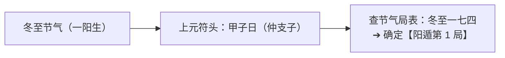

# 奇门遁甲动画实操演练——阳遁一局（甲子戊旬·丙寅时）四盘排演与决策复盘

> **本门导航（03_奇门遁甲·6篇）**：[🏠 总纲](../README.md) ｜ [① 源流详考](01_源流详考.md) ｜ [② 分级教程](02_分级教程.md) ｜ **③ 动画实操演练（当前）** ｜ [④ 《烟波钓叟赋》](04_经典全文1_《烟波钓叟赋》.md) ｜ [⑤ 《景祐遁甲符应经》](05_经典全文2_《景祐遁甲符应经》.md) ｜ [⑥ 《抱朴子内篇·登涉六甲秘祝》](06_经典全文3_《抱朴子内篇·登涉六甲秘祝》.md)

> **创建与修订日期**：2026-11-21  
> **状态**：`draft`（AI 辅助起草，待主理人终审）  
> **模块归属**：09 周易数术纲目 ｜ `03_奇门遁甲` ｜ 交互式沙盘演练  
> **算法依据**：明清主流**转盘奇门**（《烟波钓叟赋》体例）

---

## 一、 交互式动态排盘沙盘（`shushu-anim`）

请先启动下方 `shushu-anim` 奇门遁甲交互式沙盘，直观观察**阳遁一局（甲子戊旬·丙寅时）**的地盘固定底座与天盘九星、人盘八门、神盘八神三层联动旋转过程：

```shushu-anim
{"type": "qimen", "title": "奇门遁甲·阳遁一局（甲子戊旬·丙寅时）天地人神四盘动态旋转沙盘"}
```

---

## 二、 演练案例参数与目标设定

- **模拟时空**：冬至节气后（上元甲子日符头），**丙寅时**。
- **时柱旬空**：丙寅属于**甲子戊**旬（甲子、乙丑、丙寅、丁卯、戊辰、己巳、庚午、辛未、壬申、癸酉），故旬空为 **戌、亥**（对应**乾六宫**）。
- **演练目标**：从零手工推演地盘、值符、值使、天盘、人盘、神盘及全盘克应格局，定位**【青龙返首】**与**【朱雀投江】**的空间落位。

---

## 三、 Step 1 → Step 7 动态推演帧序列拆解

### Step 1：节气符头定局（阳遁一局）



- **算筹判定**：冬至处于冬至→芒种阳遁区间，上元对应“冬至惊蛰一七四”首数，故定为**阳遁一局**。

---

### Step 2：布地盘三奇六仪（静态底座）

- **规则**：阳遁顺飞洛书九宫（1→2→3→4→5→6→7→8→9），将序列 **`戊→己→庚→辛→壬→癸→丁→丙→乙`** 从 **1 宫（坎）** 起逐宫填入（中 5 宫地盘 `壬` 按转盘惯例寄坤 2 宫随行）：

```
┌──────────────┬──────────────┬──────────────┐
│  巽 4 宫      │  离 9 宫      │  坤 2 宫      │
│  地盘：【辛】 │  地盘：【乙】 │ 地盘：【己(壬)】│
├──────────────┼──────────────┼──────────────┤
│  震 3 宫      │  中 5 宫      │  兑 7 宫      │
│  地盘：【庚】 │ 地盘：【壬】寄坤│  地盘：【丁】 │
├──────────────┼──────────────┼──────────────┤
│  艮 8 宫      │  坎 1 宫      │  乾 6 宫      │
│  地盘：【丙】 │  地盘：【戊】 │  地盘：【癸】 │
└──────────────┴──────────────┴──────────────┘
```

---

### Step 3：旬首寻值符与值使

- **寻找旬首**：丙寅时的六十甲子旬首为 **`甲子戊`**。
- **查地盘落宫**：地盘 **`戊`** 落在 **坎 1 宫**。
- **锁定双枢纽**：
  - **大值符（天盘统帅）** = 坎 1 宫原星 = **天蓬星**；
  - **值使门（人盘执行）** = 坎 1 宫原地盘门 = **休门**。

---

### Step 4：转动天盘九星（加临于时干落宫）

1. **找时干地盘落宫**：当前为**丙**寅时，时干 **`丙`** 在地盘位于 **艮 8 宫**。
2. **值符加临**：把 **天蓬星**（携带其地盘原宫天干 **`戊`**）旋转加临到 **艮 8 宫**。
3. **随盘刚性顺转**：观察“坎 1 → 艮 8”沿九宫外环顺时针方向（`1→8→3→4→9→2→7→6→1`）恰好转动了 **+1 格**！因此其余七星与所带天盘奇仪全盘顺时针同步移动 1 格（中 5 天禽星与 `壬` 随坤 2 天芮星同步旋转）：

| 落宫方位 | 艮 8（东北） | 震 3（东） | 巽 4（东南） | 离 9（南） | 坤 2（西南） | 兑 7（西） | 乾 6（西北） | 坎 1（北） |
| :--- | :---: | :---: | :---: | :---: | :---: | :---: | :---: | :---: |
| **天盘九星** | **天蓬**（值符） | 天任 | 天冲 | 天辅 | 天英 | 天芮（带禽） | 天柱 | 天心 |
| **天盘奇仪** | **戊** | **丙** | **庚** | **辛** | **乙** | **己（壬）** | **丁** | **癸** |
| *地盘奇仪* | *丙* | *庚* | *辛* | *乙* | *己(壬)* | *丁* | *癸* | *戊* |

---

### Step 5：转动人盘八门（加临于时支推算宫）

1. **算时支落宫**：从旬首 **`甲子`** 所在的 **坎 1 宫** 起算，阳遁按九宫数字顺数（1→2→3…）：
   - `1 宫` = 甲子（0 步）
   - `2 宫` = 乙丑（第 1 步）
   - `3 宫` = **丙寅**（第 2 步，到当前时支！）
2. **值使加临与顺转**：将 **值使休门** 放到 **震 3 宫**（相比坎 1 原位顺时针转动 **+2 格**），其余七门按外环顺时针序 `休→生→伤→杜→景→死→惊→开` 同步落位：
   - **震 3**：**休门**（值使）｜ **巽 4**：生门 ｜ **离 9**：伤门 ｜ **坤 2**：杜门 ｜ **兑 7**：景门 ｜ **乾 6**：死门 ｜ **坎 1**：惊门 ｜ **艮 8**：开门。

---

### Step 6：排布神盘八神（随大值符阳顺阴逆）

- **规则**：小**值符**永远追随天盘大值符（**天蓬星**，当前在 **艮 8 宫**），阳遁按外环**顺时针**依次排布 `值符→螣蛇→太阴→六合→白虎→玄武→九地→九天`。
- **完整九宫四盘终局全景图**：

```
┌─────────────────────────┬─────────────────────────┬─────────────────────────┐
│ 【巽 4 宫】             │ 【离 9 宫】             │ 【坤 2 宫】             │
│ 神盘：太阴              │ 神盘：六合              │ 神盘：白虎              │
│ 天盘：天冲 ＋ 庚        │ 天盘：天辅 ＋ 辛        │ 天盘：天英 ＋ 乙        │
│ 人盘：生门（木克土受制）│ 人盘：伤门（木生火）    │ 人盘：杜门（木克土受制）│
│ 地盘：辛                │ 地盘：乙                │ 地盘：己（带壬）        │
├─────────────────────────┼─────────────────────────┼─────────────────────────┤
│ 【震 3 宫】             │ 【中 5 宫】             │ 【兑 7 宫】             │
│ 神盘：螣蛇              │                         │ 神盘：玄武              │
│ 天盘：天任 ＋ 丙        │ （地盘 壬 寄坤二宫随转）│ 天盘：天芮(禽) ＋ 己(壬)│
│ 人盘：休门（值使·水生木）│                         │ 人盘：景门（门迫：火克金）│
│ 地盘：庚                │                         │ 地盘：丁                │
├─────────────────────────┼─────────────────────────┼─────────────────────────┤
│ 【艮 8 宫】             │ 【坎 1 宫】             │ 【乾 6 宫 · 空亡】      │
│ 神盘：值符              │ 神盘：九天              │ 神盘：九地              │
│ 天盘：天蓬 ＋ 戊        │ 天盘：天心 ＋ 癸        │ 天盘：天柱 ＋ 丁        │
│ 人盘：开门（吉·土生金） │ 人盘：惊门（凶·金生水） │ 人盘：死门（凶·土生金） │
│ 地盘：丙                │ 地盘：戊                │ 地盘：癸                │
└─────────────────────────┴─────────────────────────┴─────────────────────────┘
```

---

### Step 7：格局克应与主客决策复盘

依据 Step 6 输出的完整四盘沙盘，逐宫执行兵学与状态诊断：

| 重点宫位 | 组合符号 | 经典格局与阻滞态判定 | 战略决策研判（主客博弈） |
| :--- | :--- | :--- | :--- |
| **艮 8 宫（东北）** | **值符 + 天蓬 + 开门 + `戊加丙`** | **【青龙返首】** 大吉格！值符临开门（土生金），天盘甲子戊回得地盘丙奇阳火助阵。 | **全局最优突破口**。适合公开主动作为、总帅发号施令；惟临天蓬星（水在艮土受制），提示行动虽大吉，仍须防备后勤漏洞或小人偷盗细节。 |
| **震 3 宫（正东）** | **螣蛇 + 天任 + 休门 + `丙加庚`** | **【荧入太白 / 贼必去】**：月奇丙火制克庚金七杀，值使休门水生震木，天任吉星稳重。 | **利我方主动清剿（客胜）**，阻敌于东翼；因临螣蛇，须防虚假军情或反复牵扯。 |
| **兑 7 宫（正西）** | **玄武 + 天芮(禽) + 景门 + `己加丁`** | **【门迫】**（景门离火克兑金）＋ 天芮病星 ＋ 玄武暗昧；唯中五天禽寄此，呈吉凶参半之象。 | 景门主文书宣传与方案计划，临玄武且门迫，提示西方信息渠道易生虚诈失真，不可轻信谣言。 |
| **乾 6 宫（西北）** | **九地 + 天柱 + 死门 + `丁加癸`** | **【朱雀投江】** ＋ **【旬空】**（戌亥空）＋ 死门 ＋ 天柱凶星。 | **全局绝对高危禁区**！丁火被癸水克灭且落空亡死门，西北方向切忌交涉文书或进兵，宜彻底静守隐蔽（九地）。 |
| **坎 1 宫（正北）** | **九天 + 天心 + 惊门 + `癸加戊`** | **【天乙会合】**（戊癸合化）＋ 天心谋略 ＋ 九天，惟临惊门。 | 适合高举高打发出外交试探或舆论造势（九天 + 惊门），借助天心星筹划达成阶段性合纵。 |

---

## 四、 排盘校验口诀（防错自查清单）

1. **天盘与地盘的奇仪顺序**：不论怎么转动，外八宫天盘携带的奇仪顺时针序列必须与地盘外八宫顺时针序列完全同构（在本局为：`戊→丙→庚→辛→乙→己(壬)→丁→癸` 顺环不变）。
2. **八门与八神的顺序**：八门外环顺时针永远是 `休→生→伤→杜→景→死→惊→开`；阳遁八神外环顺时针永远是 `值符→螣蛇→太阴→六合→白虎→玄武→九地→九天`。凡排盘后环序乱掉，必有一步旋转出错！

---

<sub>© 2026 徐时言 · 《奇门遁甲动画实操演练——阳遁一局（甲子戊旬·丙寅时）四盘排演与决策复盘》 · 徐时言-易经研究 · 采用 CC BY-NC-ND 4.0 许可， 转载请署名并注明来源 https://wole278.github.io/xushiyan-YiJing/ · 禁止商业使用与改编传播 · 商业授权：wole278@hotmail.com / 微信 wole278</sub>
