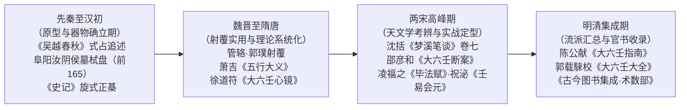
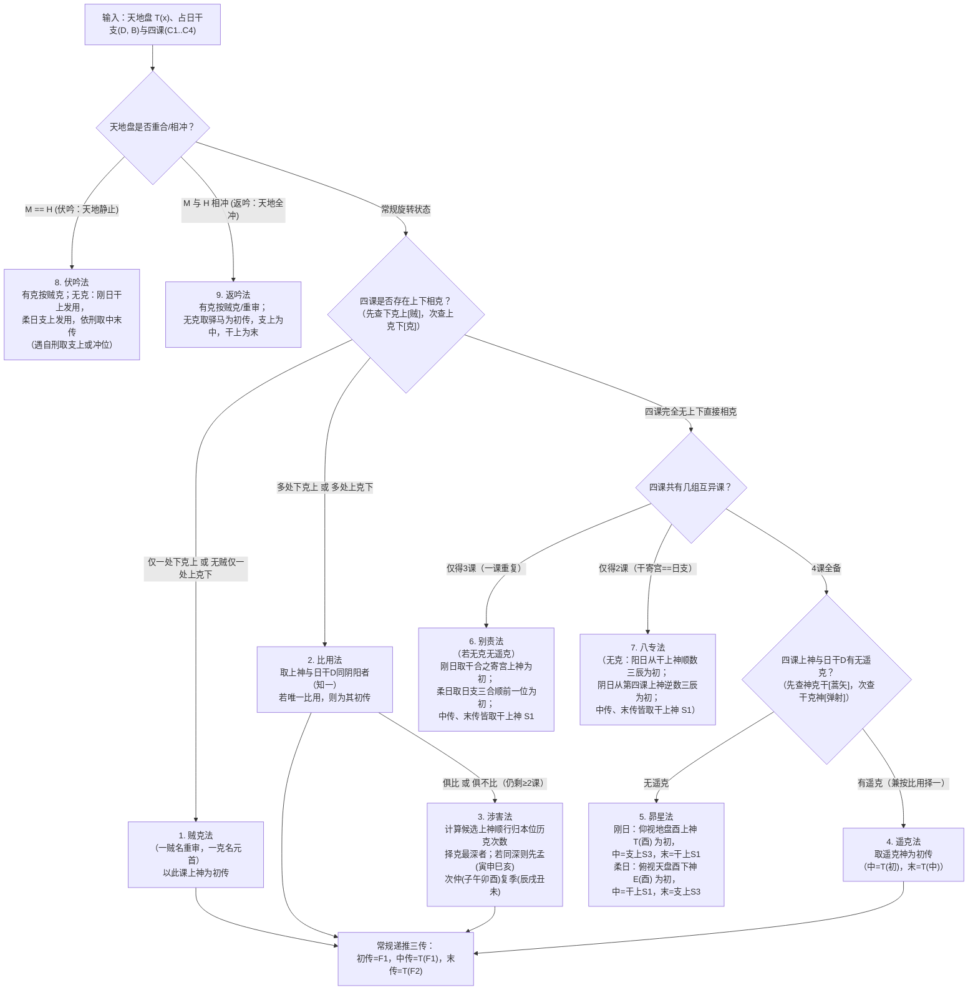

# 三式绝学之大六壬——汉代栻盘、月将加时与四课三传九宗门详考

> **创建与修订日期**：2026-11-21  
> **模块归属与编号**：`09 周易数术纲目 ｜ 编号：04`  
> **价值基准评级**：🟡 **2 级文档（核心依赖因子：0.3，初始暂定，待用户主理人终审裁定）**  
> **前置理论与公理基石**：[`《十数概论》`](../02%20元研究/十数概论.md)（1-M09，易理与术数划界公理）、[`《09 周易数术纲目》总纲`](README.md)、[`《共性基座：阴阳八卦河洛九宫十二消息二十四山与五行生克考》`](01_共性基座_阴阳八卦河洛九宫十二消息二十四山与五行生克考.md)、`《384爻断辞回测报告》`。  
> **四重证据配置与强度分层**：
> - **第一重证据（传世文献与目录典志，强）**：《周易·系辞》《汉书·艺文志·数术略》《周礼》郑玄注、《史记·日者列传》《三国志·管辂传》《颜氏家训》《五行大义》《梦溪笔谈》卷七、《古今图书集成·博物汇编·艺术典·术数部》（卷 631–650）、《永乐大典》残韵辑本及《道藏》洞神部经典；
> - **第二重证据（出土文字与简帛，强）**：安徽阜阳双古堆西汉汝阴侯墓栻盘题刻、朝鲜乐浪王盱墓栻盘墨书铭文、甘肃武威磨咀子及江苏仪征汉墓栻盘盘面干支宿度刻铭；
> - **第三重证据（民俗与人类学旁证，弱～中）**：古代岁时观象授时传统、士大夫及民间择吉避祸行为心理结构；
> - **第四重证据（考古实物，强）**：西汉至东汉木质/漆质旋转式天地盘（栻盘）机械结构实物。  
> **与既有高级别成果关系声明**：本文严格遵守 1-M09《十数概论》确立的“易理与术数划界”原则，承认大六壬之“天一生水、地六成之”及阴阳五行神将配属属汉代以后的数术耦合演进，不倒推为先秦《周易》古经本义。

---

## 摘要

**【摘要】** 在中国古代号称“三式”（太乙、奇门、大六壬）的最高阶时空数术模型中，大六壬因兼备最确凿的汉代出土机械式盘实物与最严密的离散逻辑演算程序，历来被视为“人事日用之冠”。然而，传统术数文献常将大六壬神化为“九天玄女授黄帝”，或以繁杂的十二神将吉凶标签遮蔽其天文学与组合逻辑底座。本研究立足历史唯物主义与“四重证据法”，首先考辨阜阳双古堆西汉汝阴侯墓、甘肃武威磨咀子汉墓、朝鲜乐浪王盱墓及江苏仪征汉墓出土的汉代六壬栻盘实物结构，梳理自先秦吴越式占传闻、魏晋管辂郭璞射覆、隋萧吉《五行大义》、唐徐道符《大六壬心镜》至北宋沈括天文考辨、邵彦和《大六壬断案》及明清《大六壬指南》《大六壬大全》的断代源流，并精准锚定《汉书·艺文志》《古今图书集成·术数部》《永乐大典》与《道藏》四大核心文献群及托古伪书之辨。在此基础上，论文完整拆解“六壬”命名数理、太阳黄道视运动耦合下的“月将加正时”天地盘、十干寄宫与“四课”矩阵，并构建“九宗门”发三传的完备状态机算法树与十二天将布列规则。最后以“生生”四判据与《矛盾论》审视其“贼克优先”机制，指出大六壬在剥离神煞宿命外衣后，实质上是一套古代天文历算与矛盾主要方面动态演化的高精度符号沙盘。

**【关键词】** 大六壬；汉代栻盘；月将加时；九宗门；四重证据法；易理与术数划界

---

## 一、 引言：问题意识、源流断代与汉代栻盘考古铁证

### 1.1 问题的提出：三式之冠的学术迷雾与破局路径

唐代官修法典《唐六典·太卜署》载：“凡式占，辨三式之同异：一曰雷公式，二曰太一式，三曰六壬式。”宋代以后，雷公式渐为奇门遁甲取代，太乙、奇门、大六壬遂并称“三式”。在三式分工中，古人恒言“太乙主天道国运，奇门主地理兵阵，六壬主人事日用”。相较于太乙的宏观积年与奇门的九宫飞布，大六壬具有两项独一无二的学术特质：其一，它是唯一拥有**大批西汉至东汉时期标准机械式盘（栻盘）考古实物**的三式之学；其二，其核心演算程序（天地盘 → 四课 → 九宗门发三传）不依赖主观随机性（如摇钱或报数），而是一套给定占时与占日即唯一确定输出的**高度结构化离散状态机**。

然而，历代六壬研究长期陷入三重迷雾：
1. **起源托古化**：道教及民间术数书多托言“黄帝战蚩尤，九天玄女授六壬式”，或强附为上古伍子胥、范蠡秘传，掩盖了战国至西汉天文学与干支历法逐步成熟的真实历史进程；
2. **数理神秘化**：后世江湖流派重神煞（如贵人、白虎、玄武、三十六禽）而轻天道历算，使原本严密模拟太阳黄道视运动的“月将加正时”沦为机械查表；
3. **易理与术数混糅**：部分学者将汉儒“天一生水，地六成之”及“六壬神将”直接混同于先秦《周易》古经哲理，违背了 [`《十数概论》`](../02%20元研究/十数概论.md) 确立的文献层累划界原则。

### 1.2 出土考古铁证：汉代六壬栻盘（式盘）的物理实态

区别于宋代以后才定型的诸多图书学派，大六壬的硬件原型在两千年前的汉墓中已被直接保存下来。迄今为止，考古界出土的汉代六壬栻盘（古称“栻”或“式”，《说文》：“栻，局戏也”实有误，实为占时测天之式盘）已形成极具说服力的跨地域实物证据链：

| 出土墓葬与年代 | 实物材质与形制特征 | 天盘（圆盘）刻铭配置 | 地盘（方盘）刻铭配置 | 考古学与数术史实证意义 |
| :--- | :--- | :--- | :--- | :--- |
| **安徽阜阳双古堆西汉汝阴侯夏侯灶墓**（下葬于汉文帝十五年，前 165 年） | 漆木质“六壬栻盘”（与“太乙九宫占盘”同出），上圆下方，中心穿孔以轴贯通旋转 | 中心绘**北斗七星**；外周分列十二格，刻十二月神（或十二支）与二十八宿宿名及距度 | 方形盘面分内、中、外三层：刻**八天干**（甲乙丙丁庚辛壬癸，戊己中央不入周天）、**四维**及**十二地支**，外环二十八宿 | **迄今已知年代最早的六壬式盘实物**，确证西汉初年天圆地方的旋转式“月将加时”机械装置已完全定型 |
| **甘肃武威磨咀子汉墓**（西汉晚期至东汉） | 木质漆绘栻盘构件（局部残存但刻度清晰） | 圆形转盘，刻北斗星象与十二神位对应刻度 | 方形底盘，标示八干四维、十二辰及二十八宿分度 | 证明西汉末至东汉时期，六壬式占装置已随汉代军政体系向西北河西走廊广泛传播 |
| **江苏仪征汉墓**（西汉中晚期木椁墓，含烟袋山等墓葬系统出土遗存） | 漆木质双层旋转式盘，保存较为完好 | 中心绘北斗七星，外圈环刻十二月将神名与宿度 | 方形地盘刻天干（八干）、地支（十二辰）与四维方位 | 印证江淮与长江下游地区西汉士大夫及官吏阶层使用式盘的普遍性 |
| **朝鲜乐浪郡王盱墓**（东汉永平十二年，公元 69 年） | 漆木质六壬栻盘，墨书字迹极清晰 | 圆盘中心刻北斗七星，外列十二神名（含天罡、太冲等早期神将雏形）与二十八宿 | 方盘刻八干、十二支、四维（如子丑寅卯与天干交错排列）及三十六禽相关早期符号或宿度 | 为东汉时期带完整文字铭刻的经典标准本，印证六壬式盘随汉郡县制度远播东北亚 |

> [!IMPORTANT]
> **实物机制的唯物本质**：汉代六壬栻盘并非法器，而是一种**手工机械式天球模拟计算器（Analog Mechanical Computer）**。圆盘代表以北斗和太阳视位置为参照的“天球周日旋转系统”，方盘代表地面观测者的“地平二十四方位坐标系（八干四维十二支）”。转动中心铜轴或木轴使天盘月将对准地盘占时，即可瞬间读取十二宫天地盘叠合状态——这正是先秦“仰则观象于天，俯则观法于地”观象授时技术的工程器物化。

### 1.3 历史源流断代详考（先秦至明清）

结合传世文献与考古发现，大六壬的演变可清晰划分为四个历史阶段：

1. **先秦传闻与两汉式占确立期**：
   * 东汉赵晔《吴越春秋》与《越绝书》记载春秋末期伍子胥、范蠡在吴越争霸中使用式占推演吉凶（如范蠡以“时加日出”“十二辰”推事）。虽然《吴越春秋》成书于东汉，带有汉人追述附会色彩，但结合战国秦简（如睡虎地秦简《日书》）中已成熟的干支刑德理论与《周礼·春官·太史》“大史……抱天时”郑玄注“抱式以知天时”，可断定六壬式占孕育于战国数术合流之际，成熟定型于西汉初年。
   * 《史记·日者列传》与《龟策列传》明言“旋式正棊”，《汉书·王莽传》更记载王莽在渐台覆灭前夕“天文郎按栻于前，日时加某，莽旋席随斗柄而坐”，证明“栻盘”已是两汉朝廷史官与方士的日常核心器物。
2. **魏晋南北朝至隋唐（神将分化与歌诀化）**：
   * 魏晋玄学大兴，而北方与江南士大夫对“式占”推崇备至。曹魏**管辂**（《三国志·管辂传》）、西晋/东晋**郭璞**（《晋书·郭璞传》）以精妙射覆（猜度密器中之物）名震一时，其射覆原理深嵌“四课三传取类象”与易卦互体混合思维。南朝战乱频仍，士人习六壬风气极盛，《颜氏家训·杂艺》记载梁朝士大夫好习算术式占以求乱世趋避。
   * 隋代**萧吉《五行大义》**（卷四《论相生》《论配支干》、卷五《论诸神》《论三十六禽》）首次系统梳理了六壬十二神将（贵人至天后）的渊源、阴阳五行归属及三十六禽（每支配三禽兽）对应关系，使六壬完成了从“天文式盘”向“精细类象哲学”的理论跃迁。
   * 唐代官方设“三式博士”，太卜署考核六壬式占。晚唐五代**徐道符**撰**《大六壬心镜》**（收入《四库全书》或宋明类书引录），以七言歌诀确立了“九宗门”发三传及百余种课体（如元首、重审、知一、涉害、弹射、虎视、八专、伏吟、返吟等）的标准口诀体系。
3. **两宋实战峰巅与天文学纠偏期**：
   * 北宋是大六壬学术史上最辉煌的时代，呈现出“科学考辨”与“实战精微”双峰并峙的局面：一方面，科学家**沈括**在《梦溪笔谈》卷七（象数一）中专条考辨六壬原理，精辟指出“六壬以月将加正时，乃日躔之所在”，并拆解十二天将贵人顺逆与黄道赤道星象的联系；另一方面，汴京名家**邵彦和**留下大量真实占案，经后人整理为**《大六壬断案》**（公认为六壬实战断语第一书），**凌福之**撰**《毕法赋》**百句精论课传生克细微变化，南宋**祝泌**著**《壬易会元》（又名《六壬大占》）**试图贯通《周易》卦象与六壬课传。
4. **明清集成与文献总汇期**：
   * 明代实战大家**陈公献**著**《大六壬指南》**（含《指掌赋》《心印赋》与大量明末清初实占案例，如断兵事、科举、仕途），**刘赤江**原辑、清人**郭载騋**校刊**《大六壬大全》**十二卷，全面汇集宋元明历代课经、毕法、神煞与口诀，被收入清代《四库全书》子部术数类，成为近世六壬研究之通行底本。

---

## 二、 核心文献锚点与经典史料辨伪

### 2.1 四大核心文献群目录学定位表

严格对标《汉书·艺文志》及明清三大官方总汇文献（《永乐大典》《道藏》《古今图书集成》），大六壬的核心书目体系如下：

| 文献总汇 / 目录典籍 | 具体卷次 / 部类 / 韵目 | 收录或著录之大六壬核心篇目 | 目录学与史源考辨价值 |
| :--- | :--- | :--- | :--- |
| **《汉书·艺文志·数术略》** | 五行家（三十一家，六百五十二卷） | 《羡门式法》二十卷、《羡门式》二十卷、《泰一阴阳》二十三卷等 | “式法”乃三式未全面分化前之总称，虽未直标“六壬”二字，然证实西汉官府档案中“式法”已成庞大专门之学 |
| **《古今图书集成·博物汇编·艺术典·术数部》** | **卷 631–650（六壬汇考）** | 卷 631–650 系统辑录《大六壬类集》《六壬大全》《毕法赋》《指掌赋》、起课九宗门法式、十二神将解说及历代壬占纪事（包括《三国志》《晋书》《南史》《宋史》相关传记） | **传世最完整、最权威的官修六壬资料总库**，清晰保存了清初以前六壬“九宗门”定本与历代名案 |
| **《永乐大典》** | **“壬”字韵、“式”字韵**（原书多佚，见清四库辑佚与现存残卷引录） | 辑录宋元《六壬心镜》引文、祝泌《壬易会元》（部分由四库馆臣据大典及秘阁校理）、宋代《六壬神定经》等稀见秘本 | 承接唐宋六壬与明清六壬的关键桥梁；今传宋代《大六壬神定经》（杨惟德撰，与《景祐太乙》《景祐遁甲》并列北宋官修三式体系）赖清代辑录保存 |
| **《道藏》** | **洞神部·方法类 / 众术类**（《正统道藏》） | **《黄帝授三子玄女经》**（一卷）、**《太上六壬明鉴符阴经》**（四卷） | 揭示六壬被道教神学化、符箓化的历史横截面——将“月将”“十二神将”改造为可召请驱使的“神兵符将” |

### 2.2 经典历史典故考实

1. **《三国志·魏书·方技传·管辂传》“清河射覆十三物”**：
   据《三国志》及裴松之注引《辂别传》，管辂过清河郡守倪太守府，倪氏令其“射覆”（以器物覆物令其占猜）。管辂先仰观天时日辰，继而连射十三物（包含燕卵、蜂巢、蜘蛛等，皆精确命中形态、质地与生灭状态）。虽然管辂同时使用《周易》卦象，但汉魏射覆中“以日干支乘加天地盘、取神将类象（如卵为圆滑太阴、网丝为螣蛇、飞虫为朱雀）”正是早期六壬与易象合流之绝佳实证。
2. **南朝士大夫之乱世习壬（《颜氏家训·杂艺》）**：
   北齐颜之推（曾仕南梁）在《颜氏家训·杂艺》中客观记述梁代士族普遍学习天文、星算与式占（含六壬）以图避祸全身，同时告诫子孙“算术亦是六艺要事，自古儒士论天道、定律历者，皆学通之”，但也警惕“阴阳之书……多有拘忌，反致疑滞”，深刻反映了六朝动荡时期数术在知识分子中的真实心理功能。
3. **北宋邵彦和汴京占案实录（《大六壬断案》）与沈括科学考辨**：
   北宋熙宁、元丰年间（约 11 世纪后期），邵彦和在京师开封为官僚、士子、商贾占断科举、差遣、讼狱、疾病，其占案详记干支、月将、占时、四课、三传及日后验应（如某年某官问升迁，邵以三传驿马动而空亡断其先虚惊而后实迁）。与此同时，沈括在《梦溪笔谈》卷七指出：当时术士常用固定口诀取月将，不知岁差导致太阳实际过宫与节气已有微差，强调六壬“月将加正时”必须回归“**日躔之所在（太阳真实黄道经度）**”——这代表了中国古代科学理性对数术教条主义的直接纠偏。

### 2.3 “九天玄女授黄帝六壬”托古辨伪

在《道藏》洞神部《黄帝授三子玄女经》及明清《大六壬大全》卷首序文中，普遍载有神话叙事：黄帝与蚩尤战于涿鹿，九天玄女下降，授黄帝“三宫五意、太乙六壬遁甲之式”，黄帝乃克蚩尤。

依“四重证据法”与目录学（《四库全书总目》术数类存目及按语）考辨，该叙事确凿属于**战国末至六朝方士伪托**：
1. **文献时序断裂**：先秦白名单原典（《尚书》《左传》《国语》《周易》经传）均无“九天玄女”与“六壬”之名；《史记·五帝本纪》载黄帝战蚩尤，亦全无“授式法”之语；
2. **数术概念时代错置**：该经杂糅“六壬、十二神将、六十甲子、五行休旺”，而完整之干支纪日与五行相生相克哲学，至战国中后期始全面体系化（参见 [`《十数概论》`](../02%20元研究/十数概论.md) 3.5）；
3. **神学改造痕迹**：西汉汝阴侯墓式盘仅见北斗、二十八宿、干支四维及早期神名，尚无宋明定型的宗教化“玄女祈禳符箓”。《黄帝授三子玄女经》实为魏晋南北朝道教吸收汉代式占并追溯“道统祖师”的宗教建构产物，绝不可作信史采信。

---

## 三、 底层易理划界与核心数理演算状态机

### 3.1 “易理与术数划界”及“六壬”得名数理

严格遵照 [`《十数概论》`](../02%20元研究/十数概论.md) 所立划界规则：
* 先秦《周易》古经（384 爻）的核心研判依据是**“时位”（六位初二三四五上）与“德行实践”**（本工程 `384爻断辞回测报告` 实证证实：六位时位对吉凶断辞的方差解释力达 $\eta^2 = 0.131, p < 0.001$，居首要地位）；经文中“五”与“水”皆无后世五行代数义，“天一生水”更不见于先秦古经（据《十数概论》2.1 核验，今传“天一生水，地六成之”之五行生成数配属最早明确见于东汉郑玄注《系辞》天地之数，而《尚书大传》该条疑为郑玄注文混入）。
* **大六壬的数理起点正是汉代象数易学的五行生成数转换**：《系辞上》云“天一，地二……天九，地十”。汉代象数派将“一（阳奇）与六（阴偶）”配北方水（“天一生水，地六成之”）。在十天干中，**壬为阳水、癸为阴水**；阳主生发开创，水为万物化生之源（五行生成数第一）。而在六十甲子周期中，天干为“壬”的日子共有且仅有六日——即**壬申、壬午、壬辰、壬寅、壬子、壬戌**（六阳干配六阳支）。以“水为数一之始、壬为阳水之干、六十甲子凡六壬日”，遂定名为**“大六壬”**（又因六数成水、天地盘叠合共六层推演之义，与《周易》“兼三才而两之，故六”形成结构暗合）。

### 3.2 第一层：太阳黄道视运动与“月将加正时”（天地盘物理耦合）

大六壬排盘的第一步是建立**天地盘（Heaven-Earth Plate）**。其本质是把“太阳在黄道上的周年视运动位置”与“太阳在地球周日自转下的地平方位位置”进行同屏叠加。

1. **十二月将与太阳过宫（严格以“中气”换将）**：
   古人观测太阳在黄道十二次（星纪至析木，对应十二地支子至亥）的视运行方向与地面“月建”（北斗斗柄所指或节气月令顺行寅→卯→辰……）**方向相反**。每月交**中气**之时，太阳进入下一宫，即为本月“月将”：

| 二十四节气中气 | 传统月份 | 月建（地支月令） | 黄道十二次 / 西洋黄道星座对照 | **月将地支** | **月将神名** | 物理天文学原型（太阳视位置） |
| :--- | :--- | :---: | :--- | :---: | :--- | :--- |
| **雨水**（约2月19日） | 正月 | 寅 | 娵訾（双鱼宫初） | **亥** | **登明** | 太阳过亥宫（岁差前古历标准） |
| **春分**（约3月21日） | 二月 | 卯 | 降娄（白羊宫初） | **戌** | **河魁** | 太阳过戌宫（昼夜平分点） |
| **谷雨**（约4月20日） | 三月 | 辰 | 大梁（金牛宫初） | **酉** | **从魁** | 太阳过酉宫 |
| **小满**（约5月21日） | 四月 | 巳 | 实沈（双子宫初） | **申** | **传送** | 太阳过申宫 |
| **夏至**（约6月21日） | 五月 | 午 | 鹑首（巨蟹宫初） | **未** | **小吉** | 太阳过未宫（北回归线顶点） |
| **大暑**（约7月23日） | 六月 | 未 | 鹑火（狮子宫初） | **午** | **胜光** | 太阳过午宫 |
| **处暑**（约8月23日） | 七月 | 申 | 鹑尾（室女宫初） | **巳** | **太乙** | 太阳过巳宫 |
| **秋分**（约9月23日） | 八月 | 酉 | 寿星（天秤宫初） | **辰** | **天罡** | 太阳过辰宫（秋分昼夜平分） |
| **霜降**（约10月23日） | 九月 | 戌 | 大火（天蝎宫初） | **卯** | **太冲** | 太阳过卯宫 |
| **小雪**（约11月22日） | 十月 | 亥 | 析木（人马宫初） | **寅** | **功曹** | 太阳过寅宫 |
| **冬至**（约12月22日） | 十一月 | 子 | 星纪（摩羯宫初） | **丑** | **大吉** | 太阳过丑宫（南回归线顶点） |
| **大寒**（约1月20日） | 十二月 | 丑 | 玄枵（宝瓶宫初） | **子** | **神后** | 太阳过子宫 |

> [!NOTE]
> **岁差科学检视**：上述“雨水用登明亥”的传统换将法，是基于汉唐时期的恒星黄道坐标。北宋沈括《梦溪笔谈》已敏锐察觉因地球进动（岁差），中气时刻太阳实际位置（真太阳黄经）已向后退移近一宫。若在现代严格依天文学太阳实测位置，亦须以“日躔所在”核定；传统六壬则多保留中气定将作为纯历法节气符号索引。

2. **月将加正时（旋转变换算法）**：
   设月将地支索引为 $M \in \{0,1,\dots,11\}$（子=0，丑=1，…，亥=11），占卜当地真太阳时地支索引为 $H \in \{0,1,\dots,11\}$。将圆盘上的 $M$ 旋转对准方盘上的 $H$，则方盘任意地支位置 $x$ 上所乘的天盘地支 $T(x)$ 满足同余旋转方程：
   $$T(x) \equiv x + (M - H) \pmod{12}$$
   反之，已知天盘地支 $y$，其下方所临之地盘位置 $E(y)$ 为：
   $$E(y) \equiv y - (M - H) \pmod{12}$$
   此旋转群 $\mathbb{Z}_{12}$ 的同余变换，即完成了栻盘物理旋转的数学等价。

### 3.3 第二层：十干寄宫与“起四课”（主客内外二维张量）

天地盘仅给出了“宇宙大背景（十二宫关系）”，要落实到具体占日之人与事，必须把占日之**日干（代表求测主体/人）**与**日支（代表占测客体/事/宅）**嵌入十二地盘之中。由于地盘仅有十二地支而无戊己土宫位（八干四维之中戊己归中），故需实行**“十干寄宫”**规则（此规则实源自汉代五行四维寄旺与阴阳禄位拓扑）：

* **十干寄宫歌诀**：“甲课寅兮乙课辰，丙戊课巳不须论，丁己课未庚申上，辛戌壬亥是其真，癸课原来丑上坐。”
* **寄宫规律解析**：阳干（甲、丙、庚、壬）寄于各自五行之**临官（禄）位**（甲木禄在寅，丙火禄在巳，庚金禄在申，壬水禄在亥；戊土随丙火寄生于巳）；阴干（乙、丁、己、辛、癸）避开辰戌丑未与阳干重叠之理（实则阴干寄于临官前一位之“阳刃/旺位”或冠带位之对称折中：乙寄辰、丁己寄未、辛寄戌、癸寄丑——恰巧妙填补了**辰、未、戌、丑**四隅四季土位）。

| 十天干 | 甲 | 乙 | 丙 | 丁 | 戊 | 己 | 庚 | 辛 | 壬 | 癸 |
| :---: | :-: | :-: | :-: | :-: | :-: | :-: | :-: | :-: | :-: | :-: |
| **地盘寄宫地支 $P(D)$** | **寅** | **辰** | **巳** | **未** | **巳** | **未** | **申** | **戌** | **亥** | **丑** |

设占日天干寄宫为 $P_D$，占日地支为 $B$，利用旋转映射 $T(x)$ 依次提取**四课**：
1. **第一课（日干阳神）**：上神 $S_1 = T(P_D)$，下神 $P_D$（记作 $S_1 / D$）。表征主体外部表现与显性行动；
2. **第二课（日干阴神）**：上神 $S_2 = T(S_1)$，下神 $S_1$（记作 $S_2 / S_1$）。表征主体深层动机与隐性后果；
3. **第三课（日支阳神）**：上神 $S_3 = T(B)$，下神 $B$（记作 $S_3 / B$）。表征客体/对方外部显象；
4. **第四课（日支阴神）**：上神 $S_4 = T(S_3)$，下神 $S_3$（记作 $S_4 / S_3$）。表征客体深层变数与归宿环境。

### 3.4 第三层：九宗门发三传完整算法状态机（核心演算法）

四课构成了一个包含主客内外关系的静态横截面（4 组上下乘临对）。大六壬最精微之处，在于通过**“九宗门”**严密逻辑筛选机制，从四课或天地盘中提取出**初传（发用，矛盾爆发的起点）→ 中传（发展演化的中继阶段）→ 末传（结局归宿）**三步动态演化序列（三传）。

为确保演算零差错，将九宗门核心边界规则与特殊算例补充定型如下：

| 宗门序号 | 名称与子格 | 触发前置条件 | 初传（发用）提取规则 | 中传与末传提取规则 |
| :---: | :--- | :--- | :--- | :--- |
| **第一宗** | **贼克法**（始入/元首、重审） | 四课中存在上下直接相克；**下克上称为“贼”，上克下称为“克”，下克上绝对优先** | 唯一“贼”神（重审课）或无贼时唯一“克”神（元首课）之**天盘上神** | 顺递链：`中 = T(初)`，`末 = T(中)`（下同，除特殊宗门外） |
| **第二宗** | **比用法**（知一课） | 存在两课及以上“贼”，或无贼而存在两课及以上“克” | 筛选上神与占日**日干阴阳相同**（阳干配阳支、阴干配阴支）者；若唯一胜出即取之 | 顺递链：`中 = T(初)`，`末 = T(中)` |
| **第三宗** | **涉害法**（见机、察微、涉害深浅） | 比用法后仍有 $\ge 2$ 课同为“俱比”或“俱不比” | 考察候选天盘上神自其现所乘地盘位顺行归回本位途中，与所历地盘（含天干寄宫）发生下克上（若本为贼）或上克下（若本为克）的累计次数（深浅），取涉害最深者；若深浅相等，依传统宗法先取地盘为**四孟**（寅申巳亥，名“见机”），次取**四仲**（子午卯酉，名“察微”），次取**四季**（辰戌丑未，名“复等”） | 顺递链：`中 = T(初)`，`末 = T(中)` |
| **第四宗** | **遥克法**（蒿矢、弹射） | 四课全备（或三课备），且无任何上下克贼 | 察四课上神 $S_1\dots S_4$ 与占日日干 $D$（注意是日干本身五行，非寄宫）之五行生克：**神克日干为“蒿矢”优先**，无神克日则取**日干克神为“弹射”**；若有二神同克或同被克，依**比用法**取与日干同阴阳者（注意：第一课上神虽在干上，仍参看神干五行关系；涉极少数四课重复需注意去重） | 顺递链：`中 = T(初)`，`末 = T(中)` |
| **第五宗** | **昴星法**（虎视、冬蛇掩目） | 四课全备互异，无上下克贼，且无遥克 | **阳日（刚日）**：仰视地盘“酉”宫上之天盘神 $T(\text{酉})$ 为初传（名虎视转蓬）； **阴日（柔日）**：俯视天盘“酉”神下方之地盘神 $E(\text{酉})$ 为初传（名冬蛇掩目） | **刚日**：`中 = 支上神 S3`，`末 = 干上神 S1`； **柔日**：`中 = 干上神 S1`，`末 = 支上神 S3` |
| **第六宗** | **别责法**（四课不全三课备） | 四课中仅存三课互异（如丁酉日未上乘酉、酉上乘亥，二三课皆酉/亥），且无上下克、无遥克 | **阳日（刚日）**：取日干五合（甲己、乙庚、丙辛、丁壬、戊癸）所合天干寄宫之上神为初传； **阴日（柔日）**：取日支三合局中顺行下一位（即地支顺数四位，如巳酉丑三合中，酉日顺数四位取丑，丑日取巳）之**本支神**为初传 | **刚柔同例**：`中 = 干上神 S1`，`末 = 干上神 S1`（三传并现“中末重见干上”特征） |
| **第七宗** | **八专法**（干支同位两课备） | 占日干寄宫与日支相同（仅**甲寅、庚申、丁未、己未、癸丑**五日），故仅得两课，且无上下克（八专不论遥克） | **阳日（刚日）**：自**干上神 $S_1$** 起算顺数三辰（含 $S_1$ 本身为第 1 辰）为初传； **阴日（柔日）**：自**第四课上神（即支阴神 $S_2/S_4$）** 起算逆数三辰为初传 | **刚柔同例**：`中 = 干上神 S1`，`末 = 干上神 S1` |
| **第八宗** | **伏吟法**（天地盘重合不动） | 月将与占时地支相同（$M = H$，即 $T(x)=x$） | **有克**：依贼克（如癸丑、乙辰、壬亥等自身带克之干支课）直取受克或克神发用； **无克**：**阳日及自任刚干**取**干上神**（即干寄宫）为初传；**阴日**（除有克外）取**支上神**（即支本身）为初传 | 依**三刑**递推：`中 = 初传所刑之支`，`末 = 中传所刑之支`；若遇**自刑**（辰午酉亥）或**杜传**（互刑停滞如寅巳申循环外之子卯），则阳日改取支上神、阴日改取干上神或取**六冲**破滞 |
| **第九宗** | **返吟法**（天地盘六冲） | 月将与占时地支相冲（$\|M - H\| = 6$） | **有克**：按贼克、比用等常规克贼法取初传； **无克**（即所谓**井栏射**课，如六辛日及丁丑、丁未无克返吟）：取日支所属三合局之**驿马星**为初传（寅午戌马在申，申子辰马在寅，巳酉丑马在亥，亥卯未马在巳） | **有克返吟**：依常规递推（呈初末同字之“来回往复”态）； **无克返吟**：`中 = 支上神 S3`，`末 = 干上神 S1` |

### 3.5 第四层：十二天将、遁干六亲与空亡长生决断体系

三传既定，必须赋予每一地支以**时间属性（天将与遁干六亲）**及**能量状态（空亡与十二长生）**：

1. **十二天将顺逆布列（以占日日干定昼夜贵人）**：
   * 固定序列（12 位）：**贵人（土）→ 螣蛇（火）→ 朱雀（火）→ 六合（木）→ 勾陈（土）→ 青龙（木）→ 天空（土）→ 白虎（金）→ 太常（土）→ 玄武（水）→ 太阴（金）→ 天后（水）**。
   * **昼夜贵人定位口诀**（主流《大六壬大全》甲戊庚牛羊版）：“甲戊庚牛羊（昼丑夜未），乙己鼠猴乡（昼子夜申），丙丁猪鸡位（昼亥夜酉），壬癸蛇兔藏（昼巳夜卯），六辛逢马虎（昼午夜寅），此是贵人方。”（昼占即卯至申六时，夜占即酉至寅六时）。
   * **顺逆法则**：视天盘“贵人”落于地盘何宫——若落于**地盘亥、子、丑、寅、卯、辰**六宫（冬季至春季阳生之方），十二天将自贵人起**顺时针**布列天盘；若落于**地盘巳、午、未、申、酉、戌**六宫（夏季至秋季阴生之方），十二天将自贵人起**逆时针**布列天盘（所谓“贵人居亥至辰顺行，居巳至戌逆行”）。
2. **遁干六亲与空亡、十二长生**：
   * **旬遁配六亲**：查占日所属六十甲子旬（如甲子旬中戌亥空），将占日天干所在旬之十天干分别飞布于地盘对应地支（空亡二支无天干，称为**旬空**），据此读取初、中、末三传所遁天干（或径依三传地支五行）与占日日干比对，定出**官鬼（克我）、父母（生我）、兄弟（同我）、妻财（我克）、子孙（我生）**六亲关系，形成具体事件主角与结果判别（如求财看妻财、问官司病痛看官鬼、求学文书看父母）。
   * **空亡与十二长生**：旬空之地支力量悬空（分“真空”——休囚无救之空与“假空”——旺相有冲或出旬可实之空）；再结合日干五行在三传地支所处的**长生、沐浴、冠带、临官、帝旺、衰、病、死、墓、绝、胎、养**十二状态，构成高维综合推演矩阵。

---

## 四、 历史唯物主义与“生生”四判据评析

### 4.1 “九宗门贼克优先”与《矛盾论》的逻辑同构性

剥去十二神将的拟人化迷信色彩后，大六壬九宗门算法的底层哲学逻辑惊人地契合辩证唯物主义矛盾分析法：

1. **贼克为先＝抓主要矛盾与矛盾爆发的突破口**：
   在四课呈现的八个地支要素中，正常情况下存在多组生、比、克关系。但大六壬**绝不取“相生”或“比和”发用，而绝对强制优先提取“上下相克”，且“下克上（贼）”优先级高于“上克下（克）”**。这在社会实践与军事博弈中具有深刻的现实逻辑：**系统维持稳态时（相生、比和），矛盾处于潜伏期；只有当内部（下）对外部/上位（上）产生剧烈对抗冲克（下克上之贼，即下层积弊爆发或新生力量挑战旧秩序）时，事物才进入转折发端（初传发用）**。
2. **比用涉害＝矛盾普遍性中的特殊性筛选**：
   当存在多个对抗冲突点时，通过“比用”（与主体日干同阴阳，即与我方核心属性共振最直接者）和“涉害”（在空间循环中累积受克次数最深、经历四孟发端之地最险峻者）进行权重排序，本质上是在多矛盾并存局面下识别**“主要矛盾的主要方面”**。
3. **伏吟、返吟与初末三传＝过程阶段性与状态演进**：
   初传（发端）、中传（演进）、末传（结果）把静止的四课瞬间转化为时间轴上的三阶段过程；伏吟对应系统陷入结构性僵化停滞（须靠“刑”与“冲”打破僵局），返吟对应极端动荡往复。这与 `《384爻断辞回测报告》` 证实的“过程时位是决定事物吉凶的首要变量”在方法论直觉上高度相通。

### 4.2 对大六壬神煞宿命论的唯物批判与划界

尽管算法结构严密，大六壬在历史演变中也产生了严重的唯心异化，必须予以去魅：
1. **“占时随机性”的物理界限**：同一时辰（2 小时）内占测同一类事务的所有人，共享完全相同的天地盘、四课与三传。现实中，同一时刻决断成败的根本力量是各行为主体的客观物质实力、信息掌握度、组织动员力与社会生产关系位置，而非该时辰的天盘月将。
2. **十二神将标签的封建经验化**：将“贵人”绑定官僚庇佑、“白虎”绑定血光丧葬、“玄武”绑定盗贼淫私、“朱雀”绑定文书口舌，实质上是古代小农与宗法官僚社会常见生活痛点的**符号化索引词典**，本身没有任何超自然物理因果律。

### 4.3 “生生”四判据与“事实—推演—假说”三界检验

| 评估维度 | 历史唯物主义与“生生”评估结论 |
| :--- | :--- |
| **存续判据** | **部分正向**：汉代栻盘通过观测太阳视运动（月将）与昼夜时刻（占时），客观服务于农时历算、行军计时与古代天文学普及，具有辅助人类适应自然时空节律的存续价值。 |
| **发展/再生产判据** | **中性偏限**：作为古代高层决策模拟沙盘，其“主客四课、动态三传”启发了战略推演思维；但过度依赖卜筮决疑则容易削弱统治者与民众对客观生产力、技术革新的现实投入。 |
| **恢复/修复判据** | **方法论启示**：贼克发用与“涉害”审慎识别系统危机的警觉意识（居安思危、敏锐捕捉微小下克上矛盾），具有一定危机预警心理学价值。 |
| **传承判据** | **高度典范**：作为中国现存考古物证最硬、逻辑最严谨的古代计算器文化遗产（栻盘实物 + 九宗门离散状态机），是研究中国古代科技史、历法史与组合逻辑史的珍贵活化石。 |

| 命题层级 | 核心命题列举 | 可证伪 / 核验条件 |
| :--- | :--- | :--- |
| **事实（Fact）** | ① 阜阳双古堆（前165）、武威磨咀子、乐浪王盱墓及仪征汉墓均出土上圆下方、含北斗与十二辰/二十八宿的汉代栻盘实物；② 《古今图书集成·术数部》卷631–650、`《永乐大典》`壬/式韵、`《道藏》`《黄帝授三子玄女经》《太上六壬明鉴符阴经》真实存世；③ 大六壬演算以“月将加时”为物理底座，依“贼克优先”九宗门规则唯一确定三传。 | 若新出考古简帛证实“月将加时”或栻盘旋转机构并非用于时日占测，或传世版本出现非同余旋转新式例，须修订相应技术描述。 |
| **推演（Inference）** | ① 大六壬“九宗门”本质是一套以矛盾对抗度（贼克 > 比用 > 涉害 > 遥克）为优先级的离散状态机；② “九天玄女授黄帝六壬”系战国末至六朝道教方士托古建构，并非历史事实；③ 汉代“天一生水”配属属后天象数理论，不应倒推为先秦《周易》古经原意。 | 若出土先秦可靠文本明文记载“九天玄女授式”或先秦古经自发出现完整五行干支贼克算法，则须重估时代上限。 |
| **假说（Hypothesis）** | 汉代栻盘上圆下方的双层旋转结构，可能在东汉魏晋向“无盘纸笔演算”转型过程中，因脱离了真实天文日躔观测（沈括所批评的岁差脱节），间接促成了宋代以后重神煞歌诀而轻实测历算的流派分化。 | 若未来发现宋代以前即存在脱离日躔实测的纯符号式九宗门手抄孤本，或明清仍有大规模实测岁差改定月将的流派档案，本假说需修正。 |

---

## 五、 结论与参考文献

### 5.1 核心学术结论
1. **实物铁证奠基**：大六壬不是凭空臆想的巫术，其硬件原型可由西汉阜阳汝阴侯墓（公元前 165 年）至东汉乐浪王盱墓等出土栻盘实物确证，本质上是基于周天二十八宿、北斗斗柄与太阳视运动的古代便携式天文机械计算器。
2. **天文学与离散逻辑双核**：大六壬通过“月将加正时”将黄道周年运动与地球周日自转耦合于 $\mathbb{Z}_{12}$ 旋转群之上，通过十干寄宫建立主客“四课”，再通过“九宗门”严密算法树提取“三传”演化轨迹，逻辑自洽性居中国古代数术之冠。
3. **严格划界与去魅**：必须严守《十数概论》所立“易理与术数划界”铁律，剔除“黄帝玄女”神话及“神煞决定吉凶”的唯心杂质，肯定其“贼克发端、抓主要矛盾”的方法论精华，还原其作为古代历算决策模拟模型的真实历史地位。

### 5.2 参考文献（参照 GB/T 7714-2015）

**一、古籍原典与历代数术典籍**
1. [西汉] 司马迁. 史记[M]. 北京: 中华书局, 1959.（《日者列传》《龟策列传》）
2. [东汉] 班固. 汉书[M]. 北京: 中华书局, 1962.（《艺文志·数术略》《王莽传》）
3. [东汉] 郑玄, 注; [唐] 贾公彦, 疏. 周礼注疏[M] // 阮元, 校刻. 十三经注疏. 北京: 中华书局, 1980.（《春官·太史》）
4. [西晋] 陈寿. 三国志[M]. 北京: 中华书局, 1959.（《魏书·管辂传》）
5. [北齐] 颜之推. 颜氏家训集解[M]. 王利器, 集解. 北京: 中华书局, 1993.（《杂艺》）
6. [隋] 萧吉. 五行大义[M]. 钱杭, 点校. 上海: 上海书店出版社, 2001.
7. [唐] 李林甫等. 唐六典[M]. 陈仲夫, 点校. 北京: 中华书局, 1992.（《太卜署》）
8. [北宋] 沈括. 梦溪笔谈校证[M]. 胡道静, 校证. 上海: 上海古籍出版社, 1987.（卷七《象数一》）
9. [明] 正统道藏（洞神部）《黄帝授三子玄女经》《太上六壬明鉴符阴经》[M]. 文物出版社, 上海书店, 天津古籍出版社联合影印《道藏》本, 1988.
10. [明] 陈公献. 大六壬指南[M]. 见《古今图书集成》及清刊通行本.
11. [清] 陈梦雷, 编; 蒋廷锡, 校. 古今图书集成·博物汇编·艺术典·术数部（卷631–650 六壬汇考，收《大六壬大全》《毕法赋》等）[M]. 北京: 中华书局影印本, 1934.
12. [清] 郭载騋, 校. 大六壬大全[M]. 四库全书子部术数类本.

**二、出土考古报告与现代研究论著**
13. 安徽省文物工作队, 阜阳地区博物馆, 阜阳县文化局. 阜阳双古堆西汉汝阴侯墓发掘简报[J]. 文物, 1978(8): 12-31.
14. 殷涤非. 西汉汝阴侯墓出土的占盘和天文仪器[J]. 考古, 1978(5): 338-343.
15. 严敦杰. 式盘综述[J]. 考古学报, 1985(4): 445-464.
16. 李零. 中国方术正考[M]. 北京: 中华书局, 2006.
17. 刘大钧. 大六壬精义[M]. 济南: 齐鲁书社, 1999.

---

© 2026 徐时言 · 《三式绝学之大六壬——汉代栻盘、月将加时与四课三传九宗门详考》 · 徐时言-易经研究 · 采用 CC BY-NC-ND 4.0 许可， 转载请署名并注明来源 https://wole278.github.io/xushiyan-YiJing/ · 禁止商业使用与改编传播 · 商业授权：wole278@hotmail.com / 微信 wole278
