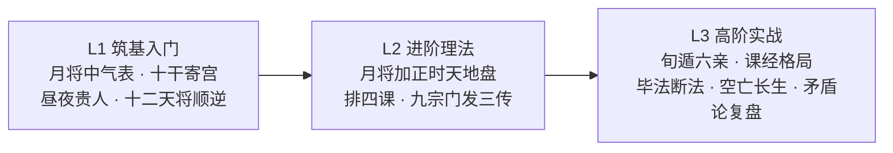

# 大六壬分级教程：从筑基盘式、九宗门算法到《矛盾论》实战复盘

> **创建与修订日期**：2026-11-21  
> **状态**：`draft`（AI 辅助起草，待主理人终审，未经人工核对前不得标 final）  
> **模块归属与编号**：`09 周易数术纲目 ｜ 04_大六壬 ｜ 02_分级教程`  
> **价值基准评级**：🟡 **2 级文档（核心依赖因子：0.3，初始暂定，待用户主理人终审裁定）**  
> **本门导航（04_大六壬 · 6篇体系）**：[01 源流详考](01_源流详考.md) ｜ [**02 分级教程**](02_分级教程.md)（当前） ｜ [03 动画实操演练](03_动画实操演练.md) ｜ [04 经典全文1·《毕法赋》](04_经典全文1_《大六壬毕法赋》.md) ｜ [05 经典全文2·《大六壬指南》](05_经典全文2_《大六壬指南》.md) ｜ [06 经典全文3·《大六壬断案》](06_经典全文3_《邵彦和大六壬断案》.md) ｜ [返回纲目总览](../README.md)  
> **前置理论与公理基石**：[`《十数概论》`](../../02%20元研究/十数概论.md)（易理与术数划界公理）、[`01_源流详考`](01_源流详考.md)。

---

## 教学总纲：三阶递进学习路线

本教程依据大六壬“**天文学底座（天地盘）→ 离散结构化状态机（四课三传）→ 辩证类象推理（天将六亲神煞）**”的内在逻辑，将全部学理拆解为 **L1 筑基入门、L2 进阶理法、L3 高阶实战** 三个刚性阶梯。学习者须先掌握无差错手工排盘，再进入课体生克与历史唯物主义去魅复盘，严禁跳过基础算法直接背诵江湖杂煞。



---

## 第一阶：L1 筑基入门（盘式符号与基础口诀）

大六壬排盘完全脱离随机摇掷，是一套确定性符号映射系统。L1 阶段必须熟记三大基础映射表与两组关系网。

### 1.1 十二月将与中气换将表（太阳黄道位置索引）

大六壬之“月将”，物理本质是**太阳在黄道十二宫的视位置（日躔所居）**。因为太阳在恒星背景下的周年视运动方向（自西向东过宫）与地面节气月建（寅→卯→辰……）恰好**逆向**，且换将的唯一时间节点是二十四节气中的**“中气”**（绝非农历初一，亦非立春等“节气”）：

| 交将中气（约公历日期） | 对应传统月建 | 月将地支 | 月将神名 | 十二次 / 太阳视位置意象 | 记忆速诀 |
| :--- | :---: | :---: | :---: | :--- | :--- |
| **雨水**（2月18–20日） | 寅（正月） | **亥** | **登明** | 娵訾（亥宫双鱼初） | 雨水登明亥 |
| **春分**（3月20–22日） | 卯（二月） | **戌** | **河魁** | 降娄（戌宫白羊初） | 春分河魁戌 |
| **谷雨**（4月19–21日） | 辰（三月） | **酉** | **从魁** | 大梁（酉宫金牛初） | 谷雨从魁酉 |
| **小满**（5月20–22日） | 巳（四月） | **申** | **传送** | 实沈（申宫双子初） | 小满传送申 |
| **夏至**（6月21–22日） | 午（五月） | **未** | **小吉** | 鹑首（未宫巨蟹初） | 夏至小吉未 |
| **大暑**（7月22–24日） | 未（六月） | **午** | **胜光** | 鹑火（午宫狮子初） | 大暑胜光午 |
| **处暑**（8月22–24日） | 申（七月） | **巳** | **太乙** | 鹑尾（巳宫室女初） | 处暑太乙巳 |
| **秋分**（9月22–24日） | 酉（八月） | **辰** | **天罡** | 寿星（辰宫天秤初） | 秋分天罡辰 |
| **霜降**（10月23–24日） | 戌（九月） | **卯** | **太冲** | 大火（卯宫天蝎初） | 霜降太冲卯 |
| **小雪**（11月22–23日） | 亥（十月） | **寅** | **功曹** | 析木（寅宫人马初） | 小雪功曹寅 |
| **冬至**（12月21–23日） | 子（十一月） | **丑** | **大吉** | 星纪（丑宫摩羯初） | 冬至大吉丑 |
| **大寒**（1月20–21日） | 丑（十二月） | **子** | **神后** | 玄枵（子宫宝瓶初） | 大寒神后子 |

> [!TIP]
> **速记规律**：月建与月将恒呈**“地支六合”**关系！正月建寅，寅亥合，故月将为亥；二月建卯，卯戌合，故月将为戌；三月建辰，辰酉合，故月将为酉……依此类推，凡过“中气”后，只需用当月地支求其六合地支，一秒即得月将，绝不出错。

### 1.2 十干寄宫口诀与拓扑原理

地盘只有十二地支而无天干独立宫位，必须将占日“日干”寄托于地盘十二支中。传统大六壬通用**“十干寄宫”**（又称十干遁宫）：

> **口诀**：“甲课寅兮乙课辰，丙戊课巳不须论；丁己课未庚申上，辛戌壬亥是其真；癸课原来丑上坐，分明不用四正神。”

| 十天干 | 甲 | 乙 | 丙 | 丁 | 戊 | 己 | 庚 | 辛 | 壬 | 癸 |
| :---: | :-: | :-: | :-: | :-: | :-: | :-: | :-: | :-: | :-: | :-: |
| **阴阳属性** | 阳 | 阴 | 阳 | 阴 | 阳 | 阴 | 阳 | 阴 | 阳 | 阴 |
| **寄宫地支** | **寅** | **辰** | **巳** | **未** | **巳** | **未** | **申** | **戌** | **亥** | **丑** |
| **五行禄刃机理** | 临官 | 衰/季木 | 临官 | 衰/季火 | 随丙寄巳 | 随丁寄未 | 临官 | 衰/季金 | 临官 | 衰/季水 |

**关键特征**：十干寄宫彻底避开了**子、午、卯、酉“四正神（四仲）”**，全部落于**四孟（寅申巳亥，阳干归禄）**与**四季（辰戌丑未，阴干归库/冠带前位）**之中。这一数学设计保证了天干五行既能通过四孟展现生发冲力，又使阴干退守四库以区分刚柔。

### 1.3 昼夜贵人与十二天将顺逆口诀

十二天将以**天乙贵人**为统帅，随占日日干及占时昼夜而变幻起点和方向：

1. **昼夜划分标准**：
   * **昼占（阳贵/旦贵）**：**卯、辰、巳、午、未、申** 六时（日出至日入）；
   * **夜占（阴贵/暮贵）**：**酉、戌、亥、子、丑、寅** 六时（日入至日出）。
   *(注：严密交界时刻须参考当地真太阳时日出日落，如卯初刻前犹暗或可参夜贵，一般按地支时段划分。)*
2. **牛羊贵人歌（《大六壬大全》《大六壬指南》通行标准版）**：
   > **“甲戊庚牛羊，乙己鼠猴乡，丙丁猪鸡位，壬癸蛇兔藏，六辛逢马虎，此是贵人方。”**
   * 拆解（前字昼贵，后字夜贵）：
     * **甲、戊、庚日**：昼在**丑**（牛），夜在**未**（羊）；
     * **乙、己日**：昼在**子**（鼠），夜在**申**（猴）；
     * **丙、丁日**：昼在**亥**（猪），夜在**酉**（鸡）；
     * **壬、癸日**：昼在**巳**（蛇），夜在**卯**（兔）*(注意歌诀作“蛇兔藏”或“兔蛇藏”，务必牢记壬癸昼巳夜卯)*；
     * **辛日**：昼在**午**（马），夜在**寅**（虎）。
3. **十二天将固定排布序列与顺逆铁律**：
   * **十二将序**：**贵人（土）→ 螣蛇（火）→ 朱雀（火）→ 六合（木）→ 勾陈（土）→ 青龙（木）→ 天空（土）→ 白虎（金）→ 太常（土）→ 玄武（水）→ 太阴（金）→ 天后（水）**。
   * **顺逆法则**：将“贵人”置于歌诀所查**地盘宫位**，看其落在哪一半球：
     * 落于**地盘亥、子、丑、寅、卯、辰**六宫（北东冬春阳区）→ 自贵人起**顺时针**布列（故昼贵甲戊庚丑、乙己子、丙丁亥，及夜贵壬癸卯、辛寅皆顺）；
     * 落于**地盘巳、午、未、申、酉、戌**六宫（南西夏秋阴区）→ 自贵人起**逆时针**布列（故夜贵甲戊庚未、乙己申、丙丁酉，及昼贵壬癸巳、辛午皆逆）。
   * 布列后，读取**该地盘宫位上方所乘的天盘地支**，该天盘地支即承载此天将（天将附着于天盘神将，入四课三传随天盘流转）。

### 1.4 十二天将五行与类象核心表

| 序号 | 天将全称 | 简称 | 五行属性 | 传统吉凶属性 | 现实事物与人事核心类象（去魅化语义索引） |
| :-: | :--- | :-: | :-: | :-: | :--- |
| 1 | **天乙贵人** | 贵 | 土 | 至尊吉神 | 高层决策者、主管、法规权威、贵人助力、关键枢机 |
| 2 | **螣蛇** | 蛇 | 火 | 凶将 | 虚惊怪异、反复纠缠、焦虑失眠、暗中变化、火灾线缆 |
| 3 | **朱雀** | 雀 | 火 | 凶中带文 | 文书契约、信息传播、口舌争辩、考试宣传、电子信息 |
| 4 | **六合** | 合 | 木 | 吉将 | 合作签约、婚姻媒介、中间人、多方聚会、箱盒车辆 |
| 5 | **勾陈** | 勾 | 土 | 凶将 | 迟滞阻隔、田土房产、争讼抓捕、固执僵持、工程基建 |
| 6 | **青龙** | 龙 | 木 | 吉将 | 财帛利润、升迁喜庆、资金流动、正向成长、文雅俊秀 |
| 7 | **天空** | 空 | 土 | 凶将（半吉半空） | 虚伪空诺、欺诈泡沫、策划空想、宗教僧道、容器空壳 |
| 8 | **白虎** | 虎 | 金 | 至凶将 | 突发危机、刑法强制、伤病手术、道路交通、金融刚性兑付 |
| 9 | **太常** | 常 | 土 | 吉将 | 衣帛礼仪、餐饮宴会、印章凭证、常规行政、稳健收益 |
| 10 | **玄武** | 玄 | 水 | 凶将 | 隐秘私情、盗窃欺瞒、暗箱操作、信息黑洞、水湿暗流 |
| 11 | **太阴** | 阴 | 金 | 吉将 | 暗中庇护、幕后策划、女性长辈、隐私秘密、精密金石 |
| 12 | **天后** | 后 | 水 | 吉将 | 恩泽庇荫、女性配偶、后勤保障、阴私和解、水润暗助 |

---

## 第二阶：L2 进阶理法（排盘与九宗门完整算法）

L2 阶段要求完全不借助软件，凭借心算或纸笔在 1 分钟内准确排出任意日期时辰的天地盘、四课与三传。

### 2.1 第一步：月将加正时立天地盘

地盘十二支永远固定于方盘四周（通常以“巳午未申”居上南，“亥子丑寅”居下北，“寅卯辰”居左东，“申酉戌”居右西——即上南下北左东右西的中国古代式盘标准方位）：

```text
  巳    午    未    申
  辰                酉
  卯                戌
  寅    丑    子    亥
```

令占日所处节气之**月将**为 $M$，占测**时辰**为 $H$（按地支编号 子=0, 丑=1, …, 亥=11）。将天盘（圆盘）上的 $M$ 旋转对准地盘上的 $H$，则天盘其余十一支按顺时针依次排满。地盘任意位置 $x$ 对应的天盘上神为：
$$T(x) \equiv x + (M - H) \pmod{12}$$

* **算例演练**：设谷雨后五月小满前，**酉将（从魁）**，**午时**占卜。
  * $M = \text{酉}(9)$，$H = \text{午}(6)$，偏移量 $\Delta = 9 - 6 = +3$。
  * 午宫上神为酉，顺数：未上戌、申上亥、酉上子、戌上丑、亥上寅、子上卯、丑上辰、寅上巳、卯上午、辰上未、巳上申。天地盘即立！

### 2.2 第二步：起四课标准步骤

设占日天干为 $D$（寄宫为 $P_D$），占日地支为 $B$：
1. **第一课（干阳）**：寻 $P_D$ 在地盘的宫位，读出其天盘上神 $S_1 = T(P_D)$，写成上神在下神之上：$\dfrac{S_1}{D}$；
2. **第二课（干阴）**：寻 $S_1$ 在地盘的宫位，读出其天盘上神 $S_2 = T(S_1)$，写成：$\dfrac{S_2}{S_1}$；
3. **第三课（支阳）**：寻 $B$ 在地盘的宫位，读出其天盘上神 $S_3 = T(B)$，写成：$\dfrac{S_3}{B}$；
4. **第四课（支阴）**：寻 $S_3$ 在地盘的宫位，读出其天盘上神 $S_4 = T(S_3)$，写成：$\dfrac{S_4}{S_3}$。

*(注意：传统排盘习惯四课**自右向左**书写，即最右侧为第一课干阳，最左侧为第四课支阴。)*

### 2.3 第三步：九宗门发三传完整算法与典型实例

三传即**初传（发用）、中传、末传**，代表矛盾爆发的起点、演化过程与结局归宿。九宗门构成一个严格互斥、完备覆盖所有 $12 \times 60 \times 12 = 8640$ 种时空组合的决策树，必须**严格按优先级顺序**判定（但**伏吟、返吟**两大特殊盘式须最先识别或单列）：

#### 1. 贼克法（第一宗门：重审与元首）
* **规则**：检查四课每组上下神之间的五行相克关系（注：第一课下神为日干 $D$，论克只看日干 $D$ 本身五行与上神 $S_1$ 之相克，不混用寄宫地支五行）。
  * **下克上称为“贼”**（权力反转、内部冲突爆发，优先级绝对高于上克下）；
  * **上克下称为“克”**。
  * 若四课中**仅有一处下贼上**（不论有几处上克下），立即取该课天盘上神为初传，名曰**“重审课”**；
  * 若完全无下贼上，且**仅有一处上克下**，取该课天盘上神为初传，名曰**“元首课”**。
  * **中末传**：中传 $= T(\text{初传})$，末传 $= T(\text{中传})$。
* **实例**：**戊午日 巳将 寅时**（$\Delta = 5 - 2 = +3$）。
  * 戊寄巳，四课：一课 `申/戊`，二课 `亥/申`，三课 `申/午`，四课 `亥/申`。
  * 查相克：一课申金泄戊土（无克）；二课亥水泄申金（无克）；三课午火克申金（**下贼上！**）；四课同二课无克。
  * 仅一处下贼上（三课），取三课上神 **`申`** 为初传（重审课），中传 $T(\text{申}) =$ **`亥`**，末传 $T(\text{亥}) =$ **`寅`**。三传为 `申 → 亥 → 寅`。

#### 2. 比用法（第二宗门：知一课）
* **规则**：当四课中出现**两课及以上下贼上**，或无贼而出现**两课及以上上克下**时，比较候选课的**天盘上神**与**占日日干 $D$** 的阴阳属性（阳支子寅辰午申戌配阳干甲丙戊庚壬；阴支丑卯巳未酉亥配阴干乙丁己辛癸）。
  * 若恰好只有**一个**上神与日干同阴阳（称为“比”），即取其为初传，名曰**“知一课”**，中末顺递 $T$。
  * *(注：若四课中有两课完全相同且都有克，去重后只算一课，仍属元首/重审而非比用！)*
* **实例**：**甲子日 亥将 辰时**（详见本目录 [`03_动画实操演练`](03_动画实操演练.md) 完整拆解）：无下贼上，有三处上克下（酉克甲、未克子、寅克未），甲为阳干，酉阴、未阴、唯**寅**为阳，故比用取 **`寅`** 为初传，三传 `寅 → 酉 → 辰`。

#### 3. 涉害法（第三宗门：见机与察微）
* **规则**：比用法筛选后，若仍剩下 **2 课及以上**（“俱比”或“俱不比”），则启动涉害法：
  1. **历克深度计算（通行《大全》《指南》孟仲季归本位涉害法）**：取各候选天盘上神，看其现在所乘的地盘支，从该地盘支开始**顺时针数至该上神的本家地盘位为止**（含起点与终点），逐位统计途中**被所历地盘（包含地盘十干寄宫！）发生同类克制（原为贼则计下贼上次数，原为克则计上克下次数）的总次数**（称为“涉害深浅”）。**取涉害次数最多者**发用；
  2. **深浅相等取四孟四仲（见机、察微、复等）**：若涉害次数仍相同，则看候选课的**下神（地盘宫位）**是否位于**四孟（寅、申、巳、亥）**，有则取孟（名**见机课**）；若无孟或同为孟，次取**四仲（子、午、卯、酉）**（名**察微课**）；若仍不能决（或同为四季辰戌丑未），则阳日取干上相关之课、阴日取支上相关之课（名**复等课**，又称“俱不比涉害深浅同，阳取干、阴取支”）。
* **实例（经典名局：庚辰日 巳将 子时）**：
  * 庚寄申，$\Delta = 5 - 0 = +5$。
  * 四课：一课 `丑/庚(申)`（丑生申/庚，无克）、二课 `午/丑`（午生丑，无克）、三课 `酉/辰`（辰生酉，无克）、四课 `寅/酉`（**酉克寅，下贼上**）——此例仅一贼，属重审；若换 **壬辰日 申将 子时**（$\Delta = 8 - 0 = +8$）：
    * 壬寄亥，四课：一课 `未/壬(亥)`（未克壬，上克下）、二课 `卯/未`（卯克未，上克下）、三课 `子/辰`（辰克子，下贼上）、四课 `申/子`（无克）。此处有下贼上 `子/辰`，先取 `子`（重审）。
    * 再看真涉害例：**丁卯日 丑将 卯时**（$\Delta = 1 - 3 = -2 \equiv +10$）：
      * 丁寄未，四课：一课 `巳/丁(未)`（无克）、二课 `卯/巳`（无克）、三课 `丑/卯`（卯克丑，下贼上）、四课 `亥/丑`（丑克亥，下贼上）。
      * 无比用（丑亥俱阴，与丁阴干**俱比**！）。算涉害：
        * 候选 `丑`（现居地盘卯）：自地盘卯顺行归丑位（卯、辰、巳、午、未、申、酉、戌、亥、子、丑），看途中地盘（含寄宫：甲寅、乙辰、丙戊巳、丁己未、庚申、辛戌、壬亥、癸丑）有几个能克丑土（即下贼上者）？卯克丑（1）、辰藏乙木克丑（2）、寅虽未过但至丑止，共历 **卯、乙(辰)** 二重克；
        * 候选 `亥`（现居地盘丑）：自地盘丑顺行归亥位（丑、寅、卯、辰、巳、午、未、申、酉、戌、亥），途中克亥水（土克水）者：丑（含癸）克亥（1）、辰土克亥（2）、未（含丁己）克亥（3）、戌（含辛）克亥（4）！亥涉害达四重（含四季四土），深于丑之二重，故取 **`亥`** 为初传！

#### 4. 遥克法（第四宗门：蒿矢与弹射）
* **规则**：四课全无上下直接相克（除八专外，亦包括三课备有遥克之例），则考察**二、三、四课（及一课）天盘上神**与**占日日干 $D$** 之间的遥远相克关系：
  * **神遥克日干（蒿矢课）优先**：四课上神中有五行克日干 $D$ 者取之；
  * **日干遥克上神（弹射课）次之**：无神克日干，则取日干 $D$ 所克之上神；
  * 若有两神同遥克日或同被日克，依**比用法**取与日干同阴阳者发用；中末顺递 $T$。
* **实例**：**甲寅日 申将 午时**（$\Delta = 8 - 6 = +2$，且甲寄寅与寅支同位是八专，故不入遥克；换 **壬戌日 午将 辰时**，$\Delta = +2$）：
  * 壬寄亥，四课：一课 `丑/壬`（丑克壬！这已有上克下了，换 **壬申日 午将 巳时**，$\Delta = +1$）：
    * 一课 `子/壬`、二课 `丑/子`（丑克子，有克）。若要四课全无直接克，如 **甲申日 午将 未时**（$\Delta = 6 - 7 = -1 \equiv +11$）：
    * 一课 `丑/甲`（无克）、二课 `子/丑`（无克）、三课 `未/申`（未生申，无克）、四课 `午/未`（午生未，无克）。
    * 四课完全无上下直接相克！查遥克：神克甲木（需金神申酉，四课上神 `丑、子、未、午` 中无金）→ 无蒿矢；再查甲木克神（甲木克土，上神中有 **`丑`** 土与 **`未`** 土！皆可为甲所克，即“弹射”）→ 依比用，甲为阳干，丑未皆阴支（俱不比），依涉害查丑居寅、未居申：未居申（四孟）或按涉害次数，先涉害归本位查甲寅等被克重数择一，即可得出三传！

#### 5. 昴星法（第五宗门：虎视与冬蛇掩目）
* **规则**：四课四组互异、无上下克贼、无遥克（如水木相生、火土相生满盘和气之局）：
  * **阳日（刚日）**：仰视地盘“酉”位上之天盘神 $T(\text{酉})$ 为初传，中传取**支上神 $S_3$**，末传取**干上神 $S_1$**（名“虎视转蓬”）；
  * **阴日（柔日）**：俯视天盘“酉”位下之地盘神 $E(\text{酉})$ 为初传，中传取**干上神 $S_1$**，末传取**支上神 $S_3$**（名“冬蛇掩目”）。
* **实例**：**戊寅日 亥将 申时**（$\Delta = 11 - 8 = +3$）：
  * 戊寄巳，四课：一课 `申/戊`、二课 `亥/申`、三课 `巳/寅`（寅生巳，无克）、四课 `申/巳`（无克；四课中二三四课不重，四课备否？`申/戊, 亥/申, 巳/寅, 申/巳` 虽有 `申` 在一、四课重复，然组对均异，四课全备！）。查遥克：戊土与上神 `申、亥、巳` 均无相克（寅已不在上神）→ 入昴星！
  * 戊为刚日：仰视地盘 `酉` 上神 $T(\text{酉}) = 9 + 3 = \text{子}$，故初传 **`子`**，中传支上神 **`巳`**，末传干上神 **`申`**。

#### 6. 别责法（第六宗门：四课不全三课备）
* **规则**：四课中出现两组完全相同的课（实得三课），且无克贼、无遥克：
  * **阳日**：取日干**五合天干**（甲合己、乙合庚、丙合辛、丁合壬、戊合癸）所寄地盘宫位上的**天盘神**为初传；
  * **阴日**：取日支所属三合局**顺行下一位地支**（地支顺数四位，如巳酉丑，酉日取丑、丑日取巳、巳日取酉）的**本支地支**为初传；
  * **中末传**：无论刚柔，中传、末传**皆取干上神 $S_1$**。
* **实例**：**辛丑日 丑将 卯时**（$\Delta = 1 - 3 = -2 \equiv +10$）：
  * 辛寄戌，四课：一课 `申/辛(戌)`、二课 `午/申`（无克）、三课 `亥/丑`（无克）、四课 `酉/亥`（无克）。*(此例四课全备；若换 **辛亥日 酉将 亥时** $\Delta = -2$：一课 `申/辛`、二课 `午/申`、三课 `酉/亥`、四课 `未/酉`，仍全备；典型别责如 **戊午日 申将 午时** $\Delta = +2$：戊寄巳，一课 `未/戊`、二课 `酉/未`、三课 `申/午`、四课 `戌/申`；若 **丙辰日 辰将 卯时** $\Delta = +1$：丙寄巳，一课 `午/丙(巳)`、二课 `未/午`、三课 `巳/辰`、四课 `午/巳`，一课与四课同为 `午/巳`，仅三课备！四课无克无遥克 → 丙为刚日，丙辛合，辛寄戌，取地盘戌上神 `亥` 为初传，中末皆干上神 `午`，三传 `亥 → 午 → 午`！)*

#### 7. 八专法（第七宗门：干支同位两课备）
* **规则**：仅限**甲寅、庚申、丁未、己未、癸丑**（“八专”原指甲寅、乙卯、丁未、戊戌、己未、庚申、辛酉、癸丑八日干支同气，在大六壬寄宫中严格使 $P_D = B$ 仅余此五日，余三日若乙卯寄辰、戊戌寄巳、辛酉寄戌则四课不全属别责或有克）：
  * 有上下克贼，仍按贼克发用（八专**不论遥克**）；
  * 无上下克贼：
    * **阳日（甲寅、庚申）**：从**干上神 $S_1$**（第一课上神）顺数三位（含本身，即 $S_1 + 2 \pmod{12}$）为初传；
    * **阴日（丁未、己未、癸丑）**：从**第四课上神（即支阴神 $S_2$）**逆数三位（含本身，即 $S_2 - 2 \pmod{12}$）为初传；
    * **中末传**：皆取**干上神 $S_1$**。
* **实例**：**甲寅日 子将 亥时**（$\Delta = 0 - 11 = +1$）：
  * 一课 `卯/甲(寅)`、二课 `辰/卯`、三课 `卯/寅`、四课 `辰/卯`，仅两课且无克。甲为阳日，自干上神 `卯` 顺数三位（1卯、2辰、3巳）得 **`巳`** 为初传，中末皆 **`卯`**，三传 `巳 → 卯 → 卯`。

#### 8. 伏吟法（第八宗门：天地盘重合 $M = H$）
* **规则**：月将与占时同支，天地盘毫无转动（$T(x) = x$），四课上下同字：
  * **有克（自任克）**：仅限于干支自身与寄宫相克之日（如癸丑[丑克癸]、乙辰[乙克辰]等），取受克/贼课神发用（通常即干上神），中传取初传**所刑**之支，末传取中传**所刑**之支；
  * **无克**：阳日（及部分刚干如戊辰等自任格）取**干上神（即干寄宫）**为初传，阴日（无克时）取**支上神（即支本身）**为初传（俗称“阳干阴支”）；
  * **三刑与杜传破局**：中传、末传按**地支相刑**递推（寅刑巳→巳刑申→申刑寅；丑刑戌→戌刑未→未刑丑；子卯互刑；辰午酉亥自刑）。若初传遇**自刑**（辰午酉亥），中传改取**刚日支上、柔日干上**（或中传杜塞再取六冲），末传再顺刑或取**冲**（如 `辰→寅` 若为申已见，或自刑后取对冲破局，具体详见《毕法赋》与《大六壬指南》伏吟专例，核心原则为**遇自刑互刑而止者，借干支互换与六冲破滞**）。

#### 9. 返吟法（第九宗门：天地盘六冲 $\|M - H\| = 6$）
* **规则**：月将与占时地支相冲，天地盘全盘对冲（$T(x) = x + 6$）：
  * **有克**：依贼克、比用、涉害常规发用，中传取 $T(\text{初})$（即初传对冲），末传取 $T(\text{中})$（即返归初传本字，形成 `A → B → A` 往复动荡局）；
  * **无克（井栏射格）**：特指六辛日及丁丑、丁未日返吟四课全无克贼时，取**日支所属三合局之驿马**为初传（申子辰马在寅，寅午戌马在申，巳酉丑马在亥，亥卯未马在巳），中传取**支上神 $S_3$**，末传取**干上神 $S_1$**。
* **实例**：**辛未日 午将 子时**（$\Delta = +6$）：
  * 辛寄戌，四课：`辰/辛(戌)`、`戌/辰`、`丑/未`、`未/丑`，全为土金相生或比和，无克贼。
  * 无克返吟（井栏射）：日支 `未` 属亥卯未木局，驿马在 **`巳`**！故初传 **`巳`**，中传支上神 **`丑`**，末传干上神 **`辰`**。

---

## 第三阶：L3 高阶实战（六亲格局、空亡长生与《矛盾论》复盘）

完成排盘只是获取了“符号状态机”的输出；L3 阶段的核心任务是提取有效信息量，并以辩证法框架统御庞杂的课体神煞。

### 3.1 旬遁六亲与关键神煞精简（去伪存真）

大六壬之神煞动辄百余种，清代《御定六壬直指》与实战派早已指出“神煞繁多反乱心目”，实战仅需紧扣**五大核心算子**：
1. **旬遁干与六亲**：以占日所属甲子旬将十天干填入十二地支（余二支为**旬空**）。既可按三传地支五行与日干五行定**生克六亲**（主流法），亦须察看三传天盘上所遁天干（特别是**旬丁——丁神**，主变动惊扰；**闭口**——旬尾癸加旬首甲或三传遁癸临甲，主阻塞难言）。
2. **驿马与天马**：日支三合对冲为**驿马**（申子辰马在寅等），月令顺数（正月起午顺行两支一跳：正七月午、二八月申、三九月戌……）为**天马**，主行程调动、消息速至。
3. **日禄与羊刃**：甲禄在寅刃在卯，丙戊禄在巳刃在午，庚禄在申刃在酉，壬禄在亥刃在子（阴干禄位虽在旺衰之间，大六壬以寄宫兼参）。禄主俸禄实利，临干旺相主得实惠，临绝空则禄败。
4. **日墓与网罗**：辰（水土墓）、戌（火墓）、丑（金墓）、未（木墓）为四墓库；**天罗（辰）地网（戌）**临干支且乘凶将，主受困束缚。
5. **德合与救神**：月德、日德（如甲德在寅、乙德在申等）、天乙贵人、青龙、六合生扶日干或制伏鬼煞（“制鬼之位乃良医”）。

### 3.2 常用核心课体格局速查表

| 课体名称 | 结构特征 | 核心意象与吉凶辨证（不可死板单断吉凶） |
| :--- | :--- | :--- |
| **三奇课** | 三传或课传见**甲戊庚（天三奇）**、**乙丙丁（地三奇）**或旬首仪奇（**甲戌旬、甲申旬**等变通法） | 象征打破常规的奇谋、高层特批或突发转机；然遇空亡克害则奇而不奇 |
| **联茹格** | 三传地支连续挨次排列（如 `寅→卯→辰` 为**进茹**，`辰→卯→寅` 为**退茹**） | 事物呈连续推进（进茹利开拓、升迁）或连续退缩（退茹利退守、隐退、解套）的链式反应 |
| **间传格** | 三传地支隔一位排列（如 `子→寅→辰` 顺间，`辰→寅→子` 逆间） | 事物演化有跳跃、间断或中间人串联，“一步一停” |
| **三合局** | 三传构成 `申子辰`(水)、`亥卯未`(木)、`寅午戌`(火)、`巳酉丑`(金) | 极强系统合力：若合局**生日干**或为财官吉神（润下、曲直、炎上、从革），主众志成城；若合局**克日干**（三传合鬼）或泄气（脱气），主群体围攻或精力耗散 |
| **铸印格** | **巳（炉冶）＋ 戌（印绶火库）＋ 卯（印木/车）** 会于课传（尤其丁巳、己巳等传见巳戌卯） | 古代科举授官吉格，主获印信授权或制度性晋升；现代可引申为签署正式权责文件、资质认证通过 |
| **斫轮格** | **卯（木轮）加于 申/酉（金斧斤）** 或三传金木交克而受雕琢 | 主事须经激烈改造、打磨方能成器；若无火制金或木太衰，则成折损之象 |
| **斩关格** | 魁（戌）、罡（辰）临干支或发用乘太冲（卯）、天罡（辰）冲破关隔 | 主冲破封锁、辞职远行、越狱脱险；占家居稳守则反主不安 |
| **罗网格** | 辰（天罗）、戌（地网）临日干支、年命或夹克发用 | 主进退两难、规则束缚、法律红线限制 |

### 3.3 空亡与十二长生动态评估

1. **空亡（旬空）辩证法则**：“避实击虚，真空不空”
   * **真空**：旬空之地支又逢**月破、休囚死绝、被日辰或动神克伤**，谓之彻底失效（吉事落空成画饼，凶事落空反免灾）。
   * **假空**：旬空之地支得**月建日辰生旺、或旺相乘吉将生合、或出旬（等待数日至下一甲子旬）即填实**，谓之“暂时悬置，出旬即应”。
2. **十二长生（长生至养的周期定位）**：
   以日干五行（阳干顺行，大六壬兼论阳长生为主，**绝不机械死套“阴干逆行”谬论**，而重木生亥、火土生申?——注意：大六壬主流采用**水土同生于申、火生于寅、木生于亥、金生于巳**，亦即“水土长生在申、绝在巳”的五行阳顺长生统制，亦有部分派别兼参阴长生）：
   * **长生、冠带、临官、帝旺**：系统处于上升期与强势期；
   * **衰、病、死、墓、绝**：能量收敛、病态阻滞、入库封存（墓）或彻底断流（绝）；
   * **胎、养**：孕育酝酿、信息萌动、犹豫未决（《毕法赋》云“胎财生气妻怀孕”）。

### 3.4 基于《矛盾论》的实战复盘四步工作法

为防止初学者陷入“背口诀算命”的唯心泥淖，本教程强制确立基于唯物辩证法的**四步复盘框架**：

1. **界定主体与客体边界（日干 vs 日支）**：
   任何社会实践首先区分“我方能动性（日干 $D$ 及其上神）”与“客观条件/对手/项目实体（日支 $B$ 及其上神）”。若日干旺相克支（我制客），则主动权在我；若日支克干（客制我），则须评估客观环境阻力。
2. **锁定主要矛盾与矛盾主要方面（初传与贼克）**：
   为什么大六壬以“下贼上”为最优先？因为在组织与社会系统中，表面风平浪静下的“内部底层冲突”（下克上）才是引爆系统质变的真正突破口。复盘历史事件时，应重点核查：当时真正的矛盾爆破点，是否正是系统内最尖锐的“受压抑/反制力量”？
3. **考察矛盾转化的外部条件与阶段性（三传与月建日辰）**：
   初传（起因）→ 中传（过程博弈）→ 末传（阶段结果）体现了过程论。初传虽凶（如鬼贼发用），若中传、末传出现“子孙制鬼”或“父母化鬼生身”（即通过制度协调、技术革新、外援介入实现矛盾转化），则凶可化吉；反之初吉末空（如初传旺财，末传逢空亡或化鬼脱气），则是典型的“高开低走、后劲乏力”陷阱。
4. **剥离宿命，回归现实物质实践**：
   大六壬作为符号沙盘，其真正价值在于**“结构化盲点扫描”**——逼迫决策者系统检查“我方资源（禄财）、对手实力（支阴）、潜在规则约束（官鬼墓网）、未来三步演化路径（三传）”。绝不可因课象呈吉而放弃现实尽职调查，亦不可因课象呈凶而消极躺平——课象揭示的是“若按惯性不加干预可能面对的矛盾结构”，唯有人的客观实践能动性才是改写结局的决定性力量。

---

## 本阶自检习题（附校验答案）

1. **排盘验算**：试排出 **丙申日 午将 辰时（昼占）** 之天地盘、四课、三传、昼夜贵人及初传六亲。
   * *校验答案*：$\Delta = \text{午}(6) - \text{辰}(4) = +2$。丙寄巳，一课 `未/丙(巳)`、二课 `酉/未`、三课 `戌/申`、四课 `子/戌`。四课无直接上下克贼（未泄丙火、酉泄未土、戌生申金、子耗戌土）；查遥克：上神 `未酉戌子` 中 **`子` 水遥克 `丙` 火**（蒿矢课！）。故取 **`子`** 为初传，中传 $T(\text{子}) =$ **`寅`**，末传 $T(\text{寅}) =$ **`辰`**（三传 `子→寅→辰`，水生木、木克土）。丙日昼占贵人在地盘 `亥`（丙丁猪鸡位），亥在亥~辰顺行，故地盘 `亥` 上天盘 `丑` 乘贵人，顺推至地盘 `戌` 上天盘 `子` 乘 **天后**（亥贵、子蛇、丑雀、寅合、卯勾、辰龙、巳空、午虎、未常、申玄、酉阴、戌后）。丙申日属甲午旬（辰巳空），末传 `辰` 逢旬空！初传 `子` 克丙火为官鬼（乘天后）。
2. **概念辨析**：为何《大六壬》严格规定“伏吟无克，刚日取干、柔日取支”而不顺递天盘？
   * *校验要点*：因 $M = H$ 时天地盘静止（$T(x) = x$），若再用 $T(x)$ 顺递，三传将永远死锁在原地不动；故古人借“地支三刑（矛盾内在摩擦自耗）”打破静态死锁，体现“外动停滞则内耗显化”的辩证逻辑。

---

<sub>© 2026 徐时言 · 《大六壬分级教程：从筑基盘式、九宗门算法到《矛盾论》实战复盘》 · 徐时言-易经研究 · 采用 CC BY-NC-ND 4.0 许可， 转载请署名并注明来源 https://wole278.github.io/xushiyan-YiJing/ · 禁止商业使用与改编传播 · 商业授权：wole278@hotmail.com / 微信 wole278</sub>
