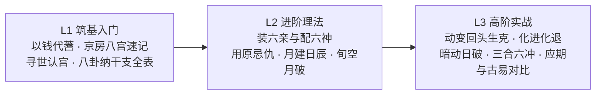

# 六爻纳甲分级教程：从以钱代蓍、浑天甲子到局域动变与古易对勘

> **创建与修订日期**：2026-11-21  
> **状态**：`draft`（AI 辅助起草，待主理人终审，未经人工核对前不得标 final）  
> **模块归属与编号**：`09 周易数术纲目 ｜ 05_六爻纳甲 ｜ 02_分级教程`  
> **价值基准评级**：🟡 **2 级文档（核心依赖因子：0.3，初始暂定，待用户主理人终审裁定）**  
> **本门导航（05_六爻纳甲 · 6篇体系）**：[01 源流详考](01_源流详考.md) ｜ [**02 分级教程**](02_分级教程.md)（当前） ｜ [03 动画实操演练](03_动画实操演练.md) ｜ [04 经典全文1·《京氏易传》](04_经典全文1_《京氏易传·八宫纳甲篇》.md) ｜ [05 经典全文2·《火珠林》](05_经典全文2_《火珠林》.md) ｜ [06 经典全文3·《千金赋》](06_经典全文3_《黄金策·千金赋》.md) ｜ [返回纲目总览](../README.md)  
> **前置理论与公理基石**：[`《十数概论》`](../../02%20元研究/十数概论.md)、`《384爻断辞回测报告》`、[`01_源流详考`](01_源流详考.md)。

---

## 教学总纲：三阶递进学习路线

六爻纳甲（《火珠林》系统）是中国传统数术中结构最紧凑、符号编码效率最高的干支生克模型。本教程严格按 **L1 筑基入门（起卦与装卦硬件规则）→ L2 进阶理法（六亲六神与月日四值）→ L3 高阶实战（动变回头生克、合冲应期与古易对勘）** 三阶编排，彻底剔除清代野鹤老人早已批驳的“卦身/世身/星煞”等繁芜冗余，直击“用神—月日—动变”核心机制。

---

## 第一阶：L1 筑基入门（摇卦、认宫与浑天甲子）

### 1.1 以钱代蓍摇卦法（二项分布概率编码）

取三枚形制均一、正反面纹饰清晰的硬币/铜钱（约定：**有字/徽章面为“字/阳面/正面”**，**无字/花纹素面为“背/阴面/反面”**——依古法《火珠林》及《增删卜易》主流规定，**三钱以“背”的数量少者定阴阳，或按“少为贵”原则：一背为少阳、两背为少阴、三背为老阳、三字全无背为老阴**）：

> *(注：现代部分简化教材亦用“字数”作类似定义，即一背两字为单[阳]、两背一字为拆[阴]、三背无字为重[老阳]、三字无背为交[老阴]。关键在于**全过程规则锁定一致**，本体系严格遵从清代《增删卜易》《卜筮正宗》古制。)*

| 三枚钱投掷结果 | 俗称与符号 | 阴阳与动静属性 | 单次理论概率 | 变卦映射规则 |
| :--- | :---: | :--- | :---: | :--- |
| **一背二字**（1反2正） | 单（`、`） | **少阳**（静阳爻 `———`） | $C_3^1/8 = \mathbf{37.5\%}$ | 静而不动，之卦仍为阳爻 |
| **二背一字**（2反1正） | 拆（`、、`） | **少阴**（静阴爻 `-- --`） | $C_3^2/8 = \mathbf{37.5\%}$ | 静而不动，之卦仍为阴爻 |
| **三背零字**（3反0正） | 重（`O`） | **老阳**（动阳爻 `——— O`） | $C_3^3/8 = \mathbf{12.5\%}$ | **物极必反**，之卦变为阴爻 `-- --` |
| **零背三字**（0反3正） | 交（`X`） | **老阴**（动阴爻 `-- -- X`） | $C_3^0/8 = \mathbf{12.5\%}$ | **物极必反**，之卦变为阳爻 `———` |

* **装画方向**：**自下而上**逐次记录——第 1 掷为**初爻**（最底），第 2 掷为二爻……第 6 掷为**上爻**（最顶）。每次抛掷生成变爻的总概率为 $12.5\% + 12.5\% = 25\%$，故一卦六爻平均出现 $6 \times 0.25 = 1.5$ 个动爻。

### 1.2 京房八宫六十四卦速记与“寻世认宫”核心算法

背诵整个六十四卦表极易遗忘；掌握**“世爻定位歌”**与**“认宫口诀”**，可在 5 秒内推导出任意一卦的**世爻、应爻与所属宫位（五行）**：

1. **天同二世天变五，地同四世地变初，本宫六世三世异，人同游魂人变归**（《京房/火珠林》寻世绝学）：
   把一个六画卦分成**上卦（四五上爻）**和**下卦（初二三爻）**，逐一比对两卦的天爻（上 vs 三）、人爻（五 vs 二）、地爻（四 vs 初）阴阳是否相同：
   * **三才全同**（上下纯卦相同）：**本宫卦**（**世在六爻**，如乾、坤）；
   * **三才全异**（上下三爻全相反）：**三世卦**（**世在三爻**，如泰、否、既济、未济）；
   * **仅天同**（仅上爻与三爻同，人地异）：**二世卦**（**世在二爻**）；
   * **仅天变**（人地同，唯天爻异）：**五世卦**（**世在五爻**）；
   * **仅地同**（仅四爻与初爻同，天人异）：**四世卦**（**世在四爻**）；
   * **仅地变**（天人同，唯地爻异）：**一世卦**（**世在初爻**）；
   * **仅人同**（仅五爻与二爻同，天地异）：**游魂卦**（**世在四爻**，如晋、明夷、颐、大过）；
   * **仅人变**（天地同，唯人爻异）：**归魂卦**（**世在三爻**，如大有、同人、随、蛊）。
   * *(应爻规则：永远与世爻相隔三位——世初应四、世二应五、世三应六、世四应一、世五应二、世六应三。)*

2. **认宫口诀（“八卦之宫归何处”）**：
   > **“一二三六外卦宫，四五游魂内变更，归魂内卦是本宫。”**
   * **本宫（六世）、一世、二世、三世卦**：其**上卦（外卦）**本身就是所属宫位！（如《地天泰》是三世卦，上卦为坤，故属**坤宫土**）；
   * **四世、五世、游魂卦**：将**下卦（内卦）三爻全部阴阳反转（错卦）**，所得之卦即为其所属宫位！（如《火地晋》为游魂卦，内卦为坤，错转为乾，故属**乾宫金**）；
   * **归魂卦**：其**下卦（内卦）**本身就是所属宫位！（如《火天大有》为归魂卦，内卦为乾，故属**乾宫金**）。

### 1.3 八卦纳干支（浑天甲子）完整全表

六爻排盘口诀：“**乾震坎艮阳顺转（子寅辰），坤巽离兑阴逆飞（未丑卯巳）**”。下表为 L1 阶段必须烂熟于胸的唯一映射表：

| 经卦 | 阴阳与五行 | 纳干（内/外） | 初爻 | 二爻 | 三爻 | 四爻 | 五爻 | 上爻 |
| :---: | :---: | :---: | :---: | :---: | :---: | :---: | :---: | :---: |
| **乾** | 阳 · 金 | 甲 / 壬 | 甲**子**水 | 甲**寅**木 | 甲**辰**土 | 壬**午**火 | 壬**申**金 | 壬**戌**土 |
| **震** | 阳 · 木 | 庚 / 庚 | 庚**子**水 | 庚**寅**木 | 庚**辰**土 | 庚**午**火 | 庚**申**金 | 庚**戌**土 |
| **坎** | 阳 · 水 | 戊 / 戊 | 戊**寅**木 | 戊**辰**土 | 戊**午**火 | 戊**申**金 | 戊**戌**土 | 戊**子**水 |
| **艮** | 阳 · 土 | 丙 / 丙 | 丙**辰**土 | 丙**午**火 | 丙**申**金 | 丙**戌**土 | 丙**子**水 | 丙**寅**木 |
| **坤** | 阴 · 土 | 乙 / 癸 | 乙**未**土 | 乙**巳**火 | 乙**卯**木 | 癸**丑**土 | 癸**亥**水 | 癸**酉**金 |
| **巽** | 阴 · 木 | 辛 / 辛 | 辛**丑**土 | 辛**亥**水 | 辛**酉**金 | 辛**未**土 | 辛**巳**火 | 辛**卯**木 |
| **离** | 阴 · 火 | 己 / 己 | 己**卯**木 | 己**丑**土 | 己**亥**水 | 己**酉**金 | 己**未**土 | 己**巳**火 |
| **兑** | 阴 · 金 | 丁 / 丁 | 丁**巳**火 | 丁**卯**木 | 丁**丑**土 | 丁**亥**水 | 丁**酉**金 | 丁**未**土 |

> [!NOTE]
> **变卦装支铁律**：若本卦有动爻生成之卦（变卦），变卦各爻之地支**必须重新按变卦自身上下经卦查上表装配**，而**变卦的六亲，依然以本卦所属宫位的五行为“我”来推算**（绝不能改用变卦的宫位定六亲！）。

---

## 第二阶：L2 进阶理法（六亲六神、四维链与月日四值）

### 2.1 装六亲与配六神

1. **装六亲（以本卦宫位五行 $P$ 为“我”，对照各爻地支五行 $B$）**：
   * $B$ 生 $P$ → **父母**（印绶、契约、文书、房产、长辈、庇护）；
   * $B$ 同 $P$ → **兄弟**（竞争、同辈、分财、合作阻滞）；
   * $P$ 生 $B$ → **子孙**（产出、利润源、医药、解除压力、制官鬼）；
   * $P$ 克 $B$ → **妻财**（财物、利润、配偶、物质基础）；
   * $B$ 克 $P$ → **官鬼**（职位、规则、官方考核、病灶、灾患）。
2. **配六神（按占日日干，自初爻至上爻向上顺配）**：
   * 甲乙日初爻起**青龙**；丙丁日起**朱雀**；戊日起**勾陈**；己日起**螣蛇**；庚辛日起**白虎**；壬癸日起**玄武**。
   * **顺布序列**：青龙 → 朱雀 → 勾陈 → 螣蛇 → 白虎 → 玄武（六神只主象意修饰，**全无生克实权**）。

### 2.2 取用神及原神—忌神—仇神四维生态链

六爻断卦绝非漫无目的看全盘，必须先依求占事项锚定唯一核心焦点——**用神**，由此生成四维调控网络：

| 常见求占事项 | 核心用神选取 | 原神（生用神者） | 忌神（克用神者） | 仇神（生忌克原者） |
| :--- | :--- | :--- | :--- | :--- |
| **求财、买卖、股票投资** | **妻财** | 子孙（财源） | 兄弟（劫财） | 父母（生兄克子） |
| **求官、升职、诉讼被告、官司** | **官鬼** | 妻财（生官） | 子孙（剥官） | 兄弟（生子克财） |
| **考试、签约、购房、文书** | **父母** | 官鬼（生印） | 妻财（坏印） | 子孙（生财克官） |
| **健康、医病、避灾解祸** | **世爻 / 病者六亲 / 官鬼(病)** / **子孙(药)** | 依具体对象定 | 克制救神者 | 助病克药者 |
| **合作、竞争对手、同辈关系** | **应爻 / 兄弟** | 父母 | 官鬼 | 妻财 |

* **飞神与伏神处理**：若用神在本卦六爻中完全不见（“用神不上卦”），须从**本卦所属纯卦**的对应爻位抄出该用神，写在本卦该爻（称**飞神**）之下（称**伏神**）。伏神欲出头发挥作用，须满足以下条件之一：① **得月建日辰生扶或冲开飞神**；② **飞神逢旬空、月破或动变**（飞神让路，“空下伏神易于引拔”）；③ **伏神旺相且飞来生伏**（反之飞来克伏、伏神休囚死绝则“伏无提拔终徒尔”）。

### 2.3 月建与日辰四值生克权（外部客观环境权重）

在《火珠林》与《增删卜易》体系中，**月建（节气月令）**与**日辰（占日地支）**统称“大环境主宰”，年（太岁）与时（时辰）仅作辅助参考（故实占重点在月、日二值）：

1. **月建（旺相休囚死之总裁判）**：
   * 严格按二十四节气**十二节**换月（立春寅、惊蛰卯、清明辰、立夏巳、芒种午、小暑未、立秋申、白露酉、寒露戌、立冬亥、大雪子、小寒丑）。
   * **当令为旺，月生为相，生月为休，克月为囚，月克为死**（如寅卯月：木旺、火相、水休、金囚、土死）。
   * **月破**：地支与月建正冲者（寅申、卯酉、辰戌、巳亥、子午、丑未），主该爻当月毫无实力、破裂失效；唯得日辰生扶、或待出月填实方可再用。
2. **日辰（全年恒旺之绝对主动权）**：
   * **日辰与月建同权，且贯穿始终**（月建过期退位，日辰恒久不衰）。
   * **日冲的双向效应**：
     * **暗动**：旺相的静爻被日辰冲之，反被激发出等同于动爻的生克行动力；
     * **日破**：休囚无气的静爻被日辰冲之，彻底散架崩溃，全无可用之理。

### 2.4 旬空与月破真假辨析（《增删卜易》实证精髓）

| 特殊空破状态 | **假空 / 可用之空**（暂时悬置） | **真空 / 彻底无用**（永无实效） |
| :--- | :--- | :--- |
| **判定条件** | ① 临月建旺相；② 得日辰生扶；③ 自己发动或有他动爻生助；④ 化吉或虽空而旺相有气 | ① 休囚死绝于月建、又无日辰及动爻生扶；② **月破又逢空**；③ 动而化绝、化墓、化回头克再加旬空 |
| **实战断法** | 绝非“无此事”，而是**目前时机未熟或心中犹豫**；待**出旬填实**或**冲空之日/月**即刻兑现 | 彻底“画饼充饥”：吉神真空则美事成空，忌神/官鬼真空则灾祸自动消散（“避凶喜真空”） |

---

## 第三阶：L3 高阶实战（动变法则、应期及与古经时位法对比）

### 3.1 动爻与变爻的“局域作用域”法则

六爻系统各层级之间的生克权力存在严格的**单向拓扑秩序**（绝不可乱克）：
1. **层级压制律**：`月建、日辰` $\ge$ `动爻` $>$ `静爻`；`变爻` 只作用于**本位动爻**。
   * 月、日可生克卦中一切动爻与静爻，但卦中任何爻不能反克月日；
   * 动爻可生克静爻，亦可与其他动爻交互生克；**静爻即使旺相，也绝不能克动爻**；
   * **变爻（之卦对应爻）的局域原则**：变爻是本位动爻演化的直接结果，**只对自己所从出的那个动爻发生回头生、回头克、回头冲合或进退**，一般不越位去生克卦中其他位置的静爻！
2. **动变八大核心形态**：
   * **回头生**：动爻受变爻生助（如丑土动化巳火，火生土），力量倍增且可持续；
   * **回头克**：动爻被变爻克制（如子水动化丑土，土克水），主半途受制、自我反噬或计划流产；
   * **化进神**：同五行地支由弱向强顺进，包括 **亥化子、寅化卯、巳化午、申化酉** 以及四库顺进 **丑化辰、辰化未、未化戌、戌化丑**，主事物不断升级壮大；
   * **化退神**：同五行地支逆退（**子化亥、卯化寅、午化巳、酉化申** 等），主规模萎缩、主动撤退或心生退意；
   * **化绝 / 化墓 / 化破 / 化空**：动爻变入死绝墓库或被月日冲破（如木化申绝、火化亥绝），能量瞬间截断；
   * **化伏吟 / 化反吟**：变出地支与本位相同（伏吟，如乾变震同属子寅辰），主停滞呻吟；变出地支与本位正冲（反吟，如乾变巽/坤等六冲），主反复折腾。

### 3.2 三合局与六冲变六合的全局动力学

1. **三合局（极强生态联盟）**：
   卦中出现三爻齐动，或**二动爻＋一静爻/日辰/月建**凑齐 **申子辰（水局）、亥卯未（木局）、寅午戌（火局）、巳酉丑（金局）**（注意：野鹤实证指出“两动一静或一动加变爻与月日”最易成局，纯静三字一般不作实局论）。三合局成则五行能量压倒单爻，成局生世用大吉，成局克世用大凶。
2. **六冲卦与六合卦**：
   * **六冲卦**（八纯卦及天雷无妄、雷天大壮共十卦，对应爻初四、二五、三六皆相冲）：主事发急骤、离散快、难以持久（久病遇六冲多危，近病遇六冲易愈；合作谋事忌六冲，解讼散灾喜六冲）；
   * **六合卦**（地天泰、天地否、山火贲、火山旅、水泽节、泽水困、雷地豫、地雷复共八卦，对应爻相合）：主牵绊、黏连、和好持久；
   * **六冲变六合**（先散后聚、先难后成）；**六合变六冲**（先甜后苦、虎头蛇尾、合作破裂）。

### 3.3 应期判定五大核心法则

| 卦中关键状态 | 应期锁定规则（实占统计最常用规律） |
| :--- | :--- |
| **用神安静不动** | 逢**冲**用神之月日（“静待冲”）或用神**临值**之月日 |
| **用神或原神发动** | 逢**合**住动爻之月日（“动待合”）或临值之月日 |
| **用神逢旬空** | 逢**出旬填实**或**冲空**之日（假空可应，真空不应） |
| **用神逢月破** | 待**出月**之后、或逢**合破**之日、或**实破**之月 |
| **用神入墓库** | 待**冲开墓库**之月日（如辰墓待戌冲，丑墓待未冲） |

### 3.4 学术基石对勘：六爻纳甲与《周易》古经“时位法”的本质差异

在结束 L3 学习前，必须将六爻纳甲技术放回 `《384爻断辞回测报告》` 确立的科学坐标系中进行方法论对勘：

1. **变量体系的彻底置换**：
   * 先秦《周易》古经以**“六位时位（初微、二中、三危、四惧、五尊、上亢）”**为决定吉凶的首要变量（$\eta^2 = 0.131, p < 0.001$），而不问干支五行；
   * 京房—火珠林六爻则完全抹平了初二三四五上的固有位势差异（仅保留五爻为君位等微弱类象），将决定权全盘移交给**世应坐标、月日四值生克与局域动变**。
2. **“用神不上卦”与“全易一理”的哲学张力**：
   《周易》古经通过历史典故（如“高宗伐鬼方”“帝乙归妹”）引导人在特定发展阶段践行中正德行；而六爻纳甲将人抽离为“世爻”，将对象抽离为“用神”，构建了一套纯粹的**能量流向与时效窗口（应期）模拟算盘**。二者属于不同历史时代、不同功能目的的两套独立知识系统——研易者当**“用六爻之模型思维锻炼多维博弈分析，守古经之唯物史观践行历史主体责任”**，绝不可把铜钱随机分布神化为先王神谕。

---

© 2026 徐时言 · 《六爻纳甲分级教程：从以钱代蓍、浑天甲子到局域动变与古易对勘》 · 徐时言-易经研究 · 采用 CC BY-NC-ND 4.0 许可， 转载请署名并注明来源 https://wole278.github.io/xushiyan-YiJing/ · 禁止商业使用与改编传播 · 商业授权：wole278@hotmail.com / 微信 wole278
