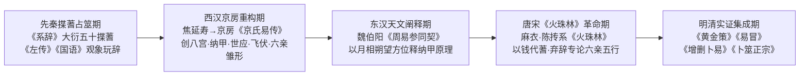

# 象数卜筮之六爻纳甲——京房八宫纳甲与火珠林系统源流原理详考

> **创建与修订日期**：2026-11-21  
> **状态**：`draft`（AI 辅助起草，待主理人终审，未经人工核对前不得标 final）  
> **模块归属与编号**：`09 周易数术纲目 ｜ 编号：05`  
> **价值基准评级**：🟡 **2 级文档（核心依赖因子：0.3，初始暂定，待用户主理人终审裁定）**  
> **前置理论与公理基石**：[`《十数概论》`](../02%20元研究/十数概论.md)（1-M09，易理与术数划界公理）、[`《09 周易数术纲目》总纲`](README.md)、[`《共性基座：阴阳八卦河洛九宫十二消息二十四山与五行生克考》`](01_共性基座_阴阳八卦河洛九宫十二消息二十四山与五行生克考.md)、`《384爻断辞回测报告》`。  
> **四重证据配置与强度分层**：
> - **第一重证据（传世文献与目录典志，强）**：《周易》经传（`zhouyi.json` 四部丛刊基准）、《左传》《汉书·艺文志》《汉书·京房传》《京氏易传》《晋书·郭璞传》《梦溪笔谈》《朱子语类》《古今图书集成·博物汇编·艺术典·卜筮部》（卷 469–482）、《永乐大典》残韵辑本及《道藏》太玄部《周易参同契》诸注本；
> - **第二重证据（出土文字与简帛，强）**：商周数字卦、殷墟甲骨干支与战国楚简卦画体系（用以对比证明先秦无干支纳甲之制）；
> - **第三重证据（民俗与人类学旁证，中）**：唐宋以来民间“以钱代蓍”铜钱掷占民俗与心理归因机制；
> - **第四重证据（考古实物，强）**：商周海贝货币与秦半两、汉五铢、唐开元通宝等历代圆形方孔铜钱实物形制断代。  
> **与既有高级别成果关系声明**：本文以本工程 384 爻回测硬实证（六位时位 $\eta^2 = 0.131$，“当位”解释力 $\eta^2 = 0.000$）与 1-M09《十数概论》为标尺，明确指出六爻纳甲体系系汉唐时期以“干支五行代数”替代先秦《周易》“时位与德行实践”的范式重构，二者不可混为一谈。

---

## 摘要

**【摘要】** 在传世众多的周易卜筮数术中，“六爻纳甲”（民间俗称“文王课”）流传最广、影响最深。然而，该体系从起卦媒介（铜钱替代蓍草）到断卦逻辑（五行六亲生克替代卦爻辞时位）均与先秦《周易》古经存在深刻的历史断裂。本文立足历史唯物主义与“四重证据法”，上溯先秦大衍揲蓍与《左传》观象占筮，系统考辨西汉京房创立“八宫六十四卦序、纳甲纳支、世应、飞伏”之历史真相、东汉魏伯阳《周易参同契》以月相盈亏阐释纳甲的天文学理据、唐末五代《火珠林》完成“以钱代蓍”与弃辞重干支的技术革命，以及明清《黄金策》《增删卜易》《卜筮正宗》之集成。论文严格锚定《汉书·艺文志》《古今图书集成·卜筮部》《永乐大典》与《道藏》核心文献，以货币史和文字学铁证彻底廓清“文王金钱课”之时代错置伪托。随后，本文构建了八宫卦序生成状态图、十干纳甲与十二支纳支完整数学映射表，并系统解析六亲六神、四值纲领与动静变爻运算规则。最后对照本工程《384 爻断辞回测报告》实证数据，在“生生”四判据下客观评析六爻纳甲体系化建模之得与剥离历史实践之失。

**【关键词】** 六爻纳甲；京房八宫；火珠林；周易参同契；四重证据法；384 爻回测

---

## 一、 引言：从先秦揲蓍观象到六爻纳甲的范式断裂

### 1.1 问题的提出：为什么“文王课”既非文王所作，也不用经文断辞？

在明清以来的民间卜筮实践中，人们习惯于用三枚铜钱摇掷六次成卦，并在装入天干地支、六亲（父母、兄弟、子孙、妻财、官鬼）与六神（青龙至玄武）后，完全绕开《周易》原有的卦辞与爻辞，单凭月建、日辰、动爻与变爻之间的五行生克冲合决断吉凶。民间普遍将其尊称为**“文王课”**或**“文王金钱课”**。

这种普遍认知隐藏着易学史上最剧烈的一次**范式断裂与历史倒置**：
1. **符号媒介的断裂**：先秦以五十根蓍草（大衍之数五十，其用四十有九）按“分二、挂一、揲四、归奇”四营十八变成卦；后世六爻则改用三枚圆形方孔铜钱一掷一爻，六掷即成；
2. **阐释底座的断裂**：先秦《左传》《国语》筮例，主要依据本卦与变卦（之卦）的**卦名、八卦物象及《周易》经文断辞**进行道德与政治推论；而汉唐以后的六爻纳甲体系，则几乎彻底弃置原经爻辞，把六十四卦降格为装载“天干、地支、五行、六亲”的空壳容器（载体）。

### 1.2 历史源流详考（先秦至明清四阶段演进）

1. **先秦基石与局限（大衍揲蓍与观象玩辞）**：
   《周易·系辞上》明确记载了标准蓍占程序：“大衍之数五十，其用四十有九。分而为二以象两，挂一以象三，揲之以四以象四时，归奇于扐以象闰……十有八变而成卦。”春秋时期《左传》《国语》载二十余例筮占，无一使用“纳甲”“地支”或“六亲”，其核心推理完全围绕卦象物理属性（如“风行天上”“火泽相违”）与经文本义展开。大衍法虽具仪式庄重感，但十八变耗时冗长，且面对具体的商业、婚姻、疾病等日常微观诉求，古老的军政占辞往往显得宽泛难执——这为汉代象数派大刀阔斧改革占法埋下了社会需求的伏笔。
2. **西汉京房创立八宫纳甲体系（第一次范式革命）**：
   西汉宣帝、元帝之际，**京房**（字君明，本姓李，从焦延寿受《易》）顺应汉代“阴阳灾异”与“五行宇宙论”大潮，在《京氏易传》及“积算、建候”诸法中完成三大技术创造：
   * **重排六十四卦序**：废弃通行本上下经非覆即变卦序，创立**“八宫六十四卦序”**（乾、震、坎、艮、坤、巽、离、兑八纯卦各领七变卦）；
   * **引入干支五行**：把十天干、十二地支分别配入八卦六爻（即**纳甲、纳支**），使原本只有阴阳奇偶的六画卦瞬间获得了时间干支与五行属性；
   * **确立主客坐标与借象机制**：设立**世爻、应爻**（定主客位置）与**飞神、伏神**，并将卦爻五行生克转化为早期六亲（官鬼、妻财、父母、子孙、兄弟）与社会阶层（元士、大夫、三公、诸侯、天子、宗庙）映射。
3. **东汉《周易参同契》的月相天文学阐释**：
   东汉桓帝时期，魏伯阳著**《周易参同契》**（道教炼丹理论鼻祖，收入《道藏》），以天体朔望月相的盈亏与观测方位为京房纳甲法提供了严密的天文学解释：“三日出为爽，震庚受西方；八日兑受丁，上弦平如绳；十五乾体就，盛满甲东方……”从而在理论上解释了为何震纳庚、兑纳丁、乾纳甲壬、坤纳乙癸。
4. **唐末五代《火珠林》的技术转型（第二次范式革命）**：
   西汉京房法仍混合使用“卦气、星宿、建候、积算”与部分灾异象辞，操作极为繁琐。至唐末五代，隐士**麻衣道者、陈抟**一系（一说宋初道士或民间术士集大成）撰成**《火珠林》**，完成了决定后世一千余年六爻形态的两大彻底变革：
   * **工具革命——以钱代蓍**：正式用**三枚铜钱摇掷六次**取代大衍五十根蓍草十八变，使占卜耗时从数十分钟压缩至一分钟，迅速下沉民间；
   * **逻辑纯化——全盘五行化**：彻底剥离《周易》卦爻辞与灾异星宿杂项，全面强化以**月建、日辰**为环境基准，以**六亲（用神）、六神、旬空、十二长生、动变回头生克**为唯一演算引擎的纯符号系统。
5. **明清理论大成与实证检讨**：
   明代流传托名刘基（诚意伯）的**《黄金策》**（含总断《千金赋》与分门详断），成为六爻断事歌诀总纲；清初**野鹤老人**著**《增删卜易》**（李我平序），大胆以数十年实占验案统计为据，批驳汉唐以来繁芜无效的古神煞与“卦身/世身/星煞”，提出“独重用神、月建日辰、动变生克”的极简实证派路线；同期**王洪绪《卜筮正宗》**（含《十八问答》批驳谬说与《诸般碎金》）及**李文辉《易冒》**将六爻推演规则系统化至巅峰。

---

## 二、 核心文献锚点、经典历史典故与“文王课”辨伪

### 2.1 四大核心文献群目录学定位表

| 文献总汇 / 目录典籍 | 具体卷次 / 部类 / 韵目 | 收录或著录之六爻纳甲核心文献 | 目录学与史源考辨价值 |
| :--- | :--- | :--- | :--- |
| **《汉书·艺文志》** | **六艺略·易类** & **数术略·蓍龟家** | 易类著录《孟氏京房》十一篇、《灾异孟氏京房》六十六篇、《京氏段嘉》十二篇；数术略著录《龟书》《蓍书》等多家 | 确证京房易在西汉即兼具“经学灾异”与“数术占验”双重属性，然《京氏易传》三卷今传本实由三国吴陆绩作注传世 |
| **《古今图书集成·博物汇编·艺术典·卜筮部》** | **卷 469–482（卜筮部汇考、总论、艺文、纪事）** | 全文收录**《京氏易传》**三卷、**《火珠林》**、**《黄金策》**、焦延寿《易林》辑录、宋明清易占法则及自先秦《左传》至明代之千余则卜筮纪事 | **清代官修最完备之易占文献总库**，直观呈现从先秦蓍占向京房纳甲、火珠林钱占演变的全貌 |
| **《永乐大典》** | **“卜”字韵、“易”字韵**（见四库辑本及类书转引） | 曾收宋元刊本《火珠林》异本、宋代《灵棋经》《易林》诸注及若干宋人钱卜杂占秘录 | 证实《火珠林》体例在宋元时期已定型并广泛入录官修大型类书，部分宋本口诀赖清人辑佚得以对照校勘 |
| **《道藏》** | **太玄部**（《正统道藏》） | **《周易参同契》**及历代道门注本（如五代彭晓《周易参同契通真义》、宋朱熹《周易参同契考异》、元俞琰《周易参同契发挥》） | 虽为道教内丹经典，却是解读京房**“纳甲法”背后太阳月亮朔望盈亏天文原型**的核心理论文献 |

### 2.2 经典历史典故考实

1. **京房以卦气纳甲谏汉元帝抗石显而弃市（《汉书·京房传》）**：
   西汉元帝建昭年间，宦官石显与中书令五鹿充宗专权。京房以通晓《易》学阴阳灾异受元帝宠信，上奏“考功课吏法”欲以考核百官政绩并暗指石显乱政，屡以“久阴不雨”“灾异卦气”直陈朝政得失。石显遂借故将京房外调魏郡太守，旋即罗织京房与张博“诽谤政治、归恶天子”罪名，将京房下狱弃市（公元前 37 年），年仅四十一岁。这一信史惨剧证明，西汉“京房易”绝非纯粹的民间算命术，而是汉代儒生试图利用**天文灾异象数体系制约皇权与宦官专权**的政治博弈工具。
2. **晋郭璞以纳甲与六爻筮法预断乱局（《晋书·郭璞传》）**：
   东晋博学家郭璞精通阴阳历算与《易》占，《晋书》本传载其为王导、元帝及王敦多次筮占（如晋室中兴渡江、预言王敦谋反必败等，虽史传微带神秘渲染，然所涉“鬼爻动”“子孙持世”“合冲应期”等断法特征，已明显呈现六爻干支生克与《易林》杂占合流的面貌）。
3. **北宋沈括《梦溪笔谈》与南宋朱熹《朱子语类》之学术实证考辨**：
   * **沈括《梦溪笔谈》卷七**：专论“纳甲”之天文学本质，指出“《易》有纳甲之法，未知起于何时。予尝考之，可以推见天地胎育之理”，并用月相晦朔弦望精确复原八卦方位与天干的对应，认为这是古人观测月球视运动的历象结晶；
   * **朱熹《朱子语类》卷六十六**：明确区分古法揲蓍与近代钱占，指出“今人以三钱当揲蓍，乃京房之法（或火珠林法），虽简便，然非圣人分二挂一之本意”，同时客观承认“以钱代蓍”在概率奇偶分布上另有规律可循。

### 2.3 “文王课 / 文王金钱课”时代错置辨伪

在民间坊刻本与戏曲小说中，六爻摇卦常被冠以“周文王拘羑里所创”之名（故称“文王课”或“文王金钱课”）。依据本工程“四重证据法”，此说在**文字、文献与考古实物**三重维度上皆可彻底证伪：

1. **出土考古货币铁证（第四重证据）**：用三枚铜钱掷出“正（字/文）”与“反（背/漫）”的前提，是社会上存在形制统一、正反面纹饰差异明显的**圆形方孔金属铸币**。考古发掘证实：商末周初（周文王时期，约公元前 11 世纪）中原通用货币为天然海贝（朋贝）、骨贝及极少数无铭无孔的青铜仿贝，西周中期以后始有原始铲形空首布；圆形方孔钱直到战国末秦统一前后（“秦半两”）才确立形制，而正面铸“通宝/重宝”四字、背面素平或带星月纹以清晰区分“字与背”的标准铜钱，迟至唐武德四年（621 年）铸**“开元通宝”**后才广泛流行。周文王绝无可能跨越一千七百余年使用唐代以后的“金钱”摇卦！
2. **出土古文字与简帛证据（第二重证据）**：商周数字卦及清华简《筮法》、马王堆帛书《周易》均未见任何“世爻、应爻、青龙白虎、父母官鬼”术语；
3. **传世文献断代铁证（第一重证据）**：先秦《左传》《国语》《礼记》《周礼》及司马迁《史记》皆言周文王“演《周易》”（推演六十四卦与卦辞或重卦），从未言文王作干支纳甲课；完整八宫纳甲体系首见于西汉《京氏易传》，钱占定型于唐末五代《火珠林》。故“文王课”实乃后世术士借圣王之名抬高术数身价的典型伪托。

---

## 三、 核心数理原理与完整装卦决断系统

六爻纳甲体系的本质，是将一个**六维二进制矢量（64 卦）**，通过**八宫拓扑群**与**干支同余映射**，转换为一个包含**主体—客体—环境—变数**的五行生克动态网络。

### 3.1 京房八宫卦序生成律与世应定位

京房将六十四卦划分为八宫，每宫以一个纯卦（上下经卦相同）为“本宫主卦”（分属特定五行），依次从初爻向上逐爻阳变阴、阴变阳，衍生出七个变卦，共八卦。值得注意的是，变化至五世后，**不再变第六爻（上爻）**——因为若上爻再变，将彻底失去本宫血脉而沦为对立错卦（如乾变坤）；故采取**退回第四爻再变（游魂）**，继而**将内卦下三爻全体复原为本宫纯卦（归魂）**的精巧拓扑闭环：

**京房八宫六十四卦与五行归属完整总表**：

| 宫位（五行） | 本宫（世六应三） | 一世（世一应四） | 二世（世二应五） | 三世（世三应六） | 四世（世四应一） | 五世（世五应二） | 游魂（世四应一） | 归魂（世三应六） |
| :--- | :---: | :---: | :---: | :---: | :---: | :---: | :---: | :---: |
| **乾宫（金）** | 乾为天 | 天风姤 | 天山遁 | 天地否 | 风地观 | 山地剥 | 火地晋 | 火天大有 |
| **坎宫（水）** | 坎为水 | 水泽节 | 水雷屯 | 水火既济 | 泽火革 | 雷火丰 | 地火明夷 | 地水师 |
| **艮宫（土）** | 艮为山 | 山火贲 | 山天大畜 | 山泽损 | 火泽睽 | 天泽履 | 风泽中孚 | 风山渐 |
| **震宫（木）** | 震为雷 | 雷地豫 | 雷水解 | 雷风恒 | 地风升 | 水风井 | 泽风大过 | 泽雷随 |
| **巽宫（木）** | 巽为风 | 风天小畜 | 风火家人 | 风雷益 | 天雷无妄 | 火雷噬嗑 | 山雷颐 | 山风蛊 |
| **离宫（火）** | 离为火 | 火山旅 | 火风鼎 | 火水未济 | 山水蒙 | 风水涣 | 天水讼 | 天火同人 |
| **坤宫（土）** | 坤为地 | 地雷复 | 地泽临 | 地天泰 | 雷天大壮 | 泽天夬 | 水天需 | 水地比 |
| **兑宫（金）** | 兑为泽 | 泽水困 | 泽地萃 | 泽山咸 | 水山蹇 | 地山谦 | 雷山小过 | 雷泽归妹 |

* **世爻与应爻的博弈意义**：**世爻**永远作为求测主体（我方）的坐标，**应爻**（恒与世爻在六爻环上相隔两位，即 $|S - R| \equiv 3 \pmod 6$）代表客体、交易对手、目的地或所求之事。
* **飞伏神借用机制**：当所求之事对应的“用神”（如求财之妻财爻）在本卦六爻中完全缺席（“用神不上卦”）时，向该卦所属**本宫纯卦**同爻位借取对应地支六亲，藏于本卦相应爻位之下——本卦爻为**飞神**，借来之纯卦爻为**伏神**。能否发挥效力，视飞神与伏神生克及月日扶抑（如飞来生伏得长生、飞来克伏反受制）而定。

### 3.2 十干纳甲与十二支纳支完整映射表（月相耦合律）

1. **天干纳甲（《周易参同契》月相盈亏拓扑）**：
   * 朔旦（初三）微阳生于西南傍晚见于西方庚位：**震纳庚**；
   * 上弦（初八）二阳见于南方丁位：**兑纳丁**；
   * 望日（十五）三阳纯乾满盈东方甲位：**乾纳甲**（及壬）；
   * 既望（十六）一阴始生退守辛位：**巽纳辛**；
   * 下弦（二十三）二阴见于丙位：**艮纳丙**；
   * 晦日（三十）纯阴熄灭于东方乙位：**坤纳乙**（及癸）；
   * 中央戊己土分别配中男中女：**坎纳戊**，**离纳己**。
2. **十二地支纳支完整映射表（阳顺阴逆隔位循环群）**：
   * 阳四经卦（乾、震、坎、艮）按六阳支顺行序列 `{子 → 寅 → 辰 → 午 → 申 → 戌}` 排布；
   * 阴四经卦（坤、巽、离、兑）按六阴支逆行序列 `{未 → 巳 → 卯 → 丑 → 亥 → 酉}` 排布：

| 经卦名 | 阴阳属性 | 内卦纳干 | 外卦纳干 | 初爻支 | 二爻支 | 三爻支 | 四爻支 | 五爻支 | 上爻支 | 数学循环律解析 |
| :---: | :---: | :---: | :---: | :---: | :---: | :---: | :---: | :---: | :---: | :--- |
| **乾** | 阳（老父） | 甲 | 壬 | **子**（水） | **寅**（木） | **辰**（土） | **午**（火） | **申**（金） | **戌**（土） | 阳支顺行，起于子（冬至一阳生） |
| **震** | 阳（长男） | 庚 | 庚 | **子**（水） | **寅**（木） | **辰**（土） | **午**（火） | **申**（金） | **戌**（土） | 长男代父，同乾位序 |
| **坎** | 阳（中男） | 戊 | 戊 | **寅**（木） | **辰**（土） | **午**（火） | **申**（金） | **戌**（土） | **子**（水） | 阳支顺行，向前错移 1 步起于寅 |
| **艮** | 阳（少男） | 丙 | 丙 | **辰**（土） | **午**（火） | **申**（金） | **戌**（土） | **子**（水） | **寅**（木） | 阳支顺行，向前错移 2 步起于辰 |
| **坤** | 阴（老母） | 乙 | 癸 | **未**（土） | **巳**（火） | **卯**（木） | **丑**（土） | **亥**（水） | **酉**（金） | 阴支逆行，起于未（夏至后阴生） |
| **巽** | 阴（长女） | 辛 | 辛 | **丑**（土） | **亥**（水） | **酉**（金） | **未**（土） | **巳**（火） | **卯**（木） | 阴支逆行，半周错位起于丑 |
| **离** | 阴（中女） | 己 | 己 | **卯**（木） | **丑**（土） | **亥**（水） | **酉**（金） | **未**（土） | **巳**（火） | 阴支逆行，错位起于卯 |
| **兑** | 阴（少女） | 丁 | 丁 | **巳**（火） | **卯**（木） | **丑**（土） | **亥**（水） | **酉**（金） | **未**（土） | 阴支逆行，错位起于巳 |

> [!TIP]
> **编程级排盘口诀**：任意六十四卦之装支，只需分别查其**下卦（初至三爻）的“初二三爻支”**与**上卦（四至上爻）的“四五上爻支”**拼接即可（如《水火既济》卦，下离取初二三为 `卯、丑、亥`，上坎取四五上为 `申、戌、子`，变卦亦依各爻对应经卦位置独立装支）。

### 3.3 六亲、六神与用神四维作用链

1. **六亲转换（以本宫五行为“我”）**：
   设本卦所属八宫之五行为 $E_{palace}$，某一爻所纳地支之五行为 $E_{branch}$，定义二者关系如下：
   * **父母**（生我者）：印绶、庇护、文书、契约、车宅、长辈；
   * **兄弟**（同我者）：同辈、竞争者、劫财、阻滞、合作；
   * **子孙**（我生者）：福神、医药、产出、财源之源、消灾克官；
   * **妻财**（我克者）：物质财富、妻子、利润、供给、克父坏印；
   * **官鬼**（克我者）：功名官职、法规约束、压力、疾病、灾祸、丈夫。
2. **六神配置（依占日天干自初爻至上爻顺布）**：
   甲乙日初爻起**青龙**（次朱雀、勾陈、螣蛇、白虎、上玄武）；丙丁日起**朱雀**；戊日起**勾陈**；己日起**螣蛇**；庚辛日起**白虎**；壬癸日起**玄武**。在《火珠林》体系中，六神仅作**辅助类象修饰**（如青龙主喜庆吉美、白虎主急迫血光、玄武主暗昧隐私），决不具备生克实权。
3. **用神—原神—忌神—仇神四维调控链**：
   依所占事项选定核心主角为**用神**（如占财取妻财、占官取官鬼、占文书考试取父母、占病避祸取子孙或察官鬼），由此自动锁定生态链：生用神者为**原神**（吉源），克用神者为**忌神**（病灶），生忌神而克原神者为**仇神**（助凶者）。

### 3.4 四值纲领与动变局域状态方程

《增删卜易》与《卜筮正宗》将六爻演算的高度精炼为**“外部时令（四值，实以月建、日辰为核心纲领）× 内部突变（动爻与变爻）”**的相互作用法则：

| 演算算子 | 定义与物理/历法原型 | 在六爻决断中的动力学功能 |
| :--- | :--- | :--- |
| **月建（月令）** | 依二十四节气之十二节（立春寅、惊蛰卯……）定地支，对应**十二消息卦太阳节律** | **旺相休囚死**的总裁判：临月建为“月建”最旺，月生为旺相；与月建地支相冲者为**“月破”**（短期失能，出月或逢合可填实）。月建只管当月权衡，不主动发动作用于卦外之永久改变 |
| **日辰（日建）** | 占日之六十甲子地支 | **六爻之主宰（全年通用能量源）**：可冲起旺相静爻为**“暗动”**（有动爻之能），亦可冲散休囚静爻为**“日破”**；日辰可生克扶抑卦中一切爻，且能合住动爻（日合绊）或冲开合局 |
| **旬空（空亡）** | 占日所在甲子旬中轮空之二地支 | 表征力量暂缺或信息悬而未决：旺相有气、动而化吉或出旬逢冲填实者为**“假空”**（应期在出空/冲实之日）；休囚死绝、月破又逢空者为**“真空”**（彻底无力） |
| **十二长生** | 金木水火土五行在地支十二宫之生命周期状态 | 重点关注**长生、帝旺、墓库、绝**四位（尤其是动爻变墓、日辰入墓、动化绝地，象征能量被收敛封存或陷入绝境） |
| **动爻与变爻（局域变分原则）** | 铜钱三背（老阳 `O`）变阴、三字（老阴 `X`）变阳 | **核心动力源**：①静爻不能克动爻，动爻可生克同层次静爻及他动爻；②**变爻原则上只作用于本位动爻**（回头生、回头克、化进神[如寅化卯、申化酉]、化退神[如卯化寅、酉化申]、化伏吟、化反吟、化墓化绝），一般不越位生克卦中其他静爻；③三合局（申子辰、亥卯未、寅午戌、巳酉丑）与六冲/六合卦主全局聚散快慢 |

---

## 四、 历史唯物主义与“生生”标尺评析

### 4.1 与本工程《384 爻断辞回测报告》的硬实证对勘

将六爻纳甲体系置于本工程实证基石——`《384爻断辞回测报告》`（对通行本《周易》全部 64 卦 384 爻进行量化统计与 2 万次置换检验）之下，可清晰揭示汉唐数术对先秦古易的根本性改造：

| 对比维度 | 先秦《周易》古经（384 爻实证） | 汉唐京房—火珠林六爻纳甲体系 | 范式转移实质 |
| :--- | :--- | :--- | :--- |
| **核心判定轴** | **六位时位（$\eta^2 = 0.131, p < 0.001$）**与“得中/不中”（$\eta^2 = 0.066$）为主要矛盾；传统“当位”解释力实为 **$\eta^2 = 0.000$** | **月建、日辰五行生克与动变回头生克**（世应强弱与用神旺衰）；几乎完全忽略初二三四五上固有吉凶位势 | 由**“过程发展阶段论（时位）”**转向**“外环境—系统节点即时生克代数”** |
| **阴阳作用机制** | 爻性本身不直接决定吉凶多少，而决定**“得吉方式”**（阳爻刚进得吉 35% vs 阴爻柔承得吉 55%） | 阴阳简化为“静（少阴/少阳）”与“动（老阴/老阳）”，以及天干地支奇偶排列规则 | 剥离了主体的伦理实践姿态（刚进与柔承），转化为纯粹的物理能量流向算子 |
| **人文与历史实践维度** | 强调“君子以自强不息”“修德避凶”，以历史经验（如帝乙归妹、高宗伐鬼方）规范行动边界 | 弃置经文历史故事与德行戒惧，只问用神旺衰生克与应期日期 | **系统建模精密化（得），但人文实践能动性萎缩（失）** |

### 4.2 系统建模之得与唯心概率之失

1. **工程方法论之“得”**：
   六爻纳甲堪称中国古代最精巧的“**多变量博弈决策框架**”。它用极低的符号成本，同步编码了四个关键分析维度：① **主体自身状态（世爻）**、② **目标对象与竞争环境（应爻与用神）**、③ **宏观时间政策与季节大势（月建与日辰）**、④ **局部突发变量与未来反馈（动爻与回头生克）**。清初《增删卜易》甚至带有早期经验统计色彩（通过大量实证案例淘汰无效的古神煞），这种模型化思维对古人梳理复杂人际与事务因果具有一定启发意义。
2. **唯心概率神化之“失”**：
   铜钱三枚摇掷六次本质上是一个遵循二项分布（单次老阳 1/8、老阴 1/8、少阳 3/8、少阴 3/8，即变爻概率为 25%）的**独立随机采样过程**。把随机物理扰动产生的二进制序列当作“鬼神感应必有先兆（心动卦成）”，并试图以此替代对现实生产条件、经济规律与组织力量的客观调研，则是彻头彻尾的历史唯心主义。

### 4.3 “生生”四判据与“事实—推演—假说”三界检验

| 评估维度 | 历史唯物主义与“生生”评估结论 |
| :--- | :--- |
| **存续判据** | **负向风险警示**：当个体或决策者以随机摇钱替代对自然灾害、市场风险、军事敌情的科学调研时，会直接削弱主体的生存应对能力（《韩非子·饰邪》早有“龟策鬼神不足以胜政”之清醒批判）。 |
| **发展/再生产判据** | **文化符号史价值**：推动了宋明清民间实用数理逻辑、干支历算普及与心理咨询式文化实践的发展，但本身不直接创造物质生产力。 |
| **恢复/修复判据** | **心理减压代偿**：在古代医疗、信息与社会保障极度匮乏的条件下，掷钱问卜常充当个体面对高度不确定性时的焦虑缓解仪式；现代社会应以科学决策与社会保障取代此心理代偿。 |
| **传承判据** | **非遗与思想史标本**：作为汉代象数易学向市井文化下沉的代表性活化石（从《京氏易传》到《火珠林》《增删卜易》），是研究中国古代思维方式与数理建模演变的珍贵学术标本。 |

| 命题层级 | 核心命题列举 | 可证伪 / 核验条件 |
| :--- | :--- | :--- |
| **事实（Fact）** | ① 现存最早可考之八宫纳甲世应体系出自西汉《京氏易传》；② 《周易参同契》以月相朔望盈亏方位解说纳甲；③ 《古今图书集成·卜筮部》卷469–482及《道藏》太玄部保存相关核心典籍；④ 商周无方孔铜钱，“以钱代蓍”成于汉唐货币制度普及之后；⑤ 384 爻回测证明《周易》古经以“六位时位（$\eta^2=0.131$）”而非五行生克为核心。 | 若出土商周墓葬证实当时已普遍流通类似开元通宝之双面可辨字背方孔钱币且明确用于六爻摇卦，或先秦简帛出现完整八宫纳支表，须彻底修正断代事实。 |
| **推演（Inference）** | ① 民间“文王课”称谓系后世伪托；② 唐末《火珠林》弃辞专论六亲五行，完成了对先秦古易的彻底范式置换；③ 铜钱随机概率（老阴老阳各占 1/8）决定了其无法建立客观物理因果预测力。 | 若能通过大样本严格双盲随机对照实验，证明铜钱投掷在剔除心理暗示后对特定事件预测准确率显著高于随机基准且可稳定复现，则需重估其物理机制边界。 |
| **假说（Hypothesis）** | 唐代“开元通宝”铸造工艺标准化（正面四字规整、背面光洁或带星月纹，重量形制高度均一）可能是促使唐末《火珠林》顺利取代繁琐大衍蓍草、迅速在市井普及的直接物质技术诱因。 | 若未来发现两汉魏晋时期已有大规模使用五铢钱摇出六十四卦且明确区分“字背”替代大衍蓍草的出土实录文本，本技术诱因假说须提前至汉晋。 |

---

## 五、 结论与参考文献

### 5.1 核心学术结论
1. **断代清源**：六爻纳甲绝非“周文王所创”，而是**西汉京房创立八宫纳甲骨架、东汉《参同契》赋予月相天文解释、唐末五代《火珠林》完成“以钱代蓍”与五行六亲纯化、清代《增删卜易》《卜筮正宗》实现逻辑自洽**的千年层累产物。
2. **数理本质**：其核心是一套由八宫拓扑（确定世应飞伏）、$\mathbb{Z}_{6}$ 阳顺阴逆纳支矩阵、月日四值环境常数以及局域动变回头生克方程构成的**高维离散博弈代数模型**。
3. **唯物定位**：必须严格执行“易理与术数划界”，既肯定其严密的系统逻辑结构（主客环境突变四维协同），又通过 384 爻回测实证与货币考古铁证，彻底揭破其“文王托名”与“随机投币决定宿命”的唯心幻象。

### 5.2 参考文献（参照 GB/T 7714-2015）

**一、古籍原典与历代易占典籍**
1. [西汉] 京房, 撰; [三国吴] 陆绩, 注. 京氏易传[M]. 四部丛刊景明范氏天一阁本（亦见《古今图书集成·卜筮部》）.
2. [东汉] 班固. 汉书[M]. 北京: 中华书局, 1962.（《艺文志》《京房传》）
3. [东汉] 魏伯阳, 撰; [五代] 彭晓, 解. 周易参同契通真义[M] // 正统道藏（太玄部）. 文物出版社等联合影印本, 1988.
4. [唐] 房玄龄等. 晋书[M]. 北京: 中华书局, 1974.（《郭璞传》）
5. [北宋] 沈括. 梦溪笔谈校证[M]. 胡道静, 校证. 上海: 上海古籍出版社, 1987.（卷七《象数一》）
6. [南宋] 黎靖德, 编. 朱子语类[M]. 王星贤, 点校. 北京: 中华书局, 1986.（卷六十六）
7. [宋元旧题] 麻衣道者（托名）. 火珠林[M]. 见《古今图书集成·艺术典·卜筮部》及清刻本.
8. [明] 刘基（托名）. 黄金策[M]. 见《古今图书集成·艺术典·卜筮部》.
9. [清] 野鹤老人, 撰; 李我平, 增删. 增删卜易[M]. 康熙年间通行刊本.
10. [清] 王洪绪. 卜筮正宗[M]. 乾隆年间通行刊本.
11. [清] 李文辉. 易冒[M]. 四库全书存目丛书本.
12. [清] 陈梦雷, 编; 蒋廷锡, 校. 古今图书集成·博物汇编·艺术典·卜筮部（卷469–482）[M]. 北京: 中华书局影印本, 1934.

**二、现代考古与易学学术专著**
13. 朱伯崑. 易学哲学史（第一卷）[M]. 北京: 昆仑出版社, 2005.
14. 余敦康. 汉宋易学与现代易学[M]. 北京: 华夏出版社, 2008.
15. 尚秉和. 周易古筮考[M]. 北京: 光明日报出版社, 2006.
16. 彭林. 中国古代礼仪文明与历代货币实物研究（相关先秦货币形制考辨）[M]. 北京: 中华书局, 2004.

---

© 2026 徐时言 · 《象数卜筮之六爻纳甲——京房八宫纳甲与火珠林系统源流原理详考》 · 徐时言-易经研究 · 采用 CC BY-NC-ND 4.0 许可， 转载请署名并注明来源 https://wole278.github.io/xushiyan-YiJing/ · 禁止商业使用与改编传播 · 商业授权：wole278@hotmail.com / 微信 wole278
