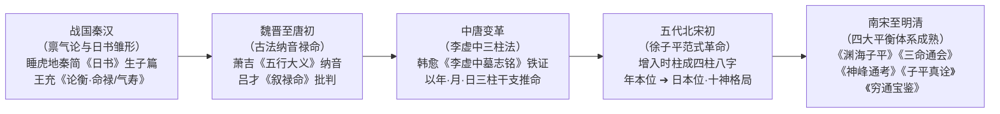
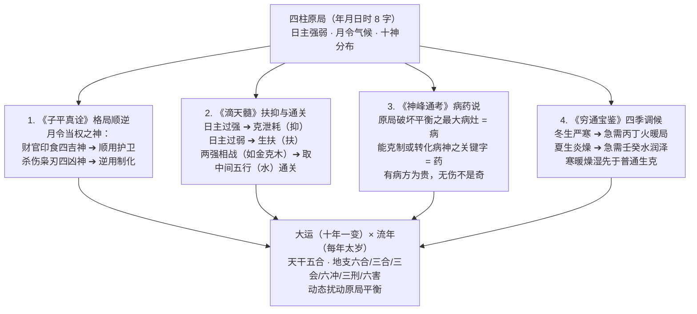

# 禄命星占之四柱八字——从李虚中三柱到徐子平四柱十神格局源流详考

> **创建与修订日期**：2026-11-21  
> **状态**：`draft`（AI 辅助起草，待主理人终审，未经人工核对前不得标 final）  
> **模块归属与编号**：`09 周易数术纲目 ｜ 编号：06`  
> **价值基准评级**：🟡 **2 级文档（核心依赖因子：0.3，初始暂定，待用户主理人终审裁定）**  
> **前置理论与公理基石**：[`《十数概论》`](../02%20元研究/十数概论.md)（1-M09，易理与术数划界公理）、[`《09 周易数术纲目》总纲`](README.md)、[`《共性基座：阴阳八卦河洛九宫十二消息二十四山与五行生克考》`](01_共性基座_阴阳八卦河洛九宫十二消息二十四山与五行生克考.md)。  
> **四重证据配置与强度分层**：
> - **第一重证据（传世文献与目录典志，强）**：《周易》经传、《汉书·艺文志·数术略》《论衡》《旧唐书·吕才传》、韩愈《殿中侍御史李君墓志铭》、《五行大义》《四库全书总目》《古今图书集成·博物汇编·艺术典·星命部》（卷 483–570）、《永乐大典》辑本（《李虚中命书》《珞琭子三命消息赋注》）及《道藏》相关元辰文献；
> - **第二重证据（出土文字与简帛，强）**：睡虎地秦简《日书》、放马滩秦简《日书》（“生子”“星日”干支推命雏形）与殷墟干支纪日无缝连续序列；
> - **第三重证据（民俗与人类学旁证，中）**：东亚汉字文化圈批八字择婚合命民俗与生命仪礼投射；
> - **第四重证据（天文历法与数理统计实证，强）**：太阳回归年二十四节气黄经交节时刻实测与 $518,400$ 种八字组合抽屉原理统计分析。  
> **与既有高级别成果关系声明**：本文严格执行 1-M09《十数概论》“易理与术数划界”原则，阐明四柱八字系唐宋时期在干支纪时历法与五行生克基础上独立演化的个体时序模型，虽借用《周易》阴阳寒暑协和理念，却绝非先秦《周易》经传固有体系。

---

## 摘要

**【摘要】** 四柱八字（子平术）是中国历史上社会渗透度最高、技术体系最为世俗化的个人禄命推演模型。它并非源于上古圣王秘传，而是经历了从战国秦汉“日书择日禀气论”、魏晋隋唐“年柱纳音古法禄命”、中唐李虚中“年月日三柱干支推命”，到五代北宋初徐子平增入时柱并实现“由年本位向日本位”哥白尼式范式革命的漫长演进历程。本文立足历史唯物主义与“四重证据法”，依托韩愈《李虚中墓志铭》、吕才《叙禄命》等正史铁证，精准锚定《古今图书集成·星命部》（卷 483–570）、《永乐大典》“命”字韵四库辑本及《道藏》对照文献，并据《四库全书总目》廓清《鬼谷子遗文》《珞琭子赋》之托古伪托。论文系统解析了立春换年、十二节气换月、五虎遁与五鼠遁数学公式、地支循藏人元、十神社会学映射，以及格局顺逆、扶抑通关、病药说与四季调候四大平衡调控机制。最后从四柱有效组合仅 51.84 万种的数学边界与人类社会阶级实践差异出发，彻底批驳宿命决定论，同时肯定其蕴含的北半球季候节律与复杂系统平衡辩证法。

**【关键词】** 四柱八字；李虚中；徐子平；十神格局；调候病药；历史唯物主义

---

## 一、 引言：禄命术的源流演进与“徐子平范式革命”

### 1.1 问题的提出：为什么出生时刻的八个干支符号会被当成“人生代码”？

在东亚传统社会中，“生辰八字”往往被民间视为决定个体寿夭穷通的先天编码。然而，任何严肃的学术考察都必须首先追问两个根本问题：
1. 将人的命运系于**出生瞬间**（而非受孕瞬间或成长实践），在思想史上经历了怎样的理论合法化过程？
2. 为什么今天通行的八字算法以**“日干（日元）”**为自己、以**“月令（节气）”**为核心，而与隋唐以前的古法禄命截然不同？

通过历史唯物主义的源流解剖可见，四柱八字绝非一蹴而就的“先秦古法”，而是在中国古代**干支历法高度精密化**与**士大夫科举流动性增强**的社会土壤中，经历三次关键跃迁才最终定型的世俗数术。

### 1.2 断代历史源流详考（秦汉至明清）

1. **战国秦汉（日书生子占与王充自然禀气论）**：
   * 睡虎地秦简《日书》（战国末至秦）及放马滩秦简《日书》中已有“生子”专篇，按婴儿出生日的十二地支（或建除十二直、二十八宿）直断富贵寿夭（如“子日生子，必为官”等）。此时的推命极为粗糙，尚未形成生克系统。
   * 东汉唯物主义思想家**王充**在《论衡·命禄》《气寿》《骨相》中提出：人出生时禀受天地阴阳“元气”之厚薄与天象星气之吉凶，决定其自然禀赋（“凡人遇偶及遭累害，皆由命也……禀气渥则其体强，体强则命长”）。王充本意在于用自然气化论打击神鬼报应说，却在客观上为后世禄命术提供了“出生时刻冻结先天禀气”的哲学前提。
2. **魏晋南北朝至唐初（六十甲子纳音古法与吕才之批判）**：
   * 北齐至隋**萧吉《五行大义》**系统整理并完备了**六十甲子纳音五行**（如甲子乙丑海中金、丙寅丁卯炉中火等）。自南北朝至唐初，以僧一行、桑道茂为代表的“古法禄命”，主要以**出生年柱的纳音五行**（即所谓“本命”与“禄马贵人”神煞）为主轴，兼论胎元与月日，尚未确立现代意义上的八字格局。
   * 值得高度重视的是，唐太宗贞观年间，朝廷命太史令**吕才**删定阴阳杂书。吕才在**《叙禄命》**（全文载于《旧唐书·吕才传》）中展开了极具唯物主义光芒的猛烈批判，以“鲁桓公、秦始皇、长平坑卒四十万岂皆生于同一干支时辰？”为铁证，揭示唐初禄命术在社会上的泛滥及其逻辑荒谬。
3. **中唐变革（李虚中确立三柱干支法）**：
   中唐宪宗时期，曾任殿中侍御史的**李虚中**对古法禄命进行了首次重大改造。韩愈在为李虚中撰写的**《殿中侍御史李君墓志铭》**中留下了无可辩驳的第一手同时代信史记录：“最深于五行书，**以人之始生年月日所直日辰支干，相生胜衰死王相，斟酌推人寿夭贵贱、利不利，辄先处其年时，百不失一二。**”这段史料铁证了两件事：① 中唐时期已成熟使用**年、月、日三柱干支**的旺相休囚生克推命；② 李虚中尚**未普遍纳入“时柱”**（仅用年月日三柱），且仍未脱离“年本位”纳音传统。
4. **五代北宋初（徐子平四柱“哥白尼式”范式革命）**：
   五代末至北宋初，隐士**徐子平**（据宋人记载与陈抟同期隐居华山，或名徐居易）完成了中国禄命史上最具决定意义的两次结构升级：
   * **结构扩维**：在李虚中年月日三柱基础上，正式增入出生**时辰干支（时柱）**，形成“年、月、日、时”四柱共八个字（八字），时间精度从“日”精确到“2 小时（时辰）”；
   * **重心转移（由年本位转向日本位）**：彻底抛弃以“年柱纳音与神煞”为主的古法体系，破天荒地确立**以“日柱天干（日元/日主）”代表命主本人**，以**月令地支（十二节气气候）为全盘力量提纲**，并以**正偏官、正偏印、比劫、食伤、正偏财“十神”**统摄格局成败。后世遂尊称此法为**“子平术”**。
5. **南宋至明清（经典体系成熟与四大流派分化）**：
   * 南宋**徐大升**编纂**《渊海子平》**，首次将宋代子平歌赋与格局法汇编成册；明初托名京图或刘基之**《滴天髓》**，将子平术推向精微抽象的气化理气哲学高度；
   * 明代进士**万民英**编纂十二卷巨著**《三命通会》**（收入《四库全书》），百科全书式兼容古法纳音与子平正宗；同期**张楠**著**《神峰通考》**，愤于江湖术士妄用神煞，创立“病药说”；
   * 清代乾嘉以降，子平理论臻于巅峰：**沈孝瞻《子平真诠》**精研“月令格局顺逆用神”，**任铁樵《滴天髓阐微》**专攻日主衰旺扶抑通关，**余春台《穷通宝鉴》（原名《栏江网》）**专主四季寒暖燥湿“调候”——三书鼎足而立，构成近代八字学不可逾越的理论三峰。

---

## 二、 核心文献锚点、历史典故与托古辨伪

### 2.1 四大核心文献群目录学定位表

| 文献总汇 / 目录典籍 | 具体卷次 / 部类 / 韵目 | 收录或著录之四柱禄命核心文献 | 目录学与史源考辨价值 |
| :--- | :--- | :--- | :--- |
| **《汉书·艺文志·数术略》** | **五行家** & **杂占家** | 著录《钟律灾应》《四时五行经》《泰一阴阳》等；同时期出土秦简《日书》为民间实物佐证 | 揭示早期禄命术脱胎于汉代“五行家”与民间择日“日书”，彼时尚无“四柱八字”名目 |
| **《古今图书集成·博物汇编·艺术典·星命部》** | **卷 483–570**（其中卷 501–570 集中收录子平八字） | 卷 483–500 收《果老星宗》《星学大成》《十八飞星》等星命；卷 501–570 完整收录**《三命通会》《渊海子平》《星平会海》**全文核心卷帙及历代名臣命造 | **清代官修最宏富的星命与四柱八字总库**，完整保存明清子平术正宗文本与大批士大夫八字样本 |
| **《永乐大典》** | **“命”字韵**（清四库馆臣据大典残卷辑出） | 据《永乐大典》辑出**《李虚中命书》**三卷、**《珞琭子三命消息赋注》**二卷（载徐子平、王廷光、李仝、释昙莹四家注）、**《兰台妙选》**三卷及《三命指迷赋》 | **研究唐宋“古法禄命向子平法过渡期”的唯一直接珍贵文献链**；其中宋人注本实态揭穿了宋初四柱演进的真实轨迹 |
| **《道藏》** | **洞真部 / 正一部**（《正统道藏》） | 收录《太上玄灵北斗本命延生真经》《南斗六司延寿度人妙经》及三元甲子本命神煞祈禳法 | 道教主要吸收了“本命年干支（太岁）与星宿消灾”，而**正统子平八字（《渊海子平》《子平真诠》）基本剥离了道教符箓科仪**，呈现出鲜明的世俗儒生技术化特征 |

### 2.2 经典历史典故考实

1. **韩愈《李虚中墓志铭》与唐代士大夫的双重态度**：
   韩愈作为古文运动领袖与排佛道儒宗，竟在墓志铭中盛赞李虚中推命“百不失一二”（虽含墓志铭体例常见的谀墓夸饰成分），足见中唐士大夫在仕途沉浮、党争激烈的环境中对干支推命的深切心理依赖；而此前太宗朝**吕才《叙禄命》**的理性驳斥，恰构成了中国古代无神论与宿命论交锋的精彩双面镜。
2. **苏轼与韩愈同命“身宫在磨蝎”典故**：
   北宋苏轼在《东坡志林》与诗作（“我生之辰，月宿直斗”）及后世笔记中屡次自叹与韩愈命运相似——两人皆才高八斗而屡遭贬谪，且推算皆“命宫/身宫在磨蝎宫（摩羯座）”。这则著名文坛典故实证了北宋士林不仅热衷推命，且当时**源于印度希腊的黄道十二宫五星占星术（七政四余）与本土干支子平八字常并行参看**（正与《古今图书集成·星命部》将五星与八字合编一处相吻合）。
3. **明代进士万民英纂《三命通会》**：
   《三命通会》作者万民英（号育吾），明嘉靖二十九年（1550 年）进士，历任河南道监察御史、福建按察司佥事，乃典型正途出身之朝廷高官。他以严谨的史学与目录学功夫，将散乱于坊间的唐宋古法纳音与徐子平体系系统梳理汇编，使四柱八字摆脱江湖口诀的鄙陋面貌，得以堂皇入选清代官修《四库全书》。

### 2.3 《四库全书总目》对《鬼谷子遗文》《珞琭子赋》的辨伪

针对命理学史上影响极大的两部早期托古文献，清代《四库全书总目·子部·术数类》及现代目录学已作铁案辨伪：
1. **《鬼谷子遗文》与《三命总括》托名鬼谷子**：清四库馆臣指出，战国纵横家鬼谷子绝无可能通晓西汉以后才完备的纳音五行与唐宋十神格局，凡托名“鬼谷子遗文”“鬼谷分定经”者，皆为宋元以降术士伪撰；
2. **《珞琭子三命消息赋》托名周代珞琭子**：虽经《永乐大典》保存宋代徐子平等四家注释，但《四库全书总目》精辟考证：“珞琭”二字语出《老子》“不欲琭琭如玉，珞珞如石”，其文骈偶对仗、满纸“禄马、建禄、纳音、三元”，绝非先秦文体与制度产物，实为**中晚唐至五代初人伪托先秦隐士而作**；
3. **《李虚中命书》层累掺伪考**：清馆臣从《永乐大典》辑出《李虚中命书》后即敏锐发现，今本上卷尚保留唐代“以年为主、三柱纳音”古风，而下卷竟已出现“时柱”与“十神”术语，实为宋人借李虚中盛名层累增补羼入所致。

---

## 三、 核心数理原理、历法锚定与四大平衡演算体系

### 3.1 四柱干支历法的天文学严格锚定

四柱八字虽属禄命术，但其排盘起算严格锚定于中国古代太阳回归年精密历法（与阴阳合历的“农历初一”毫无关系）：

1. **年柱换年界线**：严格以**立春**（太阳视黄经到达 $315^\circ$ 之精准交节时刻）为新年起点，绝非农历正月初一。例如立春前一日出生，虽已属正月，年柱仍归上一年；
2. **月柱换月界线**：严格以**二十四节气之十二“节”**（非“中气”）交节时刻为月令分界——立春入寅月、惊蛰入卯月、清明入辰月、立夏入巳月、芒种入午月、小暑入未月、立秋入申月、白露入酉月、寒露入戌月、立冬入亥月、大雪入子月、小寒入丑月。这十二月令地支直接耦合于汉代**十二消息卦气（太阳周年辐射能量周期）**；
3. **日柱与时柱**：日柱依六十甲子无间断连续纪日（春秋鲁隐公三年公元前 722 年二月己巳日食至今两千七百余年从未错乱一日）；时柱须将当地标准时间换算为**观测地真太阳时**（进行经度差校正与地球公转椭圆轨道均时差校正）后划分为十二时辰（子时 23:00–01:00 至亥时 21:00–23:00）；
4. **五虎遁月与五鼠遁时同余计算公式**：
   设十天干索引 `甲=0, 乙=1, 丙=2, 丁=3, 戊=4, 己=5, 庚=6, 辛=7, 壬=8, 癸=9`：
   * **五虎遁月（由年干 $Y$ 求月干）**：歌诀“甲己之年丙作首，乙庚之岁戊为头，丙辛必定寻庚起，丁壬壬位顺行流，若问戊癸何方发，甲寅之上好追求。”设寅月（正月）序号 $m=0$，卯月 $m=1\dots$ 丑月 $m=11$，则该月天干索引为：
     $$M_{\text{stem}} \equiv 2(Y \bmod 5) + 2 + m \pmod{10}$$
   * **五鼠遁时（由日干 $D$ 求时干）**：歌诀“甲己还加甲，乙庚丙作初，丙辛从戊起，丁壬庚子居，戊癸何方发，壬子是真途。”设子时序号 $h=0$，丑时 $h=1\dots$ 亥时 $h=11$，则该时天干索引为：
     $$H_{\text{stem}} \equiv 2(D \bmod 5) + h \pmod{10}$$

### 3.2 地支循藏（人元司令分野）与十二长生状态表

徐子平体系借用《周易·说卦》“兼三才而两之”思想，将每柱划分为**天元（天干）、地元（地支）、人元（地支中所藏天干）**。十二地支并非单一五行，而是包含“本气（当令主气）、中气（余势或三合长生）、余气（上一季末气残留）”的复合向量：

| 地支 | 所属季节月令 | 五行属性 | 地支循藏（人元：本气 / 中气 / 余气） | 物理气候意义解析 |
| :---: | :--- | :---: | :--- | :--- |
| **子** | 仲冬十一月（大雪—小寒） | 阳水 | **癸**（纯阴水） | 仲冬正水当令（虽地支属阳，藏干纯癸） |
| **丑** | 季冬十二月（小寒—立春） | 阴土 | **己**（本气湿土）/ **癸**（余气水）/ **辛**（金库墓气） | 寒冬腊月冻土，兼藏冬水余寒与金之收气 |
| **寅** | 孟春正月（立春—惊蛰） | 阳木 | **甲**（本气阳木）/ **丙**（火长生）/ **戊**（土长生） | 初春阳气生发，木旺而蕴含初生阳火暖土 |
| **卯** | 仲春二月（惊蛰—清明） | 阴木 | **乙**（纯阴木） | 仲春正木当令，专气不杂 |
| **辰** | 季春三月（清明—立夏） | 阳土 | **戊**（本气阳土）/ **乙**（余气木）/ **癸**（水库墓气） | 暮春湿润耕土，含春木余气与蓄水之库 |
| **巳** | 孟夏四月（立夏—芒种） | 阴火 | **丙**（本气阳火）/ **庚**（金长生）/ **戊**（土长生） | 初夏炎热渐起，火盛之中暗孕燥金之始 |
| **午** | 仲夏五月（芒种—小暑） | 阳火 | **丁**（本气阴火）/ **己**（中气阴土） | 盛夏火极而土生（《易》夏至一阴生之理） |
| **未** | 季夏六月（小暑—立秋） | 阴土 | **己**（本气燥土）/ **丁**（余气火）/ **乙**（木库墓气） | 酷暑燥土，兼蓄夏火余热与草木收归 |
| **申** | 孟秋七月（立秋—白露） | 阳金 | **庚**（本气阳金）/ **壬**（水长生）/ **戊**（土长生） | 初秋肃杀清凉，金生而带秋水初生之润 |
| **酉** | 仲秋八月（白露—寒露） | 阴金 | **辛**（纯阴金） | 仲秋正金当令，肃杀专气 |
| **戌** | 季秋九月（寒露—立冬） | 阳土 | **戊**（本气燥土）/ **辛**（余气金）/ **丁**（火库墓气） | 深秋寒燥之土，兼含秋金余气与阳火归藏 |
| **亥** | 孟冬十月（立冬—大雪） | 阴水 | **壬**（本气阳水）/ **甲**（木长生） | 初冬寒水奔流，水旺之中暗育来年春木生机 |

* **十二长生（能量周期表）**：五阳干（甲丙戊庚壬）顺行、五阴干（乙丁己辛癸）逆行十二支，历经**长生、沐浴、冠带、临官、帝旺、衰、病、死、墓、绝、胎、养**十二阶段（注：清代《滴天髓》等理气派另主张“五阳长生即五阴长生”，认为阴阳同气、分顺逆系机械类推，此系子平学术史重要派别分歧）。

### 3.3 十神关系社会学映射模型

以日柱天干（**日主**）为唯一坐标原点，按五行生克与阴阳同异（同性相斥力猛为**偏**，异性相吸有情为**正**），映射出反映封建宗法伦理与官僚市场关系的**十神符号网络**：

| 与日主五行关系 | 异性（一阴一阳相见） | 同性（纯阳或纯阴相见） | 社会学与心理原型映射 |
| :--- | :--- | :--- | :--- |
| **生我者** | **正印** | **偏印**（枭神） | 父母慈荫、学历文凭、保护伞、体制庇护（偏印主偏门技艺、孤僻敏锐） |
| **同我者** | **劫财** | **比肩** | 同辈朋友、兄弟竞争、合伙人、体力执行力（劫财主激烈争夺与冲动消费） |
| **我生者** | **伤官** | **食神** | 才华表达、技术创新、子女晚辈、情绪宣泄（食神温和享受，伤官叛逆抗上） |
| **我克者** | **正财** | **偏财** | 劳动薪俸、固定资产、正妻（正财稳健）；商业投机、横财、父辈（偏财流动） |
| **克我者** | **正官** | **七杀**（偏官） | 礼法约束、公职仕途、名誉秩序（正官温和）；强权高压、军警武职、危机病厄（七杀刚猛） |

### 3.4 四大动态平衡机制与大运流年扰动方程

子平八字之所以在千百年间吸引无数文人学者研习，核心在于它并非死板查神煞，而是围绕“阴阳五行中和流通”建构了一套**多目标控制系统**（由四大经典平衡法则协同运作）：

* **大运顺逆与起运算法**：
  * **顺逆定则**：依据出生**年干之阴阳**与命主**性别**组合——**阳男阴女顺行**（大运干支自月柱起向下一柱顺推），**阴男阳女逆行**（自月柱起向上一柱逆推）。
  * **起运岁数折算**：顺行者计算出生精确时刻至**下一个“节”**交节时刻之时间差；逆行者计算出生时刻至**上一个“节”**交节时刻之时间差。依传统“**三天折合一岁，一天折合四个月，一个时辰折合十天**”的压缩映射比例（按地球公转一周 360 日约合 12 节每节 30 日对应 10 年大运之比例推算），定出上运虚岁（约 1 至 10 岁不等）。每步大运管十年，再叠加每年流年干支（太岁），构成随时间演进的动态交互方程。

---

## 四、 历史唯物主义与“生生”标尺评析

### 4.1 组合数理极限与对机械宿命论的彻底证伪

从现代组合数学与人口统计学角度检视，四柱八字“决定个体一切命运”的宿命论宣称在科学上完全无法成立：

1. **有效组合总数的严格上限（抽屉原理铁证）**：
   * 年柱有六十甲子共 $60$ 种；因“五虎遁月”完全由年干唯一确定，每年固定对应 $12$ 个月柱，故年月两柱共 $60 \times 12 = 720$ 种；
   * 日柱有六十甲子共 $60$ 种；因“五鼠遁时”完全由日干唯一确定，每日固定对应 $12$ 个时柱（若细分早晚子时计为 13 档），故日时两柱共 $60 \times 12 = 720$ 种；
   * 由此得出标准四柱八字在 **60 年一甲子周期内的全部有效组合总数为**：
     $$720 \times 720 = 518,400 \text{ 种}$$
     即便计入男女大运顺逆翻倍，亦仅 **$1,036,800$ 种**（实际还因某年特定节气闰差微调而基本不变）。
2. **数理统计实证批驳**：
   当代全球人口已逾 80 亿，中国历史各朝亦常在数千万至十数亿人口规模。按 $1,036,800$ 种组合均分，地球上平均**每一种男女八字均同时对应约 7,700 余位活生生的个体**（在中国一国之内亦对应逾千人）。同一医院同一产房同一小时内出生的同性别婴儿，八字、大运、流年干支分毫不差，但他们因**家庭阶级出身、社会生产关系位置、国家战乱或和平历史周期、受教育机会及个人主观能动努力**的差异，人生轨迹截然不同。正如唐代吕才在《叙禄命》中所指出的那样：长平之战被坑杀的四十万赵卒、皇朝更替中同日覆灭的军民，绝非全都生于同一个倒霉八字！把个体命运归结为先天八个干支符号，是典型的忽视社会存在决定社会意识的历史唯心主义机械决定论。

### 4.2 朴素系统辩证法精华与“易理—术数划界”

在彻底批判宿命论的同时，历史唯物主义也要求我们实事求是地发掘四柱八字理论演进中所沉淀的合理哲学内核：
1. **“调候说”对自然气候生态节律的精准抽象**：《穷通宝鉴》强调冬生需暖、夏生需润，直白反映了北半球温带大陆性季风气候下，人类农耕生物体与自然温度、湿度环境协调共生的朴素生态认知（直接呼应《周易》寒暑相推而成岁之唯物起点）；
2. **“病药、扶抑、通关”的复杂系统均衡论**：张楠《神峰通考》“有病方为贵，无伤不是奇；格中如去病，财禄两相随”与《滴天髓》的“抑强扶弱、疏通阻滞”，本质上是以五行符号模拟一个多要素系统的**动态负反馈调节与主要矛盾转化机制**——过旺者必须予以疏导或制约，两派剧烈冲突时必须寻找中介桥梁（通关），这与中国传统中医辨证施治及系统控制论有着高度相通的哲学方法论直觉。
3. **恪守“易理与术数划界”**：根据 [`《十数概论》`](../02%20元研究/十数概论.md) 所定界限，先秦《周易》古经的核心价值在于指导人在不断变化的时位中“自强不息、厚德载物、修省防患”；子平八字则是一套晚出的干支时间符号推演游戏，绝不能反客为主地用八字去取代《周易》“时位与实践”的主体精神。

### 4.3 “生生”四判据与“事实—推演—假说”三界检验

| 评估维度 | 历史唯物主义与“生生”评估结论 |
| :--- | :--- |
| **存续判据** | **负向戒惧**：若民众因算命得出“八字带克、命硬克亲、大运必败”而放弃医疗救治、拆散婚姻或消极躺平，将直接危害家庭存续与个体心理健康；破除命定迷信是保障文明健康存续的必由之路。 |
| **发展/再生产判据** | **双面效应**：① 正面看，古代历法（精确到分钟的二十四节气交节算）借助民间推八字需求得以在基层广泛保存；② 负面看，封建社会通过“好命/贱命”话语体系使被剥削阶级逆来顺受，客观上麻痹了推动生产力与生产关系变革的主观能动性。 |
| **恢复/修复判据** | **思想方法转化**：剥离宿命论后，可将“病药、扶抑、调候”的辨证调平思想转化为个体自我认知与心理调节的工具——审视自身性格短板（病）与环境资源（调候），主动寻求弥补与突破（药）。 |
| **传承判据** | **历史档案与文化研究价值**：《古今图书集成·星命部》及《永乐大典》辑本保存了自中唐至明清上千年的社会风俗、士大夫心态及大量真实历史人物生卒时辰档案，是社会史与文化人类学的重要研究素材。 |

| 命题层级 | 核心命题列举 | 可证伪 / 核验条件 |
| :--- | :--- | :--- |
| **事实（Fact）** | ① 韩愈《李虚中墓志铭》确证中唐李虚中以“年月日三柱支干”推命；② 唐代吕才《叙禄命》对当时禄命术作出理性批判；③ 四柱有效组合在 60 年一周期内严格等于 $518,400$ 种（计男女顺逆为 $1,036,800$ 种）；④ 《古今图书集成·星命部》（卷483–570）与《永乐大典》“命”字韵四库辑本系核心存世文献；⑤ 《鬼谷子遗文》《珞琭子赋》经《四库全书总目》考定为后世伪托。 | 若发现确凿可信的先秦或两汉完整四柱十神命谱原件，或发现非六十甲子周期的传统八字历算基数，须修正相关历史与数学描述。 |
| **推演（Inference）** | ① 从李虚中三柱到徐子平四柱实现了“年本位向日本位”的范式革命；② 十神体系本质上是宗法与官僚社会伦理关系在五行生克代数上的同构投影；③ 基于抽屉原理，51.84 万种组合无法决定 80 亿人口的具体社会命运，机械宿命论在数理与社会学上皆不成立。 | 若未来超大规模实证统计在严格控制社会经济地位、受教育程度、地域与遗传基因后，仍能证明相同八字个体在人生客观成就上存在超随机的显著因果一致性，须重估局部关联机制。 |
| **假说（Hypothesis）** | 五代北宋初徐子平得以完成“从年本位转向日本位、强化日干与月令”的改革，或与唐宋之际门阀士族彻底解体、科举制全面平民化导致“寒门士子个人奋斗（日元）取代门第祖荫（年柱太岁）”的社会结构剧变存在深层历史心态共振。 | 若有宋初文献直接证明子平十神法系纯粹由单一历算数学推演或域外占星术直译而成，完全独立于唐宋门阀解体社会心理，则须修正此社会学诱因假说。 |

---

## 五、 结论与参考文献

### 5.1 核心学术结论
1. **源流断代实证**：四柱八字绝非战国鬼谷子之学，而是沿着**秦汉日书与禀气论 → 隋唐年柱纳音古法 → 中唐李虚中三柱法 → 宋初徐子平四柱十神法 → 明清《三命通会》《子平真诠》《穷通宝鉴》**的清晰路径层累演进，有着韩愈墓志铭、吕才《叙禄命》与《永乐大典》辑本构成的完整信史证据链。
2. **结构与算法内核**：四柱八字以太阳真黄经节气（立春与十二节）与真太阳时为历法坐标，以五虎遁、五鼠遁及地支循藏为数据展开引擎，以十神为社会角色映射，再通过格局顺逆、扶抑通关、病药与调候四大机制构成一套精致的系统动力学平衡模型。
3. **唯物主义去魅与边界**：51.84 万种八字组合面对数十亿人口与复杂阶级历史实践的巨大落差，从根本上宣告了命定论的破产。研习四柱八字史，应汲取其观察四季气候节律（调候）与系统平衡调节（病药中和）的辩证思维精华，彻底扬弃消极宿命论。

### 5.2 参考文献（参照 GB/T 7714-2015）

**一、古籍原典与历代星命典籍**
1. [东汉] 王充. 论衡校释[M]. 黄晖, 校释. 北京: 中华书局, 1990.（《命禄》《气寿》《骨相》）
2. [隋] 萧吉. 五行大义[M]. 钱杭, 点校. 上海: 上海书店出版社, 2001.
3. [后晋] 刘昫等. 旧唐书[M]. 北京: 中华书局, 1975.（卷七十九《吕才传》载《叙禄命》）
4. [唐] 韩愈. 韩昌黎文集校注[M]. 马其昶, 校注. 上海: 上海古籍出版社, 1986.（《殿中侍御史李君墓志铭》）
5. [唐宋旧题] 李虚中（托名）. 李虚中命书[M]. 清《四库全书》据《永乐大典》辑本.
6. [宋] 徐大升, 编. 渊海子平[M]. 明万历刊本及《古今图书集成》收录本.
7. [宋] 珞琭子（托名）, 撰; 徐子平等, 注. 珞琭子三命消息赋注[M]. 清《四库全书》据《永乐大典》辑本.
8. [明] 万民英. 三命通会[M]. 清《四库全书》子部术数类本.
9. [明] 张楠. 神峰通考命理正宗辟谬大全[M]. 明刊通行本.
10. [清] 沈孝瞻. 子平真诠[M]. 民国徐乐吾评注本及清代传抄本.
11. [清] 京图（托名）, 撰; 刘基（托名）, 注; 任铁樵, 阐微. 滴天髓阐微[M]. 民国通行本.
12. [清] 余春台, 编. 穷通宝鉴（栏江网）[M]. 清代通行刊本.
13. [清] 永瑢等. 四库全书总目[M]. 北京: 中华书局, 1965.（卷一百九《子部·术数类》）
14. [清] 陈梦雷, 编; 蒋廷锡, 校. 古今图书集成·博物汇编·艺术典·星命部（卷483–570）[M]. 北京: 中华书局影印本, 1934.

**二、出土文献与现代研究论著**
15. 睡虎地秦墓竹简整理小组. 睡虎地秦墓竹简[M]. 北京: 文物出版社, 1990.（《日书》甲、乙种）
16. 李零. 中国方术正考[M]. 北京: 中华书局, 2006.
17. 洪丕谟, 姜玉珍. 中国古代算命术[M]. 上海: 上海人民出版社, 1990.
18. 陆致极. 中国命理学史论[M]. 上海: 上海人民出版社, 2008.

---

© 2026 徐时言 · 《禄命星占之四柱八字——从李虚中三柱到徐子平四柱十神格局源流详考》 · 徐时言-易经研究 · 采用 CC BY-NC-ND 4.0 许可， 转载请署名并注明来源 https://wole278.github.io/xushiyan-YiJing/ · 禁止商业使用与改编传播 · 商业授权：wole278@hotmail.com / 微信 wole278
