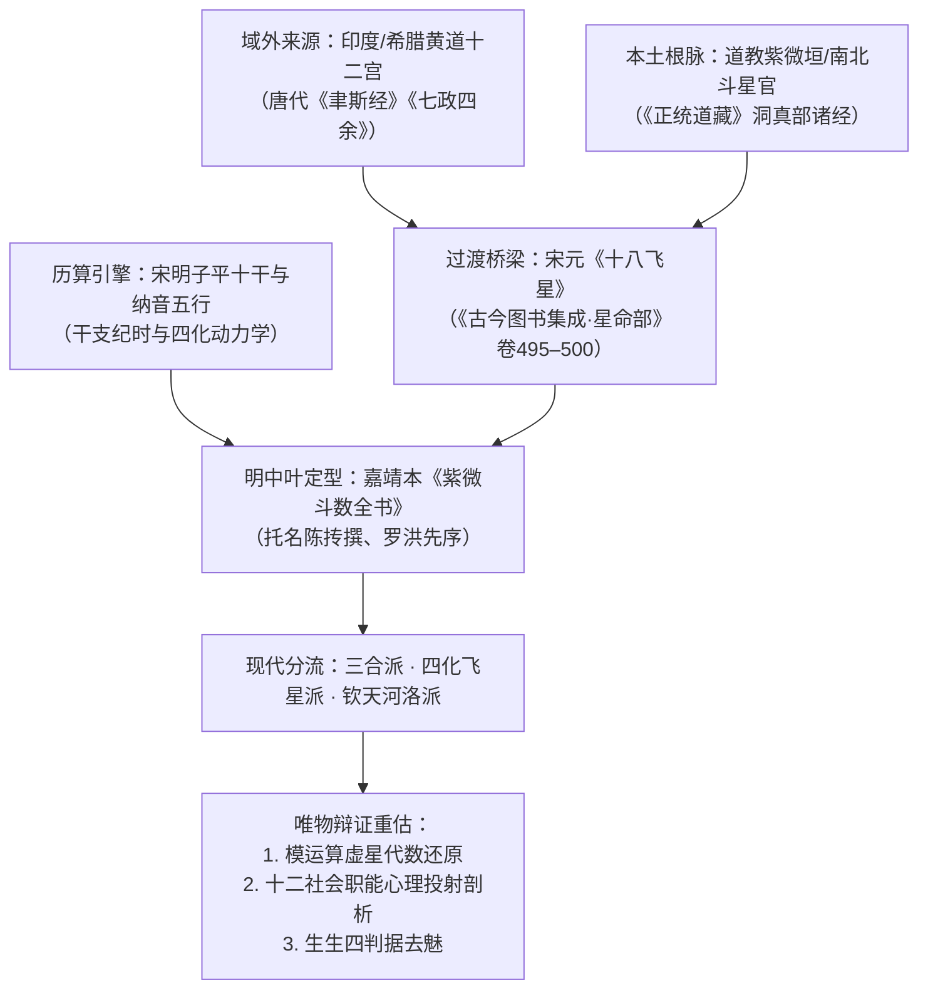

# 禄命星占之紫微斗数——从十八飞星、《道藏》星垣到十二宫四化飞星源流详考

> **本门导航（07 紫微斗数）**：[🏠 返回总纲](../README.md) ｜ [01 源流详考](01_源流详考.md) ｜ [02 分级教程](02_分级教程.md) ｜ [03 动画实操演练](03_动画实操演练.md) ｜ [04 《十八飞星策天紫微斗数》](04_经典全文1_《十八飞星策天紫微斗数》.md) ｜ [05 《紫微斗数全书·太微赋与诸星问答》](05_经典全文2_《紫微斗数全书·太微赋与诸星问答》.md) ｜ [06 《紫微斗数全书·骨髓赋与女命赋》](06_经典全文3_《紫微斗数全书·骨髓赋与女命赋》.md)

> **创建与修订日期**：2026-11-21  
> **状态**：`draft`（AI 辅助起草，待主理人终审，未经人工核对前不得标 final）  
> **模块归属与编号**：09 周易数术纲目 ｜ 07_紫微斗数 ｜ 01_源流详考  
> **价值基准评级**：🟡 **2 级文档（核心依赖因子：0.3，初始暂定，待用户主理人终审裁定）**  
> **前置理论与公理基石**：`《周易笺注审议与完善系统（标准 v3.5）》`（2级 0.3）、[`《十数概论》`](../../02%20元研究/十数概论.md)（1级待终审，暂按 0.3 适用）、[`《共性基座：阴阳八卦河洛九宫十二消息二十四山与五行生克详考》`](../01_共性基座/01_阴阳八卦河洛九宫十二消息二十四山与五行生克详考.md)（2级 0.3）；综合核心依赖度指数 $CDI = 0.3$。  
> **四重证据配置与强度分层**：  
> - **第一重证据（传世官修类书、经藏与正史目录，强）**：清《古今图书集成·博物汇编·艺术典·星命部》（卷 495–500 收《十八飞星策天紫微斗数》及《星学大成》）、明《正统道藏》（洞真部《太上玄灵北斗本命延生真经》《南斗六司延寿度人妙经》）、《永乐大典》（星字韵残卷及目录钩沉）、《汉书·艺文志·数术略》《宋史·艺文志》《四库全书总目·子部·术数类》及明刊《紫微斗数全书》；  
> - **第二重证据（版本内证与历史语言学考据，强）**：明本《紫微斗数全书》所见“尚书、给事中、锦衣卫、翰林”等明代官制词汇考辨，及唐代《聿斯经》《灵台经》译本星占术语比对；  
> - **第三重证据（社会人类学与心理投射旁证，中）**：古代士庶阶层对社会角色分工的心理焦虑与近现代都市商业社会“十二部门职能化标签”的巴纳姆效应；  
> - **第四重证据（古代天文历算与星垣测绘实物，强）**：苏州石刻天文图、敦煌星图及紫微垣真实赤经赤纬星官坐标，反证斗数十四主星系“代数虚星”。  
> **与既有高级别成果关系声明**：本文严格贯彻 [`《十数概论》`](../../02%20元研究/十数概论.md) 确立的“**易理与术数划界**”硬红线，绝不以明代才最终成书的紫微斗数反推先秦《周易》经传本义；同时客观还原其如何在唐宋“星命术”与“四柱八字”之间嫁接《周易》阴阳消息、河洛纳音与八卦方位，形成中国古代最后一套大型人生命理符号计算模型。

---

## 【摘要】

**问题意识**：紫微斗数在近现代港台及华人商业社会中声誉极隆，坊间术书动辄托名“宋初陈抟（希夷先生）所创、吕洞宾与白玉蟾秘传”，甚至将其神化为上古河洛星象真传。然而，无论汉代《汉书·艺文志·数术略》、宋代官修《宋史·艺文志》，抑或明初《永乐大典》与《正统道藏》，均未见今本《紫微斗数全书》之名目。**方法**：本文秉持历史唯物主义与“四重证据法”，以**《古今图书集成·博物汇编·艺术典·星命部》**所收《十八飞星策天紫微斗数》、**《道藏》**星官经忏及**《永乐大典》**星字韵目为三大核心文献锚点，结合明清版本语言学内证、离散数学模运算解析与真实天文星图比对，对紫微斗数开展“史源考辨—伪托拆解—算法还原—唯物去魅”四维详考。**发现**：（1）紫微斗数并非宋初一人顿悟之作，而是唐代印度—波斯—希腊黄道十二宫占星术（《聿斯经》《果老星宗》七政四余）东传后，与中国本土道教紫微垣、北斗九皇及南斗六星信仰深度混血，经宋元**《十八飞星策天紫微斗数》**过渡，最终在明代嘉靖二十九年（1550年）前后托名罗洪先（念庵）序刊的**《紫微斗数全书》**中吸收子平干支四化而层累定型；（2）其核心排盘本质上是一套**“六十甲子纳音五行局 + 农历生日整数模运算 + 地支寅申轴对称映射 + 十天干四化动力学”**的纯粹代数状态机，十四主星全系脱离真实天文观测坐标的“代数虚星”；（3）其将人生强行切分为“十二人事功能宫位”的结构化社会学隐喻，恰与近代商业社会中产阶层的角色分工焦虑相契合，故能借心理投射广为流播。**结论**：在“生生”四判据与唯物史观下，紫微斗数应被科学定位于“明代中叶以来融汇东西方星占符号的古代社会角色分类与心理推演游戏”，必须剥离其陈抟神话与宿命决定论。

**关键词**：紫微斗数；十八飞星；《古今图书集成·星命部》；《道藏》；《永乐大典》；模运算虚星；四化飞星；历史唯物主义

---

## 一、 引言：问题意识与学术史文献综述

### 1.1 问题的提出：紫微斗数研究中的三重历史迷雾

在《汉书·艺文志·数术略》所列的六大数术门类（天文、历谱、五行、蓍龟、杂占、形法）中，汉代原本只有基于天象观测的军国“星占”与基于干支形貌的“骨相禄命”，并无以个人出生时刻构建十二宫虚星命盘的“星命之学”。直到唐宋以后，中国禄命术才分化为两支并行的巨流：一支是彻底抛弃星辰名号、纯以干支五行生克为内核的**四柱八字（子平法）**；另一支则是保留黄道十二宫外壳与道教星官名号、却按农历日期模运算排布星曜的**紫微斗数**。

然而，长期以来紫微斗数的研究充斥着三重严重违背史实的迷雾：
1. **源流倒置的神话迷雾**：江湖术士与部分当代流行读物坚称紫微斗数由五代宋初隐士陈抟（号希夷先生）“仰观天象、独创于华山”，并附会“宋太祖赵匡胤召陈抟推算国运”“传于麻衣道者、吕洞宾”，全然无视宋元目录学文献中“陈抟紫微斗数”的彻底缺席。
2. **天文实体的混淆迷雾**：许多学习者误以为命盘上的“紫微坐命”“破军守财”“太阳太阴同宫”对应着出生时刻天空中紫微垣北斗诸星或太阳月亮的真实天文位置，殊不知斗数盘中哪怕同一日不同年份出生者，“太阳星”也可在寅、午、戌任意宫位跳跃，根本不随黄道周年视运动而行。
3. **易理与术数的混同迷雾**：部分现代术士动辄将明代中叶才成型的“飞星四化”“河洛五行局”倒推为先秦《周易》伏羲文王之本义，严重违背 [`《十数概论》`](../../02%20元研究/十数概论.md) 确立的“图在后、典在先，术数不得倒灌易经”原则。

### 1.2 学术史梳理：古今四代研习谱系与得失评析

| 学术代际 | 代表文献与人物 | 对紫微斗数体系的贡献（得） | 历史局限与理论盲区（失） |
| :--- | :--- | :--- | :--- |
| **唐宋星占与飞星孕育期** | 李弼乾译《聿斯经》、张果《星宗》（托名）、《十八飞星策天紫微斗数》 | 引入黄道十二宫框架（命宫至福德、相貌宫），并将唐代“七政四余”真星推步简化为以年干生月定飞星之法 | 尚处于“五星真历”向“虚星模算”转型的半成品阶段，神煞繁杂而结构未稳 |
| **明代中叶定型集成期** | 嘉靖本《紫微斗数全书》（托名陈抟撰、罗洪先序）、《紫微斗数全集》、万民英《星学大成》 | 剔除繁琐杂星，精简确立十四主星与十二人事宫位，吸收子平学十天干（四化禄权科忌）与大限流年，完成数理定型 | 为抬高身价而伪托宋初陈抟与理学名臣罗洪先；混入大量明代科举与锦衣卫官僚语汇，宿命论色彩浓厚 |
| **清代目录考据与整理期** | 陈梦雷/蒋廷锡《古今图书集成·艺术典·星命部》、纪昀《四库全书总目》 | 《古今图书集成》全录《十八飞星》与《星学大成》；《四库总目》在星命类严格辨伪托古伪书，守护目录信史 | 《四库全书》未收今本《紫微斗数全书》，清代官方主流学者多轻视斗数而重子平，致其流落民间坊刻传抄，讹误丛生 |
| **近现代分派与科学审视期** | 陆致极、王亭之（中州派）、钦天门（飞星四化派）、现代天文史学家 | 梳理出三合派、飞星派、河洛派三大实操分支；部分史学家以《道藏》《星命部》揭露其明代成书真相 | 坊间商业化极重，多数著作仍沉溺于“陈抟秘传”营销话术，缺乏对模运算本质与唯物史观的系统批判 |

### 1.3 研究思路与逻辑架构

---

## 二、 四重证据史源锚定：三大文献支柱与“陈抟创制说”辨伪

### 2.1 三大核心文献锚点考辨

要厘清紫微斗数从何而来，必须抛开江湖口诀，回归**《古今图书集成》《永乐大典》《道藏》**三大历史文献坐标进行交叉定位：

1. **《古今图书集成·博物汇编·艺术典·星命部》（卷 495–500）：紫微斗数的前身铁证**  
   清康熙末陈梦雷主持编纂、雍正四年（1726年）蒋廷锡校订的《古今图书集成·艺术典·星命部》（共 88 卷，卷 483–570），是清代以前中国星命术文献最完备的官修总汇。耐人寻味的是，该部在前段（卷 483–494）收录了以唐宋真星推步为基础的《星学大成》《果老星宗》（七政四余），紧接着在**卷 495–500** 完整收录了**《十八飞星策天紫微斗数》**（及《星平会海》所载飞星源流），而后段（卷 501–570）则全收《渊海子平》《三命通会》等八字经典，**却并未将今本《紫微斗数全书》列为核心正典**。  
   对比《十八飞星策天紫微斗数》与今本《紫微斗数全书》可知：《十八飞星》已有“紫微、天虚、天贵、天印、天寿、红鸾、天库、天贯、文昌、天福、天禄、天刑、天姚、天哭、天耗、天荫、天孤、天破”十八星，且同样采用“命宫十二支排布 + 阴男阳女顺逆 + 生月生时安命”的格局框架，只是尚未引入“天府星系”与“十干四化”。这铁一般地证明：**十八飞星正是七政四余（需精密天文历表计算真星经度）向紫微斗数（完全脱离历表、仅凭农历年月日时查表模算虚星）演进的中间过渡桥梁。**

2. **《道藏》（明正统十年《正统道藏》及《万历续道藏》）：十四主星名号的宗教原型**  
   紫微斗数中最核心的星曜名号，绝非先秦《周易》所有，亦非纯粹天文学《史记·天官书》的直接搬运，而是直接取材于**《道藏》洞真部与太玄部的北斗、南斗星官崇拜经忏**：
   - 《太上玄灵北斗本命延生真经》（收入《正统道藏》洞真部本文类）确立了“北斗七星+二隐星”的九皇星君信仰：贪狼、巨门、禄存、文曲、廉贞、武曲、破军（及左辅、右弼），合称**“北斗九星”**——这恰是紫微斗数北斗星系主星与左辅右弼的逐字名号真源！
   - 《南斗六司延寿度人妙经》确立了司命、司禄、延寿、益算、度厄、上生之南斗六星信仰，与天府、天相、天梁、天同、七杀等南斗星系名号形成宗教对应；而居于中宫北极尊位的“中天北极紫微太皇大帝”（紫微大帝），则顺理成章被供奉为群星统帅“紫微星”。
   - 更关键的目录学反证在于：**截至明正统十年（1445年）编成的《正统道藏》全藏五千余卷中，虽遍收道教星垣斋醮文献，却绝无“紫微斗数”四字书名或排盘之法**。这说明在 15 世纪中叶以前，紫微斗数尚未以今本形态定型。

3. **《永乐大典》残卷与清代《四库全书》辑佚：时间上限的铁锁**  
   明永乐六年（1408年）成书的《永乐大典》，按《洪武正韵》广泛收录宋元以前方技数术典籍（如“星”字韵、“命”字韵、“算”字韵下保存了《果老星宗》前身诸五星赋、宋元《兰台妙选》《珞琭子赋注》及《十八飞星》相关歌赋）。然而，无论是现存《永乐大典》残卷、文渊阁目录，还是清代四库馆臣从《永乐大典》中大规模辑佚而成的《四库全书·子部·术数类》及《存目》，**均未见《紫微斗数全书》或《紫微斗数全集》之只字片语**。

### 2.2 史料辨伪：“陈抟创制说”与“罗洪先校刊说”的层累解剖

结合上述三大文献支柱与明代版本语言学内证，坊间流传的“宋初陈抟著紫微斗数”可被彻底证伪：
- **目录学证伪**：《宋史·艺文志·五行类》及《崇文总目》《郡斋读书志》《直斋书录解题》记录陈抟著作仅有《指玄篇》《易龙图》等，绝无紫微斗数；宋代文人笔记（如沈括《梦溪笔谈》、洪迈《容斋随笔》、周密《齐东野语》）详论当时士大夫热衷的六壬、纳甲、李虚中三柱、徐子平四柱及五星术，却无一人提及“紫微斗数”。
- **时代语汇内证（破绽铁证）**：今传嘉靖二十九年（1550年）前后刊刻的《紫微斗数全书》歌诀与断语中，赫然出现大量**明代特有的官僚制度与社会词汇**——例如“**锦衣卫**”“**给事中**”“**六部尚书**”“**翰林院**”“**都察院**”“**总兵**”“**生员**”“**举人**”等（如论武曲、七杀、廉贞入庙常断“主掌兵权，为锦衣卫或总兵”；论文昌文曲断“入翰林、居清要给事中”）。“锦衣卫”设立于明洪武十五年（1382年），“都察院”定名于洪武十五年，明代科举始严格分级为“生员—举人—进士”。宋初陈抟（卒于989年）岂能预知近四百年后朱元璋创立的“锦衣卫”？
- **“罗洪先序刊本”真伪考**：现存最早的《紫微斗数全书》卷首常署“宋·希夷陈抟著、明·念庵罗洪先校刊”。罗洪先（1504—1564年），嘉靖八年状元，乃王阳明心学江右学派大儒，一生精研理学与地理舆图（《广舆图》），《明史·罗洪先传》及其文集《念庵文集》从未记载其曾校刊或推崇紫微斗数。明代嘉靖、万历间坊刻书商“借名流状元以重书价”乃通病（正如同期《推背图》托名李淳风、《黄金策》托名刘基）。

| 文献 / 实物锚点 | 所属时代 | 关键记载或缺失事实 | 证据层级与定性 |
| :--- | :--- | :--- | :--- |
| 唐李弼乾译《聿斯经》残文及《果老星宗》 | 唐至五代 | 传入希腊/印度黄道十二宫与“命宫—财帛—兄弟—田宅—男女—奴仆—夫妻—疾厄—迁移—官禄—福德—相貌”十二宫体系 | **第一重（强）**：证明十二宫框架系唐代西域占星东传产物 |
| 《道藏》洞真部《北斗延生经》《南斗度人经》 | 宋元定型，明1445年刊 | 载紫微大帝与贪狼、巨门、禄存、文曲、廉贞、武曲、破军、左辅、右弼名号；全藏无“紫微斗数”书名 | **第一重（强）**：证明星曜名号源自道教星官，1445年前斗数未成型 |
| 《永乐大典》（1408年）及《四库全书总目》 | 明初至清乾隆 | 大典收五星与十八飞星线索，无今本《紫微斗数全书》；《宋史》亦无陈抟著斗数之载 | **第一重（强）**：证伪“宋初陈抟创作说” |
| 《古今图书集成·艺术典·星命部》（卷 495–500） | 清雍正四年（1726年） | 全文保存过渡形态《十八飞星策天紫微斗数》，详载十八飞星安命与生月生时起例 | **第一重（强）**：锁定五星向斗数过渡的关键环节 |
| 明刊《紫微斗数全书》内文官制词汇 | 明嘉靖二十九年（1550年）前后 | 含“锦衣卫”“都察院”“给事中”“举人”等洪武以后明代官职词 | **第二重（强）**：确证今本系明代中叶方士层累编纂 |

---

## 三、 核心数理原理与排盘机制详述

紫微斗数的魅力与复杂性，并不在于玄学神秘性，而在于它巧妙地将**《周易》数理底盘（阴阳、河洛五行、八卦方位）**、**天干地支历算**与**离散模运算**封装成一套高度结构化的符号计算系统。其核心算法可拆解为四大模块：

### 3.1 十二人事宫位拓扑与“三方四正”关系网络

唐代传入的《聿斯经》十二宫顺序为顺时针（黄道太阳视运动方向），且第十二宫为“相貌宫”；明代《紫微斗数全书》将其彻底汉化重构，结合“父母—福德”宗法伦理，改为**逆时针布列地支十二宫**（象征天道左旋与人伦顺推），用“**父母宫**”取代了“相貌宫”，形成固定次序：

> **命宫 → 兄弟宫 → 夫妻宫 → 子女宫 → 财帛宫 → 疾厄宫 → 迁移宫 → 奴仆（交友）宫 → 官禄（事业）宫 → 田宅宫 → 福德宫 → 父母宫**

在此环形拓扑结构（同构于模 12 剩余类环 $\mathbb{Z}_{12}$）中，任一宫位 $P$ 都不是孤立的，而是通过“三合”与“对冲”构成**“三方四正”联动网络**：
- **本宫**（$P$）：核心本体状态；
- **对宫**（$P + 6 \pmod{12}$）：即“地支六冲”位，在空间上正对，代表外部映射与客观环境（如命宫之对宫必为迁移宫，官禄之对宫必为夫妻宫）；
- **三合宫**（$P + 4 \pmod{12}$ 与 $P + 8 \pmod{12}$）：即“地支三合局”（申子辰、寅午戌、亥卯未、巳酉丑），代表气脉相通的支撑系统（如命宫的三合方必为**财帛宫**与**官禄宫**，合称“命财官迁”核心铁三角）。
- **身宫叠加机制**：以寅宫起正月，顺数至生月，再从生月宫起子时，**顺数**至生时安**身宫**（而命宫则是**逆数**至生时）。由于一顺一逆，身宫必然只落在**命、福德、官禄、迁移、财帛、夫妻**六宫之一，代表一个人后天实践重心与中年以后行为惯性的落脚点。

### 3.2 河洛纳音五行局与十四主星离散模运算公式

紫微斗数最精密之处，在于如何仅凭“农历生日（初一至三十）”，用纯算术把十四颗主星分布到十二地支宫中。其运算分五步走：

#### 第一步：寅宫起月定命宫，五虎遁起命宫天干
1. 定地支顺序：$0=\text{子}, 1=\text{丑}, 2=\text{寅}, \dots, 11=\text{亥}$。
2. 自**寅宫（$2$）**起正月，顺数至农历生月 $M$，得到月建落宫 $(2 + M - 1) \bmod 12$；以此宫为子时（$0$），**逆数**至生时地支 $H$，即得**命宫地支**：
   $$P_{\text{命}} = (2 + M - 1 - H) \bmod 12$$
3. 以生年天干按**“五虎遁元”**（甲己之年丙作首，乙庚之岁戊为头……）推算出寅宫天干，顺数至命宫地支，从而赋予命宫完整的干支组合（如“戊午”）。

#### 第二步：六十甲子纳音定“五行局”
由命宫干支查**《六十甲子纳音表》**（源于汉代京房与隋萧吉《五行大义》音律配数），确定命局所属的五行局数 $k$，其数字取自**河图生数与洛书成数之合流**：
- **水二局**（$k = 2$）
- **木三局**（$k = 3$）
- **金四局**（$k = 4$）
- **土五局**（$k = 5$）
- **火六局**（$k = 6$）

> 值得注意的是，此处的“二、三、四、五、六”虽托名河洛，实则将《系辞》与汉代《洪范》五行序（一水、二火、三木、四金、五土）改易为“水二、木三、金四、土五、火六”，以便作为**除数模数 $k \in \{2, 3, 4, 5, 6\}$** 覆盖农历 1~30 日的整数除法！

#### 第三步：农历生日整数模运算定“紫微星”落宫
设农历出生日为 $D \in \{1, 2, \dots, 30\}$，五行局数为 $k \in \{2, 3, 4, 5, 6\}$。传统口诀云：“六五四三二，酉午亥辰丑，局数除日数，商数宫前走；若见数无余，便要起虎口（寅）；日数小于局，还直宫中守。”将其转化为严谨的数学公式如下：
1. 若 $D$ 能被 $k$ 整除，设商 $q = D / k$，余数 $r = 0$，则**借数补足为 $0$**，直接从**寅宫（$2$）**顺数 $q$ 位：
   $$P_{\text{紫微}} = (2 + q - 1) \bmod 12$$
2. 若 $D$ 不能被 $k$ 整除，则找最小的非负整数 $x \in \{1, \dots, k-1\}$，使得 $(D + x)$ 能被 $k$ 整除，记商 $q = (D + x) / k$：
   - 若补数 $x$ 为**奇数**，则从由寅起顺数 $q$ 位后再**回退（逆减）** $x$ 步；
   - 若补数 $x$ 为**偶数**，则从由寅起顺数 $q$ 位后再**前进（顺加）** $x$ 步：
   $$P_{\text{紫微}} = \left(2 + q - 1 + (-1)^x \cdot x\right) \bmod 12$$

这就是“紫微安星诀”的全部数学真相！由此可见，只要生日 $D$ 与五行局 $k$ 相同，无论相隔多少百年、太阳月亮位于何处星座，紫微星落宫永远恒定，它是纯粹的**农历日期离散模函数**。

#### 第四步：紫微星系逆布与“寅申斜线轴对称”定天府星
1. **北斗紫微星系（6 星）**：自紫微落宫起，**逆时针**按固定步长布列：
   - 紫微（0）→ **天机**（-1）→ 空1格 → **太阳**（-3）→ **武曲**（-4）→ **天同**（-5）→ 空2格 → **廉贞**（-8）。
2. **天府星对称公式（寅申斜轴镜像）**：紫微与天府并不呈中心点对冲（差 6 宫），而是沿地支方盘的**寅（2）—申（8）对角线**作轴对称反射！即：紫微在寅，天府亦在寅（同宫）；紫微在申，天府亦在申（同宫）；紫微在卯（3），天府在丑（1）；紫微在子（0），天府在辰（4）。用地支编号（$0=\text{子}\dots 11=\text{亥}$）表达，即为极其优美的模 12 反射公式：
   $$P_{\text{天府}} = (4 - P_{\text{紫微}}) \bmod 12$$
   验证：紫微在寅（2）$\Rightarrow (4-2)\bmod 12 = 2$（寅）；紫微在申（8）$\Rightarrow (4-8)\bmod 12 = 8$（申）；紫微在午（6）时，$(4-6)\bmod 12 = 10$（戌）；紫微在亥（11）时，$(4-11)\bmod 12 = 5$（巳）！**$(4 - P_{\text{紫微}}) \bmod 12$ 精确无误地覆盖全部十二宫的“寅申斜轴镜像对称”！**
3. **南斗天府星系（8 星）**：自天府落宫起，**顺时针**布列：
   - 天府（0）→ **太阴**（+1）→ **贪狼**（+2）→ **巨门**（+3）→ **天相**（+4）→ **天梁**（+5）→ **七杀**（+6）→ 空3格 → **破军**（+10）。
   *(注：七杀与破军永隔三宫，故“杀破狼”三颗星在命盘中永远彼此相差 4 宫，构成永恒的“三合会照”关系！)*

### 3.3 辅佐吉曜与四煞空劫系统

在十四主星定盘之后，斗数以生月、生时、生年干支再配入**六吉星**与**六煞星**，构建平衡与冲突张力：
- **辅佐吉曜（六吉 + 禄马）**：**左辅、右弼**（生月起辰戌顺逆，主同侪助力）、**文昌、文曲**（生时起戌辰逆顺，主文书思辨）、**天魁、天钺**（生年干起昼夜贵人，同源于大六壬“甲戊庚牛羊”口诀，主制度提携）、**禄存与天马**（禄存随年干禄位，天马随年支三合驿马，主资源与流动）。
- **四煞与空劫（六煞）**：**擎羊、陀罗**（永远夹于禄存前后各一宫，即“羊陀夹禄”，象征资源中心必伴随争夺与消耗的辩证性！）、**火星、铃星**（随年支三合与生时定，主突发冲动）、**地空、地劫**（起亥宫顺逆生时，主精神悬空与物质损耗）。

### 3.4 十天干四化飞星动力学：从静态星盘到动态流转

明清紫微斗数之所以能超越早期《十八飞星》的机械死板，关键在于吸收了子平干支思维，创造出**“十天干四化飞星”**。所谓“四化”，即**化禄、化权、化科、化忌**，其哲学映射直接对应《周易》乾卦“元、亨、利、贞”与四季气化流转：
- **化禄（春/生发/元）**：资源丰沛、欲望启动、人缘与物质流入；
- **化权（夏/成长/亨）**：掌控欲、决断力、组织推进与冲突张力；
- **化科（秋/收敛/利）**：声望、规则、文书契约、缓冲与修复力；
- **化忌（冬/闭藏/贞与阻滞）**：执着、亏欠、系统瓶颈、压力聚焦与事态终结转化。

十天干各自触发固定的四颗星曜产生“四化”（以最通行之《全书》本为例）：

| 十天干 | 化禄 | 化权 | 化科 | 化忌 |
| :---: | :--- | :--- | :--- | :--- |
| **甲** | 廉贞 | 破军 | 武曲 | 太阳 |
| **乙** | 天机 | 天梁 | 紫微 | 太阴 |
| **丙** | 天同 | 天机 | 文昌 | 廉贞 |
| **丁** | 太阴 | 天同 | 天机 | 巨门 |
| **戊** | 贪狼 | 太阴 | 右弼 | 天机 |
| **己** | 武曲 | 贪狼 | 天梁 | 文曲 |
| **庚** | 太阳 | 武曲 | 太阴 | 天同 |
| **辛** | 巨门 | 太阳 | 文曲 | 文昌 |
| **壬** | 天梁 | 紫微 | 左辅 | 武曲 |
| **癸** | 破军 | 巨门 | 太阴 | 贪狼 |

在时间维度上，斗数以命宫五行局数（$2,3,4,5,6$ 岁）为**起大限岁数**，阳男阴女顺行、阴男阳女逆行，**每十年移换一个大限宫位**，再叠加**流年太岁宫位**，使大限宫干与流年宫干不断重新发射“禄权科忌”，撞击原局星盘（即“飞星派”与“钦天门河洛派”的核心玩法：本命为体、大限为用、流年为应）。

---

## 四、 近现代流派演化：三合派、飞星派与钦天门河洛派

清末至 20 世纪下半叶，紫微斗数在港台与南洋华人社会爆发式传播，演化为三大主流分支：
1. **三合派（以香港中州派王亭之、陆斌兆为代表）**：重十四主星庙旺落陷、星曜组合（如“机月同梁”“杀破狼”“日月并明”）及六吉六煞之“三方四正”静态格局平衡，承袭明本《紫微斗数全书》与《全集》正统最多。
2. **飞星派（源于台湾北派紫微）**：极度淡化星曜庙旺与杂曜，几乎仅凭十四主星+昌曲辅弼，专攻**十二宫宫干飞化（如财帛宫干化忌冲命宫、官禄宫干化禄入夫妻）**的交叉拓扑连线，将斗数高度推演为一张“十天干能量流向有向图”。
3. **钦天门河洛派（以台湾蔡明宏一系为代表）**：强行将紫微斗数与宋代河图洛书数字、来因宫（生年天干所在宫位）、河洛四象（禄权科忌配少阳、老阳、少阴、老阴）及自化（离心自化/向心自化）捆绑，声称上溯易经河洛正脉。从学术史考辨角度看，这属于典型的**现代易学附会再包装**，其数理逻辑虽自洽，但并无宋元以前文献根基。

---

## 五、 历史唯物主义与“生生”价值标尺综合讨论

### 5.1 唯物去魅：为什么“虚星模算”能在现代商业社会盛行？

从历史唯物主义的认识论审视，紫微斗数揭示了两个耐人寻味的客观事实：
1. **星曜的“去天文实体化”**：真正的太阳在黄道上按回归年运行，不可能随农历生日的模数与紫微星保持固定步距；真实天文学中的紫微垣、北斗七星距地球数十至数百光年，且因地轴进动（岁差），每隔约 25,772 年北极星便易主。斗数盘上的“紫微、太阳、太阴”**百分之百是脱离天体物理实体的“代数虚星”**。任何宣称“紫微斗数反映出生时宇宙星体引力场作用”的说法，在天文学与物理学上均属彻底谬误。
2. **社会分工与“十二部门分类”的心理投射机制**：为何紫微斗数在 20 世纪后期至今的香港、台湾及大陆都市白领中比传统八字更受欢迎？这有着深刻的历史唯物主义社会基础——传统四柱八字源于农耕与宗法社会（以正官、七杀、正印、偏财论宗族与仕途），结构高度抽象；而紫微斗数将人的生活强行切分为**“命格、兄弟手足、婚姻配偶、子女、现金流（财帛）、健康（疾厄）、外派差旅（迁移）、下属人脉（交友）、职场晋升（官禄）、不动产（田宅）、精神消费（福德）、长辈上司（父母）”**整整十二个高度具象的现代科层与商业部门！当现代个体面对高度原子化、充满不确定性的市场竞争时，这种带有明确部门标签与心理原型（如“七杀代表高压开拓”“天机代表策划变动”“化忌代表KPI受阻”）的符号体系，极易诱发**巴纳姆效应（Barnum Effect）**与自我心理归因。

### 5.2 “生生”四判据检验与事实—推演—假说边界申明

| 评估维度 | 紫微斗数在“生生”四判据下的定性审视 |
| :--- | :--- |
| **存续（主体保全）** | 若仅作为自我性格盘点、压力预警的象征性反思工具（如借“化忌”反思某领域的盲区与过执），尚无大害；若盲从“命宫无主星”“巨门化忌必遭官非”而产生习得性无助，则直接削弱主体主观能动性与危机应对能力。 |
| **再生产（实践创生）** | 紫微斗数以农历生日模数将全球数千万同日同时生人归为完全相同的“命盘模板”，完全抹杀生产资料占有、阶级地位、教育资源与个人历史实践对人生的决定性作用，不具备物质再生产指导价值。 |
| **修复（纠偏容错）** | 斗数“忌星即执念、科星即规范”的辩证意象，在人文心理学层面具有一定“提醒自我克制与守正修复”的隐喻意义，但其本身无法提供现实制度或工程修复方案。 |
| **传承（文明演进）** | 严守“易理与术数划界”：紫微斗数作为明清社会史、中外星占交融史与古代离散数学史的活化石具有文献研究价值，但绝不允许其反客为主替代先秦《周易》“生生之谓易”的唯物辩证法正统。 |

**事实（Fact）、推演（Inference）与假说（Hypothesis）边界表**：

| 命题类别 | 本文具体论断 | 证据支撑与可证伪条件 |
| :--- | :--- | :--- |
| **第一类：铁证（Fact）** | ①《正统道藏》《永乐大典》《宋史·艺文志》均无《紫微斗数全书》之载；②《古今图书集成·星命部》收《十八飞星策天紫微斗数》；③明刊《紫微斗数全书》含“锦衣卫、给事中”等明代官制词；④斗数十四主星由农历生日模运算与寅申轴对称生成。 | 传世文献目录、明刊原典文本及数学排盘规则可 100% 复核验证。 |
| **第二类：推演（Inference）** | ①紫微斗数系唐代西域黄道十二宫占星术与道教南北斗星官融合，经宋元《十八飞星》过渡，至明中叶嘉靖前后定型；②“陈抟创制、罗洪先校刊”系明代书坊托古伪作。 | 基于版本层累学、社会官制演变与星占文献比对的历史唯物推论。 |
| **第三类：假说（Hypothesis）** | 明中叶江南商品经济萌芽与科举内卷加剧，是否直接催生了将复杂“七政四余真星天文计算”彻底简化为“查表模算虚星”的紫微斗数以便于市民阶层快速上手消费？ | **可证伪条件**：统计嘉靖—万历年间徽州/江南坊刻算学与日用类书中星命普及本的印行地域与序跋读者群体，若发现紫微斗数最初系宫廷钦天监而非江南坊刻普及，则本假说须修正。 |

---

## 六、 结论

1. **历史定性**：紫微斗数不是“上古伏羲河洛真传”，也不是“宋初陈抟手著”，而是**明代嘉靖二十九年（1550年）前后在《十八飞星》基础上，嫁接西域十二宫、道教《道藏》南北斗星官与子平十干四化而最终定型的民间星命术**。
2. **数理本质**：其排盘算法本质上是一个封闭在 $\mathbb{Z}_{12}$ 环上的**离散模运算与轴对称反射系统**，所排十四主星全为脱离天体物理坐标的“代数虚星”。
3. **当代态度**：研究紫微斗数，应当赏析其作为古代组合数学与社会角色分类模型的结构巧思，揭穿其托名古贤与宿命决定论的商业面纱，坚定回归“人的社会关系总和与历史实践决定命运”的历史唯物主义正道。

---

## 七、 参考文献

1. [清] 陈梦雷 编, 蒋廷锡 校订. 古今图书集成·博物汇编·艺术典·星命部（卷 495–500 收《十八飞星策天紫微斗数》《星学大成》）[M]. 北京: 中华书局影印本, 1934.
2. [明] 正统道藏·洞真部（收《太上玄灵北斗本命延生真经》《南斗六司延寿度人妙经》）[M]. 北京: 文物出版社 / 上海书店 / 天津古籍出版社联合影印, 1988.
3. [明] 托名陈抟撰, 托名罗洪先校. 紫微斗数全书[M]. 明嘉靖—万历坊刻汇印本 / 台北: 武陵出版有限公司点校本, 1998.
4. [汉] 班固. 汉书·艺文志（数术略）[M]. 北京: 中华书局, 1962.
5. [元] 脱脱 等. 宋史·艺文志[M]. 北京: 中华书局, 1977.
6. [清] 永瑢 等. 四库全书总目·子部·术数类[M]. 北京: 中华书局, 1965.
7. 陆致极. 中国命理学史论[M]. 上海: 上海人民出版社, 2008.
8. 陈久金. 中国星占学[M]. 北京: 中国书店, 2009.
9. 宁晓玉. 《聿斯经》与唐代星命术研究[J]. 自然科学史研究, 2007, 26(3): 321–334.

---

© 2026 徐时言 · 《禄命星占之紫微斗数——从十八飞星、《道藏》星垣到十二宫四化飞星源流详考》 · 徐时言-易经研究 · 采用 CC BY-NC-ND 4.0 许可， 转载请署名并注明来源 https://wole278.github.io/xushiyan-YiJing/ · 禁止商业使用与改编传播 · 商业授权：wole278@hotmail.com / 微信 wole278
