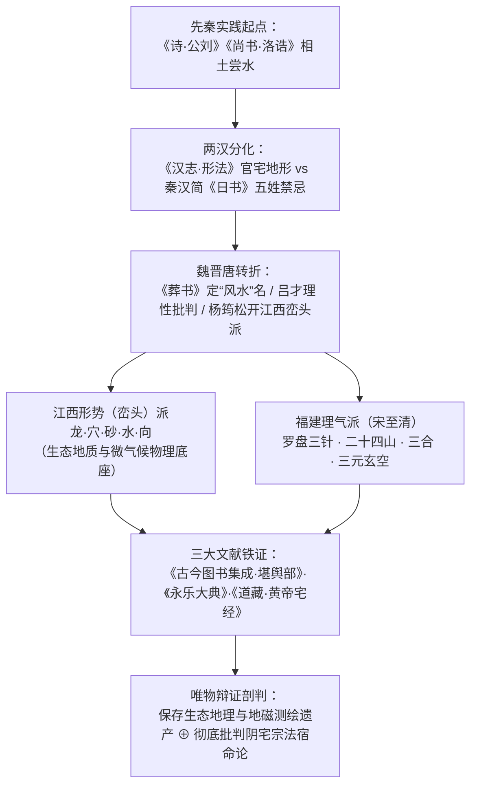

# 形法相地之风水堪舆——形势峦头与理气二十四山、三合及玄空飞星源流详考

> **本门导航（08_风水堪舆）**：[`← 返回数术纲目总览`](../README.md) ｜ [`01 源流详考`](01_源流详考.md) · [`02 分级教程`](02_分级教程.md) · [`03 动画实操演练`](03_动画实操演练.md) · [`04 经典全文1：《郭璞葬书》`](04_经典全文1_《郭璞葬书》.md) · [`05 经典全文2：《杨筠松青囊奥语与天玉经》`](05_经典全文2_《杨筠松青囊奥语与天玉经》.md) · [`06 经典全文3：《道藏黄帝宅经》`](06_经典全文3_《道藏黄帝宅经》.md)  
> **创建与修订日期**：2026-11-21  
> **状态**：`draft`（AI 辅助起草，待主理人终审，未经人工核对前不得标 final）  
> **模块归属与编号**：09 周易数术纲目 ｜ 编号：08（一术一详述核心专论）  
> **价值基准评级**：🟡 **2 级文档（核心依赖因子：0.3，初始暂定，待用户主理人终审裁定）**  
> **前置理论与公理基石**：`《周易笺注审议与完善系统（标准 v3.5）》`（2级 0.3）、[`《十数概论》`](../../02%20元研究/十数概论.md)（1级待终审，暂按 0.3 适用）、[`《共性基座：阴阳八卦河洛九宫十二消息二十四山与五行生克考》`](../01_共性基座/01_阴阳八卦河洛九宫十二消息二十四山与五行生克详考.md)（2级 0.3）；综合核心依赖度指数 $CDI = 0.3$。  
> **四重证据配置与强度分层**：  
> - **第一重证据（传世原典、官修类书与史传批判文献，强）**：《诗经·大雅·公刘》《尚书·洛诰》《汉书·艺文志·数术略·形法》《论衡·诘术》《旧唐书·吕才传》《晋书·郭璞传》、北宋司马光《葬论》、沈括《梦溪笔谈》、清《古今图书集成·博物汇编·艺术典·堪舆部》（卷 651–710）、《永乐大典》（地字韵/葬字韵辑佚本如《发微论》《催官篇》）及《道藏》洞神部《黄帝宅经》；  
> - **第二重证据（出土简帛与墓葬方位文字，强）**：睡虎地秦简《日书》、放马滩秦简《日书》宅居避忌篇及马王堆帛书《刑德》刑徒方位图；  
> - **第三重证据（聚落生态与民间建筑民俗旁证，中）**：中国传统四合院、徽派村落、客家围屋“枕山环水、负阴抱阳”聚落营建规律；  
> - **第四重证据（考古遗址与磁测仪器实物，强）**：陕西岐山凤雏村西周甲组建筑基址朝向、战国司南（勺形指南器）文献与汉唐式盘/宋明罗盘三针实物、现代水文地质与地磁偏角实测数据。  
> **与既有高级别成果关系声明**：本文严守 [`《十数概论》`](../../02%20元研究/十数概论.md) 确立的“易理与术数划界”及“二仪阴阳初义源自山川向背”论断，把堪舆学拆解为**“古代生态人居环境工程学 + 地磁方位测绘技术”**与**“封建宗法阴宅宿命附会”**两重截然不同的历史成分，严禁以宋明理气罗盘倒推先秦《周易》经文。

---

## 【摘要】

**问题意识**：风水堪舆是中国古代数术中直接干预城乡聚落选址、民居营造与丧葬制度的最具社会渗透力的一门学问。传统术家将其神秘化为“上承伏羲八卦、下掌子孙兴衰”的“天机密法”，而部分现代批判者则将其整体斥为毫无科学成分的迷信，双方均未能做出历史唯物主义的精准剖判。**方法**：本文以**《古今图书集成·博物汇编·艺术典·堪舆部》**、**《永乐大典》**辑本及**《道藏》**《黄帝宅经》为文献锚点，结合《汉书·艺文志·形法》目录溯源、秦汉简《日书》、古建筑遗址与地磁学原理，系统梳理堪舆从先秦“相土尝水”到唐宋江西形势派（峦头）与福建理气派（三合、玄空）的演进全史，并对峦头五诀与罗盘二十四山三针、玄空飞星算法进行数理与物理双重还原。**发现**：（1）风水堪舆的两大核心支派各有本质差异——**形势（峦头）派**以“龙、穴、砂、水、向”为纲，实质上是在前科学时代凝练出的**水文地质避险、河道流体动力学（玉带环抱与反弓冲刷）与北半球微气候保温采光工程学**；（2）**理气派罗盘三针**（地盘正针、人盘中针逆旋 $7.5^\circ$、天盘缝针顺旋 $7.5^\circ$）折射出唐宋之际中国工匠对**地磁偏角（Magnetic Declination）**的长期实测发现，比欧洲早数百年，然其“二十四山三元龙顺逆飞星”“三合生旺墓绝”及阴宅“枯骨荫庇子孙”说，则是将客观方位角编码与宗法血缘宿命论强行绑定的形式主义建构；（3）唐代吕才与北宋司马光对“五姓图宅”与“阴宅厚葬”的理性批判，构成了中国古代唯物主义反迷信的辉煌传统。**结论**：在“生生”四判据下，应继承发扬堪舆中服务于人类居住安全与生态可持续的**建筑环境学合理内核**，彻底扬弃停丧求福、欺世惑众的**阴宅宿命迷信**。

**关键词**：风水堪舆；形势峦头；二十四山；罗盘三针；地磁偏角；三合水法；玄空飞星；《古今图书集成·堪舆部》

---

## 一、 引言：问题意识与学术史文献综述

### 1.1 问题的提出：堪舆学内部的“唯物工程”与“唯心宿命”双重撕裂

《汉书·艺文志·数术略》末类“形法”云：“**形法者，大举九州之势以立城郭室舍形。人及六畜骨法之度数，器物之形容，以求其声气贵贱吉凶。**”这一上古学术定义极其深刻地指出：最初的“形法相地”（堪舆之古称）核心任务是“立城郭室舍形”——即为了部落与城邦的生存安全而进行的**大地山川测量与人居选址实践**。

然而，随着秦汉大一统帝国确立、宗法门阀制度发展及汉代天人感应思潮渗透，原本朴素实用的相地术发生了剧烈分化与异化：
1. **阳宅生态选址与阴宅“枯骨福荫”的分裂**：先秦《诗》《书》“相其阴阳，观其流泉”本服务于活人的农耕聚落与防洪筑城；魏晋以降，伴随门阀士族攀比祖坟以巩固世袭特权，“阴宅葬地决定子孙三公九卿、富贵绝嗣”的迷信大行其道，甚至衍生出停丧数十年不葬以待“吉穴”的社会陋习（北宋司马光《葬论》曾痛陈其弊）。
2. **直观地形物理（峦头）与抽象符号推演（理气）的分裂**：唐末杨筠松开创江西峦头派，立足实地山川走势、水口冲淤与微气候；宋代以降福建理气派兴起，将《周易》八卦、河图洛书九宫、十二地支三合、二十四山与流年九星叠加入罗盘，甚至衍生出不看真山真水、仅凭罗盘度数与元运飞星纸上谈兵的繁琐玄学。

### 1.2 学术史梳理：古今四代研习谱系与得失评析

| 学术代际 | 代表人物与经典文献 | 历史贡献（得） | 历史局限与理论偏误（失） |
| :--- | :--- | :--- | :--- |
| **先秦两汉实测与批判期** | 《诗经·公刘》《尚书·洛诰》《汉志·形法》《宫宅地形》；王充《论衡·诘术》 | 确立“相阴阳、观流泉”的农耕聚落选址法；王充率先批判“五姓图宅术”之机械荒谬 | 秦简《日书》已出现大量无科学根据的方位禁忌与岁煞避忌 |
| **魏晋隋唐峦头奠基与理性争鸣期** | 郭璞（托名《葬书》）、唐吕才（《叙宅经》《叙葬书》）、杨筠松（《撼龙经》《疑龙经》）、曾文辿 | 提出“气乘风则散，界水则止”生态微气候总纲；吕才奉敕删定阴阳杂书，以理性戳破五姓、禄命、葬法伪妄；杨筠松开创江西峦头实勘传统 | 《葬书》《青囊》托古伪作问题严重；杨派亦未摆脱“龙穴富贵”的宗法因果设定 |
| **宋元明清福建理气与多派合流期** | 王伋、赖文俊《催官篇》、蔡元定《发微论》、蒋大鸿《地理辨正》、沈竹礽《沈氏玄空学》；《古今图书集成·堪舆部》 | 将天文学九宫（木土会合三元九运）、地磁三针偏角与方位几何编码进二十四山罗盘，推动了古代测绘仪器精密化 | 门派林立、互相攻讦（三合骂玄空、玄空斥八宅）；把空间角度与时间数字绝对化为吉凶主宰 |
| **近现代科学重估与生态建筑学转向** | 潘谷西、王其亨、李约瑟（Joseph Needham）、当代地理/环境学者 | 剥离迷信外壳，发掘古代堪舆在景观生态学、微气候调控、水土保持及罗盘地磁偏角史上的重大科技史价值 | 个别商业化“现代风水大师”披着“量子力学/磁场学”外衣重新兜售阴宅与改运商品迷信 |

### 1.3 研究思路与逻辑架构

---

## 二、 四重证据史源锚定：三大文献支柱与名家辨伪

### 2.1 三大核心文献锚点考辨

1. **《古今图书集成·博物汇编·艺术典·堪舆部》（卷 651–710）：堪舆全史总汇**  
   《古今图书集成·艺术典》专设**堪舆部**六十卷（与术数部、星命部、相术部、卜筮部并列），按汇考、总论、艺文、纪事、杂录、外编编排，完整保存了汉唐至明清最重要的堪舆原典：包括《黄帝宅经》《葬书》《青乌先生葬经》《撼龙经》《疑龙经》《青囊奥语》《青囊序》《天玉经》《催官篇》《发微论》《地理人子须知》《罗经解定》及历代名师传记与官私争论（含司马光《葬论》、朱熹《山陵议状》等批判文献）。它构成了检验一切“祖传秘本”是否真实的文献基准库。

2. **《永乐大典》“地”字韵与“葬”字韵：抢救宋代堪舆真貌**  
   明初《永乐大典》广泛收录宋元时期赣州、闽中两派早期著作。清修《四库全书》时，四库馆臣正是从《永乐大典》残卷中重新辑校出北宋**赖文俊《催官篇》**与南宋**蔡元定（朱熹高足）《发微论》**等理学儒生兼论堪舆的珍贵善本，使后世得以辨清宋代早期理气学与明清坊间伪造“玄空秘诀”的文字层累差异。

3. **《道藏》洞神部《黄帝宅经》：阳宅神煞与道教融合之镜**  
   今传《黄帝宅经》二卷收于《正统道藏》洞神部灵图类（亦收入《四库全书》与《古今图书集成·堪舆部》）。该书将阳宅分为“阳宅二十四路（以干支维卦排布方位）”，并按“凡宅以形势为身体，以泉水为血脉，以土地为皮肉，以草木为毛发，以舍屋为衣服，以门户为冠带”的人体有机类比立论，同时杂糅大游年、五鬼、绝命、天医等神煞，体现了汉唐之际道教对阳宅方位禁忌的系统收编。

### 2.2 经典典故与史料辨伪

1. **《晋书·郭璞传》葬母高阜 vs 托名《葬书》辨伪**：  
   正史《晋书·郭璞传》确载郭璞为母卜葬于暨阳（今江苏江阴），距水仅百步许，人皆患水近，郭璞言“当即为陆矣”，后沙涨数十里，墓处高阜反成良田。抛开玄学渲染，这实则体现了东晋博物学者郭璞对长江下游**泥沙淤积规律与河岸地貌变迁**的敏锐水文洞察！然而，通行本《葬书》（又称《锦囊经》）据《四库全书总目》考证，文字杂糅六朝骈文与唐宋术士口诀，实为后人托名郭璞的层累结集；同样，《黄帝宅经》绝非上古黄帝所作，《青乌先生葬经》亦系唐宋伪托。
2. **唐代吕才与北宋司马光的唯物理性批判（第一重信史铁证）**：  
   - **唐太宗贞观年间，太常博士吕才**奉敕删定《阴阳书》，在《叙宅经》《叙葬书》（载于《旧唐书·吕才传》）中一针见血地指出：按《五姓宅经》，同姓之人皆用同一方位，然“张王等姓，或本出姬姜，或赐姓改氏”，岂能以音律决定住宅吉凶？他又用历史事实反驳阴宅《葬书》：“长平坑卒，未闻共犯三刑；南阳贵士，何必俱当六合！”（战国白起坑杀赵卒四十万，难道四十万人祖坟都犯了同一凶煞？东汉南阳多出公卿，难道全占了同一龙穴？）
   - **北宋司马光《葬论》**（《温国文正司马公文集》及《古今图书集成·堪舆部》）更直接痛斥阴宅迷信：“**世俗信葬师之说，既择年月，又择山水形势，以为子孙贫富贵贱、寿夭贤愚尽系于此……岂有枯骨能福子孙之理哉！**”这一犀利论断，成为中国古代唯物史观批判阴宅宿命论的不朽丰碑。

---

## 三、 核心数理原理与空间环境模型详述

### 3.1 形势（峦头）派五诀与古代微气候/水文地质物理底座

江西派（杨筠松—曾文辿—廖瑀—赖布衣等，俗称“赣州四大家”）的精髓在于实地考察地形地貌，归纳为**“龙、穴、砂、水、向”**五字真诀，其背后几乎全可还原为严谨的**地球物理、水文流体力学与建筑微气候原理**：

1. **觅龙（山脉地质构造与植被水土条件）**：考察主山（祖山、少祖山、父母山）蜿蜒起伏之走势。“龙”之“生旺死绝”，在客观地理上对应着**岩层稳定性、山体坡度、土壤蓄水能力与植被覆盖率**（“童山断脉”即水土流失严重、易发生泥石流或滑坡的不稳定山体；“草木繁茂、石润土厚”则是生态良地）。
2. **察砂（四灵围合与风场屏障效应）**：要求穴场周边形成**“左青龙、右白虎、前朱雀（案山、朝山）、后玄武（靠山）”**的半封闭式“簸箕形”盆地或山坳地形。在中国季风气候（北半球中纬度）背景下：
   - **后玄武（北面高大靠山）**：有效阻挡冬季西伯利亚强冷西北季风的直吹，显著提高局地冬季气温（微气候保温效应）；
   - **左右青龙白虎护砂（东西山丘环抱）**：形成侧向导流屏障，降低横向穿堂风速，避免“风煞”（即狭管效应引起的局部强风扰动与热量散失）；
   - **前朱雀（南面低矮案山与开阔明堂）**：既不影响冬季低角度太阳光的充分照射（采光与太阳能获取），又在夏季引导温和的东南季风入室散热。
3. **观水（流体力学弯道环抱与防洪排涝原理）**：堪舆极重**“玉带环抱水”（曲水内侧，又称“有情水”）**，极忌**“反弓水/割脚水”（河流弯道外侧，又称“无情水”）**。从流体力学与河流地貌学来看：
   - 当水流经弯曲河道时，受离心力与表层流、底流环流（弯道环流）作用，**凹岸（反弓外侧）水流湍急、冲刷掏蚀强烈**，极易在汛期发生堤岸坍塌、洪涝决口与地基滑移；
   - **凸岸（玉带环抱内侧）流速平缓、泥沙沉积形成肥沃阶地**，既利于农业灌溉与日常取水，又兼具极高的防洪安全系数！《葬书》所谓“气乘风则散，界水则止”，实质上正是对**避风防冲、蓄水保温小气候**的经验总结。
4. **点穴与立向（微地形排水与太阳辐射最大化）**：要求居室或墓基选在山坡中下部的微凸“太极晕”或阶地之上（既避山顶强风雷击，又避谷底地下潜水位过高导致的潮湿积水），并多取**坐北朝南**（或依地形微调朝向），实现全年太阳辐射接收最优化。

### 3.2 理气派罗盘精密结构与“地磁偏角三针”科学发现

如果说峦头派重“形”，福建理气派则借**罗盘（罗经）**将周天 $360^\circ$ 空间符号化、算法化。现代科学史界（如李约瑟《中国科学技术史》、王振铎等）高度肯定了中国古代堪舆罗盘中隐藏的一项伟大地球物理学发现——**罗盘三针与地磁偏角**：

| 罗盘三针层圈 | 发明/定型归属（传统与史考） | 角度偏差 | 堪舆操作用途 | 背后客观物理学原型 |
| :--- | :--- | :---: | :--- | :--- |
| **地盘正针** | 宋代定型（子午正指磁北极） | $0^\circ$（基准磁北） | **立向**（定建筑/坟墓中轴线朝向） | 磁针直接指示的**地磁子午线**（磁北与磁南） |
| **人盘中针** | 托名北宋赖文俊（赖布衣）创 | **逆时针（左旋）$7.5^\circ$**（半山） | **消砂**（测周边山峰方位与五行生克） | 反映古代不同时期、不同地域对**磁偏角（Magnetic Declination）**及日影真北与磁北差异的长期观测修正！ |
| **天盘缝针** | 托名唐末杨筠松（杨救贫）创 | **顺时针（右旋）$7.5^\circ$**（半山） | **纳水**（测来水、去水及水口方位） | 北宋沈括《梦溪笔谈》卷二十四已明确记载“方家以磁石磨针锋，则能指南，然常微偏东，不全南也”——古代堪舆师在长期野外测量中发现天文极星真北、日影正午与磁针所指并不重合，遂在罗盘上以半山（$7.5^\circ$）或缝针加以经验补偿！ |

*(注：罗盘一圈 $360^\circ$ 分为二十四山，每山占 $15^\circ$；半山即 $7.5^\circ$。历史上不同朝代中国中原与江南地区的磁偏角恰在偏西/偏东数度之间缓慢漂移，中针与缝针正是前科学时期未建立全球地磁等偏线图时，工匠用固定机械偏角刻盘的实操妥协。)*

### 3.3 二十四山“三元龙”与三合派十二长生水法

理气派把后天八卦八方各一分为三，组成**二十四山**（每山 $15^\circ$），并将其与天干、地支、四维卦配为**地元龙、天元龙、人元龙**（简称“三元龙”），奠定了所有罗盘推算的坐标系：

| 八卦方位 | 所辖三山（按顺时针：地元→天元→人元） | 二十四山阴阳属性（用于玄空顺逆飞） |
| :---: | :--- | :--- |
| **正北坎宫（1）** | 壬（地元）、子（天元）、癸（人元） | 壬（阳）、子（阴）、癸（阴） |
| **东北艮宫（8）** | 丑（地元）、艮（天元）、寅（人元） | 丑（阴）、艮（阳）、寅（阳） |
| **正东震宫（3）** | 甲（地元）、卯（天元）、乙（人元） | 甲（阳）、卯（阴）、乙（阴） |
| **东南巽宫（4）** | 辰（地元）、巽（天元）、巳（人元） | 辰（阴）、巽（阳）、巳（阳） |
| **正南离宫（9）** | 丙（地元）、午（天元）、丁（人元） | 丙（阳）、午（阴）、丁（阴） |
| **西南坤宫（2）** | 未（地元）、坤（天元）、申（人元） | 未（阴）、坤（阳）、申（阳） |
| **正西兑宫（7）** | 庚（地元）、酉（天元）、辛（人元） | 庚（阳）、酉（阴）、辛（阴） |
| **西北乾宫（6）** | 戌（地元）、乾（天元）、亥（人元） | 戌（阴）、乾（阳）、亥（阳） |

*(注：二十四山阴阳的确定极有巧思——子午卯酉四正及乙辛丁癸、辰戌丑未四墓库属阴，共计 12 阴；乾坤艮巽四维及甲庚丙壬、寅申巳亥四孟属阳，共计 12 阳，呈现“阴阳各半、三元对等”的严密对称性。)*

在此基础上，清代盛行的**三合派**（如彻莹和尚《地理直指原真》、赵九峰《地理五诀》）采用**“双山五行”**（壬子同宫、癸丑同宫、艮寅同宫、甲卯同宫、乙辰同宫、巽巳同宫、丙午同宫、丁未同宫、坤申同宫、庚酉同宫、辛戌同宫、乾亥同宫），合为十二双山，匹配**四大水口局（申子辰水局、寅午戌火局、巳酉丑金局、亥卯未木局）**，套用五行**十二长生**（长生、沐浴、冠带、临官、帝旺、衰、病、死、墓、绝、胎、养），主张“水从长生、临官、帝旺方来朝，从墓、绝方流出（归库）”。

### 3.4 三元玄空飞星派时空耦合算法（洛书九宫 + 三元九运）

明末清初蒋大鸿《地理辨正》与晚清沈竹礽《沈氏玄空学》集**三元玄空飞星派**之大成。这是堪舆理气派中数学结构最严密的一支，它将**时间周期（天体行星会合）**与**空间洛书矩阵**完全耦合：

1. **时间维：三元九运（180 年周期）**  
   源于古代天文学对**木星（岁星，约 11.86 年公转一周）与土星（镇星，约 29.46 年公转一周）大约每 20 年会合一次**（$19.86$ 年，且三次会合约 $60$ 年为一甲子元，九次会合即 $180$ 年，木土水金火五星大聚会周期的近似）的周期观测：
   - **上元**（60 年）：一运（一白贪狼坎，20年）、二运（二黑巨门坤，20年）、三运（三碧禄存震，20年）；
   - **中元**（60 年）：四运（四绿文曲巽，20年）、五运（五黄廉贞中，20年）、六运（六白武曲乾，20年）；
   - **下元**（60 年）：七运（七赤破军兑，20年）、八运（八白左辅艮，20年）、九运（九紫右弼离，20年）。*(注：2024—2043 年正值下元九运。)*
2. **空间维：运盘入中 + 山星与向星顺逆飞布**  
   - **第一步（排运盘）**：以房屋建成或迁入所属大运数 $U \in \{1, \dots, 9\}$ 入洛书**中宫（5）**，**一律顺飞**洛书九宫轨迹（$5 \to 6 \to 7 \to 8 \to 9 \to 1 \to 2 \to 3 \to 4$，数字模 9 循环递增）。
   - **第二步（定山星与向星入中）**：测量房屋的“坐山”方位（如坐子山）与“朝向”方位（如向午向），在运盘对应的坐宫与向宫中读取该宫的运星数字，分别作为**山星**（管人丁健康）和**向星**（管财禄事业）填入中宫。
   - **第三步（依三元龙阴阳定顺飞或逆飞）**：查坐山与朝向分别属于二十四山中的哪一元龙（地元、天元、人元），再看该数字在原始洛书九宫（元旦盘）中同一元龙位置上的字是**阳**还是**阴**——**阳则顺飞（数字递增），阴则逆飞（数字递减）**！（若原字为 5 五黄，则按当前大运数本身所居之卦宫阴阳定顺逆）。
   - **第四步（四大格局与流年叠加）**：山星与向星在坐方和向方的旺衰组合，归纳为四大基本盘局：
     - **旺山旺向**（当运旺星，如九运之 9 星，山星飞到坐山、向星飞到朝向）：人财两旺之格；
     - **上山下水**（旺山星飞到向首，旺向星飞到坐山）：能量错位之格；
     - **双星会坐**（山向两旺星均聚于坐山）：利丁不利财；
     - **双星会向**（山向两旺星均聚于向首）：利财需防人丁损耗。  
     再将每年**流年紫白飞星**（如九紫、一白、二黑等顺飞九宫）叠加于宅盘之上，判断当年“五黄煞”“二黑病符”等是否被引动。

---

## 四、 历史唯物主义与“生生”价值标尺综合讨论

### 4.1 科学剥离：古代生态地理学 vs 封建宗法宿命论

运用历史唯物主义“存在决定意识”和“生产力—地理环境—社会关系”分析工具，风水堪舆必须被清晰地一分为二：

1. **应予科学抢救与转化的合理内核（阳宅生态与微气候工程）**：  
   在没有气压计、气象卫星与流体力学软件的古代，中国劳动人民与营建工匠通过数千年聚落兴衰试错，总结出的**“负阴抱阳、背山面水、藏风聚气、玉带避冲、绿植涵养水源”**原则，本质上是一部朴素而高效的**古代生态人居环境学、微气候调控学与灾害地理预防手册**。现代村镇规划、生态建筑学与景观设计，完全可以从中汲取因地制宜的东方生态智慧。
2. **必须彻底批判扬弃的糟粕成分（阴宅祸福说与机械理气决定论）**：  
   - **物理因果断裂**：所谓“祖坟山向坐甲向庚、玄空飞星旺山旺向，就能决定千里之外经商或做官的后代升官发财”，彻底违背物质能量守恒与社会存在决定社会意识的基本定律。死去先人的骸骨在土壤中逐步矿化分解，绝不可能发射任何改变后代智力、品德与社会生产关系的超距射线。
   - **社会危害剖析**：历史上，“风水阴宅说”曾造成极其严重的社会负外部性——诸如宗族之间为争夺所谓“龙脉吉穴”而**械斗杀人**（明清江南徽州、闽粤宗族械斗频发之重要诱因），富室大户停棺在家数十年不葬（司马光所痛批），以及把社会贫富分化、阶级压迫、朝代兴衰的原因归结于“祖坟没埋好”，从而消解人民群众改造现实生产关系与社会制度的斗争意志。

### 4.2 “生生”四判据检验与事实—推演—假说边界申明

| 生生四判据 | 在堪舆学二重性下的科学评估 |
| :--- | :--- |
| **存续（聚落防灾与卫生安全）** | **峦头选址（正面贡献）**：避开滑坡体（童山断脉）、避开洪涝冲刷凹岸（反弓割脚水）、确保洁净水源与采光通风，直接保障了先民聚落人口的生存安全与流行病预防。 |
| **再生产（农耕与水利经济支撑）** | **阳宅/聚落水利（正面贡献）**：背山蓄水林与前瞻肥沃冲积扇（明堂水聚），构成了“林—田—水—居”自给自足的农耕再生产生态系统；而**阴宅厚葬奢靡（负面损耗）**则占用大量良田林地与社会财富，损害再生产。 |
| **修复（生态缓冲与危机适应）** | 强调水口林（“风水林”）不可砍伐、山脉植被不可破坏（“伤龙脉”禁忌），客观上以民间信仰形式保护了村落生态水土，赋予生态系统极强的洪旱自我修复力。 |
| **传承（文明与科技遗产继承）** | 继承其**人居生态工程经验**与**罗盘地磁偏角测绘史料**；废除其封建宗法阴宅迷信，严守 [`《十数概论》`](../../02%20元研究/十数概论.md) 易理与术数划界原则。 |

**事实（Fact）、推演（Inference）与假说（Hypothesis）边界表**：

| 命题类别 | 本文具体论断 | 证据支撑与可证伪条件 |
| :--- | :--- | :--- |
| **第一类：铁证（Fact）** | ①先秦《诗·公刘》《尚书·洛诰》记载“相阴阳、观流泉”等聚落选址；②唐吕才《叙葬书》、北宋司马光《葬论》痛批阴宅宿命；③《古今图书集成·堪舆部》《永乐大典》残卷保存赣闽两派经典；④罗盘三针客观存在 $7.5^\circ$ 左右机械偏角刻度，沈括《梦溪笔谈》明确记载磁偏角现象。 | 传世正史、类书原文及出土与传世罗盘实物可 100% 实证核验。 |
| **第二类：推演（Inference）** | ①峦头“四灵围合与玉带水”本质上是古代防寒风、迎季风、避凹岸冲刷的微气候与水文地质学经验；②罗盘中针与缝针是对不同时代地磁偏角的经验补偿；③阴宅“枯骨荫福说”不具备任何物理因果基础，属宗法观念异化。 | 基于流体力学、地球物理学与历史唯物主义的科学逻辑推演。 |
| **第三类：假说（Hypothesis）** | 宋代福建理气派之所以迅速压倒直观的江西峦头派成为书生士大夫竞相研习的显学，是否直接源于北宋东南地区人口暴增、平原聚落与山林土地稀缺导致“真龙真穴”难寻，从而迫使术家在平坦狭小地形中转而诉诸罗盘度数与玄空时间轮转以开辟“新市场供给”？ | **可证伪条件**：对比北宋至明清赣南山区与闽粤沿海平原现存堪舆契约及宗族族谱中“峦头”与“理气”术语占比；若发现高山地区理气派比例高于平原城市，则本假说须修正。 |

---

## 五、 结论

1. **历史流变定性**：风水堪舆源于先秦人类**生存聚落选址的唯物实践**（《汉书·艺文志·形法》“立城郭室舍形”），经汉代五姓杂忌、魏晋《葬书》玄化、唐代杨筠松赣派（峦头）与宋元明清闽派（理气三合/玄空）的演进，形成《古今图书集成·堪舆部》所汇集的庞大体系。
2. **科学核与迷信壳的剥离**：其**峦头五诀**是宝贵的古代人居环境工程与水文微气候学；其**罗盘三针**记录了中国古代对地磁偏角实测的光辉探索；而其**阴宅骨殖决定后代富贵**及**脱离客观物理环境的纯符号飞星吉凶**，则是必须依吕才、司马光理性传统加以彻底扬弃的历史糟粕。

---

## 六、 参考文献

1. [清] 陈梦雷 编, 蒋廷锡 校订. 古今图书集成·博物汇编·艺术典·堪舆部（卷 651–710）[M]. 北京: 中华书局影印本, 1934.
2. [明] 正统道藏·洞神部（收《黄帝宅经》）[M]. 北京: 文物出版社等联合影印, 1988.
3. [宋] 司马光. 葬论[M] // 温国文正司马公文集: 卷六十五. 四部丛刊影印本.
4. [后晋] 刘昫 等. 旧唐书·吕才传（附《叙宅经》《叙葬书》）[M]. 北京: 中华书局, 1975.
5. [唐] 房玄龄 等. 晋书·郭璞传[M]. 北京: 中华书局, 1974.
6. [宋] 沈括. 梦溪笔谈校证（胡道静校证）[M]. 上海: 上海古籍出版社, 1987.
7. [清] 沈竹礽. 沈氏玄空学[M]. 上海: 广益书局民国印本（北京: 九州出版社点校本, 2007）.
8. 王其亨 主编. 风水理论研究[M]. 天津: 天津大学出版社, 1992.
9. [英] 李约瑟（Joseph Needham）. 中国科学技术史（第4卷第1分册·物理学）[M]. 北京: 科学出版社, 2003.

---

© 2026 徐时言 · 《形法相地之风水堪舆——形势峦头与理气二十四山、三合及玄空飞星源流详考》 · 徐时言-易经研究 · 采用 CC BY-NC-ND 4.0 许可， 转载请署名并注明来源 https://wole278.github.io/xushiyan-YiJing/ · 禁止商业使用与改编传播 · 商业授权：wole278@hotmail.com / 微信 wole278
