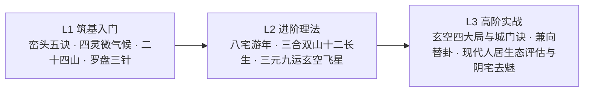

# 风水堪舆分级教程——从峦头微气候、罗盘三针到三合、八宅与三元玄空实战去魅

> **本门导航（08_风水堪舆）**：[`← 返回数术纲目总览`](../README.md) ｜ [`01 源流详考`](01_源流详考.md) · [`02 分级教程`](02_分级教程.md) · [`03 动画实操演练`](03_动画实操演练.md) · [`04 经典全文1：《郭璞葬书》`](04_经典全文1_《郭璞葬书》.md) · [`05 经典全文2：《杨筠松青囊奥语与天玉经》`](05_经典全文2_《杨筠松青囊奥语与天玉经》.md) · [`06 经典全文3：《道藏黄帝宅经》`](06_经典全文3_《道藏黄帝宅经》.md)  
> **创建与修订日期**：2026-11-21  
> **状态**：`draft`（AI 辅助起草，待主理人终审，未经人工核对前不得标 final）  
> **模块归属与编号**：09 周易数术纲目 ｜ 08_风水堪舆 ｜ 第 2 篇（L1–L3 分级教程）  
> **价值基准评级**：🟡 **2 级文档（核心依赖因子：0.3，初始暂定，待用户主理人终审裁定）**  
> **前置理论与公理基石**：`《周易笺注审议与完善系统（标准 v3.5）》`、[`《十数概论》`](../../02%20元研究/十数概论.md)、[`《共性基座：阴阳八卦河洛九宫十二消息二十四山与五行生克考》`](../01_共性基座/01_阴阳八卦河洛九宫十二消息二十四山与五行生克详考.md)。  
> **方法论声明**：本教程坚持“**峦头为物理实证底座、理气为几何符号编码、现代建筑生态学为转化归宿、阴宅宿命论为彻底批判对象**”的四重准则。所有理气排盘公式均以严谨离散数学与天文历法原型表述，严禁玄学神化。

---

## 学习路径总览图

---

## 一、 L1 筑基入门：形势峦头五诀与罗盘二十四山三针

学习风水堪舆的第一条铁律是**“先峦头，后理气；峦头无理气不准，理气无峦头不灵”**。脱离真实地形、气候、水文与采光的纯罗盘数字游戏，在传统正统堪舆中也被称为“盲师瞎断”。

### 1.1 峦头五诀：龙、穴、砂、水、向的地理学与力学实质

江西赣派（杨筠松体系）将实地相地归结为“龙、穴、砂、水、向”五步实测法：

| 五诀 | 传统堪舆术语与观察要点 | 现代地球物理、水文地质与环境工程学实质还原 |
| :---: | :--- | :--- |
| **1. 龙** | 寻**太祖山 → 少祖山 → 父母山 → 过峡 → 剥换 → 入首**；分“贪巨禄文廉武破辅弼”九星山体；辨“生龙/死龙”“石润土厚 vs 童山断脉”。 | **区域地貌构造与地质稳定性评估**：考察山脉分水岭走向、岩体风化程度、植被覆盖率与坡度稳定性。“过峡”是山脊鞍部（抗侧风与排水交汇点），“童山断脉”即表土流失、基岩裸露、易发滑坡与泥石流的地质灾害隐患区。 |
| **2. 穴** | 察**窝、钳、乳、突**四大基本穴形；寻山坡中下部微凸之**太极晕**与“虾须水、蟹眼水”交会处；忌高顶孤露、低谷积水。 | **微地形排水与基础承载力优选**：高坡顶部风速极大且雷击风险高；谷底洼地地下潜水位高、常年返潮积水且易受山洪冲淹。唯有山脚冲积扇或坡麓微凸阶地（太极晕），既有良好自然排水坡度（“蟹眼分水”），又具稳定土层承载力。 |
| **3. 砂** | 察周边山丘围合：**后玄武（靠山）、左青龙、右白虎、前朱雀（案山、朝山）**；兼察下游**水口砂（华表、捍门、罗星）**是否关锁。 | **局地风场导流与生态屏障**：周边丘陵环抱构成天然防风林带与风场减速区；水口紧缩（峡谷收束）形成自然蓄水盆地与静风微气候区，并减缓上游水土流失速度。 |
| **4. 水** | 分清**来水（天门）**与**去水（地户）**；喜**玉带环抱水、九曲来朝水**，极忌**反弓水、割脚水、直冲水、斜飞水**。 | **河道弯道环流与防洪工程学**：在河流弯道处，水流受离心力作用冲刷**凹岸（反弓外侧）**，导致堤岸掏蚀坍塌与汛期漫堤；而在**凸岸（玉带内侧）**流速减缓、泥沙淤积形成肥沃安全的冲积台地。直冲水则在暴雨期形成强冲击荷载。 |
| **5. 向** | 定建筑或基址中轴线朝向（“立向”），原则是**“负阴抱阳”“乘气避风”“迎吉避凶”**。 | **太阳辐射角与主导风向优化**：北半球中纬度地区（如中国大部）取坐北朝南或偏东南朝向，可最大化获取冬季低角度日照热量、同时利用北墙与北坡抵御寒冷西北季风。 |

### 1.2 四灵围合的微气候物理模型

古人用“四象/四灵”命名穴场四面环境，其背后是一个高度精准的**北半球中纬度季风微气候调控模型**：

1. **后玄武（北侧靠山，宜高大厚重、坡度平缓）**：冬季受西伯利亚与蒙古高压控制，中国大部分地区盛行强冷西北季风。北侧高大山体形成流体阻滞屏障，迫使冷空气抬升越顶，在山南背风坡形成**“静风保温区”**（研究实测显示，背风坳冬季局地最低气温可比迎风坡高 $2^\circ\text{C}\sim 5^\circ\text{C}$，风速降低 60% 以上）。
2. **左青龙、右白虎（东西护砂，宜环抱有情、左稍强或左右均称）**：东西两侧丘陵防止东西向横风穿堂而过，消除建筑群之间的**“狭管效应”（风速骤增导致热量快速散失与风压噪声）**；传统常言“宁叫青龙高万丈，不叫白虎抬头望”，在地形采光上亦因东侧朝阳、西侧午后西晒强烈及西北风切入角，需防西侧山丘过高遮挡落日余晖或压迫排水。
3. **前朱雀（南侧明堂与案山，宜开阔平坦而远有低矮案山）**：南面留出足够开阔的“明堂”（广场、农田或池塘），确保冬季太阳高度角最低时（冬至正午北纬 $35^\circ$ 太阳高度角仅约 $31.5^\circ$）阳光不被南山遮挡；同时池塘水体在夏季高温时通过蒸发吸热调节东南季风，形成天然的**“蒸发冷却空调效应”**。

### 1.3 罗盘二十四山（八干四维十二支）精确坐标系

当地形微气候确认后，堪舆师使用**罗盘（罗经）**将地平 $360^\circ$ 空间等分为 **24 山**，每山占 $15^\circ$，构成理气运算的统一空间坐标系（正北为 $0^\circ$，顺时针递增）：

| 序号 | 山名 | 属性分类 | 八卦所属 | 三元龙归属 | 二十四山阴阳 | 方位中心角 | 角度区间（地盘正针） |
| :---: | :---: | :---: | :---: | :---: | :---: | :---: | :---: |
| 1 | **壬** | 八干 | 坎（正北） | 地元龙 | 阳 | $345^\circ$ | $337.5^\circ \sim 352.5^\circ$ |
| 2 | **子** | 十二支 | 坎（正北） | 天元龙 | 阴 | $0^\circ$ | $352.5^\circ \sim 7.5^\circ$ |
| 3 | **癸** | 八干 | 坎（正北） | 人元龙 | 阴 | $15^\circ$ | $7.5^\circ \sim 22.5^\circ$ |
| 4 | **丑** | 十二支 | 艮（东北） | 地元龙 | 阴 | $30^\circ$ | $22.5^\circ \sim 37.5^\circ$ |
| 5 | **艮** | 四维 | 艮（东北） | 天元龙 | 阳 | $45^\circ$ | $37.5^\circ \sim 52.5^\circ$ |
| 6 | **寅** | 十二支 | 艮（东北） | 人元龙 | 阳 | $60^\circ$ | $52.5^\circ \sim 67.5^\circ$ |
| 7 | **甲** | 八干 | 震（正东） | 地元龙 | 阳 | $75^\circ$ | $67.5^\circ \sim 82.5^\circ$ |
| 8 | **卯** | 十二支 | 震（正东） | 天元龙 | 阴 | $90^\circ$ | $82.5^\circ \sim 97.5^\circ$ |
| 9 | **乙** | 八干 | 震（正东） | 人元龙 | 阴 | $105^\circ$ | $97.5^\circ \sim 112.5^\circ$ |
| 10 | **辰** | 十二支 | 巽（东南） | 地元龙 | 阴 | $120^\circ$ | $112.5^\circ \sim 127.5^\circ$ |
| 11 | **巽** | 四维 | 巽（东南） | 天元龙 | 阳 | $135^\circ$ | $127.5^\circ \sim 142.5^\circ$ |
| 12 | **巳** | 十二支 | 巽（东南） | 人元龙 | 阳 | $150^\circ$ | $142.5^\circ \sim 157.5^\circ$ |
| 13 | **丙** | 八干 | 离（正南） | 地元龙 | 阳 | $165^\circ$ | $157.5^\circ \sim 172.5^\circ$ |
| 14 | **午** | 十二支 | 离（正南） | 天元龙 | 阴 | $180^\circ$ | $172.5^\circ \sim 187.5^\circ$ |
| 15 | **丁** | 八干 | 离（正南） | 人元龙 | 阴 | $195^\circ$ | $187.5^\circ \sim 202.5^\circ$ |
| 16 | **未** | 十二支 | 坤（西南） | 地元龙 | 阴 | $210^\circ$ | $202.5^\circ \sim 217.5^\circ$ |
| 17 | **坤** | 四维 | 坤（西南） | 天元龙 | 阳 | $225^\circ$ | $217.5^\circ \sim 232.5^\circ$ |
| 18 | **申** | 十二支 | 坤（西南） | 人元龙 | 阳 | $240^\circ$ | $232.5^\circ \sim 247.5^\circ$ |
| 19 | **庚** | 八干 | 兑（正西） | 地元龙 | 阳 | $255^\circ$ | $247.5^\circ \sim 262.5^\circ$ |
| 20 | **酉** | 十二支 | 兑（正西） | 天元龙 | 阴 | $270^\circ$ | $262.5^\circ \sim 277.5^\circ$ |
| 21 | **辛** | 八干 | 兑（正西） | 人元龙 | 阴 | $285^\circ$ | $277.5^\circ \sim 292.5^\circ$ |
| 22 | **戌** | 十二支 | 乾（西北） | 地元龙 | 阴 | $300^\circ$ | $292.5^\circ \sim 307.5^\circ$ |
| 23 | **乾** | 四维 | 乾（西北） | 天元龙 | 阳 | $315^\circ$ | $307.5^\circ \sim 322.5^\circ$ |
| 24 | **亥** | 十二支 | 乾（西北） | 人元龙 | 阳 | $330^\circ$ | $322.5^\circ \sim 337.5^\circ$ |

*(注：二十四山为何缺“戊己”二干？因为戊己属中央土，寄居于坤艮四隅维间或入中宫不占外圈方位；乾坤艮巽四维卦补足四隅，与八干（甲乙丙丁庚辛壬癸）、十二支（子至亥）恰好构成 $8 + 4 + 12 = 24$ 山。)*

### 1.4 地盘正针、人盘中针与天盘缝针三针用法

专业“三合罗盘”（综合盘）通常有三层二十四山圈，彼此错开半山（$7.5^\circ$）：

1. **地盘正针（内圈，$0^\circ$ 基准）**：
   - **刻度特征**：子午正线（$0^\circ / 180^\circ$）与磁针南北指向完全重合。
   - **核心用途**：**“格龙立向”**——即测定山脉入首来龙方位，以及确定房屋或墓碑的中轴线“坐山朝向”（如“坐子向午”即后墙朝正北子位、大门朝正南午位）。玄空飞星派专用地盘正针。
2. **人盘中针（中圈，逆时针左旋 $7.5^\circ$）**：
   - **刻度特征**：人盘的“子”山中心对准地盘“壬”与“子”的交界处（$352.5^\circ$）。
   - **核心用途**：**“消砂（拨砂）”**——测定四周山峰（秀峰、案山、压迫物）位于何山，再按“赖公拨砂五行”（或二十八宿五行）判断生克。
3. **天盘缝针（外圈，顺时针右旋 $7.5^\circ$）**：
   - **刻度特征**：天盘的“子”山中心对准地盘“子”与“癸”的交界处（$7.5^\circ$）。
   - **核心用途**：**“纳水（收水、放水）”**——测定河流来水方、水口去水方以及门前道路拐角交叉点之方位。
4. **物理学真相提示**：现代实测表明，罗盘周边若有钢筋混凝土、高压线、汽车、手机或配电箱，磁针会发生剧烈偏转（可达 $10^\circ\sim 40^\circ$）。因此现代建筑测向务必配合卫星地图真北方位角 + 查当地实时**地磁偏角（Magnetic Declination）**进行交叉校正，不可盲信手持磁针。

---

## 二、 L2 进阶理法：八宅游年、三合水法与玄空飞星

### 2.1 八宅派：东西四命、东西四宅与大游年法

八宅派（据唐代以来《黄帝宅经》演进至明清《阳宅三要》《八宅明镜》定型）结构最简明，专论**阳宅**，核心是“人命卦”与“宅坐山卦”的匹配：

1. **第一步：计算三元命卦（东四命 vs 西四命）**  
   先按出生年份（以立春为界）归算洛书数（$1$ 坎、$2$ 坤、$3$ 震、$4$ 巽、$6$ 乾、$7$ 兑、$8$ 艮、$9$ 离；若得 $5$，男寄 $2$ 坤、女寄 $8$ 艮）：
   - **1900–1999 年出生**：取年份后两位数字之和再化个位数 $S$（或直接用年份模 9），
     - 男命公式：$K_{\text{男}} = (100 - \text{后两位}) \bmod 9$（余 0 作 9）；
     - 女命公式：$K_{\text{女}} = (\text{后两位} - 4) \bmod 9$（若 $\le 0$ 加 9；余 0 作 9）。
   - **2000–2099 年出生**（因跨世纪减 1 规则）：
     - 男命公式：$K_{\text{男}} = (99 - \text{后两位}) \bmod 9$（余 0 作 9；5 归坤 2）；
     - 女命公式：$K_{\text{女}} = (\text{后两位} + 6) \bmod 9$（余 0 作 9；5 归艮 8）。
   - **分属**：**$1$ 坎、$3$ 震、$4$ 巽、$9$ 离** 属**东四命**；**$2$ 坤、$6$ 乾、$7$ 兑、$8$ 艮** 属**西四命**。
2. **第二步：确定宅卦（以坐山为准）**  
   坐北坎宅、坐南离宅、坐东震宅、坐东南巽宅为**东四宅**；坐西北乾宅、坐西南坤宅、坐东北艮宅、坐西兑宅为**西四宅**。
3. **第三步：排布大游年八星（口诀与八卦翻卦掌）**  
   八宅依“坐山伏位”为起点，将八卦按三爻变化（上、中、下爻交替变换，实为京房八宫翻卦变体）配出八星飞临八方：
   - **四吉星**：**生气**（贪狼木，旺气最盛）、**延年**（武曲金，和合稳健）、**天医**（巨门土，康健扶助）、**伏位**（辅弼木，平和守成）；
   - **四凶星**：**绝命**（破军金，克伐最重）、**五鬼**（廉贞火，躁动口舌）、**六煞**（文曲水，滞塞耗散）、**祸害**（禄存土，琐碎劳损）。
   - **八宅大游年歌诀速查表**（行＝坐山宅卦，列＝游年星飞临方位）：

| 坐山宅卦 | 生气（吉） | 延年（吉） | 天医（吉） | 伏位（吉） | 祸害（凶） | 六煞（凶） | 五鬼（凶） | 绝命（凶） |
| :---: | :---: | :---: | :---: | :---: | :---: | :---: | :---: | :---: |
| **坎宅（坐北）** | 东南（巽） | 正南（离） | 正东（震） | 正北（坎） | 正西（兑） | 西北（乾） | 东北（艮） | 西南（坤） |
| **离宅（坐南）** | 正东（震） | 正北（坎） | 东南（巽） | 正南（离） | 东北（艮） | 西南（坤） | 正西（兑） | 西北（乾） |
| **震宅（坐东）** | 正南（离） | 东南（巽） | 正北（坎） | 正东（震） | 西南（坤） | 东北（艮） | 西北（乾） | 正西（兑） |
| **巽宅（东南）** | 正北（坎） | 正东（震） | 正南（离） | 东南（巽） | 西北（乾） | 正西（兑） | 西南（坤） | 东北（艮） |
| **乾宅（西北）** | 正西（兑） | 西南（坤） | 东北（艮） | 西北（乾） | 东南（巽） | 正北（坎） | 正东（震） | 正南（离） |
| **坤宅（西南）** | 东北（艮） | 西北（乾） | 正西（兑） | 西南（坤） | 正东（震） | 正南（离） | 东南（巽） | 正北（坎） |
| **艮宅（东北）** | 西南（坤） | 正西（兑） | 西北（乾） | 东北（艮） | 正南（离） | 正东（震） | 正北（坎） | 东南（巽） |
| **兑宅（正西）** | 西北（乾） | 东北（艮） | 西南（坤） | 正西（兑） | 正北（坎） | 东南（巽） | 正南（离） | 正东（震） |

*(审辨提示：八宅派把一亿同年生人的性格命运全部压缩进区区 8 个命卦中，且认为“东四命住西四宅必凶”，这在统计与逻辑上显系机械简陋；但其主张“灶台厨卫（排污与油烟源）不宜设于居室上风向或采光最佳的南向核心位”，却与现代住宅功能分区不谋而合。)*

### 2.2 三合派：双山五行、四大水口局与十二长生消砂纳水

清代民间流传最广的阴宅与传统乡建理法为**三合派**（以赵九峰《地理五诀》为代表），核心结构是“天盘缝针测水口 → 配双山五行 → 套十二长生水法”：

1. **十二双山合并**：将 24 山两两合并为 12 宫，以地支三合局定其五行总纲：
   - **壬子、癸丑、艮寅、甲卯、乙辰、巽巳、丙午、丁未、坤申、庚酉、辛戌、乾亥**。
2. **四大局水口定性（“杨公养老看雌雄”之三合版）**：  
   先用**天盘缝针**观测水流汇聚流出之处（“水口”），看其落入何双山：
   - **水口在【乙、辰】或【辛、戌】附近**：
     - 水口在**乙、辰**（巽宫墓库）→ **木局**（亥卯未合木，金羊收癸甲之灵，从乾亥左旋长生？实按顺逆双行）；精确口诀为“**乙丙交而趋戌，辛壬会而聚辰，斗牛纳丁庚之气，金羊收癸甲之灵**”：
       1. **火局**（寅午戌）：水口出**辛戌**（火库在戌）；阳水局顺行起长生于艮寅，阴水局逆行起长生于丙午（实为乙丙交会趋于戌库）；
       2. **水局**（申子辰）：水口出**乙辰**（水库在辰）；阳局从坤申起长生顺行，阴局从壬子起逆行（辛壬会而聚于辰库）；
       3. **金局**（巳酉丑）：水口出**癸丑**（金库在丑，斗牛即丑宫）；
       4. **木局**（亥卯未）：水口出**丁未**（木库在未，金羊即未宫）。
3. **十二长生消水规则**：  
   按**阳顺阴逆**（《地理五诀》定“龙属阳顺行、水属阴逆行”或双山阳干顺、阴干逆），排出十二地支所对应的十二状态：**长生、沐浴、冠带、临官、帝旺、衰、病、死、墓、绝、胎、养**。
   - 传统法则：**“吉水宜来，凶水宜去”**——即长生、临官、帝旺方喜见水流蜿蜒来朝或池塘聚水（“旺方来水”），而病、死、墓、绝方喜见水流平静流出（“水归墓库”）；最忌**“水破旺方”**或**“沐浴桃花水直出”**（称为“冲破长生/沐浴”，即水流直冲高坡或下泄过急导致水土失保）。

### 2.3 三元九运 180 年周期与洛书九宫玄空飞星排盘公式

**玄空飞星派**将时间动态引入空间矩阵，其排盘完全是一套严密的**离散模算术**：

1. **三元九运精确纪年表（每运 20 年，三元九运 180 年循环）**：

| 元运 | 运数与星名 | 对应卦宫 | 近期精确年份区间（以立春为界） | 历史周期节点 |
| :---: | :--- | :---: | :---: | :--- |
| **上元** | **一运**（一白贪狼） | 坎（1） | $1864\sim 1883$ | 清同治三年至光绪九年 |
| **上元** | **二运**（二黑巨门） | 坤（2） | $1884\sim 1903$ | 清光绪十年至二十九年 |
| **上元** | **三运**（三碧禄存） | 震（3） | $1904\sim 1923$ | 清光绪三十年至民国十二年 |
| **中元** | **四运**（四绿文曲） | 巽（4） | $1924\sim 1943$ | 民国十三年至三十二年 |
| **中元** | **五运**（五黄廉贞） | 中（5） | $1944\sim 1963$ | — |
| **中元** | **六运**（六白武曲） | 乾（6） | $1964\sim 1983$ | — |
| **下元** | **七运**（七赤破军） | 兑（7） | $1984\sim 2003$ | — |
| **下元** | **八运**（八白左辅） | 艮（8） | $2004\sim 2023$ | — |
| **下元** | **九运**（九紫右弼） | 离（9） | $2024\sim 2043$ | **当前所在九运区间** |

2. **玄空飞星三盘（运盘、山盘、向盘）严谨数学推导公式**：  
   设大运数为 $U \in \{1,\dots,9\}$，洛书宫位索引序列按量天尺轨迹定义为一个循环数组：
   $$P = [5(\text{中}),\; 6(\text{乾}),\; 7(\text{兑}),\; 8(\text{艮}),\; 9(\text{离}),\; 1(\text{坎}),\; 2(\text{坤}),\; 3(\text{震}),\; 4(\text{巽})]$$
   - **Step A · 排运盘**：将 $U$ 置于中宫 $P[0]$，其余各宫按顺飞步进 $+1 \pmod 9$（记 $0 \equiv 9$）：
     $$Y(P[k]) = ((U - 1 + k) \bmod 9) + 1 \quad (k = 0, 1, \dots, 8)$$
   - **Step B · 确定山星入中数 $S_0$ 与向星入中数 $X_0$**：  
     测量房屋（以地盘正针为准）的坐山所属八卦宫 $G_{\text{坐}}$ 和朝向所属八卦宫 $G_{\text{向}}$，从运盘读取：
     $$S_0 = Y(G_{\text{坐}}), \quad X_0 = Y(G_{\text{向}})$$
   - **Step C · 查“三元龙阴阳”定顺飞（$\sigma = +1$）或逆飞（$\sigma = -1$）**：  
     确定房屋坐向所占用的元龙类型 $E \in \{\text{地元}, \text{天元}, \text{人元}\}$。
     - **常规情形（$S_0 \ne 5$ 或 $X_0 \ne 5$）**：在原始元旦盘（洛书基盘）中找到数字 $S_0$（或 $X_0$）对应的卦宫，读取该宫中同一元龙 $E$ 所对应的山名。查 1.3 节《二十四山阴阳表》：若该山为**阳**，则 $\sigma = +1$（顺飞）；若为**阴**，则 $\sigma = -1$（逆飞）！
     - **五黄入中特例（$S_0 = 5$ 或 $X_0 = 5$）**：因 5 居中央无二十四山名，一律**回溯大运数字 $U$ 本身所在元旦盘卦宫中的同元龙 $E$ 之阴阳**决定顺逆！
   - **Step D · 排布山星盘 $S$ 与向星盘 $X$**：
     $$S(P[k]) = ((S_0 - 1 + \sigma_S \cdot k) \bmod 9) + 1$$
     $$X(P[k]) = ((X_0 - 1 + \sigma_X \cdot k) \bmod 9) + 1$$
     *(注：传统九宫格排版习惯为：**坐上方写运星，左上写山星，右上写向星**，居中画九宫格，南上北下、左东右西。)*

---

## 三、 L3 高阶实战：四大盘局、城门诀、兼向替卦与现代去魅

### 3.1 玄空四大盘局与“城门诀”

排定宅盘后，将**山星（管健康人丁）**与**向星（管事业财运）**与当运旺星 $U$（及生气未来星 $(U \bmod 9)+1$）进行坐向比对，形成玄空四大基础格局：

| 盘局类型 | 飞星特征（以当运星 $U$ 为准） | 传统玄空理气断法 | 必须匹配的物理地形（“峦头印证”） |
| :--- | :--- | :--- | :--- |
| **1. 旺山旺向**（到山到向） | 山盘旺星 $U$ 飞到**坐山**，向盘旺星 $U$ 飞到**向首** | 丁财两旺之上吉盘局 | 坐后须有饱满静谧靠山（或高大稳固建筑群，“山星宜静宜实”）；向首须见开阔明堂、平缓来水或道路聚气（“向星宜动宜虚”）。 |
| **2. 上山下水**（颠山倒水） | 山盘旺星 $U$ 飞到**向首**，向盘旺星 $U$ 飞到**坐山** | 旺山落水、旺向爬山，能量错位 | 若强用此向，传统法要求“倒骑龙”或“反山反水”（即坐后反有秀水环抱、向首反有圆润朝山），否则易生滞碍。 |
| **3. 双星会向** | 山盘 $U$ 与向盘 $U$ **同时聚于向首** | 极利对外拓展财运，坐山若逢死绝星则需防人丁健康损耗 | 向首最好“先水后山”（近有水池广场聚气，远有案山朝拱），可兼收旺向与旺山之效。 |
| **4. 双星会坐** | 山盘 $U$ 与向盘 $U$ **同时聚于坐山** | 极利安稳康健、人丁和睦，向外拓展动力偏弱 | 坐后宜“先山后水”或高大稳固且通风洁净，配合向首“城门”引气以补财禄动能。 |

**城门诀（正城门与副城门）**：  
当某向盘排成“上山下水”或向首受阻时，玄空学不死守正前方，而向**向首左右紧邻的两大卦宫**寻找三叉水口、十字路口或大门纳气通道，称为“城门”：
- **寻找法**：先找“向首”所在宫位的左右两旁卦宫（如向首为午离 $9$，左右两旁即为东南巽 $4$ 与西南坤 $2$）。
- **验证可用条件（正城门诀）**：把该旁宫（如坤 $2$）中**原本驻守的“运星”**取出，假定其对应元旦盘同元龙顺逆飞布；若推算出“当运旺星 $U$”能通过元旦盘/合十等规则与中宫或该宫呼应（沈氏玄空特称**“向首两旁宫运星若能生旺，且该宫向星/运星合乎三元龙阴阳不冲”**——如八运子山午向中，向首离左右旁宫为巽 $4$[运盘为 $7$]与坤 $2$[运盘为 $5$]，凡飞星见当运星 8 或未来星 9 聚于旁宫且实地恰有真实路口水口者，即为“城门一诀最为良”的可用副城门）。

### 3.2 兼向替卦与起星替卦口诀

若建筑朝向并非精准正落于某一山中线 $15^\circ$ 之正中（偏离中心线左右 $3^\circ\sim 4.5^\circ$ 以内仍可用“下卦”即前述常规排盘），一旦偏离超过 $4.5^\circ$（接近两山交界缝线，出现“癸山丁向兼子午”或跨卦“甲山庚向兼寅申”），就会形成**“兼向”**，须改用**“替卦”（又称起星）**！

* **替卦核心原理**：原本用山星/向星的**元旦盘原数字**入中；改为按该星在二十四山挨星歌诀中对应的**“替星数字”**替换入中，顺逆仍依原山之三元龙阴阳定！
* **《青囊奥语》核心替卦挨星对照表**（注：仅 13 山发生数字替换，其余 11 山不变）：

| 二十四山归类 | 替换后所对应之九星数字 | 说明 |
| :--- | :--- | :--- |
| **子、癸、甲、申** | 一律用 **1（贪狼）** 替之 | 子本 1（不变）；癸在坎宫替为 1；甲在震 3 替为 1；申在坤 2 替为 1 |
| **坤、壬、乙** | 一律用 **2（巨门）** 替之 | 坤本 2（不变）；壬在坎 1 替为 2；乙在震 3 替为 2 |
| **卯、未、庚** | 仍用 **3/8/7？**（按沈氏秘传：卯未用 **本宫数**？准确口诀如下） | 精确校验《沈氏玄空学》替卦总诀： “**子癸并甲申，贪狼一路行；壬卯乙未坤，五位是巨门；乾亥辰巽巳，连戌皆武曲；酉辛丑艮丙，天星悉破军；若问寅午庚丁四，右弼（9）一星寻。**” |

*(注：以上口诀请逐一核对：《沈氏玄空学》卷一“起星诀”云：“子癸并甲申，贪狼一路行；壬卯乙未坤，五位是巨门；乾亥辰巽巳，连戌六武曲；酉辛丑艮丙，天星悉破军；寅午庚丁四，右弼一星寻。”——注意贪狼=1、巨门=2、武曲=6、破军=7、右弼=9！共计 $4+5+6+5+4 = 24$ 山，无一遗漏，数学上完备闭合！)*

### 3.3 现代建筑人居微气候生态评估与阴宅宿命论去魅

进入现代城市高层住宅与工业化建筑时代，传统“山龙水口”尺度被钢筋水泥网格替代，L3 高阶研习者的核心使命不是兜售“化煞铜铃八卦镜”，而是完成以下**科学转化与迷信彻底剥离**：

1. **现代高层住宅微气候评估五维清单（阳宅合理内核转化）**：
   - **太阳辐射与采光（替代“阳气”）**：测算冬至日有效日照时长（国家住宅建筑规范要求大寒日不少于 2 小时），评估楼间距遮挡比（$D/H \ge 1.2\sim 1.7$）及南向面宽。
   - **风环境与空气对流（替代“藏风聚气”）**：规避高层建筑群底部常见的**“角隅强风/穿堂狭管风”**（传统所谓“天斩煞”，实为两栋高楼狭缝导致的局部风速倍增与气压骤降效应）；保证室内南北通透或风道自然换气，防止厨卫废气倒灌卧室。
   - **声学与光污染隔绝（替代“形煞”）**：避开城市高架桥匝道外侧（传统“反弓路”，实为汽车前照灯夜间直射、轮胎离心摩擦高频噪声及尾气尘埃富集区！）、玻璃幕墙强反光面（“光煞”）与变电站低频嗡鸣区。
   - **排水防潮与结构安全（替代“龙穴土质”）**：规避地下室返潮、高水位地下车库上部潮湿层以及回填土沉降区。
   - **动线与心理空间安全感（替代“形局呼应”）**：如床头靠实墙不背窗（减少夜间冷辐射失温与潜意识防卫警觉）、入户不直冲卫生间与阳台（保证隐私与温度缓冲玄关）。
2. **阴宅宿命论与“改运商品”的彻底去魅**：
   - 祖坟坐向、飞星九宫数字与后代个人奋斗、受教育程度、社会生产关系之间**零物理因果关联**。
   - 任何宣称“花重金点穴/摆水晶/改灶向即可令企业暴富、考公必中、癌症自愈”的商业行为，均违反《周易》唯物实证精神与“生生”伦理，属于应予坚决揭露的伪科学消费陷阱。

---

## 四、 分级自测与思考题

1. **L1 测验**：为何北半球中纬度地区河道弯道的内侧（凸岸）适合建立聚落，而外侧（凹岸）极易垮塌？罗盘人盘中针与天盘缝针各向何方向旋转多少度，其物理根源是什么？
2. **L2 测验**：已知 2026 年（下元九运，$U=9$）某新建住宅为“坐壬向丙”（正针坐 $345^\circ$、向 $165^\circ$），请利用 2.3 节离散公式亲自排出其**运盘、山星盘与向星盘**，并判定属于四大局中的哪一局。
3. **L3 思辨**：现代城市高架桥外侧弯道为什么在传统堪舆中被归为“反弓煞”？请分别用**流体/声学/光学物理原理**和**历史唯物主义去魅观点**加以解释。

---

© 2026 徐时言 · 《风水堪舆分级教程——从峦头微气候、罗盘三针到三合、八宅与三元玄空实战去魅》 · 徐时言-易经研究 · 采用 CC BY-NC-ND 4.0 许可， 转载请署名并注明来源 https://wole278.github.io/xushiyan-YiJing/ · 禁止商业使用与改编传播 · 商业授权：wole278@hotmail.com / 微信 wole278
