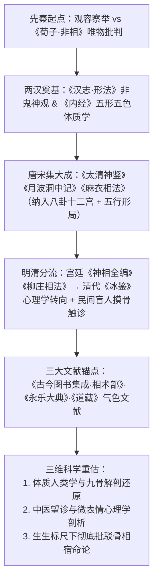

# 形法相地之相术摸骨——五行形局、面部十二宫气色与头面九骨触诊源流详考

> **创建与修订日期**：2026-11-21  
> **状态**：`draft`（AI 辅助起草，待主理人终审，未经人工核对前不得标 final）  
> **模块归属与编号**：09 周易数术纲目 ｜ 编号：09（一术一详述核心专论）  
> **价值基准评级**：🟡 **2 级文档（核心依赖因子：0.3，初始暂定，待用户主理人终审裁定）**  
> **前置理论与公理基石**：`《周易笺注审议与完善系统（标准 v3.5）》`（2级 0.3）、[`《十数概论》`](../02%20元研究/十数概论.md)（1级待终审，暂按 0.3 适用）、[`《共性基座：阴阳八卦河洛九宫十二消息二十四山与五行生克考》`](01_共性基座_阴阳八卦河洛九宫十二消息二十四山与五行生克考.md)（2级 0.3）；综合核心依赖度指数 $CDI = 0.3$。  
> **四重证据配置与强度分层**：  
> - **第一重证据（传世经史、类书与子部文献，强）**：《左传·文公元年》《荀子·非相》《史记·高祖本纪》《汉书·艺文志·数术略·形法》《后汉书·班超传》《论衡·骨相篇》《明史·方伎传（袁珙传）》、清《古今图书集成·博物汇编·艺术典·相术部》（卷 571–610 收《太清神鉴》《神相全编》《月波洞中记》《玉管照神局》《麻衣相法》等）、《永乐大典》（相字韵辑出《太清神鉴》《月波洞中记》）及《道藏》太玄部、洞神部内丹气色相参文献；  
> - **第二重证据（秦汉简帛与中医望诊古籍，强）**：《黄帝内经·灵枢·阴阳二十五人 / 五阅五使》（先秦两汉体质分型与面部五色诊法）及敦煌遗书相书残卷（P.2572、P.2797《相书》）；  
> - **第三重证据（社会人类学与心理学旁证，中）**：古代人才选拔（以貌取人/身言书判）社会史与民间盲人“摸骨术”职业代际口传技艺及“冷读话术”田野调查；  
> - **第四重证据（现代人体解剖学与体质人类学实证，强）**：人类颅骨解剖结构（额骨眉弓、顶骨、枕外隆凸、颧骨、颞骨乳突）及内分泌—营养发育与职业动作塑形规律。  
> **与既有高级别成果关系声明**：本文严守 [`《十数概论》`](../02%20元研究/十数概论.md) “易理与术数划界”原则，结合《荀子·非相》的先秦唯物批判传统，将相术与摸骨严格界定为“以人体生理体质观察、中医望诊与行为微表情心理学为核心底座，外覆八卦五行与宿命论外壳的古代经验识人术”。

---

## 【摘要】

**问题意识**：在中国古代《汉书·艺文志·数术略》的分类体系中，相人与堪舆同属“形法”，即通过观察人体骨骼轮廓、面部形态、皮肤气色与动态举止来判断人的性格、健康与社会命运。长期以来，相术与盲人“摸骨术”被神化为“未卜先知的宿命天眼”，抑或在政治史中被当作“帝王将相骨相奇异”的天命舆论工具。**方法**：本文以**《古今图书集成·博物汇编·艺术典·相术部》**、**《永乐大典》**相字韵辑佚本及**《道藏》**气色内丹文献为核心文献锚点，贯通先秦《荀子·非相》的理性批判史，逐层解剖相术摸骨的四大形态学模型（五行形局、三停五岳与面部十二宫、神气色声行动态观察、头面九骨与手骨触诊），并运用现代体质人类学、骨骼解剖学、中医望诊学及社会心理学予以唯物还原。**发现**：（1）相术中真正具有经验科学价值的部分，高度集中于**“整体体质分型（五行形局）”、“即时生理病理外显（气色与中医五色望诊同源）”**以及**“长期实践塑形（职业习惯、教育训练与情绪压力在骨骼肌肉张力与微表情上留下的物理印记）”**；（2）“头面九骨”触诊在解剖学上均对应着额骨、枕外隆凸、颧骨、颞骨乳突等颅面骨力学支点与肌肉附着点，其“骨肉相称、神气充足”判准本质上反映个体发育期营养状况与神经内分泌活力；（3）然而，将面部十二宫、百岁流年部位或某块骨骼凹凸直接绑定为“某岁升官、克妻、横财”的流年宿命公式，连同民间盲人摸骨的“冷读试探套话术”与历史上“麻衣、许负、曾国藩”的大量书坊伪托，均属唯心宿命附会。**结论**：立足“生生”四判据与《荀子·非相》精神，人的本质是“一切社会关系的总和”与“后天实践的产物”，相术摸骨绝无决定阶级贵贱与道德良知的资格，唯剥离其宿命迷信后所余的体质人类学与行为观察经验，方可资现代识人与健康评估参考。

**关键词**：相术；摸骨；《古今图书集成·相术部》；《永乐大典》；《荀子·非相》；五行形局；头面九骨；历史唯物主义

---

## 一、 引言：问题意识与学术史文献综述

### 1.1 问题的提出：从《左传》观容到《荀子·非相》的唯物论战

《汉书·艺文志·数术略·形法》在总括相人之术时给出了一段极富物质感与经验色彩的定义：“**人及六畜骨法之度数，器物之形容，以求其声气贵贱吉凶。犹律有长短，而各征其声，非有鬼神，数自然也。**”请注意班固这句惊世之论——**“非有鬼神，数自然也”**！在汉代目录学家的视野里，相人术（同相马、相剑、相玉一样）原本不是神鬼巫术，而是对生命个体或器物**几何比例、骨骼硬度、肌肉声气与功能表现之间经验相关性**的观察总结。

然而，从先秦到明清，相术在现实社会演化中却始终纠缠着两重根本矛盾：
1. **生理经验观察与社会宿命神学的纠缠**：人的体格、精神、仪态确能在相当程度上折射健康状况、意志习惯与过往阶层教养（所谓“长期实践塑形”）；但术士将其无限膨胀为“骨骼决定富贵贫贱，面痣决定婚姻寿夭”，甚至成为封建王朝合法性造神的工具（如吕公相刘邦、袁珙相朱棣）。
2. **静态骨相定命与动态实践改造的冲突**：早在战国末期，杰出的唯物主义思想家荀子便撰写千古名篇**《荀子·非相》**，从社会历史与道德实践角度对相术宿命论发起毁灭性打击：“**相人，古之人无有也，学者不道也……长短大小，美恶形相，岂论也哉！……尧舜参牟子，桀纣长巨姣美……盖帝尧长，帝舜短，文王长，周公短，仲尼长，子弓短。**”荀子明确指出：**相形不如论心，论心不如择术（实践道路与道德修养）**！这一先秦唯物论断，构成了我们今日审视相术摸骨最锋利的思想武器。

### 1.2 学术史梳理：古今四代研习谱系与得失评析

| 学术代际 | 代表人物与经典文献 | 历史贡献（得） | 历史局限与理论盲区（失） |
| :--- | :--- | :--- | :--- |
| **先秦两汉确立与批判期** | 周内史叔服（《左传》）、姑布子卿、唐举；**荀子《非相》**；许负（传）、王充《论衡·骨相篇》 | 积累了最早的骨法、体态识人观察；《荀子·非相》奠定了批驳“以貌定贤愚贵贱”的唯物主义思想高度；《黄帝内经》建立“五色五形人”医学模型 | 汉代《论衡·骨相》虽否定鬼神，却仍将“贫富寿夭”归结为出生时禀受的“骨相定命”（自然宿命论） |
| **魏晋隋唐写本与宗教交融期** | 敦煌《相书》残卷、唐袁天罡/李淳风（多托名）、孙思邈《千金方》望诊；《道藏》内丹气色论 | 敦煌写本保留了唐代“五官、黑子（痣相）、手掌纹”民间形态；医道两家深化了面部气色与内脏气血精微的对应关系 | 托名唐代高人（袁、李）的相书大量涌现，神煞与痣相附会日益繁琐 |
| **五代宋元明体系集成期** | 托名麻衣/陈抟《麻衣相法》、宋代**《太清神鉴》**、宋《月波洞中记》、明**袁珙/袁忠彻《柳庄相法》《神相全编》** | 统合《周易》八卦、五行形局、面部十二宫、百岁流年及声色动态，完成人相学全面系统化；《太清神鉴》与《神相全编》保存大量人物实录 | 政治攀附（借相术助朱棣靖难）与书坊商业层累极其严重；流年图谱把局部部位与具体年份祸福机械挂钩 |
| **清代整理、实用化与近代摸骨期** | 《古今图书集成·相术部》（1726年）、《四库全书》辑《太清神鉴》、清末托名曾国藩《冰鉴》、民间盲人“摸骨术” | 《集成》汇集历代相书总汇；《冰鉴》去除了部分神煞迷信，转向以“神、骨、刚柔、容貌、情态”为核心的官场识人心理学；盲人摸骨发展了精密触诊技艺 | 民间盲人摸骨常借助“冷读套话”与故弄玄虚掩盖经验推理；当代“面相微整形改运”更是赤裸裸的消费主义伪科学 |

### 1.3 研究思路与逻辑架构

---

## 二、 四重证据史源锚定：三大文献支柱与名家典故辨伪

### 2.1 三大核心文献锚点考辨

1. **《古今图书集成·博物汇编·艺术典·相术部》（卷 571–610）：相学文献总汇**  
   清官修《古今图书集成·艺术典》专设**相术部**四十卷，以“汇考、总论、艺文、纪事、杂录、外编”六目收编先秦至明代相学巨帙：包括宋代正典《太清神鉴》《月波洞中记》、明代《神相全编》《水镜集》精华，并广录《左传》《史记》《汉书》《三国志》《晋书》《明史》中全部相人纪事，以及《荀子·非相》等批相论著，正反兼收，客观呈现了古代相术的真实全貌。
2. **《永乐大典》“相”字韵：辑佚宋元相学经典之源**  
   明初《永乐大典》“相”字韵保存了宋元时期大量已失传单刻本的相学秘笈。清乾隆修《四库全书》时，子部术数类仅收录极少数较为醇正的相书，其中核心两部——宋代**《太清神鉴》（六卷）**与托名张仲景/宋人撰**《月波洞中记》（一卷）**——均是四库馆臣据《永乐大典》残卷校勘辑出！四库馆臣在《太清神鉴提要》中称赞其“于相法最为完备，持论亦多近理”，足见宋代士大夫阶层对相术的哲学化整理水平远胜后世江湖杂抄。
3. **《道藏》内丹气色与骨相参验文献**  
   与奇门、斗数不同，相术的主流载体并非道教斋醮符箓，而在世俗儒医与方技典籍中。但在**《正统道藏》太玄部、洞神部**的内丹养生与导引典籍（如《云笈七签》《太上黄庭内景玉经》注疏及钟吕内丹文献）中，屡见“**骨清、神完、五脏华色发于面部**”的论述——道教修真关注通过呼吸吐纳与节欲养生改善“精气神”，进而反映为目光清澈（“神”）与面色润泽（“气色”）。这一维度反过来证明：**人的面貌与气色并非一成不变的死物，而是可以通过后天生理调节与行为修养主动改变的动态指标！**

### 2.2 经典历史典故与史料辨伪

| 典故 / 托名著作 | 史料来源 | 历史真相与唯物辨伪解析 |
| :--- | :--- | :--- |
| **吕公相刘邦、许负相周亚夫** | 《史记·高祖本纪》《绛侯周勃世家》 | 吕公因沛县避仇，见刘邦“隆准而龙颜，美须髯”且气度豁达不羁，乃政治投资式结亲；许负断周亚夫“纵理入口，当饿死”，实则两汉史官在人物结局已定后的“事后追记与政治神化叙事”，至于今传《许负相法》则系唐宋伪作。 |
| **班超“燕颔虎颈万里侯相”** | 《后汉书·班超传》 | 班超投笔从戎前贫苦为官府抄书，相者赞其“燕颔虎颈，飞而食肉”——本质上是对一个身材强健、下颌宽厚（雄性激素旺盛）、眼神刚毅果敢之青年在怀才不遇时给予的**高情商心理激励与气质直觉判断**。 |
| **袁珙相燕王朱棣** | 《明史·方伎·袁珙传》 | 建文年间燕王朱棣蓄谋靖难，在北平特意邀名相师袁珙（柳庄居士）相面，袁珙大呼“龙行虎步，日角插天，太平天子也”。从历史唯物主义政治史看，这是一场典型的**皇室夺权政变前夕借方伎造势的“天命舆论战”**，袁珙也因此于永乐朝飞黄腾达。 |
| **《麻衣神相》《曾国藩冰鉴》** | 明清坊刻 / 清末民初传本 | 据《四库全书总目》与现代版本学考证，《麻衣相法》系宋明书坊不断杂糅扩充之层累产物，绝非五代麻衣道者手笔；而风靡近现代的《冰鉴》，在曾国藩全集、日记、家书中全无记载，实为清末民初幕僚识人笔记托名曾氏以行世，但其中“观人微表情与气概”的总结确是清代官场经验精华。 |

---

## 三、 核心原理与四大形态学模型详述

依据《太清神鉴》《神相全编》《冰鉴》及民间摸骨口诀，传统相术与摸骨建立了一套从“宏观整体”到“微观骨骼与即时气色”的四层观察系统：

### 3.1 五行形局与阴阳兼格：古代体质人类学分类

相术观察一个人的第一原则是**“先观整体格局，后看局部五官”**，其中最核心的分类框架便是“五行形局”（将人的骨骼骨架、肌肉脂肪比例与气质特征归纳为五正局，与《黄帝内经·灵枢·阴阳二十五人》同源）：

1. **金形人（方正刚毅型）**：头面方正、棱角分明、骨骼坚实、肤色偏白、声清亮、行坐稳重。对应现代体质学中的**骨骼肌肉匀称强壮型（中胚层优势体型）**，多表现为执行力强、抗压与纪律性高，偏刚易折则需“火克/水泄”（即以温和变通调和刚猛）。
2. **木形人（修长清瘦型）**：身材修长、肩背平直、面长颧露、十指纤长、肤色微青白、筋骨显露。对应**细长型（外胚层优势体型）**，神经系统敏感度高，长于思辨策划而体力耐力相对偏弱。
3. **水形人（圆润敦厚型）**：体态圆肥丰厚、面圆腹垂、皮肉柔软、肤色偏润泽微黑、行步摇曳、性情圆融灵动。对应**矮胖/内胚层优势体型**，新陈代谢偏慢但人际亲和力与适应性较强。
4. **火形人（上尖下阔型）**：额狭或顶尖、颧颊或下颌较阔（或眉浓目露、鼻准尖锐）、肤色赤红、行速急躁。爆发力与情绪感染力强，但易因心血管与情绪亢奋而缺乏持久耐力。
5. **土形人（厚重敦实型）**：头圆项粗、背厚腰圆（“土形敦厚背如龟”）、鼻大口方、步履沉稳、肤色黄润。承载力、稳定性与耐力极佳，但偏滞则显迟钝守旧。

传统相术歌诀云：“**木瘦金方水主肥，土形敦厚背如龟，上尖下阔名为火，五局分明贵有余。**”真正纯粹单一的五行人极少，绝大多数人是**“兼格”**（如木中带火、金水相生），其阴阳平衡判准在于**“形局相生则协和舒畅，形局相克（如木形却配短粗肥圆之手足）则发育不均、内部机能失调”**。

### 3.2 三停、五岳、四渎与面部十二宫八卦方位

将人体头部视为一个小宇宙，相术引入《周易》八卦与地理方位进行了高度网格化的空间投影：
1. **三停均称（纵向比例学）**：
   - **上停**（发际至印堂）：主要反映大脑额叶颅腔发育（早年智力基础与家庭教育庇荫，号称管 15–30 岁）；
   - **中停**（印堂至鼻准）：覆盖眉眼鼻颧（呼吸道、颧骨抗压、中年意志力与社会资源整合期，管 31–50 岁）；
   - **下停**（人中至地阁下巴）：反映咀嚼肌、下颌骨与晚年营养代谢基础（毅力、子孙与晚年生活根基，管 51 岁以后）。三停匀称即符合黄金比例美学与均衡发育规律。
2. **五岳四渎（三维立体感）**：
   - **五岳**：鼻为中岳嵩山（主梁柱），额为南岳衡山，下巴颏为北岳恒山，左颧为东岳泰山，右颧为西岳华山——要求“中岳高耸贯通、四岳朝拱环抱”（与风水“主山居中、四砂朝拱”同构！）。
   - **四渎**：耳（江）、目（河）、口（淮）、鼻孔（济），要求深邃清润、开阖有度。
3. **面部十二宫（借鉴星命十二宫的社会功能投影）**：
   紫微斗数有十二人事宫，相术亦将之直接映射于面庞之上：**命宫**（印堂两眉之间，反映精神压力与眉间肌舒展度）、**财帛宫**（鼻准及鼻翼）、**兄弟宫**（双眉）、**田宅宫**（眉眼之间上眼睑）、**男女宫**（眼下泪堂卧蚕）、**奴仆宫**（下颌两腮）、**妻妾宫**（眼尾奸门鱼尾）、**疾厄宫**（鼻梁山根，直观反映早年呼吸及心血管发育）、**迁移宫**（额角天仓驿马位）、**官禄宫**（额正中中正）、**福德宫**（眉尾天仓）、**相貌宫**（全脸整体气韵）。并在此基础上强行叠加“百岁流年部位图”（从 1 岁耳轮起，15 岁天中、25 岁中正、30 岁印堂、41 岁山根、48 岁准头、60 岁水星口、71 岁地阁……）。

### 3.3 神、气、色、声、行：动态生理与微表情观察

清代《冰鉴》之所以被历代官僚士大夫推崇，正是因为它大胆削减了“流年部位”的迷信，将重心转向**动态神气与细节行为观察**，提出“**骨相可定大局，神气可决当下；求全在神，分看在形**”：
* **眼神与微表情（“邪正看眼，真假看嘴”）**：眼睑肌肉与瞳孔反应最难受主观意识伪装，眼神涣散飘忽（“神不守舍”）多见于焦虑、欺瞒或精气衰竭；目光凝聚清亮且不露凶光（“神藏于内”），则是神经系统强健、专注力高与城府深沉的表现。
* **五色望诊与中医同源**：面色青（肝胆郁结、末梢血管收缩、长期忧惊）、赤（心火上炎、血压偏高或躁动）、黄（脾胃运化润泽之常色，或枯黄为营养不良）、白（肺气不足、贫血失血）、黑（肾精亏虚、慢性消耗病或长期劳顿失眠）。相术所谓“青赤主口舌官非、黄明主升迁吉庆”，在唯物生理学上恰恰是因为**长期失眠焦虑或健康恶化（面色青黑枯槁）的人，在职场决策与人际冲突中极易判断失误而招致祸患；反之精力充沛、气血饱满（黄明润泽）者更易把握机遇**！
* **声相与行相（“主意看指爪，风波看脚跟”）**：声音发自丹田横膈膜肺活量，底气足则呼吸系统与体魄强健；走路脚跟沉稳（“脚跟不点地”者多浮躁急功近利）、站姿端直而不摇膝（“树摇叶落，人摇福薄”）——实则是对一个人**自我控制力、心理稳定性与教养习惯**的极佳行为心理学观察。

### 3.4 摸骨术核心原理：头面九骨与手掌骨度解剖学还原

清代至近现代在民间盲人师徒间口传心授的**“摸骨术”**（实为古代《骨相》传统与盲人高度敏锐的触觉代偿结合的产物），其技术核心在于重点触诊**“头面九骨”**及**“躯干手掌骨度”**：

| 传统摸骨九骨名号 | 现代人体解剖学对应实体 | 触诊特征与传统断法 | 唯物生理与人类学还原 |
| :--- | :--- | :--- | :--- |
| **1. 天庭骨（含日角/月角）** | **额骨鳞部及额结节** | 饱满圆隆起于印堂之上为贵，低陷窄斜为弱 | 反映大脑前额叶颅腔容量及发育期钙磷营养与生长激素水平；前额饱满者往往智力与统筹规划发育较好 |
| **2. 枕骨（玉枕骨）** | **枕骨枕外隆凸** | 脑后枕骨隆起圆厚（如“连珠枕”“十字枕”），忌平削扁塌（“脑后无枕”） | 枕外隆凸是项韧带与斜方肌等颈部深层肌群的力学附着点，直接反映胚胎与幼年睡姿、脊柱颈曲发育及强健的颈背肌力（“抗压与耐劳力”） |
| **3. 伏犀骨（玉柱骨）** | **额骨正中嵴至顶骨矢状线隆起** | 自两眉印堂直透百会顶门如玉柱隐起 | 反映中轴颅骨骨缝愈合紧密、骨密度极高，对应充沛的精力与持久的脑力耐力 |
| **4. 驿马骨** | **额骨颧突至颞骨蝶骨大翼交界** | 太阳穴附近斜向发际上方之骨棱 | 对应咀嚼肌颞肌附着缘与颅侧壁厚度，传统以饱满平顺主“外出奔波有成”，凹陷主外务受阻 |
| **5. 将军骨** | **额骨眉弓（眶上缘）** | 双眉骨隆起刚劲而不孤露 | 受雄性激素（睾酮）调控最显著的骨性标志之一，眉弓突出者往往果敢、好竞争、决断力强（对应传统“威权武职”） |
| **6. 颧骨（权骨）** | **颧骨及颧弓** | 丰隆有肉包护为善，高耸孤露无肉（“颧露破相”）为凶 | 面部中份抗冲击与咀嚼肌力学支点；有肉包护说明皮下脂肪与肌肉充盈（营养及情绪平和），孤露消瘦则反映长期营养匮乏、高压消耗或刻薄偏执心态 |
| **7. 巨鳌骨** | **颞骨乳突（耳后凸起）** | 耳后乳突圆厚坚实 | 胸锁乳突肌重要附着点，关乎头部平衡与颈部爆发力 |
| **8. 龙宫骨** | **眼眶下缘上颌骨颧突前缘** | 眼眶下沿平滑圆厚、卧蚕处骨基扎实 | 反映眶下结构与眼周血液循环及肾上腺皮质功能（熬夜衰弱者此处极易塌陷） |
| **9. 龙角骨（辅角骨）** | **额结节两侧骨隆（额顶过渡区）** | 两侧眉尾上方隐隐隆起 | 反映颅骨前部横向宽度及两侧对称性发育质量 |

此外，盲人摸骨极为重视**“手掌骨度”与“骨肉比例”**：
- **手骨**：手掌软厚如绵而内部掌骨挺拔者（即手部皮下脂肪与弹性适度、从事脑力或管理劳动者），断为“劳心贵格”；手骨粗大节露、皮肤粗糙生茧者（长期重体力劳动塑形），断为“劳力辛劳”；
- **骨肉相称律**：最核心的纲领是**“骨为阳、肉为阴，骨有肉包、肉不浮肿”**（本质即骨密度良好 + 肌肉与脂肪比例健康，既不皮包骨头显营养不良，亦不虚胖浮肿显代谢障碍）。

---

## 四、 历史唯物主义与“生生”价值标尺综合讨论

### 4.1 从“相由心生”到“实践塑形”的唯物主义颠倒再颠倒

黑格尔与马克思都曾剖析过传统面相学与颅相学（如高尔、拉瓦特）的谬误。用历史唯物主义来重估中国相术摸骨，核心在于**把“先天骨相决定后天命运”的唯心因果链，重新颠倒回“后天社会实践与生活条件塑造人的外在形态”的唯物因果链**：

1. **社会阶级与劳动分工对骨骼气色的物理塑形**：  
   在古代封建社会，地主士大夫阶层从小享有充足蛋白质营养、避开风吹日晒与重体力劳役，加之长期接受儒家礼仪规训，自然发育出“天庭饱满、手软如绵、步履从容、眉眼温润”的“富贵相”；而常年忍饥挨饿、背负重担的底层贫农与矿工，必然呈现出“颧骨突出、皮下脂肪枯竭、皮肤黝黑粗糙、指节粗大变形、眼神焦虑疲惫”的所谓“孤寒苦相”。相术家倒果为因，说是“因为长了富贵骨所以当官，长了苦相骨所以受穷”，这本质上是在为**封建阶级固化提供生物学伪装**！
2. **心理微表情与行为习惯的反作用**：  
   一个人如果长期心怀算计、暴躁偏执、作息紊乱，面部皱眉肌、降眉间肌与咀嚼肌会形成永久性的“悬针纹”“咬肌紧绷”“眼露凶光”及内分泌失调引起的面色晦暗；反之，长期胸怀坦荡、坚持锻炼与专注学习者，会自然养成平和舒展的面部肌肉张力与沉稳目光。这正是《冰鉴》之所以有一定识人准确率、而“摸骨算流年吉凶”纯属荒诞的根本界限。
3. **盲人摸骨“冷读术”的认知心理学揭秘**：  
   现代心理学与社会调查早已揭示，部分职业盲人摸骨师之所以看似“一摸即中”，往往综合运用了三层信息漏斗：①**触觉经验判断**（通过握手湿度、指节老茧、腕骨粗细、肩颈肌肉劳损度，迅速锁定求测者的年龄、体型、是否从事体力/文职工作以及颈椎/胃肠健康状况）；②**语音语调辨析（听声识人）**（盲人听觉高度敏锐，从求测者进门脚步声、呼吸频次、口音乡音、措辞礼貌程度即可推断其受教育水平与当下焦灼情绪）；③**巴纳姆效应与冷读试探**（抛出“你早年离家或与长辈不合、心里装事多、曾有一波大坎”等高概率模糊陈述，捕捉对方微小的呼吸停顿或应答反应迅速收窄范围）。

### 4.2 “生生”四判据检验与事实—推演—假说边界申明

| 生生四判据 | 在相术与摸骨体系下的唯物评判 |
| :--- | :--- |
| **存续（健康预警与体质评估）** | 相术“气色望诊”与“骨肉发育评估”与中医望诊高度同源，能敏锐察觉人体营养失衡、过度劳损、呼吸心血管隐患，在公共卫生与个人健康预警上具有积极的“存续”参考价值。 |
| **再生产（人才选拔与社会协同）** | 若仅借鉴《冰鉴》“看眼、看神、看行止”去辅助考察人的专注力、抗压能力与诚信微表情，尚有助于团队协同；但若以“耳反廓露、鼻准尖斜、颧骨高”等纯外貌偏见排斥有才干的劳动者（如古今多少“以貌取人失之子羽”的教训），则严重破坏人力资源再生产！ |
| **修复（自我修养与体态重塑）** | 肯定“实践塑形”与《道藏》内丹养生观：人完全可以通过改善营养、调整作息、克制私欲暴戾、坚持体育锻炼与正念修养，主动修复衰败的“气色神态”，彻底打破“一相定终身”的绝望闭环。 |
| **传承（批相传统的弘扬）** | 继承发扬《荀子·非相》“相形不如论心，论心不如择术”与《汉志》“非有鬼神”的理性光辉，绝不容许骨相宿命论借尸还魂为职场歧视或医美改运骗局。 |

**事实（Fact）、推演（Inference）与假说（Hypothesis）边界表**：

| 命题类别 | 本文具体论断 | 证据支撑与可证伪条件 |
| :--- | :--- | :--- |
| **第一类：铁证（Fact）** | ①《荀子·非相》明确批驳“相人之形状颜色而知其吉凶”；②《汉书·艺文志·形法》定性相人为“骨法之度数……非有鬼神”；③《古今图书集成·相术部》《永乐大典》保存宋《太清神鉴》《月波洞中记》；④传统头面九骨一一对应人类颅面骨解剖学实存骨突。 | 传世先秦两汉典籍、类书辑本及现代人体解剖学图谱可 100% 核验。 |
| **第二类：推演（Inference）** | ①所谓“富贵骨相”与“贫贱苦相”实质上是营养条件、劳动分工、阶层教养与内分泌长期作用于骨骼肌肉张力的**结果**，而非决定命运的**原因**；②盲人摸骨的“灵验感”源于触觉体格勘察 + 听觉语调识别 + 心理学冷读技术的复合运用。 | 基于历史唯物主义、体质人类学与认知心理学的严密推论。 |
| **第三类：假说（Hypothesis）** | 明代中叶以后（《神相全编》《水镜集》以降）之所以爆发式涌现远比宋代《太清神鉴》繁琐得多的“百岁面部流年细分图”与“十二宫痣相”，是否与明清科举竞争白热化及商业市井社会流动性骤增、中下层士民急需廉价即时的“前途心理代偿”直接相关？ | **可证伪条件**：统计宋代《太清神鉴》与明代《神相全编》中“百岁流年细目”及“手相痣相”篇幅占比的变化曲线；若发现宋本已高度细化而明本反而简省，则本假说须修正。 |

---

## 五、 结论

1. **学术源流定位**：相术与摸骨源于先秦经验观察与《汉志·形法》“骨法度数”传统，经两汉医理融合、唐宋《太清神鉴》系统化、明代《神相全编》宫廷化及清代《冰鉴》与民间盲人摸骨分流，构成《古今图书集成·相术部》的庞大档案群。
2. **唯物主义终极裁判**：人体骨骼（九骨）、体型（五行形局）与面色神情（十二宫/气色），是**遗传禀赋、地理营养、中医病理及后天长期社会实践共同刻画在躯体上的物理档案**。我们可以用它来观察一个人的健康状况与过往生活惯性，但**必须遵循《荀子·非相》的千古正见——永远反对用骨相面相去先验地剥夺任何个体通过改造环境与自我实践而“生生不息”的未来！**

---

## 六、 参考文献

1. [清] 陈梦雷 编, 蒋廷锡 校订. 古今图书集成·博物汇编·艺术典·相术部（卷 571–610）[M]. 北京: 中华书局影印本, 1934.
2. [宋] 王洙（辑/托名）. 太清神鉴[M] // 文渊阁四库全书（据《永乐大典》本）. 台北: 台湾商务印书馆影印, 1986.
3. [战国] 荀况 撰, [清] 王先谦 集解. 荀子集解·非相篇[M]. 北京: 中华书局, 1988.
4. [汉] 班固. 汉书·艺文志（数术略·形法）[M]. 北京: 中华书局, 1962.
5. [汉] 王充 撰, 黄晖 校释. 论衡校释·骨相篇[M]. 北京: 中华书局, 1990.
6. [清] 张廷玉 等. 明史·方伎传（袁珙传）[M]. 北京: 中华书局, 1974.
7. 黄帝内经·灵枢（阴阳二十五人、五阅五使）[M]. 北京: 人民卫生出版社, 2005.
8. 郑怀林. 敦煌写本相书研究[M]. 北京: 民族出版社, 2004.
9. 朱平生. 中国古代相术文化史论[M]. 北京: 中国社会科学出版社, 2012.

---

© 2026 徐时言 · 《形法相地之相术摸骨——五行形局、面部十二宫气色与头面九骨触诊源流详考》 · 徐时言-易经研究 · 采用 CC BY-NC-ND 4.0 许可， 转载请署名并注明来源 https://wole278.github.io/xushiyan-YiJing/ · 禁止商业使用与改编传播 · 商业授权：wole278@hotmail.com / 微信 wole278
