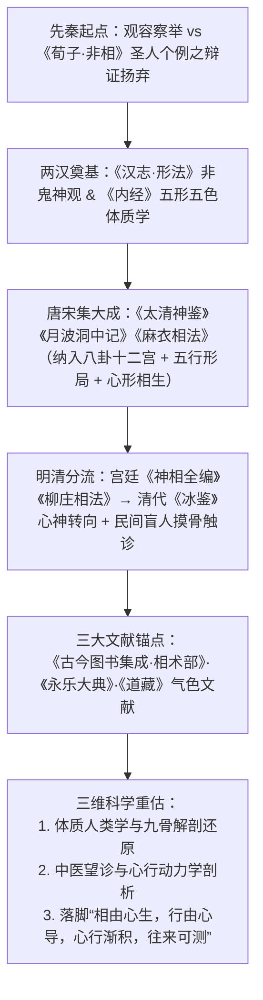

# 形法相地之相术摸骨——五行形局、面部十二宫气色与头面九骨触诊源流详考

> **本门导航（09_相术摸骨）**：[`← 返回数术纲目总览`](../README.md) ｜ [`01 源流详考`](01_源流详考.md) · [`02 分级教程`](02_分级教程.md) · [`03 动画实操演练`](03_动画实操演练.md) · [`04 经典全文1：《太清神鉴·骨相气色篇》`](04_经典全文1_《太清神鉴·骨相气色篇》.md) · [`05 经典全文2：《麻衣相法·神异赋金锁赋摸骨歌》`](05_经典全文2_《麻衣相法·神异赋金锁赋摸骨歌》.md) · [`06 经典全文3：《柳庄相法与冰鉴神骨篇》`](06_经典全文3_《柳庄相法与冰鉴神骨篇》.md)  
> **创建与修订日期**：2026-11-21  
> **状态**：`draft`（AI 辅助起草，待主理人终审，未经人工核对前不得标 final）  
> **模块归属与编号**：09 周易数术纲目 ｜ 编号：09（一术一详述核心专论）  
> **价值基准评级**：🟡 **2 级文档（核心依赖因子：0.3，初始暂定，待用户主理人终审裁定）**  
> **前置理论与公理基石**：`《周易笺注审议与完善系统（标准 v3.5）》`（2级 0.3）、[`《十数概论》`](../../02%20元研究/十数概论.md)（1级待终审，暂按 0.3 适用）、[`《共性基座：阴阳八卦河洛九宫十二消息二十四山与五行生克考》`](../01_共性基座/01_阴阳八卦河洛九宫十二消息二十四山与五行生克详考.md)（2级 0.3）；综合核心依赖度指数 $CDI = 0.3$。  
> **四重证据配置与强度分层**：  
> - **第一重证据（传世经史、类书与子部文献，强）**：《左传·文公元年》《荀子·非相》《史记·高祖本纪》《汉书·艺文志·数术略·形法》《后汉书·班超传》《论衡·骨相篇》《明史·方伎传（袁珙传）》、清《古今图书集成·博物汇编·艺术典·相术部》（卷 571–610 收《太清神鉴》《神相全编》《月波洞中记》《玉管照神局》《麻衣相法》等）、《永乐大典》（相字韵辑出《太清神鉴》《月波洞中记》）及《道藏》太玄部、洞神部内丹气色相参文献；  
> - **第二重证据（秦汉简帛与中医望诊古籍，强）**：《黄帝内经·灵枢·阴阳二十五人 / 五阅五使》（先秦两汉体质分型与面部五色诊法）及敦煌遗书相书残卷（P.2572、P.2797《相书》）；  
> - **第三重证据（社会人类学与心理学旁证，中）**：古代人才选拔（以貌取人/身言书判）社会史与民间盲人“摸骨术”职业代际口传技艺及“冷读话术”田野调查；  
> - **第四重证据（现代人体解剖学与体质人类学实证，强）**：人类颅骨解剖结构（额骨眉弓、顶骨、枕外隆凸、颧骨、颞骨乳突）及内分泌—营养发育与职业动作塑形规律。  
> **与既有高级别成果关系声明**：本文严守 [`《十数概论》`](../../02%20元研究/十数概论.md) “易理与术数划界”原则，在唯物辩证框架下扬弃《荀子·非相》以圣人奇貌否定常人相法之偏颇、独取其“论心择术”之旨，将相术与摸骨的核心立论总纲锚定于**“相由心生，行由心导，心行渐积，往来可测”**的身心耦合与长期实践累积机制，界定其为“常人出生环境与心性特征经年物理—生理沉积的经验识人体系，需剥离旧时代封建表象死断语与江湖宿命附会”。

---

## 【摘要】

**问题意识**：在中国古代《汉书·艺文志·数术略》的分类体系中，相人与堪舆同属“形法”，即通过观察人体骨骼轮廓、面部形态、皮肤气色与动态举止来判断人的性格、健康与人事吉凶。长期以来，传统相术与盲人“摸骨术”一方面被江湖术士神化为脱离现实因果的“宿命天眼”，另一方面又常受《荀子·非相》单向批判路径的影响而被简单斥为纯然虚妄，连带将“升官、克妻”等传统具体断语一概骂作封建迷信，二端皆有失唯物辩证之准。**方法**：本文以**《古今图书集成·博物汇编·艺术典·相术部》**、**《永乐大典》**相字韵辑佚本及**《道藏》**气色内丹文献为核心文献锚点，对《荀子·非相》展开方法论层面的辩证重估，深入阐发《汉书·艺文志·形法》“犹律有长短，而各征其声，非有鬼神，数自然也”的象数本体论，逐层解剖相术摸骨的四大形态学模型（五行形局、三停五岳与面部十二宫、神气色声行动态观察、头面九骨与手骨触诊），并以现代人体解剖学、神经生物学、中医望诊学及社会行为心理学建立**“相由心生，行由心导，心行渐积，往来可测”**的唯物解析框架。**发现**：（1）相术中的**“整体体质分型（五行形局）”、“即时生理病理外显（气色与中医五色望诊同源）”、“长期实践塑形（职业习惯、教育训练与情绪压力在骨骼肌张力与微表情上留下的物理印记）”**以及**“头面九骨解剖触诊与骨肉相称、神气充足判准”**，绝非与吉凶推演割裂的单纯生理学，而是**恰恰构成了象数“相由心生，行由心导，心行渐积，往来可测”最核心的唯物论据**——常人的心相本质上是其一生所行之路对“出生环境”与“自身心性特征”的长期物理与生理沉积，正如律管长短决定发声频率（“各征其声，数自然也”），客观骨法度数与声气心行必然在社会博弈中感召相应的结果反馈，故相术在常人尺度上**极有缘由且高度可信**；（2）《荀子·非相》所举“尧舜参牟子、禹跳汤偏、仲尼面如蒙倛、周公身如断菑”等反例，皆属**上古圣人或极端离群个案（Outliers）**，既缺乏实证解剖学依据，又违背常人受心性习气与环境惯性支配的普遍统计规律，缺乏经验说服力，不能作为全盘否定相术合理内核的理性论据（仅取其后半篇“论心择术”以证心行对形相的主导作用）；（3）**“升官、克妻”等传统具体人事断语的三元条件还原与古今之变**：传统相术中的“升官”“克妻”之类具体人事吉凶断语，绝非无源之水的迷信附会，**本质上是“个体心相象数（骨法度数 + 心行渐积）× 被测人出生环境基座 × 所处时代社会运行规则”三者结合后得出的条件结果推论**；现代社会生活环境（营养医疗、女性独立、多元职业分工）虽与古代迥异，致使依赖旧时代环境变量的表层断语需随时代参数重映射，但“骨法度数，各征其声”与“相由心生，行由心导，心行渐积，往来可测”的底层数理与唯物机理跨越古今完全一致；（4）真正应予彻底剥离的，是脱离上述三元机理、将局部流年点位作机械宿命绑定的街头套路，以及民间盲人摸骨的“冷读试探话术”与“麻衣、许负、曾国藩”的书坊伪托。**结论**：立足“生生”四判据与“心—行—相”动态累积机制，既应充分肯定常人心相“往来可测”的经验科学价值与传统人事推论的客观合理内核，更当秉持修心正行、改变路径依赖以造命“生生”的主体能动立场。

**关键词**：相术；摸骨；相由心生；心行渐积；往来可测；骨法度数；《古今图书集成·相术部》；《永乐大典》；《荀子·非相》；历史唯物主义

---

## 一、 引言：问题意识与学术史文献综述

### 1.1 问题的提出：从《左传》观容到《荀子·非相》的辩证审视

《汉书·艺文志·数术略·形法》在总括相人之术时给出了一段极具本体论高度的唯物定义：“**人及六畜骨法之度数，器物之形容，以求其声气贵贱吉凶。犹律有长短，而各征其声，非有鬼神，数自然也。**”请注意班固这句惊世之论——**“犹律有长短，而各征其声，非有鬼神，数自然也”**！在汉代目录学家的视野里，相人术（同相马、相剑、相玉一样）绝非脱离因果的鬼神巫术，也不止于单纯的解剖测量；班固以声学“律管长短决定发声频率”作比，点破了象数的唯物本体论——人的**“骨法度数（骨骼轮廓、形局比例）”**与**“声气神色（气色、肌张力与行为举止）”**正是其先天禀赋、出生环境与长期心行积淀的客观数理表征，必然在社会运行中感召并映射出对应的“贵贱吉凶”后果反馈，这恰恰构成**“相由心生，行由心导，心行渐积，往来可测”**最核心的先秦两汉法理基石。

然而，从先秦到明清，相术在现实社会演化与思想交锋中始终纠缠着两重根本张力：
1. **基于“心相象数 × 出生环境 × 时代规则”的经验推论与脱离因果的江湖附会之纠缠**：人的体格、面貌与神态确能在极高程度上折射先天发育、出生环境与后天心性习惯，结合所处时代的社会运行规则，遂能作出“升官”“克妻”等具备高度统计概率的条件性人事推演；但江湖术士与皇权造神者往往抽空“心行渐积”与“时代环境”变量，将其异化为脱离因果的机械流年定命、冷读话术及政治造神工具（如吕公相刘邦、袁珙相朱棣的舆论叙事）。
2. **《荀子·非相》的历史功绩与方法论硬伤之理性审视**：战国末期荀子撰《非相》，列举“**相人，古之人无有也，学者不道也……禹跳，汤偏，尧舜参牟子……仲尼之状，面如蒙倛；周公之状，身如断菑……桀纣长巨姣美**”作为驳斥相术的论据，并提出**“相形不如论心，论心不如择术”**。以往唯物主义研究多对《非相》作单向全盘肯定，实则其举证存在两大方法论硬伤：
   - **① 史料神话化**：尧舜重瞳、禹汤跛偏、仲尼面如蒙倛等上古圣王异貌，皆系战国百家追述与神话传说，并非经过实证测绘的人类学样本；
   - **② 以极端圣人特例否定常人统计规律（离群值谬误）**：圣人具有极强的理性自觉与超凡定力，能够克服并超越自身生理与环境惯性，在人类群体中属于极少数**极端离群个案（Outliers）**；而世间绝大多数**常人**的心性习气、情绪模式与出生环境，必然在日复一日的“行由心导、心行渐积”中外化为骨骼肌张力、五色气血与行止神态。因此，《非相》以少数圣人传说特例来证伪相术对常人的普遍经验归纳，**缺乏经验说服力**，不可作为全盘否定相术合理内核的理性论据。《非相》真正具有永恒理论价值的，在于其后半篇指出“论心”“择术”高于静态死形——这非但不能取消相术，反而从侧面印证了**“心”与“行（术）”才是塑造形相与决定往来轨迹的真正推手**。

### 1.2 学术史梳理：古今四代研习谱系与得失评析

| 学术代际 | 代表人物与经典文献 | 历史贡献（得） | 历史局限与理论盲区（失） |
| :--- | :--- | :--- | :--- |
| **先秦两汉确立与批判期** | 周内史叔服（《左传》）、姑布子卿、唐举；**荀子《非相》**；许负（传）、王充《论衡·骨相篇》 | 积累了最早的骨法、体态识人观察；《荀子·非相》提出“相形不如论心，论心不如择术”，点破“心行”主导形相与命运的根本机制；《黄帝内经》建立“五色五形人”医学模型 | 《荀子·非相》以尧舜禹汤、周公仲尼等极端圣人传说个例否定常人身心耦合统计规律，论证样本失真、缺乏常人经验说服力；汉代《论衡·骨相》虽否定鬼神，却走向“禀骨定命”的自然宿命论 |
| **魏晋隋唐写本与宗教交融期** | 敦煌《相书》残卷、唐袁天罡/李淳风（多托名）、孙思邈《千金方》望诊；《道藏》内丹气色论 | 敦煌写本保留了唐代“五官、黑子（痣相）、手掌纹”民间形态；医道两家深化了面部气色与内脏气血精微的对应关系 | 托名唐代高人（袁、李）的相书大量涌现，神煞与痣相附会日益繁琐 |
| **五代宋元明体系集成期** | 托名麻衣/陈抟《麻衣相法》、宋代**《太清神鉴》**、宋《月波洞中记》、明**袁珙/袁忠彻《柳庄相法》《神相全编》** | 统合《周易》八卦、五行形局、面部十二宫、百岁流年及声色动态，完成人相学全面系统化；《太清神鉴》“心者形之主”与《麻衣》“相逐心生”直指心行机理 | 政治攀附（借相术助朱棣靖难）与书坊商业层累极其严重；流年图谱把局部部位与具体年份祸福机械挂钩，贴附大量旧阶级表象死断语 |
| **清代整理、实用化与近代摸骨期** | 《古今图书集成·相术部》（1726年）、《四库全书》辑《太清神鉴》、清末托名曾国藩《冰鉴》、民间盲人“摸骨术” | 《集成》汇集历代相书总汇；《冰鉴》去除了部分神煞迷信，转向以“神、骨、刚柔、容貌、情态”为核心的心行动力学识人观；盲人摸骨发展了精密触诊技艺 | 民间盲人摸骨常借助“冷读套话”与故弄玄虚掩盖经验推理；当代“面相微整形改运”更是割裂“心—行—相”内在积累的消费主义伪科学 |

### 1.3 研究思路与逻辑架构

---

## 二、 四重证据史源锚定：三大文献支柱与名家典故辨伪

### 2.1 三大核心文献锚点考辨

1. **《古今图书集成·博物汇编·艺术典·相术部》（卷 571–610）：相学文献总汇**  
   清官修《古今图书集成·艺术典》专设**相术部**四十卷，以“汇考、总论、艺文、纪事、杂录、外编”六目收编先秦至明代相学巨帙：包括宋代正典《太清神鉴》《月波洞中记》、明代《神相全编》《水镜集》精华，并广录《左传》《史记》《汉书》《三国志》《晋书》《明史》中全部相人纪事，以及《荀子·非相》等批相论著，正反兼收，客观呈现了古代相术的真实全貌。
2. **《永乐大典》“相”字韵：辑佚宋元相学经典之源**  
   明初《永乐大典》“相”字韵保存了宋元时期大量已失传单刻本的相学秘笈。清乾隆修《四库全书》时，子部术数类仅收录极少数较为醇正的相书，其中核心两部——宋代**《太清神鉴》（六卷）**与托名张仲景/宋人撰**《月波洞中记》（一卷）**——均是四库馆臣据《永乐大典》残卷校勘辑出！四库馆臣在《太清神鉴提要》中称赞其“于相法最为完备，持论亦多近理”，足见宋代士大夫阶层对相术的哲学化整理水平远胜后世江湖杂抄。
3. **《道藏》内丹气色与骨相参验文献**  
   与奇门、斗数不同，相术的主流载体并非道教斋醮符箓，而在世俗儒医与方技典籍中。但在**《正统道藏》太玄部、洞神部**的内丹养生与导引典籍（如《云笈七签》《太上黄庭内景玉经》注疏及钟吕内丹文献）中，屡见“**骨清、神完、五脏华色发于面部**”的论述——道教修真关注通过呼吸吐纳与节欲养生改善“精气神”，进而反映为目光清澈（“神”）与面色润泽（“气色”）。这一维度反过来证明：**人的面貌与气色并非一成不变的死物，而是可以通过后天生理调节与行为修养主动改变的动态指标！**

### 2.2 经典历史典故与史料辨伪

| 典故 / 托名著作 | 史料来源 | 历史真相与唯物辨伪解析 |
| :--- | :--- | :--- |
| **吕公相刘邦、许负相周亚夫** | 《史记·高祖本纪》《绛侯周勃世家》 | 吕公因沛县避仇，见刘邦“隆准而龙颜，美须髯”且气度豁达不羁，乃政治投资式结亲；许负断周亚夫“纵理入口，当饿死”，实则两汉史官在人物结局已定后的“事后追记与政治神化叙事”，至于今传《许负相法》则系唐宋伪作。 |
| **班超“燕颔虎颈万里侯相”** | 《后汉书·班超传》 | 班超投笔从戎前贫苦为官府抄书，相者赞其“燕颔虎颈，飞而食肉”——本质上是对一个身材强健、下颌宽厚（雄性激素旺盛）、眼神刚毅果敢之青年在怀才不遇时给予的**高情商心理激励与气质直觉判断**。 |
| **袁珙相燕王朱棣** | 《明史·方伎·袁珙传》 | 建文年间燕王朱棣蓄谋靖难，在北平特意邀名相师袁珙（柳庄居士）相面，袁珙大呼“龙行虎步，日角插天，太平天子也”。从历史唯物主义政治史看，这是一场典型的**皇室夺权政变前夕借方伎造势的“天命舆论战”**，袁珙也因此于永乐朝飞黄腾达。 |
| **《麻衣神相》《曾国藩冰鉴》** | 明清坊刻 / 清末民初传本 | 据《四库全书总目》与现代版本学考证，《麻衣相法》系宋明书坊不断杂糅扩充之层累产物，绝非五代麻衣道者手笔；而风靡近现代的《冰鉴》，在曾国藩全集、日记、家书中全无记载，实为清末民初幕僚识人笔记托名曾氏以行世，但其中“观人微表情与气概”的总结确是清代官场经验精华。 |

---

## 三、 核心原理与四大形态学模型详述

依据《太清神鉴》《神相全编》《冰鉴》及民间摸骨口诀，传统相术与摸骨建立了一套从“宏观整体”到“微观骨骼与即时气色”的四层观察系统：

### 3.1 五行形局与阴阳兼格：古代体质人类学分类

相术观察一个人的第一原则是**“先观整体格局，后看局部五官”**，其中最核心的分类框架便是“五行形局”（将人的骨骼骨架、肌肉脂肪比例与气质特征归纳为五正局，与《黄帝内经·灵枢·阴阳二十五人》同源）：

1. **金形人（方正刚毅型）**：头面方正、棱角分明、骨骼坚实、肤色偏白、声清亮、行坐稳重。对应现代体质学中的**骨骼肌肉匀称强壮型（中胚层优势体型）**，多表现为执行力强、抗压与纪律性高，偏刚易折则需“火克/水泄”（即以温和变通调和刚猛）。
2. **木形人（修长清瘦型）**：身材修长、肩背平直、面长颧露、十指纤长、肤色微青白、筋骨显露。对应**细长型（外胚层优势体型）**，神经系统敏感度高，长于思辨策划而体力耐力相对偏弱。
3. **水形人（圆润敦厚型）**：体态圆肥丰厚、面圆腹垂、皮肉柔软、肤色偏润泽微黑、行步摇曳、性情圆融灵动。对应**矮胖/内胚层优势体型**，新陈代谢偏慢但人际亲和力与适应性较强。
4. **火形人（上尖下阔型）**：额狭或顶尖、颧颊或下颌较阔（或眉浓目露、鼻准尖锐）、肤色赤红、行速急躁。爆发力与情绪感染力强，但易因心血管与情绪亢奋而缺乏持久耐力。
5. **土形人（厚重敦实型）**：头圆项粗、背厚腰圆（“土形敦厚背如龟”）、鼻大口方、步履沉稳、肤色黄润。承载力、稳定性与耐力极佳，但偏滞则显迟钝守旧。

传统相术歌诀云：“**木瘦金方水主肥，土形敦厚背如龟，上尖下阔名为火，五局分明贵有余。**”真正纯粹单一的五行人极少，绝大多数人是**“兼格”**（如木中带火、金水相生），其阴阳平衡判准在于**“形局相生则协和舒畅，形局相克（如木形却配短粗肥圆之手足）则发育不均、内部机能失调”**。

### 3.2 三停、五岳、四渎与面部十二宫八卦方位

将人体头部视为一个小宇宙，相术引入《周易》八卦与地理方位进行了高度网格化的空间投影：
1. **三停均称（纵向比例学）**：
   - **上停**（发际至印堂）：主要反映大脑额叶颅腔发育（早年智力基础与家庭教育庇荫，号称管 15–30 岁）；
   - **中停**（印堂至鼻准）：覆盖眉眼鼻颧（呼吸道、颧骨抗压、中年意志力与社会资源整合期，管 31–50 岁）；
   - **下停**（人中至地阁下巴）：反映咀嚼肌、下颌骨与晚年营养代谢基础（毅力、子孙与晚年生活根基，管 51 岁以后）。三停匀称即符合黄金比例美学与均衡发育规律。
2. **五岳四渎（三维立体感）**：
   - **五岳**：鼻为中岳嵩山（主梁柱），额为南岳衡山，下巴颏为北岳恒山，左颧为东岳泰山，右颧为西岳华山——要求“中岳高耸贯通、四岳朝拱环抱”（与风水“主山居中、四砂朝拱”同构！）。
   - **四渎**：耳（江）、目（河）、口（淮）、鼻孔（济），要求深邃清润、开阖有度。
3. **面部十二宫（借鉴星命十二宫的社会功能投影）**：
   紫微斗数有十二人事宫，相术亦将之直接映射于面庞之上：**命宫**（印堂两眉之间，反映精神压力与眉间肌舒展度）、**财帛宫**（鼻准及鼻翼）、**兄弟宫**（双眉）、**田宅宫**（眉眼之间上眼睑）、**男女宫**（眼下泪堂卧蚕）、**奴仆宫**（下颌两腮）、**妻妾宫**（眼尾奸门鱼尾）、**疾厄宫**（鼻梁山根，直观反映早年呼吸及心血管发育）、**迁移宫**（额角天仓驿马位）、**官禄宫**（额正中中正）、**福德宫**（眉尾天仓）、**相貌宫**（全脸整体气韵）。须辩证看待的是：十二宫之所以能对应具体人事（如从官禄宫察仕途、从妻妾宫察婚姻），实质是因为各部位忠实记录了**“心行渐积”在不同社会生活切面上的肌肉气血印记**（如眉间紧锁、眼尾奸门青暗多反映长期焦虑暴戾或情绪失衡），将其置于特定**出生环境**与**时代社会制度**下，即可推演出高度合理的条件人事后果；而至于后世强行叠加的“百岁流年部位图”（从 1 岁耳轮起，15 岁天中、25 岁中正、30 岁印堂、41 岁山根、48 岁准头、60 岁水星口、71 岁地阁……），将复杂动态的心行过程切割为逐年死板点位吉凶，则属脱离整体动力学机制的机械附会。

### 3.3 神、气、色、声、行：动态生理与微表情观察

清代《冰鉴》之所以被历代官僚士大夫推崇，正是因为它大胆削减了“流年部位”的迷信，将重心转向**动态神气与细节行为观察**，提出“**骨相可定大局，神气可决当下；求全在神，分看在形**”：
* **眼神与微表情（“邪正看眼，真假看嘴”）**：眼睑肌肉与瞳孔反应最难受主观意识伪装，眼神涣散飘忽（“神不守舍”）多见于焦虑、欺瞒或精气衰竭；目光凝聚清亮且不露凶光（“神藏于内”），则是神经系统强健、专注力高与城府深沉的表现。
* **五色望诊与中医同源**：面色青（肝胆郁结、末梢血管收缩、长期忧惊）、赤（心火上炎、血压偏高或躁动）、黄（脾胃运化润泽之常色，或枯黄为营养不良）、白（肺气不足、贫血失血）、黑（肾精亏虚、慢性消耗病或长期劳顿失眠）。相术所谓“青赤主口舌官非、黄明主升迁吉庆”，在唯物生理学上恰恰是因为**长期失眠焦虑或健康恶化（面色青黑枯槁）的人，在职场决策与人际冲突中极易判断失误而招致祸患；反之精力充沛、气血饱满（黄明润泽）者更易把握机遇**！
* **声相与行相（“主意看指爪，风波看脚跟”）**：声音发自丹田横膈膜肺活量，底气足则呼吸系统与体魄强健；走路脚跟沉稳（“脚跟不点地”者多浮躁急功近利）、站姿端直而不摇膝（“树摇叶落，人摇福薄”）——实则是对一个人**自我控制力、心理稳定性与教养习惯**的极佳行为心理学观察。

### 3.4 摸骨术核心原理：头面九骨与手掌骨度解剖学还原

清代至近现代在民间盲人师徒间口传心授的**“摸骨术”**（实为古代《骨相》传统与盲人高度敏锐的触觉代偿结合的产物），其技术核心在于重点触诊**“头面九骨”**及**“躯干手掌骨度”**：

| 传统摸骨九骨名号 | 现代人体解剖学对应实体 | 触诊特征与传统断法 | 唯物生理与人类学还原 |
| :--- | :--- | :--- | :--- |
| **1. 天庭骨（含日角/月角）** | **额骨鳞部及额结节** | 饱满圆隆起于印堂之上为贵，低陷窄斜为弱 | 反映大脑前额叶颅腔容量及发育期钙磷营养与生长激素水平；前额饱满者往往智力与统筹规划发育较好 |
| **2. 枕骨（玉枕骨）** | **枕骨枕外隆凸** | 脑后枕骨隆起圆厚（如“连珠枕”“十字枕”），忌平削扁塌（“脑后无枕”） | 枕外隆凸是项韧带与斜方肌等颈部深层肌群的力学附着点，直接反映胚胎与幼年睡姿、脊柱颈曲发育及强健的颈背肌力（“抗压与耐劳力”） |
| **3. 伏犀骨（玉柱骨）** | **额骨正中嵴至顶骨矢状线隆起** | 自两眉印堂直透百会顶门如玉柱隐起 | 反映中轴颅骨骨缝愈合紧密、骨密度极高，对应充沛的精力与持久的脑力耐力 |
| **4. 驿马骨** | **额骨颧突至颞骨蝶骨大翼交界** | 太阳穴附近斜向发际上方之骨棱 | 对应咀嚼肌颞肌附着缘与颅侧壁厚度，传统以饱满平顺主“外出奔波有成”，凹陷主外务受阻 |
| **5. 将军骨** | **额骨眉弓（眶上缘）** | 双眉骨隆起刚劲而不孤露 | 受雄性激素（睾酮）调控最显著的骨性标志之一，眉弓突出者往往果敢、好竞争、决断力强（对应传统“威权武职”） |
| **6. 颧骨（权骨）** | **颧骨及颧弓** | 丰隆有肉包护为善，高耸孤露无肉（“颧露破相”）为凶 | 面部中份抗冲击与咀嚼肌力学支点；有肉包护说明皮下脂肪与肌肉充盈（营养及情绪平和），孤露消瘦则反映长期营养匮乏、高压消耗或刻薄偏执心态 |
| **7. 巨鳌骨** | **颞骨乳突（耳后凸起）** | 耳后乳突圆厚坚实 | 胸锁乳突肌重要附着点，关乎头部平衡与颈部爆发力 |
| **8. 龙宫骨** | **眼眶下缘上颌骨颧突前缘** | 眼眶下沿平滑圆厚、卧蚕处骨基扎实 | 反映眶下结构与眼周血液循环及肾上腺皮质功能（熬夜衰弱者此处极易塌陷） |
| **9. 龙角骨（辅角骨）** | **额结节两侧骨隆（额顶过渡区）** | 两侧眉尾上方隐隐隆起 | 反映颅骨前部横向宽度及两侧对称性发育质量 |

此外，盲人摸骨极为重视**“手掌骨度”与“骨肉比例”**：
- **手骨**：手掌软厚如绵而内部掌骨挺拔者（即手部皮下脂肪与弹性适度、从事脑力或管理劳动者），断为“劳心贵格”；手骨粗大节露、皮肤粗糙生茧者（长期重体力劳动塑形），断为“劳力辛劳”；
- **骨肉相称律**：最核心的纲领是**“骨为阳、肉为阴，骨有肉包、肉不浮肿”**（本质即骨密度良好 + 肌肉与脂肪比例健康，既不皮包骨头显营养不良，亦不虚胖浮肿显代谢障碍）。

---

## 四、 历史唯物主义与“生生”价值标尺综合讨论

### 4.1 唯物思辨的核心落脚点：“相由心生，行由心导，心行渐积，往来可测”

黑格尔与马克思曾剖析过西方颅相学（如高尔、拉瓦特）“静态器官决定论”的形而上学谬误。若以历史唯物主义与现代生命科学重估中国传统相术摸骨，绝不可止步于简单的全盘否定，而必须立足《汉书·艺文志·形法》**“人及六畜骨法之度数，器物之形容，以求其声气贵贱吉凶。犹律有长短，而各征其声，非有鬼神，数自然也”**的象数本体论，把“先天死骨宿命论”重构为**“相由心生，行由心导，心行渐积，往来可测”**的身心耦合与三元条件推演机制：

1. **第一层：对《荀子·非相》圣人论据的方法论批判——为何常人之相高度可信？**  
   必须划清**“圣人离群特例”**与**“常人统计规律”**的界限。《荀子·非相》以尧舜重瞳、禹跳汤偏、周公身如断菑、仲尼面如蒙倛等上古圣贤异相来驳斥相术，这一论证在方法论上落入了“以极端离群值（Outliers）否定整体统计回归线”的误区。圣人之所以为圣人，正在于其具备常人所不及的超凡理性自觉与意志定力，足以克制、超越乃至逆转先天形躯与早年环境的惯性束缚；何况战国典籍所载上古圣王奇貌本多属传说附会，并非实证人类学观测样本。反观世间绝大多数**常人**，既无圣人之绝对理性定力，又深嵌于日常生计与情绪习气之中：其一生所行之路所承受的**出生环境**（早年水土营养、家庭抚育质量、阶层起点）与**自身心性特征**（刚柔、贪廉、急缓、宽刻、专注或散漫），会毫无保留地折射在骨架发育、面部表情肌张力、眼神清浊与体态步履之中。因此，相术在常人尺度上**绝非无稽之谈，而是极有缘由且高度可信的经验规律总结**。
2. **第二层：“骨法度数，各征其声”与“相由心生，行由心导，心行渐积”的象数动力学机制**  
   传统相学中的**整体体质分型（五行形局）**、**即时生理病理外显（气色与中医五色望诊）**、**长期实践塑形**以及**头面九骨解剖触诊**，绝非与“吉凶贵贱推演”割裂的孤立生理学，而**恰恰构成了象数“相由心生，行由心导，心行渐积，往来可测”最核心的唯物论据**。正如《汉书·艺文志》以“律管长短决定发声频率（各征其声，数自然也）”所喻，宋代《太清神鉴》明言“**心者形之主，有诸内必形诸外**”，《麻衣相法》亦道“**有心无相，相逐心生；有相无心，相随心灭**”——其背后具备坚实的神经生物学、表观遗传学与肌肉筋膜记忆机制：
   - **行由心导**：个体的内在心性特征（价值取向、认知图式、情绪应激模式与意志品质）持续主导其日常每一个微小的行为选择、人际应对与生活作息——即“心”为指令中枢，引导每日之“行”；
   - **心行渐积**：日复一日的情绪反应（如长期焦虑紧绷、算计防卫或坦荡沉静）、下丘脑—垂体—肾上腺（HPA 轴）压力激素分泌、饮食劳逸与处事方式，经年累月在骨骼肌腱附着点、面部四十余块表情肌（如皱眉肌、降眉间肌、咬肌、眼轮匝肌）、末梢气血微循环及脊柱体态上做**“时间积分”**，并通过表观遗传修饰与筋膜重塑留下物理记忆；
   - **相由心生与各征其声**：上述“心行积分”经年沉淀为稳定的“骨法度数（九骨/形局）”与“声气神色（气色/微表情/肌张力）”，而这一客观象数表征又必然在社会互动中感召、引发相应的行为后果与命运反馈——正如不同长短的律管必发不同声响，非关鬼神，数理使然。
3. **第三层：“往来可测”的双向因果链与“升官、克妻”等传统人事断语的三元条件还原**  
   立足上述闭环，“知往测来”依靠的绝非神秘天启，而是严谨的因果推断；尤其对于传统相术中看似武断的**“升官”“克妻”**等具体人事吉凶断语，**严禁简单粗暴地一概斥为“唯心宿命附会”**，其本质乃是**身心象数、出生环境与时代社会规则三元耦合后的条件结果推论**：
   $$\text{具体人事吉凶（如升官/克妻）} = \text{个体心相象数（骨法度数 + 心行渐积）} \times \text{被测人出生环境基座} \times \text{时代社会运行规则}$$
   - **知往（过往可溯）**：成年人的骨骼轮廓、体态肌张力、面相纹路与神气，是一份记录其**“出生环境 + 过往一生心行轨迹”**的物理沉积档案（如从天庭、山根与骨肉比例可逆推早年营养发育根基，从眉间悬针纹、咬肌张力、眼神清浊与手掌肌理可还原过往劳作类型、心理负荷与心性积习）；
   - **测来（未来可测与具体人事推论实例）**：常人的心性与行为具有极强的**路径依赖（惯性）**，“行由心导”会驱使其在未来社会博弈中持续重复同类选择，再叠加其所处的**出生环境**与**时代社会运行规则**，即可导出具体吉凶结果：
     * **以“升官”推论为例**：若被测人具备士族或耕读等**出生环境**基座，且呈现“头面九骨匀称饱满、伏犀贯顶、气色黄明润泽、眼神凝聚沉稳”等**心相象数**（实证发育营养优良、脑力耐力充沛、心性坚毅自律），置于古代科举取士与官场“身言书判”选拔的**时代社会环境**下，自然高概率推导出“升官发迹”的条件结果；
     * **以“克妻”推论为例**：若被测人呈现“颧骨横露无肉、眉棱暴突、眼露凶光、奸门青暗”等**心相象数**（实证性格暴戾刻薄、控制欲极强、缺乏温润体恤之心行积习），结合其特定**出生家庭环境**，置于古代封建宗法社会“女性完全依附丈夫、缺乏离婚自救渠道、长期承受精神压迫与冷热暴力极易郁结早亡”的**时代社会环境**下，自然高概率推导出配偶病亡或婚姻悲剧（古人以当时社会术语名之曰“克妻”；而在现代女性独立、婚姻自由的时代环境下，同样的暴戾刻薄心相象数结合现代社会规则，则应推论为“亲密关系破裂、高频离异或家庭冲突”）。
   - **精准剥离江湖糟粕**：肯定三元条件推论的合理内核，并非为街头骗局背书。真正应当彻底剥离的，是抽空“心行渐积”与“环境规则”变量的流年死板点位公式、职业盲人摸骨师混杂其间的**巴纳姆效应“冷读试探套话术”**，以及“麻衣、许负、曾国藩”的书坊伪托附会。
4. **第四层：古今社会环境变迁与底层法理之常**  
   经由上述三元函数公式可见，古今相术差异的根源完全在于**“时代社会运行规则”与“生活环境参数”的变迁**，而非底层数理失效：
   - 古代农业宗法社会普遍营养匮乏、阶级固化、女性依附、选官重“身言书判”，故古籍断语贴附了当时环境参数（如“天庭丰肥手软即贵、某骨隆起必登科、奸门深陷暴戾即克妻”）；现代社会蛋白质营养普遍充足、医疗干预普及、职业分工多元、性别平等，加之医美微整形对皮下软组织的表层掩饰，致使依赖旧时代参数的表层断语需随现代环境变量重新校准映射。
   - 然而，穿越古今社会形态的剧变，**“骨法度数，各征其声，非有鬼神，数自然也”**与**“出生环境与心性特征 → 引导长期日常行为 → 渐积为外在骨骼肌理与神气气色 → 结合现实环境规则推演往来趋向”**这一底层数理与唯物机理完全一致、跨越古今而恒常有效。

### 4.2 “生生”四判据检验与事实—推演—假说边界申明

| 生生四判据 | 在相术与摸骨体系下的唯物评判 |
| :--- | :--- |
| **存续（健康预警与体质评估）** | 相术“气色望诊”与“骨肉发育评估”与中医望诊高度同源，能敏锐察觉人体营养失衡、过度劳损、呼吸心血管隐患，在公共卫生与个人健康预警上具有积极的“存续”参考价值。 |
| **再生产（人才选拔与社会协同）** | 基于“相由心生、行由心导、心行渐积”与《汉志》“各征其声”原理，结合时代环境规则客观评估个体的专注力、情绪稳定性与抗压惯性，有助于识人协同；但若忽视古今环境参数变迁，泥古套用封建阶级表象死断语去排斥实干劳动者，则会破坏人力资源再生产！ |
| **修复（修心正行与体态重塑）** | 正因为相由“心行渐积”而成，故“有相无心，相随心灭”。肯定《道藏》内丹养生与自觉修养观：人完全可以通过修心正行、克制贪戾、改善作息营养与坚持体魄锻炼，打破不良心行路径依赖，主动重塑“精气神”与面貌体态，彻底粉碎“一相定终身”的绝望宿命论。 |
| **传承（辩证扬弃与去魅立正）** | 辩证扬弃《荀子·非相》：否定其以圣人离群个案全盘非相的方法论盲区，继承发扬其“论心”“择术”与《汉志》“非有鬼神，数自然也”的理性光辉；将传统相术推进到“心相象数 × 出生环境 × 时代规则”动态可测的现代唯物认知高度，坚决抵制脱离因果的冷读骗局与“微整形改运”消费主义伪科学。 |

**事实（Fact）、推演（Inference）与假说（Hypothesis）边界表**：

| 命题类别 | 本文具体论断 | 证据支撑与可证伪条件 |
| :--- | :--- | :--- |
| **第一类：铁证（Fact）** | ①《荀子·非相》以尧舜禹汤、周公仲尼等圣人奇貌为论据，批驳静态相形并主张“相形不如论心，论心不如择术”；②《汉书·艺文志·形法》以“犹律有长短，而各征其声，非有鬼神，数自然也”定性相人骨法度数与吉凶推演之关系；③《古今图书集成·相术部》《永乐大典》保存宋《太清神鉴》（“心者形之主”）与《麻衣相法》（“相逐心生”）；④传统头面九骨一一对应人类颅面骨解剖学实存骨突。 | 传世先秦两汉典籍、类书辑本及现代人体解剖学图谱可 100% 核验。 |
| **第二类：推演（Inference）** | ①《荀子·非相》的圣人奇貌例证属战国传说与极端离群特例（Outliers），缺乏经验说服力，无法证伪常人“相由心生，行由心导，心行渐积，往来可测”的身心统计规律；②体质分型、气色望诊、实践塑形与九骨触诊构成象数“心—行—相”机制的核心唯物论据；③传统“升官”“克妻”等具体人事断语，本质是“个体心相象数 × 出生环境基座 × 时代社会运行规则”的条件结果推论——古今环境参数虽异，底层机理完全一致；④盲人摸骨的“神断感”常混杂了触觉体格勘察 + 听觉语调识别 + 心理学冷读技术。 | 基于唯物辩证法、神经生物学、体质人类学、社会历史学与认知心理学的严密推论。 |
| **第三类：假说（Hypothesis）** | 明代中叶以后（《神相全编》《水镜集》以降）之所以爆发式涌现远比宋代《太清神鉴》繁琐得多的“百岁面部流年细分图”与“十二宫痣相”，是否与明清科举竞争白热化及商业市井社会流动性骤增、中下层士民急需廉价即时的“前途心理代偿”直接相关？ | **可证伪条件**：统计宋代《太清神鉴》与明代《神相全编》中“百岁流年细目”及“手相痣相”篇幅占比的变化曲线；若发现宋本已高度细化而明本反而简省，则本假说须修正。 |

---

## 五、 结论

1. **学术源流定位**：相术与摸骨源于先秦经验观察与《汉志·形法》“骨法度数，各征其声”传统，经两汉医理融合、唐宋《太清神鉴》系统化、明代《神相全编》宫廷化及清代《冰鉴》与民间盲人摸骨分流，构成《古今图书集成·相术部》的庞大档案群。
2. **唯物主义终极裁判**：**“相由心生，行由心导，心行渐积，往来可测。”** 常人的骨骼发育（九骨）、体型格局（五行形局）与面色神情（十二宫/气色），绝非与吉凶推演无关的孤立生理指标，而是以《汉志》“犹律有长短，而各征其声，非有鬼神，数自然也”为法理根基、将**个体出生环境与一生心性特征经由长期实践累积刻画在躯体上的真实象数档案**——结合出生环境基座与所处时代社会规则，传统“升官”“克妻”等具体人事断语实有其客观条件推演基础，故相术在常人尺度上极有缘由且高度可信；而《荀子·非相》以少数圣人离群特例否定常人相法之举缺乏说服力，唯其“论心择术”之旨正与心行塑相之理相通。当代相术摸骨研究应在更新时代环境参数、剥离江湖冷读套路与机械流年附会的基础上，紧扣古今一贯的“心—行—相”动态累积机制，既达“观相以知往测来”之明，更开“修心正行、改易惯性以造命生生”之路！

---

## 六、 参考文献

1. [清] 陈梦雷 编, 蒋廷锡 校订. 古今图书集成·博物汇编·艺术典·相术部（卷 571–610）[M]. 北京: 中华书局影印本, 1934.
2. [宋] 王洙（辑/托名）. 太清神鉴[M] // 文渊阁四库全书（据《永乐大典》本）. 台北: 台湾商务印书馆影印, 1986.
3. [战国] 荀况 撰, [清] 王先谦 集解. 荀子集解·非相篇[M]. 北京: 中华书局, 1988.
4. [汉] 班固. 汉书·艺文志（数术略·形法）[M]. 北京: 中华书局, 1962.
5. [汉] 王充 撰, 黄晖 校释. 论衡校释·骨相篇[M]. 北京: 中华书局, 1990.
6. [清] 张廷玉 等. 明史·方伎传（袁珙传）[M]. 北京: 中华书局, 1974.
7. 黄帝内经·灵枢（阴阳二十五人、五阅五使）[M]. 北京: 人民卫生出版社, 2005.
8. 郑怀林. 敦煌写本相书研究[M]. 北京: 民族出版社, 2004.
9. 朱平生. 中国古代相术文化史论[M]. 北京: 中国社会科学出版社, 2012.

---

© 2026 徐时言 · 《形法相地之相术摸骨——五行形局、面部十二宫气色与头面九骨触诊源流详考》 · 徐时言-易经研究 · 采用 CC BY-NC-ND 4.0 许可， 转载请署名并注明来源 https://wole278.github.io/xushiyan-YiJing/ · 禁止商业使用与改编传播 · 商业授权：wole278@hotmail.com / 微信 wole278
