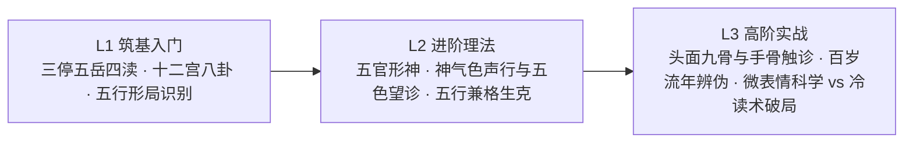

# 相术摸骨分级教程——从三停五岳五行形局、五色望诊到九骨触诊与冷读破局

> **本门导航（09_相术摸骨）**：[`← 返回数术纲目总览`](../README.md) ｜ [`01 源流详考`](01_源流详考.md) · [`02 分级教程`](02_分级教程.md) · [`03 动画实操演练`](03_动画实操演练.md) · [`04 经典全文1：《太清神鉴·骨相气色篇》`](04_经典全文1_《太清神鉴·骨相气色篇》.md) · [`05 经典全文2：《麻衣相法·神异赋金锁赋摸骨歌》`](05_经典全文2_《麻衣相法·神异赋金锁赋摸骨歌》.md) · [`06 经典全文3：《柳庄相法与冰鉴神骨篇》`](06_经典全文3_《柳庄相法与冰鉴神骨篇》.md)  
> **创建与修订日期**：2026-11-21  
> **状态**：`draft`（AI 辅助起草，待主理人终审，未经人工核对前不得标 final）  
> **模块归属与编号**：09 周易数术纲目 ｜ 09_相术摸骨 ｜ 第 2 篇（L1–L3 分级教程）  
> **价值基准评级**：🟡 **2 级文档（核心依赖因子：0.3，初始暂定，待用户主理人终审裁定）**  
> **前置理论与公理基石**：`《周易笺注审议与完善系统（标准 v3.5）》`、[`《十数概论》`](../../02%20元研究/十数概论.md)、[`《共性基座：阴阳八卦河洛九宫十二消息二十四山与五行生克考》`](../01_共性基座/01_阴阳八卦河洛九宫十二消息二十四山与五行生克详考.md)。  
> **方法论声明**：本教程立足《汉志·形法》“犹律有长短，而各征其声，非有鬼神，数自然也”的象数本体论，辩证扬弃《荀子·非相》（舍其圣人离群个案，独取其“论心择术”之旨），以**“相由心生，行由心导，心行渐积，往来可测”**为总纲，将骨骼形态、气色望诊与行为微表情还原为常人“出生环境 × 心性特征 × 时代规则”的客观表征，同时系统传授识破民间“冷读套话”与机械流年死断语的方法。

---

## 学习路径总览图

---

## 一、 L1 筑基入门：三停五岳、十二宫八卦与五行形局

相法第一条铁律：**“先观整体形局，次察三停五岳，再分十二宫位，切忌单凭一痣一纹妄断终身。”**

### 1.1 三停、五岳、四渎：面部宏观三维坐标系

1. **三停（纵向三等分比例学）**：  
   将面部从额头发际至下巴尖端纵分为三段，标准相法要求**“三停均称，长短相配”**（在解剖与美学上对应面部“三庭五眼”黄金比例与均衡骨发育）：
   - **上停（天停）**：从正中发际线（天中）至两眉之间（印堂）。涵盖**大脑额叶颅腔**。发育饱满开阔者，往往早年钙磷营养充足、脑容积发育良好；传统对应 15–30 岁及早年家庭教养条件。
   - **中停（人停）**：从两眉印堂至鼻头下端（准头）。涵盖**眼眶、鼻腔呼吸通道、颧骨支撑架**。中停高朗而颧鼻有肉包裹，反映心肺呼吸功能与颌面抗压发育优异；传统对应 31–50 岁及中年事业意志。
   - **下停（地停）**：从鼻下人中至下颌底部（地阁）。涵盖**口腔咀嚼肌、上下颌骨及咽喉颈基**。下停圆厚方正而收拢有力，反映营养消化吸收能力强、咬合力稳健；传统对应 51 岁以后晚年基础。
2. **五岳与四渎（三维立体凹凸平衡）**：
   - **五岳（五个高隆骨点）**：**鼻为中岳嵩山**（全脸中轴立柱，宜端直丰隆）、**额为南岳衡山**（宽平隆起）、**颏（下巴）为北岳恒山**（敦厚上朝）、**左颧为东岳泰山**、**右颧为西岳华山**（两颧饱满平拱，护卫鼻梁，忌孤峰高耸或塌陷不朝）。
   - **四渎（四个通畅孔窍）**：**耳为江、目为河、口为淮、鼻孔为济**。总纲是“深邃、清润、开阖有度、不露不塞”（如鼻孔不朝天外翻、嘴唇合闭严密不漏齿、耳廓轮廓清晰、眼神清亮）。

### 1.2 面部十二宫与八卦方位图

宋明相法借鉴星命十二宫与后天八卦方位，将人体社会角色与局部面貌进行了网格映射（须牢记：**十二宫对应具体人事之实质，乃“心行渐积”在不同生活切面上的肌肉气血印记，须结合被测人出生环境与当代社会运行规则作条件推演，绝非脱离因果的机械宿命**）：

1. **面部十二宫精准定位表**：

| 十二宫名 | 解剖学精准定位 | 传统所主与观察要点 | 现代生理与心理行为实质还原 |
| :--- | :--- | :--- | :--- |
| **1. 命宫** | 两眉之间**印堂**（眉间区） | 主一生总运与心胸；喜平阔光明（可容两指）、忌窄促乱纹或黑暗 | 皱眉肌与降眉间肌长期收缩会产生深竖纹（“悬针纹”），直接反映个体**长期处于高压焦虑、习惯性紧锁眉头**的情绪模式 |
| **2. 财帛宫** | **鼻准（鼻尖）及左右鼻翼** | 主财禄积聚；喜丰隆圆润有肉、鼻翼包护、忌尖削露孔 | 鼻部皮脂腺丰富、毛细血管网密集，直接体现消化脾胃吸收营养状况及生活优渥稳定度 |
| **3. 兄弟宫** | **左右双眉**（眶上缘眉弓毛发） | 主手足助力与情绪；喜清秀弯长过目、忌逆乱断折 | 眉毛受肾上腺与甲状腺内分泌调节，稀疏焦枯常反映代谢异常或极度情绪躁郁 |
| **4. 田宅宫** | **眉眼之间上眼睑区** | 主房产安稳与心境；喜宽广饱满、忌狭隘深陷 | 眶隔脂肪与提上睑肌饱满度，极易受长期熬夜、脱水及睡眠不足影响（疲劳者眼窝迅速深陷） |
| **5. 男女宫** | **下眼睑卧蚕处（泪堂）** | 主子女缘与精力；喜丰润平满、忌青黑枯陷或网纹乱交 | 眼周微循环最薄弱处！长期睡眠剥夺、肾素—血管紧张素系统疲惫或静脉淤血，最先在此呈现“黑眼圈/眼袋浮肿” |
| **6. 奴仆宫** | **下颌两侧腮骨（地阁两旁）** | 主下属助益与晚年承接；喜丰满有肉朝拱、忌尖削无腮 | 反映咀嚼肌与下颌体宽度（韧性与承受力）；腮部过分削瘦多伴咀嚼咀食不足或体脂过低 |
| **7. 妻妾宫** | **左右眼尾鱼尾处（奸门）** | 主婚姻情感；喜平满光润、忌深陷青暗或乱纹交叉 | 眼轮匝肌外侧频繁牵拉形成鱼尾纹，直接记录长期面部表情丰富度与眼周皮肤胶原老化状态 |
| **8. 疾厄宫** | **两眼之间鼻梁根部（山根）** | 主健康抗病力；喜高隆平直贯通、忌折断横纹、青暗低陷 | 鼻骨与筛骨发育支撑上呼吸道通气截面积；幼年常患严重鼻炎、哮喘或消化不良者，山根发育常偏低且呈青筋外露 |
| **9. 迁移宫** | **额角两侧发际（天仓驿马位）** | 主出行远游与变迁；喜饱满明润、忌凹陷伤疤 | 颞部脂肪垫充盈度，长期户外奔波暴晒或极度消瘦者太阳穴最先凹陷 |
| **10. 官禄宫** | **前额正中线（中正至天庭）** | 主学业事业地位；喜光洁平阔、忌低窄乱纹冲破 | 额骨鳞部饱满度与额肌舒展度（代表早期营养及大脑认知自信神态） |
| **11. 福德宫** | **眉尾上方天仓、眉梢外延** | 主福气与心态；喜圆润丰厚、忌尖削凹陷 | 颞额过渡区轮廓，饱满平和给人沉稳可靠的第一印象 |
| **12. 相貌宫** | **全脸整体统筹气韵** | 统摄十一宫，“一官成管十年”不如整体神完气足 | 即整体对称性、软组织健康度与非语言气场综合评分 |

2. **后天八卦面部方位图（与地理北上南下相反：面相习惯南额北颏，或依“天南地北、左东右西”定之）**：  
   - **正南离火**：额头上部（南岳天庭，主礼仪光明与心智）；
   - **正北坎水**：下巴地阁（北岳水星口颏，主肾精与涵容）；
   - **正东震木**：左颧与左耳（东岳青龙）；
   - **正西兑金**：右颧与右耳（西岳白虎）；
   - **四维**：左额角**巽**、右额角**坤**、左下腮**艮**、右下腮**乾**（各家流派左右男女略异，核心取“**中央鼻梁土（太极中宫）统领八方**”的对称观）。

### 1.3 金木水火土“五行形局”识别表

L1 入门最实用的技能是**一眼辨出对方的“主形局”**，其本质是古代版的**人体体型分类学（对照现代 Sheldon 体型分类：中胚层、外胚层、内胚层）**：

| 五行形局 | 骨骼轮廓与面部形状 | 肤色声息与行动特征 | 现代体质人类学与性格气质倾向 | 调和要点（缺补之理） |
| :--- | :--- | :--- | :--- | :--- |
| **金形** | **方正刚毅**：国字脸、方额方颐、肩宽平直、骨骼坚实有棱角、手方指短厚 | 肤色偏白净、声音清亮带金属质感、行动干脆稳重 | **中胚层肌肉骨骼优势型**：自律、重规则、抗压执行力强，但偏刚易折、易显冷峻固执 | 金过刚需“水泄”或“火炼”：喜神色温和带笑（火）、肌肤润泽微丰（水） |
| **木形** | **修长清瘦**：长脸瓜子脸、高额高鼻、肩背平直窄长、手指纤长、筋骨显露 | 肤色微青白、发须较密、声音清越、步态轻快直挺 | **外胚层细长优势型**：逻辑思辨力强、敏锐善谋、重精神世界，但耐力偏弱易思虑过劳 | 木过瘦需“水生”或“土培”：忌青瘦露骨（枯木），喜气色润泽、肉略包骨 |
| **水形** | **圆润敦厚**：圆脸圆头、双下巴、肩背圆厚、腰腹丰腴、手掌软厚如绵 | 肤色偏润泽微黑或亮白、声音圆滑流利、步履带轻晃（如水波） | **内胚层圆胖优势型**：圆融通变、情商高、适应与共情能力强，但懒散易缺坚持 | 水过散需“土堤”或“木泄”：喜眼神有神采聚敛（不散漫）、肩腰不过度浮肿 |
| **火形** | **上尖下阔**：额头偏尖或窄、两颧两腮横阔（或眉浓目大、鼻尖露骨）、发粗硬 | 肤色偏红赤、说话语速快、声音焦烈、步态急促微前倾 | **高代谢/交感神经兴奋型**：爆发力强、热情有感染力、敢拼敢闯，但易暴躁且心脑血管负荷大 | 火过烈需“水济”或“土收”：忌目露赤丝、气躁心浮，喜沉静养神 |
| **土形** | **厚重敦实**：头圆颈粗、背厚如龟（背肌发达）、大鼻大口、方圆大脸、四肢粗实 | 肤色偏黄润厚实、声音浑厚低沉如钟、步态如山岳沉稳 | **混合壮实强韧型**：包容力强、重信用、耐力与承压极限极高，但易陷保守迟钝 | 土过重需“木疏”或“金泄”：忌呆滞蠢笨、浊气满面，喜清秀眉眼或声音清润 |

---

## 二、 L2 进阶理法：五官形神、五维动态观察与五行兼格

### 2.1 五官形神标准（“一官成管十年”的辩证理解）

传统《麻衣》《太清神鉴》把五官命名为朝廷五职：

1. **耳为“采听官”**：标准为“轮廓分明、垂珠厚大、色泽红润于面、贴脑不反”（**解剖还原**：耳廓软骨发育折射胎儿期肾系与听神经胚胎发育；高耳位、轮廓清者往往幼年体质健壮，但“耳大必寿”仅具有营养与听觉保护关联性）。
2. **眉为“保寿官”**：标准为“宽广清秀、毛顺光泽、高居额上而长过眼尾”（**生理还原**：眉骨及毛囊反映性激素与甲状腺平衡；眉压眼则眉弓下垂压迫上睑，常与紧绷防卫心态相关）。
3. **眼为“监察官”**（全脸权重占 50% 以上！）：标准为“黑白分明、瞳仁端正有光、神藏不露、视物定而不飘”。眼神最难伪装，直接映射中枢神经系统觉醒度、情绪稳定性与专注力。
4. **鼻为“审辨官”**：标准为“梁柱挺直贯印堂、准头圆润丰厚、两翼相扶不露孔”（上呼吸道通畅度与中面发育核心支撑）。
5. **口为“出纳官”**：标准为“唇红齿白、菱角分明、闭时严密、开时方正、语不露齿”。嘴唇血色直接反映血红蛋白携氧量，嘴角自然上扬或微闭反映长期情绪基调与控制力。

### 2.2 神、气、色、声、行五维动态观察与中医五色望诊

清代《冰鉴》之所以高于江湖相书，在于提出**“静态骨骼不如动态神气”**——五官即便平凡，只要神气完足，依然是干练人才；反之五官虽俊，若神枯气散，必处于衰退困厄之中。

1. **五色望诊（直接源于《黄帝内经·灵枢·五色》）**：
   - **主色 vs 客色**：先天肤色基调为“主色”；随四季寒暑（春微青、夏微赤、长夏微黄、秋微白、冬微黑）及喜怒劳逸变化者为“客色”。
   - **吉色（明润、含蓄、如帛裹朱砂）**：黄明（脾胃健运、精力巅峰）、红润（气血充盈、心肺强健）、紫明（血氧极佳、精神振奋）。
   - **病危/晦滞色（枯槁、浮垢、如尘土蒙面）**：青黑（寒凝血瘀、肝郁失眠、长期惊恐或肾精耗竭，所谓“天庭青黑主灾”实为严重失眠焦虑或重疾前兆导致的决策失误与意外风险！）、惨白（贫血失血、肺气大虚）、焦赤（高血压急症、躁狂火炎）。
2. **声与行（听声辨气、察步定心）**：
   - **声相**：如击钟磬、圆润清亮自丹田发出（肺活量与腹式呼吸深沉）；忌“破锣声”“尖细雌声”或“语无伦次急促抢话”（焦虑与底气不足）。
   - **行相**：龙行虎步、脚跟先着地而重心稳固（核心肌群协调、心态笃定）；忌“蛇行雀跃、行未动而头先摇、坐而抖膝”（多动浮躁、耐心极差，很难胜任长期复杂重任）。

### 2.3 五行兼格与生克平衡法

现实中 95% 以上的人皆为**“兼格”**（如“木形兼火”“金形带水”），判断准则在于**“相生助则协和，相克战则失调”**：
* **良性兼格（相生流通）**：
  - **金水相生**：骨架方正坚实（金），配肌肤白润、眼神灵动、圆融通变（水）——既有原则执行力，又具极高情商，是卓越管理者常见体质气质；
  - **木火通明**：身材修长清瘦（木），配目光炯炯有神、口才感染力强（火）——极适合学术、演说、创意策划；
  - **土金相生**：厚重敦实（土）而面部棱角清朗、声音宏亮带刚（金）——耐力与威信兼具。
* **失衡偏格（相克破局，多反映发育不均或生活方式矛盾）**：
  - **木土相战 / 金木相克**：例如生就一副高瘦窄肩之“木形骨架”，偏偏腹部虚胖臃肿、面部皮肤粗糙晦暗（浊土）——医学上常对应**“向心性肥胖（瘦躯干+大肚子）”**，实乃长期久坐熬夜、高糖饮食引发的胰岛素抵抗与代谢综合征！相术称“破格短寿”，医学上正是心血管疾病高危预警。

---

## 三、 L3 高阶实战：九骨触诊、百岁流年辨伪与冷读术破局

### 3.1 摸骨术实操：头面九骨解剖触点与手骨触诊法

传统盲人摸骨（或相家密传触诊）绝非隔空玄想，而是以指腹（食指、中指、无名指指腹敏锐触觉）按固定解剖顺序轻按、滑动触摸骨骼起止点、骨缝凹凸、皮肉紧实度与弹性：

| 触诊顺序 | 传统九骨名号 | 解剖触点与操作手法 | 触感判定标准与唯物还原 |
| :---: | :--- | :--- | :--- |
| **1** | **天庭骨（含日角/月角）** | 用指腹从印堂向上推按额头正中（额骨鳞部）及左右眉上方偏外（额结节） | **佳感**：平滑圆隆、前额骨壁厚实无凹陷急斜（反映前额叶发育空间及幼年营养）；**弱感**：前额扁平后缩、左右额结节塌陷或有深沟 |
| **2** | **伏犀骨（玉柱骨）** | 从印堂正中沿矢状中线向后滑至头顶百会处 | **佳感**：隐约触及中轴骨嵴连续饱满如玉柱微凸（骨缝闭合严密、骨密度强）；若呈尖锐刀刃状突出（“孤脊”）则属畸形偏颇 |
| **3** | **龙角骨（辅角骨）** | 双手拇指或食指同时轻按左右眉尾上方至发际（额顶骨交界外缘） | **佳感**：左右对称圆起、宽度舒展（忌一高一低严重偏头畸形） |
| **4** | **将军骨（眉棱骨）** | 沿左右眉毛下缘从眉头滑按至眉尾（额骨眶上缘） | **佳感**：骨脊挺拔坚实且有皮肤肌肉包覆（反映雄性激素水平与果断胆魄）；忌皮枯骨露如刀锋（易冲动暴躁、人际冲突多） |
| **5** | **驿马骨** | 轻按太阳穴外上方斜向鬓角发际之骨棱（颞线与蝶骨大翼交界） | **佳感**：平顺舒展、太阳穴不深陷枯瘪（反映颞肌饱满与日常精力耐劳） |
| **6** | **龙宫骨** | 轻按左右下眼眶骨性边缘（上颌骨颧突前缘） | **佳感**：骨缘圆实不断裂，配合卧蚕肌肉不浮肿松垮（反映眼周组织弹性及作息质量） |
| **7** | **颧骨（权骨）** | 双手指腹轻抚面颊中部最突出处（颧骨体及向耳前延伸之颧弓） | **佳感**：**“颧骨丰隆而有肉包护，直入鬓角”**（有抗压担当力且待人温和）；**忌**：“高耸孤露无肉”或“塌陷平削” |
| **8** | **巨鳌骨** | 绕至双耳垂后方凹陷处下方，触摸坚硬突起（颞骨乳突） | **佳感**：圆厚如小鳌壳突出坚实（胸锁乳突肌发达，头颈承载力与协调性好） |
| **9** | **玉枕骨（枕骨）** | 双手绕至后脑勺正中下部（发际上方，即**枕外隆凸**）横竖抚摸 | **佳感**：饱满隆起、呈圆润横梁（“连珠枕”/“十字枕”），颈后肌肉群有力；**忌**：“脑后平削如削壁”（俗称“脑后无枕”，多与婴儿期长期硬枕仰卧致颅后扁平及颈深肌较弱有关） |

**手骨触诊要点**：握手时暗察三项指标——①**骨节感**（掌骨挺拔而不僵硬，指节不过度粗大变形）；②**皮肉弹性**（“手软如绵、握之有温润弹性”反映末梢微循环极佳且多从事非重体力脑力管理工作；反之手掌冰冷湿黏主交感神经紧张或内分泌湿寒，手茧粗硬主长期体力劳动）；③**三才主纹与指比例**（拇指第一二节劲健者意志坚定）。

### 3.2 百岁流年部位图与机械宿命论之证伪

《麻衣相法》与《神相全编》流年歌诀将人生 1–100 岁逐年对应面部 100 个微小点位：
> *1–14 岁看双耳（1–7 左耳轮，8–14 右耳轮）；15 岁天中（发际正中）、16 天庭、19 天岳、22 司空、25 中正、28 印堂、30 两眉交接/印堂；31–34 凌云紫气繁霞彩霞（眉内）、35–40 左右眼（35 太阳、36 太阴、37 中阳、38 中阴、39 少阳、40 少阴）；41 岁山根、42–43 精舍光殿、44 年上、45 寿上、46–47 两颧、48 准头、49–50 兰台廷尉（两鼻翼）；51 人中、52–59 法令纹与虎耳旁、60 水星（口）、61–70 承浆与地库归来、71 地阁、72–75 奴仆腮骨、76–100 绕颌回环至百岁……*

**【科学证伪铁律】**：  
流年图唯一合理之处仅在于**宏观三停与人类生长发育衰老序列偶合**（如青少看颅额耳发育、中年看呼吸心肺与面部张力、老年看咬合下颌与代谢衰老）；至于宣称“41 岁山根有痣必破产、48 岁鼻头有疤必离异”等精准到年份的定点预言，纯属**毫无统计学意义的概率附会**，在双盲对比测试中准确率与随机猜测无异。

### 3.3 识破江湖“摸骨/看相冷读术”防坑指南

任何遇到声称“不用你开口，摸一下骨头就知道你家几口人、何时发财、需花钱买符改命”的人，请立刻用以下五条心理学武器识破其套路：

1. **视觉与听觉前置采集**：进门前观察你的衣着品牌、鞋履磨损、随行人员眼神交互（谁站前面谁是买单人）、握手温湿度与手茧位置；盲人则通过你走路的步频重量、呼吸急促度、方言口音及措辞称呼，在开口前 10 秒已完成 70% 的阶层与年龄画像。
2. **巴纳姆语句（高概率普适句）**：如“你这人外冷内热/表面坚强其实心里装事多”、“早年靠自己打拼、与父母观念曾有隔阂”、“近两三年有一波起伏、钱财进出快存不住”——此类语句对 90% 的成年人都成立！
3. **试探性歧义抛出与微反应捕捉（Cold Reading）**：摸骨师先含糊试探：“你家里兄弟姊妹不止你一个吧？（或：你上面还有人吧？）”若求测者稍微停顿、喉结微动或嗯了一声，对方立刻顺杆爬收窄；若求测者皱眉沉默，对方立刻转圜“我说的是你本家堂亲或者流产过胎气，差点没留住”。
4. **恐吓制造焦虑 + 商业收割闭环**：凡是以“你山根断折/印堂发黑/头无枕骨，今年必有血光之灾或克妻克夫”为由，紧接着推销“开光法器、改名费、整容垫鼻改运、高价化解法事”者，**100% 属于欺诈行为**。
5. **正确应用姿态**：将 L1–L3 所学锚定于**“相由心生，行由心导，心行渐积，往来可测”**总纲，结合当代社会生活环境参数，用于**自我健康管理（警惕面色晦暗与眼眶塌陷反映的过劳）**与**客观评估他人长期心性惯性（眼神定力、情绪稳定性与行为修养）**，既以“观相知往测来”，更以“修心正行”主动重塑自身未来。

---

© 2026 徐时言 · 《相术摸骨分级教程——从三停五岳五行形局、五色望诊到九骨触诊与冷读破局》 · 徐时言-易经研究 · 采用 CC BY-NC-ND 4.0 许可， 转载请署名并注明来源 https://wole278.github.io/xushiyan-YiJing/ · 禁止商业使用与改编传播 · 商业授权：wole278@hotmail.com / 微信 wole278
