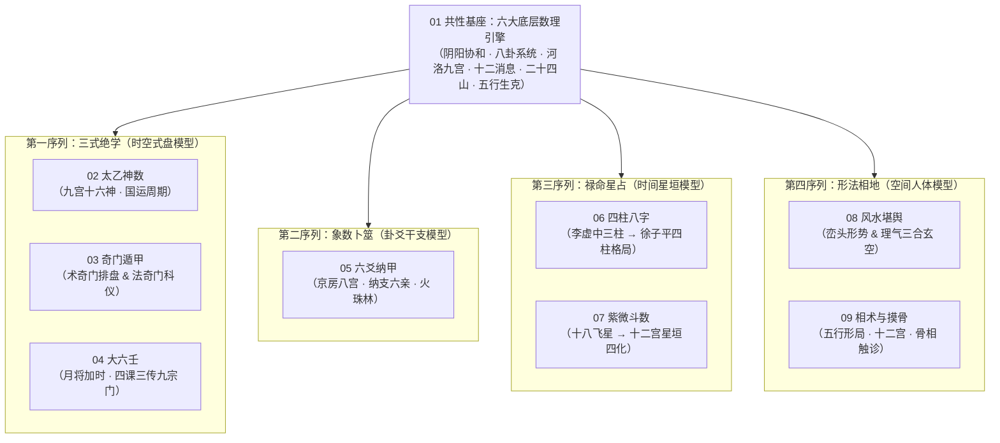

# 09 周易数术纲目

> **模块定位**：与 [`08 周易源流与哲学史/`](../08%20周易源流与哲学史/README.md) 同级的顶级研究主线，聚焦“**术·数·用**”——系统考辨以《周易》阴阳协和为体，以八卦、河图洛书九宫、十二消息、二十四山与五行生克为共性数理基座，向上衍生出的“**三式绝学 → 象数卜筮 → 禄命星占 → 形法相地**”四大序列八大数术体系之历史源流、核心文献载体、数理推演机制与唯物辩证去魅。  
> **价值基准评级**：🟢 **初始暂定 2 级（核心依赖因子：0.3）**，具体专题论文随撰随呈用户主理人终审确权。依据 `01 审议体系/01_标准与规范/文档价值基准应用分级体系.md`，本模块成果受 `02 元研究/`（1 级 0.4）与 `01 审议体系/` 标准法典之向下约束，严守“易理与术数划界”学术红线。

---

## 一、 模块宗旨、学科边界与四维互证关系

### 1.1 为什么设立独立顶级主线 `09 周易数术纲目`
中国古代“易学”在历史演进中分化出两条既交织又异质的脉络：其一为以《周易》经传文本、义理哲学与历代易学思想演进为主线的**“文·道·理”体系**（归属 `02 元研究/`、`03 周易笺注史鉴/`、`08 周易源流与哲学史/`）；其二为在战国至两汉以后，将《周易》奇偶二元与象数概念，同天文历法、干支纪时、式盘测绘、星官占验、堪舆形法深度耦合，从而独立成型为一套具备操作程序与符号代数规则的**“术·数·用”技术体系**。

将数术研究从 `08 周易源流与哲学史` 中独立升格为顶级目录 `09 周易数术纲目/`，旨在实现两大工程目标：
1. **避免“以术掩理”或“混术于经”**：防止后世技术化的式盘、神煞、纳甲、河洛飞星倒灌污染先秦《周易》古经本义与《03 周易笺注史鉴》的史鉴断辞；
2. **展开“一术一详述”的深度解剖**：以博士至教授级学术规范，逐门拆解八大数术的历法物理原型、数学算法机制、经典文献真伪与社会历史土壤，完成从“玄学盲从”或“简单贴标签否定”向“历史唯物主义科学史重估”的学术跃升。

### 1.2 与既有顶级模块的边界划定与互证关系

| 关联模块 | 核心聚焦 | 与 `09 周易数术纲目/` 的边界划定与互证协议 |
| :--- | :--- | :--- |
| **`01 审议体系/`** | 工程法典与学术红线 | 提供“生生”四判据（存续、发展、恢复、传承）、“四重证据法”强度分层及《学术研究论文撰写格式与期刊级模板规范》；严禁使用《序卦传》《杂卦传》机械相因论调。 |
| **[`02 元研究/`](../02%20元研究/十数概论.md)** | 本体公理与先秦原典底座 | 严格遵照 [`《十数概论》`](../02%20元研究/十数概论.md) 确立的**“易理与术数划界”**原则：黑白点河图洛书图式属宋代图书学后设建构，先天八卦方位图属陈抟—邵雍体系，**绝不倒推为先秦《周易》古经本源**；同时在数术史框架内，客观还原其作为唐宋明清数术通用接口的组装逻辑。 |
| **[`03 周易笺注史鉴/`](../03%20周易笺注史鉴/README.md)** | 64 卦 384 爻定本与史鉴 | `03` 卷严守 1644 年 4 月 25 日史鉴截断线，聚焦经文时位与历史实证；`09` 卷全贯先秦至清代及近现代数术演变，仅作数术技术史与学术史参照，**不以术数吉凶替代 `03` 卷爻辞本义**。 |
| **[`08 周易源流与哲学史/`](../08%20周易源流与哲学史/README.md)** | 文本源流与哲学范式史 | [`01_周易源流编`](../08%20周易源流与哲学史/01_周易源流编/README.md) 提供简帛/石经/图书文献辨伪底座；[`02_周易哲学史编`](../08%20周易源流与哲学史/02_周易哲学史编/02_两汉时期象数易学宇宙图式化与谶纬异化考.md) 提供汉代象数宇宙图式化的思想史背景；`09` 卷则专司追踪象数向实用数术模型的分支外溢。 |

---

## 二、 核心文献三大支柱与四重证据总表

本模块立论紧紧锚定清代官修总汇**《古今图书集成》**、明初大类书辑佚源**《永乐大典》**、明代道教总藏**《道藏》**三大传世巨帙，并以正史艺文志与出土简帛式盘实物作四重证据交叉校准：

| 证据层级 | 核心文献 / 实物载体 | 精准卷次 / 典籍构成与目录学锚点 | 学术价值与辨伪功用 |
| :--- | :--- | :--- | :--- |
| **第一重证据 （清代集大成官修类书）** | **《古今图书集成·博物汇编·艺术典》** （清康熙末陈梦雷编、雍正四年蒋廷锡校定，共 824 卷） | 严格区分其下属五部： ① **卜筮部**（卷 469–482）：先秦蓍法、京房《易传》、火珠林、黄金策、梅花易数及历代卜筮纪事； ② **星命部**（卷 483–570）：五星七政四余（《果老星宗》）、《十八飞星策天紫微斗数》、子平八字（《渊海子平》《三命通会》）及古今命谱； ③ **相术部**（卷 571–610）：《太清神鉴》《神相全编》《月波洞中记》及面相、骨相、手相、声色纪事； ④ **术数部**（卷 611–650）：太乙（卷 611–620，《太乙金镜式经》等）、奇门遁甲（卷 621–630，《烟波钓叟赋》等）、大六壬（卷 631–650，《六壬大全》《毕法赋》等）及禽演杂占； ⑤ **堪舆部**（卷 651–710）：《黄帝宅经》《葬书》《撼龙经》《疑龙经》《青囊序》《天玉经》《罗经解定》等。 | 迄今保存清以前数术文献最完整之官方类书。须特别注意：**《古今图书集成》将“术数部”与“堪舆部”分列，并无“数术堪舆部”之混称**；全书按“汇考、总论、艺文、纪事、杂录、外编”六目体例编排，便于剥离正统式占与民间演义。 |
| **第一重证据 （明代大类书辑佚源）** | **《永乐大典》** （明永乐年间解缙、姚广孝等奉敕纂修；含残卷及清《四库全书》辑本） | 按《洪武正韵》分韵辑录宋元以前数术古籍：主要散见于**“太”“甲”“遁”“壬”“卜”“易”“命”“星”“相”“地”“葬”“数”**等韵目；清代四库馆臣据此辑出《太乙金镜式经》《遁甲符应经》《灵台秘苑》《太清神鉴》《月波洞中记》《催官篇》《发微论》等珍本。 | 考辨宋元数术原始面貌与明代坊刻伪书改写层累的核心标尺。凡《永乐大典》与宋史艺文志俱未著录而突现于明中叶者（如《紫微斗数全书》），即可作断代铁证。 |
| **第一重证据 （道教经藏文献群）** | **《道藏》** （明正统十年《正统道藏》及万历三十五年《万历续道藏》） | 按“三洞四辅”分类，关键数术文献分布于： ① **洞神部**（方法类/众术类）：《黄帝太乙八门入式诀》《黄帝太乙八门逆顺生死诀》《黄帝授三子玄女经》《太上六壬明鉴符阴经》《黄帝宅经》； ② **洞真部**（本文类/神符类）：《太上玄灵北斗本命延生真经》《南斗六司延寿度人妙经》； ③ **太玄部 / 正一部**：《周易参同契》（纳甲月相）、《抱朴子内篇》（六甲秘祝与闭六戊法）、《上清六甲祈祷秘法》。 | 揭示“道法与数术交涉”的唯一官方总集，尤其是**法奇门（符箓禹步）**、**太乙八门道法化**、**紫微星垣神名原型**及**阳宅二十四路禁忌**的原始文献档案。 |
| **第一重证据 （正史目录学总锚点）** | **《汉书·艺文志·数术略》**及历代正史艺文/经籍志 | 《汉志·数术略》分**天文、历谱、五行、蓍龟、杂占、形法**六大类（190 家，2528 卷）；上承刘歆《七略》，下接《隋书·经籍志·子部五行类》《宋史·艺文志·五行类》《四库全书总目·子部·术数类》。 | 确立中国古代数术门类分化的官方源头，廓清“明堂羲和史卜之职”的唯物制度起源，证伪后世“黄帝、周公、鬼谷子、诸葛亮、陈抟”等层累伪托。 |
| **第二 / 四重证据 （出土简帛与考古实物）** | 战国秦汉简帛《日书》、汉唐式盘与天文仪器 | **1977 安徽阜阳双古堆西汉汝阴侯墓（前 165 年）太乙九宫占盘与六壬式盘**；睡虎地、放马滩、孔家坡、周家台秦汉简《日书》；马王堆帛书《刑德》《五星占》；甘肃武威磨咀子、江苏仪征、朝鲜乐浪王盱墓出土六壬栻盘；曾侯乙墓漆箱二十八宿盖（前 433 年）。 | 实证九宫数阵（二九四、七五三、六一八）、干支纳音、建除十二神、月将天盘、二十四方位在战国秦汉之际的物理实态，彻底破除“宋人始创洛书”与“黄帝亲授式盘”双重偏误。 |

---

## 三、 全模块“1+8”研究架构与导航总表

### 全模块 9 篇专论完整导航大纲表

| 序号 | 序列归属 | 专题文档 / 拟定题名 | 核心研究内容与数理锚点 | 价值等级 | 状态 |
| :---: | :---: | :--- | :--- | :---: | :---: |
| **01** | **共性基座** | **[`01_共性基座_阴阳八卦河洛九宫十二消息二十四山与五行生克考.md`](01_共性基座_阴阳八卦河洛九宫十二消息二十四山与五行生克考.md)** | 阴阳奇偶二元态、先天/后天八卦接口、阜阳汉简九宫与河洛矩阵、十二消息太阳视运动周期、二十四山 360° 空间离散化、五行生克十二长生与纳音代数系统 | 2 级暂定 | 🟢 已完成 |
| **02** | **一·三式绝学** | **[`02_三式绝学之太乙神数_九宫十六神与天道国运周期源流详考.md`](02_三式绝学之太乙神数_九宫十六神与天道国运周期源流详考.md)** | 战国《太一生水》至《太乙金镜式经》《景祐太乙福应经》源流；上元积年五元六纪模算、太乙不入中五、十六神盘、五将三基、主客定算博弈及“掩迫击囚关格对”判准 | 2 级暂定 | 🟢 已完成 |
| **03** | **一·三式绝学** | **[`03_三式绝学之奇门遁甲_术奇门与法奇门双轨源流及九宫八门原理详考.md`](03_三式绝学之奇门遁甲_术奇门与法奇门双轨源流及九宫八门原理详考.md)** | 汉代孤虚与《抱朴子》至《烟波钓叟赋》《遁甲符应经》源流；术奇门阴阳二遁、置闰拆补历法、天地人神四盘转飞比较；法奇门六甲神将、禹步罡斗与闭六戊藏身法 | 2 级暂定 | 🟢 已完成 |
| **04** | **一·三式绝学** | **[`04_三式绝学之大六壬_汉代栻盘月将加时与四课三传九宗门详考.md`](04_三式绝学之大六壬_汉代栻盘月将加时与四课三传九宗门详考.md)** | 汉唐六壬栻盘考古、《大六壬心镜》《断案》《指南》源流；月将加时（黄道十二中气）、日干寄宫四课、九宗门发三传、十二天将贵人及《梦溪笔谈》天文考辨 | 2 级暂定 | 🟢 已完成 |
| **05** | **二·象数卜筮** | **[`05_象数卜筮之六爻纳甲_京房八宫纳甲与火珠林系统源流原理详考.md`](05_象数卜筮之六爻纳甲_京房八宫纳甲与火珠林系统源流原理详考.md)** | 《京氏易传》至《火珠林》《增删卜易》《卜筮正宗》源流；“文王课”伪托辨正；八宫世应飞伏、浑天甲子纳支、以钱代蓍概率分布、六亲六神与月建日辰生克体系 | 2 级暂定 | 🟢 已完成 |
| **06** | **三·禄命星占** | **[`06_禄命星占之四柱八字_从李虚中三柱到徐子平四柱十神格局源流详考.md`](06_禄命星占之四柱八字_从李虚中三柱到徐子平四柱十神格局源流详考.md)** | 《五行大义》纳音古法、韩愈铭文所载李虚中三柱、徐子平四柱日干体系跃迁至《三命通会》《子平真诠》源流；十神结构、扶抑调候通关病药机制与气候人格投射去魅 | 2 级暂定 | 🟢 已完成 |
| **07** | **三·禄命星占** | **[`07_禄命星占之紫微斗数_从十八飞星道藏星垣到十二宫四化飞星源流详考.md`](07_禄命星占之紫微斗数_从十八飞星道藏星垣到十二宫四化飞星源流详考.md)** | 印度/希腊黄道十二宫与《道藏》北斗南斗信仰合流、宋代《十八飞星》至明嘉靖《紫微斗数全书》源流；陈抟著述辨伪；纳音五行局模算十四主星与四化飞星逻辑 | 2 级暂定 | 🟢 已完成 |
| **08** | **四·形法相地** | **[`08_形法相地之风水堪舆_形势峦头与理气二十四山三合玄空源流详考.md`](08_形法相地之风水堪舆_形势峦头与理气二十四山三合玄空源流详考.md)** | 先秦相土、郭璞《葬书》、唐末杨筠松赣派至宋闽理气派与清代玄空飞星源流；司马光《葬论》批判；龙穴砂水向生态微气候原型与罗盘三针、三元九运算法解析 | 2 级暂定 | 🟢 已完成 |
| **09** | **四·形法相地** | **[`09_形法相地之相术摸骨_五行形局十二宫气色与九骨触诊源流详考.md`](09_形法相地之相术摸骨_五行形局十二宫气色与九骨触诊源流详考.md)** | 《荀子·非相》《论衡·骨相》至《太清神鉴》《麻衣相法》《神相全编》及清末民间摸骨术源流；五行体质形局、面部五岳十二宫气色望诊、九骨触诊解剖学与冷读术辨伪 | 2 级暂定 | 🟢 已完成 |

---

## 四、 学术研究纪律与质量门禁

1. **期刊级体例规范**：本目录下所有专论均须遵照 `《学术研究论文撰写格式与期刊级模板规范》` 的八大模块标准撰稿（摘要、学术史综述、四重证据考辨、数理算法解剖、历史唯物主义与“生生”评估、“事实—推演—假说”三界切割、参考文献与核验说明、四级自检闭环）。
2. **禁止空泛概论**：凡涉及“一术一详述”，必须给出具体的**数学公式/模运算规则、天文历法物理量、古籍原典精确卷次篇目**以及**正史与演义辨伪表**，严禁泛泛而谈。
3. **无工单不言卦红线**：凡文中附带举例涉及具体六十四卦爻辞引证时，严格以 `01 审议体系/04_核心数据库/zhouyi.json` 为文字唯一准绳，不得擅改经文异字或脱离时位乱解。

---

© 2026 徐时言 · 《09 周易数术纲目》 · 徐时言-易经研究 · 采用 CC BY-NC-ND 4.0 许可， 转载请署名并注明来源 https://wole278.github.io/xushiyan-YiJing/ · 禁止商业使用与改编传播 · 商业授权：wole278@hotmail.com / 微信 wole278
