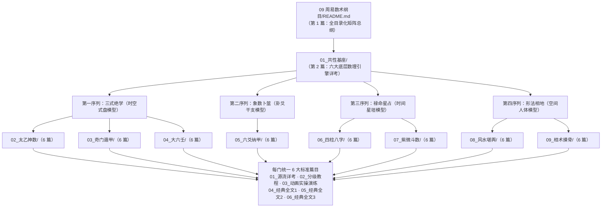

# 09 周易数术纲目

> **模块定位**：与 [`08 周易源流与哲学史/`](../08%20周易源流与哲学史/README.md) 同级的顶级研究主线，聚焦“**术·数·用**”——系统考辨以《周易》阴阳协和为体，以八卦、河图洛书九宫、十二消息、二十四山与五行生克为共性数理基座，向上衍生出的“**三式绝学 → 象数卜筮 → 禄命星占 → 形法相地**”四大序列八大数术体系之历史源流、分级推演教学、动态沙盘演练、传世核心经典全文校注与唯物辩证去魅。  
> **目录化规模**：**1 篇总纲（本文件） + 1 篇共性基座 + 8 大数术门类 × 6 大标准篇目 = 共 50 篇全目录化矩阵**。  
> **价值基准评级**：🟢 **初始暂定 2 级（核心依赖因子：0.3）**，具体专题论文随撰随呈用户主理人终审确权。依据 `01 审议体系/01_标准与规范/文档价值基准应用分级体系.md`，本模块成果受 `02 元研究/`（1 级 0.4）与 `01 审议体系/` 标准法典之向下约束，严守“易理与术数划界”学术红线。

---

## 一、 模块宗旨、学科边界与四维互证关系

### 1.1 为什么设立独立顶级主线 `09 周易数术纲目`
中国古代“易学”在历史演进中分化出两条既交织又异质的脉络：其一为以《周易》经传文本、义理哲学与历代易学思想演进为主线的**“文·道·理”体系**（归属 `02 元研究/`、`03 周易笺注史鉴/`、`08 周易源流与哲学史/`）；其二为在战国至两汉以后，将《周易》奇偶二元与象数概念，同天文历法、干支纪时、式盘测绘、星官占验、堪舆形法深度耦合，从而独立成型为一套具备操作程序与符号代数规则的**“术·数·用”技术体系**。

将数术研究从 `08 周易源流与哲学史` 中独立升格为顶级目录 `09 周易数术纲目/`，并进一步重构为**“总纲 + 共性基座 + 八门六篇（源流详考 / 分级教程 / 动画实操演练 / 三部核心经典全文校录）”**的立体知识工程，旨在实现三大目标：
1. **避免“以术掩理”或“混术于经”**：防止后世技术化的式盘、神煞、纳甲、河洛飞星倒灌污染先秦《周易》古经本义与《03 周易笺注史鉴》的史鉴断辞；
2. **展开“一术一体系”的纵深解剖**：以博士至教授级学术规范，逐门拆解八大数术的历法物理原型、数学算法机制、经典文献真伪与社会历史土壤；
3. **打通“考据—算法—演练—原典”四维闭环**：每一门数术均独立成夹，既提供历史唯物主义源流考辨，又提供 L1→L3 分级教学与 `shushu-anim` 动态排盘演练，并完整校录三部代表性原典文献，彻底消除二手转引之失真。

### 1.2 与既有顶级模块的边界划定与互证关系

| 关联模块 | 核心聚焦 | 与 `09 周易数术纲目/` 的边界划定与互证协议 |
| :--- | :--- | :--- |
| **`01 审议体系/`** | 工程法典与学术红线 | 提供“生生”四判据（存续、发展、恢复、传承）、“四重证据法”强度分层及《学术研究论文撰写格式与期刊级模板规范》；严禁使用《序卦传》《杂卦传》机械相因论调。 |
| **[`02 元研究/`](../02%20元研究/十数概论.md)** | 本体公理与先秦原典底座 | 严格遵照 [`《十数概论》`](../02%20元研究/十数概论.md) 确立的**“易理与术数划界”**原则：黑白点河图洛书图式属宋代图书学后设建构，先天八卦方位图属陈抟—邵雍体系，**绝不倒推为先秦《周易》古经本源**；同时在数术史框架内，客观还原其作为唐宋明清数术通用接口的组装逻辑。 |
| **[`03 周易笺注史鉴/`](../03%20周易笺注史鉴/README.md)** | 64 卦 384 爻定本与史鉴 | `03` 卷严守 1644 年 4 月 25 日史鉴截断线，聚焦经文时位与历史实证；`09` 卷全贯先秦至清代及近现代数术演变，仅作数术技术史与学术史参照，**不以术数吉凶替代 `03` 卷爻辞本义**。 |
| **[`08 周易源流与哲学史/`](../08%20周易源流与哲学史/README.md)** | 文本源流与哲学范式史 | [`01_周易源流编`](../08%20周易源流与哲学史/01_周易源流编/README.md) 提供简帛/石经/图书文献辨伪底座；[`02_周易哲学史编`](../08%20周易源流与哲学史/02_周易哲学史编/02_两汉时期象数易学宇宙图式化与谶纬异化考.md) 提供汉代象数宇宙图式化的思想史背景；`09` 卷则专司追踪象数向实用数术模型的分支外溢。 |

---

## 二、 核心文献三大支柱与四重证据总表

本模块立论紧紧锚定清代官修总汇**《古今图书集成·博物汇编·艺术典》五部**、明初大类书辑佚源**《永乐大典》**、明代道教总藏**《道藏》**三大传世巨帙，并以正史艺文志与出土简帛式盘实物作四重证据交叉校准：

| 证据层级 | 核心文献 / 实物载体 | 精准卷次 / 典籍构成与目录学锚点 | 学术价值与辨伪功用 |
| :--- | :--- | :--- | :--- |
| **第一重证据 （清代集大成官修类书）** | **《古今图书集成·博物汇编·艺术典》** （清康熙末陈梦雷编、雍正四年蒋廷锡校定，共 824 卷） | 严格区分其下属五部： ① **卜筮部**（卷 469–482）：先秦蓍法、京房《易传》、火珠林、黄金策、梅花易数及历代卜筮纪事； ② **星命部**（卷 483–570）：五星七政四余（《果老星宗》）、《十八飞星策天紫微斗数》、子平八字（《渊海子平》《三命通会》）及古今命谱； ③ **相术部**（卷 571–610）：《太清神鉴》《神相全编》《月波洞中记》及面相、骨相、手相、声色纪事； ④ **术数部**（卷 611–650）：太乙（卷 611–620，《太乙金镜式经》等）、奇门遁甲（卷 621–630，《烟波钓叟赋》等）、大六壬（卷 631–650，《六壬大全》《毕法赋》等）及禽演杂占； ⑤ **堪舆部**（卷 651–710）：《黄帝宅经》《葬书》《撼龙经》《疑龙经》《青囊序》《天玉经》《罗经解定》等。 | 迄今保存清以前数术文献最完整之官方类书。须特别注意：**《古今图书集成》将“术数部”与“堪舆部”分列，并无“数术堪舆部”之混称**；全书按“汇考、总论、艺文、纪事、杂录、外编”六目体例编排，便于剥离正统式占与民间演义。 |
| **第一重证据 （明代大类书辑佚源）** | **《永乐大典》** （明永乐年间解缙、姚广孝等奉敕纂修；含残卷及清《四库全书》辑本） | 按《洪武正韵》分韵辑录宋元以前数术古籍：主要散见于**“太”“甲”“遁”“壬”“卜”“易”“命”“星”“相”“地”“葬”“数”**等韵目；清代四库馆臣据此辑出《太乙金镜式经》《遁甲符应经》《灵台秘苑》《太清神鉴》《月波洞中记》《催官篇》《发微论》等珍本。 | 考辨宋元数术原始面貌与明代坊刻伪书改写层累的核心标尺。凡《永乐大典》与宋史艺文志俱未著录而突现于明中叶者（如《紫微斗数全书》），即可作断代铁证。 |
| **第一重证据 （道教经藏文献群）** | **《道藏》** （明正统十年《正统道藏》及万历三十五年《万历续道藏》） | 按“三洞四辅”分类，关键数术文献分布于： ① **洞神部**（方法类/众术类）：《黄帝太乙八门入式诀》《黄帝太乙八门逆顺生死诀》《黄帝授三子玄女经》《太上六壬明鉴符阴经》《黄帝宅经》； ② **洞真部**（本文类/神符类）：《太上玄灵北斗本命延生真经》《南斗六司延寿度人妙经》； ③ **太玄部 / 正一部**：《周易参同契》（纳甲月相）、《抱朴子内篇》（六甲秘祝与闭六戊法）、《上清六甲祈祷秘法》。 | 揭示“道法与数术交涉”的唯一官方总集，尤其是**法奇门（符箓禹步）**、**太乙八门道法化**、**紫微星垣神名原型**及**阳宅二十四路禁忌**的原始文献档案。 |
| **第一重证据 （正史目录学总锚点）** | **《汉书·艺文志·数术略》**及历代正史艺文/经籍志 | 《汉志·数术略》分**天文、历谱、五行、蓍龟、杂占、形法**六大类（190 家，2528 卷）；上承刘歆《七略》，下接《隋书·经籍志·子部五行类》《宋史·艺文志·五行类》《四库全书总目·子部·术数类》。 | 确立中国古代数术门类分化的官方源头，廓清“明堂羲和史卜之职”的唯物制度起源，证伪后世“黄帝、周公、鬼谷子、诸葛亮、陈抟”等层累伪托。 |
| **第二 / 四重证据 （出土简帛与考古实物）** | 战国秦汉简帛《日书》、汉唐式盘与天文仪器 | **1977 安徽阜阳双古堆西汉汝阴侯墓（前 165 年）太乙九宫占盘与六壬式盘**；睡虎地、放马滩、孔家坡、周家台秦汉简《日书》；马王堆帛书《刑德》《五星占》；甘肃武威磨咀子、江苏仪征、朝鲜乐浪王盱墓出土六壬栻盘；曾侯乙墓漆箱二十八宿盖（前 433 年）。 | 实证九宫数阵（二九四、七五三、六一八）、干支纳音、建除十二神、月将天盘、二十四方位在战国秦汉之际的物理实态，彻底破除“宋人始创洛书”与“黄帝亲授式盘”双重偏误。 |

---

## 三、 全模块目录化拓扑与 50 篇完整矩阵总表

### 3.1 四大序列八大门类与“一门六篇”标准架构

### 3.2 总纲与共性基座（第 1–2 篇）

| 编号 | 目录归属 | 文档名称与精确相对链接 | 核心内容定位 | 状态 |
| :---: | :---: | :--- | :--- | :---: |
| **01** | **总纲** | **[`README.md`](README.md)**（本文件） | 模块定位、三大文献支柱、四大序列八门六篇 50 篇全目录化矩阵总导航与学术门禁 | 🟢 已完成 |
| **02** | **01_共性基座** | **[`01_共性基座/01_阴阳八卦河洛九宫十二消息二十四山与五行生克详考.md`](01_共性基座/01_阴阳八卦河洛九宫十二消息二十四山与五行生克详考.md)** | 阴阳奇偶二元态、先后天八卦接口、阜阳汉简九宫与河洛矩阵、十二消息太阳视运动、二十四山 360° 空间离散化、五行生克长生与纳音代数系统 | 🟢 已完成 |

---

### 3.3 第一序列：三式绝学（`02_太乙神数` / `03_奇门遁甲` / `04_大六壬` · 共 18 篇）

| 编号 | 门类子目录 | 篇目分类 | 精确相对链接 | 核心内容与文献锚点 | 状态 |
| :---: | :--- | :--- | :--- | :--- | :---: |
| **03** | **02_太乙神数** | ① 源流详考 | [`02_太乙神数/01_源流详考.md`](02_太乙神数/01_源流详考.md) | 战国《太一生水》至《金镜式经》《景祐福应经》源流；十六神、五元六纪、主客算与木土星周期考 | 🟢 已完成 |
| **04** | **02_太乙神数** | ② 分级教程 | [`02_太乙神数/02_分级教程.md`](02_太乙神数/02_分级教程.md) | L1 九宫十六神筑基 → L2 上元积年/文昌/始击/计神/三基/主客大小将算筹公式 → L3 主客定算/八门/七凶格实战与唯物去魅 | 🟢 已完成 |
| **05** | **02_太乙神数** | ③ 动画演练 | [`02_太乙神数/03_动画实操演练.md`](02_太乙神数/03_动画实操演练.md) | 嵌入 `shushu-anim`（`taiyi`）动态沙盘 + Step 1→7 阳遁第一局完整排盘与主客博弈图文拆解 | 🟢 已完成 |
| **06** | **02_太乙神数** | ④ 经典全文 1 | [`02_太乙神数/04_经典全文1_《太乙金镜式经》.md`](02_太乙神数/04_经典全文1_《太乙金镜式经》.md) | 唐·王希明撰（《四库》《古今图书集成》卷 611–615 校录）：积年、太乙、文昌、始击、大小将、八门、十精及七凶格原文精录与数理还原 | 🟢 已完成 |
| **07** | **02_太乙神数** | ⑤ 经典全文 2 | [`02_太乙神数/05_经典全文2_《景祐太乙福应经》.md`](02_太乙神数/05_经典全文2_《景祐太乙福应经》.md) | 北宋·杨惟德撰：仁宗御制序、三基五福、阳九百六灾厄周期、主客算单双长短和断歌诀原文与宋夏战局考证 | 🟢 已完成 |
| **08** | **02_太乙神数** | ⑥ 经典全文 3 | [`02_太乙神数/06_经典全文3_《黄帝太乙八门入式诀》.md`](02_太乙神数/06_经典全文3_《黄帝太乙八门入式诀》.md) | 明《正统道藏》洞神部众术类核心太乙经典（兼及《太乙淘金歌》）：原文全录、八门耦合机制与道教层累辨析 | 🟢 已完成 |
| **09** | **03_奇门遁甲** | ① 源流详考 | [`03_奇门遁甲/01_源流详考.md`](03_奇门遁甲/01_源流详考.md) | 汉代孤虚与《抱朴子》至《烟波钓叟赋》《符应经》源流；术奇门置闰拆补/转飞盘与法奇门双轨解剖 | 🟢 已完成 |
| **10** | **03_奇门遁甲** | ② 分级教程 | [`03_奇门遁甲/02_分级教程.md`](03_奇门遁甲/02_分级教程.md) | L1 洛书三奇六仪九星八门八神 → L2 二遁七十二局/置闰拆补/转盘五步法 → L3 十干克应/门迫击刑/法奇门禹步与兵学还原 | 🟢 已完成 |
| **11** | **03_奇门遁甲** | ③ 动画演练 | [`03_奇门遁甲/03_动画实操演练.md`](03_奇门遁甲/03_动画实操演练.md) | 嵌入 `shushu-anim`（`qimen`）四盘旋转沙盘 + Step 1→7 阳遁一局（甲子戊旬·丙寅时）完整演练 | 🟢 已完成 |
| **12** | **03_奇门遁甲** | ④ 经典全文 1 | [`03_奇门遁甲/04_经典全文1_《烟波钓叟赋》.md`](03_奇门遁甲/04_经典全文1_《烟波钓叟赋》.md) | 100% 完整收录《烟波钓叟赋》全文（“阴阳顺逆妙难穷”至篇末），附池本理古注要点、排盘公式对照与军事沙盘解构 | 🟢 已完成 |
| **13** | **03_奇门遁甲** | ⑤ 经典全文 2 | [`03_奇门遁甲/05_经典全文2_《景祐遁甲符应经》.md`](03_奇门遁甲/05_经典全文2_《景祐遁甲符应经》.md) | 北宋·杨惟德撰（《四库》《永乐大典》《集成》校录）：遁甲总序、三奇六仪、星门九宫与十干加临克应原文全录 | 🟢 已完成 |
| **14** | **03_奇门遁甲** | ⑥ 经典全文 3 | [`03_奇门遁甲/06_经典全文3_《抱朴子内篇·登涉六甲秘祝》.md`](03_奇门遁甲/06_经典全文3_《抱朴子内篇·登涉六甲秘祝》.md) | 东晋·葛洪《抱朴子·登涉》及《道藏·上清六甲祈祷秘法》选篇：九字祝、禹步、闭六戊原文全录与社会心理学评析 | 🟢 已完成 |
| **15** | **04_大六壬** | ① 源流详考 | [`04_大六壬/01_源流详考.md`](04_大六壬/01_源流详考.md) | 汉唐栻盘考古、《心镜》《断案》《指南》源流、月将加时与《梦溪笔谈》天文考辨 | 🟡 目录迁移待建 |
| **16** | **04_大六壬** | ② 分级教程 | [`04_大六壬/02_分级教程.md`](04_大六壬/02_分级教程.md) | L1 天地盘十二将神 → L2 日干寄宫四课与九宗门发三传 → L3 十二天将贵人顺逆与类神断法 | 🟡 目录迁移待建 |
| **17** | **04_大六壬** | ③ 动画演练 | [`04_大六壬/03_动画实操演练.md`](04_大六壬/03_动画实操演练.md) | `shushu-anim` 大六壬天地盘四课三传动态沙盘与分步演练 | 🟡 目录迁移待建 |
| **18** | **04_大六壬** | ④ 经典全文 1 | [`04_大六壬/04_经典全文1_《大六壬毕法赋》.md`](04_大六壬/04_经典全文1_《大六壬毕法赋》.md) | 宋·凌福之撰《大六壬毕法赋》百句全文校注与课体结构解析 | 🟡 目录迁移待建 |
| **19** | **04_大六壬** | ⑤ 经典全文 2 | [`04_大六壬/05_经典全文2_《大六壬指南》.md`](04_大六壬/05_经典全文2_《大六壬指南》.md) | 明·陈公献《大六壬指南》（指掌赋、会心赋及占验选录）全文校注 | 🟡 目录迁移待建 |
| **20** | **04_大六壬** | ⑥ 经典全文 3 | [`04_大六壬/06_经典全文3_《邵彦和大六壬断案》.md`](04_大六壬/06_经典全文3_《邵彦和大六壬断案》.md) | 北宋·邵彦和《大六壬断案》（《四库全书》/《集成》本）核心断例全文与逻辑还原 | 🟡 目录迁移待建 |

---

### 3.4 第二序列：象数卜筮（`05_六爻纳甲` · 共 6 篇）

| 编号 | 门类子目录 | 篇目分类 | 精确相对链接 | 核心内容与文献锚点 | 状态 |
| :---: | :--- | :--- | :--- | :--- | :---: |
| **21** | **05_六爻纳甲** | ① 源流详考 | [`05_六爻纳甲/01_源流详考.md`](05_六爻纳甲/01_源流详考.md) | 《京氏易传》至《火珠林》《增删卜易》《卜筮正宗》源流；“文王课”伪托辨正与以钱代蓍概率分布 | 🟡 目录迁移待建 |
| **22** | **05_六爻纳甲** | ② 分级教程 | [`05_六爻纳甲/02_分级教程.md`](05_六爻纳甲/02_分级教程.md) | L1 八宫卦序世应与纳甲装卦 → L2 浑天六亲、六神与月建日辰旺衰 → L3 动变生克、伏神空破与用神断法 | 🟡 目录迁移待建 |
| **23** | **05_六爻纳甲** | ③ 动画演练 | [`05_六爻纳甲/03_动画实操演练.md`](05_六爻纳甲/03_动画实操演练.md) | `shushu-anim` 六爻纳甲装卦排盘与生克动态沙盘演练 | 🟡 目录迁移待建 |
| **24** | **05_六爻纳甲** | ④ 经典全文 1 | [`05_六爻纳甲/04_经典全文1_《京氏易传·八宫纳甲篇》.md`](05_六爻纳甲/04_经典全文1_《京氏易传·八宫纳甲篇》.md) | 西汉·京房《京氏易传》核心八宫世应飞伏与纳甲条文校录 | 🟡 目录迁移待建 |
| **25** | **05_六爻纳甲** | ⑤ 经典全文 2 | [`05_六爻纳甲/05_经典全文2_《火珠林》.md`](05_六爻纳甲/05_经典全文2_《火珠林》.md) | 宋代托名麻衣道者《火珠林》（《古今图书集成·卜筮部》校录）核心全文校注 | 🟡 目录迁移待建 |
| **26** | **05_六爻纳甲** | ⑥ 经典全文 3 | [`05_六爻纳甲/06_经典全文3_《黄金策·千金赋》.md`](05_六爻纳甲/06_经典全文3_《黄金策·千金赋》.md) | 明清六爻集大成《黄金策·千金赋》（总断与分项要旨）全文校注 | 🟡 目录迁移待建 |

---

### 3.5 第三序列：禄命星占（`06_四柱八字` / `07_紫微斗数` · 共 12 篇）

| 编号 | 门类子目录 | 篇目分类 | 精确相对链接 | 核心内容与文献锚点 | 状态 |
| :---: | :--- | :--- | :--- | :--- | :---: |
| **27** | **06_四柱八字** | ① 源流详考 | [`06_四柱八字/01_源流详考.md`](06_四柱八字/01_源流详考.md) | 《五行大义》纳音、李虚中三柱至徐子平四柱日干体系跃迁及《三命通会》《子平真诠》源流 | 🟡 目录迁移待建 |
| **28** | **06_四柱八字** | ② 分级教程 | [`06_四柱八字/02_分级教程.md`](06_四柱八字/02_分级教程.md) | L1 四柱排盘、真太阳时与十神 → L2 月令格局、十二长生与刑冲合害 → L3 扶抑调候通关病药与气候人格投射去魅 | 🟡 目录迁移待建 |
| **29** | **06_四柱八字** | ③ 动画演练 | [`06_四柱八字/03_动画实操演练.md`](06_四柱八字/03_动画实操演练.md) | `shushu-anim` 四柱八字排盘与大运流年交互沙盘演练 | 🟡 目录迁移待建 |
| **30** | **06_四柱八字** | ④ 经典全文 1 | [`06_四柱八字/04_经典全文1_《渊海子平·喜忌篇继善篇》.md`](06_四柱八字/04_经典全文1_《渊海子平·喜忌篇继善篇》.md) | 宋元明初《渊海子平》核心纲领《喜忌篇》《继善篇》全文校注 | 🟡 目录迁移待建 |
| **31** | **06_四柱八字** | ⑤ 经典全文 2 | [`06_四柱八字/05_经典全文2_《三命通会·论干支十神总纲》.md`](06_四柱八字/05_经典全文2_《三命通会·论干支十神总纲》.md) | 明·万民英《三命通会》（《四库全书》本）论干支十神及格局总纲选录校注 | 🟡 目录迁移待建 |
| **32** | **06_四柱八字** | ⑥ 经典全文 3 | [`06_四柱八字/06_经典全文3_《滴天髓·通神颂与天干地支篇》.md`](06_四柱八字/06_经典全文3_《滴天髓·通神颂与天干地支篇》.md) | 《滴天髓》通神颂及论天干地支核心原典（附任铁樵注评辨析）全文校注 | 🟡 目录迁移待建 |
| **33** | **07_紫微斗数** | ① 源流详考 | [`07_紫微斗数/01_源流详考.md`](07_紫微斗数/01_源流详考.md) | 黄道十二宫与《道藏》星垣合流、宋代《十八飞星》至明《紫微斗数全书》源流及陈抟辨伪 | 🟡 目录迁移待建 |
| **34** | **07_紫微斗数** | ② 分级教程 | [`07_紫微斗数/02_分级教程.md`](07_紫微斗数/02_分级教程.md) | L1 十二人事宫与安命身宫 → L2 纳音五行局模算安紫微与十四主星 → L3 三方四正与十干四化飞星推演 | 🟡 目录迁移待建 |
| **35** | **07_紫微斗数** | ③ 动画演练 | [`07_紫微斗数/03_动画实操演练.md`](07_紫微斗数/03_动画实操演练.md) | `shushu-anim` 紫微斗数十二宫安星与四化飞星动态沙盘演练 | 🟡 目录迁移待建 |
| **36** | **07_紫微斗数** | ④ 经典全文 1 | [`07_紫微斗数/04_经典全文1_《十八飞星策天紫微斗数》.md`](07_紫微斗数/04_经典全文1_《十八飞星策天紫微斗数》.md) | 《古今图书集成·星命部》卷 495–500 所收宋元过渡形态《十八飞星策天紫微斗数》核心全文校录 | 🟡 目录迁移待建 |
| **37** | **07_紫微斗数** | ⑤ 经典全文 2 | [`07_紫微斗数/05_经典全文2_《紫微斗数全书·太微赋与诸星问答》.md`](07_紫微斗数/05_经典全文2_《紫微斗数全书·太微赋与诸星问答》.md) | 明嘉靖本《紫微斗数全书》核心总赋《太微赋》及诸星问答论全文校注 | 🟡 目录迁移待建 |
| **38** | **07_紫微斗数** | ⑥ 经典全文 3 | [`07_紫微斗数/06_经典全文3_《紫微斗数全书·骨髓赋与女命赋》.md`](07_紫微斗数/06_经典全文3_《紫微斗数全书·骨髓赋与女命赋》.md) | 《紫微斗数全书·骨髓赋》《女命骨髓赋》全文校录及封建性别观唯物批判 | 🟡 目录迁移待建 |

---

### 3.6 第四序列：形法相地（`08_风水堪舆` / `09_相术摸骨` · 共 12 篇）

| 编号 | 门类子目录 | 篇目分类 | 精确相对链接 | 核心内容与文献锚点 | 状态 |
| :---: | :--- | :--- | :--- | :--- | :---: |
| **39** | **08_风水堪舆** | ① 源流详考 | [`08_风水堪舆/01_源流详考.md`](08_风水堪舆/01_源流详考.md) | 先秦相土、郭璞《葬书》、唐末杨筠松赣派至宋闽理气派与清代玄空源流、生态微气候与司马光《葬论》批判 | 🟡 目录迁移待建 |
| **40** | **08_风水堪舆** | ② 分级教程 | [`08_风水堪舆/02_分级教程.md`](08_风水堪舆/02_分级教程.md) | L1 龙穴砂水向峦头与罗盘二十四山三针 → L2 三合双山长生与八宅游年 → L3 三元九运玄空飞星算法与建筑地理去魅 | 🟡 目录迁移待建 |
| **41** | **08_风水堪舆** | ③ 动画演练 | [`08_风水堪舆/03_动画实操演练.md`](08_风水堪舆/03_动画实操演练.md) | `shushu-anim` 风水堪舆二十四山罗盘与玄空飞星动态沙盘演练 | 🟡 目录迁移待建 |
| **42** | **08_风水堪舆** | ④ 经典全文 1 | [`08_风水堪舆/04_经典全文1_《郭璞葬书》.md`](08_风水堪舆/04_经典全文1_《郭璞葬书》.md) | 晋·郭璞（托名）《葬书》（《四库全书》及《古今图书集成·堪舆部》校本）全文校注与“藏风得水”生态学还原 | 🟡 目录迁移待建 |
| **43** | **08_风水堪舆** | ⑤ 经典全文 2 | [`08_风水堪舆/05_经典全文2_《杨筠松青囊奥语与天玉经》.md`](08_风水堪舆/05_经典全文2_《杨筠松青囊奥语与天玉经》.md) | 唐·杨筠松（系）《青囊奥语》《天玉经》全文校录与玄空/三合理气算法解析 | 🟡 目录迁移待建 |
| **44** | **08_风水堪舆** | ⑥ 经典全文 3 | [`08_风水堪舆/06_经典全文3_《道藏黄帝宅经》.md`](08_风水堪舆/06_经典全文3_《道藏黄帝宅经》.md) | 明《正统道藏》洞神部《黄帝宅经》（阳宅二十四路祖本）全文校录与人居环境学解读 | 🟡 目录迁移待建 |
| **45** | **09_相术摸骨** | ① 源流详考 | [`09_相术摸骨/01_源流详考.md`](09_相术摸骨/01_源流详考.md) | 《荀子·非相》辩证扬弃、《汉志》“各征其声”与《太清神鉴》《麻衣相法》源流；“相由心生、行由心导、心行渐积、往来可测”唯物机制、三元条件还原与冷读辨伪 | 🟡 目录迁移待建 |
| **46** | **09_相术摸骨** | ② 分级教程 | [`09_相术摸骨/02_分级教程.md`](09_相术摸骨/02_分级教程.md) | L1 五形形局与三停五岳 → L2 面部十二宫、百岁流年图与气色望诊 → L3 颅面九骨触诊解剖对照与非语言心理学剥离 | 🟡 目录迁移待建 |
| **47** | **09_相术摸骨** | ③ 动画演练 | [`09_相术摸骨/03_动画实操演练.md`](09_相术摸骨/03_动画实操演练.md) | `shushu-anim` 五行形局、面部十二宫及颅面九骨部位动态标注沙盘演练 | 🟡 目录迁移待建 |
| **48** | **09_相术摸骨** | ④ 经典全文 1 | [`09_相术摸骨/04_经典全文1_《太清神鉴·骨相气色篇》.md`](09_相术摸骨/04_经典全文1_《太清神鉴·骨相气色篇》.md) | 《永乐大典》《四库全书》辑宋元《太清神鉴》骨相、气色核心篇章全文校注 | 🟡 目录迁移待建 |
| **49** | **09_相术摸骨** | ⑤ 经典全文 2 | [`09_相术摸骨/05_经典全文2_《麻衣相法·神异赋金锁赋摸骨歌》.md`](09_相术摸骨/05_经典全文2_《麻衣相法·神异赋金锁赋摸骨歌》.md) | 明清传本《麻衣神相》核心《神异赋》《金锁赋》及摸骨总歌全文校注 | 🟡 目录迁移待建 |
| **50** | **09_相术摸骨** | ⑥ 经典全文 3 | [`09_相术摸骨/06_经典全文3_《柳庄相法与冰鉴神骨篇》.md`](09_相术摸骨/06_经典全文3_《柳庄相法与冰鉴神骨篇》.md) | 明·袁忠彻《柳庄相法》精华与清·曾国藩（托名）《冰鉴·神骨篇》全文校注与“察人术”社会学辨析 | 🟡 目录迁移待建 |

---

## 四、 学术研究纪律与质量门禁

1. **期刊级体例与深度规范**：源流详考篇均须遵照 `《学术研究论文撰写格式与期刊级模板规范》` 八大模块撰稿；分级教程、动画演练与经典全文篇亦须严格区分**信史原典、算法公式与唯物批判**，不得虚构经文或编造伪书。
2. **禁止空泛概论**：凡涉及“一术一体系”，必须给出具体的**数学公式/模运算规则、天文历法物理量、古籍原典精确卷次篇目**以及**正史与演义辨伪表**，严禁泛泛而谈。
3. **红线熔断与无工单不言卦**：严禁引用或附会《序卦传》《杂卦传》及“受之以”等机械相因论调；凡文中附带举例涉及具体六十四卦爻辞引证时，严格以 `01 审议体系/04_核心数据库/zhouyi.json` 为文字唯一准绳，不得擅改经文异字或脱离时位乱解。

---

© 2026 徐时言 · 《09 周易数术纲目》 · 徐时言-易经研究 · 采用 CC BY-NC-ND 4.0 许可， 转载请署名并注明来源 https://wole278.github.io/xushiyan-YiJing/ · 禁止商业使用与改编传播 · 商业授权：wole278@hotmail.com / 微信 wole278
